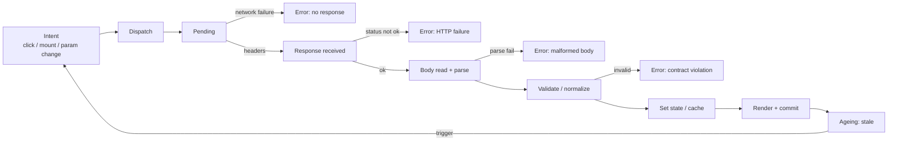
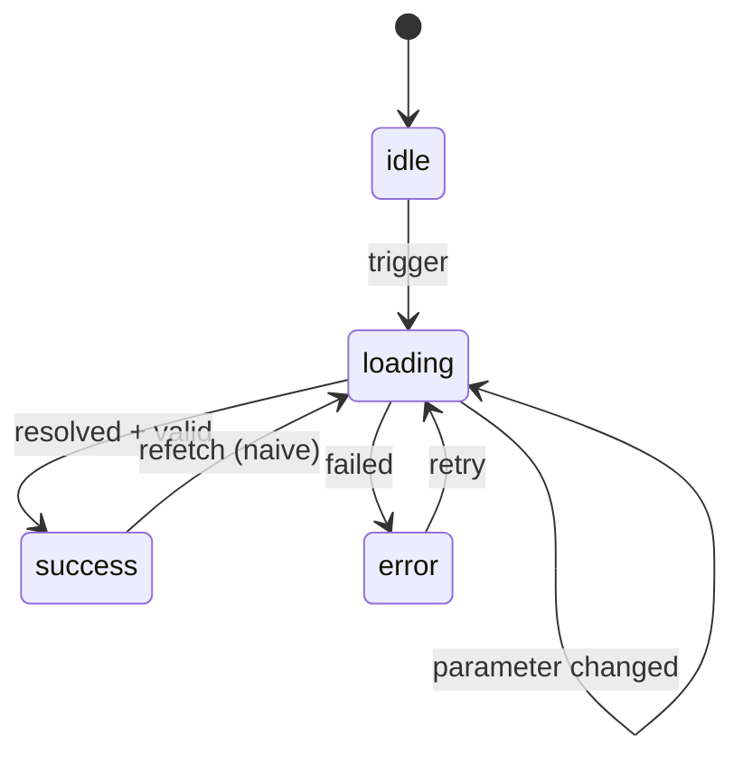
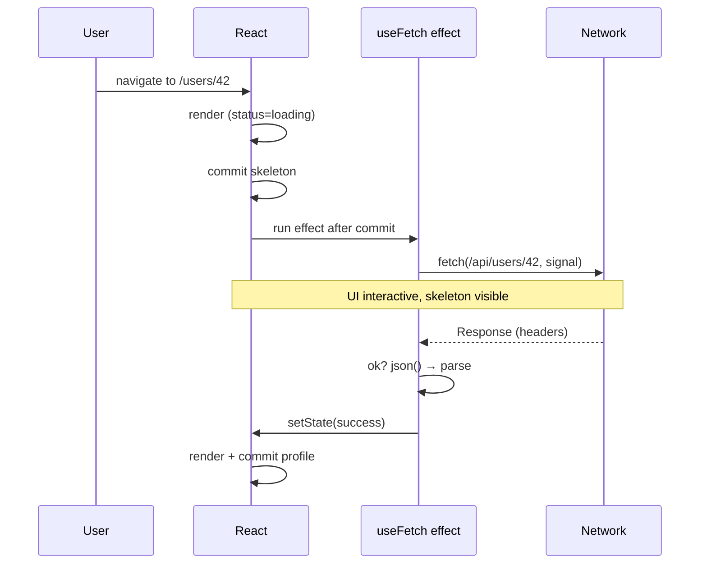
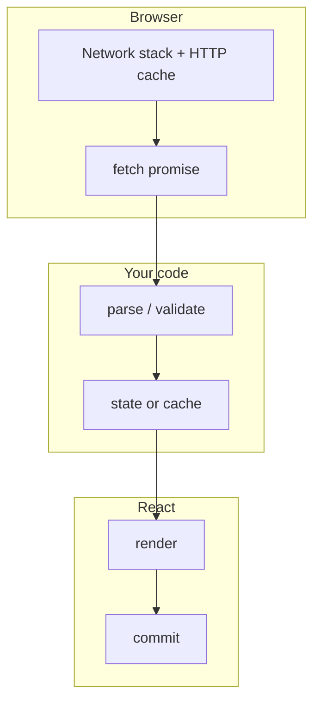

# 06 / 01 — The Fetch Lifecycle: From Trigger to Settled UI

## 1. Lesson metadata

| | |
|---|---|
| **Level** | Intermediate |
| **Study time** | 4–5 hours (reading 2 h, experiments 1 h, exercises 1.5 h) |
| **Prerequisites** | [00 / 12 — Promises and async/await](../00-web-and-javascript-foundations/12-promises-and-async-await.md), [00 / 14 — Web APIs and network requests](../00-web-and-javascript-foundations/14-web-apis-and-network-requests.md), [03 / 04 — `useEffect` and synchronization](../03-react-state-and-hooks/04-useeffect-synchronization.md), [03 / 06 — Effect cleanup](../03-react-state-and-hooks/06-effect-cleanup.md), [03 / 07 — You might not need an effect](../03-react-state-and-hooks/07-you-might-not-need-an-effect.md), [03 / 15 — Custom hooks](../03-react-state-and-hooks/15-custom-hooks.md) |
| **Next** | [02 — Cancellation and race conditions](./02-cancellation-and-race-conditions.md) |
| **Related** | [04 / 16 — Server vs client state](../04-react-architecture/16-server-vs-client-state.md), [07 — Server state management](./07-server-state-management.md), [08 — TanStack Query](./08-tanstack-query.md) |

**Learning objectives.** After this lesson you can:
1. Describe every phase a data request passes through between "something wants data" and "the UI shows a settled result", including the phases React adds (render, commit, effect).
2. Model request state as a discriminated union rather than independent booleans, and explain which impossible states that eliminates.
3. Write a correct fetch-in-effect hook (abort, status handling, validation) and explain precisely what each line protects against.
4. Explain why `fetch` resolving is not the same as the request succeeding, and why `response.json()` returning is not the same as having typed data.
5. Distinguish the four places a fetch can be *triggered* in a React application (event handler, effect, render-time with `use`/Suspense, server) and the trade-offs of each.
6. Predict how React 19 StrictMode in development changes the number of requests, and why this is a feature.
7. Explain which lifecycle responsibilities a hand-written hook leaves unsolved, motivating the rest of Phase 6.

**Concepts covered:** request trigger, pending/settled, fetch resolution vs HTTP success, parse and validation boundaries, status as a state machine, discriminated unions, stale data across parameter changes, effect-based fetching, event-driven fetching, render-time fetching (`use`), StrictMode double mount, unmount, duplicated requests, what a fetch hook does *not* do.

---

## 2. Deep conceptual explanation

### 2.1 What problem is this lesson solving?

Almost every real React application is a *view over data that lives somewhere else*. That data arrives asynchronously, may fail, may arrive out of order, may be stale by the time it is shown, and is owned by someone else (a server). React's rendering model, by contrast, is synchronous and pure: a component function takes props and state and returns elements, immediately (see [01 / 03 — UI as a function of state](../01-react-fundamentals/03-ui-as-a-function-of-state.md) and [02 / 12 — Why rendering must be pure](../02-react-rendering-and-internals/12-why-rendering-must-be-pure.md)).

The whole of Phase 6 is about bridging those two worlds. This first lesson names the *phases of the bridge*. If you cannot draw the lifecycle of one request, you cannot reason about its race conditions (lesson 02), its loading and error presentation (lesson 03), or what a caching library is actually caching (lessons 06–08).

### 2.2 The lifecycle, from first principles

A request is not a function call that returns a value. It is a **process with a beginning, a duration, and an outcome that arrives later**. Strip away React and the process is:

1. **Intent.** Something decides data is needed (a user clicked, a component mounted, a parameter changed, a timer fired, a socket message arrived).
2. **Dispatch.** A request is sent. From this point the browser's network stack owns the work (see [00 / 14 §3.1](../00-web-and-javascript-foundations/14-web-apis-and-network-requests.md)). JavaScript only holds a promise.
3. **Pending.** Time passes. The user may keep interacting. The inputs that caused the request may change.
4. **Response headers arrive.** `fetch` resolves with a `Response`. The body may still be streaming.
5. **Body read and parse.** `response.json()` (or `.text()`, `.blob()`) resolves.
6. **Validation / normalization.** The parsed value is `unknown` in the strict sense. It is turned into a trustworthy domain value (or rejected).
7. **Commit to state.** The result is stored where React can see it (component state, an external store, a cache).
8. **Render and commit.** React renders with the new data and commits to the DOM.
9. **Staleness.** The data begins aging the moment it was produced on the server. At some later point something decides it is too old and the cycle restarts at step 1.

Steps 1–7 are the *request lifecycle*. Step 8 is React's contribution. Step 9 is what separates a toy from a product, and it is the origin of caching, invalidation, and refetching (lessons 06 and 07).



### 2.3 The four failure points, and why `fetch` hides the middle two

`fetch` resolves its promise when response *headers* arrive. It rejects only for network-level failures (DNS, connection refused, CORS blocked, aborted). A `404`, `500`, or `401` response **resolves**. This is the single most common source of silent bugs for beginners: `await fetch(url)` followed by `.json()` on an HTML error page throws a confusing `SyntaxError` far from the real cause. The explicit check is `response.ok` (status in `200–299`) and it is *your* job.

The second hidden step is that a successful `response.json()` gives you `any` in TypeScript's lib typings. Casting it (`as User`) is a lie the compiler cannot detect. The data came from a different program, deployed on a different schedule, possibly by a different team. Treat the network boundary like user input: **parse, don't cast**. We return to this properly in [04 — API normalization](./04-api-normalization.md).

| Failure | Where it surfaces | `fetch` rejects? | Typical cause |
|---|---|---|---|
| Transport | `await fetch()` throws `TypeError` | Yes | Offline, DNS, CORS, TLS, blocked by extension |
| Abort | `await fetch()` / body read throws `AbortError` (`DOMException`) | Yes | You (or React cleanup) called `abort()` |
| HTTP status | `response.ok === false` | **No** | 4xx / 5xx |
| Malformed body | `response.json()` throws `SyntaxError` | Yes (on the body promise) | HTML error page, truncated response, wrong content type |
| Contract violation | Your validator throws / returns failure | n/a | Server changed shape, null where you expected a string |

Each row needs different UI and different retry policy ([15 — Error recovery and retries](./15-error-recovery-and-retries.md)). An application that collapses them into one `catch { setError(true) }` cannot distinguish "you are offline" from "this product does not exist" from "our API is broken".

### 2.4 Status is a state machine, not a bag of booleans

The classic beginner shape is:

```ts
const [data, setData] = useState<User | null>(null);
const [loading, setLoading] = useState(false);
const [error, setError] = useState<Error | null>(null);
```

Eight combinations of (data present?, loading?, error?) exist; only a few are meaningful. What does `{ data: user, loading: true, error: Error }` mean? Perhaps "we have old data, are retrying, and the last attempt failed" — a legitimate state in a cache-based design — but in a naive hook it is almost always an *accident*, a stale `error` that nobody cleared.

The remedy is the same one used throughout this curriculum for impossible states (see [03 / 03 — `useReducer`](../03-react-state-and-hooks/03-usereducer-and-reducer-architecture.md) and [00 / 18 — TypeScript narrowing](../00-web-and-javascript-foundations/18-typescript-fundamentals-and-narrowing.md)): a **discriminated union** with exactly one `status` tag.

```ts
type AsyncState<T> =
  | { status: 'idle' }
  | { status: 'loading' }
  | { status: 'success'; data: T }
  | { status: 'error'; error: Error };
```



The naive union above forces every refetch through `loading` and therefore *discards* previously shown data (the UI flashes a spinner where content was). Production data layers separate two orthogonal axes:

- **Data axis:** do we have data, and is it fresh? (`pending` = no data yet, `success` = have data, `error` = no data and last attempt failed.)
- **Activity axis:** is a request in flight right now? (`fetching` vs `idle`.)

TanStack Query's `status` (`pending | error | success`) and `fetchStatus` (`fetching | paused | idle`) are exactly this split (these names are v5; confirmed against `@tanstack/react-query` 5.104: a fresh observer reports `status: 'pending'`, `fetchStatus: 'idle'` until it fetches, and a disabled query stays `pending`/`idle`). A background refetch has `status: 'success'` and `fetchStatus: 'fetching'`. We will use that distinction in [03 — Loading and error states](./03-loading-and-error-states.md); for now, remember that *"loading" is two different things*: "I have nothing to show yet" and "I am working on something".

### 2.5 Where can a fetch be triggered in React?

React does not have a data-fetching primitive of its own for client-side requests (React 19 adds `use` for *reading* a promise during render, and Actions for *mutations*, but neither performs the request for you). A request can be started from four places:

| Trigger | Mechanism | Fires when | Good for | Weakness |
|---|---|---|---|---|
| **Event handler** | `onClick`, `onSubmit` | The user does something | Mutations, "load more", search-on-submit | Not for data the screen needs to *exist* |
| **Effect** | `useEffect` | After commit, when dependencies change | Synchronizing a component with a server resource it displays | Starts only after render and commit; waterfalls; double invocation in dev; manual race handling |
| **Render-time / Suspense** | `use(promise)` with a promise created outside render (or by a framework/library) | During render | Declarative reads, streaming, parallel loading | The promise must be *stable across renders*; creating it in render is a bug |
| **Server** | RSC `async` component, loader, route handler | Before HTML is produced | Initial data without client JS | Different mental model; see [14 — Server-side data loading](./14-server-side-data-loading.md) |

The React docs state explicitly that for effect-based fetching there are drawbacks (no server-side execution, waterfalls, no preloading/caching, boilerplate) and recommend using the data-fetching mechanisms of a framework or a library for most application code *(verify the current wording at the "You Might Not Need an Effect" page on react.dev)*. That does **not** mean effect-based fetching is forbidden; it means you must know what you are re-implementing. This lesson implements it by hand, once, correctly, so that you can recognize what libraries are doing for you.

### 2.6 The "request is a function of state" view

The most useful reframing: a component showing a user profile is **synchronizing** with an external resource identified by `userId`. The effect is not "run this code on mount"; it is "whenever `userId` changes, make my local copy consistent with the server's resource for that id, and clean up the previous attempt". That is the exact sentence you should apply from [03 / 04 — `useEffect` and synchronization](../03-react-state-and-hooks/04-useeffect-synchronization.md). It explains why `userId` is a dependency, why a cleanup must exist, and why "fetch on mount" is the wrong mental model (a component whose `userId` changes without remounting needs the whole lifecycle again).

### 2.7 Common misconceptions

| Misconception | Reality |
|---|---|
| "`await fetch()` throws on a 500." | It resolves. Check `response.ok`. |
| "`const user = (await res.json()) as User` makes it a `User`." | It only silences the compiler. Runtime shape is whatever the server sent. |
| "`useEffect` with `[]` is the right place to load data." | It is *a* place; the correct dependency list is derived from what the request reads, not from when you want it to run. |
| "Making `useEffect` `async` is fine." | `useEffect(async () => …)` returns a promise, which React would treat as the cleanup value. Put an async function *inside* the effect. |
| "In StrictMode my request ran twice; React is buggy." | Dev-only deliberate mount → unmount → mount check. A correct effect (with cleanup) tolerates it. |
| "Loading and error booleans are enough." | They permit impossible states and cannot express stale-while-revalidate. |
| "If I put the data in `useState`, I have a cache." | You have a copy owned by one component instance. Unmount and it is gone; a sibling asking for the same data refetches. |
| "Fetching in the event handler avoids all the problems." | It avoids the effect-specific ones, but races, errors and validation still apply. |

---

## 3. Internal mechanics

### 3.1 What `fetch` does and does not give you (public guarantee)

**Public guarantee** (Fetch Standard, MDN): `fetch(input, init)` returns a promise that fulfils with a `Response` once headers are available and rejects on network error or abort. `Response.ok` is `true` for status 200–299. `response.json()` reads the full body and parses it; it rejects on parse failure. A body can be consumed once; `response.clone()` exists for reading it twice.

**Teaching model:** think of `fetch` as "start a download, notify me at headers, notify me again at body completion".

**Implementation detail:** HTTP cache lookups, connection reuse, prioritization, and preload matching happen in the browser's network stack and differ between browsers. Your JS cannot observe them directly except through `PerformanceResourceTiming`. See [00 / 15 — HTTP caching](../00-web-and-javascript-foundations/15-http-caching-and-navigation.md).

### 3.2 What React does around your effect (public guarantee vs teaching model)

**Public guarantee** (react.dev): an effect runs *after* the component's changes are committed to the DOM; its cleanup runs before the effect re-runs (when dependencies changed) and when the component unmounts. In development with `<StrictMode>`, React additionally runs an extra setup+cleanup cycle on mount to help find missing cleanups. React 18 introduced this check and React 19 keeps it. One documented 19 change: when double-rendering in Strict Mode, `useMemo` and `useCallback` reuse the memoized results from the first render during the second render (React 19 upgrade guide). Verified on React 19.3: an effect that starts a request and a cleanup that sets an `ignore` flag yields 2 requests and 1 `setState` under `<StrictMode>` in development.

**Teaching model:** the timeline of an effect-based fetch is `render (with state: loading) → commit → paint (likely) → effect starts request → … → response → setState → render (state: success) → commit`. The first paint almost always shows the loading state, because the request cannot start before commit. That is the origin of the **fetch-on-render waterfall**: if a parent fetches and only then renders a child that fetches, the child's request starts after the parent's response *and* a commit. Two 200 ms requests become 400 ms plus two render passes.

**Implementation detail:** passive effects are typically flushed after paint, but React may flush them earlier (for example before processing a subsequent update, or for discrete events such as clicks, per the scheduler). Do not rely on "after paint"; rely only on "after commit". See [02 / 18 — Effects and their timing](../02-react-rendering-and-internals/18-effects-and-their-timing.md) and [02 / 19](../02-react-rendering-and-internals/19-layout-vs-passive-effects.md).

### 3.3 What `setState` after await means

`setState` calls after an `await` run in a later task/microtask, outside React's event handler. Since React 18, **automatic batching** applies to them as well (see [02 / 22 — Automatic batching](../02-react-rendering-and-internals/22-automatic-batching.md)), so `setData(x); setLoading(false)` produce one render. Two calls to *different* `useState` setters still allow an intermediate inconsistent state *within your own logic* if you split them across awaits. A single discriminated-union state (one `setState`) removes that class of problem structurally.

In React 18+, calling `setState` on an unmounted component no longer logs the old "Can't perform a React state update on an unmounted component" warning; the warning was removed because it was frequently a false alarm. The underlying issue (work done for nobody; stale results written after parameters changed) still exists, and lesson 02 deals with it.

### 3.4 Request identity

A request's *identity* is the tuple of everything that determines the resource: URL, method, relevant headers (for example `Authorization` or `Accept-Language`), and body. Two components that need "user 42" have the same request identity, whether or not they know about each other. A hook that stores results in `useState` makes the *component instance* the owner and cannot exploit this equality. A cache keyed by identity can. Lesson 07 is built on this observation.

---

## 4. Step-by-step execution walkthrough

Scenario: `<UserProfile userId="42" />` mounts, using the hook from §5.2 in a Vite SPA with `<StrictMode>`, in **development**. Assume each request takes 300 ms.

| t (ms) | Event | State after | DOM / network |
|---|---|---|---|
| 0 | First render. Hook's initial state is `{status:'loading'}` | loading | Render returns the skeleton |
| ~5 | Commit | loading | Skeleton in DOM |
| ~5 | Effect setup #1 runs: creates `AbortController` A, calls `fetch('/api/users/42', {signal: A.signal})` | loading | Request #1 in flight |
| ~5 | StrictMode simulated unmount: cleanup #1 runs → `A.abort()` | loading | Request #1 canceled (appears as cancelled/failed in the Network panel) |
| ~5 | StrictMode simulated remount: effect setup #2 creates controller B, calls `fetch` | loading | Request #2 in flight |
| ~305 | Request #2 resolves → `response.ok` → `json()` → validation | — | — |
| ~306 | `setState({status:'success', data})` | success | |
| ~306 | Re-render + commit | success | Profile in DOM |
| later | User navigates away; component unmounts; cleanup runs `abort()` on B (no-op: already complete) | — | — |

Request #1's rejection (`AbortError`) reaches the `catch` block; the hook must **ignore** it (it is not a failure, it is an intentional cancellation). If the hook treated it as an error, it would `setState({status:'error'})`, and then request #2's success would overwrite it — *probably* masking the bug in dev while real-world cancellations (parameter change followed by quick unmount) would surface as spurious error flashes.

In **production** (no StrictMode double invocation), the sequence is the same minus the first fetch/abort pair: one request.

**Predict:** if `userId` changes from `"42"` to `"43"` at t = 100 ms (before the first response), what must the hook do, and what is the worst thing it could do? *(Answer in §5.3–5.4 and in lesson 02.)*

---

## 5. Code examples

### 5.1 Minimal: the raw lifecycle with no React

```ts
// fetch-json.ts
export class HttpError extends Error {
  constructor(
    public readonly status: number,
    public readonly statusText: string,
    public readonly body?: unknown,
  ) {
    super(`HTTP ${status} ${statusText}`);
    this.name = 'HttpError';
  }
}

export async function fetchJson(url: string, signal?: AbortSignal): Promise<unknown> {
  const res = await fetch(url, { signal, headers: { Accept: 'application/json' } });
  if (!res.ok) {
    // Try to read a structured error body, but don't fail if it isn't JSON.
    const body = await res.json().catch(() => undefined);
    throw new HttpError(res.status, res.statusText, body);
  }
  return res.json(); // Promise<any> in lib.dom — we widen to unknown on purpose.
}
```

Line notes:

- `fetchJson` returns `Promise<unknown>`. The widening is deliberate: it forces callers to validate before use.
- `HttpError` carries `status` so callers can branch (`404` vs `500`) instead of string-matching a message.
- `res.json().catch(() => undefined)` avoids a secondary exception hiding the real HTTP failure when an error page is not JSON.
- `signal` is optional so the function is usable outside React.

`Response.json()` is typed as `Promise<any>` in TypeScript's DOM lib; the explicit return type `Promise<unknown>` narrows what leaves this function.

### 5.2 Practical: a correct `useAsync`/`useFetch` hook

```tsx
// use-fetch.ts
import { useEffect, useState } from 'react';
import { fetchJson } from './fetch-json';

export type AsyncState<T> =
  | { status: 'loading' }
  | { status: 'success'; data: T }
  | { status: 'error'; error: Error };

type Parser<T> = (raw: unknown) => T; // throws on invalid input

export function useFetch<T>(url: string, parse: Parser<T>): AsyncState<T> {
  const [state, setState] = useState<AsyncState<T>>({ status: 'loading' });

  useEffect(() => {
    const controller = new AbortController();
    setState({ status: 'loading' });

    fetchJson(url, controller.signal)
      .then((raw) => {
        setState({ status: 'success', data: parse(raw) });
      })
      .catch((err: unknown) => {
        if (controller.signal.aborted) return; // intentional cancel: not an error
        setState({
          status: 'error',
          error: err instanceof Error ? err : new Error(String(err)),
        });
      });

    return () => controller.abort();
  }, [url, parse]);

  return state;
}
```

Usage:

```tsx
// UserProfile.tsx
import { useFetch } from './use-fetch';

interface User { id: string; name: string; email: string }

// Stable reference: defined at module scope, not re-created each render.
function parseUser(raw: unknown): User {
  if (
    typeof raw === 'object' && raw !== null &&
    typeof (raw as Record<string, unknown>).id === 'string' &&
    typeof (raw as Record<string, unknown>).name === 'string' &&
    typeof (raw as Record<string, unknown>).email === 'string'
  ) {
    const r = raw as Record<string, string>;
    return { id: r.id, name: r.name, email: r.email };
  }
  throw new Error('Invalid User payload');
}

export function UserProfile({ userId }: { userId: string }) {
  const state = useFetch(`/api/users/${encodeURIComponent(userId)}`, parseUser);

  switch (state.status) {
    case 'loading': return <p aria-busy="true">Loading…</p>;
    case 'error':   return <p role="alert">Could not load user: {state.error.message}</p>;
    case 'success': return <h1>{state.data.name}</h1>;
  }
}
```

Line-by-line notes:

- **`setState({ status: 'loading' })` inside the effect.** When `url` changes on an already-mounted component, the old `success` data would otherwise remain on screen under a new URL, showing user 42's data for user 43. Resetting to `loading` prevents showing *wrong* data (at the cost of discarding *right-but-old* data; see §7 and lesson 03). On first mount the state is already `loading`, so React bails out of an identical-object update only if the reference is equal — a new object literal is not equal, so this causes one extra render. That is a known minor cost. Alternatives: store state keyed by URL, or reset by giving the component a `key` ([01 / 16 — State preservation and reset](../01-react-fundamentals/16-state-preservation-and-reset.md)).
- **`controller.signal.aborted` check in `catch`.** This distinguishes our own cancellation from a real failure. Checking `err.name === 'AbortError'` also works; checking the signal is more robust because a *different* abort reason may be thrown (the signal's `reason`).
- **`parse` in the dependency array.** `useEffect` dependencies must list every reactive value used inside. If a caller passes an inline arrow function (`useFetch(url, (r) => r as User)`), it changes identity every render → the effect re-runs every render → infinite fetch loop. The doc comment in the hook signature and a module-scope parser are the mitigation. This is the *stale closure / unstable dependency* problem from [03 / 05](../03-react-state-and-hooks/05-effect-dependencies-and-stale-closures.md) in disguise.
- **`switch` with no default.** TypeScript checks exhaustiveness here only if the function's return type is annotated as non-undefined; with `noImplicitReturns` enabled the compiler would flag a missing branch if you added a fourth status. Add an `assertNever` default for explicit protection.
- **`encodeURIComponent`.** Never interpolate raw ids into URLs; a value containing `/` or `?` changes the request.

**Predict:** With `<StrictMode>` in dev, how many requests appear in the Network panel for one mount, and how many `console.log('parse')` calls would a log inside `parseUser` print? *Answer:* Two requests (the first is shown as cancelled), but `parseUser` runs once, because the aborted request's promise chain rejects (or its `.then` never produces a state we keep). Strictly, with a mock server that ignores aborts, the first response's `.then` could still run `parse` before the `catch` path — in a real browser `fetch` rejects on abort, so `.then` does not run. Do not write code that depends on this ordering.

### 5.3 Incorrect: the "three booleans" fetch with five latent bugs

```tsx
function UserProfileBad({ userId }: { userId: string }) {
  const [user, setUser] = useState<any>(null);
  const [loading, setLoading] = useState(false);
  const [error, setError] = useState<string | null>(null);

  useEffect(async () => {                         // (1)
    setLoading(true);
    try {
      const res = await fetch(`/api/users/${userId}`);
      const data = await res.json();               // (2)
      setUser(data);                               // (3)
    } catch (e) {
      setError('failed');                          // (4)
    }
    setLoading(false);
  }, []);                                          // (5)

  if (loading) return <p>Loading…</p>;
  if (error) return <p>{error}</p>;
  return <h1>{user.name}</h1>;                     // (6)
}
```

Predict what happens on first render, on `userId` change, and on a 404. Then compare:

1. **`async` effect function.** Returns a promise instead of a cleanup function; React warns in development and you cannot clean up. TypeScript rejects this signature for `useEffect`.
2. **No `res.ok` check.** A 404 with an HTML or JSON-error body proceeds to `json()`; either it throws (HTML) and sets a generic "failed", or it succeeds and `setUser(errorBody)` — then `user.name` is `undefined`.
3. **Unvalidated data into `any`.** `user` could be anything.
4. **A single generic error string.** Offline, 404, 500, and parse failure are indistinguishable; the UI cannot offer a sensible action.
5. **Empty dependency array.** `userId` is used inside; changing it never refetches (the lint rule `react-hooks/exhaustive-deps` flags this). The component shows user 42 under user 43's page.
6. **First render.** `loading` is initially `false` and `user` is `null`, so the first render evaluates `user.name` and **throws** `TypeError: Cannot read properties of null`. Initial state must represent "nothing yet" *as a status*, not as `null` with an unrelated boolean that flips later.

Also: no cleanup → no cancellation; `error` is never cleared after a later success (a stale `error` takes precedence over fresh `user`); `setLoading(false)` is skipped by an early `return`-style refactor.

### 5.4 Corrected

The corrected version is §5.2. The key repairs, mapped to the numbered defects: (1) async function nested inside the effect (here, promise chaining); (2) `HttpError` on `!res.ok`; (3) `parse` returns a typed value or throws; (4) status union carries the actual `Error`, so UI can branch on `instanceof HttpError`; (5) `[url, parse]` complete dependencies and an abort cleanup; (6) initial status `loading` with the switch rendering `success` only when `data` exists.

### 5.5 Advanced: branching on error kind and exposing `refetch`

```tsx
// use-resource.ts
import { useCallback, useEffect, useReducer, useRef } from 'react';
import { fetchJson, HttpError } from './fetch-json';

export type ResourceState<T> =
  | { status: 'loading' }
  | { status: 'success'; data: T }
  | { status: 'error'; kind: 'offline' | 'not-found' | 'http' | 'parse'; error: Error };

type Action<T> =
  | { type: 'start' }
  | { type: 'resolve'; data: T }
  | { type: 'reject'; error: Error };

function classify(error: Error): Extract<ResourceState<never>, { status: 'error' }>['kind'] {
  if (error instanceof HttpError) return error.status === 404 ? 'not-found' : 'http';
  if (error instanceof TypeError) return 'offline'; // fetch network failures are TypeError
  return 'parse';
}

function reducer<T>(_: ResourceState<T>, action: Action<T>): ResourceState<T> {
  switch (action.type) {
    case 'start': return { status: 'loading' };
    case 'resolve': return { status: 'success', data: action.data };
    case 'reject': return { status: 'error', kind: classify(action.error), error: action.error };
  }
}

export function useResource<T>(url: string, parse: (raw: unknown) => T) {
  const [state, dispatch] = useReducer(
    reducer as (s: ResourceState<T>, a: Action<T>) => ResourceState<T>,
    { status: 'loading' } as ResourceState<T>,
  );
  const [attempt, bump] = useReducer((n: number) => n + 1, 0);

  const parseRef = useRef(parse);
  useEffect(() => { parseRef.current = parse; });   // latest parser, no dependency churn

  useEffect(() => {
    const controller = new AbortController();
    dispatch({ type: 'start' });
    fetchJson(url, controller.signal)
      .then((raw) => dispatch({ type: 'resolve', data: parseRef.current(raw) }))
      .catch((e: unknown) => {
        if (controller.signal.aborted) return;
        dispatch({ type: 'reject', error: e instanceof Error ? e : new Error(String(e)) });
      });
    return () => controller.abort();
  }, [url, attempt]);

  const refetch = useCallback(() => bump(), []);
  return { state, refetch };
}
```

Notes and trade-offs:

- `reducer` is the single place where transitions are defined, so illegal transitions are unrepresentable ([03 / 03](../03-react-state-and-hooks/03-usereducer-and-reducer-architecture.md)).
- Storing `parse` in a ref lets callers pass inline functions without causing refetch loops. Trade-off: the effect no longer *declares* its dependence on `parse`; if a caller changes the parser to mean something different for the same URL, no refetch happens. That is acceptable for a parser (shape of the same resource), not for, say, a filter predicate.
- `TypeError` as "offline" is a heuristic: `fetch` throws `TypeError` for network failures, but other bugs also throw `TypeError`. Treat as a hint, not a proof. A more reliable signal is `navigator.onLine` combined with the error, and still not definitive.
- `attempt` is a manual invalidation counter; `refetch` increments it. This is the poor man's version of `queryClient.invalidateQueries` (lesson 06).
- Updating a ref in an effect (instead of during render) is the conservative pattern; React docs discourage writing refs during render. `useEffectEvent` addresses this use case and is exported by stable `react` 19.2+ (it is exported by the sandbox's React 19.3 and has a react.dev reference page); it still has restrictions (call it only from inside Effects; do not pass it around), so read the reference before depending on it ([03 / 22](../03-react-state-and-hooks/22-modern-hooks-and-apis.md)).

### 5.6 Practical: fetch in an event handler (and why it is simpler)

```tsx
function SearchForm() {
  const [results, setResults] = useState<Product[] | null>(null);
  const [pending, setPending] = useState(false);
  const [error, setError] = useState<Error | null>(null);

  async function onSubmit(e: React.FormEvent<HTMLFormElement>) {
    e.preventDefault();
    const q = new FormData(e.currentTarget).get('q');
    if (typeof q !== 'string' || q.trim() === '') return;
    setPending(true);
    setError(null);
    try {
      const raw = await fetchJson(`/api/search?q=${encodeURIComponent(q)}`);
      setResults(parseProducts(raw));
    } catch (err) {
      setError(err instanceof Error ? err : new Error(String(err)));
    } finally {
      setPending(false);
    }
  }
  /* … render form, results, error … */
}
```

Event-handler fetching has no lifecycle-sync problem for *initiation* (it runs when the user acts, not when state changes), but note what it still lacks: two rapid submits can resolve out of order (lesson 02), and there is still no cancellation on unmount. The booleans here are three independent `useState` calls — acceptable only because the interactions are strictly sequential; the moment you add a "retry" or concurrency, move to the union/reducer form.

### 5.7 Advanced preview: render-time reading with `use`

```tsx
import { Suspense, use } from 'react';

// The promise is created OUTSIDE render and cached by key.
const cache = new Map<string, Promise<User>>();
function loadUser(id: string): Promise<User> {
  let p = cache.get(id);
  if (!p) {
    p = fetchJson(`/api/users/${encodeURIComponent(id)}`).then(parseUser);
    cache.set(id, p);
  }
  return p;
}

function Profile({ id }: { id: string }) {
  const user = use(loadUser(id)); // suspends until resolved; throws on rejection → Error Boundary
  return <h1>{user.name}</h1>;
}

export function Page({ id }: { id: string }) {
  return (
    <Suspense fallback={<p>Loading…</p>}>
      <Profile id={id} />
    </Suspense>
  );
}
```

**Public guarantee** (react.dev `use` reference): `use` reads the value of a promise or context; while the promise is pending the component suspends and the nearest Suspense boundary shows its fallback; a rejected promise propagates to the nearest error boundary. A promise created *during render in a Client Component* is re-created on each render, which the docs warn against; they recommend creating the promise in a Server Component and passing it down, or using a library/cache that returns stable promises. The react.dev `use` reference states that "promises passed to `use` must be cached so the same Promise instance is reused across re-renders" and warns "A component was suspended by an uncached promise" otherwise.

The module-level `Map` above has *no* invalidation, no error eviction (a rejected promise would be cached forever!), and no memory bound. It illustrates **why caches are hard** and sets up lesson 06. It also moves the "loading" and "error" states out of your component entirely — see [13 — Suspense data loading](./13-suspense-data-loading.md).

---

## 6. Visual explanations

### Timeline of an effect-based fetch (single component)



### Fetch-on-render waterfall vs parallel

```text
Waterfall (parent fetches, then child mounts and fetches):
  |--render--|-fetch A----------|--render--|-fetch B----------|--render--|
  0                                                                 total ≈ 2×latency + 3 renders

Parallel (both started before render, e.g. route loader / prefetch / hoisted):
  |--render--|-fetch A----------|
             |-fetch B----------|--render--|
                                           total ≈ 1×latency + 2 renders
```

### Who owns what (response lifecycle)



---

## 7. Alternative approaches and trade-offs

The question is not "which is best" but "which responsibilities does my situation require me to own". Compare approaches by the lifecycle responsibilities they cover:

| Approach | Handles pending/error status | Cancellation | Dedup of identical requests | Caching across components | Background refresh | Boilerplate | Bundle cost |
|---|---|---|---|---|---|---|---|
| `fetch` in event handler + `useState` | You | You (if at all) | No | No | No | Low–Med | 0 |
| `useEffect` + `useState` (this lesson) | You | You | No | No | No | Med | 0 |
| `useEffect` + `useReducer` custom hook | You (centralized) | You | No | No | Manual (counter) | Med–High | 0 |
| `use(promise)` + Suspense + your own cache | Suspense / Error Boundary | You | Yes, if you key promises | In your cache | You | Med | 0 |
| Query library (TanStack Query, SWR, RTK Query, Apollo, urql) | Library | Library (signal passed; TanStack Query v5 passes `signal` in the query function context) | Yes | Yes | Yes (configurable) | Low | Non-zero |
| Framework data layer (RSC, loaders) | Framework | Framework | Framework (request-scoped memoization, e.g. React `cache` in Server Components) | Framework (several cache layers; check your framework's docs) | Framework | Low | Server-side |

**When the recommended approach is *not* best.** "Use a query library" is a good default for many applications, but it is the wrong call when: (a) the page makes exactly one request, once, and never revisits it (a one-off marketing widget); (b) you are building a small embeddable script where every kilobyte matters; (c) the data is a *stream* (SSE, WebSocket) not a request/response, so a request cache models it poorly ([17 — Real-time](./17-real-time-websockets-subscriptions.md)); (d) your framework already handles loading/caching on the server and the client only receives props. In case (a) the 25 lines of §5.2 are the right amount of code.

Reset-via-`key` vs reset-in-effect:

| Strategy | How | Pros | Cons |
|---|---|---|---|
| Reset in effect (`setState(loading)`) | §5.2 | Local to the hook | One extra render; the first render after param change still shows *old* data for a frame (state not yet reset) |
| Remount via `key={userId}` | Parent passes `key` | State resets *before* the first render for the new id; removes the stale frame | Destroys other state in that subtree |
| State keyed by request identity | `Map<url, AsyncState>` | Back/forward navigation instantly shows prior data | You are now writing a cache |

---

## 8. Best practices and anti-patterns

**Do**

- Model status as one discriminated union (or the data/activity pair) and render by `switch`.
- Check `response.ok`; produce typed errors; keep `AbortError` out of the error path.
- Parse at the boundary (§5.1, lesson 04); never `as` a network payload into a domain type.
- Derive the effect's dependencies from what the request reads (URL, params, auth identity), not from "when I want it to run".
- Abort in cleanup. Treat the StrictMode double-run as a free test.
- Encode URL parts; include only request-relevant values in the dependency list.
- Keep fetching logic in a hook or module, not interleaved with JSX ([04 / 04 — Presentational vs container](../04-react-architecture/04-presentational-vs-container.md) for the structural idea).

**Anti-patterns**

| Smell | Why it hurts | Fix |
|---|---|---|
| `useEffect(async () => …)` | Returns a promise as cleanup | Inner async function or promise chain |
| `[]` deps while reading props | Stale data after prop change | Complete deps; or reset with `key` |
| Inline function dep (`parse`) | Refetch loop | Module-scope function, `useCallback`, or ref |
| `catch { setError(true) }` | Cannot distinguish failure kinds | Typed errors/classification |
| `data && <X/>` then `loading && <Spinner/>` independently | Impossible states shown simultaneously | Union + `switch` |
| Fetching in render body | Impure render; repeated every render; breaks in StrictMode | Effect, handler, or `use` with a stable promise |
| Disabling StrictMode "to stop double requests" | Hides missing cleanups; production races remain | Fix cleanup |
| Caching "for later" in a module-level `let` | Cross-user data leak in SSR; no invalidation | A real cache with a key/lifetime |

**Justified exceptions.** Fetching in a long-lived singleton (analytics beacon, one-time app config) outside React is fine. A cancellation-less fetch is fine for idempotent, fire-and-forget calls (`navigator.sendBeacon`-style telemetry). Do not present "always abort" as universal: a *mutation* that was already sent cannot be un-sent by aborting the client's wait (lesson 02, §2.5).

---

## 9. Real-world application

| Domain | Lifecycle concern | Engineering constraint |
|---|---|---|
| **E-commerce product page** | Product, price, stock, recommendations are separate requests with different freshness | Parallelize (no waterfalls); price/stock must not be stale at checkout; skeletons must match final layout to avoid layout shift |
| **Dashboard** | Many independent widgets refresh on timers | Per-widget status; one widget's failure must not blank the page; polling must pause when the tab is hidden |
| **Finance** | Balances and transactions | Money values arrive as strings/minor units — parse, don't float ([04](./04-api-normalization.md)); "stale" must be visible (timestamp) |
| **Forms (edit profile)** | Initial load + submit | Loaded values seed the form once (don't let background refetch overwrite typed input); submission is a mutation with its own lifecycle |
| **Auth** | `GET /me` at startup | Everything else depends on it; 401 handling is global, not per-component |
| **Real-time** | Initial snapshot via fetch, then deltas | Request/response lifecycle plus a subscription; ordering between the two matters (snapshot version vs first delta) |
| **Multi-team** | Many teams' components hit the same endpoints | Duplicated requests and inconsistent loading UI — the pressure that leads to a shared data layer |

Constraint that generalizes: on a mid-range phone on a slow network, *time to first meaningful content* is dominated by the fetch waterfall, not by React render time. Count network round-trips before optimizing renders ([07 / 17 — Network waterfalls](../07-performance/17-network-waterfalls.md)).

---

## 10. Debugging and troubleshooting

### Symptom 1 — The profile for the previous user flashes (or stays) after navigating

- **Repro:** Visit `/users/42`, click a link to `/users/43`.
- **Investigation:** In React DevTools, confirm the component is *not* remounting (same instance). Check the effect's dependency array. In the Network panel, check whether a request for 43 was sent at all.
- **Root cause:** Missing dependency (`[]`), or no reset to `loading` when the dependency changed.
- **Fix & validate:** Add `url` to deps; reset or `key`; throttle the network to "Slow 4G" and confirm no stale content flashes.

### Symptom 2 — Two requests on every mount in dev, one in production

- **Investigation:** Look for `<StrictMode>` in `main.tsx`; the first request is cancelled/aborted in the Network panel (Chrome shows `(canceled)`).
- **Root cause:** Intentional development-only check.
- **Fix:** None to the count. Confirm the first is aborted and no error is shown. If the *first* completes and its result is used, your cleanup is broken.

### Symptom 3 — Infinite request loop

- **Investigation:** Network panel shows a request every few ms; in React DevTools Profiler the component re-renders continuously. Check each dependency for identity instability (inline arrays/objects/functions; `new URL(...)` in render).
- **Root cause:** A dependency changes identity every render; the effect sets state; the render creates a new dependency; repeat.
- **Fix:** Stabilize (module scope, `useMemo`/`useCallback`, ref, or depend on primitives like a string URL).

### Symptom 4 — "Unexpected token < in JSON at position 0"

- **Investigation:** Open the failing request in Network → Response. It is HTML (a dev-server fallback, auth redirect, or proxy error page).
- **Root cause:** No `res.ok`/content-type check; proxy or route misconfigured; request redirected to the SPA's `index.html`.
- **Fix:** `HttpError` path; validate `content-type` includes `application/json` if your API guarantees it; fix the proxy.

### Symptom 5 — A request succeeds in Network but the UI shows an error

- **Investigation:** Log the exception in `catch`; put a breakpoint in `parse`.
- **Root cause:** The parse/validation step throws (field renamed, null introduced).
- **Fix:** Fix the contract/normalization; surface *which* field failed in logs; consider tolerant parsing with defaults only where the domain justifies it.

### Symptom 6 — CORS error in the console, no status code visible

- **Investigation:** Network panel shows the request as failed; the console explains the missing header. See [00 / 14 §2.4](../00-web-and-javascript-foundations/14-web-apis-and-network-requests.md).
- **Root cause:** The server did not send `Access-Control-Allow-Origin` (or preflight failed).
- **Fix:** Server config or a dev proxy; *not* client code.

---

## 11. Exercises

### Level A — Knowledge
A1. List the steps of the request lifecycle from intent to staleness. Which steps does React own?
A2. Name the four failure points between dispatch and a validated domain value. Which of them make `fetch` reject?
A3. Why is `response.ok` not checked for you?
A4. What does a discriminated union prevent that three booleans do not?
A5. Why does an `async` function passed to `useEffect` not work as intended?

### Level B — Code comprehension
B1. In §5.2, trace the exact state transitions for: mount with user 42 (success), then prop change to 43 (error 404). Include render counts, assuming no StrictMode.
B2. What does this log, in order?
```tsx
useEffect(() => {
  console.log('setup', id);
  return () => console.log('cleanup', id);
}, [id]);
```
Component mounts with `id=1` under StrictMode (dev), then `id` changes to `2`.
B3. Why can `useFetch(url, (r) => r as User)` loop forever in §5.2? Does the same inline function loop in §5.5?

### Level C — Implementation
C1. Add a `select` option to `useFetch` that transforms the validated data, without introducing a refetch loop when callers pass inline functions.
C2. Extend `AsyncState` so a refetch after success keeps the old data visible: `{ status: 'success'; data: T; refreshing: boolean }`. Update the hook.
C3. Write `fetchJson` so it also rejects with a `ContentTypeError` if the response `content-type` is not JSON.

### Level D — Debugging
D1. A teammate reports "the page shows user 42's name but user 43's avatar for a moment". The hook stores `user` and `avatar` in two `useState`s and sets them in two separate `await`s. Explain the cause and fix.
D2. After deploying, error monitoring shows many `AbortError`s labelled as exceptions. Where in the code is the bug?
D3. The network panel shows `GET /api/users/42` fired twice in production (not dev). List three non-StrictMode causes and how to tell them apart.

### Level E — Architecture decisions
E1. A product page needs product details, reviews, and recommendations. Reviews are only visible after the user scrolls. Propose a trigger strategy for each (effect, handler, observer, server) and discuss waterfalls.
E2. Your team of six has written four slightly different `useFetch` hooks. Decide whether to standardize on a hook in-house or adopt a library. State criteria and what would change your decision.

### Level F — Expert challenge
F1. Design a minimal request-state primitive (not a library) usable by both a "fetch in effect" component and a `use`+Suspense component, sharing one cache with request-identity keys. Specify the data structure, the error-eviction policy, the invalidation API, and what you intentionally leave out. Identify two bugs your design would have if you shipped it unchanged to server rendering.

---

## 12. Detailed answers and explanations

> Attempt the exercises first.

**A1.** Intent → dispatch → pending → headers → body read/parse → validate/normalize → commit to state → render/commit → staleness. React owns *render and commit* (and it schedules effects); everything before is yours/the browser's. Staleness detection is yours unless a library provides it. *Wrong-but-plausible:* "React owns the fetch" — React offers no request API; `use` only reads a promise.

**A2.** Transport (rejects `TypeError`), HTTP status (does **not** reject), malformed body (body promise rejects `SyntaxError`), contract violation (your validator). Abort also rejects with `AbortError` but is an intentional cancellation, not a failure. The common wrong answer is "HTTP errors reject".

**A3.** `fetch` models "the exchange completed". A 404 is a successful exchange with a negative answer; the Fetch standard resolves. (Historical design decision; wrappers like axios chose differently, which is why behavior differs per client.)

**A4.** Impossible combinations: loading with error, success without data, error with stale-but-not-labelled data. With a union, each state carries only the fields valid in it, and TypeScript narrows. Booleans permit eight combinations and require every consumer to remember precedence rules. Edge: stale-while-revalidate legitimately needs data + activity; model that explicitly (C2), do not smuggle it through booleans.

**A5.** An async function returns a promise; React expects `undefined` or a cleanup function. The promise would be interpreted as cleanup (and React warns; TypeScript errors). Fix: define and call an async function inside the effect, or use promise chains.

**B1.** Mount (user 42): render 1 (`loading`), commit; effect sets `loading` again (new object ⇒ re-render; React compares by `Object.is`, new literal is not equal) → render 2 (`loading`); response → render 3 (`success`). Prop change to 43: render 4 occurs with the *props* for 43 but *state still `success` for 42* — a frame with mismatched data (this is the "stale frame" problem); then the effect's cleanup aborts the old controller (completed, no-op), the effect resets `loading` → render 5; 404 → `HttpError` → render 6 (`error`). Total ≈ 6 renders; the mismatched frame at render 4 is committed to the DOM and *may* paint. This is why the `key` strategy or keyed state is preferable when mismatched frames matter. If you answered 3 renders you missed the effect-driven reset renders. (Exact paint of render 4 depends on scheduling; do not claim it always paints.)

**B2.** Dev StrictMode mount: `setup 1`, `cleanup 1`, `setup 1`. Then id → 2: `cleanup 1`, `setup 2`. Common error: omitting the StrictMode pair or ordering cleanup of the *old* effect after setup of the new one — React runs the old cleanup first.

**B3.** In §5.2 `parse` is in the dependency array; an inline function is a new identity every render, so after each state update the effect re-runs, sets state, re-renders… infinite loop. §5.5 stores `parse` in a ref and omits it from deps, so the same call does not loop; the cost is that parser changes don't trigger refetch.

**C1.** Sketch: keep `parse` and `select` in refs; store `raw`-validated data in state; compute `selected` with `useMemo(() => select(data), [data])` — but `select` as a dep reintroduces instability. Preferred: apply `select` at render time without memoization when cheap: `const selected = state.status === 'success' ? selectRef.current(state.data) : undefined`. Edge: a new object each render if `select` constructs one; consumers that depend on identity (memo, effects) will re-run; mention that libraries solve this with structural sharing (lesson 07).

**C2.** Add action `'refresh'` that maps `success → {…s, refreshing:true}` and leaves other states alone; `'resolve'` sets `refreshing:false`; `'reject'` while refreshing either returns to `success` with an `error` annotation or to `error` — a product decision (show stale data with a toast vs replace the screen). Evaluation: reducer total over all (state, action) pairs; no transition drops data unintentionally.

**C3.**
```ts
export class ContentTypeError extends Error { name = 'ContentTypeError'; }
// inside fetchJson after the ok check:
const ct = res.headers.get('content-type') ?? '';
if (!ct.includes('application/json')) throw new ContentTypeError(`Expected JSON, got "${ct}"`);
```
Edge: `application/problem+json` and `application/vnd.api+json` should be accepted if used; test with a regex such as `/\bjson\b/`.

**D1.** Two sequential awaits each followed by a separate `setX` produce intermediate commits (or at least intermediate state) where one is new and the other old. Automatic batching only merges updates in the *same* synchronous run; across an `await` boundary they are separate. Fix: fetch both, then update once (one state object/union); or derive avatar from `user`.

**D2.** The `catch` handler lacks the `signal.aborted` (or `AbortError`) check, and reports aborts to monitoring. Also check any global `unhandledrejection` reporting. Validate: navigate quickly between pages in staging; error rate for `AbortError` should drop to zero.

**D3.** (1) Two components mount that each request the same URL (no dedup) — check component tree/DevTools; (2) a dependency changes identity once after mount (e.g. a `headers` object created in render, or auth token refresh) — log the dependency values per run; (3) the browser/service worker retries or a preload/prefetch link plus the real fetch — check the Network panel's *Initiator* column and whether one is "prefetch/preload". Also possible: a redirect (`301/302`) shows as two entries.

**E1.** Criteria: needed for first paint? shared across screens? can be parallelized? SEO? Proposal: product details loaded by the route/server so it is available before render (no waterfall); recommendations in an effect or `use` boundary after first paint (non-critical) but *started in parallel*, not after the product response unless they depend on its data; reviews fetched on-demand when an `IntersectionObserver` signals visibility or when the user opens the tab (event-triggered). Discussion of waterfalls: recommendations depending on product category forces a dependency; solve by the server returning the category in the route params or the product endpoint embedding a recommendation seed. Evaluation criteria: identifies dependency vs independence, justifies each trigger, mentions skeleton/layout stability, cancellation on navigation.

**E2.** Criteria: number of distinct needs beyond status (cancel, dedup, cache sharing, invalidation after mutation, retry, pagination, devtools, SSR); team size and onboarding cost; bundle budget; existing framework data layer; who maintains custom code. Decision example: if ≥3 of those needs exist in more than two screens, a library wins because you are already re-implementing it unevenly; if the app is a handful of read-only screens, a single in-house hook with a documented contract is enough. What would change it: moving to a framework with loader-based data; strict bundle limits; need for offline persistence. Avoid answers of the form "TanStack Query is best".

**F1.** Evaluation criteria: keyed entries `{key → {promise, value?, error?, status, updatedAt, subscribers}}`; `use`-compatible stable promise per key; subscribe/`useSyncExternalStore` for effect-style consumers ([03 / 20](../03-react-state-and-hooks/20-usesyncexternalstore-and-external-stores.md)); evict rejected entries (or retain with `error` and a retry policy) so errors are not permanent; invalidation `invalidate(prefix)`; garbage collection by subscriber count + timeout; intentionally omit: persistence, retries, pagination, optimistic updates. SSR bugs: a module-level singleton cache shared across requests leaks one user's data to another; hydration mismatch if the client cache is empty while server HTML was rendered from data (needs dehydrate/hydrate transfer). Other valid bugs: unbounded memory; timestamps from the server vs client clock.

---

## 13. Senior engineer interview questions

1. **"`await fetch('/api/x')` returns 500. What happens and why?"** It resolves with a `Response` whose `ok` is false; `fetch` signals only that the HTTP exchange completed. Rejections are reserved for network-level failure/abort. Therefore every wrapper must convert non-2xx into a typed error, and UI/retry logic depends on that taxonomy.
2. **"Why did your request fire twice in dev?"** StrictMode's deliberate setup–cleanup–setup on mount, which surfaces effects lacking cleanup. A correct effect aborts the first request; production does one. If the second outcome overwrote the first only by luck, the cleanup is broken.
3. **"Explain a fetch-on-render waterfall and how you'd remove it."** Child fetches start only after parent response → render → commit → effect. Remove by hoisting requests (route loaders, prefetch on intent), by running independent requests in parallel, or by letting the server compose the response. The causal chain is: request start requires render of the component that starts it.
4. **"Why model request status as a union?"** To make impossible states unrepresentable and to carry data only where valid; to give exhaustive `switch` checks; and because refetch semantics (data + activity) require an explicit model rather than flag precedence.
5. **"What's wrong with `res.json() as User`?"** It transfers trust from compile time to a runtime boundary the compiler cannot see. API drift becomes a crash far from its cause. Validate/normalize at the edge.
6. **"When would you not use a data-fetching library?"** One-off request, tiny embeddable bundle, streaming data, or when the framework already owns data loading and caching. The criterion is: do I need cache sharing, dedup, invalidation, or retry on multiple screens? If not, the library's concepts cost more than they save.
7. **"A teammate wraps setState-after-await in an `isMounted` ref. Comment."** It suppresses a no-longer-emitted warning rather than addressing the real issue (stale results for outdated parameters); an abort/ignore-by-identity approach fixes both unmount and parameter-change cases.

---

## 14. Further learning resources

| Resource | URL | Covers / why | Level | Study |
|---|---|---|---|---|
| React — Synchronizing with Effects | <https://react.dev/learn/synchronizing-with-effects> | Effects, cleanup, fetching section, StrictMode behavior | Beginner–Int. | "Fetching data" subsection |
| React — You Might Not Need an Effect | <https://react.dev/learn/you-might-not-need-an-effect> | When effect-based fetching is acceptable and its drawbacks | Intermediate | "Fetching data" |
| React — `use` reference | <https://react.dev/reference/react/use> | Reading promises in render, Suspense/error boundary behavior | Intermediate | "Streaming data from server to client" |
| React — `<StrictMode>` | <https://react.dev/reference/react/StrictMode> | Extra setup/cleanup in development | Intermediate | "Fixing bugs found by re-running Effects" |
| MDN — Using the Fetch API | <https://developer.mozilla.org/en-US/docs/Web/API/Fetch_API/Using_Fetch> | `ok`, errors, request/response bodies | Beginner | Checking that the fetch was successful |
| MDN — `AbortController` | <https://developer.mozilla.org/en-US/docs/Web/API/AbortController> | Cancellation primitive | Beginner | Examples |
| Fetch Standard | <https://fetch.spec.whatwg.org/> | Normative behavior of `fetch`, `Response.ok` | Advanced | Fetch method, Response class |
| TanStack Query — Overview | <https://tanstack.com/query/latest/docs/framework/react/overview> *(link checked, HTTP 200, 2026-10-22)* | What a query library takes off your plate | Intermediate | Motivation |
| TypeScript Handbook — Narrowing | <https://www.typescriptlang.org/docs/handbook/2/narrowing.html> | Discriminated unions | Beginner–Int. | Discriminated unions |

URLs in this table were checked for HTTP 200 on 2026-10-22; any still marked *(unverified)* could not be checked automatically (blocked or unreachable). A 200 response does not guarantee the page content still matches the description; if a link has moved, search the site for the quoted title.

---

## 15. Knowledge checkpoint

**You should now understand**
- The nine-step request lifecycle and which steps React owns.
- Why `fetch` resolution, HTTP success, parsed body and validated data are four separate facts.
- Status as a state machine; the data axis vs the activity axis.
- Four trigger locations and what each costs.
- What a hand-written hook leaves unsolved: dedup, shared caching, staleness, background refresh, retries.

**You should be able to explain without notes**
- Why StrictMode makes two requests in dev and what a correct effect does about it.
- How a fetch-on-render waterfall arises.
- Why `[]` dependencies and inline dependency functions both fail, in opposite ways.

**You should be able to implement**
- `fetchJson` with typed errors; a `useFetch`/reducer-based hook with abort; a `use`-based variant with a stable promise cache.

**You should be able to debug**
- Stale data after parameter change, infinite loops, HTML-instead-of-JSON failures, spurious `AbortError` reports.

**Before moving on:** read [02 — Cancellation and race conditions](./02-cancellation-and-race-conditions.md), which shows what happens when the same lifecycle runs *concurrently* with itself.
