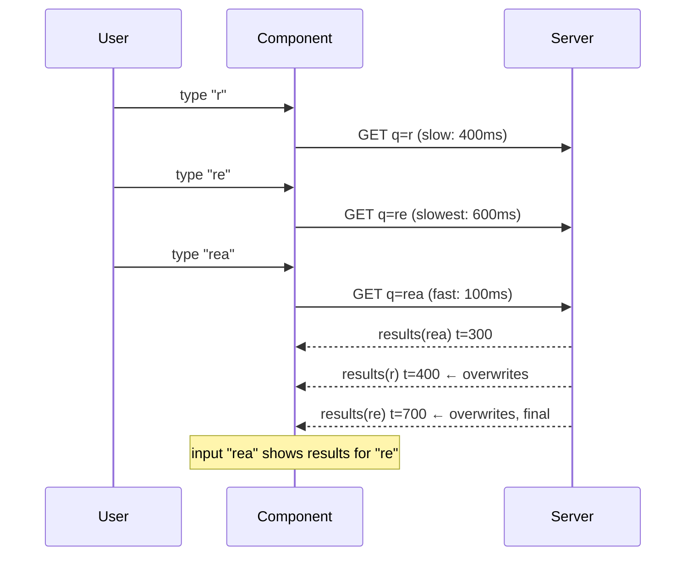
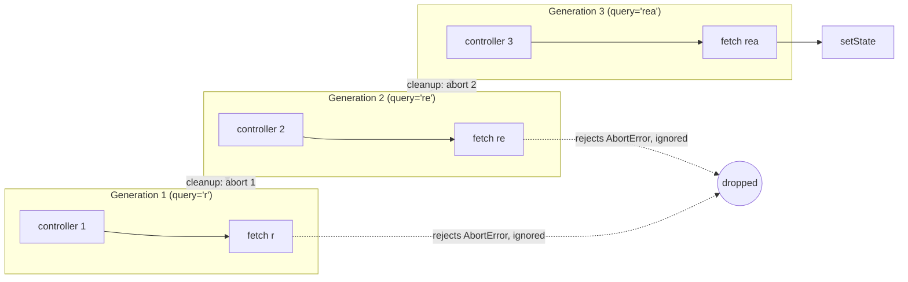
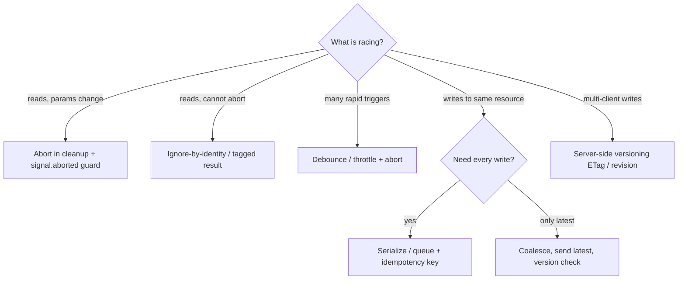

# 06 / 02 — Cancellation and Race Conditions: Making Concurrent Requests Safe

## 1. Lesson metadata

| | |
|---|---|
| **Level** | Intermediate–Advanced |
| **Study time** | 4–5 hours (reading 2 h, experiments 1 h, exercises 1.5 h) |
| **Prerequisites** | [06 / 01 — The fetch lifecycle](./01-fetch-lifecycle.md), [00 / 11 — Event loop, tasks, microtasks](../00-web-and-javascript-foundations/11-event-loop-tasks-microtasks.md), [00 / 12 — Promises and async/await](../00-web-and-javascript-foundations/12-promises-and-async-await.md), [00 / 14 — Web APIs and network requests](../00-web-and-javascript-foundations/14-web-apis-and-network-requests.md), [03 / 05 — Effect dependencies and stale closures](../03-react-state-and-hooks/05-effect-dependencies-and-stale-closures.md), [03 / 06 — Effect cleanup](../03-react-state-and-hooks/06-effect-cleanup.md) |
| **Next** | [03 — Loading and error states](./03-loading-and-error-states.md) |
| **Related** | [02 / 28 — StrictMode behavior](../02-react-rendering-and-internals/28-strict-mode-behavior.md), [02 / 23 — Transitions and deferred rendering](../02-react-rendering-and-internals/23-transitions-and-deferred-rendering.md), [05 — Optimistic updates](./05-optimistic-updates.md), [08 — TanStack Query](./08-tanstack-query.md) |

**Learning objectives.** After this lesson you can:
1. Define a race condition precisely in the context of async UI, and explain why it is a *logic* race even though JavaScript is single-threaded.
2. Identify the three families of async race in React apps: out-of-order responses, stale writes after unmount, and overlapping mutations.
3. Implement three correct defenses (abort, ignore-by-identity / latest-wins, serialization) and state which race each one does and does not solve.
4. Explain what `AbortController` cancels (the client's *interest* in the response, and often the transport) and what it can never cancel (a server-side effect already underway).
5. Design cancellation semantics for reads versus writes, and justify a different policy for each.
6. Read a timeline of overlapping requests and predict the final UI state with and without protection.
7. Compare debouncing, abort, latest-wins, and queueing as tools that solve *different* problems.

**Concepts covered:** race condition vs data race, out-of-order resolution, last-writer-wins at the UI layer, `AbortController` / `AbortSignal`, `AbortError`, abort reason, `AbortSignal.timeout`, ignore flags, request tokens, effect cleanup as cancellation, StrictMode as a race detector, debouncing vs cancellation, mutation cancellation limits, idempotency keys, serialization / queueing, transitions and Actions ordering, library-level cancellation.

---

## 2. Deep conceptual explanation

### 2.1 The problem: a promise is not a turn

JavaScript has no data races in the classic sense: two pieces of your code never execute at the same instant on the same heap (see [00 / 11](../00-web-and-javascript-foundations/11-event-loop-tasks-microtasks.md)). Yet UIs suffer from **race conditions** all the time. The word means: *the correctness of the outcome depends on the relative timing of events that you do not control.* The network is such an event source. If you start request A and then request B, nothing in HTTP, TCP, or `fetch` promises that A's promise settles before B's. Servers have load balancers, caches, cold starts, database locks, and retries; two requests to the same endpoint have different latencies.

The mismatch is this: **you issue requests in order, but the UI cares about the order in which the *user's intent* changed, and responses arrive in the order the network decides.** The code that handles a response usually assumes "the response I am handling is the answer to the most recent question". That assumption is the bug.

### 2.2 Three families of race

| Family | Sequence | Symptom |
|---|---|---|
| **Out-of-order responses** | Request A (old params) sent; request B (new params) sent; B resolves first, then A | UI shows A's data under B's params. The classic "search shows results for the previous keystroke" bug |
| **Stale write after teardown** | Request sent; component unmounts or its owner key changes; response arrives and writes to state/cache | Wasted work, flashing content, writes into a cache entry that is now owned by someone else, errors reported for a screen the user left |
| **Overlapping mutations** | Mutation A (set title "X") sent; mutation B (set title "Y") sent; server processes B then A | The server ends with "X" while the user's last action was "Y"; the client and server silently disagree |

Reads and writes differ fundamentally. For a **read**, an older response is *worthless* — you can discard it with no consequence. For a **write**, an older request may already have been *applied* — discarding the response does not undo it. The rest of the lesson keeps these two apart.

### 2.3 Why `await` makes it feel safe, and why it is not

```ts
async function load(id: string) {
  const res = await fetch(`/api/items/${id}`);
  setItem(await res.json());   // "obviously this is the item for id"
}
```

Inside `load`, `id` is a closure variable that cannot change; it feels like the code is sequentially correct. It is — *per invocation*. The race is **between invocations**: `load('1')` and `load('2')` are two independent suspended coroutines. When each resumes it executes `setItem` without asking "is my `id` still the one the user wants?". Closures preserve *what you asked*; they do not know *what is currently wanted*. That second fact lives in React state, and the continuation must consult it (or be cancelled by whoever changes it).

### 2.4 Two ways to defend a read

1. **Cancel the stale request** (abort). Tell the browser you no longer care. Effects: the network stack may stop the transfer (saving bandwidth and server work, if the server notices), and the promise rejects with `AbortError`, so your continuation never writes.
2. **Ignore the stale response** (identity check). Let the request finish, but at resume time compare a token ("is my request still the latest?") and drop the result if not.

They are complementary. Abort is an *optimization plus a guard*, but it depends on the transport honoring it and on every code path (including `await res.json()` and your own post-processing) respecting the signal. The identity check is a *correctness guard* that holds even if the request cannot be aborted (for instance, a call through a client library that does not accept a signal, or a Promise from a non-fetch source such as a Web Worker or IndexedDB). A robust hook uses abort for the network and an identity guard (often just `signal.aborted`) for state writes.

### 2.5 What cancellation does *not* mean

`controller.abort()` means: *the caller withdraws interest.* It does **not** mean the server undid anything.

- A `GET` aborted midway: the server may keep computing (it may or may not detect the closed connection). Harmless if it is idempotent and side-effect free.
- A `POST /orders` aborted after the bytes were sent: **the order may have been created.** The client has no response, so it does not know. Treating abort as "it did not happen" produces duplicate orders on retry.

Consequences:

- For mutations, "cancel" is a *business decision* (a compensating request, an idempotency key, or simply waiting for the outcome), not a transport feature.
- Never present a spinner-dismissing "Cancel" button on a payment as if it reversed the charge. If you offer cancellation, specify what the server guarantees.
- Retrying a mutation requires **idempotency** (a client-generated idempotency key the server deduplicates — a widely used API convention, e.g. an `Idempotency-Key` header; the exact header is server-defined, *verify against your API's contract*).

### 2.6 Debounce, cancel, latest-wins, queue: four different tools

| Tool | Solves | Does *not* solve |
|---|---|---|
| **Debounce** (delay request until input pauses) | Too many requests; reduces the *frequency* of races | Races still occur whenever two requests overlap (slow server, a pause shorter than latency) |
| **Abort** | Wasted work; stale writes from aborted requests | Responses from requests that cannot be aborted; ordering among non-aborted ones |
| **Latest-wins / identity guard** | Out-of-order display of reads | Wasted bandwidth |
| **Serialization / queue** | Ordering of *writes* (and read-after-write) | Latency: each operation waits for the previous |

A common amateur claim, "I debounced so there are no races", is false: debounce changes *how often* the race is possible, not *whether*.

### 2.7 React-specific angles

- **Effects are the natural cancellation scope.** The effect's cleanup runs exactly when the request's *reason to exist* (its dependencies, or the component) goes away ([03 / 06](../03-react-state-and-hooks/06-effect-cleanup.md)). Abort-in-cleanup is therefore not an add-on; it is the *definition of the effect being a faithful synchronization*.
- **StrictMode is a race detector.** The dev-only setup → cleanup → setup sequence is a miniature "parameter changed immediately" scenario ([02 / 28](../02-react-rendering-and-internals/28-strict-mode-behavior.md)). Effects that survive it have usually handled the "old request resolves after cleanup" case.
- **Event handlers have no cleanup.** A fetch started in `onSubmit` is not tied to any lifecycle, so you must build the scope yourself (a ref holding the current controller or a token).
- **Transitions and Actions.** `useTransition`/Actions let React keep the old UI while a pending async update is in progress (see [02 / 23](../02-react-rendering-and-internals/23-transitions-and-deferred-rendering.md)). They give you a `isPending` and error plumbing; they do **not** automatically cancel your `fetch` and do not (by themselves) guarantee that your *own* async function's `setState` calls are applied in the right order. *Version-sensitive:* the react.dev `useTransition` reference (checked 2026-10-22) says awaited calls in an Action are included in the transition but "currently require wrapping any set functions after the await in an additional `startTransition`". Do not depend on ordering guarantees beyond what the `useTransition` and `useActionState` reference pages state.

### 2.8 Misconceptions

| Misconception | Reality |
|---|---|
| "JS is single-threaded, so there are no race conditions." | No *data* races; plenty of *logical* races across `await`. |
| "Aborting a fetch cancels what the server is doing." | It withdraws the client's interest. Server behavior is up to the server. |
| "An `AbortError` is an error to report." | It is control flow caused by your own cancellation. |
| "The isMounted flag fixes races." | It addresses only unmount, not parameter change; use a per-invocation token or signal. |
| "Debounce fixes races." | It reduces frequency only. |
| "A newer request always returns a newer answer." | Only if the server is consistent and ordered; with read replicas/caches the *older* request can return *newer* data. Ordering of responses is not ordering of truth ([06 — Cache consistency](./06-cache-consistency-and-invalidation.md)). |

---

## 3. Internal mechanics

### 3.1 `AbortController` and `AbortSignal` (public guarantee)

**Public guarantee** (DOM Standard; MDN): an `AbortController` owns an `AbortSignal` (`controller.signal`). Calling `controller.abort(reason?)` sets `signal.aborted = true`, sets `signal.reason` (defaulting to an `AbortError` `DOMException`), and fires an `abort` event on the signal. Passing the signal to `fetch` means that if the signal is aborted before or during the request, the fetch promise rejects with the signal's reason, and an in-progress body read rejects as well. Aborting is idempotent; a controller is single-use (once aborted it stays aborted).

**Teaching model:** the signal is a *one-way broadcast latch*: consumers subscribe or poll; the controller flips it once.

**Implementation detail:** whether bytes already on the wire are discarded, whether the TCP connection is reset or reused, and how quickly the server notices are browser/server specific. The Network panel typically labels the entry as cancelled; the server may still log a completed request.

Useful signal members (MDN browser-compat data, checked 2026-10-22: `reason`/`throwIfAborted` Chrome 98-100, Firefox 97, Safari 15.4; `AbortSignal.timeout` Chrome 124, Firefox 100, Safari 16; `AbortSignal.any` Chrome 116, Firefox 124, Safari 17.4; Node 24 supports all of them):

| API | Purpose |
|---|---|
| `signal.aborted`, `signal.reason` | Poll state / read why |
| `signal.throwIfAborted()` | Throw the reason if aborted — put it after each `await` in non-fetch async code |
| `signal.addEventListener('abort', fn, { once: true })` | React to abort (e.g. cancel a worker task) |
| `AbortSignal.timeout(ms)` | A signal that aborts itself with a `TimeoutError` after `ms` |
| `AbortSignal.any([a, b])` | A signal aborted when any input aborts — combine "component unmounted" with "timeout" |
| `AbortSignal.abort(reason?)` | An already-aborted signal |

`AbortSignal.timeout` and `AbortSignal.any` are more recent than `AbortController` itself (versions above); check them against your browser matrix. Verified in Node 24 by running `fetch` against a local server: a default `abort()` rejects with a `DOMException` named `AbortError` (identical to `signal.reason`), `abort(new Error('x'))` rejects with that custom reason, `AbortSignal.timeout(20)` rejects with a `DOMException` named `TimeoutError`, `AbortSignal.any` propagates the first source's reason, and a body read after `abort()` also rejects with `AbortError`. A distinction to preserve: an `AbortError` means *you aborted*; a `TimeoutError` means the *timeout signal fired* — typically treated as a failure with a retry policy, whereas your own cancellation is ignored.

### 3.2 What the event loop does to your ordering

Each `await` splits a function into a prefix and a continuation scheduled when the awaited promise settles (a microtask after settlement; see [00 / 12](../00-web-and-javascript-foundations/12-promises-and-async-await.md)). Settlement of a fetch promise is triggered by a *networking task* — an independent event source. Two fetches have two independent sources; nothing orders their continuations. The only ordering you get is what you impose with chaining (`await a; await b`), a queue, or tokens.

### 3.3 How React interacts (teaching model vs guarantee)

**Public guarantee** (react.dev): the cleanup function from an effect runs before the next run of that effect (when dependencies changed) and when the component unmounts. Therefore "abort the controller created in this effect run" is guaranteed to execute *before* the next request's effect run starts.

**Teaching model:** each effect run is a *generation*. Everything created in that run (controller, listeners, timers) belongs to that generation; cleanup ends it. A response that arrives belongs to some generation and must check whether it is still current. `controller.signal.aborted` *is* that check, because the controller is generation-scoped.

**Implementation detail:** do not rely on the relative timing of cleanup and the paint of the intermediate render; only on "cleanup before next setup".

### 3.4 Why setState-after-unmount is not the real problem

Since React 18 the "update on an unmounted component" warning no longer appears (see [06 / 01 §3.3](./01-fetch-lifecycle.md)). The real consequence of a stale write is *semantic*: wrong data under new parameters, or a write into shared state (a store, a cache) that now represents something else. In a shared cache the harm is larger than in component state, because a stale write can poison *other* consumers. Libraries tie the write to a **query key** so that a response can only ever write into the entry it was issued for ([07](./07-server-state-management.md), [08](./08-tanstack-query.md)).

---

## 4. Step-by-step execution walkthrough

Scenario: a search box. The user types "r", "re", "rea". Each keystroke triggers a request (no debounce) from an effect depending on `query`. Latencies: `r` → 400 ms, `re` → 600 ms, `rea` → 100 ms. Keystrokes at t = 0, 100, 200 ms.

**Naive hook (no abort, no guard), writes `setResults` on every resolve:**

| t (ms) | Event | Displayed results | Input value |
|---|---|---|---|
| 0 | Type "r"; request R sent (arrives at 400) | (loading) | r |
| 100 | Type "re"; request RE sent (arrives at 700) | (loading) | re |
| 200 | Type "rea"; request REA sent (arrives at 300) | (loading) | rea |
| 300 | REA resolves | results for "rea" | rea |
| 400 | R resolves → `setResults(rResults)` | results for **"r"** | rea |
| 700 | RE resolves → `setResults(reResults)` | results for **"re"** (final!) | rea |

The UI ends showing results for "re" while the input says "rea". Nothing errored. No warning. This is a classic race.

**With abort in cleanup:**

| t | Event |
|---|---|
| 100 | Effect cleanup for "r" runs → R aborted; effect for "re" starts RE |
| 200 | Cleanup for "re" → RE aborted; REA starts |
| 300 | REA resolves → results for "rea" displayed |
| (never) | R and RE reject with `AbortError`; the `catch` sees `signal.aborted` and ignores |

Final UI: correct. The server may still have done the work for R and RE (bandwidth saved only if it noticed).

**Predict:** if the library/client you use cannot abort (say it wraps an XHR without signal support), and you only *ignore* stale results, at what time does the displayed result become final? *Answer:* still correct, but the final stable state is reached at t = 300, and R/RE responses (400/700) arrive and are discarded; the cost is the wasted transfer, not correctness.

**Mutation scenario (why abort is not enough).** User clicks "Save title" with "X", then edits and clicks "Save title" with "Y". Requests PUT-X at t = 0 and PUT-Y at t = 50 ms. Server worker 1 handles PUT-X slowly (lock), worker 2 handles PUT-Y fast. Server order of application: Y then X. Aborting PUT-X at t = 50 on the client does not stop worker 1 from applying X. Final server state: "X". The client believes "Y". Defenses: serialize (do not send Y until X settles), version the resource (`If-Match`/ETag or an incrementing `version` the server checks — a documented HTTP mechanism for optimistic concurrency; *verify your API supports it*), or make updates commutative/last-writer-wins by *client timestamp or revision number* validated on the server.

---

## 5. Code examples

### 5.1 Minimal: the classic out-of-order bug

```tsx
import { useEffect, useState } from 'react';

interface Product { id: string; name: string }

export function SearchBad({ query }: { query: string }) {
  const [results, setResults] = useState<Product[]>([]);

  useEffect(() => {
    fetch(`/api/search?q=${encodeURIComponent(query)}`)
      .then((r) => r.json())
      .then((data: Product[]) => setResults(data));   // writes whichever resolves last
  }, [query]);

  return <ul>{results.map((p) => <li key={p.id}>{p.name}</li>)}</ul>;
}
```

**Predict** the final UI for the §4 timeline before reading on. Answer: results for "re". The defects: no `res.ok` check ([06 / 01](./01-fetch-lifecycle.md)), an `as`-less but unvalidated cast, and — the subject of this lesson — no cancellation or identity check.

### 5.2 Corrected, minimal: ignore flag

```tsx
useEffect(() => {
  let ignore = false;                       // generation-scoped token
  fetch(`/api/search?q=${encodeURIComponent(query)}`)
    .then((r) => r.json())
    .then((data: Product[]) => {
      if (!ignore) setResults(data);
    });
  return () => { ignore = true; };          // cleanup ends this generation
}, [query]);
```

Notes: `ignore` is a closure variable *per effect run*, which is why it distinguishes generations (a single `useRef` boolean would not — see §8). This is the pattern the react.dev docs show in the effects/fetching section (an `ignore` flag set in the cleanup). It guarantees correctness but wastes the transfer.

### 5.3 Practical: abort + guard + typed errors, as a hook

```tsx
// use-search.ts
import { useEffect, useState } from 'react';
import { fetchJson } from './fetch-json'; // from lesson 01 §5.1; accepts an AbortSignal

export type SearchState =
  | { status: 'idle' }
  | { status: 'loading'; query: string }
  | { status: 'success'; query: string; results: Product[] }
  | { status: 'error'; query: string; error: Error };

export function useSearch(query: string): SearchState {
  const [state, setState] = useState<SearchState>({ status: 'idle' });

  useEffect(() => {
    if (query.trim() === '') {
      setState({ status: 'idle' });
      return;
    }
    const controller = new AbortController();
    setState({ status: 'loading', query });

    fetchJson(`/api/search?q=${encodeURIComponent(query)}`, controller.signal)
      .then((raw) => parseProducts(raw))
      .then((results) => {
        if (controller.signal.aborted) return;       // belt and braces
        setState({ status: 'success', query, results });
      })
      .catch((err: unknown) => {
        if (controller.signal.aborted) return;       // our own cancellation: not an error
        setState({
          status: 'error',
          query,
          error: err instanceof Error ? err : new Error(String(err)),
        });
      });

    return () => controller.abort();
  }, [query]);

  return state;
}
```

Line notes:

- **`query` stored inside every non-idle state.** The state names *which question it answers*. A consumer can assert `state.query === inputValue` to avoid presenting stale results as current (a "tagged result" defense that also works without cancellation).
- **Aborted check in `.then`.** `fetch` rejects on abort, so `.then` normally does not run. The check also covers the case where abort happens during `parseProducts` or between the promise settling and the continuation running (the controller can be aborted in a microtask gap). It costs nothing.
- **`query.trim() === ''` branch returns without a cleanup.** Valid: nothing to cancel. Returning `undefined` from one branch and a function from another is allowed by React; with `noImplicitReturns` TypeScript may complain — write `return undefined;` explicitly if your config requires it.
- **Why `idle`.** An empty query has no request; modeling it as `idle` prevents showing a spinner forever.

### 5.4 Practical: cancellation in an event handler (latest-wins with a ref)

Effects give you lifecycle scoping for free; handlers do not. Use a ref to hold "the controller of the current operation".

```tsx
import { useRef, useState } from 'react';

export function useLatestAction<TArg, TResult>(
  run: (arg: TArg, signal: AbortSignal) => Promise<TResult>,
) {
  const controllerRef = useRef<AbortController | null>(null);
  const [state, setState] = useState<
    | { status: 'idle' }
    | { status: 'pending' }
    | { status: 'success'; value: TResult }
    | { status: 'error'; error: Error }
  >({ status: 'idle' });

  async function trigger(arg: TArg) {
    controllerRef.current?.abort();                  // cancel the previous operation
    const controller = new AbortController();
    controllerRef.current = controller;
    setState({ status: 'pending' });
    try {
      const value = await run(arg, controller.signal);
      if (controller.signal.aborted) return;
      setState({ status: 'success', value });
    } catch (e) {
      if (controller.signal.aborted) return;
      setState({ status: 'error', error: e instanceof Error ? e : new Error(String(e)) });
    }
  }

  function cancel() { controllerRef.current?.abort(); }
  return { state, trigger, cancel };
}
```

Missing pieces that you must add in real code: (a) abort on unmount (`useEffect(() => () => controllerRef.current?.abort(), [])`); (b) `cancel()` leaves state at `pending` — decide whether it should return to `idle`. Both are deliberate omissions to keep the core readable. Trade-off: because the controller lives in a ref, abort is *imperative and outside React's render model*; that is acceptable for an external-system concern.

**Why a ref and not state?** The controller is not rendered; storing it in state would trigger renders for nothing and its value would be stale inside already-created closures ([03 / 10 — `useRef`](../03-react-state-and-hooks/10-useref-and-mutable-references.md)).

### 5.5 Incorrect: the "isMounted" ref

```tsx
const mounted = useRef(true);
useEffect(() => () => { mounted.current = false; }, []);

useEffect(() => {
  fetch(`/api/items/${id}`).then(r => r.json()).then((d) => {
    if (mounted.current) setItem(d);   // BUG
  });
}, [id]);
```

**Predict:** `id` changes 1 → 2 → resolve order 2, 1. What is shown? *Answer:* the item for 1, because the component is still mounted. The flag models only one of the two events that end a request's validity. A second defect: in dev under StrictMode, the first effect's cleanup sets `mounted.current = false` and the simulated remount does **not** reset it to `true` (the ref's initial value is not re-run), so the check can wrongly suppress *all* writes in development. (Verify by reasoning: the cleanup runs, the setup `useEffect(() => () => …, [])` has no setup body that sets it back.) Fix: per-run controller or token (§5.3).

### 5.6 Advanced: combine unmount + timeout signals

```ts
export async function fetchWithTimeout(
  url: string,
  userSignal: AbortSignal,
  ms = 8000,
): Promise<unknown> {
  const signal = AbortSignal.any([userSignal, AbortSignal.timeout(ms)]);
  try {
    const res = await fetch(url, { signal });
    if (!res.ok) throw new HttpError(res.status, res.statusText);
    return await res.json();
  } catch (e) {
    // Distinguish: caller cancelled (ignore) vs timeout (a failure we can retry)
    if (userSignal.aborted) throw userSignal.reason;       // propagate as cancellation
    if (e instanceof DOMException && e.name === 'TimeoutError') {
      throw new RequestTimeoutError(url, ms);
    }
    throw e;
  }
}
```

Requires `AbortSignal.any` and `AbortSignal.timeout` (support versions in §3.1). Note the ordering of checks: if the user aborted, the error is *not* a failure no matter what the thrown value looks like. The caller's `catch` still applies the `signal.aborted` guard.

### 5.7 Advanced: serializing mutations with a per-resource queue

```ts
// serial-queue.ts
export function createSerialQueue() {
  let tail: Promise<unknown> = Promise.resolve();
  return function enqueue<T>(task: () => Promise<T>): Promise<T> {
    const run = tail.then(task, task);     // run even if the previous task failed
    tail = run.catch(() => undefined);     // keep the chain alive; callers see their own result
    return run;
  };
}

const saveTitleQueue = createSerialQueue();

export function saveTitle(id: string, title: string) {
  return saveTitleQueue(() =>
    fetch(`/api/docs/${id}`, {
      method: 'PATCH',
      headers: { 'Content-Type': 'application/json' },
      body: JSON.stringify({ title }),
    }).then((r) => { if (!r.ok) throw new Error(`HTTP ${r.status}`); return r.json(); }),
  );
}
```

Line notes: `tail.then(task, task)` runs the next task whether or not the previous one succeeded; `tail = run.catch(...)` ensures a rejection of one task does not break the chain for later callers while each caller still receives its own rejection through `run`. Trade-offs: a queue guarantees *server-side application order for this client*, adds latency, and does nothing about *other clients*; combine with version checks (ETag/`If-Match`) for multi-client safety. A coalescing variant (drop intermediate queued values, keep only the latest pending) is better for rapid edits — "autosave" typically wants *the last value*, not every keystroke.

### 5.8 Library-level cancellation (concept; TanStack Query v5 verified, others per library)

Query libraries accept a function that receives a context including an `AbortSignal`; if you forward it to `fetch`, the library can abort the request when the query becomes unused or is explicitly cancelled. TanStack Query v5 passes `{ signal }` to `queryFn` and provides `queryClient.cancelQueries`. Verified by running `@tanstack/query-core` 5.104: (a) if `queryFn` consumes the signal, `cancelQueries` aborts it (`CancelledError`) and the entry reverts to its previous state (`pending`/`idle` with no data, or the old data if there was some); (b) if `queryFn` *ignores* the signal, `cancelQueries` still reverts the entry and the late result is discarded (state stays `pending`, data `undefined`); (c) when the last observer unsubscribes, a signal-consuming `queryFn` is aborted, but a `queryFn` that ignores the signal runs to completion and its result **is written to the cache** (verified: data `'late'` appeared after unsubscribing). So signal consumption is what enables transport cancellation on unmount; ignoring it does not make the library discard the result of an unobserved query. RTK Query, SWR, Apollo and urql each expose their own mechanisms and defaults; do not assume equivalence.

---

## 6. Visual explanations

### Race timeline (naive)



### Generations and cleanup



### Which tool for which race



---

## 7. Alternative approaches and trade-offs

| Approach | Stops stale display | Saves bandwidth/server work | Handles non-abortable sources | Works for writes | Complexity |
|---|---|---|---|---|---|
| `ignore` flag in effect | Yes | No | Yes | No (does not stop the write) | Very low |
| `AbortController` + `signal.aborted` guard | Yes | Often (transport + server dependent) | Partly (needs signal support) | No | Low |
| Request counter / token in a ref | Yes | No | Yes | No | Low |
| Tagged state (`state.query === input`) | Yes (display-time) | No | Yes | No | Low; shifts burden to consumers |
| Debounce only | No (reduces frequency) | Yes | n/a | n/a | Low |
| Serial queue | n/a | No (adds latency) | Yes | **Yes (ordering)** | Medium |
| Server versioning (ETag, revision) | Yes (server rejects stale) | n/a | Yes | **Yes (multi-client)** | Medium–High, server work |
| Query library | Yes (key-addressed writes) | Yes (if `signal` forwarded) | Yes | Mutations have their own model | Low per call; library cost |
| `useTransition` / Actions | Keeps old UI visible; not a cancellation | No | n/a | Tracks pending | Low; see the `useTransition` caveat on post-`await` updates (§1) |

**When the recommended approach (abort + guard) is *not* best.**

1. **Expensive reads you want to finish anyway.** A report that takes 20 s to compute on the server and is cached server-side: aborting wastes the work the *next* request would have reused. Better: let it finish, store it in a client cache keyed by params, and ignore for display. Cancellation is not a free win when the work is shareable.
2. **Fire-and-forget telemetry or `sendBeacon`** — you *want* the request to outlive the page.
3. **Mutations.** Abort is the wrong tool (§2.5). Use queue + idempotency.
4. **Low-frequency, low-latency interactions.** A single "load details" click that cannot be repeated while pending (button disabled) has no race; adding cancellation machinery is noise.

Disabling the control while pending is the *cheapest* race defense for mutations and one-shot reads, at the cost of responsiveness. It is a legitimate answer; do not dismiss it as "cheating".

---

## 8. Best practices and anti-patterns

**Do**

- Create one `AbortController` **per effect run** inside the effect; abort in cleanup.
- Pass the signal to `fetch` *and* check `signal.aborted` before every state write that follows an `await` or `.then`.
- Treat `AbortError` as control flow: never log it as an error, never show it, never retry it.
- Put the identity of the question into the result state (`query`, `id`) so views can verify they are showing the answer to the current question.
- For writes, decide *ordering policy* explicitly: disable, serialize, coalesce, or version.
- Use idempotency keys for retried creating mutations.
- Test with an artificially slow/inverted-latency mock (§10) — races rarely appear on a fast local server.

**Anti-patterns**

| Smell | Why it hurts | Fix |
|---|---|---|
| Single `useRef` boolean `mounted` | Handles unmount only; wrong across param change; StrictMode pitfalls | Per-run `ignore`/controller |
| Controller created at module or hook-top scope shared across runs | Abort of a previous run aborts the new one, or never aborts | Create inside the effect |
| Aborting then reusing the same controller | Aborted controllers stay aborted; the new request fails instantly | New controller per request |
| Swallowing *all* errors in `catch {}` after an abort check | Hides real failures | Check `signal.aborted` first, then handle everything else |
| "Fixing" duplicated dev requests by removing StrictMode | Hides the race detector | Fix cleanup |
| Using debounce as the only defense | Race remains when latency > debounce interval | Debounce + cancel |
| Aborting a `POST` and retrying blindly | Duplicate side effects | Idempotency key; read-your-write check |
| Setting `loading=false` in `finally` unconditionally | An aborted older request flips off the loading flag of the newer one | Guard with `signal.aborted` inside `finally` too |

The last row is subtle and common:

```tsx
try { /* ... */ } finally { setLoading(false); }   // BUG when an older run finishes after a newer one started
```

**Justified exceptions.** If a hook intentionally lets older requests finish to warm a cache, guard only the *display* write and let the cache write proceed (keyed by params). Do not call this "ignoring races": it is "separating *cache writes* (always valid for their key) from *display selection* (latest only)".

---

## 9. Real-world application

| Domain | Race | Policy and constraint |
|---|---|---|
| **E-commerce search / filters** | Faceted filters change quickly; results out of order | Abort + tagged results; keep previous results visible (transition) while loading to avoid flicker; analytics should count *committed* searches, not aborted ones |
| **Dashboards** | Polling widget fires again before previous poll returns | Skip the tick if one is in flight, or abort the old one; never let two polls stack on a slow backend (it amplifies load) |
| **Finance / payments** | Double-click on "Pay" | Disable immediately, idempotency key per *intent* (generated when the form opens, reused on retry), show unknown-outcome state after a timeout and *query* order status rather than resubmit |
| **Forms with autosave** | Rapid edits issue overlapping PATCHes | Coalesced serial queue; send latest value; include `version`; surface "saving…/saved/conflict" |
| **Auth** | Token refresh racing with multiple 401s | Single-flight refresh: all failing requests await *one* refresh promise; then retry once. A classic shared-promise pattern |
| **Realtime** | Snapshot fetch races with first socket delta | Buffer deltas until the snapshot arrives; apply deltas whose sequence number is newer than the snapshot's ([17 — Real-time](./17-real-time-websockets-subscriptions.md)) |
| **Route navigation** | User navigates twice quickly | Cancel route-level loaders on navigation (router-dependent; React Router and TanStack Router loaders receive an abort `signal`, check your router version); otherwise slow earlier loaders replace newer pages |

Single-flight is worth a snippet because it shows cancellation's cousin — *sharing*:

```ts
let refreshInFlight: Promise<string> | null = null;
export function refreshToken(): Promise<string> {
  refreshInFlight ??= doRefresh().finally(() => { refreshInFlight = null; });
  return refreshInFlight;
}
```

Constraint: in SSR a module-level variable is shared across users — keep this on the client only ([06 / 01 §5.7](./01-fetch-lifecycle.md) made the same warning about caches).

---

## 10. Debugging and troubleshooting

### Symptom 1 — "The list shows the wrong results sometimes"

- **Repro:** DevTools → Network → throttle to "Slow 4G"; or use a mock server that returns *shorter* latency for later requests. Type quickly. In Chrome you can right-click a request → "Block request URL"/use request-blocking and throttle profiles; MSW (Mock Service Worker) handlers with `delay()` per query make the repro deterministic ([08 / 06 — Mocking strategies and MSW](../08-testing-and-quality/06-mocking-strategies-and-msw.md)).
- **Investigation:** In the Network panel sort by "Waterfall"; note response *completion order*. In React DevTools Components tab, inspect the hook state: does it show a `query` that differs from the prop?
- **Root cause:** Missing identity guard / abort.
- **Fix & validate:** Add controller + guard; replay the inverted-latency script; assert final state in an automated test with controlled promises.

### Symptom 2 — "Loading spinner disappears while the new data is still loading"

- **Root cause:** `finally { setLoading(false) }` from an older run (§8).
- **Investigation:** Log `generation id` at start and in `finally`.
- **Fix:** Guard; or better, derive `loading` from the state union rather than a separate boolean.

### Symptom 3 — "Console floods with `AbortError` / Sentry reports DOMException"

- **Root cause:** `catch` treating aborts as failures, or a global `unhandledrejection` listener catching rejections of promises that nobody handles (the `.then` chain after an aborted fetch, if you forgot `.catch`).
- **Fix:** Handle every promise chain; filter `AbortError` in the reporter as a last line of defense, not the first.

### Symptom 4 — "Request is cancelled in Network panel but the UI shows an error"

- **Investigation:** Breakpoint in `catch`; inspect `err.name`. If it is `AbortError` and you show it, you missed the guard. If the error name is `TimeoutError`, it is your timeout — a real failure by design.

### Symptom 5 — "Mutations applied out of order on the server"

- **Investigation:** Server access logs with request IDs and timestamps; the client logs the dispatch order. Compare. If dispatch order ≠ application order, the server is processing concurrently.
- **Root cause:** Concurrent writes without ordering/versioning.
- **Fix:** Serialize on the client for one user; version on the server for multiple.

### Validating a race fix in a test (sketch)

```ts
// Using a controllable deferred for each request
function deferred<T>() {
  let resolve!: (v: T) => void;
  const promise = new Promise<T>((r) => { resolve = r; });
  return { promise, resolve };
}
// 1. Mock fetch to hand out deferreds in call order.
// 2. Render with query "r"; rerender "re"; rerender "rea".
// 3. Resolve the third, then the first, then the second.
// 4. Assert the DOM shows results for "rea" and never for "r" or "re".
```

Deterministic control of resolution order is the only reliable way to test races; real timers make such tests flaky ([08 / 04 — Testing async updates](../08-testing-and-quality/04-testing-async-updates.md)).

---

## 11. Exercises

### Level A — Knowledge
A1. Why can a single-threaded language have race conditions? Give a definition that distinguishes logical from data races.
A2. List the three families of async race in §2.2 with one sentence each.
A3. What does `controller.abort()` cancel? What can it not cancel?
A4. Why is an `AbortError` not an application error?
A5. Why does debouncing not eliminate races?

### Level B — Code comprehension
B1. In §5.2, why must `ignore` be a variable declared *inside* the effect rather than a `useRef` at component level? Walk through the `id: 1 → 2` change.
B2. Given the timeline in §4, with abort-in-cleanup, what does the Network panel show for R and RE? What does the server log (describe possibilities)?
B3. In §5.4, the `trigger` function aborts `controllerRef.current` before creating a new controller. What breaks if the order is reversed (create/assign, then abort `controllerRef.current`)?
B4. What happens in §5.5 under StrictMode in development? Be specific about the `mounted` ref.

### Level C — Implementation
C1. Add debouncing (300 ms) to `useSearch` such that debounce and abort compose correctly. Where does the timer cleanup go?
C2. Implement `usePolling(fn, intervalMs)` that never has two overlapping calls and aborts the in-flight call on unmount.
C3. Implement a **coalescing** serial queue: at most one running task and one pending slot; a new enqueue replaces the pending (not running) task.
C4. Write a `singleFlight(key, fn)` helper that deduplicates concurrent calls with the same key and clears the entry when the promise settles (success *or* failure).

### Level D — Debugging
D1. The product list flashes the previous category's items for ~200 ms after switching categories on a fast network, then corrects itself. There is abort in cleanup. Give two plausible causes and how to tell them apart.
D2. A hook sets `setLoading(false)` in `finally`; users report that spinners vanish early when they click filters rapidly. Explain precisely and fix.
D3. After adding `AbortSignal.timeout(5000)` the error monitor shows spikes of `TimeoutError` on the reports page only. What are the possible root causes and what should the UI do?
D4. Two browser tabs edit the same document; the later save from tab A silently overwrites tab B's changes though both used serial queues. Why, and what is the fix?

### Level E — Architecture decisions
E1. Decide cancellation policy for: (a) typeahead search, (b) "Place order", (c) background token refresh, (d) a 30 s report generation, (e) infinite-scroll page fetch. State for each: abort / ignore / let finish / serialize, with a reason.
E2. Your team debates mandating "all fetches must accept an `AbortSignal`" in the API client. Argue for and against, and propose a rule that survives both.

### Level F — Expert challenge
F1. Design a request layer for a multi-tab collaborative editor that must (i) never display out-of-order reads, (ii) apply local edits in order, (iii) tolerate lost responses (unknown outcome), and (iv) converge when two clients edit concurrently. Specify client queue behavior, server versioning, how unknown outcomes are resolved, and what is *not* guaranteed. Identify the single biggest assumption your design makes about the server.

---

## 12. Detailed answers and explanations

> Attempt the exercises first.

**A1.** A data race is simultaneous unsynchronized access to shared memory by multiple threads. A logical (or "ordering") race is when correctness depends on the relative order of independent events. JS has no simultaneous heap access in one realm, but `await` splits a function into pieces whose resumption order is decided by external events (network). Wrong answer: "JS has no races because it is single-threaded" — it conflates the two kinds.

**A2.** Out-of-order responses (old overtakes new → stale data displayed); stale write after teardown (response writes after the owner ended); overlapping mutations (writes applied in an order other than intended, and not undoable by abort).

**A3.** It cancels the client's interest and (typically) the in-progress transfer; pending `fetch` and body reads reject with the abort reason. It cannot undo server-side effects or guarantee the server stopped working; for non-idempotent requests the outcome is *unknown*. Plausible wrong answer: "aborting a POST makes it as if it never happened".

**A4.** It is thrown *because we asked for it*. Treating it as failure creates spurious error UIs, retries, and noisy monitoring.

**A5.** Debounce delays dispatch until input pauses; if a pause is shorter than latency (or a user types, pauses, types), two requests can still be in flight and arrive out of order. It reduces probability, not possibility.

**B1.** Each effect run creates its own `ignore`, closed over by that run's continuation. On `1 → 2`: cleanup for run 1 sets run 1's `ignore = true`; run 2 creates a fresh `ignore = false`. When response 1 resolves late, it reads run 1's variable (true) and is dropped. A single `useRef` boolean would be shared: cleanup would set it true, then run 2 would need to reset it to false — and then run 1's late response would see `false` and be *accepted*. The closure variable is what makes it per-generation.

**B2.** R and RE appear as cancelled (Chrome shows `(canceled)`) at t = 100 and 200 respectively; REA completes at 300. The server: depending on implementation it may have fully processed R and RE and logged 200 with a failed write to the closed socket (e.g., "client disconnected"), or it may detect the disconnect and stop. Do not claim either as universal.

**B3.** If you assign the new controller to the ref and then abort `controllerRef.current`, you abort the *new* controller; the new request fails instantly (or is ignored), and the old one is never aborted. Always abort the old, then replace.

**B4.** Dev mount: effect 1 (`[]` cleanup registration) runs; StrictMode simulates unmount → cleanup sets `mounted.current = false`; simulated remount re-runs setup, which only re-registers a cleanup — it does not set `mounted.current = true`. So in dev `mounted.current` stays false and `setItem` never runs: the UI appears stuck loading. In production it works, giving a "works in prod, broken in dev" report that is the reverse of what people expect. The fix is to set `mounted.current = true` in setup — but better to remove the pattern.

**C1.** Put the timer inside the effect and clear it in the same cleanup, then start the fetch inside the timeout callback:
```tsx
useEffect(() => {
  if (query.trim() === '') { setState({ status: 'idle' }); return; }
  const controller = new AbortController();
  const t = setTimeout(() => {
    setState({ status: 'loading', query });
    fetchJson(url(query), controller.signal)
      .then(parseProducts)
      .then((results) => { if (!controller.signal.aborted) setState({ status: 'success', query, results }); })
      .catch((e) => { if (!controller.signal.aborted) setState({ status: 'error', query, error: toError(e) }); });
  }, 300);
  return () => { clearTimeout(t); controller.abort(); };
}, [query]);
```
Cleanup does both: clears a not-yet-fired timer and aborts a fired request. Edge: the "loading" state appears only after 300 ms; consider showing a subtle pending indicator immediately or keeping prior results.

**C2.** Skeleton: an effect with a `running` flag in the closure; schedule the next tick with `setTimeout` *after* the previous call settles (not `setInterval`), so calls cannot overlap; cleanup clears the timeout and aborts the controller. Evaluation: no overlapping calls even when `fn` takes longer than `intervalMs`; unmount aborts; `AbortError` ignored; optional pause when `document.hidden` (via the `visibilitychange` event).

**C3.**
```ts
export function createCoalescingQueue() {
  let running = false;
  let pending: (() => Promise<unknown>) | null = null;
  async function drain() {
    if (running) return;
    running = true;
    while (pending) {
      const task = pending; pending = null;
      try { await task(); } catch { /* surface via task's own handlers */ }
    }
    running = false;
  }
  return (task: () => Promise<unknown>) => { pending = task; void drain(); };
}
```
Evaluation: while task 1 runs, enqueue 2, 3, 4 → only 4 runs after 1. Edge: tasks should capture the *latest value* at enqueue; callers need their own promise if they want a result (extension).

**C4.**
```ts
const inFlight = new Map<string, Promise<unknown>>();
export function singleFlight<T>(key: string, fn: () => Promise<T>): Promise<T> {
  const existing = inFlight.get(key) as Promise<T> | undefined;
  if (existing) return existing;
  const p = fn().finally(() => { if (inFlight.get(key) === p) inFlight.delete(key); });
  inFlight.set(key, p);
  return p;
}
```
The identity check in `finally` prevents deleting a newer entry. Clearing on failure matters: caching a rejected promise would make the failure permanent (the same defect called out in lesson 01 §5.7). Note: sharing a promise shares *one* abort scope — if one caller aborts you must not cancel for the others (use reference counting, which is what libraries do).

**D1.** Cause 1: the state is not reset on key change (the old `success` remains for one commit because the effect resets state *after* the render with new props) — see lesson 01 §7 stale frame. Check: React DevTools shows state `success` with old `query` during the first render after the prop change. Fix: tagged state + `state.query !== query` treated as loading, or `key`. Cause 2: a **cache** or `placeholderData`/keep-previous behavior showing the previous data on purpose. Check: a library setting; it's a product decision. Distinguish by whether the old data is intentionally retained and labeled.

**D2.** An older run's `finally` runs after a newer run has set `loading=true`, flipping it to false. Rapid filter clicks make runs overlap. Fix: guard `finally` with `if (!signal.aborted)`, or derive loading from `state.status`. Validate with a deferred-controlled test that resolves the older run last.

**D3.** Root causes: the endpoint genuinely exceeds 5 s (cold start, heavy query); the timeout is too tight for a *report* and was copied from a typeahead; network conditions; server not honoring cancellation so retries stack load. UI: a timeout is not "failed forever" — show "taking longer than expected", offer retry, possibly raise the timeout for that endpoint or switch to an async job + polling pattern. Decide per endpoint, not globally.

**D4.** The queue serializes *this client's* writes only. Tab A's PATCH overwrote B's because the server accepts last-writer-wins. Fix: version/ETag on the resource with `If-Match` (412 on mismatch) or a merge strategy (field-level patches, CRDT/OT for rich text); on conflict, refetch and rebase or ask the user.

**E1.** (a) Typeahead: debounce + abort + tagged result; reads are disposable. (b) Place order: disable control, single in-flight, idempotency key per checkout attempt; abort is *not* offered; on timeout query the order status by key. (c) Token refresh: single-flight shared promise; not abortable by a single caller. (d) 30 s report: let it finish, key the result in cache by params; abort only when no consumer remains and the server work is not shareable; consider an async job. (e) Infinite scroll page: abort on unmount/route change; keep pages already fetched; ignore duplicate triggers for the same cursor. Evaluation: policy follows from *side effects* and *shareability*, not habit.

**E2.** For: uniform ability to cancel, library compatibility, predictable route-change behavior. Against: boilerplate; false sense of safety if signals aren't actually forwarded; mutations/cancellation semantics are different. Surviving rule: "Every *read* function takes an optional trailing `{ signal }`; every effect/query-owned read forwards it; mutation functions never expose cancel without documenting server guarantees; lint/test that signals are forwarded in the fetch wrapper."

**F1.** Criteria for a strong answer: reads — keyed by document and revision, result tagged with revision; discard older revisions; writes — per-document client queue with coalescing, each op carries `baseRevision` and an operation id; server dedupes by op id (idempotency) and either rebases (OT/CRDT) or rejects with 409/412 for client rebase; unknown outcomes — retry with same op id; query by op id/revision after timeout; offline — persistent queue (see [16 — Offline](./16-offline-considerations.md)); not guaranteed: wall-clock ordering across clients, exactly-once delivery of intermediate states, immediate consistency. Biggest assumption: the server provides a total order (monotonic revisions) per document and deduplicates by operation id; without this, no client-only design converges.

---

## 13. Senior engineer interview questions

1. **"Explain a race condition in a React search box and fix it."** Responses can arrive out of order; the continuation writes without checking whether its question is still current. Fix: per-effect-run controller aborted in cleanup, a `signal.aborted` guard on writes, optionally tagged results. Cause–effect: cleanup runs before the next effect; the aborted promise rejects; the guard keeps rejections out of the error state.
2. **"Does aborting a fetch stop the server?"** No; it signals the client's disinterest and may close the connection; server behavior varies. For writes the outcome is unknown, so retries need idempotency keys.
3. **"Why does StrictMode double-run reveal race bugs?"** It runs setup → cleanup → setup, simulating a quick teardown; effects that write after cleanup or mis-handle abort fail visibly in dev.
4. **"How do you order mutations?"** Choose: disable, serialize/coalesce on the client for a single user, and version on the server for multiple clients; abort is not an ordering tool.
5. **"Debounce vs abort?"** Different problems: frequency vs staleness. Use both; neither replaces the other.
6. **"What goes wrong with `finally { setLoading(false) }`?"** Older runs flip the flag for newer ones. Derive loading from a state union tied to the current run or guard by signal.
7. **"When should a long-running read *not* be aborted?"** When its result is expensive and shareable via a cache the next request will hit; abort then wastes work. Decouple cache fill from display selection.
8. **"How do query libraries avoid these bugs structurally?"** They key every write by query key and track observers, so a response can only write into its own entry and unobserved queries can be cancelled; they still rely on you forwarding the signal for transport-level cancellation (verified for TanStack Query v5; verify per library).

---

## 14. Further learning resources

| Resource | URL | Covers / why | Level | Study |
|---|---|---|---|---|
| React — Synchronizing with Effects | <https://react.dev/learn/synchronizing-with-effects> | Cleanup, fetching, StrictMode re-run | Beg–Int | "Fetching data" |
| React — You Might Not Need an Effect | <https://react.dev/learn/you-might-not-need-an-effect> | Ignore-flag pattern and drawbacks of effect fetching | Int | "Fetching data" |
| React — `useTransition` | <https://react.dev/reference/react/useTransition> | Pending state, Action semantics, post-`await` caveat | Int | Caveats |
| MDN — `AbortController` | <https://developer.mozilla.org/en-US/docs/Web/API/AbortController> | Cancellation API | Beg | Examples |
| MDN — `AbortSignal` | <https://developer.mozilla.org/en-US/docs/Web/API/AbortSignal> | `timeout`, `any`, `throwIfAborted`, support tables | Int | Static methods |
| DOM Standard — Aborting ongoing activities | <https://dom.spec.whatwg.org/#aborting-ongoing-activities> | Normative abort semantics | Adv | Whole section |
| MDN — HTTP conditional requests | <https://developer.mozilla.org/en-US/docs/Web/HTTP/Conditional_requests> | `ETag`, `If-Match` for optimistic concurrency | Int | Optimistic locking |
| TanStack Query — Query Cancellation | <https://tanstack.com/query/latest/docs/framework/react/guides/query-cancellation> *(link checked, HTTP 200, 2026-10-22)* | Library-level signal forwarding | Int | Whole page |

URLs in this table were checked for HTTP 200 on 2026-10-22; any still marked *(unverified)* could not be checked automatically (blocked or unreachable). A 200 response does not guarantee the page content still matches the description; if a link has moved, search the site for the quoted title.

---

## 15. Knowledge checkpoint

**You should now understand**
- Why async UI has logical races despite a single thread, and the three families of race.
- What abort does and does not do; why reads and writes need different policies.
- Generation-scoped state: closure tokens, controllers, tagged results.

**You should be able to explain without notes**
- The §4 timeline, with and without abort, and why debounce alone does not fix it.
- Why `finally { setLoading(false) }` is a race bug.
- Why aborting a `POST` leaves an unknown outcome and what to do about it.

**You should be able to implement**
- A search hook with abort + guard; a latest-wins action hook; a serial/coalescing queue; a single-flight helper.

**You should be able to debug**
- Out-of-order display, early-vanishing spinners, `AbortError` noise, out-of-order server writes, and verify fixes with controlled deferreds.

**Before moving on:** read [03 — Loading and error states](./03-loading-and-error-states.md), where "what to show while a request is in flight or has failed" is treated as a product and accessibility problem, not just a boolean.
