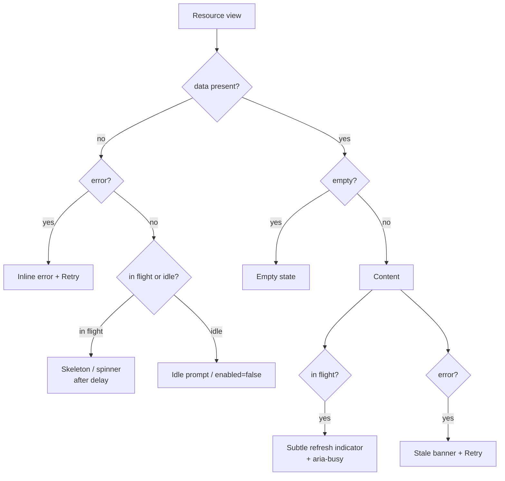
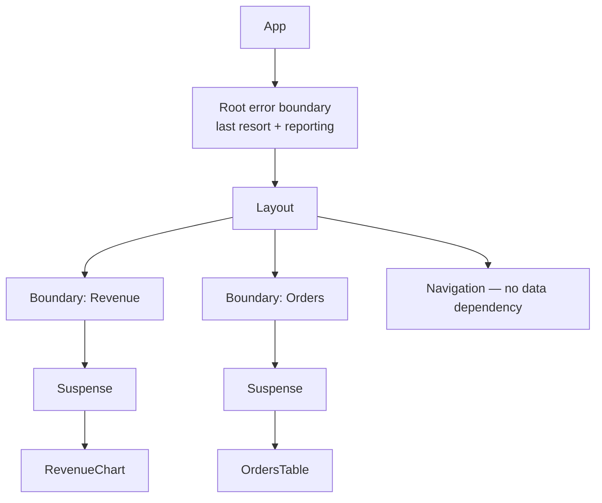

# 06 / 03 — Loading and Error States: Designing What Users See Between Request and Result

## 1. Lesson metadata

| | |
|---|---|
| **Level** | Intermediate |
| **Study time** | 4–5 hours (reading 2 h, experiments 1 h, exercises 1.5 h) |
| **Prerequisites** | [06 / 01 — The fetch lifecycle](./01-fetch-lifecycle.md), [06 / 02 — Cancellation and race conditions](./02-cancellation-and-race-conditions.md), [04 / 19 — Error boundaries](../04-react-architecture/19-error-boundaries.md), [02 / 24 — Suspense conceptual internals](../02-react-rendering-and-internals/24-suspense-conceptual-internals.md), [02 / 23 — Transitions and deferred rendering](../02-react-rendering-and-internals/23-transitions-and-deferred-rendering.md) |
| **Next** | [04 — API normalization](./04-api-normalization.md) |
| **Related** | [13 — Suspense data loading](./13-suspense-data-loading.md), [15 — Error recovery and retries](./15-error-recovery-and-retries.md), [08 — TanStack Query](./08-tanstack-query.md), [08 / 10 — Accessibility testing](../08-testing-and-quality/10-accessibility-testing.md) |

**Learning objectives.** After this lesson you can:
1. Enumerate the distinct *UI situations* a data-bound region can be in (initial loading, refreshing, empty, partial, stale, failed with data, failed without data, offline) and why `loading`/`error` booleans cannot express them.
2. Choose among spinner, skeleton, placeholder data, previous data, and optimistic content for a given interaction, with a justification based on latency, layout, and user expectation.
3. Place Suspense boundaries and error boundaries so that failures and waits are *local*, not page-wide, and state exactly which errors an error boundary does and does not catch.
4. Map the error taxonomy from lesson 01 to concrete UI and recovery actions.
5. Make loading and error states accessible (live regions, focus, `aria-busy`, reduced motion).
6. Avoid layout shift and loading flicker using delays, minimum durations, and reserved space.
7. Compare the *responsibilities* handled by hand-written state, Suspense + error boundaries, Actions/transitions, and query-library status flags.

**Concepts covered:** data axis vs activity axis, initial vs background fetch, empty vs loading, stale-with-error, skeletons vs spinners, delayed spinners, minimum display duration, keep-previous-data, placeholder data, Suspense fallbacks and boundaries, error boundaries and their limits, rethrowing async errors into render, partial failure, error taxonomy to UI, retry affordances, ARIA live regions, focus management, layout stability (CLS), `useTransition`/`isPending`, `useFormStatus`, React 19 root error callbacks.

---

## 2. Deep conceptual explanation

### 2.1 Loading and error are *UI states*, not just request states

Lesson 01 gave you a request state machine. This lesson is about the *presentation* state machine that sits on top of it, and the two are not the same. A request may be "pending" while the UI correctly shows complete, useful content (a background refresh). A request may have "failed" while the UI correctly shows everything that is still valid (stale data plus a banner). The presentation decision is a function of **three questions**:

1. **Do I have anything worth showing?** (data present — fresh or stale; placeholder; previous)
2. **Is work in progress?** (a request is in flight)
3. **Did the last attempt fail, and does that matter for what I show?**

The cross product of those is the real state space. A model with only `loading` and `error` flags has four combinations and cannot even name the interesting ones.

| Have data? | In flight? | Last attempt failed? | UI situation | Typical presentation |
|---|---|---|---|---|
| No | Yes | No | **Initial loading** | Skeleton or spinner in place of content |
| No | No | Yes | **Failed, nothing to show** | Inline error with retry; explain; do not blank the page |
| No | No | No | **Idle / empty-by-design** | "Enter a search term" prompt |
| Yes | No | No | **Settled** | Content |
| Yes | Yes | No | **Refreshing** | Content + subtle activity indicator |
| Yes | No | Yes | **Stale with error** | Content + "couldn't refresh, showing data from 10:42" + retry |
| Yes | Yes | Yes | **Retrying over stale content** | Content + banner + activity indicator |
| Yes, zero rows | No | No | **Empty result** | Empty state (distinct from loading) |

Two things deserve emphasis:

- **"Empty" is a successful result.** A list of zero items must not render a skeleton and must not render an error. A frequent bug is `if (!data.length) return <Spinner />`: after a successful empty result the spinner spins forever.
- **"Loading" is two things** (lesson 01 §2.4): *"I have nothing to show"* (blocking, initial) and *"I am updating what I show"* (non-blocking, background). They deserve different visuals.

### 2.2 What the user is actually experiencing

Perceived performance is nonlinear in latency. The following are widely cited **rules of thumb** from human-computer-interaction research (response-time limits around 0.1 s feels instantaneous, ~1 s keeps flow of thought, ~10 s loses attention). They are heuristics, not specifications — treat the exact numbers as starting points to be validated against your product's analytics:

| Latency | User perception (heuristic) | Design implication |
|---|---|---|
| < ~100 ms | Instantaneous | Any loading UI is *noise* and may cause flicker |
| ~100 ms – ~1 s | Noticeable but flow continues | Show subtle feedback only if the delay persists; avoid layout jumps |
| ~1 s – ~10 s | Attention drifts | Show progress/skeleton; keep prior content if possible |
| > ~10 s | Likely abandonment | Progress with explanation; allow cancel; consider async job pattern |

The practical consequence: **a loading indicator that appears for 80 ms and disappears is worse than none** — it produces a flash that reads as instability. Hence the "delayed spinner" and "minimum display time" techniques in §5.

### 2.3 Skeleton, spinner, placeholder, previous data — different tools

| Technique | What it communicates | Best when | Pitfalls |
|---|---|---|---|
| **Spinner** | "Something is happening", no shape information | Small, unpredictable layouts; button-level actions; short waits | Layout shift when content arrives; no sense of progress |
| **Skeleton** | "Content of *this shape* is coming" | Known layout (cards, tables, profile); initial loads of 300 ms–several s | Mismatched dimensions cause shift; animated shimmer is distracting and must respect reduced motion; too many skeletons on a page = noise |
| **Progress bar** | Quantified progress | Uploads, long jobs where progress is real | Fake progress erodes trust |
| **Previous data kept visible** | Continuity: "the thing you were looking at is updating" | Pagination, filters, tabs (same shape, new parameters) | Must signal staleness (dim, `aria-busy`) — otherwise users act on the wrong data |
| **Placeholder data** | Plausible content immediately (e.g. from a list item for a detail view) | Detail pages reachable from lists | Placeholder looks real; fields missing in the list payload must be visibly absent, not zeros |
| **Optimistic content** | The action already took effect | High-confidence mutations ([05](./05-optimistic-updates.md)) | Must reconcile or roll back on failure |

**Responsibility comparison.** Who decides which of these appears?

| Responsibility | Hand-written hook | Suspense + error boundaries | Transitions / Actions | Query-library flags |
|---|---|---|---|---|
| Know there is no data yet | You (status tag) | React (component suspended) | n/a | `status`/`isPending` (TanStack Query v5) |
| Know a refresh is running over existing data | You (extra axis) | Not expressible by Suspense alone (existing content stays only if the update is a transition) | `isPending` of the transition | `isFetching`/`fetchStatus` (v5) |
| Keep old UI while new loads | You | Only via transitions or `useDeferredValue` | **Yes — the main purpose** | `placeholderData: keepPreviousData` (v5) |
| Place the fallback | Your JSX | `<Suspense>` boundary placement | n/a | Your JSX |
| Catch failure | Your `catch` | Error boundary | Action error handling (an error thrown inside an async transition/Action is rethrown to the nearest error boundary; verified on React 19.3) | `error`/`isError`; optional throw-to-boundary |
| Retry | Your code | Boundary reset callback | Re-trigger | `refetch`; auto-retry policy |

Reading across: **no single mechanism owns the whole table.** Suspense owns "where is the fallback", transitions own "do not replace content with a fallback for updates", error boundaries own "contain a render-time failure", a data library owns "retry and staleness", and *you* own the product decisions (what an empty state says, whether stale data may be acted on).

### 2.4 Suspense and transitions: why "loading" sometimes should not appear

React's Suspense shows the nearest boundary's fallback when a child suspends. If an update (not initial mount) causes content that is *already visible* to suspend, React by default will replace that content with the fallback — unless the update is marked as a **transition**, in which case React keeps the current UI and prepares the new one in the background, exposing a pending flag via `useTransition` ([02 / 23](../02-react-rendering-and-internals/23-transitions-and-deferred-rendering.md), [02 / 24](../02-react-rendering-and-internals/24-suspense-conceptual-internals.md)). Teaching model: *fallbacks are for things that have never been shown; transitions are for things that are changing*. Details such as the reveal throttle (the Suspense reference documents one reveal per 300 ms) and how nested boundaries reveal are documented on react.dev but may be tuned between releases; do not rely on timing.

### 2.5 Error boundaries: what they catch and what they do not

**Public guarantee** (react.dev, `Component.componentDidCatch`/`getDerivedStateFromError` docs): an error boundary catches errors thrown **during rendering**, in lifecycle methods, and in constructors of components *below* it. It does **not** catch:

- errors in **event handlers** (they are not part of rendering — handle with `try/catch`);
- errors in **asynchronous code** such as `setTimeout`, promise callbacks, or the continuation after `await`;
- errors thrown in the boundary component itself;
- errors during server-side rendering (handled by the SSR/streaming API's own error callbacks).

Error boundaries are still **class components** in React 19 (there is no function-component equivalent in React itself; the `react-error-boundary` package (v6 at time of checking) is a widely used wrapper offering `ErrorBoundary` with `fallback`/`fallbackRender`/`FallbackComponent`, `onError`, `onReset`, `resetKeys`, and a `useErrorBoundary()` hook returning `{ showBoundary, resetBoundary }`; checked against its published type definitions on 2026-10-22). That is a legitimate remaining use of a class component; label it as such in a codebase.

Consequence for data fetching: an error in your `fetch().catch(...)` **does not** reach the boundary on its own. Two options:

1. **Keep the error in state and render it** (your component decides what to show) — best for *local, recoverable* errors.
2. **Rethrow into render** — set the error in state and `throw` during render so the nearest boundary handles it: appropriate when the whole subtree is meaningless without the data and you want a consistent boundary UI.

With `use(promise)` and Suspense, a rejected promise is thrown during render and *does* reach the nearest boundary — that is the design point of that API ([13 — Suspense data loading](./13-suspense-data-loading.md)).

React 19 additionally provides root-level callbacks (`onCaughtError`, `onUncaughtError`, `onRecoverableError` options on `createRoot`/`hydrateRoot`) for centralized reporting. Per the react.dev `createRoot` reference, `onCaughtError(error, errorInfo)` and `onRecoverableError(error, errorInfo)` receive an `errorInfo` with `componentStack`; `onCaughtError` was executed in React 19.3 with an `ErrorBoundary` to confirm the signature.

### 2.6 Error taxonomy → UI taxonomy

From lesson 01 §2.3 we have transport, abort, HTTP status, parse, contract failures. Presentation requires more than the transport class — it requires **what the user can do**:

| Error class | Meaning to the user | Primary UI | Recovery | Auto-retry? |
|---|---|---|---|---|
| Offline / transport | "I can't reach the service" | Inline notice; offline banner | Retry; wait for connectivity | Yes, with backoff (idempotent reads) |
| 401 | "Session expired" | Re-auth flow, not an error panel | Sign in again; replay | Once after refresh |
| 403 | "You aren't allowed" | Explain; hide the action | Request access; navigate away | No |
| 404 | "This thing doesn't exist" | Not-found page *or* inline "removed" | Go back; search | No |
| 409 / 412 | "Someone else changed this" | Conflict UI with diff / reload | Reload; merge | No |
| 422 / 400 validation | "Fix your input" | **Field-level** messages, not an error panel | Edit and resubmit | No |
| 429 | "Slow down" | Quiet retry notice | Wait (honour `Retry-After` if provided) | Yes with delay |
| 5xx | "Our fault" | Apologetic inline error, request id for support | Retry | Yes, limited |
| Timeout | "Taking too long" | "Still working…" then offer retry | Retry / cancel | Maybe |
| Parse / contract | "Something's wrong with the data" | Generic failure + log with detail | Retry won't help | No; alert engineers |

Rules: validation errors (4xx with field detail) are **part of a form's normal state**, not exceptions; do not route them to an error boundary. Contract violations are *engineering* errors: show a generic message to the user and the detail to your monitoring ([10 / 05 — Error monitoring](../10-production-engineering/05-error-monitoring.md)).

### 2.7 Accessibility is not optional here

Loading and error content appears *without a navigation event*, so assistive technology users get no cue unless you provide one.

- **Live regions.** Status messages ("Loading results…", "12 results", "Couldn't load") should be announced via `role="status"` (polite) or `role="alert"` (assertive). Rendering a *new* element with `role="alert"` is announced on insertion in most screen readers; for polite updates, the live region element must already exist in the DOM and its *text* changes *behavior varies across AT/browser pairs (not verifiable here); test with real screen readers*.
- **`aria-busy`.** `aria-busy="true"` on a region signals that its content is being updated; assistive tech may defer announcements until it clears. Support varies; use it as a hint, not the only signal.
- **Focus.** When an error replaces content, do not steal focus unprompted; when the user triggered the action (submitting a form), moving focus to the error summary is appropriate. After a retry that succeeds, return focus to a sensible place.
- **Motion.** Respect `prefers-reduced-motion` for shimmer/spinner animations.
- **Color alone.** Errors must not rely only on color; include text and an icon with a text alternative.
- **Spinners need text.** An SVG spinner without an accessible name is invisible to a screen reader.

### 2.8 Layout stability

Content replacing a loading placeholder with different dimensions causes **Cumulative Layout Shift** (a Core Web Vital; see [07 / 21 — Web Vitals and budgets](../07-performance/21-web-vitals-and-budgets.md)). Reserve space: fixed or minimum heights for skeleton blocks that match the final layout; `aspect-ratio` for images; avoid inserting banners above content (put refresh/error banners where inserting them doesn't push the content, or reserve their space).

### 2.9 Misconceptions

| Misconception | Reality |
|---|---|
| "Always show a spinner while loading." | Spinners for sub-100 ms waits flash; for known layouts skeletons are better; for refreshes keep content. |
| "An error boundary catches my failed fetch." | Only if the error is thrown during render. A `catch` callback is outside rendering. |
| "Empty array means still loading." | Empty is a success state. |
| "One global error boundary is enough." | A page-wide fallback for one widget's failure is a bad outcome; boundary granularity is a design decision. |
| "On error, clear the data." | Often the *best* UI is stale data plus an error notice. |
| "Skeletons are always better than spinners." | Mismatched skeletons shift layout; for tiny regions or unknown shapes a spinner is fine. |
| "`isLoading` is `true` for any request in flight." | Libraries distinguish initial from background; the flag's meaning is library-specific (TanStack Query v5: `isLoading` = `isFetching && isPending`; `isInitialLoading` is deprecated). |

---

## 3. Internal mechanics

### 3.1 How Suspense chooses what to show (public guarantee vs implementation)

**Public guarantee** (react.dev `Suspense` reference): when a component below a `<Suspense>` boundary suspends (for example by reading an unresolved promise with `use`, or via a Suspense-enabled framework/library), the closest boundary above it displays its `fallback` until the promise resolves. During an update, if already-revealed content would suspend, React will show the fallback again *unless* the update is a transition (or uses `useDeferredValue`), in which case the previous UI remains.

**Teaching model:** each boundary is a "reveal unit". Content inside is either fully hidden (fallback) or shown. Nested boundaries let outer content appear while inner content loads — a *progressive reveal*.

**Implementation detail:** React may throttle how often fallbacks are revealed/replaced to avoid rapid flicker; the react.dev `<Suspense>` reference currently documents that React reveals suspended content at most once every 300 ms (measured from the last reveal; boundaries that become ready within the window reveal together; checked 2026-10-22). Treat the number as documented-but-tunable and observe via DevTools rather than building logic on it.

### 3.2 Why error boundaries are class-based and render-time only

Boundaries hook into React's *render/commit error handling*: when rendering a subtree throws, React unwinds to the nearest boundary that defines the catching static method and re-renders it with the error state. Event handlers run outside this process (they are invoked by the browser via React's event system), so their exceptions propagate to the browser's global error handling like any JavaScript. Async continuations run later still. This is a **public guarantee** only in terms of what the docs list as caught/not caught; the unwinding mechanism is an implementation detail (conceptually tied to Fiber, see [02 / 08](../02-react-rendering-and-internals/08-why-fiber.md)).

### 3.3 Rethrowing an async error into render

The documented technique (commonly shown in the community and by the `react-error-boundary` library as `useErrorBoundary()` / `showBoundary`) is to put the error into state and throw it while rendering. A minimal hand-rolled equivalent:

```tsx
function useThrowAsync() {
  const [, setState] = useState();
  return (error: unknown) =>
    setState(() => { throw error; }); // thrown during the *render* triggered by this update
}
```

The updater function runs during render, so the throw happens in the render phase and is caught by the nearest boundary. This is a known idiom, but relying on "updater functions run during render" is relying on a documented-but-surprising property of `useState` updater semantics; a clearer version stores the error in state and does `if (error) throw error;` in the component body.

### 3.4 What `isPending` from `useTransition` reports

`useTransition` returns `[isPending, startTransition]`. `isPending` is `true` from when a transition is scheduled until its resulting render has been committed. It tells you "the UI you are looking at is about to be replaced"; it is not a network-request status and does not know about requests your own code started with `fetch`. If your transition callback only sets state and a *child suspends* on a promise, `isPending` stays true until that child resolves and the transition commits. If your own `await`ed fetch updates state *after* the transition callback has returned, that update may not be part of the transition: the react.dev `useTransition` reference states that async Actions are supported but "currently require wrapping any set functions after the await in an additional `startTransition`" (checked 2026-10-22).

### 3.5 Timing of loading UI vs paint

A loading skeleton rendered in the *initial* HTML (SSR/streaming) is visible before JavaScript runs; a skeleton rendered by client JS appears after hydration/mount. For client-only SPAs, "first paint" is typically a blank page or app shell until the bundle runs, so the skeleton matters only *after* that — an important reminder that data-loading skeletons do not fix a slow bundle ([07 / 15 — Code splitting](../07-performance/15-code-splitting-and-lazy-loading.md)).

---

## 4. Step-by-step execution walkthrough

Scenario: a "Team members" panel. First visit loads the list; a "Refresh" button refetches; the second refetch fails with a 503. Assume a typed hook exposing `{ data?, error?, isFetching }` (the data/activity split).

| t | Event | Data | In flight | Error | Rendered |
|---|---|---|---|---|---|
| 0 | Mount | — | yes | — | Skeleton (3 rows, fixed height); `role="status"` text "Loading team members" (visually hidden) |
| 400 | Response (8 members) | 8 | no | — | List; status text updated to "8 team members loaded" |
| 5000 | User clicks Refresh | 8 | yes | — | List stays; header shows small spinner; list gets `aria-busy="true"` |
| 5300 | Response (8 members, one changed) | 8' | no | — | List updates in place; spinner removed |
| 9000 | Refresh again | 8' | yes | — | As above |
| 9250 | 503 | 8' | no | 503 | List remains; inline banner "Couldn't refresh. Showing data from 09:00:05." + Retry button; `role="alert"` on banner |
| 9400 | User clicks Retry | 8' | yes | (cleared when retry starts? — design choice) | List + spinner; banner either persists until success or is replaced by "Retrying…" |
| 9650 | Success | 8'' | no | — | List; banner removed; status "Updated" |

**Predict:** at t = 9250, should the screen show the error panel and drop the list? *Answer:* No. The data is still valid information with an age; discarding it converts a partial failure into a total one. Whether to **permit actions** on stale data (editing a member) is a *domain decision*: for a directory, yes; for stock levels at checkout, probably not.

**Initial failure variant.** If the *first* request fails, there is no data: the panel shows an inline error with Retry, *not* a skeleton and not a blank panel. The same component handles both variants only if its state carries the data and error independently — which is why the single-tag union of lesson 01 is a starting point, not the destination.

---

## 5. Code examples

### 5.1 Minimal: render a union exhaustively

```tsx
type View<T> =
  | { kind: 'loading' }
  | { kind: 'error'; error: Error; retry: () => void }
  | { kind: 'empty' }
  | { kind: 'ready'; data: T };

function assertNever(x: never): never {
  throw new Error(`Unhandled view: ${JSON.stringify(x)}`);
}

function Members({ view }: { view: View<Member[]> }) {
  switch (view.kind) {
    case 'loading': return <MembersSkeleton />;
    case 'error':   return <InlineError message="Couldn't load members." onRetry={view.retry} />;
    case 'empty':   return <p>No members yet. Invite someone to get started.</p>;
    case 'ready':   return <MemberList members={view.data} />;
    default:        return assertNever(view);
  }
}
```

Note the **presentation union** (`View`) is derived from, and distinct from, the **request state** — `empty` is a presentation case that the request layer does not know about (it is `success` with zero rows).

### 5.2 Practical: the two-axis presentation (stale data + error + refreshing)

```tsx
interface ResourceView<T> {
  data: T | undefined;
  error: Error | null;
  isInitialLoading: boolean;   // no data yet and a request is in flight (our own view-model field; TanStack's `isInitialLoading` is deprecated, use its `isLoading`)
  isRefreshing: boolean;       // data present and a request is in flight
  updatedAt: number | null;
  refetch: () => void;
}

export function MembersPanel({ r }: { r: ResourceView<Member[]> }) {
  const showSkeleton = r.isInitialLoading;
  const showBlockingError = r.data === undefined && r.error !== null && !r.isInitialLoading;
  const showStaleBanner = r.data !== undefined && r.error !== null;

  if (showSkeleton) return <MembersSkeleton />;
  if (showBlockingError) {
    return <InlineError message={describe(r.error!)} onRetry={r.refetch} />;
  }

  const members = r.data!; // narrowed by the two checks above (a type predicate would be cleaner)
  return (
    <section aria-busy={r.isRefreshing} aria-labelledby="members-heading">
      <header>
        <h2 id="members-heading">Team members</h2>
        {r.isRefreshing && <SmallSpinner label="Refreshing" />}
      </header>

      {showStaleBanner && (
        <div role="alert" className="banner">
          Couldn't refresh. Showing data from {formatTime(r.updatedAt)}.
          <button onClick={r.refetch}>Retry</button>
        </div>
      )}

      {members.length === 0 ? <p>No members yet.</p> : <MemberList members={members} />}
    </section>
  );
}
```

Line notes:

- `showBlockingError` requires `!isInitialLoading` because a *retry after initial failure* has no data and an in-flight request; the user should see a skeleton or "Retrying…", not the old error frozen. Decide explicitly (this is the sort of case a flag soup gets wrong).
- The `!` non-null assertions mark where the type system cannot see the invariant; with a discriminated `ResourceView` (separate variants) they disappear. Trade-off: more types versus fewer assertions. Prefer the union in shared libraries.
- `role="alert"` on a banner that mounts when the error occurs is announced assertively. If errors can flap (repeated refetch failure), debounce or the user is bombarded; consider `role="status"` for non-critical stale notices.
- The empty case lives *inside* the ready branch: `members.length === 0`.

### 5.3 Practical: delayed spinner with minimum display time

```tsx
import { useEffect, useState } from 'react';

/** Returns true only if `active` has been true for at least `delayMs`;
 *  once shown, stays visible for at least `minMs` to avoid flashes. */
export function useDelayedFlag(active: boolean, delayMs = 200, minMs = 400): boolean {
  const [visible, setVisible] = useState(false);

  useEffect(() => {
    if (active) {
      const show = setTimeout(() => setVisible(true), delayMs);
      return () => clearTimeout(show);
    }
    if (visible) {
      // Hold until the minimum display time has passed. Track when it was shown.
      const hide = setTimeout(() => setVisible(false), minMs);
      return () => clearTimeout(hide);
    }
  }, [active, delayMs, minMs, visible]);

  return visible;
}
```

**Predict** for `delayMs = 200`, `minMs = 400`: a request takes 150 ms. *Answer:* The flag never becomes visible: the timer is cleared when `active` goes false at 150 ms. A request taking 250 ms: the spinner shows at 200 ms; when `active` turns false at 250, `visible` is true so it schedules a hide in **400 ms from that moment** (not from when it appeared), so the spinner is visible 200→650 ms. That is a *simplification*: the code guarantees at least `minMs` of *additional* display after completion, which can be longer than the "minimum total display" the doc comment promises. To get a true minimum total display time, record `shownAt` in a ref and hide after `max(0, minMs - (now - shownAt))`. This subtlety is exactly why numbers like these should be validated by testing, and why the version above is labeled a starting point.

(Alternative that needs no timers for the *delay*: CSS `animation-delay` on the spinner with `opacity: 0` initially — the element can be rendered immediately and becomes visible after the delay without JS state. For reduced-motion users avoid animating, but the delayed *visibility* is fine.)

### 5.4 Practical: Suspense + Error Boundary placement

```tsx
import { Suspense } from 'react';
import { ErrorBoundary } from './ErrorBoundary'; // class component or react-error-boundary

export function Dashboard() {
  return (
    <main>
      <h1>Dashboard</h1>
      <div className="grid">
        <Widget title="Revenue">
          <ErrorBoundary fallback={<WidgetError name="Revenue" />}>
            <Suspense fallback={<WidgetSkeleton />}>
              <RevenueChart />   {/* reads data with use()/a Suspense-enabled library */}
            </Suspense>
          </ErrorBoundary>
        </Widget>

        <Widget title="Orders">
          <ErrorBoundary fallback={<WidgetError name="Orders" />}>
            <Suspense fallback={<WidgetSkeleton />}>
              <OrdersTable />
            </Suspense>
          </ErrorBoundary>
        </Widget>
      </div>
    </main>
  );
}
```

Design notes: boundary pairs are **per independent widget**. Order matters conceptually: the `ErrorBoundary` is *outside* the `Suspense` so a rejected promise thrown by the child is caught by the boundary while pending state is caught by Suspense (a boundary can catch both orderings, but the usual convention puts the error boundary outside so retry can re-mount the Suspense subtree). A single page-level boundary would blank every widget when one fails; conversely a boundary per table row is overkill and prevents any coherent "section failed" message. Granularity guideline: *one boundary per independently failing, independently meaningful unit*.

### 5.5 Practical: resettable error boundary (class, React 19-compatible)

```tsx
import { Component, type ErrorInfo, type ReactNode } from 'react';

interface Props {
  fallback: (args: { error: Error; reset: () => void }) => ReactNode;
  onError?: (error: Error, info: ErrorInfo) => void;
  resetKeys?: ReadonlyArray<unknown>;
  children: ReactNode;
}
interface State { error: Error | null }

export class ErrorBoundary extends Component<Props, State> {
  state: State = { error: null };

  static getDerivedStateFromError(error: Error): State {
    return { error };
  }

  componentDidCatch(error: Error, info: ErrorInfo) {
    this.props.onError?.(error, info);
  }

  componentDidUpdate(prev: Props) {
    // Auto-reset when the inputs that caused the error change (e.g. route param).
    if (
      this.state.error &&
      this.props.resetKeys?.some((k, i) => !Object.is(k, prev.resetKeys?.[i]))
    ) {
      this.setState({ error: null });
    }
  }

  reset = () => this.setState({ error: null });

  render() {
    return this.state.error
      ? this.props.fallback({ error: this.state.error, reset: this.reset })
      : this.props.children;
  }
}
```

Notes: a class component is the *only* way to author a boundary in core React (still true in the React 19.3 reference; there is no function-component API). `reset` merely clears the error state; if the failing cause persists (a cached rejected promise!), the child will throw again immediately — retry must also **evict or refetch** the failed resource (query libraries expose reset helpers for this, e.g. TanStack Query v5's `QueryErrorResetBoundary` / `useQueryErrorResetBoundary`, both exported by `@tanstack/react-query` 5.104). The `resetKeys` comparison runs only after the boundary has re-rendered; comparing with `prev.resetKeys?.[i]` handles added keys by treating them as changed.

### 5.6 Incorrect: three classic loading/error mistakes

```tsx
function Orders() {
  const { data, error, isLoading } = useOrders();            // flags from some hook

  if (isLoading) return <Spinner />;                          // (1)
  if (error) return <ErrorPage />;                            // (2)
  if (!data.length) return <Spinner />;                       // (3)
  return <OrderTable rows={data} />;
}
```

**Predict** what the user sees for: (a) a background refetch that fails; (b) a user with zero orders; (c) `data` undefined before `isLoading` flips (possible when the flag starts `false`).

(1) If `isLoading` covers *every* in-flight request (as it does in hand-rolled hooks), a background refresh blanks a visible table and shows a spinner — content flash. (2) The failed refresh *replaces* valid stale data with a full error page. (3) An empty list shows a spinner **forever** (it is not loading, it is empty). Also (c) throws `Cannot read properties of undefined (reading 'length')` — the flags and data are not coupled by the type system.

### 5.7 Corrected

```tsx
function Orders() {
  const q = useOrders();   // returns a discriminated view: see §5.2 for the two-axis variant

  if (q.data === undefined) {
    if (q.error) return <InlineError message={describe(q.error)} onRetry={q.refetch} />;
    return <OrdersSkeleton />;                  // no data and no error => initial load
  }
  return (
    <>
      {q.error && <StaleBanner onRetry={q.refetch} />}
      {q.data.length === 0 ? <EmptyOrders /> : <OrderTable rows={q.data} dimmed={q.isFetching} />}
    </>
  );
}
```

Key idea: **branch on data presence first**, then error, then activity. That ordering encodes "data beats error beats loading" and prevents each of the three bugs.

### 5.8 Advanced: keep previous content during parameter change with a transition

```tsx
import { useState, useTransition } from 'react';

export function ProductBrowser() {
  const [category, setCategory] = useState('all');
  const [isPending, startTransition] = useTransition();

  return (
    <>
      <CategoryTabs
        value={category}
        onChange={(next) => startTransition(() => setCategory(next))}
      />
      <div aria-busy={isPending} style={{ opacity: isPending ? 0.6 : 1 }}>
        <Suspense fallback={<ProductGridSkeleton />}>
          <ProductGrid category={category} />   {/* suspends while loading new category */}
        </Suspense>
      </div>
    </>
  );
}
```

Behavior (teaching model): on the **first** render the grid suspends and the skeleton appears. On a later tab change wrapped in `startTransition`, React keeps the *old* grid on screen (dimmed via `isPending`) until the new grid is ready, instead of swapping it for the skeleton. Without `startTransition` the old grid would be replaced by the skeleton. Caveats: (a) `ProductGrid` must suspend via a Suspense-compatible mechanism (`use` with a stable promise, a Suspense-enabled library, or a framework) — a plain `useEffect` fetch does not suspend; (b) dimming old content is *signalling staleness* — essential for honesty; (c) a11y: `aria-busy` support varies.

### 5.9 Practical: form submission states with `useFormStatus` (React 19)

```tsx
import { useFormStatus } from 'react-dom';
import { useActionState } from 'react';

function SubmitButton() {
  const { pending } = useFormStatus();          // must be rendered inside the <form>
  return <button type="submit" disabled={pending}>{pending ? 'Saving…' : 'Save'}</button>;
}

type FormState = { ok: boolean; message: string | null; fieldErrors?: Record<string, string> };

async function saveProfile(_prev: FormState, formData: FormData): Promise<FormState> {
  const res = await fetch('/api/profile', { method: 'POST', body: formData });
  if (res.status === 422) {
    const body = (await res.json()) as { errors: Record<string, string> };
    return { ok: false, message: null, fieldErrors: body.errors };   // validation => state, not exception
  }
  if (!res.ok) return { ok: false, message: 'Could not save. Try again.' };
  return { ok: true, message: 'Saved.' };
}

export function ProfileForm() {
  const [state, formAction] = useActionState(saveProfile, { ok: false, message: null });
  return (
    <form action={formAction}>
      <input name="displayName" aria-invalid={Boolean(state.fieldErrors?.displayName)} />
      {state.fieldErrors?.displayName && <p role="alert">{state.fieldErrors.displayName}</p>}
      <SubmitButton />
      <p role="status">{state.message}</p>
    </form>
  );
}
```

Points: `useFormStatus` reads the status of the *parent form*, so it must be used in a component rendered inside the `<form>` (not in the same component that renders the `<form>`). Validation failures (422) are returned as state; transport/5xx failures produce a message. An *uncaught throw* inside the action would propagate to an error boundary — a deliberate behavior for unexpected failures (an async error thrown from `startTransition(async () => ...)` reached the nearest error boundary in a React 19.3 test). This is the mutation-side counterpart of the read-side states above ([09 / 13 — Forms, actions, and mutations](../09-advanced-rendering-and-ecosystem/13-forms-actions-and-mutations.md)).

---

## 6. Visual explanations

### Presentation decision tree



### Boundary scoping



### Timeline: delayed spinner vs naive (request 120 ms)

```text
naive:   |spinner shown 0─120ms|content        -> flash of spinner
delayed: |nothing (delay 200ms)  |content        -> no spinner at all (content arrives first)
```

---

## 7. Alternative approaches and trade-offs

| Approach | Where "loading" lives | Where "error" lives | Keeps stale content on refresh | Local failure containment | Complexity | Fits best |
|---|---|---|---|---|---|---|
| Per-component flags (`useState`) | Component | Component | Only if you code it | Natural (per component) | Low–Med | Small apps, one-off requests |
| Discriminated union in hook | Hook state | Hook state | Needs data+activity split | Natural | Med | Custom hooks |
| Suspense + error boundaries | Boundary placement | Boundary placement | Via transitions | Boundary granularity | Med (needs Suspense-capable source) | Declarative trees, streaming |
| Query-library flags | Library | Library | Yes (default behavior in most; e.g. TanStack Query v5 keeps `data` while `isFetching`) | Per query | Low per usage | Cache-centric apps |
| Library + `throwOnError`/suspense mode | Boundaries | Boundaries | Yes | Boundary granularity | Low–Med | Teams that standardize on boundaries (TanStack Query v5: `throwOnError`, `useSuspenseQuery`) |
| Framework route-level loading UI | Route segments | Route error UI | Navigation-level | Route granularity | Low | Framework apps (e.g. Next.js `loading`/`error` route files; check your framework version) |
| Optimistic UI ([05](./05-optimistic-updates.md)) | Avoided | Rollback | n/a | Item-level | Med–High | High-confidence mutations |

**When the recommended approach is *not* best.** "Keep stale data + banner on error" is the usual best practice, but it is wrong when staleness is **dangerous**: a trading screen showing a stale price, a stock count at checkout, a medication dose. There, replace the data with an explicit "unavailable" state, disable dependent actions, and show the last-known time. Similarly, "skeleton, not spinner" is wrong for a 150 ms inline action; a small inline spinner (or nothing) is correct. And "boundary per widget" is wrong when widgets are only meaningful together (a chart and its legend): one boundary for the unit.

---

## 8. Best practices and anti-patterns

**Do**

- Branch on **data presence first**, then error, then activity.
- Distinguish **initial loading** from **background refresh** in both state and visuals.
- Treat **empty** as its own designed state with a next action.
- Delay and bound loading indicators; reserve layout space; match skeleton dimensions to final content.
- Scope boundaries to independent units; always provide a root boundary with reporting as a safety net.
- Map error classes to *actions* (retry / sign in / fix field / contact support) rather than showing raw messages.
- Announce status changes (`role="status"`) and errors (`role="alert"`) and test with a screen reader.
- Show *how old* stale data is when stale data matters.
- Log full technical detail (status, request id, validation path) but show users plain language.

**Anti-patterns**

| Smell | Why it hurts | Fix |
|---|---|---|
| `if (!data) return <Spinner/>` with `data` possibly `[]` or `null` by design | Infinite spinner on empty/not-found | Explicit presentation states |
| Error replaces valid stale content | Turns partial failure into total | Banner over stale data |
| Full-page spinner for refetch | Context loss and flicker | Keep content; subtle indicator |
| Global-only error boundary | One widget kills the page | Granular boundaries |
| Rendering `error.message` raw | Leaks internals; useless; may be unlocalized | Classify and map |
| Catching errors and returning `null` silently | Invisible failure | Visible, retryable state |
| Skeleton with different dimensions | CLS | Fixed/min sizes |
| Spinner with no accessible name | Silent for screen readers | `role="status"` + text |
| Retry button that only resets a boundary but not the cached rejected promise | Immediate re-throw loop | Evict/refetch with reset |
| Reporting every `AbortError` ([02](./02-cancellation-and-race-conditions.md)) as a failure | Noise | Ignore aborts |
| Toast-only errors for form validation | Not associated with fields; disappears | Field-level messages with `aria-describedby` |

**Justified exceptions.** A blocking full-screen loader is correct during a *critical, atomic* transition (initial auth bootstrap, a payment finalization) where partial UI would be misleading. A toast is appropriate for background mutation failures where there is no inline surface (e.g. "Failed to archive 'Q3 notes' — Undo/Retry"). Do not present "no toasts" or "always inline" as universal; choose by whether the user can locate the failed thing on screen.

---

## 9. Real-world application

| Domain | Loading/error challenge | Constraint |
|---|---|---|
| **E-commerce listing** | Filter change must not flash the whole grid; zero-result state needs recovery suggestions | Previous results dimmed during transition; announce "N results"; keep scroll position; CLS budget |
| **Product detail / checkout** | Stock and price must be fresh | Don't show stale price as authoritative; block "Pay" on stale/failed price refresh; error copy must not reveal internal service names |
| **Dashboard** | Many widgets with independent failure | Boundary per widget; stale timestamp; polling failure must not stack banners; per-widget retry |
| **Finance** | Balance unknown vs zero | "Unavailable" is not "$0.00"; show as-of time; never default failed numbers to 0 |
| **Forms** | Submit pending, validation vs server failure | Disable duplicate submit; field errors vs form-level error; preserve user input on failure |
| **Auth** | 401 mid-session | Global handler redirects/re-auths; do not render 401 as a widget error |
| **Realtime** | Disconnected vs loading | Separate connection status indicator from data states; reconnect with backoff ([17](./17-real-time-websockets-subscriptions.md)) |
| **Multi-team shell** | Micro-frontends each with own loading UI | Shared loading/error primitives in the design system to keep UX consistent; contract for boundary behavior ([11 / 12 — Microfrontends](../11-senior-and-architect-mastery/12-microfrontends.md)) |

Constraint worth stating: error messages are **content** and need copy review, localization ([10 / 09](../10-production-engineering/09-internationalization.md)), and security review (no stack traces, SQL fragments, or internal hostnames to end users).

---

## 10. Debugging and troubleshooting

### Symptom 1 — Spinner never goes away on an empty result

- **Repro:** Account with zero records.
- **Investigation:** React DevTools → hook/state: `data` is `[]`, `isLoading` false. The component checks `!data.length` for loading.
- **Root cause:** Conflating empty with loading (§5.6 (3)).
- **Fix & validate:** Separate empty state; add a test fixture with an empty response.

### Symptom 2 — Whole page goes white after one API failure

- **Investigation:** Check the console: an error thrown during render (React logs "The above error occurred in…"). No boundary → React unmounts the tree. In development, an error overlay may also appear (Vite/Next overlays are *dev-only*; production behavior differs).
- **Root cause:** Render-time throw (e.g. `data.items.map` on undefined after an error response) with no boundary.
- **Fix:** Handle the error state; add boundaries; add root boundary + reporting. Validate by forcing the endpoint to return 500 in MSW/DevTools "Block request URL".

### Symptom 3 — The error boundary does not catch my fetch error

- **Investigation:** Place a `console.log` in `getDerivedStateFromError`; it never fires. The error is in a `.catch`/`await` continuation or an event handler.
- **Root cause:** Boundaries only catch render-time errors (§2.5).
- **Fix:** Store in state and render, or rethrow in render (§3.3), or use `use`/Suspense-enabled data source.

### Symptom 4 — Retry shows the same error instantly

- **Investigation:** Network panel shows *no* new request on retry. A cached rejected promise (module-level `Map`) is being re-read.
- **Root cause:** Boundary reset without evicting the failed resource (§5.5; lesson 01 §5.7).
- **Fix:** Evict on rejection; make reset trigger a refetch.

### Symptom 5 — Layout jumps when data arrives

- **Investigation:** DevTools Performance panel → "Layout Shifts" track (Experience section), or Lighthouse CLS attribution; inspect which element shifted.
- **Root cause:** Skeleton height ≠ content height; image without dimensions; banner inserted above content.
- **Fix:** Reserve space; `aspect-ratio`; place banners in reserved slot. Validate with throttled network and CLS measurement ([07 / 21](../07-performance/21-web-vitals-and-budgets.md)).

### Symptom 6 — Screen reader announces nothing / announces too much

- **Investigation:** Test with VoiceOver (macOS: Cmd+F5) and NVDA; inspect live-region markup in the Accessibility tree. Live region added *with* its content at the same time may not be announced; text updated every second floods.
- **Root cause:** Region created late; unthrottled updates; missing `role`.
- **Fix:** Render a persistent `role="status"` container; update text at meaningful moments only.

### Symptom 7 — Spinner flashes for a split second on fast responses

- **Investigation:** Performance recording shows the loading render lasting < 100 ms.
- **Fix:** Delay the indicator (§5.3 or CSS `animation-delay`), keep previous content, or use transitions.

---

## 11. Exercises

### Level A — Knowledge
A1. List the eight UI situations in §2.1 and say which require data to be present.
A2. Name four things an error boundary does **not** catch.
A3. Why must "empty" be distinguished from "loading"?
A4. What is the difference between a Suspense fallback and `useTransition`'s `isPending`, in terms of what they replace?
A5. Why might a spinner for a 80 ms request be harmful?

### Level B — Code comprehension
B1. In §5.2, trace the render branches for: (i) first load failing with 500; (ii) then user clicks Retry and succeeds; (iii) later a refresh fails.
B2. In §5.3, with `delayMs = 200` and `minMs = 400`, give the visibility timeline for a request that takes 250 ms. Is the "minimum display time" guarantee actually met? Explain.
B3. In §5.4, what does the user see if `OrdersTable` throws during render while `RevenueChart` is still loading?
B4. In §5.8, which update shows the skeleton and which keeps the old grid? Why?

### Level C — Implementation
C1. Implement `describe(error: Error): { title: string; action: 'retry' | 'signin' | 'none' }` mapping the taxonomy in §2.6 from lesson 01's `HttpError`, `TypeError` and others.
C2. Build `<AsyncBoundary>` that composes `ErrorBoundary` + `Suspense` and accepts `resetKeys`, `fallback`, `errorFallback`.
C3. Write `useDelayedFlag` with a *true* minimum total display time using a ref for `shownAt`.
C4. Add an accessible loading announcement to a list: a persistent `role="status"` element announcing "Loading results", "N results", or "No results", without announcing on every re-render.

### Level D — Debugging
D1. A page shows a skeleton forever after a 404 on a "project" resource; the console is clean. Find the likely cause in a hook with `{data, loading}` booleans and fix it.
D2. QA reports: "when the API is down, the user's unsaved form disappears and an error page is shown." Identify the architectural cause and propose a fix preserving input.
D3. Clicking Retry in the boundary fallback immediately shows the fallback again, with no network activity. Diagnose.
D4. Lighthouse reports CLS 0.28 on the product page, dominated by the reviews section. Walk through diagnosing and fixing.

### Level E — Architecture decisions
E1. Define boundary and fallback strategy for an admin console with a persistent sidebar, a main table, a details drawer, and a notifications badge. Specify what each failure does to the others.
E2. Choose between "stale data + banner" and "block the UI" for: (a) analytics dashboard; (b) stock level in checkout; (c) chat history; (d) bank account balance. Justify with the cost of acting on stale data.

### Level F — Expert challenge
F1. Design a design-system-level contract (props, hooks, and a11y requirements) for `DataRegion` that every team in a 10-team organization uses for server-backed content. It must support initial/refresh/stale/empty/error states, announce correctly, avoid flicker, and not force a particular data library. Identify what you deliberately leave to teams, and how you prevent them from bypassing it.

---

## 12. Detailed answers and explanations

> Attempt the exercises first.

**A1.** Initial loading (no data), failed with nothing to show (no data), idle/empty-by-design (no data), settled (data), refreshing (data), stale with error (data), retrying over stale (data), empty result (data — an empty collection is still a successful value). Common slip: classifying "empty result" as no data.

**A2.** Event-handler errors; async code (timeouts, promise continuations after `await`); errors in the boundary itself; SSR errors. (Also errors thrown by the boundary's own fallback.)

**A3.** They are different facts with different UI and different next actions. Empty is a *successful* answer; showing a spinner implies work is happening and hides the call to action; the bug typically loops forever. Plausible wrong view: "if there's nothing to show it's loading".

**A4.** A Suspense fallback replaces the **subtree** of the boundary with placeholder content while it is suspended; `isPending` is a flag *you* use while the old UI **stays** visible; the transition holds back the replacement. Fallback = "this has never been shown (or must not be shown)", pending = "this is about to change".

**A5.** The indicator appears and disappears faster than a user can interpret, producing flicker and layout churn; it suggests slowness the user never experienced. Fix: delay, or avoid.

**B1.** (i) `data` undefined, `error` set, not loading → `showBlockingError` → inline error. (ii) Click Retry → request in flight with no data → depends on state: if `error` is cleared when retry starts, `isInitialLoading` true → skeleton; if `error` persists during retry, `showBlockingError` is gated by `!isInitialLoading` so skeleton still wins → skeleton. Success → content. (iii) Refresh fails: data present, error set → stale banner + content. Edge: if the hook does not clear `error` on success, the banner persists — a hook contract to verify.

**B2.** Active at 0. Timer for show at 200 ms. Request completes at 250 → `active` false; effect re-runs; `visible` is true so a hide timer of 400 ms is set from 250 → hidden at 650. The spinner is visible 200–650 = 450 ms (≥ 400) but only because completion arrived 50 ms after show; in general visibility after completion is 400 ms *regardless of how long it was shown* — so for a request ending at 2000 ms, the spinner would stay until 2400 ms (extra 400 ms of fake loading). The guarantee "at least `minMs`" is met, but over-delivered; a `shownAt` ref gives exact semantics (C3). Another subtlety: the effect depends on `visible`, so it re-runs when `visible` flips; confirm no stale-timer leak by cleanup (it is cleared).

**B3.** Each widget has its own boundary/Suspense pair. The Orders widget shows `WidgetError`; Revenue still shows its skeleton and then content. The page remains usable. Contrast with a single page-level boundary, which would replace all.

**B4.** First render: the grid suspends → no previous UI → skeleton fallback. Tab change inside `startTransition`: React keeps the previously committed grid and renders the new one off-screen; `isPending` true meanwhile → dimmed old grid. If the tab change were not in a transition, already-revealed content would be replaced by the fallback.

**C1.** Sketch:
```ts
export function describe(e: Error): { title: string; action: 'retry' | 'signin' | 'none' } {
  if (e instanceof HttpError) {
    if (e.status === 401) return { title: 'Your session expired.', action: 'signin' };
    if (e.status === 403) return { title: "You don't have access to this.", action: 'none' };
    if (e.status === 404) return { title: "We couldn't find that.", action: 'none' };
    if (e.status === 429) return { title: 'Too many requests. Try again shortly.', action: 'retry' };
    if (e.status >= 500) return { title: 'Something went wrong on our side.', action: 'retry' };
    return { title: 'The request could not be completed.', action: 'none' };
  }
  if (e instanceof TypeError) return { title: "Can't reach the server. Check your connection.", action: 'retry' };
  return { title: 'Something went wrong.', action: 'none' };
}
```
Evaluation: no raw `message` shown; 422 handled elsewhere (forms); `TypeError` flagged as heuristic; copy localizable (use keys in real code).

**C2.** Compose `<ErrorBoundary resetKeys fallback={errorFallback}><Suspense fallback={fallback}>{children}</Suspense></ErrorBoundary>`; add a reset hook integration with the data library's error reset (e.g. `QueryErrorResetBoundary`). Evaluation: reset re-fetches; boundary does not swallow aborts; a11y roles on fallbacks.

**C3.**
```tsx
export function useDelayedFlag(active: boolean, delayMs = 200, minMs = 400) {
  const [visible, setVisible] = useState(false);
  const shownAt = useRef<number | null>(null);
  useEffect(() => {
    if (active) {
      const t = setTimeout(() => { shownAt.current = performance.now(); setVisible(true); }, delayMs);
      return () => clearTimeout(t);
    }
    if (visible && shownAt.current !== null) {
      const remaining = Math.max(0, minMs - (performance.now() - shownAt.current));
      const t = setTimeout(() => { shownAt.current = null; setVisible(false); }, remaining);
      return () => clearTimeout(t);
    }
  }, [active, visible, delayMs, minMs]);
  return visible;
}
```
Edge: if `active` flips back to true during the hide wait, the cleanup cancels the hide and the spinner stays visible (desired). Check by test with fake timers.

**C4.** Keep `<p role="status" className="sr-only">{message}</p>` mounted permanently; compute `message` from `{status, count}` (derived, not in effect state); only change text on status transitions (loading → loaded). Avoid including volatile text (e.g. timestamps) in the region. Evaluation: persistent container; no announcement spam; text derived from state.

**D1.** A 404 triggers the `catch`, which sets `error` but the component's guard is `if (loading) return <Skeleton/>` and `loading` is only cleared on success (the `setLoading(false)` is after `await` in the `try` and skipped on throw, or in a `finally` that is missing). Console clean because the error was caught and swallowed. Fix: union state; `finally`/transition to `error` status; branch on data → error → loading.

**D2.** Likely a render-time throw (or a global boundary) replaces a subtree containing the form; form state lives in that subtree and is destroyed by unmount. Fix: keep form state above the failing region (lift or store drafts), contain errors with boundaries *around data regions not around the form*, and handle submit errors as state not exceptions. Validate: kill the API; the form stays with input and shows an inline error.

**D3.** Boundary `reset` clears the error but the child re-reads the cached *rejected* promise (or a library query in error state with `throwOnError` and no refetch on reset) so it throws on first render; no network request occurs. Fix: evict the rejection and refetch on reset (library's reset mechanism, e.g. TanStack Query's `QueryErrorResetBoundary`), and include `resetKeys`.

**D4.** Diagnose via Performance panel → Layout Shifts, and Lighthouse's "Avoid large layout shifts" list. Typical causes: reviews skeleton shorter than final; async review images without dimensions; "N reviews" header inserted after load. Fix: min-height matching typical content (measured from analytics), `aspect-ratio` on images, reserve header space, load below-the-fold sections without pushing visible content (they are below the viewport so shifts do not count if user has not scrolled? — shifts count based on visible movement; verify with measurement rather than assume). Validate by re-running Lighthouse with throttling and comparing CLS.

**E1.** Sidebar: no data dependency or its own boundary; failure shows a compact error, never blanks the console. Main table: boundary + Suspense; keep stale rows on refetch failure; transition for sort/filter. Details drawer: separate boundary keyed by selected id (`resetKeys=[id]`); failure affects only the drawer. Notification badge: failure is silent/subtle (decorative status, non-critical) with a retry on next poll; never a toast storm. Root boundary: reporting + generic recovery. Evaluation: blast radius defined per failure.

**E2.** (a) Analytics: stale + banner + timestamp (decisions are not time-critical at the minute scale). (b) Stock at checkout: block or re-validate on submit; stale increases oversell risk; server must re-check anyway. (c) Chat history: stale OK, show connection status; ensure ordering with realtime. (d) Bank balance: show last-known with "as of", disable transfers dependent on it, never show 0. Evaluation criterion: tie to the cost of a wrong action.

**F1.** Strong answers include: props `{ view: 'initial' | 'refreshing' | 'stale' | 'empty' | 'error' | 'ready', ... }` or a render-prop API; adapter hooks for each data library (so the contract is data-library-agnostic); built-in live region and `aria-busy`; delay/min-display constants configurable centrally; skeleton slot with required dimensions; required `errorTitle` mapping function but default taxonomy; telemetry hook; lint rule/codemod and review checklist to prevent bypass; escape hatch with documented review ([04 / 23 — Multi-team ownership](../04-react-architecture/23-multi-team-ownership.md)). Left to teams: copy, empty-state content, domain rules on acting-on-stale. Risk to name: over-abstraction that cannot express a legitimate edge case; mitigate with composition (slots) rather than flags.

---

## 13. Senior engineer interview questions

1. **"What states can a data-bound component be in, and why isn't `loading`/`error` enough?"** Data presence, in-flight activity, and last-attempt failure are independent; the combinations (refreshing, stale-with-error, empty) need different UI. Two flags cannot express them without precedence rules that people forget.
2. **"Will an error boundary catch a rejected fetch?"** Not by itself — only render-time errors. Store the error and render it, or rethrow in render, or use `use`/Suspense so rejection is thrown during render.
3. **"Spinner or skeleton?"** Skeleton when layout is known and wait is long enough to be perceived; spinner for small/unknown regions; neither under ~100 ms; and never at the cost of layout shift. Choice is driven by perceived latency and CLS.
4. **"A refresh failed. What do you show?"** Usually stale data plus a banner and retry, because discarding valid data converts partial failure to total failure — unless acting on stale data is unsafe in this domain.
5. **"How do you scope error boundaries?"** One per independently failing, independently meaningful unit, plus a root boundary for reporting; granularity reflects the blast radius you want.
6. **"Why does `useTransition` help loading UX?"** It lets existing content stay visible while new content prepares, replacing a jarring fallback with a pending indication; the trade-off is you must signal staleness.
7. **"How do you make loading accessible?"** Persistent live region with meaningful messages, `aria-busy` as hint, focus management on user-triggered failures, reduced motion, text alternatives, and testing with real screen readers.
8. **"Why can retry loop instantly?"** The failure is cached (rejected promise, or library error state with no refetch); reset must evict and refetch.

---

## 14. Further learning resources

| Resource | URL | Covers / why | Level | Study |
|---|---|---|---|---|
| React — `<Suspense>` | <https://react.dev/reference/react/Suspense> | Fallbacks, nested boundaries, transitions, resetting | Int | "Preventing already revealed content from hiding" |
| React — `useTransition` | <https://react.dev/reference/react/useTransition> | `isPending`, Actions, caveats | Int | Caveats |
| React — `useFormStatus` | <https://react.dev/reference/react-dom/hooks/useFormStatus> | Form pending state | Int | Usage |
| React — `useActionState` | <https://react.dev/reference/react/useActionState> | Action state, errors | Int | Usage |
| React — Component (error boundaries) | <https://react.dev/reference/react/Component> | `getDerivedStateFromError`, `componentDidCatch`, what boundaries catch | Int | Error boundary sections |
| React — `createRoot` | <https://react.dev/reference/react-dom/client/createRoot> | `onCaughtError`/`onUncaughtError` options (confirmed) | Adv | Parameters |
| web.dev — Cumulative Layout Shift | <https://web.dev/articles/cls> | Measuring and fixing shift | Int | Whole page |
| MDN — ARIA live regions | <https://developer.mozilla.org/en-US/docs/Web/Accessibility/ARIA/ARIA_Live_Regions> | `role=status/alert`, polite/assertive | Int | Whole page |
| MDN — `aria-busy` | <https://developer.mozilla.org/en-US/docs/Web/Accessibility/ARIA/Attributes/aria-busy> | Busy semantics | Beg | Whole page |
| WAI-ARIA Authoring Practices | <https://www.w3.org/WAI/ARIA/apg/> | Patterns and live-region guidance | Int | Browse patterns |
| react-error-boundary | <https://github.com/bvaughn/react-error-boundary> | Popular wrapper; verify API | Int | README |
| TanStack Query — Important defaults | <https://tanstack.com/query/latest/docs/framework/react/guides/important-defaults> *(link checked, HTTP 200, 2026-10-22)* | Stale/refetch/error defaults | Int | Whole page |

URLs in this table were checked for HTTP 200 on 2026-10-22; any still marked *(unverified)* could not be checked automatically (blocked or unreachable). A 200 response does not guarantee the page content still matches the description; if a link has moved, search the site for the quoted title.

---

## 15. Knowledge checkpoint

**You should now understand**
- Presentation state is derived from three independent facts (data, activity, last failure), producing eight UI situations.
- What error boundaries and Suspense each own, and what neither catches or handles.
- How delays, transitions, and reserved space prevent flicker and layout shift.
- Why accessibility requires explicit announcements for async UI changes.

**You should be able to explain without notes**
- Why "data beats error beats loading" is the branching order.
- Which classes of failure belong in forms (field state), banners (stale), pages (not found), or auth flows.
- Why a transition keeps old content and how that differs from a fallback.

**You should be able to implement**
- A two-axis presentation component; a delayed spinner with true minimum duration; a resettable error boundary; an accessible status region; a boundary-per-widget dashboard.

**You should be able to debug**
- Infinite spinners on empty results, white-screen failures, boundaries that do not catch async errors, instant retry loops, CLS from skeletons, silent screen readers.

**Before moving on:** read [04 — API normalization](./04-api-normalization.md). The states you just designed assume the data that arrives is *shaped* the way the UI needs; normalization is where raw server payloads become that shape.
