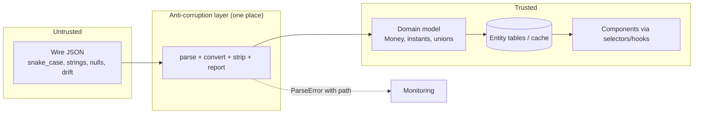
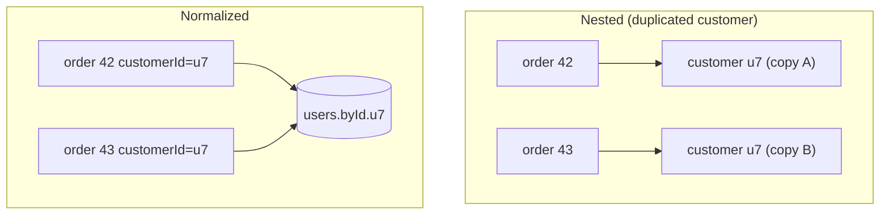
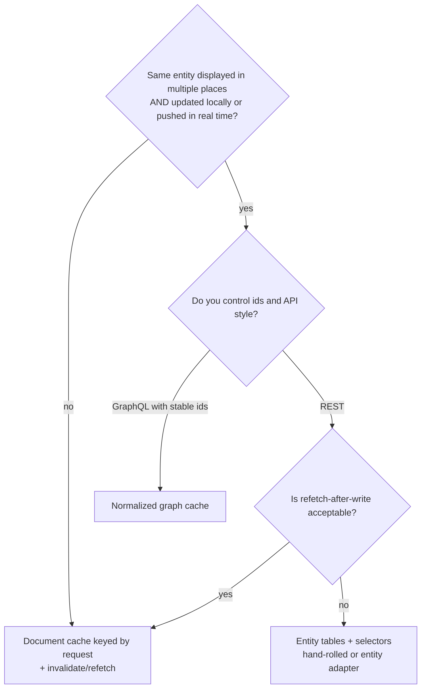

# 06 / 04 — API Normalization: From Wire Format to Trustworthy Domain Data

## 1. Lesson metadata

| | |
|---|---|
| **Level** | Intermediate–Advanced |
| **Study time** | 5 hours (reading 2 h, experiments 1.5 h, exercises 1.5 h) |
| **Prerequisites** | [06 / 01 — The fetch lifecycle](./01-fetch-lifecycle.md), [06 / 03 — Loading and error states](./03-loading-and-error-states.md), [00 / 08 — Objects, references, immutability](../00-web-and-javascript-foundations/08-objects-references-immutability.md), [00 / 18 — TypeScript fundamentals and narrowing](../00-web-and-javascript-foundations/18-typescript-fundamentals-and-narrowing.md), [00 / 19 — Generics, utility types, discriminated unions](../00-web-and-javascript-foundations/19-typescript-generics-and-utility-types.md), [03 / 17 — Derived state](../03-react-state-and-hooks/17-derived-state.md) |
| **Next** | [05 — Optimistic updates](./05-optimistic-updates.md) |
| **Related** | [04 / 12 — Domain logic vs UI logic](../04-react-architecture/12-domain-logic-vs-ui-logic.md), [04 / 13 — Application services and adapters](../04-react-architecture/13-application-services-and-adapters.md), [04 / 16 — Server vs client state](../04-react-architecture/16-server-vs-client-state.md), [06 — Cache consistency and invalidation](./06-cache-consistency-and-invalidation.md), [09 — Redux Toolkit](./09-redux-toolkit.md) |

**Learning objectives.** After this lesson you can:
1. Distinguish the two meanings of "normalization" used in front-end work: **shape normalization** (wire format → domain model) and **relational normalization** (nested graph → flat, id-keyed entity tables), and say which problem each solves.
2. Write a boundary layer ("anti-corruption layer") that parses `unknown` into typed domain values, without `as` casts, with structured failures.
3. Handle the realistic mess of real APIs: naming conventions, nullable vs missing, dates, money, ids, enums that grow, polymorphic payloads, envelopes, pagination, partial objects.
4. Decide, with criteria, whether an entity should be stored normalized, as nested documents keyed by request, or both.
5. Implement id-keyed entity stores with derived selectors and explain the update-consistency benefit (and the cost).
6. Compare the *responsibility split* in document-cache libraries, normalized-cache libraries, and entity-adapter stores.
7. Explain why normalization at the boundary is the main defense against API drift.

**Concepts covered:** wire format vs domain model, DTO, anti-corruption layer, parse-don't-validate, tolerant reader, runtime validation schemas, `unknown` vs `any`, branded types, money in minor units, ISO 8601 timestamps, unknown enum values, discriminated unions from the wire, null vs undefined vs missing, envelopes, cursor vs offset pagination, problem-details error bodies, relational normalization (`byId`/`allIds`), denormalization via selectors, entity adapters, normalized caches (GraphQL-style), identity (`__typename`+`id` conceptually), structural sharing and referential stability.

---

## 2. Deep conceptual explanation

### 2.1 Two words, two problems

"Normalization" in front-end data work names two quite different activities. Teams argue past each other when they do not separate them.

| | **Shape normalization** | **Relational normalization** |
|---|---|---|
| **Also called** | Mapping, adapting, parsing, DTO → model, anti-corruption layer | Entity flattening, normalized state, entity tables |
| **Input** | A single response body in the server's idiom | A *graph* of nested entities (orders containing customers containing addresses…) |
| **Output** | A trustworthy, UI-friendly *typed* value | Maps keyed by id, with relations as ids |
| **Problem solved** | The server's format is untrusted, inconsistent, or unsuited to UI | The same entity appears in several places; updating one copy leaves others stale |
| **Where it happens** | At the network boundary, once | At the point of storing into a shared store/cache |
| **Mandatory?** | Practically always, in some form | Only when duplicate-entity consistency is a real problem |
| **Cost** | Small, local | Real: indirection, selectors, update plumbing |

Most applications need the first everywhere and the second selectively. Treating the second as a universal requirement is a common over-engineering pattern; treating the first as optional is a common source of production incidents.

### 2.2 Shape normalization: the wire is not your model

Lesson 01 established that `response.json()` returns data from a different program, deployed on a different schedule. Everything in your React tree that touches that data is implicitly depending on a *contract*. If the contract lives only in people's heads and in `as User` casts, then every deviation becomes a crash at the point of *use* — often a render-time `undefined` dereference — far from the point of *cause*.

A **boundary layer** converts at one place:

```text
wire (unknown JSON)  ──parse/validate──►  domain model (typed, UI-friendly)
         ▲                                          │
   untrusted, snake_case,                   trusted, camelCase,
   strings for dates/money,                 Date/Instant types, Money,
   nullable chaos, versioned                unions with exhaustive handling
```

Everything inside the boundary can assume invariants. Everything outside is suspicious. This is the front-end form of the *anti-corruption layer* from domain-driven design ([04 / 08 — Domain-driven frontend](../04-react-architecture/08-domain-driven-frontend.md), [04 / 13](../04-react-architecture/13-application-services-and-adapters.md)): the external model is prevented from leaking into your internal model.

What the boundary should do:

1. **Validate** presence and types of fields you actually use.
2. **Convert** representations (string → `Date`/timestamp, minor units → `Money`, snake_case → camelCase, `"true"` → boolean when an old endpoint does that).
3. **Default or reject** deliberately: decide per field whether absence is a defect (reject) or normal (default) — never default silently by accident.
4. **Narrow** open-ended server enums and polymorphic payloads into closed unions *plus an explicit unknown case* (§2.5).
5. **Strip** fields you do not need (reduces accidental coupling and avoids leaking sensitive extra fields into logs/state).
6. **Report** failures with a path ("`items[3].price` expected string, got null") so engineers can find the contract violation.

What it should **not** do: business logic (pricing rules, eligibility), UI formatting (locale strings), or fetching. Conversion of *representation* belongs at the boundary; *interpretation* belongs in the domain layer ([04 / 12](../04-react-architecture/12-domain-logic-vs-ui-logic.md)).

### 2.3 "Parse, don't validate" in practice

A validator returns a boolean (`isUser(x)`) and leaves the original value untyped or loosely typed; code later forgets to check. A **parser** returns a *new, more precisely typed value* (or a failure). The type system then carries the proof. TypeScript offers two idioms: type predicates (`x is User`) and parse functions returning `Result<User, ParseError>` or throwing. Prefer parse functions that return fresh domain objects, because they also *convert* and *strip*.

Runtime schema libraries (e.g. **Zod**, **Valibot**, **io-ts**, **ArkType**, **Effect Schema**) implement this pattern: you declare a schema once and derive both the validator and the static type *the specific APIs differ per library and change between major versions; the Zod snippet in §5.4 was executed against Zod 4.6, other libraries' calls were not*. A hand-written parser is perfectly adequate for a small number of endpoints and is the only way to *see* what the libraries do, so this lesson shows both.

Responsibility comparison for parsing:

| Responsibility | Hand-written parser | Schema library | OpenAPI/GraphQL codegen | tRPC-style shared types |
|---|---|---|---|---|
| Static types for the result | You write them | Inferred from schema | Generated | Inferred from server code |
| **Runtime** validation of the wire | You write it | Yes | **Usually no** (types only; some generators can emit validators; tool-dependent) | Optional (validation of inputs yes; outputs usually trusted; library-dependent) |
| Conversion (dates, money) | You | Transform steps | Custom scalars / post-processing | Transformer (library-dependent) |
| Detects server drift at runtime | Yes (if you check) | Yes | No (compile-time only, against a snapshot) | Only if server and client versions match |
| Bundle cost | None | Non-zero (varies) | Usually small | Library |
| Source of truth | Your code | Your schema | The API description | The server code |

Key insight: **generated or shared *types* give you compile-time agreement with a *snapshot* of the server**. They do not protect against a deployed server that differs from the snapshot (stale client bundle, mismatched deploy, a proxy returning an HTML error page). Runtime validation is what protects at the boundary. Whether the protection is worth its runtime cost is a trade-off (see §7); *where* the data comes from — your own backend in a monorepo versus a third party — shifts it dramatically.

### 2.4 The messy-reality catalogue

| Issue | What the wire does | What goes wrong if untreated | Boundary decision |
|---|---|---|---|
| **Naming** | `snake_case`, inconsistent plurals | Style drift; typos in unvalidated property access | Map once to camelCase; own the names |
| **Null vs missing vs `undefined`** | Field absent, `null`, or `""` all used for "no value" | `undefined` and `null` checks diverge; `""` treated as value | Pick one internal representation (commonly `undefined`/absent or an explicit `Option`), convert at boundary |
| **Dates** | ISO 8601 strings, epoch seconds, epoch millis, `"2024-01-02"` date-only | `new Date('2024-01-02')` is parsed as UTC midnight per spec, which can display as the previous day in negative-UTC-offset zones; date-time without zone is ambiguous | Parse explicitly; distinguish *instant* vs *calendar date* vs *local date-time* in types; consider Temporal (MDN compat data, 2026-10-22: Chrome 144, Firefox 139, Safari only in preview; not in Node 24, so use a polyfill or date library if you need it today) |
| **Money** | `"19.99"`, `19.99`, `1999` (minor units), multiple currencies | Floating-point rounding (`0.1 + 0.2`), wrong currency, formatting bugs | Represent as integer minor units + currency code (or a decimal library); never do arithmetic on floats; format only at display via `Intl.NumberFormat` |
| **IDs** | Numbers beyond `2^53 - 1` lose precision in JSON → JS number; string vs number inconsistency | Silent id corruption | Treat ids as opaque **strings**; if the server emits big numeric ids insist on strings |
| **Enums** | `"status": "shipped"`, and next quarter `"partially_shipped"` | `switch` falls through; a new value crashes or mislabels | Closed union + `unknown` variant (§2.5) |
| **Polymorphism** | `{ type: 'card', last4 } \| { type: 'paypal', email }` | Reading `last4` on the wrong variant | Discriminated union parsed by tag |
| **Envelopes** | `{ data, meta, errors }`, `{ results, next }` | Components know envelope shapes | Unwrap at boundary |
| **Pagination** | Offset/limit vs cursor; total counts that are expensive or absent | Page state drifts when data changes; duplicate/missed rows | Normalize into one internal page type; see §5.7 |
| **Errors** | Different shapes per service; HTML from proxies | `error.message` undefined; JSON parse crash | One `ApiError` type; accept problem-details (RFC 9457, formerly 7807) bodies where used (check your API) |
| **Partial entities** | List endpoint returns summary; detail endpoint returns full | Treating summary as full → missing fields shown as 0/blank | Separate types (`ProductSummary`, `ProductDetail`) or optional fields with explicit meaning |
| **Booleans & numbers as strings** | Legacy `"1"`, `"0"`, `"12"` | Truthiness bugs (`"0"` is truthy) | Convert at the boundary |
| **Large payloads** | Whole object graphs | Parse time on the main thread | Limit fields, paginate, consider moving parsing to a worker (measure first) |

### 2.5 Open enums and the "unknown" variant

Deployments are not atomic: a server may add a status before the client is updated (or after the client was cached by a CDN or installed as a PWA). A closed union without an escape hatch turns *forward-compatible server changes into client crashes*.

```ts
type OrderStatus = 'pending' | 'paid' | 'shipped' | 'cancelled' | { kind: 'unknown'; raw: string };
```

Handle it deliberately: unknown statuses render as a neutral label and disable actions that require knowledge of the status. This is the **tolerant reader** principle (be liberal in what you accept — but *explicitly*, not by letting `undefined` flow through). Exhaustive `switch` with an `assertNever` still protects you inside the closed set; the unknown arm is part of the set.

### 2.6 Relational normalization: why it exists

Consider a Kanban board returning:

```json
{ "boards": [{ "id": "b1", "columns": [{ "id": "c1", "cards": [
  { "id": "k1", "title": "Fix bug", "assignee": { "id": "u7", "name": "Ana" } },
  { "id": "k2", "title": "Write docs", "assignee": { "id": "u7", "name": "Ana" } } ] }] }] }
```

User `u7` appears **twice**, inside two cards. If a user renames themself, an edit that updates the nested copy in `k1` leaves `k2` stale. The UI shows two different names for the same person — an **update anomaly**, the same problem relational database design solved with normal forms. Flattening yields:

```ts
interface EntityState<T> { byId: Record<string, T>; allIds: string[] }

interface State {
  users:   EntityState<User>;                       // { u7: { id:'u7', name:'Ana' } }
  cards:   EntityState<{ id: string; title: string; assigneeId: string }>;
  columns: EntityState<{ id: string; cardIds: string[] }>;
}
```

Now `u7` exists once, so one update is visible everywhere; every view derives its nested shape through **selectors** ("denormalization on read"). The costs: you must (a) flatten each response on write (`normalizr`-style, or hand-written), (b) write selectors to rebuild graphs, (c) manage deletions (dangling ids), (d) keep selectors referentially stable ([07 / 05 — Referential equality](../07-performance/05-referential-equality.md); [03 / 11 — memoization](../03-react-state-and-hooks/11-usememo-and-usecallback.md)).

**When does relational normalization pay off?** When *the same entity is rendered in several places simultaneously and edited/updated from some of them* (or by realtime pushes), and you cannot afford a refetch to reconcile. If each screen fetches what it displays and mutations *invalidate and refetch* (lesson 06), duplication is tolerable and normalization may be pure overhead.

### 2.7 Where normalized caches fit among the tools

| Approach | What is stored | Identity | Update propagation | Typical technology |
|---|---|---|---|---|
| **Document cache keyed by request** | The response of each request, whole, under its key | The request (key) | Refetch/invalidate keys, or manual `setQueryData` per key | TanStack Query, SWR (both treat results as opaque values and compare/share structure rather than track entity identity; TanStack Query's `structuralSharing` default and `replaceEqualDeep` behaviour were verified, SWR's comparison was not) |
| **Normalized graph cache** | Entities by global id (e.g. `__typename:id`) with references | The entity | Automatic: any response containing an entity updates all views of it | Apollo Client, urql (with the Graphcache package), Relay (not verified per library) |
| **Entity adapter in a store** | Hand-chosen entity tables | Whatever you decide | You write reducers/`upsert`; derived via selectors | Redux Toolkit `createEntityAdapter` ([09](./09-redux-toolkit.md)), Zustand/own stores |
| **Server-composed** | UI shapes from a BFF | n/a | Server decides | BFF, RSC loaders |

Important: **normalized caches require reliable identity**. Apollo-style caches need every object to expose a type name and an id (or a configured key function); objects without identity are stored embedded in their parent and cannot be shared. Choosing a normalized cache is also *choosing an API style* that guarantees stable ids. With a REST API of unguaranteed ids, you are doing normalization by hand and carrying the risk that "same id" does not mean "same entity" across resource types (id `7` for a product and id `7` for a user — hence keying by `type:id` or per-type tables).

### 2.8 Referential stability: normalization's silent partner

Replacing the whole cached object with a freshly parsed object on every refetch changes every reference, so memoized children re-render even if nothing changed. **Structural sharing** — reusing old object references for unchanged subtrees — preserves identity ([07 / 05](../07-performance/05-referential-equality.md)). TanStack Query does this by default for query results (`structuralSharing`, verified in 5.104: `replaceEqualDeep(old, deepEqualNew) === old`); with hand-written stores you implement it with immutable-update helpers (Immer in Redux Toolkit) or a deep-equal-then-reuse step. A **parser that always allocates new objects defeats structural sharing unless the cache step compares and reuses** — a subtle interaction between this lesson and lesson 07.

### 2.9 Misconceptions

| Misconception | Reality |
|---|---|
| "TypeScript types from OpenAPI mean the data is safe." | They are compile-time claims about a snapshot; runtime may differ. |
| "Normalization means `normalizr`/Redux." | Two senses; neither requires a specific library. |
| "Normalize everything for performance." | It adds work and complexity; benefits are consistency, not speed (though selectors can improve memoization). |
| "Zod (or any schema) = free safety." | It costs bundle size and CPU; it validates *what you wrote*; a wrong schema validates wrongly. |
| "Dates from JSON are `Date`s." | JSON has no date type; they arrive as strings or numbers. |
| "Numbers from the API are fine for money." | Floats are binary; use integer minor units/decimal types. |
| "An unknown enum value is the server's bug." | Forward compatibility is a *client* requirement in a continuously deployed system. |
| "A normalized store holds the source of truth." | The server is the source of truth; the client holds a cache of it ([04 / 16](../04-react-architecture/16-server-vs-client-state.md)). |

---

## 3. Internal mechanics

### 3.1 JSON, numbers, and what `JSON.parse` can and cannot represent (public guarantee)

**Public guarantee** (ECMAScript, RFC 8259): JSON has objects, arrays, strings, numbers, booleans, and `null`. There is no date, no `undefined`, no `NaN`/`Infinity`, no bigint. `JSON.parse` maps JSON numbers to IEEE-754 doubles; integers beyond ±(2^53−1) lose precision silently. `JSON.stringify` drops `undefined`-valued properties and turns `Date` into its ISO string via `toJSON`. Duplicate keys in an object: the last one wins (behavior of `JSON.parse`; do not rely on servers emitting them).

Consequences for boundary design: ids that exceed 2^53 must be strings on the wire; "precise decimal" values must be strings or integers in minor units; a `Date` round-trips as a *string*, so the type after parse is `string` until you convert.

### 3.2 Dates: what `new Date(string)` does

**Public guarantee** (ECMAScript): the *Date Time String Format* (a simplified ISO 8601) is specified. A date-only form (`"2024-01-02"`) is interpreted as **UTC**; a date-time form without an offset (`"2024-01-02T10:00:00"`) is interpreted as **local time**. Other string formats are implementation-defined. Verified in Node 24 with `TZ=America/Los_Angeles`: `new Date('2024-01-02')` is `2024-01-02T00:00:00Z` and prints as Jan 1 local time, while `new Date('2024-01-02T10:00:00')` is local (`18:00Z`). Because the two forms differ in interpretation, mixing them is a classic source of off-by-one-day bugs. **Teaching model:** decide your *semantic type* — an instant (absolute point in time → store epoch ms or an ISO string *with* `Z`/offset), a calendar date (a day with no time → keep the string `YYYY-MM-DD` or a dedicated type; do not turn it into a `Date`), or a local wall-clock time (requires a time zone identity). **Implementation detail:** formatting and parsing of non-standard strings differs across engines; avoid it.

### 3.3 What a schema library does under the hood (teaching model)

Conceptually, a schema is a tree of small parser functions. Object schemas iterate over declared keys, run each field's parser against `input[key]`, collect issues with a **path** (array of keys/indexes), and either return a new object composed of parsed fields or an issue list. Transforms are parsers composed after validators. Libraries differ on whether unknown keys are stripped, passed through, or rejected; whether errors accumulate or stop at first; whether parsing is sync/async. These defaults vary by library and version (Zod 4: unknown keys are stripped and issues accumulate; verified) — read the docs rather than assuming. **Implementation detail:** performance varies by orders of magnitude between libraries and with compiled vs interpreted schemas; measure on realistic payloads if you parse large responses on the main thread ([07 / 20 — Long tasks](../07-performance/20-long-tasks-and-main-thread.md)).

### 3.4 How a normalized cache decides "same entity" (teaching model)

Conceptually: on each response, walk the result tree; whenever you encounter an object that has an identity (type + id), write its *scalar fields* into the entity table under that identity and replace the object with a *reference*; the query's stored result is the tree with references. On read, resolve references back. Updating an entity table row therefore updates every query result that references it, and **merge policy** matters: what happens when two responses contain different subsets of fields for the same entity (summary vs detail)? Normalized caches typically *merge fields* shallowly; arrays and nested non-entity objects need explicit merge rules. This is the origin of cache "merge functions"/type policies (library-specific, not verified here), and the origin of the notorious bugs where a list endpoint returns an older `updatedAt` than a cached detail and overwrites it (§10).

### 3.5 Immutable updates and identity (cross-reference)

Entity updates in React state must be immutable ([00 / 08](../00-web-and-javascript-foundations/08-objects-references-immutability.md)): create new objects along the changed path, reuse the rest. Redux Toolkit's `createSlice` uses Immer so that "mutating" code compiles to immutable updates; `createEntityAdapter` exists in RTK 2.13 (see [09](./09-redux-toolkit.md)).

---

## 4. Step-by-step execution walkthrough

Scenario: `GET /api/orders/42` returns the payload below. The app has a boundary parser and an entity-store for customers (shown on orders *and* on a customer sidebar).

```json
{
  "id": 42,
  "status": "partially_shipped",
  "created_at": "2024-03-09T23:30:00Z",
  "total": "1999",
  "currency": "EUR",
  "customer": { "id": "c9", "full_name": "Ana Ruiz", "email": null },
  "lines": [
    { "sku": "A-1", "qty": "2", "unit_price": "999" },
    { "sku": "B-7", "qty": 1,   "unit_price": "1" }
  ]
}
```

The numbered observations show why normalization is not decoration:

| Step | Operation | Problem found / decision |
|---|---|---|
| 1 | Response arrives; `res.ok`; `json()` → value typed `unknown` | Nothing is known yet |
| 2 | Parse `id`: it is the **number** 42, whereas `customer.id` is a **string** | Inconsistent id types → convert both to strings (`"42"`) at the boundary |
| 3 | Parse `status` `"partially_shipped"` | Not in the known union → `{ kind: 'unknown', raw }` |
| 4 | Parse `created_at` | Has `Z` → an instant; convert to epoch ms or keep ISO string; do not format here |
| 5 | Parse `total` `"1999"` + `currency "EUR"` | String of minor units → integer 1999 → `Money { minor: 1999, currency: 'EUR' }`; check integer and non-negative |
| 6 | Parse `customer.email: null` | `null` → internal "no email" (`undefined`/absent) |
| 7 | Parse `lines[0].qty "2"` vs `lines[1].qty 1` | A string and a number for the same field → both accepted and converted; flagged in logs as contract drift |
| 8 | Cross-field check: sum of line totals vs `total` | `2*999 + 1*1 = 1999` ✓. (If it mismatched, *report* the discrepancy but still decide: reject, or trust server total and log) |
| 9 | Result: `Order` domain object; customer extracted | Customer upserted into the customers entity table; the order stores `customerId` |
| 10 | Render | Sidebar and order header both select `customers.byId['c9']`; a later rename updates both once |

**Predict:** if step 5 had been `Number(raw.total) / 100` stored as a float for display, what breaks and when? *Answer:* Display formatting would usually look right for such small amounts, but summing floats across lines accumulates rounding error (e.g. `0.1 + 0.2 = 0.30000000000000004`), producing a total off by a cent that fails reconciliation against the server — typically discovered only with specific values. Integer minor units make addition exact (until overflow beyond 2^53, irrelevant for money).

---

## 5. Code examples

### 5.1 Minimal: the problem with casting

```ts
interface Order { id: string; total: number; placedAt: Date }

async function getOrderBad(id: string): Promise<Order> {
  const res = await fetch(`/api/orders/${id}`);
  return (await res.json()) as Order;     // compiles; wire has total:"1999", placed_at:"…"
}
// Later: order.placedAt.getFullYear()  -> TypeError: not a function (a string has no such method)
```

**Predict:** where does the error surface and what does the stack trace tell you about the cause? *Answer:* In whatever component first uses `placedAt` as a `Date` — perhaps a formatting helper, perhaps after a rerender — far from `getOrderBad`. The trace says "`getFullYear` is not a function", which does not mention the API at all.

### 5.2 Practical: a small hand-written boundary toolkit

```ts
// parse.ts — tiny combinators (illustrative; a schema library does this for you)
export class ParseError extends Error {
  constructor(public readonly path: string, public readonly expected: string, public readonly received: unknown) {
    super(`${path}: expected ${expected}, got ${describeValue(received)}`);
    this.name = 'ParseError';
  }
}

function describeValue(v: unknown): string {
  if (v === null) return 'null';
  if (Array.isArray(v)) return 'array';
  return typeof v;
}

export type Parser<T> = (input: unknown, path: string) => T;

export const str: Parser<string> = (v, p) => {
  if (typeof v !== 'string') throw new ParseError(p, 'string', v);
  return v;
};

export const idString: Parser<string> = (v, p) => {
  if (typeof v === 'string' && v !== '') return v;
  if (typeof v === 'number' && Number.isSafeInteger(v)) return String(v);   // accept numeric ids, normalize to string
  throw new ParseError(p, 'id (string or safe integer)', v);
};

export const nullableStr: Parser<string | undefined> = (v, p) => {
  if (v === null || v === undefined) return undefined;
  return str(v, p);
};

export const minorUnits: Parser<number> = (v, p) => {
  const n = typeof v === 'string' && /^-?\d+$/.test(v) ? Number(v) : v;
  if (typeof n !== 'number' || !Number.isSafeInteger(n)) throw new ParseError(p, 'integer minor units', v);
  return n;
};

export const isoInstant: Parser<number> = (v, p) => {
  if (typeof v !== 'string' || !/(Z|[+-]\d{2}:\d{2})$/.test(v)) throw new ParseError(p, 'ISO 8601 instant with offset', v);
  const t = Date.parse(v);
  if (Number.isNaN(t)) throw new ParseError(p, 'valid ISO 8601 instant', v);   // NaN catches malformed input; V8 rolls an impossible day such as 02-31 over instead of returning NaN
  return t;                                   // epoch milliseconds
};

export function object(input: unknown, path: string): Record<string, unknown> {
  if (typeof input !== 'object' || input === null || Array.isArray(input)) throw new ParseError(path, 'object', input);
  return input as Record<string, unknown>;    // narrowing cast is local and justified: we just checked
}

export function array<T>(item: Parser<T>): Parser<T[]> {
  return (v, p) => {
    if (!Array.isArray(v)) throw new ParseError(p, 'array', v);
    return v.map((x, i) => item(x, `${p}[${i}]`));
  };
}
```

Line notes:

- `Parser<T>` takes a **path** so errors point at `lines[1].qty`, not "invalid".
- `idString` shows the *tolerant-but-explicit* policy: accept safe integers, convert to string; reject unsafe integers (which would already be corrupted by `JSON.parse`).
- The single `as Record<string, unknown>` is a *narrowing after a runtime check*, the opposite of the unsafe cast of §5.1. Justify such casts in a comment.
- `isoInstant` **requires** an offset or `Z` so that a naive local date-time cannot sneak in as an "instant".
- These helpers throw. An alternative is returning `Result<T, ParseError[]>` to accumulate *all* issues; throwing stops at the first. Trade-off: first-error is simpler, all-errors is better for diagnosing drift.

### 5.3 Practical: the domain model and the order parser

```ts
// order.ts
import { array, idString, isoInstant, minorUnits, nullableStr, object, str, ParseError } from './parse';

export interface Money { readonly minor: number; readonly currency: string }   // ISO 4217 code

export type OrderStatus =
  | 'pending' | 'paid' | 'shipped' | 'cancelled'
  | { readonly kind: 'unknown'; readonly raw: string };

export interface OrderLine { sku: string; quantity: number; unitPrice: Money }
export interface Customer { id: string; name: string; email?: string }
export interface Order {
  id: string;
  status: OrderStatus;
  placedAt: number;            // epoch ms (instant)
  total: Money;
  customerId: string;
  lines: OrderLine[];
}

const KNOWN: readonly string[] = ['pending', 'paid', 'shipped', 'cancelled'];

function parseStatus(v: unknown, p: string): OrderStatus {
  const s = str(v, p);
  return KNOWN.includes(s) ? (s as Exclude<OrderStatus, { kind: 'unknown' }>) : { kind: 'unknown', raw: s };
}

function parseQuantity(v: unknown, p: string): number {
  const n = typeof v === 'string' && /^\d+$/.test(v) ? Number(v) : v;
  if (typeof n !== 'number' || !Number.isSafeInteger(n) || n < 0) throw new ParseError(p, 'non-negative integer', v);
  return n;
}

function parseCurrency(v: unknown, p: string): string {
  const s = str(v, p);
  if (!/^[A-Z]{3}$/.test(s)) throw new ParseError(p, 'ISO 4217 currency code', v);
  return s;
}

export function parseCustomer(raw: unknown, path = 'customer'): Customer {
  const o = object(raw, path);
  return {
    id: idString(o.id, `${path}.id`),
    name: str(o.full_name, `${path}.full_name`),
    email: nullableStr(o.email, `${path}.email`),
  };
}

export function parseOrderResponse(raw: unknown): { order: Order; customer: Customer } {
  const o = object(raw, 'order');
  const currency = parseCurrency(o.currency, 'order.currency');
  const customer = parseCustomer(o.customer);
  const lines = array<OrderLine>((l, p) => {
    const lo = object(l, p);
    return {
      sku: str(lo.sku, `${p}.sku`),
      quantity: parseQuantity(lo.qty, `${p}.qty`),
      unitPrice: { minor: minorUnits(lo.unit_price, `${p}.unit_price`), currency },
    };
  })(o.lines, 'order.lines');

  const total: Money = { minor: minorUnits(o.total, 'order.total'), currency };
  const computed = lines.reduce((sum, l) => sum + l.quantity * l.unitPrice.minor, 0);
  if (computed !== total.minor) {
    // Policy decision: report, don't reject — the server total is authoritative for payment.
    reportContractDrift({ endpoint: 'orders/:id', detail: `line sum ${computed} != total ${total.minor}` });
  }

  return {
    order: {
      id: idString(o.id, 'order.id'),
      status: parseStatus(o.status, 'order.status'),
      placedAt: isoInstant(o.created_at, 'order.created_at'),
      total,
      customerId: customer.id,
      lines,
    },
    customer,
  };
}

declare function reportContractDrift(info: { endpoint: string; detail: string }): void;
```

Design notes:

- `parseOrderResponse` returns **two entities** — the order references `customerId`, the customer goes to a separate table. That is relational normalization performed *during* shape normalization; the two are often one pass.
- The cross-field check demonstrates that a boundary can detect **semantic** contract drift, not just type mismatch; the chosen policy (report, not reject) is a business decision made explicit.
- `parseStatus` uses a cast after `KNOWN.includes` — acceptable but a type-safe alternative is a lookup object `Record<KnownStatus, true>`/`satisfies`. TypeScript's `readonly string[]` `includes` does not narrow, which is why the cast appears; mention as a TypeScript limitation, not a design goal.

### 5.4 Practical: schema-library version (Zod 4; run against `zod` 4.6)

```ts
import { z } from 'zod';   // Zod 4 API (run against zod 4.6). In Zod 3, use z.string().datetime({ offset: true }) instead of z.iso.datetime()

const Id = z.union([z.string().min(1), z.number().int()]).transform(String);

const StatusKnown = z.enum(['pending', 'paid', 'shipped', 'cancelled']);
const Status = z.string().transform((s) => {
  const r = StatusKnown.safeParse(s);
  return r.success ? r.data : ({ kind: 'unknown', raw: s } as const);
});

const OrderWire = z.object({
  id: Id,
  status: Status,
  created_at: z.iso.datetime({ offset: true }).transform((s) => Date.parse(s)),
  total: z.string().regex(/^-?\d+$/).transform(Number),
  currency: z.string().regex(/^[A-Z]{3}$/),
  customer: z.object({ id: Id, full_name: z.string(), email: z.string().nullable() }),
  lines: z.array(z.object({
    sku: z.string(),
    qty: z.union([z.number().int().nonnegative(), z.string().regex(/^\d+$/).transform(Number)]),
    unit_price: z.string().regex(/^-?\d+$/).transform(Number),
  })),
});

export type OrderWireParsed = z.output<typeof OrderWire>;   // the *post-transform* type
export const parseOrderWire = (raw: unknown) => OrderWire.parse(raw);   // throws ZodError with paths
```

What to learn from it, independent of the library: (a) the schema describes the **wire**; a second mapping step turns it into your domain object (rename to camelCase, build `Money`); some teams do both in the schema with transforms — convenient but couples domain shape to the library; (b) there are *two* types (`input` and `output`) once you transform; (c) default behavior for unknown keys and error formatting differ by library/version (Zod 4: unknown keys are stripped by default and a `ZodError` exposes `issues[].path`, e.g. `['lines', 0, 'sku']`; both verified by running this schema; `z.string().datetime()` and `.safe()` are deprecated in Zod 4 in favour of `z.iso.datetime()` and `.int()`); (d) the library cannot know whether `total` as minor units is *right* — the schema encodes your assumption.

### 5.5 Incorrect: nested updates on duplicated entities

```ts
// State holds orders with nested customer copies
const [orders, setOrders] = useState<Order[]>([]);   // each order has { customer: { id, name } }

function renameCustomer(id: string, name: string) {
  setOrders(orders.map(o => o.customer.id === id ? { ...o, customer: { ...o.customer, name } } : o));
}
```

Problems: (1) other places that hold the customer elsewhere (a sidebar query, a different list) do not update — update anomaly; (2) `setOrders(orders.map(...))` reads a possibly stale `orders` from closure ([03 / 02 — Functional state updates](../03-react-state-and-hooks/02-functional-state-updates.md)); (3) every order object that *contains* the renamed customer gets a new identity, so memoized rows re-render; (4) if the customer endpoint response arrives later with an older `name`, nothing reconciles.

### 5.6 Corrected: an id-keyed store and selectors

```ts
// entities.ts
export interface EntityTable<T extends { id: string }> {
  byId: Readonly<Record<string, T>>;
  allIds: readonly string[];
}
export const emptyTable = <T extends { id: string }>(): EntityTable<T> => ({ byId: {}, allIds: [] });

export function upsertMany<T extends { id: string }>(
  table: EntityTable<T>,
  items: readonly T[],
): EntityTable<T> {
  if (items.length === 0) return table;                 // preserve identity when nothing changes
  const byId = { ...table.byId };
  const allIds = [...table.allIds];
  let changed = false;
  for (const item of items) {
    const prev = byId[item.id];
    if (prev === undefined) { allIds.push(item.id); byId[item.id] = item; changed = true; }
    else if (!shallowEqual(prev, item)) { byId[item.id] = { ...prev, ...item }; changed = true; }
  }
  return changed ? { byId, allIds } : table;            // structural sharing at the table level
}

function shallowEqual(a: object, b: object): boolean {
  const ak = Object.keys(a) as Array<keyof typeof a>;
  const bk = Object.keys(b);
  return ak.length === bk.length && ak.every((k) => Object.is(a[k], (b as typeof a)[k]));
}

// Selector: derive the denormalized view
export function selectOrderView(
  orders: EntityTable<Order>,
  customers: EntityTable<Customer>,
  id: string,
): (Order & { customer: Customer | undefined }) | undefined {
  const order = orders.byId[id];
  return order && { ...order, customer: customers.byId[order.customerId] };
}
```

Notes: `upsertMany` merges fields (`{...prev, ...item}`) so a later *summary* does not delete detail-only fields — and *also* means a field absent from the incoming item is **not** cleared (an `email` removed server-side stays locally). That is the central merge-policy trade-off from §3.4: choose "merge" or "replace" per entity and document it. `selectOrderView` allocates a new object on every call, so used directly in a component or `useSelector` it causes re-renders each time — memoize per `(order, customer)` pair ([03 / 11](../03-react-state-and-hooks/11-usememo-and-usecallback.md)); store libraries ship memoized-selector helpers (Reselect's `createSelector` is re-exported by RTK 2).

### 5.7 Advanced: normalizing pagination, errors, and envelopes into one internal shape

```ts
export interface Page<T> {
  items: T[];
  nextCursor: string | null;       // null = no more
  total?: number;                  // optional: not all APIs provide it
}

// API A: { results: [...], next: "https://api/x?cursor=abc" | null, count: 120 }
// API B: { data: [...], meta: { page: 3, per_page: 20, total_pages: 6 } }
export function pageFromA<T>(raw: unknown, item: (x: unknown, p: string) => T): Page<T> {
  const o = object(raw, 'page');
  const next = o.next;
  return {
    items: array(item)(o.results, 'page.results'),
    nextCursor: typeof next === 'string' ? new URL(next).searchParams.get('cursor') : null,
    total: typeof o.count === 'number' ? o.count : undefined,
  };
}
export function pageFromB<T>(raw: unknown, item: (x: unknown, p: string) => T): Page<T> {
  const o = object(raw, 'page');
  const meta = object(o.meta, 'page.meta');
  const page = Number(meta.page);
  const totalPages = Number(meta.total_pages);
  return {
    items: array(item)(o.data, 'page.data'),
    nextCursor: page < totalPages ? String(page + 1) : null,   // offset API exposed as an opaque cursor
    total: undefined,
  };
}
```

Idea: UI code (infinite scroll, "load more") depends only on `Page<T>` and an opaque cursor, so switching a backend from offset to cursor changes *one adapter*. Caveat: offset pagination under concurrent inserts can duplicate/skip rows — the adapter hides the protocol, not the semantics; an `items` merge keyed by `id` (dedupe) is a pragmatic mitigation ([08 — TanStack Query](./08-tanstack-query.md) covers infinite queries; `useInfiniteQuery` and a required `initialPageParam` exist in 5.104).

Normalized API errors:

```ts
export interface ApiProblem { status: number; code?: string; title: string; detail?: string; fieldErrors?: Record<string, string[]> }

export function problemFrom(status: number, body: unknown): ApiProblem {
  if (typeof body === 'object' && body !== null) {
    const b = body as Record<string, unknown>;       // narrowing after typeof check
    return {
      status,
      code: typeof b.code === 'string' ? b.code : typeof b.type === 'string' ? b.type : undefined,
      title: typeof b.title === 'string' ? b.title : typeof b.message === 'string' ? b.message : `HTTP ${status}`,
      detail: typeof b.detail === 'string' ? b.detail : undefined,
      fieldErrors: isFieldErrors(b.errors) ? b.errors : undefined,
    };
  }
  return { status, title: `HTTP ${status}` };
}
declare function isFieldErrors(x: unknown): x is Record<string, string[]>;
```

### 5.8 Advanced: branded ids so entity tables cannot be mixed

```ts
type Brand<T, B extends string> = T & { readonly __brand: B };
export type OrderId = Brand<string, 'OrderId'>;
export type CustomerId = Brand<string, 'CustomerId'>;

export const OrderId = (s: string) => s as OrderId;       // the only unchecked cast, at the boundary
// orders.byId[customerId]  -> compile error: CustomerId is not OrderId (when tables are typed by id brand)
```

This addresses "id `7` for product vs user" mix-ups at compile time. Trade-off: ceremony; worthwhile when entity tables are many and ids are plain strings. Branding is erased at runtime — it adds no runtime safety.

---

## 6. Visual explanations

### The boundary



### Nested vs normalized



### Choosing a storage strategy



---

## 7. Alternative approaches and trade-offs

| Approach | Runtime validation | Static types | Update consistency across views | Complexity | Bundle/CPU cost | Best for |
|---|---|---|---|---|---|---|
| `as T` cast | None | Claimed | By refetch | Lowest | None | Throwaways; **not** recommended at a real boundary |
| Hand-written parsers | Yes (you write) | Yes | By refetch | Medium (grows with endpoints) | Minimal | Small API surface; teaching |
| Schema library (Zod-class) | Yes | Inferred | By refetch | Low–Med | Library + parse time | Typical product apps with a few dozen endpoints |
| OpenAPI/GraphQL codegen (types only) | **No** | Generated | Depends | Low per endpoint; pipeline cost | Types erased | Same-org, version-locked deploys; combine with runtime checks at risky edges |
| Codegen + generated validators | Yes | Generated | Depends | Medium; pipeline | Varies | Large API surface with an API description |
| Document cache (request-keyed) | Orthogonal | Orthogonal | Refetch/invalidate | Low | Library | Most REST apps |
| Normalized graph cache | Orthogonal | Orthogonal | **Automatic** | Medium–High; needs stable ids and merge policies | Library | GraphQL apps, heavy cross-view entity sharing |
| Entity adapter store | Orthogonal | Orthogonal | Manual but central | Medium | Library | Apps already on Redux, realtime updates |
| BFF shaping | Server-side | Server-defined | Server-defined | Server team cost | None client | Multi-client orgs |

**When the recommended approach (validate at the boundary and keep a request-keyed document cache) is *not* best.**

1. **Hot paths with huge payloads.** Validating a 5 MB response with a heavyweight schema on the main thread can cause long tasks. Options: validate a *sample*, validate only fields you read, parse in a worker, or move shaping to the server. Measure first.
2. **Trusted, version-locked internal APIs (tRPC-style, shared monorepo types, atomic deploys).** Runtime validation of *outputs* is often skipped by design; the risk profile differs (still consider it at the edge where deploy skew exists).
3. **Highly collaborative / realtime entity-centric UIs** (a Kanban board with live updates): request-keyed documents become inconsistent whenever a push updates an entity present in many cached responses; entity tables or a normalized cache are the right choice.
4. **Prototypes.** A cast is acceptable in code with a short lifespan and a visible TODO — but dated, owned TODOs, not permanent ones.

---

## 8. Best practices and anti-patterns

**Do**

- Put **all** wire knowledge (field names, formats, quirks) in one module per API area; nothing else imports raw DTO types.
- Make boundary failures **loud and diagnosable** (path, endpoint, request id) and **user-quiet** (generic message).
- Decide and document defaults and null-handling per field.
- Model unknown enum values; use exhaustive switches over the closed part.
- Use integer minor units + currency for money; instants for time; strings for ids.
- Return the *same reference* when data is unchanged (structural sharing) to avoid needless re-renders.
- Separate summary and detail types when payloads differ.
- Keep derived data derived: compute totals/labels in selectors, do not store both ([03 / 17](../03-react-state-and-hooks/17-derived-state.md)).
- Add contract tests against recorded fixtures (and against the real API in CI where feasible) ([08 / 11 — Component contract testing](../08-testing-and-quality/11-component-contract-testing.md)).

**Anti-patterns**

| Smell | Why it hurts | Fix |
|---|---|---|
| `as SomeType` on `res.json()` | Moves error to use site | Parse at the boundary |
| Components reading `snake_case` fields | Server naming leaks into the UI; rename = shotgun surgery | Map once |
| `Number(price)` floats for money | Rounding errors | Minor units |
| `new Date(dateOnlyString)` for calendar dates | Time-zone off-by-one | Keep as date string/type |
| `switch (status)` with no default on server enums | New value → undefined behavior | Unknown variant |
| Storing both `items` and `itemCount`/`total` derived values | Drift | Derive |
| Normalizing every entity "just in case" | Boilerplate, harder reads | Normalize where duplication hurts |
| Using list-item objects as if they were full entities | Missing fields shown as 0/blank | Types for summary vs detail |
| Validation that *silently* coerces invalid data to defaults | Hides bugs | Reject or report |
| Swallowing parse errors to "keep the UI working" with empty data | Silent wrong output | Visible failure state ([03](./03-loading-and-error-states.md)) |
| Same schema reused for request and response | Different optionality and transforms | Separate input/output schemas |

**Justified exceptions.** Passthrough of opaque server-owned blobs (e.g. a rich-text document tree you only forward to an editor) should *not* be deeply parsed in app code — validate the envelope and let the owning component validate its own format. For prototypes and internal tools with the same team owning both ends, thin validation (presence of the few fields you read) is a fair compromise; do not present "always full schema validation" as universal.

---

## 9. Real-world application

| Domain | Normalization concern | Constraint |
|---|---|---|
| **E-commerce** | Product summary in listing vs detail; prices in minor units with currency; stock as eventually consistent; variants as nested unions | Price must be exact; stock displayed with freshness; SKU/variant ids as opaque strings; catalogue growth → new attribute types (unknown-friendly) |
| **Dashboard** | Time series: timestamps as instants, buckets, nullable gaps | Parse cost for thousands of points ([07](../07-performance/20-long-tasks-and-main-thread.md)); `null` means "no data" ≠ 0 |
| **Finance** | Decimals, rounding rules, currency scales (JPY 0 decimals, BHD 3) | Never use float; scale from currency; display via `Intl.NumberFormat`; rounding rules are *domain* logic |
| **Forms** | Server → form-model mapping and back; server validation errors keyed by field path | `422` body mapped to field errors; trimmed/empty-string semantics (`""` vs `null`) |
| **Auth** | Roles/permissions arrays; token claims | Unknown permission strings ignored safely (deny by default); never trust client-parsed claims for authorization — UI hints only |
| **Realtime** | Deltas applied to entities | Entities need version/sequence for ordering; normalized tables make `upsert` trivial; replace vs merge policy matters |
| **Multi-team** | Many teams, many services, inconsistent conventions | A shared `api-client` package with the boundary toolkit and per-service adapters; contract tests; versioned deprecation ([04 / 22](../04-react-architecture/22-monorepos-and-shared-packages.md), [10 / 12 — Backward compatibility](../10-production-engineering/12-backward-compatibility.md)) |

Engineering constraint to note: **deploy skew.** Users keep old bundles for days (open tabs, PWAs, CDN caching). A client must tolerate *older and newer* servers within a deprecation window; the tolerant reader plus drift reporting is how you notice skew before users do.

---

## 10. Debugging and troubleshooting

### Symptom 1 — `TypeError: x.toFixed is not a function` / `getFullYear is not a function`

- **Investigation:** Network → Response: the field is a string. Search the code path for an `as` cast of the response.
- **Root cause:** Wire value never converted (§5.1).
- **Fix & validate:** Boundary parser; add a fixture test with the wire sample; ensure the type for the *wire* and the *model* differ (so the compiler refuses the mix-up).

### Symptom 2 — A date is off by one day for some users

- **Investigation:** Compare the raw string (`"2024-03-09"`), the user's time zone (DevTools → Sensors → Location/timezone override or set TZ), and where `new Date(...)` is called. Date-only strings parse as UTC; local rendering in UTC−N shows the previous day.
- **Root cause:** Calendar date treated as instant.
- **Fix:** Keep as `YYYY-MM-DD` and format without a `Date` (or use a date-only type/library); validate with test runs under multiple `TZ` values.

### Symptom 3 — Money totals off by one cent

- **Investigation:** Log the exact values in minor units and floats; look for `*`/`/` on prices; `toFixed` rounds based on binary representation.
- **Root cause:** Float arithmetic or inconsistent rounding policy between client and server.
- **Fix:** Integer minor units; do rounding in one place with an explicit rule; server is authoritative for the final total.

### Symptom 4 — Detail page flashes older data after a list refetch

- **Investigation:** React DevTools / store devtools (Redux DevTools for entity adapters) shows `upsert` from the list response overwriting the detail's newer fields; compare `updatedAt`.
- **Root cause:** Merge policy applies older summary after newer detail (out-of-order, see [02](./02-cancellation-and-race-conditions.md)) or replaces instead of merges.
- **Fix:** Version-aware merge (`if incoming.version >= existing.version`), or request-keyed caching for these entities.

### Symptom 5 — Renaming a user updates the header but not the table

- **Investigation:** Inspect state: two copies of the user (nested in orders vs in `users`).
- **Root cause:** Partial normalization — some paths store nested copies.
- **Fix:** Single source (the entity table), selectors for views; lint/test that components don't read nested copies.

### Symptom 6 — App crashes after a backend deploy, only for some users

- **Investigation:** Error monitoring: `ParseError` with `order.status` path (if you built the boundary) or an `undefined` dereference (if not); correlate with deploy time and client version.
- **Root cause:** New enum value / field type change / deploy skew.
- **Fix:** Unknown variant; drift reporting; backend deprecation policy; contract test in CI.

### Symptom 7 — Too many re-renders after refetch although nothing changed

- **Investigation:** React DevTools Profiler → "Why did this render?" → props changed (new object identities).
- **Root cause:** The parser allocates fresh objects and the cache replaces the previous result.
- **Fix:** Structural sharing (library option or your own reuse), or select the minimal slice per component.

---

## 11. Exercises

### Level A — Knowledge
A1. Explain the two meanings of "normalization" in a table of input, output, problem solved, and cost.
A2. Why is `res.json() as User` unsafe even when the OpenAPI types say it is correct?
A3. Name five representation problems in §2.4 and the boundary decision for each.
A4. What is an "unknown variant" and what problem does it solve?
A5. Why can't normalized caches work without stable entity identity?

### Level B — Code comprehension
B1. In §5.2, why does `idString` accept `number` ids but reject unsafe integers? What actually happened to an unsafe id before your parser saw it?
B2. In §5.3, why is a mismatch between the sum of line totals and `total` reported instead of rejected? Argue the opposite policy.
B3. In §5.6, what does `upsertMany` return when called with an item deeply equal to what is stored, and why does that matter for React?
B4. In §5.6, what happens to a field the server *removed* from a customer when you `upsertMany` the new customer? Is that desirable?

### Level C — Implementation
C1. Write `parseProduct` for `{ "id": 7, "title": "Mug", "price": { "amount": "1250", "currency": "USD" }, "tags": null, "released": "2024-05-01" }` producing `Product { id: string; title: string; price: Money; tags: string[]; releaseDate: string }` (keep `releaseDate` as a calendar date string). Define what `tags: null` becomes.
C2. Implement `removeMany` for `EntityTable` that preserves identity if no ids are present, and a selector helper that tolerates dangling ids.
C3. Implement a memoized `selectOrderView(orders, customers, id)` using a one-entry cache keyed by `(order, customer)` references.
C4. Implement `mergeById<T>(existing: T[], incoming: T[]): T[]` for infinite-scroll pages that dedupes by `id` and preserves order, with *incoming wins*.

### Level D — Debugging
D1. `new Date('2024-03-09').toLocaleDateString()` shows March 8 for a user in New York. Explain precisely and fix with the smallest change.
D2. After a deploy, 3 % of users see a white screen. Stack trace: `Cannot read properties of undefined (reading 'label')` in `STATUS_LABELS[order.status].label`. Diagnose and fix at two levels (boundary and UI).
D3. A product detail page shows price `"$12.499999999999998"` for a few SKUs. Trace the likely code path and fix it.
D4. A list of 5 000 rows re-renders fully after each background refetch although the server returned identical data. Give two causes in this lesson's scope and how to verify each.

### Level E — Architecture decisions
E1. For an app with a GraphQL API (stable ids) and a REST legacy API, decide the cache strategy for each and how to unify the UI-facing types.
E2. Your team debates adding a schema library with output validation to a monorepo where backend and frontend deploy together. List the criteria and decide for two different parts of the app (internal admin vs public checkout).

### Level F — Expert challenge
F1. Design a client data layer for a trading-style screen: 2 000 instruments, price ticks via WebSocket (up to 50/s), user-edited watchlists, and a REST snapshot. Specify entity tables, merge policy (versions/sequence numbers), how the boundary handles malformed ticks without crashing, how to avoid re-rendering 2 000 rows per tick, and what is validated at what cost. State the assumptions on server guarantees.

---

## 12. Detailed answers and explanations

> Attempt the exercises first.

**A1.** Shape normalization: wire body → typed domain value; fixes untrusted, inconsistent format; at the boundary; low cost. Relational normalization: nested graph → id-keyed tables + references; fixes duplicate-entity update anomalies; at store/cache write; higher cost (selectors, merge, deletions). Common wrong answer: treating them as one thing ("normalize = Redux").

**A2.** Types describe a snapshot of the API description at build time; the runtime response can differ (version skew, proxy error body, a bug, partial deploy). A cast tells the compiler to stop checking. Safe only if something *at runtime* verifies or you accept the risk.

**A3.** Examples: dates (parse with an explicit type: instant vs calendar date); money (integer minor units + currency); ids (strings); null vs missing (pick one internal representation); enums (closed union + unknown); naming (map once); pagination (one internal `Page`); errors (one `ApiProblem`).

**A4.** A variant in a type that stands for values the client doesn't recognize (e.g. `{kind:'unknown', raw}`), so a forward-compatible server change cannot crash or silently mis-handle UI. Solves deploy skew.

**A5.** The cache must decide whether two objects are "the same thing" to store them once and share updates. Without a unique key per entity (type + id), it cannot; the object stays embedded in its parent, and updates cannot propagate. Falling back to key functions or request-keyed caching is the alternative.

**B1.** Numeric ids beyond 2^53−1 cannot be represented exactly by a JS number; `JSON.parse` has already rounded them *before* our code runs, so an unsafe integer is already corrupted. Rejecting it surfaces the contract problem (the server must send big ids as strings). Accepting safe integers keeps tolerant behavior for legacy numeric ids.

**B2.** Policy rationale: the server's total is authoritative for payment; a UI-level rejection would block the user from seeing their order because of a discrepancy that may be a rounding/discount line the client does not model. Report to engineering so the contract can be fixed. Opposite policy (reject): for a *checkout* screen where showing an inconsistent total could mislead the buyer or hide fraud/tampering, failing closed may be right. Both are defensible; the key is that the decision is explicit.

**B3.** It returns the *same* `table` reference (no `changed`), so memoized selectors and `useSelector`-style equality see no change, and no re-render occurs. Returning a new table with identical content would invalidate every dependent selector.

**B4.** With `{...prev, ...item}`, a property absent from `item` remains from `prev`, so a removed `email` persists locally (stale). Whether that is desirable depends on whether absence means "removed" or "not included in this payload". Summary-vs-detail merging argues for merge; authoritative full-entity responses argue for replace. A robust design tags payload kinds (full vs partial) and replaces on full.

**C1.**
```ts
export interface Product { id: string; title: string; price: Money; tags: string[]; releaseDate: string }
export function parseProduct(raw: unknown): Product {
  const o = object(raw, 'product');
  const price = object(o.price, 'product.price');
  const release = str(o.released, 'product.released');
  if (!/^\d{4}-\d{2}-\d{2}$/.test(release)) throw new ParseError('product.released', 'YYYY-MM-DD', release);
  return {
    id: idString(o.id, 'product.id'),
    title: str(o.title, 'product.title'),
    price: { minor: minorUnits(price.amount, 'product.price.amount'), currency: parseCurrency(price.currency, 'product.price.currency') },
    tags: o.tags === null || o.tags === undefined ? [] : array(str)(o.tags, 'product.tags'),
    releaseDate: release,
  };
}
```
`tags: null` → `[]` is a *decision*: "no tags" and "unknown tags" collapse; acceptable here because the UI treats them the same; if "unknown" matters, use `undefined`. Edge: the calendar date is not converted to `Date`.

**C2.**
```ts
export function removeMany<T extends { id: string }>(t: EntityTable<T>, ids: readonly string[]): EntityTable<T> {
  const toRemove = new Set(ids.filter((id) => id in t.byId));
  if (toRemove.size === 0) return t;
  const byId = { ...t.byId };
  for (const id of toRemove) delete byId[id];
  return { byId, allIds: t.allIds.filter((id) => !toRemove.has(id)) };
}
export const selectMany = <T extends { id: string }>(t: EntityTable<T>, ids: readonly string[]): T[] =>
  ids.flatMap((id) => (t.byId[id] ? [t.byId[id]] : []));   // dangling ids skipped
```
Note: `delete` on a copy is fine (we copied). Also consider cascading references (orders whose customer is removed).

**C3.**
```ts
let lastOrder: Order | undefined, lastCustomer: Customer | undefined, lastView: ReturnType<typeof selectOrderView>;
export function selectOrderViewMemo(orders: EntityTable<Order>, customers: EntityTable<Customer>, id: string) {
  const order = orders.byId[id];
  const customer = order ? customers.byId[order.customerId] : undefined;
  if (order === lastOrder && customer === lastCustomer) return lastView;
  lastOrder = order; lastCustomer = customer;
  return (lastView = order && { ...order, customer });
}
```
Limitation: one-entry cache is shared across ids (calls for different ids thrash); use a per-id `Map` or a library's selector factory. Module-level state is also unsafe on the server (cross-request leak).

**C4.**
```ts
export function mergeById<T extends { id: string }>(existing: readonly T[], incoming: readonly T[]): T[] {
  const incomingById = new Map(incoming.map((x) => [x.id, x]));
  const merged = existing.map((x) => incomingById.get(x.id) ?? x);
  const seen = new Set(existing.map((x) => x.id));
  return [...merged, ...incoming.filter((x) => !seen.has(x.id))];
}
```
Order is existing order followed by new items. Edge: items deleted server-side remain until a full refetch; offset shifts can reorder; define whether the server order should win.

**D1.** A date-only ISO string parses as **UTC** midnight; `toLocaleDateString` formats in local time; New York is UTC−5/−4, so 00:00 UTC is the previous evening. Smallest fix: format with `timeZone: 'UTC'` (`toLocaleDateString(undefined, { timeZone: 'UTC' })`) or avoid `Date` for calendar dates and format from the `YYYY-MM-DD` parts. The *better* fix is a type that distinguishes calendar dates from instants.

**D2.** Boundary level: parse status into closed union + unknown; report drift. UI level: replace the lookup with a function that has a default (`labelFor(status)`), disable status-dependent actions for unknown. Root cause: the server introduced a new status; clients that were not redeployed (cached bundles) crashed. Validate by adding a fixture with an unknown status to tests.

**D3.** `price` stored as float (e.g. `12.5 * 0.9999…` or accumulated tax computation) and displayed with `String(n)`/template string. Fix: minor-unit integers; compute tax/discount with explicit rounding (`Math.round` on integers) in one place; format with `Intl.NumberFormat(locale, {style:'currency', currency})`.

**D4.** (1) Parser creates new objects each time, and the cache replaces the previous result → all props change identity; verify with Profiler "why did this render". (2) The list selector derives a new array each call; or `key` or props include a fresh object/array/inline function; verify by logging identity (`Object.is`) between renders. Fix: structural sharing/reuse unchanged items; `memo` rows; stable props.

**E1.** GraphQL part: normalized graph cache (stable `__typename:id`), with type policies for merging lists/pagination (not verified here); REST part: request-keyed document cache + invalidation, with entity tables only where cross-view consistency is needed. UI-facing: define domain types (e.g. `Order`) in your own package with adapters from both sources; the UI never imports GraphQL or REST DTO types. Evaluation: keeps identity semantics local; avoids a single "universal" cache forced onto an API that lacks stable ids.

**E2.** Criteria: probability and cost of drift (deploy skew exists even in monorepos with CDN/PWA caching), payload size/CPU budget, security sensitivity, cost of crashes, team skill, value of the diagnostic path. Possible decision: **admin** — types-only, light checks on critical fields; **checkout** — runtime validation with unknown-safe design and drift reporting because failure cost is high and payloads are small. Avoid answers that say "always" or "never".

**F1.** Strong answers: entity tables keyed by instrument id; separate tables for static reference data (REST snapshot, validated fully once) and tick data (hot path); ticks validated minimally (cheap structural checks, bounded ranges, monotonic sequence) with a counter for malformed ticks and drop-with-metrics rather than throw; snapshot carries `seq`; deltas with `seq <= snapshot.seq` ignored, gaps trigger resync; batched updates (e.g. flush at `requestAnimationFrame` or fixed interval) into the store; rows subscribe to their instrument only (selector per id / external store with `useSyncExternalStore` per row ([03 / 20](../03-react-state-and-hooks/20-usesyncexternalstore-and-external-stores.md))) with `memo`; virtualization for 2 000 rows ([07 / 09](../07-performance/09-windowing-and-virtualization.md)); numbers as integers with scale factors, not floats; watchlists as ids lists in a user-owned slice. Assumptions: server provides monotonic sequence per feed and snapshot version, ticks have stable instrument ids, clock skew irrelevant (sequence-based ordering).

---

## 13. Senior engineer interview questions

1. **"What does it mean to parse rather than validate at an API boundary?"** A parser returns a new, precisely typed value (or a structured failure), so the type system carries the proof and conversions happen once; a boolean validator leaves later code to remember the check.
2. **"We have OpenAPI types generated. Do we still need runtime validation?"** Generated types are compile-time claims about a snapshot; they don't protect against deploy skew, proxies, or bugs. Whether runtime validation is worth its cost depends on failure cost, payload size, and deploy atomicity — decide per boundary.
3. **"How do you represent money and dates from an API?"** Integer minor units plus currency; instants as epoch/ISO-with-offset; calendar dates as date strings/types, never as `Date` from date-only strings; format at the edge with `Intl`.
4. **"Why model unknown enum values?"** Servers deploy independently; a closed union without an escape hatch converts additive server changes into client crashes. The unknown variant makes the failure mode graceful and observable.
5. **"When do you normalize into entity tables?"** When the same entity is shown in several places and updated locally or by push, and refetch-after-write is unacceptable. Otherwise a request-keyed cache with invalidation is simpler. Cost-benefit, not dogma.
6. **"What makes a normalized cache hard?"** Identity guarantees, merge policy for partial entities, deletions/dangling references, pagination lists, and out-of-order updates overwriting newer fields.
7. **"How does normalization relate to re-render performance?"** Not directly; it improves consistency. Performance comes from referential stability (structural sharing, memoized selectors) — which a naive parser or selector can destroy.
8. **"A backend deploy crashed 3% of clients. How do you prevent a repeat?"** Tolerant reader + unknown variants, drift reporting, contract tests against fixtures/real API in CI, deprecation windows, and feature flags for client rollout.

---

## 14. Further learning resources

| Resource | URL | Covers / why | Level | Study |
|---|---|---|---|---|
| Redux — Normalizing State Shape | <https://redux.js.org/usage/structuring-reducers/normalizing-state-shape> | Relational normalization rationale and pattern | Int | Whole page |
| Redux Toolkit — `createEntityAdapter` | <https://redux-toolkit.js.org/api/createEntityAdapter> | Entity tables and selectors (`createEntityAdapter` exists in RTK 2.13) | Int | API reference |
| TypeScript Handbook — Narrowing | <https://www.typescriptlang.org/docs/handbook/2/narrowing.html> | Discriminated unions, type predicates | Beg–Int | Whole page |
| MDN — `Date` (date-time string format) | <https://developer.mozilla.org/en-US/docs/Web/JavaScript/Reference/Global_Objects/Date> | Parsing rules, date-only vs date-time | Int | "Date time string format" |
| MDN — `Intl.NumberFormat` | <https://developer.mozilla.org/en-US/docs/Web/JavaScript/Reference/Global_Objects/Intl/NumberFormat> | Currency formatting | Int | Currency |
| MDN — `Number.MAX_SAFE_INTEGER` | <https://developer.mozilla.org/en-US/docs/Web/JavaScript/Reference/Global_Objects/Number/MAX_SAFE_INTEGER> | Integer precision limits | Beg | Whole page |
| RFC 8259 — JSON | <https://www.rfc-editor.org/rfc/rfc8259> | JSON grammar, numbers | Adv | Sections on numbers |
| RFC 9457 — Problem Details for HTTP APIs | <https://www.rfc-editor.org/rfc/rfc9457> | Standard error body shape | Int | Sections 3–4 |
| Zod documentation | <https://zod.dev> | Schema parsing, transforms (snippet run on Zod 4.6) | Int | Basic usage, transforms |
| Apollo Client — Caching overview | <https://www.apollographql.com/docs/react/caching/overview> *(link checked, HTTP 200, 2026-10-22)* | Normalized graph cache concepts | Int | Data normalization |
| TanStack Query — Overview | <https://tanstack.com/query/latest/docs/framework/react/overview> *(link checked, HTTP 200, 2026-10-22)* | Document cache vs normalized | Int | Overview |
| Temporal proposal docs | <https://tc39.es/proposal-temporal/docs/> | Date/time type distinctions | Adv | Concepts |

URLs in this table were checked for HTTP 200 on 2026-10-22; any still marked *(unverified)* could not be checked automatically (blocked or unreachable). A 200 response does not guarantee the page content still matches the description; if a link has moved, search the site for the quoted title.

---

## 15. Knowledge checkpoint

**You should now understand**
- The two meanings of normalization and when each applies.
- Why the network boundary needs parsing, not casting, and what a boundary layer converts and reports.
- How dates, money, ids, enums, nulls, pagination, and errors should be represented internally.
- Update anomalies, entity tables, merge policy, and why identity and referential stability matter.

**You should be able to explain without notes**
- The difference between a document cache, a normalized graph cache, and an entity adapter store, and what each assumes about identity.
- Why generated types are not runtime validation.
- Why `new Date('YYYY-MM-DD')` causes off-by-one bugs.

**You should be able to implement**
- A boundary parser with path-reporting errors; unknown-variant enum handling; entity table upserts with structural sharing; a normalized `Page<T>` adapter.

**You should be able to debug**
- String-where-Date bugs, off-by-one dates, cent errors, deploy-skew crashes, stale detail overwritten by list responses, full-list re-renders from unstable identities.

**Before moving on:** read [05 — Optimistic updates](./05-optimistic-updates.md). Optimistic updates *write into your cached entities before the server confirms*, and everything you learned here (identity, merge policy, rollback targets) determines whether that is safe.
