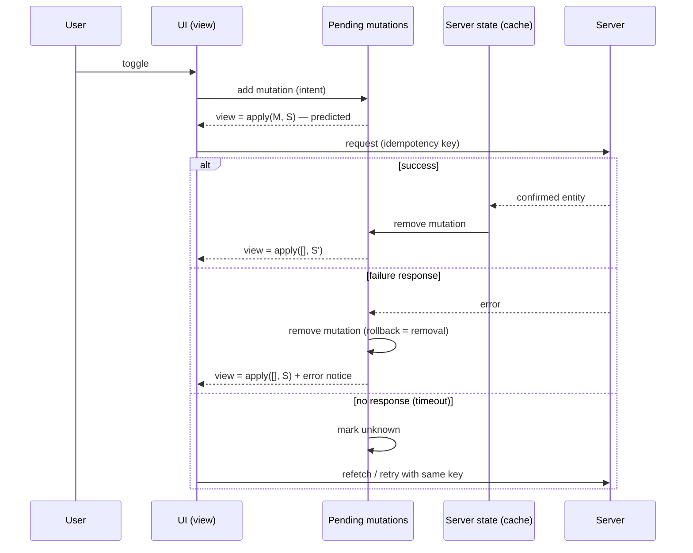
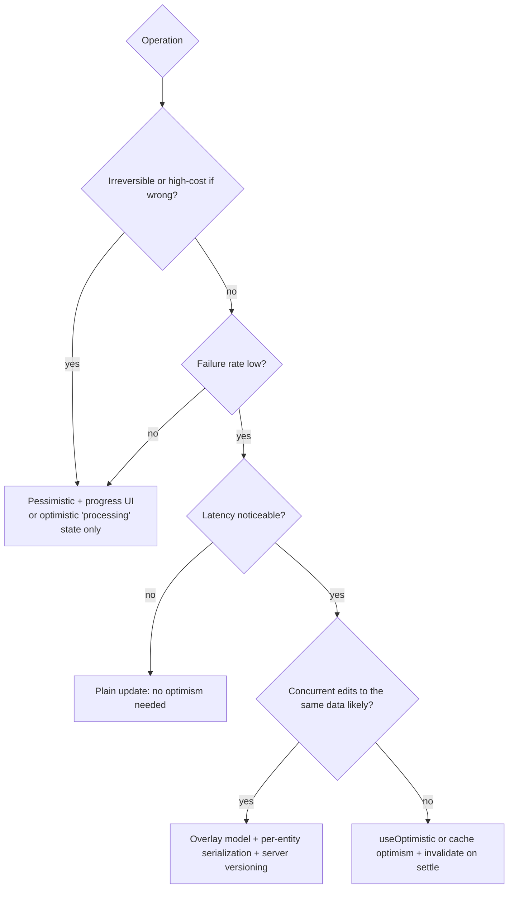

# 06 / 05 — Optimistic Updates: Showing the Outcome Before the Server Agrees

## 1. Lesson metadata

| | |
|---|---|
| **Level** | Advanced |
| **Study time** | 5 hours (reading 2 h, experiments 1.5 h, exercises 1.5 h) |
| **Prerequisites** | [06 / 02 — Cancellation and race conditions](./02-cancellation-and-race-conditions.md), [06 / 03 — Loading and error states](./03-loading-and-error-states.md), [06 / 04 — API normalization](./04-api-normalization.md), [03 / 02 — Functional state updates](../03-react-state-and-hooks/02-functional-state-updates.md), [03 / 03 — `useReducer`](../03-react-state-and-hooks/03-usereducer-and-reducer-architecture.md), [03 / 22 — Modern hooks and APIs](../03-react-state-and-hooks/22-modern-hooks-and-apis.md), [02 / 23 — Transitions and deferred rendering](../02-react-rendering-and-internals/23-transitions-and-deferred-rendering.md) |
| **Next** | [06 — Cache consistency and invalidation](./06-cache-consistency-and-invalidation.md) |
| **Related** | [08 — TanStack Query](./08-tanstack-query.md), [09 / 13 — Forms, actions, and mutations](../09-advanced-rendering-and-ecosystem/13-forms-actions-and-mutations.md), [15 — Error recovery and retries](./15-error-recovery-and-retries.md), [16 — Offline considerations](./16-offline-considerations.md) |

> **Version-sensitive.** `useOptimistic` is a React 19 API; the TanStack Query examples target v5. Reviewed 2026-10-22 against React 19.3 (executed tests) and `@tanstack/query-core` 5.104 (executed); keep the react.dev reference (<https://react.dev/reference/react/useOptimistic>) and TanStack docs as the authority. The *concepts* — predicting an outcome, keeping the prediction separate from the truth, reconciling, rolling back — are stable.

**Learning objectives.** After this lesson you can:
1. Define an optimistic update precisely and state the contract it makes with the user (a prediction, not a fact).
2. Decide whether an operation is a good candidate for optimism using criteria (success rate, reversibility, cost of being wrong, latency).
3. Implement optimism three ways — React 19 `useOptimistic`, a query-cache update with rollback, and a "pending mutations overlay" derived model — and say what each owns.
4. Explain exactly why snapshot-and-restore rollback is *incorrect* under concurrent mutations, and why deriving the view from `server state + pending mutations` is robust.
5. Handle temporary ids, server-assigned fields, ordering, duplicates, and reconciliation after success.
6. Specify user-visible failure behavior (rollback, retry, undo, conflict) and make failures accessible.
7. Compare optimism with plain pending UI, disabled controls, and server-confirmed updates.

**Concepts covered:** optimistic vs pessimistic update, prediction vs truth, optimistic state as derived state, rollback, snapshot hazards, mutation log/overlay, `useOptimistic` and Actions, `onMutate`/`onError`/`onSettled`, temporary ids, reconciliation, idempotency, ordering, conflicts, undo, pending indicators, offline queue, when *not* to be optimistic.

---

## 2. Deep conceptual explanation

### 2.1 What is an optimistic update?

A **pessimistic** (server-confirmed) update waits: the user acts, a request goes out, a pending indicator shows, the UI changes only after success. An **optimistic** update *changes the UI immediately as if the request had already succeeded*, then reconciles with the actual outcome:

```text
user acts ─► UI shows predicted result ─► request in flight ─► success: keep (adopt server truth)
                                                           └► failure: undo + explain
```

The motivation is perceived latency. A "like" button that takes 300 ms to turn red feels broken; one that flips instantly feels native. The price is that **the UI now briefly asserts something that may be false**. Optimistic updating is therefore a *contract*: the application promises to either confirm the prediction or visibly correct it. Everything in this lesson — rollback, ordering, ids, conflicts — is the work of keeping that promise.

### 2.2 Prediction vs truth: the central distinction

There are two kinds of data on screen:

- **Server state**: the last value the server confirmed (as of some time).
- **Predicted state**: what we *expect* the server state will be after pending operations succeed.

A robust design keeps these **separate** and *derives* the view:

```text
view = apply(pendingMutations, serverState)
```

When a mutation succeeds, the server state is refreshed (response or refetch) and the mutation leaves the pending list. When it fails, the mutation leaves the list and `view` recomputes without it — **rollback is just removal**, not "restore an old copy". This is the same principle as "derive, don't duplicate" ([03 / 17 — Derived state](../03-react-state-and-hooks/17-derived-state.md)) and is the foundation of React's own `useOptimistic` model (§3.1).

The alternative — mutate the cached copy in place and remember how to restore it (**snapshot/rollback**) — is common (it is the documented TanStack Query pattern) and workable, but has well-known failure modes (§2.5).

### 2.3 Is this operation a good candidate?

Optimism is a product decision with an engineering cost. A decision table:

| Criterion | Favors optimism | Against |
|---|---|---|
| Success probability | Very high (≥ ~99%: likes, toggles, reorder, rename, mark-read) | Frequent failure due to validation, permissions, inventory |
| Reversibility of the visible effect | Easy to undo visually and semantically | Irreversible effects (send email, charge card, publish publicly) |
| Cost of a wrong prediction | Low (user sees a flicker) | High (user acts on the false state: "Order placed!" then not) |
| Latency | Noticeable (> ~100–200 ms) | Already instant (cache-local) — no need |
| Server-assigned results | None, or only cosmetic (ids) | Server computes essential results the user needs (price, tax, availability) |
| Dependencies | Self-contained | Next steps depend on the confirmed result |
| Concurrency | Single user or commutative changes | Contended resources (seat selection, last item) |

Heuristic: *optimistic for toggles and edits to your own data; pessimistic with clear progress for money, irreversible actions, and contended resources.* Presenting that as a rule would be an overstatement — a payment flow can show an optimistic *"processing"* state (not "paid"), and an inventory reservation can be optimistic if the UI labels it "holding…".

**Responsibility comparison — who does what in an optimistic flow?**

| Responsibility | `useOptimistic` | Query-cache optimism | Hand-rolled overlay | Pessimistic + pending UI |
|---|---|---|---|---|
| Show predicted state | Yes (derived from base state + pending updates) | You write predicted data into the cache | Derived each render | No |
| Know when the prediction ends | Automatically, when the Action/transition completes | You (`onSettled`, cancel + rollback) | You (remove from pending list on settle) | n/a |
| Roll back on failure | Automatic revert to base state when the Action ends | You write a rollback (snapshot or invalidate) | Remove entry; view recomputes | n/a |
| Keep concurrent mutations correct | Each update is applied over base state in order (verified: two `addOptimistic` calls in one Action rendered `[1,2]`) | Hard (snapshots interleave) | Natural (replay log) | n/a |
| Reconcile with server result | You update the real state (the base) in the Action | `setQueryData` or invalidate | You update server state; then drop pending | Server result adopted |
| Cancel in-flight refetches | Not applicable | You (`cancelQueries`) | You | n/a |
| Network, retries, caching | Not provided (you do it) | Library | You | Your or library |

`useOptimistic` is a **view-layer tool**: it renders temporary state tied to an async Action. It does not perform requests, cache, retry, or reconcile — you still do that. A query library is a **cache tool** with hooks for optimism; it does not know about React Actions. They compose.

### 2.4 Reconciliation: what happens when the server answers

On success there are three options, each a trade-off:

1. **Keep the prediction, mark confirmed.** Cheapest; correct only if the prediction equals the server's result exactly (it rarely does for server-assigned fields: ids, timestamps, counters).
2. **Replace with the server's response** (the mutation's return value). One round trip; correct if the response contains the full updated entity.
3. **Invalidate and refetch** (lesson 06). Always converges to truth; costs a request and a possible visual "jump" if the prediction differs from the truth.

Most real systems do (2) when the response carries the entity, and (3) as a *safety net* in `onSettled` regardless of success or failure, because a failed or timed-out mutation leaves the true state unknown (§2.7).

### 2.5 Why snapshot-and-restore breaks

The commonly shown pattern is:

```text
onMutate:  cancel in-flight reads for the key
           snapshot = cache.get(key)
           cache.set(key, predicted(snapshot))
onError:   cache.set(key, snapshot)          // roll back
onSettled: invalidate(key)
```

This is correct for **one mutation at a time**. With two overlapping mutations A then B on the same data:

| Step | Cache | Event |
|---|---|---|
| 0 | `S0` | initial |
| 1 | `S0 + A` | A.onMutate: snapshot_A = `S0`; predicted |
| 2 | `S0 + A + B` | B.onMutate: snapshot_B = `S0 + A` (B's snapshot includes A's *unconfirmed* prediction) |
| 3 | `S0 + A` | B fails → restore snapshot_B = `S0 + A` — fine here |
| 3′ (alternative) | `S0` | **A fails first** → restore snapshot_A = `S0` — **B's prediction is also wiped** though B is still pending and may succeed |
| 4′ | `S0` | B succeeds on the server; cache shows `S0` until refetch; user sees B "undo itself" |

Variants: the restore overwrites a server-confirmed refresh that landed in between; the restore resurrects data deleted by a third path. The safe way to make the snapshot pattern robust is to **avoid per-mutation snapshots** and instead (a) cancel and invalidate on settle so truth always overwrites, accepting a flicker, or (b) use the derived overlay (§2.2). TanStack Query's docs describe checking `queryClient.isMutating(...)` before invalidating (see lesson 08); do not assume a library makes this automatically right.

### 2.6 Temporary ids and server-assigned fields

Creating an entity optimistically (a new comment, a new todo) requires an id before the server has issued one.

| Strategy | How | Pros | Cons |
|---|---|---|---|
| **Client-generated id kept as the real id** | Client creates a UUID (e.g. `crypto.randomUUID()`, available in secure contexts) and the server accepts it | No id swap; offline-friendly; natural idempotency key | Server must accept client ids and validate uniqueness; some systems forbid it |
| **Temporary id, replaced on success** | `tmp-<uuid>` shown; replaced by the server id | Works with servers that assign ids | Keys change → React remounts the row (state/animation loss) unless you keep a stable *client key* separate from the id; references to the temp id (selection, focus) must be migrated |
| **Not shown as a row until confirmed** | Show a "pending" placeholder outside the list | Simplest | Not really optimistic |

For lists, give each item a stable **React key** that survives the id swap (a `clientKey` field), ([01 / 09 — Lists, keys, and identity](../01-react-fundamentals/09-lists-keys-and-identity.md)). Server-assigned fields (timestamps, counters, computed slugs) should be rendered as *unknown/pending* until confirmed — do not invent a timestamp the server will contradict.

### 2.7 Unknown outcomes

A mutation request can end three ways from the client's perspective: **success response**, **failure response**, or **no response** (timeout, abort, connection drop). The third is the dangerous one: the server may or may not have applied it ([02 §2.5](./02-cancellation-and-race-conditions.md)). The honest UI treats it as *unknown*: keep the item marked "not confirmed", retry with the **same idempotency key** or id, or refetch to find out. Rolling back on a timeout can contradict reality; failing to roll back on a real failure leaves a lie. Hence "invalidate on settle" as the universal safety net.

### 2.8 Failure UX

A prediction that is later rolled back is a *UI event the user must understand*. Options, from least to most intrusive:

| Option | When appropriate |
|---|---|
| Silent revert + toast "Couldn't save. Reverted." | Low-stakes toggles; the toast must be accessible (`role="status"`/`alert`) and persist long enough to read |
| Keep the predicted item visibly "failed" with Retry/Discard | User-authored content (comments, messages) — never throw away what the user typed |
| Inline error at the item + preserved input | Edits to fields |
| Conflict UI (diff/overwrite/reload) | 409/412, concurrent editing |
| Undo pattern (delay the real request a few seconds, offer Undo) | Destructive actions, as an alternative to confirm dialogs — *but note: the data is not actually deleted until the delay ends; closing the tab inside the window loses or double-applies depending on implementation* |

The rule that matters most: **never destroy user-authored content on failure.** Roll back *state*, preserve *input*.

### 2.9 Misconceptions

| Misconception | Reality |
|---|---|
| "Optimistic means ignoring the server's answer." | The server stays authoritative; optimism only changes what is shown *before* the answer. |
| "`useOptimistic` is a cache." | It is temporary render state tied to an async Action. |
| "Rollback = restore the previous value." | Under concurrency that is wrong; remove the mutation from the pending set and re-derive. |
| "If the mutation succeeded, I'm done." | The prediction may differ from the server's result; reconcile or refetch. |
| "Optimism removes the need for loading/error UI." | It *adds* a failure UI. |
| "Always be optimistic; it's better UX." | For irreversible/contended/high-failure operations it misleads. |
| "A rejected promise means the server did not apply it." | A *response* of failure means not applied; a rejection due to timeout means unknown. |

---

## 3. Internal mechanics

### 3.1 `useOptimistic` (React 19): what it guarantees

**Public guarantee** (react.dev `useOptimistic` reference; behaviours below also confirmed by running React 19.3): `useOptimistic(state, updateFn?)` returns `[optimisticState, addOptimistic]`. While an **Action** (an async function run inside a transition, for example via a `<form action>` or `startTransition`) is pending, calling `addOptimistic(value)` causes `optimisticState` to be computed as `updateFn(currentState, value)` (or simply `value` if no `updateFn`). When the Action completes — whether it succeeds or throws — the optimistic overlay is dropped and `optimisticState` equals the `state` argument passed to the hook at that time. Therefore the **real** state must be updated by your Action (via ordinary state, props from a framework, or a cache) for the confirmed result to remain visible.

**Teaching model:** `optimisticState = reduce(baseState, pendingOptimisticUpdates)`. The pending updates exist **only for the duration of the Action**; the base state is whatever you pass in. The "rollback" is automatic because the overlay simply disappears — the same derivation as §2.2.

**Implementation detail:** React implements this with a special kind of hook state processed in transition-lane work (conceptually; do not rely on internal names). Do not rely on how many renders are produced.

Behaviours confirmed by running React 19.3 (RTL + jsdom):
- `addOptimistic` must be called **inside an Action/transition**; calling it elsewhere logs a `console.error` in development ("An optimistic state update occurred outside a transition or action. To fix, move the update to an action, or wrap with startTransition.") and the optimistic value is not shown.
- Behavior when multiple `addOptimistic` calls occur during one Action: the reducer function is applied to each in order over the base state (two calls rendered `1,2` while the Action was pending and the overlay cleared afterwards).
- The overlay is tied to the Action finishing (the transition ending), not to your `setState` call: it was still applied while a post-`await` plain `setState` rendered (see §3.2). Ensure your real state update is part of the same transition.

### 3.2 Why the real state update must be inside the same transition

If the Action `await`s the server and *then* calls `setTodos(newList)` **outside** a transition (after an `await`, updates are not automatically part of the transition; the react.dev `useTransition` reference still says they "currently require wrapping any set functions after the await in an additional `startTransition`"), the update is committed on its own, outside the Action. Observed on React 19.3 with the §5.2 component: with `startTransition` around the post-`await` update the renders were `hi*` (overlay) then `hi` (confirmed), clean; with a plain post-`await` `setState`, there was an intermediate render showing **both** the confirmed row and the still-applied overlay row (`hi, hi*` — a duplicate, and duplicate React keys if both share `clientKey`) before the overlay dropped. If instead the real update commits *after* the Action ends, you get the opposite glitch, a flash of the pre-mutation base state. Either way the fix is the same: wrap post-`await` state updates in `startTransition`. Frameworks that revalidate data as part of the Action avoid this by design.

### 3.3 Query-cache optimism mechanics (teaching model)

A query cache stores `queryKey → { data, status, updatedAt, ... }` and a set of observers. Optimistic cache updates:

1. **Cancel** in-flight fetches for the key so a response *started before the mutation* cannot overwrite the prediction (this is the race from [02](./02-cancellation-and-race-conditions.md) applied to the cache).
2. **Write** predicted data (`setQueryData`-style) — observers re-render.
3. **Settle**: on error write a rollback; on settled **invalidate** so a fresh fetch replaces whatever is there with truth.

In TanStack Query v5 the relevant calls are `queryClient.cancelQueries`, `queryClient.getQueryData`, `queryClient.setQueryData`, `queryClient.invalidateQueries`, and `useMutation` options `onMutate`, `onError`, `onSettled`; v5 also documents a simpler UI-driven optimism that renders from the mutation's `variables` while it is pending (no cache write, so no rollback is needed); both approaches are described in TanStack's "Optimistic Updates" guide, and the calls above were executed against `@tanstack/query-core` 5.104. In 5.104, callbacks are `onMutate(variables, context)`, `onSuccess(data, variables, onMutateResult, context)`, `onError(error, variables, onMutateResult, context)` and `onSettled(data, error, variables, onMutateResult, context)`, where `context` is `{ client, meta, mutationKey }`; the value you return from `onMutate` arrives as the third parameter (older v5 releases had it as `context`), so the lesson's `(err, vars, ctx)` shape still works.

### 3.4 Ordering guarantees you do and don't have

- Requests are sent in order of `fetch` calls, but **processed and answered in arbitrary order** (lesson 02). With overlapping mutations on the *same field*, the final server value depends on server ordering, not click order.
- The overlay model assumes mutations apply **in click order** when replayed. If the server may apply them out of order, either serialize (queue) or use server-side versioning; otherwise your confirmed state may differ from the predicted state and the invalidate-on-settle refetch will make the UI *jump* to the server's order. That jump is a **correct** outcome (server truth), but it should be rare.

### 3.5 Idempotency and retries

A retried optimistic *create* must not create twice. Send an idempotency key (a client-generated id per user intent) and make the server deduplicate; HTTP's own idempotency applies only to methods defined as idempotent (`PUT`, `DELETE`, safe methods) — `POST` is not, so rely on keys (the exact header or field is server-defined; `Idempotency-Key` is a common convention, check your API). Idempotent *replays* are what make "unknown outcome → retry" safe.

---

## 4. Step-by-step execution walkthrough

Scenario: todo list; user toggles "Buy milk" done (A), then immediately toggles "Walk dog" done (B). Both on the same list cache `['todos']`. Server latency: A 800 ms and **fails with 500**, B 300 ms and succeeds. Compare **snapshot rollback** vs **overlay**.

**Approach 1 — Snapshot/rollback in the cache**

| t | Event | Cache state | UI |
|---|---|---|---|
| 0 | Initial `S0`: milk ☐, dog ☐ | S0 | both unchecked |
| 10 | Click A. onMutate: cancel reads; snapshot_A=S0; cache = milk ☑ | S0+A | milk ☑ |
| 60 | Click B. onMutate: snapshot_B = S0+A; cache = milk ☑, dog ☑ | S0+A+B | both ☑ |
| 360 | B succeeds. onSettled: invalidate → refetch starts | | |
| 460 | Refetch returns server state: milk ☐ (A not applied yet / failed), dog ☑ | S0+B (server) | milk ☐, dog ☑ |
| 810 | A fails. onError: restore snapshot_A = S0 → cache = milk ☐, dog ☐ | **S0** | **dog becomes unchecked**, though server has dog ☑ |
| 810 | A.onSettled: invalidate → refetch | | |
| 910 | Refetch: milk ☐, dog ☑ | S0+B | dog ☑ again |

User-visible: dog flickers checked → unchecked → checked. The *final* state is right only because of the invalidate-on-settle safety net; between 810 and 910 the UI was wrong.

**Approach 2 — Overlay (derived)**

`view = apply([A, B], server)`:

| t | Event | server | pending | view |
|---|---|---|---|---|
| 10 | A pending | S0 | [A] | milk ☑ |
| 60 | B pending | S0 | [A, B] | milk ☑, dog ☑ |
| 360 | B succeeds; server state updated from response (dog ☑ confirmed) | S0+B | [A] | milk ☑, dog ☑ |
| 810 | A fails; A removed; view recomputed | S0+B | [] | milk ☐, dog ☑ |

No flicker on `dog`. Milk reverts, with an error message. **Predict:** what if A's failure had been "unknown outcome" (timeout)? *Answer:* keep A in the list marked `unknown`, refetch to learn truth, then drop it; the view keeps milk ☑ (dimmed or marked "unconfirmed") until the refetch determines the real value.

**`useOptimistic` timeline (single Action):** user submits the form → `addOptimistic(...)` inside the Action → render shows predicted item (pending) → Action awaits request → Action updates real state (in the transition) → Action completes → overlay dropped; `optimisticState` equals the new real state → a single visually stable result if the prediction matched. If the Action throws, the overlay drops and the base (old) state shows, and the error propagates to your handling: for a `<form action>` function that throws, the uncontrolled field kept its text (it is only reset after success) and the error reached the caller; an error thrown inside an async transition reached the nearest error boundary in our React 19.3 test. Behaviour for `useActionState` and framework Server Actions differs, so check your entry point.

---

## 5. Code examples

### 5.1 Minimal: the pessimistic baseline

```tsx
function LikeButton({ postId, initial }: { postId: string; initial: boolean }) {
  const [liked, setLiked] = useState(initial);
  const [pending, setPending] = useState(false);

  async function toggle() {
    setPending(true);
    try {
      await api.setLike(postId, !liked);
      setLiked(!liked);                     // UI changes only after the server confirmed
    } finally {
      setPending(false);
    }
  }
  return <button onClick={toggle} disabled={pending} aria-pressed={liked}>♥</button>;
}
```

Correct and simple. Costs: perceived latency and a disabled button. Note `setLiked(!liked)` reads the captured `liked` — fine because the button is disabled while pending, which *removes concurrency by construction*; remove the `disabled` and double-clicks produce a stale-closure bug ([03 / 05](../03-react-state-and-hooks/05-effect-dependencies-and-stale-closures.md)).

### 5.2 Practical: `useOptimistic` with a form Action (React 19)

```tsx
import { useOptimistic, useRef, useState, startTransition } from 'react';

interface Comment { clientKey: string; id?: string; text: string; pending?: boolean }

export function Comments({ postId, initial }: { postId: string; initial: Comment[] }) {
  const [comments, setComments] = useState<Comment[]>(initial);          // base (confirmed) state
  const [optimisticComments, addOptimisticComment] = useOptimistic(
    comments,
    (current: Comment[], draft: Comment) => [...current, { ...draft, pending: true }],
  );
  const [failed, setFailed] = useState<Array<{ clientKey: string; text: string }>>([]);
  const formRef = useRef<HTMLFormElement>(null);

  async function submit(formData: FormData) {
    const text = String(formData.get('text') ?? '').trim();
    if (text === '') return;

    const draft: Comment = { clientKey: crypto.randomUUID(), text };
    addOptimisticComment(draft);                                          // inside the Action
    formRef.current?.reset();

    try {
      const saved = await api.createComment(postId, { text, idempotencyKey: draft.clientKey });
      startTransition(() => {                                             // post-await update kept in the transition (required; see §3.2)
        setComments((c) => [...c, { clientKey: draft.clientKey, id: saved.id, text: saved.text }]);
      });
    } catch (e) {
      // Overlay will be dropped when the Action ends; surface the failure and keep the text.
      startTransition(() => setFailed((f) => [...f, { clientKey: draft.clientKey, text }]));
    }
  }

  return (
    <>
      <ul>
        {optimisticComments.map((c) => (
          <li key={c.clientKey} aria-busy={c.pending} style={{ opacity: c.pending ? 0.6 : 1 }}>
            {c.text}{c.pending && <span className="sr-only"> (sending)</span>}
          </li>
        ))}
      </ul>
      {failed.map((f) => (
        <p key={f.clientKey} role="alert">
          Not posted: “{f.text}”{' '}
          <button type="button" onClick={() => setFailed((x) => x.filter((y) => y.clientKey !== f.clientKey))}>Discard</button>
        </p>
      ))}
      <form action={submit} ref={formRef}>
        <textarea name="text" required />
        <button type="submit">Post</button>
      </form>
    </>
  );
}
declare const api: { createComment(postId: string, body: { text: string; idempotencyKey: string }): Promise<{ id: string; text: string }>; setLike(id: string, v: boolean): Promise<void> };
```

Line notes and honest caveats:

- `useOptimistic(base, reducer)`: the reducer produces the overlay view from the base and the draft. Pending entries are flagged for styling and for assistive tech ("sending").
- `clientKey` is a **stable React key and an idempotency key**: the optimistic row and the confirmed row have the *same key*, so React *updates* the row in place instead of unmounting/remounting it ([01 / 09](../01-react-fundamentals/09-lists-keys-and-identity.md)). The server `id` arrives later.
- `<form action={submit}>`: in React 19 a function passed to `action` runs as an Action inside a transition, which is why `addOptimisticComment` is legal here (confirmed: no warning when called from a `<form action>` function). The form's uncontrolled fields reset automatically after a successful Action in React 19 *for function actions* (confirmed in React 19.3: the field was cleared after success and kept its text when the action threw), which can surprise you when you want to keep input on failure; this example resets the form immediately but preserves the text in a `failed` list (rendered with Discard; add a Retry that resubmits with the same `clientKey`), satisfying §2.8.*
- `crypto.randomUUID()` requires a secure context (HTTPS or localhost); MDN compat data: Chrome 92, Firefox 95, Safari 15.4.
- The `catch` branch: the overlay disappears when the Action ends regardless; to avoid losing the user's words, keep them in *real* state as a "failed" entry. That is the design point: **optimism rolls back state, not user content.**

The `declare const api` line is a typing stub for the example's API client; everything else is complete.

### 5.3 Practical: query-cache optimism with rollback (TanStack Query v5, executed against 5.104)

```tsx
import { useMutation, useQueryClient } from '@tanstack/react-query';

interface Todo { id: string; title: string; done: boolean }
const todosKey = ['todos'] as const;

export function useToggleTodo() {
  const qc = useQueryClient();

  return useMutation({
    mutationFn: (v: { id: string; done: boolean }) => api.patchTodo(v.id, { done: v.done }),

    onMutate: async (v) => {
      await qc.cancelQueries({ queryKey: todosKey });                  // stop in-flight reads overwriting the prediction
      const previous = qc.getQueryData<Todo[]>(todosKey);              // snapshot (see §2.5 for its limits)
      qc.setQueryData<Todo[]>(todosKey, (old) =>
        old?.map((t) => (t.id === v.id ? { ...t, done: v.done } : t)),
      );
      return { previous };                                             // becomes `context` in onError
    },

    onError: (_err, _v, context) => {
      if (context?.previous) qc.setQueryData(todosKey, context.previous);  // rollback (coarse)
    },

    onSettled: () => {
      void qc.invalidateQueries({ queryKey: todosKey });               // converge to truth either way
    },
  });
}
declare const api: { patchTodo(id: string, body: Partial<Todo>): Promise<Todo> };
```

Line notes:

- `cancelQueries` first: without it, a refetch that began before the click can resolve *after* `setQueryData` and silently replace the prediction with older server data (a race of the kind in lesson 02).
- `previous` is a snapshot of the **whole list** — coarse. Under overlapping toggles its restore wipes other predictions (§2.5, §4). A narrower approach rolls back only the *affected item* by id, which is better but still not fully concurrent-safe if the same item is toggled twice.
- `onSettled` invalidation is the safety net; many teams treat it as *the* correctness mechanism and the rollback as cosmetic.
- Option names confirmed in 5.104. The `onMutate` return value reaches `onError`/`onSettled` as the third argument (`onMutateResult`); `onMutate` itself receives `(variables, context)` where `context` is `{ client, meta, mutationKey }`.

### 5.4 Advanced: the derived "variables" approach (no cache write, no rollback code)

```tsx
import { useMutation, useMutationState, useQuery } from '@tanstack/react-query';

function TodoList() {
  const { data: todos = [] } = useQuery({ queryKey: ['todos'], queryFn: api.listTodos });

  // Pending toggle mutations' variables, by mutation key. (`useMutationState({ filters, select })` is exported by 5.104.)
  const pending = useMutationState({
    filters: { mutationKey: ['toggle-todo'], status: 'pending' },
    select: (m) => m.state.variables as { id: string; done: boolean },
  });

  const view = todos.map((t) => {
    const p = pending.filter((x) => x.id === t.id).at(-1);   // latest pending toggle for this todo
    return p ? { ...t, done: p.done, pending: true } : t;
  });
  /* render `view` */
}
```

This is the §2.2 formula `view = apply(pending, server)` expressed with library primitives: the cache is **never written** with unconfirmed data, so there is nothing to roll back, and a failing mutation simply disappears from `pending`. The mutation hook itself still invalidates on settle (so the base converges). Limitation: it works for where the pending list is *visible* (components using `useMutationState`); other consumers of the same cache entry (a different component showing todo counts) won't see the prediction unless they also apply the overlay — a *consistency vs simplicity* trade-off. The library also documents a single-component variant using the mutation's own `variables` (`useMutation` returns `variables` and `isPending`). `Array.prototype.at` requires a modern runtime target.

### 5.5 Advanced: a hand-rolled mutation log (no libraries)

```tsx
type Todo = { id: string; title: string; done: boolean };
type Pending =
  | { kind: 'toggle'; mutationId: string; id: string; done: boolean; status: 'inflight' | 'unknown' }
  | { kind: 'add'; mutationId: string; todo: Todo; status: 'inflight' | 'unknown' };

function applyPending(server: readonly Todo[], pending: readonly Pending[]): Array<Todo & { pending?: boolean }> {
  let view: Array<Todo & { pending?: boolean }> = [...server];
  for (const p of pending) {                              // replay in click order
    if (p.kind === 'toggle') view = view.map((t) => (t.id === p.id ? { ...t, done: p.done, pending: true } : t));
    else if (!view.some((t) => t.id === p.todo.id)) view = [...view, { ...p.todo, pending: true }];  // dedupe once confirmed
  }
  return view;
}

type Action =
  | { type: 'server-loaded'; todos: Todo[] }
  | { type: 'mutation-started'; mutation: Pending }
  | { type: 'mutation-settled'; mutationId: string; outcome: 'ok' | 'failed' | 'unknown'; confirmed?: Todo }
  ;

interface State { server: Todo[]; pending: Pending[]; errors: string[] }

function reducer(s: State, a: Action): State {
  switch (a.type) {
    case 'server-loaded': return { ...s, server: a.todos };
    case 'mutation-started': return { ...s, pending: [...s.pending, a.mutation] };
    case 'mutation-settled': {
      const rest = s.pending.filter((m) => m.mutationId !== a.mutationId);
      if (a.outcome === 'ok') {
        const server = a.confirmed
          ? s.server.some((t) => t.id === a.confirmed!.id)
            ? s.server.map((t) => (t.id === a.confirmed!.id ? a.confirmed! : t))
            : [...s.server, a.confirmed]
          : s.server;
        return { ...s, server, pending: rest };
      }
      if (a.outcome === 'unknown') {
        return { ...s, pending: s.pending.map((m) => (m.mutationId === a.mutationId ? { ...m, status: 'unknown' } : m)) };
      }
      return { ...s, pending: rest, errors: [...s.errors, `Change ${a.mutationId} failed and was reverted.`] };
    }
  }
}
```

What this demonstrates: rollback is `pending: rest` (removal); the `view` is recomputed by `applyPending` during render (derived, not stored); `unknown` outcomes remain in the list until a refetch settles them; confirmed results are written into `server` so removal of the pending entry doesn't flash the old value. Cost: you now own a small sync engine. Use it when you need correctness under concurrency without adopting a library, or as the mental model for evaluating libraries.

### 5.6 Incorrect: three bugs in a common optimistic implementation

```tsx
async function toggleBad(todo: Todo) {
  setTodos(todos.map((t) => (t.id === todo.id ? { ...t, done: !t.done } : t)));   // (1)
  try {
    await api.patchTodo(todo.id, { done: !todo.done });
  } catch {
    setTodos(todos);                                                              // (2)
  }
}
```

**Predict:** user double-clicks the same todo quickly while the first request is still pending; then the first request fails. What is on screen and what does the server hold? Then identify defects.

(1) `todos` is a captured snapshot (stale closure) — the second click maps over the *old* list and its prediction replaces the first's; use the functional updater form. (2) The rollback restores the *entire list captured at click time*, wiping every other change since; and (3) `!todo.done` is computed from the click-time value, so two quick clicks send **the same** `done` value twice (both "set to true"), rather than toggling back — the user's intent ("toggle twice = unchanged") is lost; send the *target value* computed from the latest state. Also: no `onSettled` refetch, no error message, no handling of unknown outcomes.

### 5.7 Corrected (state-level): functional updates + targeted rollback

```tsx
function toggleBetter(id: string) {
  let target = false;
  setTodos((cur) => cur.map((t) => {
    if (t.id !== id) return t;
    target = !t.done;                       // updater functions can run twice in StrictMode dev; see note
    return { ...t, done: target };
  }));
  /* ... */
}
```

This sketch has its own trap: **updater functions must be pure** — running twice in StrictMode (dev) is expected, and assigning an outer variable inside is a side effect (works only because both runs assign the same value). The clean solution is to compute the target from a **ref holding the latest state** or, better, keep intent in the *mutation list* (§5.5) where the click records the target value explicitly (`{kind:'toggle', id, done: target}`) from state read at event time. The event handler *can* read the latest state through a ref or through the derived `view`. This is why the overlay model is easier to get right: the mutation carries explicit intent.

### 5.8 Advanced: serialize mutations per entity to keep server order = click order

```tsx
const queues = new Map<string, Promise<unknown>>();

export function enqueueFor<T>(entityId: string, task: () => Promise<T>): Promise<T> {
  const prev = queues.get(entityId) ?? Promise.resolve();
  const run = prev.catch(() => undefined).then(task);
  const tail = run.catch(() => undefined);
  queues.set(entityId, tail);
  void tail.then(() => { if (queues.get(entityId) === tail) queues.delete(entityId); });
  return run;
}
```

Applying per-entity serialization (two toggles on the same todo are sent one after the other) makes the server's final state match the user's last click and keeps the overlay replay faithful. Different entities still run in parallel. Trade-off: added latency for rapid repeated edits on the *same* entity; mitigate by **coalescing** (send only the last value) as in lesson 02 §5.7. Module-level `Map` caveat for SSR applies.

---

## 6. Visual explanations

### The optimistic contract



### Snapshot hazard

```text
S0 ──A──► S0+A ──B──► S0+A+B
snapshots: A holds S0; B holds S0+A
A fails first  → restore S0  → B's prediction wiped while B still pending  ✗
B fails first  → restore S0+A → correct                                     ✓
order of failure decides correctness  ⇒ non-deterministic UI
```

### Decision tree



---

## 7. Alternative approaches and trade-offs

| Approach | Perceived latency | Correct under concurrency | Failure handling | Complexity | Where state lives | Fits |
|---|---|---|---|---|---|---|
| Pessimistic + disabled control | Slow | Yes (no concurrency) | Simple | Lowest | Component | Money, irreversible, rare actions |
| Pessimistic + inline pending | Slow-ish | Mostly | Simple | Low | Component/cache | Forms with server-computed results |
| `useOptimistic` (+ Actions) | Instant | Per-Action overlay; you ensure base consistency | Overlay auto-drops; you add messaging | Low–Med | React transition state | Form actions, list adds, toggles in React 19 apps |
| Cache optimism with snapshot rollback | Instant | **Weak** with overlaps; safe if invalidated on settle | Rollback + refetch | Med | Query cache | Typical SPA mutations |
| Overlay from pending `variables` (library-supported) | Instant | Good | Disappears on failure | Med | Mutation state | Local, visible-in-one-place updates |
| Hand-rolled mutation log | Instant | **Best** (replay) | Explicit | High | Your store | Collaborative/offline-first/complex lists |
| Server-confirmed + realtime push | Medium | Server decides | Server-driven | Med–High (infra) | Server | Multi-user dashboards |
| Offline queue ([16](./16-offline-considerations.md)) | Instant | Needs conflict strategy | Retries, reconciliation | High | Persistent store | Mobile/field apps |

**When the recommended approach (optimistic with overlay + invalidate-on-settle) is *not* best.**

1. **Payments, bookings, inventory holds.** A wrongly displayed "Confirmed" has real-world consequences. Prefer pessimistic with strong progress UI; if you want snappiness, show "Processing…" (a *true* statement) rather than the end state.
2. **Server computes what the user needs.** Totals with tax/discount rules, shipping estimates: the prediction would duplicate server logic and drift. Show previous values dimmed with a pending marker.
3. **High failure rates** (permissions, validation): users see constant flip-flops. Validate client-side first; use pessimistic updates.
4. **Fast networks / cache-local changes.** If the round trip is 30 ms, optimism adds code for nothing.
5. **Strong cross-user contention** (last seat on a flight): optimism lies about scarce state; use pessimistic with a reservation step.

---

## 8. Best practices and anti-patterns

**Do**

- Keep **prediction separate from truth**; derive the view; make rollback a removal.
- Cancel (or ignore) in-flight reads for the affected data before writing a prediction.
- Always **converge on settle** (invalidate/refetch or adopt the server response), on both success and failure.
- Carry **explicit intent** (target value, not "toggle") in the mutation, and an **idempotency key**.
- Give optimistic list items a stable client key; mark them pending visually and for assistive tech.
- Preserve user-authored content on failure; offer Retry/Discard.
- Serialize or coalesce mutations per entity when order matters; version resources for multi-client safety.
- Treat "no response" as *unknown*, not *failed*.
- Announce failures (`role="alert"`/status) and make reverts understandable.
- Test with **slow and failing** responses and with rapid repeated clicks.

**Anti-patterns**

| Smell | Why it hurts | Fix |
|---|---|---|
| Optimistic "Payment successful" | Lying about irreversible state | Pessimistic with progress; show "processing" |
| Snapshot of entire cache restored on any error | Wipes concurrent predictions | Overlay or targeted rollback + invalidate |
| Toggle computed from stale closure (`!todo.done`) | Intent lost on rapid clicks | Send target value; functional/derived reads |
| Using the optimistic value as input to another request without confirmation | Propagates false assumptions | Block dependent actions until confirmed |
| Swallowing errors after rollback | User confusion | Visible message + retry |
| Inventing server-assigned values (timestamps, counters) | Contradicted after confirm | Mark unknown/pending |
| New React keys for confirmed items (id swap) | Remount; lost focus/animation | Stable `clientKey` |
| Clearing the form before success | Data loss on failure | Clear after success, or retain failed draft |
| No settle-time refetch | UI diverges silently | `invalidate` on settled |
| Optimism for every mutation by policy | Misleading UX in risky flows | Per-operation decision |

**Justified exceptions.** Skipping the settle-time refetch is fine when the mutation response contains the complete authoritative entity *and* nothing else could have changed it (single-user private data). Skipping rollback UI is fine for purely cosmetic prefs (a theme toggle) where failure just reverts silently; log it. Do not present "always invalidate" or "never refetch" as universal.

---

## 9. Real-world application

| Domain | Optimistic candidate? | Constraint |
|---|---|---|
| **E-commerce cart** | Yes for quantity/remove; **careful** for stock | Stock and price validated server-side; reconcile line items after response; show "price updated" if the server's differs; never optimistically show an order as placed |
| **Product reviews / comments** | Yes (add), with pending marker | Moderation may reject → keep text, mark "pending review" distinct from "failed" |
| **Dashboard** | Rarely (mostly read-only); filter changes use transitions not optimism | Saved view edits optimistic OK |
| **Finance** | **No** for transfers; **yes** for UI prefs/labels | Idempotency keys; unknown-outcome handling via status endpoint; never show unsettled balances as final |
| **Forms (autosave)** | Yes (local draft ahead of server) | Versioning for conflicts; coalesced saves ([02](./02-cancellation-and-race-conditions.md)); "Saving… / Saved / Failed" indicator |
| **Auth / settings** | Toggles yes; role changes no | Permission errors common — pessimistic for security-relevant changes |
| **Realtime collaboration** | Yes (local ops applied immediately) | Requires OT/CRDT or server rebase; optimistic is the *default* mode there |
| **Messaging** | Yes, with sending/failed states | Ordering by client sequence + server timestamps; retry with same message id |
| **Multi-team** | Shared mutation helper conventions | A standard `useOptimisticMutation` wrapper with settle-invalidate and error surfacing prevents each team re-inventing the snapshot bug |

Engineering constraint: observability. Track **rollback rate** per mutation type. A rising rollback rate (e.g. from a permissions change) means optimism is now misleading users; make that a dashboard metric ([10 / 04 — Observability and logging](../10-production-engineering/04-observability-and-logging.md)).

---

## 10. Debugging and troubleshooting

### Symptom 1 — Item flickers back and forth after a quick second action

- **Repro:** Throttle to Slow 3G; perform two mutations within the latency window; make the first fail.
- **Investigation:** Query DevTools (if using a query library) shows cache writes in sequence; log `onMutate`/`onError` ordering with mutation ids. Look for whole-list snapshot restores.
- **Root cause:** Snapshot rollback under overlap (§2.5).
- **Fix & validate:** Overlay model or invalidate-on-settle only; test with deferreds that fail the *first* mutation last.

### Symptom 2 — Optimistic value disappears then reappears

- **Investigation:** Network panel: a refetch completed after the mutation started and replaced the cache; or the Action ended before the real state updated (`useOptimistic`).
- **Root cause:** Missing `cancelQueries` (or equivalent) before the prediction; or post-`await` state update outside the transition (§3.2).
- **Fix:** Cancel reads; wrap the real update in the transition (verified); or let the framework revalidate within the Action.

### Symptom 3 — Duplicate items after a retry

- **Investigation:** Server logs show two creates with different ids. Check whether the retry reused an idempotency key.
- **Root cause:** Unknown outcome treated as failure; retried without key.
- **Fix:** Client-generated id/idempotency key per intent; server dedupe; refetch before retry when outcome unknown.

### Symptom 4 — Rows remount (animation restarts, input focus lost) when saved

- **Investigation:** React DevTools highlights remounting; key changed from `tmp-…` to server `id`.
- **Fix:** Stable `clientKey`.

### Symptom 5 — User's typed comment vanished after an error

- **Investigation:** Form reset before the request settled; failure branch only rolled back.
- **Fix:** Keep draft in state until confirmed; show failed item with Retry.

### Symptom 6 — Optimistic UI shows but the server never received the change

- **Investigation:** Network panel: request blocked/cancelled; `onMutate` ran but `mutationFn` never executed (e.g., paused offline by the library: TanStack Query pauses mutations when offline under the default `networkMode: 'online'`).
- **Root cause:** Mutation paused/queued; UI shows prediction indefinitely.
- **Fix:** Surface paused/offline status; persist queue deliberately ([16](./16-offline-considerations.md)).

---

## 11. Exercises

### Level A — Knowledge
A1. Define "optimistic update" and state the contract it creates.
A2. List four criteria for deciding whether an operation should be optimistic.
A3. What is "unknown outcome" and why does it matter for rollback?
A4. In `useOptimistic`, what happens to the optimistic state when the Action finishes?
A5. Why should optimistic list items have a stable client key?

### Level B — Code comprehension
B1. In §4 Approach 1, change the failure order (B fails at 810 ms, A succeeds at 360 ms). What does the user see at each step? Does the snapshot approach produce a correct final state without the settle-time invalidate?
B2. In §5.2, why does the optimistic row and the confirmed row share `clientKey`? What would happen if the confirmed row used `id` as the key?
B3. In §5.3, what could go wrong if `cancelQueries` were removed? Give a specific timeline.
B4. In §5.5, trace `pending` and `view` for: add todo X; toggle X; add confirmed; toggle fails. What does the user see?

### Level C — Implementation
C1. Convert §5.1 into a correct optimistic version using `useOptimistic` with a form action and a target-value mutation (not toggle), including error messaging.
C2. Write a `useOptimisticMutation` wrapper around `useMutation` (conceptual API) that takes `mutationFn`, `apply(base, vars)` and `queryKey`, and implements cancel → predict → settle-invalidate with *targeted* rollback by item id.
C3. Implement idempotent create: client-generated id, retry with same id, and a reducer path that dedupes when the confirmed item arrives.
C4. Implement per-entity coalescing: while one request for entity `e` is in flight, store only the latest desired value; send it after the in-flight completes.

### Level D — Debugging
D1. QA: "I like a post twice quickly; the heart ends up filled, but the server shows not liked." Analyze with the pessimistic code in §5.1 minus `disabled`, and with the optimistic §5.6; propose the intent-based fix.
D2. "After saving a new item, the list jumps and the new item's expand animation restarts." Diagnose.
D3. "Optimistic update works locally but, in production, sometimes the old value flashes before the new value." List two candidate causes (one for `useOptimistic`, one for cache optimism).
D4. Support tickets: "I posted a comment, saw it, then it vanished, and later it appeared again." Diagnose using unknown-outcome reasoning.

### Level E — Architecture decisions
E1. Classify as optimistic / pessimistic / hybrid with reasoning: (a) mark notification read, (b) place order, (c) rename a project, (d) transfer money between own accounts, (e) reorder kanban cards, (f) delete a document.
E2. Design a team convention for optimistic mutations in a multi-team app: required behaviors, forbidden patterns, telemetry, and testing.

### Level F — Expert challenge
F1. Design the client-side mutation engine for a note-taking app with offline support: operations are appended to a persistent log, applied optimistically, synced in order with idempotent ids, and reconciled against server versions. Specify the data model, replay/derivation, conflict policy (per field), how you detect and show unknown outcomes, what you persist, and what you would *not* try to guarantee. State two failure scenarios (e.g., tab crash mid-sync; two devices editing) and what the user sees.

---

## 12. Detailed answers and explanations

> Attempt the exercises first.

**A1.** An update that changes the UI to the predicted post-success state before the server confirms. Contract: the app will confirm the prediction or visibly correct it; the server remains the authority. Wrong: "ignore the response".

**A2.** Success probability; reversibility/cost of wrong prediction; noticeable latency; whether the server computes essential results; contention/concurrency; dependency of next steps. (Any four with explanation.)

**A3.** The request produced no definitive response (timeout/drop). The server may or may not have applied the mutation. Rolling back (assuming failure) may contradict reality; retrying blindly may duplicate. Handle via idempotent retries and/or refetch to learn truth, showing an "unconfirmed" state.

**A4.** The optimistic overlay is discarded and the value returns to the *base state* passed to the hook (so the real state must already contain the confirmed change, or the UI reverts). It reverts on success and failure alike; success is preserved only because the base state now includes the update. Common wrong answer: "it stays until I clear it".

**A5.** The key identifies the component instance across renders; changing key (temp id → server id) unmounts and remounts the row, losing local state, focus, and animations, and may look like a flash. A stable client key keeps one instance.

**B1.** t=10: A applied (milk ☑). t=60: B applied (dog ☑). t=360: A succeeds → onSettled invalidate (refetch starts; server has milk ☑ only; may return at ~460 showing dog ☐ if B hasn't been applied server-side yet — an in-flight refetch can return a state *older than B*, which momentarily erases B's prediction unless B's own cancel happened; **note: B's onMutate cancelled earlier reads, but A's invalidate started a refetch after B's onMutate**, so that refetch can overwrite B's prediction). t=810: B fails → restore snapshot_B = S0+A (milk ☑, dog ☐) — correct for the user's expectation — then invalidate. Final state after refetch: server truth (milk ☑, dog ☐). Without the invalidate, the snapshot would be correct here only because B failed after A; it would be wrong if the order were reversed (§4). This exercise shows that *invalidate while other mutations are pending* can itself erase predictions; TanStack Query's docs recommend invalidating only when the last pending mutation settles: `if (queryClient.isMutating({ mutationKey }) === 1) invalidate`. Verified: inside `onSettled` the settling mutation still counts (A settled with `isMutating` = 2, B settled with 1), so the check is `=== 1`, not `=== 0`.

**B2.** The optimistic row is created with `clientKey` and the confirmed row retains it, so React matches them as the same element and updates in place (attributes change from pending to confirmed). If the confirmed row used `id`, the key changes: the old `<li>` unmounts and a new one mounts — possible flash, lost CSS transition, lost focus. Also with `id` undefined for the pending row you'd have two rows momentarily if the base and overlay both contained it (dedupe needed).

**B3.** Timeline: t=0 a refetch for `['todos']` starts (window focus). t=50 user toggles; `setQueryData` writes the prediction. t=120 the refetch resolves with server state from t=0 (without the toggle) and **replaces the cache** → toggle reverts visually. t=500 mutation succeeds; settle-time invalidate refetches and the toggle reappears. User sees flicker. `cancelQueries` prevents the stale refetch result from being written.

**B4.** Start: server [], pending []. Add X (inflight): pending [add X], view [X(pending)]. Toggle X: pending [add X, toggle X→done], view [X done(pending)]. Add confirmed: reducer `outcome ok` with `confirmed` X → server [X], pending [toggle X] → view [X done(pending)] (add dedupes: `view.some` prevents double). Toggle fails: pending [], errors+1, view [X (not done)] → the toggle reverted with an error message; X stays. Edge: if the toggle was sent before X's create was confirmed, the server could reject it (X unknown) — requires serialization per entity or dependency tracking.

**C1.** Sketch:
```tsx
function LikeForm({ postId, liked }: { postId: string; liked: boolean }) {
  const [base, setBase] = useState(liked);
  const [view, setView] = useOptimistic(base, (_cur, next: boolean) => next);
  const [error, setError] = useState<string | null>(null);

  async function action() {
    const target = !view;                    // intent captured at event time from the *displayed* value
    setView(target);
    try {
      await api.setLike(postId, target);
      startTransition(() => setBase(target));
      setError(null);
    } catch {
      startTransition(() => setError('Could not update. Reverted.'));
    }
  }
  return (
    <form action={action}>
      <button aria-pressed={view}>♥</button>
      {error && <p role="alert">{error}</p>}
    </form>
  );
}
```
Evaluation: target value (not "toggle on stale data"); real state updated in the transition; error state; button remains operable. The post-`await` transition rule was verified (see §3.2). Edge: rapid double-submit — the second Action starts while the first is pending; consider ignoring or serializing.

**C2.** Skeleton: `onMutate` → `cancelQueries(key)`; `previous = getQueryData(key)`; `setQueryData(key, old => apply(old, vars))`; return `{ previous, id: vars.id }`; `onError` → restore only the item `id` from `previous` into the *current* cache (`setQueryData(key, cur => cur.map(t => t.id === id ? previousItem : t))`); `onSettled` → invalidate **only if no other pending mutations for that key** (check `queryClient.isMutating({ mutationKey }) === 1` inside `onSettled`; the settling mutation still counts). Evaluation: targeted rollback; conditional invalidation; typed generics; doc note that same-item overlaps are still imperfect.

**C3.** Client creates `const id = crypto.randomUUID()`; pending add `{todo:{id,...}}`; request carries `id` as idempotency key; on retry reuse the same id; the reducer dedupes by id when `confirmed` arrives (`server` upsert; `applyPending` skips an add whose id exists in `server`). Test: kill the response (timeout) → mark unknown → refetch finds item with `id` → drop pending without creating a second.

**C4.**
```ts
function createCoalescer<T>(send: (id: string, v: T) => Promise<void>) {
  const state = new Map<string, { inflight: boolean; next?: { v: T } }>();
  return async function set(id: string, v: T) {
    const s = state.get(id) ?? { inflight: false };
    state.set(id, s);
    if (s.inflight) { s.next = { v }; return; }
    s.inflight = true;
    try { await send(id, v); }
    finally {
      s.inflight = false;
      const queued = s.next; s.next = undefined;
      if (queued) void set(id, queued.v); else state.delete(id);
    }
  };
}
```
Evaluation: only the latest value is sent after the in-flight completes; errors don't block later sends; entries are cleaned. Edge: failure of an in-flight send with queued next value — decide whether to still send next (here yes).

**D1.** Without `disabled`, two quick clicks read the same captured `liked` and both send the same target (`true`) — server ends liked while the user intended liked→unliked. In §5.6, UI maps over a stale list; the second click re-applies; then failure rollback restores the click-time list. Fix: derive target from the *currently displayed* value at event time (overlay `view`), record intent, serialize/coalesce per entity, and settle-invalidate. Validate with deferreds: click, click, resolve in both orders.

**D2.** The key changed on id swap (temp → server id) causing remount. Also possibly the list refetch reorders the item. Fix: stable `clientKey`; keep ordering stable (sort key from client until confirmed); avoid re-sorting abruptly.

**D3.** `useOptimistic`: the Action finished and dropped the overlay before the real state update was applied (post-`await` update outside the transition) → one render of the old base. Cache optimism: a refetch started before the mutation resolved after the prediction (no cancel) or an invalidate while other mutations pending refetched stale data. Verify by logging render order and cache writes.

**D4.** Likely: the create request timed out (unknown) → client rolled back (comment vanishes), but the server had applied it; a later refetch/polling revealed it. Fix: treat timeouts as unknown — keep the item as "sending… (unconfirmed)", retry with the same id, and reconcile via refetch; never silently remove user content.

**E1.** (a) Mark read: optimistic (high success, reversible, low cost). (b) Place order: pessimistic (irreversible, server-computed totals/stock); optimistic only for "processing". (c) Rename: optimistic with rollback; conflict possible → version check. (d) Money transfer: pessimistic; show progress and idempotent retry. (e) Reorder cards: optimistic; serialize per board; server order is truth; handle conflicts with revision numbers. (f) Delete: optimistic with Undo window *or* pessimistic with confirm; decide based on whether delete is soft (recoverable) — soft deletes allow optimism. Evaluation: reasoning by reversibility and cost.

**E2.** Strong convention: shared wrapper handling cancel/predict/settle; explicit intent in mutation variables; idempotency key required for creates; error surfacing contract (toast + preserved input); forbidden: whole-cache snapshots restore, optimistic irreversible actions, discarding user content; telemetry: rollback rate, unknown-outcome rate, time-to-confirm; testing: deterministic deferreds for success/failure/timeout and out-of-order; review checklist; escape hatch process.

**F1.** Strong answers: persistent append-only op log (IndexedDB), each op `{opId, entityId, baseVersion, patch, ts}`; derived local view = replay over last confirmed server snapshot; sync worker sends in order per entity with idempotent `opId`; server returns new version or conflict; per-field policy (LWW with version for scalar fields; merge for sets; OT/CRDT for text); unknown outcomes: op remains `sent-unknown` until acked, resend is safe because of dedupe; UI shows sync state (saved locally / syncing / offline / conflict) and a conflict resolution UI; not guaranteed: instantaneous cross-device convergence; ordering across devices beyond server versions. Failure scenarios: tab crash mid-sync → on restart log replays, unacked ops resent, server dedupes; two devices editing → server rejects stale `baseVersion`, client rebases or prompts. Plausible gaps to call out: storage eviction (browsers may evict storage under pressure — verify persistence APIs), schema migrations for the log, clock skew (don't rely on `ts` for ordering).

---

## 13. Senior engineer interview questions

1. **"What is an optimistic update and what are its risks?"** It shows the predicted result before server confirmation. Risks: showing false state, divergence from server-computed values, concurrency (rollback correctness), unknown outcomes, and loss of user content on failure. Mitigation: separate prediction from truth, converge on settle, idempotent retries, visible failure UX.
2. **"Why is restoring a snapshot a flawed rollback?"** With overlapping mutations, a restore reverts other still-pending (or confirmed) changes depending on failure order. Correct models derive the view from server state plus the list of pending mutations so rollback is removal.
3. **"How does `useOptimistic` relate to Actions?"** It provides temporary state for the duration of an async Action/transition; when the Action completes the overlay is dropped and the base state shows, so the Action must update the real state (inside the transition).
4. **"How do you handle temporary ids?"** Prefer client-generated ids as real ids (and idempotency keys) when the server allows; else keep a stable client key separate from the server id so React keys don't change.
5. **"When would you refuse to be optimistic?"** Irreversible/high-cost actions, server-computed results the user depends on, high failure rates, contended resources. Use pessimistic UX or truthful intermediate states ("processing").
6. **"What do you do on a timeout?"** Treat as unknown: keep the item marked unconfirmed, retry with the same key or refetch, never silently roll back or duplicate.
7. **"What's your safety net for correctness?"** Converge to server truth on settle (adopt the response or invalidate), but avoid invalidating while other mutations on that data are pending, since the refetch can erase their predictions.
8. **"How do you test optimistic flows?"** Deterministic controlled promises: success, failure, timeout, reversed order, double-click; assert intermediate and final DOM and that user input is preserved.

---

## 14. Further learning resources

| Resource | URL | Covers / why | Level | Study |
|---|---|---|---|---|
| React — `useOptimistic` | <https://react.dev/reference/react/useOptimistic> | Signature, Action integration, caveats | Int–Adv | Whole page |
| React — `useTransition` | <https://react.dev/reference/react/useTransition> | Actions, post-`await` update rules | Int | Caveats |
| React — `useActionState` | <https://react.dev/reference/react/useActionState> | Form action state/errors | Int | Usage |
| React — Updating state based on previous state | <https://react.dev/learn/queueing-a-series-of-state-updates> | Functional updates, update queue | Beg–Int | Whole page |
| TanStack Query — Optimistic Updates | <https://tanstack.com/query/latest/docs/framework/react/guides/optimistic-updates> *(link checked, HTTP 200, 2026-10-22)* | Cache vs variables-based optimism | Int | Whole page |
| TanStack Query — Mutations | <https://tanstack.com/query/latest/docs/framework/react/guides/mutations> *(link checked, HTTP 200, 2026-10-22)* | Lifecycle callbacks, `useMutationState` | Int | Whole page |
| MDN — `Crypto.randomUUID()` | <https://developer.mozilla.org/en-US/docs/Web/API/Crypto/randomUUID> | Client-generated ids, secure-context requirement | Beg | Whole page |
| MDN — HTTP idempotency | <https://developer.mozilla.org/en-US/docs/Glossary/Idempotent> | Which methods are idempotent | Beg | Whole page |
| MDN — Conditional requests | <https://developer.mozilla.org/en-US/docs/Web/HTTP/Conditional_requests> | ETag/If-Match for conflict detection | Int | Optimistic locking |
| RFC 9110 — HTTP Semantics | <https://www.rfc-editor.org/rfc/rfc9110> | Method semantics, idempotency definitions | Adv | Methods section |

URLs in this table were checked for HTTP 200 on 2026-10-22; any still marked *(unverified)* could not be checked automatically (blocked or unreachable). A 200 response does not guarantee the page content still matches the description; if a link has moved, search the site for the quoted title.

---

## 15. Knowledge checkpoint

**You should now understand**
- Optimism as a contract: predicted state is displayed, truth is authoritative, and reconciliation is mandatory.
- Why derived `server + pending` views make rollback a removal and are robust under concurrency, while snapshots are not.
- How `useOptimistic`, cache optimism, and hand-rolled logs differ in what they own.
- Unknown outcomes, idempotency, temporary ids, and failure UX.

**You should be able to explain without notes**
- The snapshot failure timeline with two overlapping mutations.
- Why the real state update must accompany `useOptimistic`'s Action.
- When to choose pessimistic, optimistic, or hybrid for a given operation.

**You should be able to implement**
- A `useOptimistic` form flow; a cancel→predict→settle cache mutation with targeted rollback; a mutation-log reducer; idempotent create with a stable client key; per-entity coalescing.

**You should be able to debug**
- Flicker under overlap, vanishing then reappearing items, duplicates after retry, remounts on id swap, lost user input.

**Before moving on:** read [06 — Cache consistency and invalidation](./06-cache-consistency-and-invalidation.md). Every settle-time `invalidate` in this lesson assumes you know *what* to invalidate and *when*; that is the next topic.
