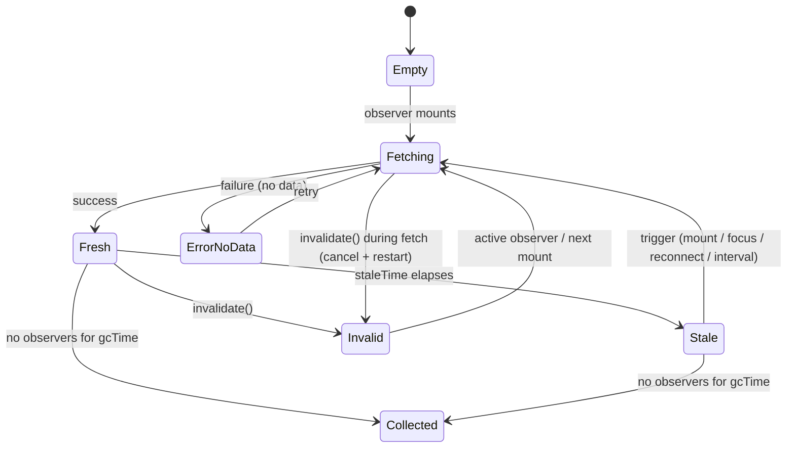
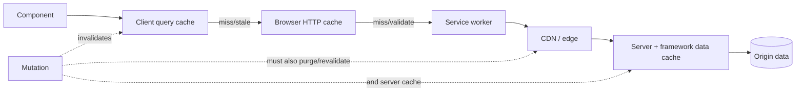

# 06 / 06 — Cache Consistency and Invalidation: Deciding When a Copy Is Still the Truth

## 1. Lesson metadata

| | |
|---|---|
| **Level** | Advanced |
| **Study time** | 5–6 hours (reading 2.5 h, experiments 1.5 h, exercises 2 h) |
| **Prerequisites** | [06 / 01 — The fetch lifecycle](./01-fetch-lifecycle.md), [06 / 02 — Cancellation and race conditions](./02-cancellation-and-race-conditions.md), [06 / 04 — API normalization](./04-api-normalization.md), [06 / 05 — Optimistic updates](./05-optimistic-updates.md), [00 / 15 — HTTP caching and navigation](../00-web-and-javascript-foundations/15-http-caching-and-navigation.md), [03 / 20 — `useSyncExternalStore` and external stores](../03-react-state-and-hooks/20-usesyncexternalstore-and-external-stores.md), [04 / 16 — Server vs client state](../04-react-architecture/16-server-vs-client-state.md) |
| **Next** | [07 — Server state management](./07-server-state-management.md) |
| **Related** | [08 — TanStack Query](./08-tanstack-query.md), [09 — Redux Toolkit](./09-redux-toolkit.md), [14 — Server-side data loading](./14-server-side-data-loading.md), [16 — Offline considerations](./16-offline-considerations.md), [17 — Real-time](./17-real-time-websockets-subscriptions.md) |

> **Library names and defaults are version-sensitive.** The concepts (freshness, key-addressed entries, invalidation, write-through, tags) are stable. TanStack Query v5 option names and defaults below were executed against `@tanstack/query-core` 5.104 and RTK Query option names were read from `@reduxjs/toolkit` 2.13 typings (2026-10-22); SWR, Apollo and framework cache details were not re-verified, so treat them as starting points.

**Learning objectives.** After this lesson you can:
1. Define a client cache precisely (what is stored, under what key, with what freshness metadata) and distinguish it from component state and from the HTTP cache.
2. State the consistency guarantees a front-end cache can and cannot offer, using standard terms (eventual consistency, read-your-writes, monotonic reads) and explain which user-visible bugs violate which.
3. Compare invalidation strategies — time-based, mutation-triggered, tag/key-based, event/push-based, manual — by precision, cost, and failure mode.
4. Design a query-key scheme that makes targeted invalidation possible, and explain why key design *is* cache design.
5. Choose between invalidate-and-refetch and write-through (updating the cache from a mutation response) with criteria.
6. Implement a small cache with dedupe, staleness, and invalidation (including in-flight requests) and explain its gaps.
7. Reason about multi-layer caches (browser HTTP cache, CDN, server data cache, client cache) and identity-scoped caches (logout, multi-tenant, permissions).

**Concepts covered:** freshness vs correctness, staleness windows, `staleTime`/`gcTime` concepts, HTTP cache validators (`ETag`, `Cache-Control`), stale-while-revalidate, query keys and key factories, hierarchical invalidation, over- and under-invalidation, write-through, invalidation of in-flight requests, refetch triggers (focus, reconnect, interval, mount), garbage collection, cross-tab invalidation, push-based invalidation, tag-based invalidation (RTK Query-style), identity scoping and cache clearing on logout, persistence and schema versioning, consistency anomalies (stale list vs fresh detail), server-side cache layers.

---

## 2. Deep conceptual explanation

### 2.1 A cache is a promise about the past

Lesson 01 ended with *staleness*: data begins aging the moment it is produced. A cache stores a copy and answers "what is X?" without asking the origin. That is only legitimate if the cache can bound how wrong the copy might be. The classic quip — *there are only two hard things in computer science: cache invalidation and naming things* — is hard-earned, because the cache has **less information than the origin** and must decide, using heuristics and signals, when a copy stops being trustworthy.

A client cache entry is conceptually:

```text
key  →  { data, updatedAt, status, error, invalidated, observers, fetch-in-flight }
```

- **key** identifies the *question* (request identity, lesson 01 §3.4), not the answer.
- **data** is the last answer.
- **updatedAt / invalidated** are the freshness metadata — the "promise about the past".
- **observers** (components subscribed) determine what must be kept and what can be garbage collected.
- **in-flight** lets concurrent identical requests share one fetch (deduplication).

### 2.2 Freshness is not correctness

Two ideas are routinely conflated:

| Idea | Meaning | Who decides |
|---|---|---|
| **Fresh** | The cache believes it need not ask again yet | A *policy* (time window, event) |
| **Correct** | The copy equals what the origin would say right now | The *world* (unknowable without asking) |

A fresh entry can be wrong (someone else changed the record 1 s ago); a stale entry can be right (nothing changed). Cache design therefore trades *requests* against *wrongness window*; there is no setting that yields both zero requests and zero wrongness. The product question is: **how wrong is acceptable, for how long, for this data?** (A "last updated" timestamp on a dashboard tolerates minutes; a seat map tolerates seconds; an account balance before a transfer tolerates none.)

### 2.3 Consistency vocabulary you actually need

| Term | Meaning (informal) | Typical front-end violation |
|---|---|---|
| **Eventual consistency** | If updates stop, all copies converge | Baseline for every client cache; the question is *how long* |
| **Read-your-writes** | After *I* write, *my* later reads reflect it | Edit a title, navigate to the list, see the old title |
| **Monotonic reads** | I never see data go *backwards* in time | Detail shows v7, then a late list response shows v6 and overwrites it ([04 §10 symptom 4](./04-api-normalization.md)) |
| **Cross-view consistency** | Two components showing the same entity agree | Header shows new name, table shows old name |
| **Causal consistency (informal)** | If B was caused by A, nobody sees B without A | Comment shown whose parent post was removed from the cache |

The most visible user-facing property is **read-your-writes**. Users forgive staleness of *others'* changes far more readily than the staleness of their *own* actions. Hence the heavy emphasis on mutation-triggered invalidation and write-through (§2.6): they exist to restore read-your-writes in a cache that otherwise only knows time.

### 2.4 Layers of caching (and who invalidates what)

A "cache problem" is often a *wrong-layer* problem. Between a click and a pixel there can be several caches, each with its own freshness rules:

| Layer | Stores | Freshness driven by | You control it via | Typical stale-data symptom |
|---|---|---|---|---|
| **Browser HTTP cache** | Responses by URL (+ `Vary`) | `Cache-Control`, `ETag`/`Last-Modified` validators, heuristics | Response headers; request `cache` option | Old JSON served without a request appearing in Network (served from disk/memory cache) |
| **Service worker cache** | Whatever the SW stores | SW code | SW strategy | Old app shell or API responses after deploy ([16 — Offline](./16-offline-considerations.md)) |
| **CDN / reverse proxy** | Responses for many users | Edge rules, TTLs, purge | Purge API, headers | Different users see different versions; "works for me" |
| **Server data cache / framework cache** | Fetch results, rendered output | Framework semantics | Revalidation APIs (framework-specific) | New data after a mutation only after a time-based revalidation |
| **Client query cache** (TanStack Query, SWR, RTK Query, Apollo) | Parsed results by key | Library policy + your calls | Options, `invalidate*`, `set*Data` | Component shows value the Network panel can prove is outdated |
| **Component state / store copies** | Derived or copied values | Your code | You | Copy of server data in `useState` initialised once and never refreshed |

Debugging rule: *walk the layers from the UI toward the origin* and ask at each: "did a request leave this layer? what freshness rule answered it?" The Network panel tells you about the HTTP layer (the "Size" column showing `(memory cache)`/`(disk cache)`, the `Cache-Control` response header, the `Initiator`); the library's devtools tell you about the client cache.

The **HTTP cache and the client cache interact**: a refetch triggered by invalidation may be satisfied from the browser HTTP cache if the response was marked cacheable with a max-age, silently defeating your invalidation. A mutation followed by `invalidate` that returns the old JSON is the signature symptom ([00 / 15](../00-web-and-javascript-foundations/15-http-caching-and-navigation.md)). Fix at the right layer: `Cache-Control: no-cache` (which means *revalidate before reuse*, not "do not store") or `private, max-age=0, must-revalidate` for per-user JSON; or send a `cache: 'no-store'`/`'reload'` request option for specific calls. Verify exact semantics on MDN's `Cache-Control` page.

### 2.5 Invalidation strategies compared

| Strategy | Trigger | Precision | Cost | Failure mode |
|---|---|---|---|---|
| **Time-based** (TTL / `staleTime`) | Clock | Low (knows nothing about changes) | Requests every TTL | Wrong during the window; thundering herd if many entries expire together |
| **Refetch triggers** (window focus, reconnect, mount, interval) | User/context events | Low–Med (proxy for "something may have changed") | Extra requests | Over-fetching; flicker; battery/network on mobile |
| **Mutation-triggered** (invalidate keys related to the write) | Your own mutation | High *if keys are designed well* | One refetch per affected key | **Under-invalidation** (forgot a related key → stale view) or **over-invalidation** (refetch storm) |
| **Write-through** (apply mutation response to cache) | Your own mutation response | Highest for the entity written | No extra request | Server-computed side effects elsewhere not reflected; response shape mismatch |
| **Tag-based** (entries *provide* tags; mutations *invalidate* tags) | Mutation | High; decoupled from key names | Metadata upkeep | Tag taxonomy drift (RTK Query model) |
| **Push-based** (WebSocket/SSE says "X changed") | Server event | Highest and covers *other users'* changes | Infrastructure | Missed events (needs resync), event storms; ordering ([17](./17-real-time-websockets-subscriptions.md)) |
| **Version/ETag validation** | Conditional requests | Exact (server decides) | A request per check (cheap 304) | Needs server support; only reduces transfer, not latency |
| **Manual** (a Refresh button) | User | User-determined | User effort | Users do not know when to press it |

Real systems combine them: a **time-based baseline** (so nothing is stale forever), **mutation-triggered** precision for read-your-writes, **push** for multi-user data, and a **manual refresh** as a trust-restoring escape hatch.

**Responsibility comparison — who implements each piece?**

| Responsibility | Browser HTTP cache | TanStack Query / SWR-class | RTK Query | Normalized graph cache (Apollo-class) | Framework data layer | You (hand-rolled) |
|---|---|---|---|---|---|---|
| Dedupe concurrent identical requests | Partly (connection level; not guaranteed) | Yes | Yes | Yes | Yes (request-scoped memoization, e.g. React `cache` in Server Components) | You |
| Freshness window | `Cache-Control` | Per-query `staleTime` (default 0) | `keepUnusedDataFor` (default 60 s) / refetch options | Fetch policies | Segment/fetch revalidate options (framework-specific) | You |
| Mutation-triggered invalidation | No | `invalidateQueries` by key/predicate | Tags (`providesTags`/`invalidatesTags`; `invalidationBehavior` defaults to `'delayed'`, i.e. tags are invalidated after in-flight queries and mutations settle) | `refetchQueries`, `evict`, cache modify | Revalidate path/tag APIs (framework-specific) | You |
| Write-through of mutation result | No | `setQueryData` | `api.util.updateQueryData` | Automatic via entity identity | n/a (server renders) | You |
| Garbage collection of unused entries | Eviction policies (browser) | Time after last observer (`gcTime`, default 5 min in the browser) | Time after last subscriber (`keepUnusedDataFor`, default 60 s) | Manual / `gc()` | Framework | You |
| Cross-entity consistency | No | No (request-keyed) | No (request-keyed + tags) | **Yes** (entities by identity) | Server-driven | You |
| Cross-tab sync | Shared storage-level | Optional broadcast plugins (not verified) | Not default | Not default | n/a | You (`BroadcastChannel`) |
| Persistence across reloads | Yes (disk) | Persister packages (`@tanstack/react-query-persist-client`) | Via redux-persist-like tools | Persist packages | Server-side | You |

No technology covers everything; the *responsibilities* (not the brand names) are what you design.

### 2.6 Invalidate-and-refetch vs write-through

After `PATCH /projects/42 { name }`:

| | Invalidate and refetch | Write-through (apply response) |
|---|---|---|
| Requests | +1 per affected active key | 0 extra |
| Correctness | Converges to server truth, including server-computed side effects (`updatedAt`, slug, counts, related rows) | Correct only for what the response contains |
| Complexity | Low (name keys) | Higher (know every cache location the entity appears in) |
| Visual | May show a brief stale→fresh jump | Instant |
| Failure mode | Refetch storms; stale between mutation and refetch completion | Divergence when the response is partial or other entries depend on server-side effects |
| Best for | Lists/aggregates/derived views | The single entity just edited (detail view) |

Common production combination: **write-through for the entity's detail entry** (instant, exact) **and invalidate the lists/aggregates** (cheap to refetch, often reorder or filter by the changed field). Why lists must be invalidated rather than patched: a rename may change *sort order*, a status change may change *filter membership* (the item now belongs on a different tab), and a delete changes *pagination boundaries*. Client-side patching of lists replicates server query semantics — fragile ([04 §2.6](./04-api-normalization.md)).

### 2.7 Keys are cache design

Invalidation precision is bounded by your key structure. Keys that are **hierarchical arrays from general to specific** allow invalidating whole subtrees by prefix:

```ts
['projects']                              // everything about projects
['projects', 'list', { status, page }]    // one list variant
['projects', 'detail', projectId]         // one entity
['projects', 'detail', projectId, 'members']
```

`invalidate(['projects'])` refreshes lists and details; `invalidate(['projects','list'])` only lists; `invalidate(['projects','detail', id])` one entity. In TanStack Query, key matching is by *partial prefix* with deep-equal comparison of the elements; keys are compared via a stable hash that treats object property order as irrelevant (verified in 5.104: `hashKey(['a',{x:1,y:2}]) === hashKey(['a',{y:2,x:1}])`, array order *does* matter, a filter `['projects','list']` matches `['projects','list',{status:'a',page:1}]`, and an object inside a filter matches partially, so `{status:'a'}` matches `{status:'a',page:1}`; `exact: true` turns prefix matching off). Practical design rules:

1. **Include everything the request depends on** (params, filters, locale, *user/tenant identity* when responses differ per user). A key that omits a dependency yields **cross-contamination**: two different questions share one answer.
2. **Don't include what the request doesn't depend on** (e.g. an `isOpen` UI flag) or you fragment the cache.
3. **Centralize key construction** (a *key factory*) so that producers and invalidators cannot drift apart (§5.2).
4. **Normalize param representation** (sort arrays you treat as sets; use `undefined` vs `null` consistently).
5. **Keep keys serializable**: functions and class instances don't hash meaningfully.

### 2.8 The three classic consistency bugs

1. **Stale list after edit** (under-invalidation): detail edited; list entry still shows the old title. Cause: only the detail key was updated.
2. **Refetch storm** (over-invalidation): `invalidate([])`/root key after every mutation refetches every active query; slow, flickers, hammers the API.
3. **Resurrection**: an item is deleted, then a *slow earlier list response* arrives and writes the deleted item back; or a refetch after an optimistic delete (while another mutation is in flight) restores it. Cause: out-of-order responses ([02](./02-cancellation-and-race-conditions.md)); fix: cancel in-flight reads for the affected keys when invalidating/mutating, and prefer server versions/tombstones for contended data.

### 2.9 Identity-scoped caches and security

A client cache is **per user session**. Failing to clear it on logout, user switch, or tenant switch exposes the previous user's data to the next one on a shared device, and (in SSR) a module-level cache can leak data *across requests*. Two safeguards:

- Include the identity in the key (`['user', userId, ...]`) *and* clear/reset the cache on logout and identity change (cheap, defense-in-depth).
- On the server, create the cache **per request** (not at module scope) ([14](./14-server-side-data-loading.md)).

Persisted caches (localStorage/IndexedDB) need the same treatment *plus* a **schema version** (a "buster") so an app update doesn't deserialize old-shaped data into new code ([04](./04-api-normalization.md) boundary parsing helps here), and a **max age** so ancient data isn't resurrected. Persisting sensitive data raises its own security questions ([10 / 06 — Security](../10-production-engineering/06-security-xss-csrf-csp.md)).

### 2.10 Misconceptions

| Misconception | Reality |
|---|---|
| "Invalidate means delete." | It means *mark as not trustworthy*; active observers usually get a background refetch while still showing the old data (verified for TanStack Query v5). |
| "A short `staleTime` makes data correct." | It only shortens the wrongness window and increases requests. |
| "Set `staleTime: 0` everywhere to be safe." | Leads to refetch on every mount/focus (TanStack Query v5's default is already `staleTime: 0`); wasteful and flickery. Choose per data type. |
| "The query library handles caching, so the browser cache doesn't matter." | They stack. HTTP headers can make a refetch return an old body. |
| "`invalidateQueries()` with no filter is a harmless catch-all." | It triggers refetches of *all* active queries (storm). |
| "If I `setQueryData` I don't need to invalidate." | Server-computed side effects and other lists may still differ. |
| "A normalized cache is always consistent." | It's consistent for *entities it knows*; list membership and ordering are query results and still need invalidation/merge policies. |
| "Cache is a performance feature only." | It is also a **correctness boundary**: it defines which truth the user sees. |

---

## 3. Internal mechanics

### 3.1 HTTP caching: the public rules (guarantees)

**Public guarantee** (RFC 9111 *HTTP Caching*, MDN `Cache-Control`): a cache may reuse a stored response if it is *fresh* (age < `max-age`/`s-maxage` or `Expires` or a heuristic freshness lifetime when none is given) or after *validating* with the origin using validators: `ETag` + `If-None-Match`, or `Last-Modified` + `If-Modified-Since`. A `304 Not Modified` response confirms the stored copy. Key directives: `no-store` (do not store), `no-cache` (may store, **must revalidate before reuse**), `private`/`public` (who may store), `must-revalidate`, `stale-while-revalidate=<s>` (serve stale while revalidating in the background) and `stale-if-error=<s>` (support varies across browsers and CDNs; check MDN's `Cache-Control` page for your targets). `Vary` lists request headers that become part of the cache key (e.g. `Vary: Authorization` or `Accept-Language`).

**Teaching model:** the HTTP cache is *the same idea* as your client cache (key, freshness, validation) implemented by the browser for URLs. Client query libraries' **stale-while-revalidate** behavior is named after the HTTP directive and has the same intent: *show the old copy now, refresh in the background*.

**Implementation detail:** heuristic freshness for responses without explicit lifetimes (commonly a fraction of time since `Last-Modified`) is browser-specific; do not rely on it — always set explicit headers for API JSON.

Interaction with `fetch`: the `cache` request option (`default`, `no-store`, `reload`, `no-cache`, `force-cache`, `only-if-cached`) lets a call override HTTP cache usage (see the MDN `Request.cache` page for the full matrix).

### 3.2 What a query cache does on a read (teaching model)

For a hook such as `useQuery(key, fn)` (conceptual):

1. **Find or create** the entry for `hash(key)`.
2. **Subscribe** this component (observer) → entry now has ≥ 1 observers (prevents GC).
3. **Decide whether to fetch**: no data → fetch; data and *fresh* → don't; data and *stale* → render data and fetch in the background; entry marked *invalidated* → treated as stale.
4. **Deduplicate**: if a fetch is already in flight for this entry, attach to it.
5. **On settle**: write `data` + `updatedAt` (or `error`), notify observers (React re-renders through `useSyncExternalStore` or equivalent — [03 / 20](../03-react-state-and-hooks/20-usesyncexternalstore-and-external-stores.md)).
6. **On unmount**: observers decrement; when zero, schedule garbage collection after a grace period (so quick back-navigation finds data).

**Public guarantee** vs **implementation detail:** the *behaviors* (dedupe, background refetch of stale data, GC after the last observer leaves) are documented for the major libraries; the *data structures* and scheduling are not part of the contract. Defaults (how long until stale; how long until GC; whether to refetch on mount/focus/reconnect; how many retries) are documented but **change between versions — verify**.

### 3.3 Invalidating something that is in flight

Suppose entry `K` has an in-flight fetch started at t=0, and a mutation completes at t=100 that makes the data at the origin different. The in-flight request may have been *answered by the server before* or *after* the mutation was applied; the client cannot tell. Writing its result into the cache can **overwrite correct post-mutation data with pre-mutation data**. Correct invalidation therefore must do two things: (a) mark the entry invalid, and (b) **cancel or discard** the in-flight request and issue a new one (the "cancel then refetch" sequence). TanStack Query's `invalidateQueries` cancels-and-refetches in-flight fetches by default for matched active queries (`cancelRefetch` defaults to true). Verified in 5.104 with a 100 ms in-flight background refetch: the default started a second fetch and aborted the first signal; `{ cancelRefetch: false }` kept the first. Caveat found while testing: the cancel only applies when the entry **already has data**; if the *initial* fetch is still in flight (no data yet) the invalidation joins that request instead of starting a new one, so that first response, possibly older than the mutation, is what lands in the cache. and `cancelQueries` exists to do the cancel half explicitly ([05 §3.3](./05-optimistic-updates.md)). This is the same race lesson 02 introduced, in the cache layer.

### 3.4 Structural sharing on refetch

When a refetch returns data deeply equal to the cached data, a good cache **keeps the previous reference** (structural sharing; [04 §2.8](./04-api-normalization.md)), so `React.memo` children and selectors see no change and don't re-render. This makes aggressive background refetching affordable. If your boundary parser (lesson 04) produces new objects each time and the cache does not preserve references, "refetch on focus" will re-render large trees for no visible change. (TanStack Query v5: `structuralSharing` defaults to true and `replaceEqualDeep` returned the old reference for deep-equal data in 5.104.)

### 3.5 Refetch triggers and their costs

| Trigger | Mechanism | Cost model |
|---|---|---|
| Mount of an observer with stale data | Hook decides on subscribe | Burst of requests when a page mounts many consumers (deduped per key) |
| Window refocus | `visibilitychange`/`focus` listeners | Spike when the user returns after a long time |
| Network reconnect | `online` event | Spike; mobile flaps cause repeated fetches |
| Interval | `setInterval`-like with pause when hidden | Constant load × users; pick intervals consciously |
| Mutation settle | Explicit invalidation | Proportional to number of active affected keys |
| Push message | Socket handler calls invalidate/patch | Depends on message rate; throttle |

The *sum* of triggers across a large user base determines API load. A seemingly harmless "refetch on focus" combined with a 30 s `staleTime` and 10 000 concurrent users is a capacity question, not only a UX one.

---

## 4. Step-by-step execution walkthrough

Scenario: a projects app. Screen A is a list (`['projects','list',{status:'active'}]`), screen B is a detail (`['projects','detail','42']`). Stale policy: lists fresh for 30 s, details fresh for 5 min. GC 5 min after last observer. User flow with times:

| t (s) | Event | Cache | UI / network |
|---|---|---|---|
| 0 | Open list | list: empty → fetching | skeleton; `GET /projects?status=active` |
| 1 | List response; project 42 name "Apollo" | list@1 (fresh until 31) | rows |
| 5 | Click project 42 → detail mounts | detail: empty → fetching | `GET /projects/42` (list data not used) |
| 6 | Detail response "Apollo" | detail@6 (fresh until 306) | detail |
| 10 | User renames to "Apollo 2" (mutation) | — | `PATCH /projects/42` |
| 11 | Mutation success; response = full entity `{name:"Apollo 2", updatedAt:11}` | **write-through** detail ← response | detail shows "Apollo 2" instantly, no extra request |
| 11 | Mutation `onSuccess/onSettled`: `invalidate(['projects','list'])` | list marked invalid; **no observers now** (list screen unmounted) → no fetch, just marked | none |
| 14 | User navigates back to list | list entry exists, **invalid ⇒ stale**; shows old data "Apollo" **and** refetches | rows flash "Apollo" then "Apollo 2" after response (~15) |

The flash at t = 14–15 is a *read-your-writes* violation lasting one round trip. Options: (1) accept (brief, background refresh); (2) write-through the list as well (patch the matching row: cheap here, wrong if the rename changed ordering — it might); (3) on invalidation of an *unobserved* entry, **remove** the entry rather than keep it, so the list shows a skeleton rather than wrong data (honest but slower); (4) mark rows as "refreshing" while an invalid entry is being revalidated.

**Predict:** at t = 100, a colleague (another user) renames project 42 again. When does this user see it? *Answer:* Not until a trigger fires. The detail is "fresh" until t = 306; if the user stays on the detail page with no focus/interval/push trigger, **never** (until 306 s passes *and* something triggers a re-evaluation — staleness alone does not cause a refetch; a trigger such as mount/focus/interval must evaluate it). That distinction — *stale is a state; a refetch needs an event* — surprises many learners. If the product requires seeing colleagues' changes within seconds, you need polling or push ([17](./17-real-time-websockets-subscriptions.md)).

---

## 5. Code examples

### 5.1 Minimal: the stale-copy-in-state bug

```tsx
function ProjectTitle({ project }: { project: { id: string; name: string } }) {
  const [name, setName] = useState(project.name);   // copied once at mount
  return <h1>{name}</h1>;                            // never follows later prop changes
}
```

**Predict:** the parent refetches and passes `name: "Apollo 2"`; what does the heading show? *Answer:* still "Apollo" — `useState`'s initial value is used once ([01 / 16 — State preservation and reset](../01-react-fundamentals/16-state-preservation-and-reset.md), [03 / 17 — Derived state](../03-react-state-and-hooks/17-derived-state.md)). Copying server data into state creates a **second, unmanaged cache** with no invalidation. Render from the source (`project.name`) or reset via `key`. Edit forms legitimately seed local draft state from server data, but then the draft owns *only the user's edits*, and you decide explicitly when a server update may overwrite it.

### 5.2 Practical: a key factory (single source of truth for keys)

```ts
// projects.keys.ts
export const projectKeys = {
  all: ['projects'] as const,
  lists: () => [...projectKeys.all, 'list'] as const,
  list: (filters: { status?: 'active' | 'archived'; page?: number }) =>
    [...projectKeys.lists(), filters] as const,
  details: () => [...projectKeys.all, 'detail'] as const,
  detail: (id: string) => [...projectKeys.details(), id] as const,
  members: (id: string) => [...projectKeys.detail(id), 'members'] as const,
};
```

Why it matters: producers (`useQuery({ queryKey: projectKeys.detail(id) })`) and invalidators (`invalidate({ queryKey: projectKeys.lists() })`) share one definition, and a *rename* of a key segment is a compile-time change. `as const` makes keys readonly tuples so typed helpers (`getQueryData<Project>(projectKeys.detail(id))`) stay precise (`getQueryData<Project>(key)` is a generic in v5). Note the hierarchy: invalidating `projectKeys.detail(id)` also hits `members(id)` (a prefix match).

### 5.3 Practical: mutation with write-through + targeted invalidation (TanStack Query v5, executed against 5.104)

```tsx
import { useMutation, useQueryClient } from '@tanstack/react-query';

export function useRenameProject(id: string) {
  const qc = useQueryClient();

  return useMutation({
    mutationFn: (name: string) => api.renameProject(id, name),   // returns the full updated Project

    onSuccess: (updated) => {
      // 1. Write-through: the detail entry now equals the server's authoritative answer.
      qc.setQueryData(projectKeys.detail(id), updated);
    },

    onSettled: () => {
      // 2. Lists may reorder / change membership: refetch them, but not everything.
      void qc.invalidateQueries({ queryKey: projectKeys.lists() });
      // 3. If the write could have failed ambiguously, converge the detail too (cheap, deduped).
      void qc.invalidateQueries({ queryKey: projectKeys.detail(id), refetchType: 'none' });
    },
  });
}
declare const api: { renameProject(id: string, name: string): Promise<Project> };
interface Project { id: string; name: string; updatedAt: string }
```

Line notes:

- `onSuccess` write-through gives read-your-writes for the detail with **zero** extra requests.
- `invalidateQueries({queryKey: lists()})` marks list entries invalid and, for *active* observers, refetches in the background. Inactive entries are only marked (verified: default `refetchType` is `'active'`; `'all'` also refetches inactive entries, `'inactive'` only those, `'none'` refetches nothing).
- `refetchType: 'none'` on the detail marks it stale **without** refetching now (we already have the response); the next trigger will revalidate. Whether to include that line is a judgment call; it demonstrates the knob (`refetchType: 'active' | 'inactive' | 'all' | 'none'`, verified).
- Failure path: `onSettled` runs for success or error; on error the cache is untouched (no write-through) and lists are re-validated, which is safe.

### 5.4 Practical: identity change clears the cache

```tsx
function useSessionCacheReset(userId: string | null) {
  const qc = useQueryClient();
  const previous = useRef<string | null | undefined>(undefined);

  useEffect(() => {
    if (previous.current !== undefined && previous.current !== userId) {
      qc.clear();                     // drop everything: previous identity's data must not leak (verified: cache is empty afterwards; an active observer is not refetched until something re-triggers it)
    }
    previous.current = userId;
  }, [userId, qc]);
}
```

Better ordering note: clearing in an effect runs *after* a render that may already have shown the previous user's cached data to the new user for one frame. For logout flows, clear **before** navigating/rendering the signed-out UI (inside the logout handler, after cancelling in-flight queries) and prefer keys that include `userId` so a leftover entry cannot match. Also note StrictMode's double effect run: the guard with `previous` makes it idempotent.

### 5.5 Advanced: a minimal cache with dedupe, staleness and invalidation (including in-flight)

```ts
// mini-cache.ts
export type Key = readonly unknown[];
const hash = (k: Key) => JSON.stringify(k);      // object key order is not normalized here; real libs use a stable hash (TanStack's `hashKey` sorts object keys)
const matchesPrefix = (prefix: Key, key: Key) =>
  prefix.length <= key.length && prefix.every((p, i) => JSON.stringify(p) === JSON.stringify(key[i]));

export interface Entry<T = unknown> {
  readonly key: Key;
  readonly data: T | undefined;
  readonly error: Error | undefined;
  readonly updatedAt: number | undefined;
  readonly invalid: boolean;
  readonly inflight: boolean;
}

interface Flight { controller: AbortController; promise: Promise<void> }

export class MiniCache {
  private entries = new Map<string, Entry>();
  private flights = new Map<string, Flight>();
  private listeners = new Set<() => void>();

  subscribe = (l: () => void) => { this.listeners.add(l); return () => { this.listeners.delete(l); }; };
  get = <T,>(key: Key) => this.entries.get(hash(key)) as Entry<T> | undefined;

  private patch(key: Key, p: Partial<Omit<Entry, 'key'>>) {
    const h = hash(key);
    const prev: Entry = this.entries.get(h) ?? {
      key, data: undefined, error: undefined, updatedAt: undefined, invalid: false, inflight: false,
    };
    this.entries.set(h, { ...prev, ...p });      // new object only when we write ⇒ stable snapshots for useSyncExternalStore
    this.listeners.forEach((l) => l());
  }

  fetch<T>(key: Key, fn: (signal: AbortSignal) => Promise<T>): Promise<void> {
    const h = hash(key);
    const existing = this.flights.get(h);
    if (existing) return existing.promise;                           // dedupe

    const controller = new AbortController();
    this.patch(key, { inflight: true });
    const promise = fn(controller.signal)
      .then(
        (data) => {
          if (controller.signal.aborted) return;                     // discarded: invalidated while in flight
          this.patch(key, { data, error: undefined, updatedAt: Date.now(), invalid: false, inflight: false });
        },
        (err: unknown) => {
          if (controller.signal.aborted) return;
          this.patch(key, { error: err instanceof Error ? err : new Error(String(err)), inflight: false });
        },
      )
      .finally(() => {
        if (this.flights.get(h)?.controller === controller) this.flights.delete(h);
      });
    this.flights.set(h, { controller, promise });
    return promise;
  }

  /** Write-through: replace data and mark fresh. Cancels an in-flight read that could overwrite it. */
  set<T>(key: Key, data: T) {
    this.cancel(key);
    this.patch(key, { data, error: undefined, updatedAt: Date.now(), invalid: false, inflight: false });
  }

  /** Mark matching entries invalid and cancel their in-flight reads; active observers will refetch. */
  invalidate(prefix: Key) {
    for (const e of [...this.entries.values()]) {
      if (matchesPrefix(prefix, e.key)) {
        this.cancel(e.key);
        this.patch(e.key, { invalid: true, inflight: false });
      }
    }
  }

  private cancel(key: Key) {
    const h = hash(key);
    const f = this.flights.get(h);
    if (f) { f.controller.abort(); this.flights.delete(h); }
  }

  clear() { this.flights.forEach((f) => f.controller.abort()); this.flights.clear(); this.entries.clear(); this.listeners.forEach((l) => l()); }
}
```

```tsx
// use-cached.ts
import { useEffect, useRef, useSyncExternalStore } from 'react';

export function useCached<T>(
  cache: MiniCache,
  key: Key,
  fn: (signal: AbortSignal) => Promise<T>,
  staleMs = 30_000,
) {
  const h = hash(key);
  const entry = useSyncExternalStore(
    cache.subscribe,
    () => cache.get<T>(key),      // returns the same object until a patch occurs
  );

  const fnRef = useRef(fn);
  useEffect(() => { fnRef.current = fn; });

  useEffect(() => {
    const e = cache.get<T>(key);
    const stale = e === undefined || e.updatedAt === undefined || e.invalid || Date.now() - e.updatedAt > staleMs;
    if (stale && !e?.inflight) void cache.fetch(key, (s) => fnRef.current(s));
    // eslint-disable-next-line react-hooks/exhaustive-deps -- key is represented by its hash
  }, [cache, h, staleMs, entry?.invalid, entry?.inflight]);

  return entry;
}
```

Line notes, and what it teaches:

- **Immutability + stable snapshots.** `useSyncExternalStore` requires `getSnapshot` to return the same value when nothing changed; each entry object is replaced only on a `patch`.
- **Dedupe** via `flights`; **cancel-on-invalidate** discards pre-mutation responses (§3.3). `set` (write-through) also cancels the in-flight read for the same reason.
- **`invalid` entries keep their `data`** so UI can show stale content while refetching (SWR behavior) — the effect observes `entry.invalid` and refetches.
- The hook includes `entry.inflight` in dependencies so that, after invalidate cancels an in-flight fetch (`inflight:false`), the effect re-runs and starts a new fetch.
- **What is missing (deliberately):** garbage collection / observer counting, retries, error back-off, focus/reconnect triggers, structural sharing, SSR isolation (module-level instances leak across requests — create per request), `JSON.stringify` key hashing ordering problems, memory bounds, devtools, persistence. Listing them is the lesson: each is a responsibility a library has taken on ([07](./07-server-state-management.md), [08](./08-tanstack-query.md)).

**Predict:** `useCached(cache, ['a'], f)` mounts in two components at once. How many `f` calls? *Answer:* One in production (second sees `inflight` or dedupes through `flights`). In StrictMode dev, effects double-run: the first effect starts the fetch; the simulated remount effect sees `inflight: true` (patch happened synchronously) and skips; so still one request — unlike the plain `useFetch` in lesson 01 — because the *cache*, not the component, owns the request. (Check the claim by reasoning on ordering: `fetch()` calls `patch(inflight:true)` synchronously before returning, and `cache.get` in the second effect run reads the updated entry.)

### 5.6 Practical: cross-tab invalidation with `BroadcastChannel`

```ts
const channel = typeof BroadcastChannel !== 'undefined' ? new BroadcastChannel('app-cache') : null;

export function broadcastInvalidate(prefix: readonly unknown[]) {
  channel?.postMessage({ type: 'invalidate', prefix });
}

export function listenForInvalidations(cache: MiniCache) {
  if (!channel) return () => {};
  const onMessage = (e: MessageEvent<{ type: string; prefix: readonly unknown[] }>) => {
    if (e.data?.type === 'invalidate' && Array.isArray(e.data.prefix)) cache.invalidate(e.data.prefix);
  };
  channel.addEventListener('message', onMessage);
  return () => channel.removeEventListener('message', onMessage);
}
```

`BroadcastChannel` delivers to *other* channel objects of the same name and origin (other tabs, workers, or other objects in the same page), not to the object that posted. Validate input from the channel like any untrusted boundary (an extension or another page script could post to the same-origin channel; it is same-origin only, but defensive parsing costs little). Alternatives: the `storage` event with `localStorage`, or a `SharedWorker` (support varies). Note that `BroadcastChannel` does not deliver to the *same channel object* that posted, but another `BroadcastChannel` object with the same name in the same page does receive the message (verified in Node 24); MDN compat data: Chrome 54, Firefox 38, Safari 15.4. Use sparingly — it's a *signal to refetch*, not a data sync protocol.

### 5.7 Incorrect: the invalidation anti-patterns

```ts
// (a) nuke everything
onSuccess: () => queryClient.invalidateQueries()                      // refetches every active query

// (b) wrong key shape — does not match any entry
onSuccess: () => queryClient.invalidateQueries({ queryKey: ['project'] })   // keys are ['projects', ...]

// (c) invalidating before the server finished — refetch can read old state
onMutate: () => queryClient.invalidateQueries({ queryKey: projectKeys.lists() })
```

**Predict** the symptom for each. (a) A refetch storm: dozens of requests after a trivial edit, loading flicker, API load. (b) **Silent no-op**: nothing refetches, the list stays stale, and there is no error — the most insidious class (typos in keys; the key factory eliminates it). (c) The invalidation refetch is dispatched *before* the mutation request completes server-side: the refetch can return pre-mutation data and (since the entry is marked valid on arrival) the list stays stale until the next trigger. Invalidate **after** the write settles.

### 5.8 Advanced: version-guarded merge so a late response can't move data backwards

```ts
interface Versioned { id: string; version: number }

export function mergeNewer<T extends Versioned>(current: T | undefined, incoming: T): T {
  if (!current) return incoming;
  return incoming.version >= current.version ? incoming : current;   // monotonic reads
}

// Usage inside a cache write, e.g. setQueryData(detailKey, (old) => mergeNewer(old, response))
```

This presumes the server provides a per-entity monotonic `version` (or `updatedAt` with sufficient resolution — **timestamps are weaker**: equal timestamps and clock skew make ordering ambiguous; prefer integers incremented by the origin or ETags compared for equality only, since ETags are opaque and unordered). Guarding at *every* write path (list refetch, detail refetch, mutation response, push message) is what delivers monotonic reads in a request-keyed cache.

---

## 6. Visual explanations

### Entry state machine (freshness × activity)



### Layers



### Key hierarchy and invalidation scope

```text
['projects']                         ← invalidate: everything below
 ├─ ['projects','list',{active}]     ← invalidate lists(): all list variants
 ├─ ['projects','list',{archived}]
 └─ ['projects','detail','42']       ← invalidate detail('42')
      └─ ['projects','detail','42','members']   (also matched by detail('42'))
```

### Timeline of the in-flight hazard

```text
t=0   refetch R1 starts (server will answer from state S_before)
t=50  mutation M starts → server applies M at ~t=80 (state S_after)
t=60  server answers R1 with S_before (R1 was processed before M applied)
t=100 M succeeds → client writes/invalidates
t=120 R1 arrives and is written ⇒ cache holds S_before   ✗   (unless R1 was cancelled/discarded at t=100)
```

---

## 7. Alternative approaches and trade-offs

| Approach | Consistency strength | Request cost | Complexity | Cross-user changes | Best for |
|---|---|---|---|---|---|
| No client cache (fetch per mount) | High freshness per mount | High, redundant | Lowest | Visible on next mount | Tiny apps, rarely revisited screens |
| TTL only (`staleTime`) | Weak (window of wrongness) | Medium | Low | Eventually | Read-mostly reference data |
| TTL + focus/reconnect refetch | Medium | Medium–High | Low | On user return | Typical dashboards/SaaS |
| TTL + mutation invalidation (key-based) | Strong read-your-writes | Medium | Medium (key design) | Eventually | Most CRUD apps |
| + write-through | Strong, minimal requests | Low | Medium–High | Eventually | Detail-edit flows |
| Tag-based invalidation | Strong; decoupled | Medium | Medium | Eventually | Large apps with many relationships (RTK Query-style) |
| Normalized graph cache | Strong across entities | Low | High; needs identity/merge policies | With subscriptions | GraphQL apps |
| Push-based (socket → invalidate/patch) | Strongest, includes others' writes | Low–Medium | High (infra) | Near-real-time | Collaborative/ops dashboards |
| Server-side only (RSC/loaders; revalidate per mutation) | Server-driven | Per navigation | Medium; framework knowledge | At navigation | Content/e-commerce sites (framework-specific) |

**When the recommended approach (key-based invalidation + write-through for the edited entity) is *not* best.**

1. **Highly collaborative data** (many users editing): your own mutations are a minority of changes; time-based + focus refetch leaves others' changes stale for long. Use push or short-interval polling, with idempotent patching and versions.
2. **Server-computed aggregates** (analytics, balances, inventory): after any write dozens of derived values change server-side; write-through would duplicate server logic and drift. Invalidate and refetch.
3. **Permissions-dependent views**: a mutation that changes someone's role changes *what they may see* — the safest invalidation is broad (identity-scoped clear), accepting a storm.
4. **Very large lists**: refetching an entire list after every edit is wasteful; patch rows *and* schedule a low-priority revalidation, or use server-side change feeds.
5. **Data that must never be stale** (financial confirmation): skip the cache for that read (`no-store`/`staleTime: 0` with blocking fetch) and treat the screen as server-confirmed.

---

## 8. Best practices and anti-patterns

**Do**

- Decide **freshness per data type** with the product owner: reference data (hours), user content (seconds–minutes), money/stock (seconds or none).
- Build keys from a **factory**; include every dependency, including identity/tenant/locale.
- On mutation: **write-through the entity you wrote**, **invalidate** lists/aggregates that depend on it, **after** the write settles; cancel in-flight reads for affected keys.
- Use **structural sharing**/stable references so frequent revalidation is cheap.
- Pause polling when the tab is hidden; add jitter/back-off; cap retries ([15 — Error recovery and retries](./15-error-recovery-and-retries.md)).
- Clear/scope caches on identity change; use per-request caches on the server.
- Version persisted caches and set max ages.
- Make staleness **visible** when it matters ("Updated 2 min ago", a refresh control).
- Instrument: cache hit rate, refetch counts per trigger, invalidation counts per mutation.

**Anti-patterns**

| Smell | Why it hurts | Fix |
|---|---|---|
| Copying server data into `useState` | Second, unmanaged cache | Render from the cache; draft state only for edits |
| `invalidate()` with no filter | Refetch storm | Targeted keys |
| Inline literal keys scattered across files | Silent no-op invalidations | Key factory |
| Missing identity in keys | Cross-user contamination | Key includes `userId`/tenant; clear on logout |
| Over-long `staleTime` as a "performance fix" | Users act on old data | Per-type policy + triggers |
| `staleTime: 0` + refetch-on-focus everywhere "to be safe" | Load and flicker | Per-type; rely on mutation invalidation |
| Patching lists client-side to mirror server filters/sort | Duplicates server logic; wrong membership | Invalidate lists |
| Invalidating in `onMutate` | Refetch races the write | Invalidate on settle |
| Ignoring HTTP cache headers on API JSON | Refetch returns old body | Explicit `Cache-Control` (+ validators) |
| Module-level cache singleton in SSR | Cross-request data leak | Per-request instance |
| Treating `updatedAt` timestamps as ordering | Clock skew/ties | Integer versions |
| Never garbage collecting | Memory growth in long sessions | GC policy |

**Justified exceptions.** For an internal tool used by one person on one device with a single writer, a plain `fetch` + local state may be all the "cache" you need. For immutable resources (content-addressed assets, historical reports), set a very long freshness and never invalidate — immutability is the strongest cache invalidation strategy ("cache-busting by changing the URL/key"). Do not present "always short staleTime" or "always long staleTime" as universal.

---

## 9. Real-world application

| Domain | Freshness requirement | Invalidation design | Constraint |
|---|---|---|---|
| **E-commerce catalogue** | Seconds–minutes for browse; strict for cart/checkout | Browse: TTL + CDN revalidation; cart: write-through + server totals; checkout: no client cache for price/stock | Price on page ≠ price at checkout must be reconciled by the server; show "price changed" |
| **Dashboard** | Per widget: 5 s – 5 min | Interval per widget; pause when hidden; push for alerts | API load = widgets × users; jitter; shared keys across widgets for dedupe |
| **Finance** | Balance: fresh on view and after any transfer | Invalidate balance + transactions on settle; display "as of" | Never persist balances in offline caches without clear policy; clear on logout |
| **Forms / editing** | Detail fresh at load; protect user draft | Don't overwrite draft on refetch; detect remote change via version → prompt | Conflicts need UI, not silent overwrite |
| **Auth / permissions** | `me` and permissions are foundational | Invalidate/clear on role change, token refresh, logout | Mis-scoped cache = privacy incident |
| **Realtime** | Seconds | Socket event → `invalidate` or patch (with version guards) | Reconnect gap ⇒ must resync snapshot ([17](./17-real-time-websockets-subscriptions.md)) |
| **Multi-team** | Many teams share endpoints | Shared key factories per domain in a package; documented invalidation contract (what mutating X invalidates) | Cross-team invalidation requires exported helpers; tests that assert invalidation |
| **Content sites (framework)** | Minutes–hours | Path/tag revalidation on publish (framework APIs; check yours) | Multiple cache layers; know which one is stale |

Engineering constraint: **capacity.** Background revalidation multiplies traffic. Estimate: `requests/s ≈ users × (active observers per user ÷ effective refetch interval)`. Choose intervals and `staleTime`s with that formula, then verify with real metrics ([10 / 04 — Observability](../10-production-engineering/04-observability-and-logging.md)).

---

## 10. Debugging and troubleshooting

### Symptom 1 — "I edited it, but the list still shows the old value"

- **Repro:** Edit in detail; navigate to list.
- **Investigation:** Query devtools (TanStack Query Devtools or Redux DevTools for RTK Query) — find the list entry; is it `stale`/`invalid`? Did a request leave? Network panel: is there a `GET /projects` after the mutation? If there is a request, did the *response body* contain the new value (HTTP cache or CDN serving old)? Check `Cache-Control` and `Age` headers; "(disk cache)" in the Size column.
- **Root cause candidates:** (1) key mismatch (silent no-op invalidation); (2) invalidated before write finished; (3) HTTP/CDN layer returned a cached body; (4) list refetch skipped because no observer and entry kept.
- **Fix & validate:** key factory; invalidate on settle; correct `Cache-Control`; test: mutate then assert the list shows the new value with the API mocked to return old data once (to catch ordering).

### Symptom 2 — Refetch storm after any save

- **Investigation:** Network panel filtered by Fetch/XHR; count requests; look for `invalidateQueries()` without filters or a root key; devtools show many entries invalidated.
- **Fix:** Narrow keys; `refetchType: 'none'` for entries you'll only mark; throttle; reconsider write-through.

### Symptom 3 — Deleted item reappears for a moment

- **Investigation:** Log cache writes with timestamps; find a response that was *requested before* the delete but arrived after. Compare request start times.
- **Root cause:** Out-of-order response written after the delete ([02](./02-cancellation-and-race-conditions.md)).
- **Fix:** Cancel reads on mutation; version/tombstone guard; only write responses for current generation.

### Symptom 4 — User B sees user A's data after switching accounts

- **Investigation:** Inspect cache keys — missing `userId`; check logout handler; check whether the HTTP layer served `Authorization`-varying responses without `Vary`/`private`.
- **Root cause:** Cache not scoped to identity; or shared proxy cache.
- **Fix:** Identity in keys, clear on logout, `Cache-Control: private` (or `no-store`) for personalized responses, `Vary` where applicable. Treat as a **security incident**: assess exposure.

### Symptom 5 — Data never refreshes unless I reload

- **Investigation:** Entry shows `fresh` forever? `staleTime: Infinity` set globally? Observers inactive? Refetch triggers disabled (`refetchOnWindowFocus: false`)? Network panel: no requests at all.
- **Root cause:** Over-long freshness with no trigger; or a hook option disabled the fetch (an `enabled: false` condition never turned true).
- **Fix:** Define policy; add focus/interval/push as justified; inspect the `enabled` expression.

### Symptom 6 — Cache memory grows in long sessions

- **Investigation:** Chrome DevTools → Memory → heap snapshot; compare after navigating many entities; check number of entries in the cache devtools; large payloads retained by unbounded keys (search terms).
- **Fix:** GC time; avoid caching unbounded keys (autocomplete queries) or limit; paginate; remove with `removeQueries` where appropriate.

### Symptom 7 — Persisted cache crashes the app after a release

- **Investigation:** Error at boundary parse of rehydrated data; stack shows old shape.
- **Fix:** Cache buster/version in persister config (`buster` option on the persister); parse at the boundary; clear on version mismatch.

---

## 11. Exercises

### Level A — Knowledge
A1. Distinguish "fresh" from "correct". Give an example of each combination (fresh/stale × correct/incorrect).
A2. Define read-your-writes and monotonic reads, each with a UI example.
A3. What is the difference between `Cache-Control: no-cache` and `no-store`?
A4. List four strategies for invalidation and one failure mode of each.
A5. Why does staleness alone not trigger a refetch?

### Level B — Code comprehension
B1. In §5.3, explain what happens to the list entry, the detail entry, and the network when the mutation **fails** with a 500.
B2. In §5.5 `invalidate`, why is `this.cancel(e.key)` called before marking invalid? What bug appears without it?
B3. In §5.5 `useCached`, why must `entry?.inflight` appear in the effect's dependency list? Walk through a scenario where omitting it leaves the UI stuck.
B4. In §5.8, why is comparing `updatedAt` timestamps weaker than comparing integer versions?

### Level C — Implementation
C1. Add observer counting and garbage collection (remove entries 60 s after the last observer unsubscribes) to `MiniCache`/`useCached`.
C2. Write a key factory for `orders` with lists filtered by `{status, customerId, page}` and details with `items` and `shipments` sub-resources; write the invalidation calls for: (a) order created; (b) shipment added; (c) customer deleted.
C3. Implement `tag`-based invalidation on top of `MiniCache`: entries declare tags when fetched; `invalidateTags(tags)` marks matching entries.
C4. Implement a `usePolling` integration: refetch an entry every N seconds only while the document is visible, with jitter, deduped across components.

### Level D — Debugging
D1. After deploy, users report that a record they edited reverted to its old value on refresh, but the database shows the new value. Network shows `GET /api/records/9` with `Cache-Control: max-age=600` and "(disk cache)". Diagnose and give two fixes at different layers.
D2. A "Delete" with optimistic removal works, but the row reappears ~1 s later and disappears at the next poll. Analyze the sequence and propose the fix.
D3. Two components display the same project's name; renaming in one updates the other only after a page refresh. Cache devtools shows two entries. Why, and how do you fix it?
D4. Production API load doubled after enabling "refetch on window focus" globally. Explain and propose a policy.

### Level E — Architecture decisions
E1. Design the invalidation policy for an issue tracker with: issue list (filters, sort), issue detail, comments, labels, assignee counts in a sidebar. Define keys, what each mutation invalidates/writes through, and what uses push.
E2. Decide the freshness and invalidation strategy for: (a) product catalogue; (b) user profile; (c) notifications badge; (d) stock level in checkout; (e) feature flags. Justify each by cost of staleness.

### Level F — Expert challenge
F1. Design a multi-tab, offline-capable cache for a field-service app: persistence, schema versioning, identity scoping, conflict handling when reconnecting, cross-tab coordination (leader election for polling/sync), and security of persisted data on shared devices. State what you would not guarantee and the user-facing signals you would show.

---

## 12. Detailed answers and explanations

> Attempt the exercises first.

**A1.** Fresh = policy says no need to ask; correct = equals origin now. Fresh & correct: nothing changed within the window. Fresh & incorrect: another user changed it during the window. Stale & correct: window elapsed but data unchanged. Stale & incorrect: window elapsed and changed. A common mistake is treating "fresh" as a guarantee.

**A2.** Read-your-writes: after I rename a project, any view I see shows the new name (violation: list shows the old name). Monotonic reads: I never see older data after newer (violation: detail v7 replaced by a late list response containing v6).

**A3.** `no-cache`: a cache may store the response but must revalidate with the origin before reusing it (conditional request; 304 if unchanged). `no-store`: do not store the response at all. Plausible wrong view: `no-cache` means "don't cache".

**A4.** Time-based — wrong during window; thundering herd. Refetch triggers — over-fetching/flicker. Mutation-triggered — under/over-invalidation. Write-through — divergence when responses partial. Tag-based — taxonomy drift. Push — missed events/storms. Any four with failure modes.

**A5.** Staleness is a *state* ("may be out of date"); a refetch needs an *event* that evaluates it (mount, focus, reconnect, interval, explicit invalidation). A page that stays open with none of those never refetches, however stale.

**B1.** On failure: `onSuccess` doesn't run → detail unchanged; `onSettled` runs → lists invalidated and refetched in the background (returns the same data; harmless but wasteful), and the detail is marked stale with no refetch (`refetchType: 'none'`). The user sees an error from the mutation (your UI) and no cache change. If the failure was ambiguous (timeout), the settle invalidation is the safety net; consider refetching the detail rather than marking only.

**B2.** An in-flight fetch started before the invalidation would complete and write pre-invalidation data with `invalid:false` and a fresh `updatedAt`, clearing the invalid flag and defeating the invalidation (§3.3). Cancelling aborts it so its result is discarded (guarded by `controller.signal.aborted`).

**B3.** After `invalidate` cancels an in-flight fetch it patches `{invalid:true, inflight:false}`. If `inflight` isn't a dependency, and `invalid` was already `true` before (a second invalidation while a refetch was running), `entry?.invalid` does not change (true → true) so the effect would not re-run; the cancelled fetch has been discarded and no new fetch starts → the entry stays invalid with no request — UI stuck on stale data. Including `inflight` makes the true→false transition re-run the effect.

**B4.** Timestamps can tie (two updates in the same millisecond or the same second resolution), and clocks differ between servers (skew) so a later write might carry an earlier timestamp. Integer versions incremented transactionally at the origin give a total order per entity. ETags are opaque: equality only.

**C1.** Add `observers: number` per key in a `Map<string, number>`; `useCached` calls `cache.observe(key)` in an effect (returns unobserve); at zero, set a timer (`setTimeout(…, 60_000)`) stored per key; re-observing clears the timer; when the timer fires, if still zero observers, delete the entry and abort flights. Evaluation: StrictMode double-effects balanced by cleanup; no timer leaks; GC does not remove an entry with observers; test with fake timers.

**C2.**
```ts
export const orderKeys = {
  all: ['orders'] as const,
  lists: () => [...orderKeys.all, 'list'] as const,
  list: (f: { status?: string; customerId?: string; page?: number }) => [...orderKeys.lists(), f] as const,
  details: () => [...orderKeys.all, 'detail'] as const,
  detail: (id: string) => [...orderKeys.details(), id] as const,
  items: (id: string) => [...orderKeys.detail(id), 'items'] as const,
  shipments: (id: string) => [...orderKeys.detail(id), 'shipments'] as const,
};
```
(a) Order created: invalidate `lists()`; write-through the new detail from the response. (b) Shipment added: invalidate `shipments(orderId)`, and the order detail if status derives from shipments; lists if they show status. (c) Customer deleted: invalidate lists filtered by that customer (`lists()` prefix is simplest) and remove/`invalidate` order details of that customer; consider identity/permission side effects. Evaluation: precision and awareness of derived fields.

**C3.** Maintain `tagsByKey: Map<string, Set<string>>`; `fetch(key, fn, tags)` stores tags on success; `invalidateTags(tags)` iterates entries, intersects, calls `cancel` + `patch({invalid:true, inflight:false})`. Edge: tags must be recomputed from each response (list entries provide a tag per item id plus a `LIST` tag); entries removed must remove tag mappings. This mirrors RTK Query's `providesTags`/`invalidatesTags` concept; its API details differ.

**C4.** One module-level (or per-cache) scheduler keyed by entry; when ≥1 observer requests interval N, set a timer with `N * (1 + rand(−0.1,0.1))`; on tick, if `document.visibilityState === 'visible'`, call `cache.invalidate(key)`-like soft refresh; on `visibilitychange` → visible, refresh if overdue; dedupe because `fetch` shares flights; stop when observers → 0. Evaluation: pausing when hidden; jitter; no overlapping fetch; cleanup.

**D1.** The browser HTTP cache served a 10-minute-old body: `max-age=600` with "(disk cache)". The write went through, but the post-mutation `GET` (or the next page load) was answered locally. Fixes: (server) emit `Cache-Control: private, no-cache` (or `max-age=0, must-revalidate`) with an `ETag` for mutable API JSON; (client) pass `cache: 'no-cache'`/`'reload'` on that fetch, or add a version/cache-buster segment. Layer awareness is the point; changing only client invalidation cannot fix an HTTP-layer cache hit.

**D2.** Sequence: optimistic delete removes the row; a poll (or invalidation refetch) already in flight returns pre-delete data and writes it (row reappears); the next poll returns post-delete data (row disappears). Fix: cancel reads for the affected keys on mutate, and on settle invalidate; guard writes with versions/tombstones; avoid writing responses from requests started before the mutation.

**D3.** The two components use different keys (or one has an extra param), so they have separate entries; invalidation/write-through hits only one. Fix: share a key factory; include only real dependencies; if they intentionally differ (list vs detail), write-through both or invalidate both on mutation. Evaluate: the cache devtools show keys; align.

**D4.** Every tab/user focus event triggers revalidation for every stale active query; at scale that multiplies traffic (users × queries × focus frequency). Policy: enable focus refetch only for data where it matters (notifications, dashboards), set sensible per-type `staleTime` so recently-fetched entries aren't refetched on focus, throttle focus refetch, rely on mutation invalidation elsewhere, and monitor request rates.

**E1.** Keys: `issues.list({filters, sort, page})`, `issues.detail(id)`, `issues.comments(id)`, `labels.all`, `issues.counts` (sidebar). Mutations: edit issue → write-through detail; invalidate `issues.lists()` (sort/filter membership), invalidate `counts`. Add comment → write-through/append comments (server order) or invalidate `comments(id)`; update `updatedAt` in detail via invalidation. Change assignee → invalidate lists/counts. Label rename → invalidate `labels.all` and lists (labels shown in rows). Push: issue events from server → invalidate `detail(id)` and `lists()` with throttle; comments events → patch with version guard. Evaluation: derived values identified; lists invalidated, not patched; throttling; permissions.

**E2.** (a) Catalogue: TTL minutes + CDN; low cost of staleness; price recheck at checkout. (b) Profile: write-through on edit; moderate TTL; invalidate on login/logout. (c) Notifications badge: short interval/push; stale cost low but user attention matters; pause when hidden. (d) Stock in checkout: no stale tolerance — fetch fresh, server validates on submit. (e) Feature flags: long TTL + refetch on focus; changes rare; must be consistent within a session — evaluate at session start to avoid UI flip-flops. Criteria: cost of acting on stale data.

**F1.** Strong answers: IndexedDB persistence with a schema version and per-user namespacing (encrypt or avoid storing sensitive fields; clear on logout; storage may be evicted, so request persistence with `navigator.storage.persist()`: Chrome 55, Firefox 57, Safari 15.2 per MDN compat data); entry metadata `updatedAt/version/serverRevision`; outbound mutation log (lesson 05 F1); `BroadcastChannel`/Web Locks for leader election so only one tab syncs (`navigator.locks`: Chrome 69, Firefox 96, Safari 15.4); on reconnect: send log, then pull deltas since revision cursor; conflicts: per-field policy with explicit UI; signals: offline banner, per-record sync status, "last synced" time; non-guarantees: real-time convergence across devices, protection from device-level compromise, unlimited storage. Note failure scenarios: crash mid-sync, schema upgrade with queued ops (migrate the log).

---

## 13. Senior engineer interview questions

1. **"Why is cache invalidation hard on the front end?"** The cache has less information than the origin; freshness is a policy, correctness depends on events the client may not see; keys determine precision; multiple cache layers each have their own rules. The design problem is choosing how wrong, for how long, per data type.
2. **"What do you do after a mutation?"** Write-through the entity written (if the response is authoritative), invalidate dependent lists/aggregates on settle, cancel in-flight reads for affected keys, and rely on a time-based baseline for other users' changes.
3. **"A list is stale after an edit. How do you debug it?"** Walk layers: cache entry state in devtools; did a request leave; did the response contain new data (HTTP/CDN cache headers); key mismatch; invalidation timing; observers.
4. **"Why can invalidating an in-flight request matter?"** Its response may reflect pre-mutation state and overwrite fresh data; you must cancel or discard it.
5. **"How would you design keys?"** Hierarchical, include all dependencies and identity, centralized factory; avoid unrelated UI state; stable param representation.
6. **"Where can stale data hide besides the query cache?"** Browser HTTP cache, service worker, CDN, server data cache, and component/store copies.
7. **"Normalized cache vs request-keyed: consistency?"** Normalized caches keep entities consistent across queries automatically but not list membership/order; request-keyed caches are simpler and need explicit invalidation; choose by stable identities and cross-view sharing.
8. **"What are the security implications of client caches?"** Identity leakage across sessions/tenants, persisted sensitive data, shared-proxy caching of personalized responses; mitigate with scoped keys, clearing on logout, `private`/`no-store`, per-request server caches.

---

## 14. Further learning resources

| Resource | URL | Covers / why | Level | Study |
|---|---|---|---|---|
| MDN — HTTP caching | <https://developer.mozilla.org/en-US/docs/Web/HTTP/Caching> | Freshness, validation, directives | Int | Whole page |
| MDN — `Cache-Control` | <https://developer.mozilla.org/en-US/docs/Web/HTTP/Headers/Cache-Control> | Directive reference | Int | Directives |
| RFC 9111 — HTTP Caching | <https://www.rfc-editor.org/rfc/rfc9111> | Normative caching rules | Adv | Freshness, validation |
| RFC 5861 — Stale content extensions | <https://www.rfc-editor.org/rfc/rfc5861> | `stale-while-revalidate`, `stale-if-error` | Adv | Sections 3–4 |
| web.dev — Love your cache / HTTP cache | <https://web.dev/articles/http-cache> | Practical header guidance | Int | Whole page |
| MDN — `fetch()` `cache` option | <https://developer.mozilla.org/en-US/docs/Web/API/Request/cache> | Per-request cache mode | Int | Values |
| MDN — `BroadcastChannel` | <https://developer.mozilla.org/en-US/docs/Web/API/BroadcastChannel> | Cross-tab messaging | Int | Whole page |
| React — `useSyncExternalStore` | <https://react.dev/reference/react/useSyncExternalStore> | External caches in React | Int–Adv | Usage, caveats |
| TanStack Query — Query Invalidation | <https://tanstack.com/query/latest/docs/framework/react/guides/query-invalidation> *(link checked, HTTP 200, 2026-10-22)* | Invalidation semantics | Int | Whole page |
| TanStack Query — Query Keys | <https://tanstack.com/query/latest/docs/framework/react/guides/query-keys> *(link checked, HTTP 200, 2026-10-22)* | Key design | Int | Whole page |
| TanStack Query — Important Defaults | <https://tanstack.com/query/latest/docs/framework/react/guides/important-defaults> *(link checked, HTTP 200, 2026-10-22)* | Default stale/gc/refetch behavior | Int | Whole page |
| RTK Query — Automated re-fetching | <https://redux-toolkit.js.org/rtk-query/usage/automated-refetching> *(link checked, HTTP 200, 2026-10-22)* | Tag-based invalidation | Int | Tags |
| SWR documentation | <https://swr.vercel.app> | SWR model, revalidation | Int | Revalidation |

URLs in this table were checked for HTTP 200 on 2026-10-22; any still marked *(unverified)* could not be checked automatically (blocked or unreachable). A 200 response does not guarantee the page content still matches the description; if a link has moved, search the site for the quoted title.

---

## 15. Knowledge checkpoint

**You should now understand**
- A client cache as keyed entries with freshness metadata; freshness vs correctness.
- The consistency properties users notice (read-your-writes, monotonic reads) and which mechanisms restore them.
- Invalidation strategies, their precision/cost/failure modes; write-through vs invalidate; why lists are invalidated.
- Layered caches and why HTTP/CDN layers can defeat client invalidation.
- In-flight invalidation, identity scoping, persistence versioning, GC.

**You should be able to explain without notes**
- The §4 timeline, including the read-your-writes flash and why stale data needs an event to be refetched.
- Why key design bounds invalidation precision and how a key factory prevents silent no-ops.
- Why invalidation must cancel or discard in-flight requests.

**You should be able to implement**
- A key factory; a mutation with write-through + targeted invalidation; a mini cache with dedupe, staleness, and invalidation; version-guarded merges; cross-tab invalidation.

**You should be able to debug**
- Stale lists after edits, refetch storms, resurrected deletes, cross-user data leaks, HTTP-cache-served old bodies, never-refreshing data, persisted-cache shape crashes.

**Before moving on:** read [07 — Server state management](./07-server-state-management.md), which steps back from mechanisms to the *model*: why server state is a different kind of state and how the responsibilities in this phase assemble into a coherent architecture.
