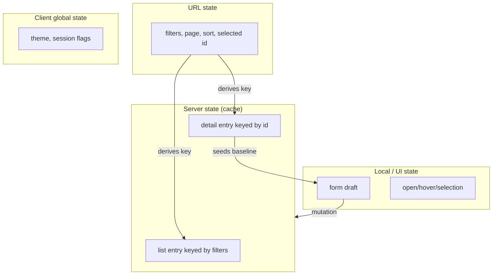
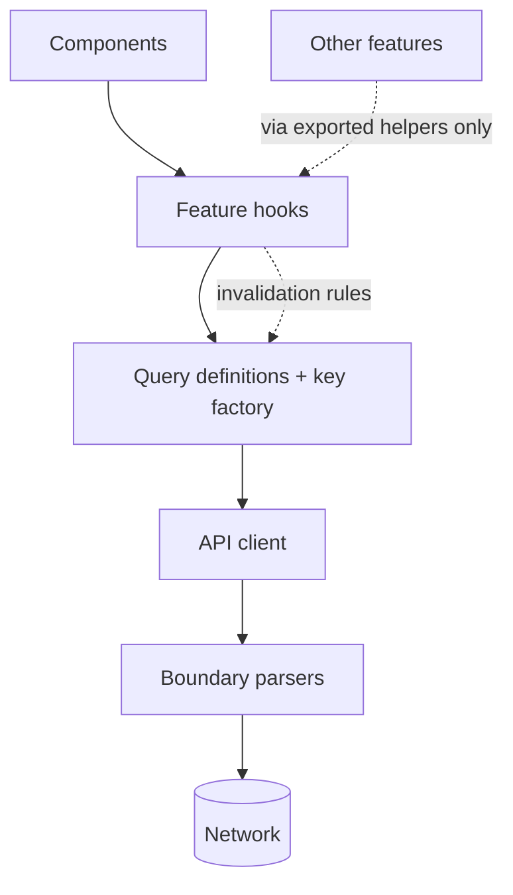
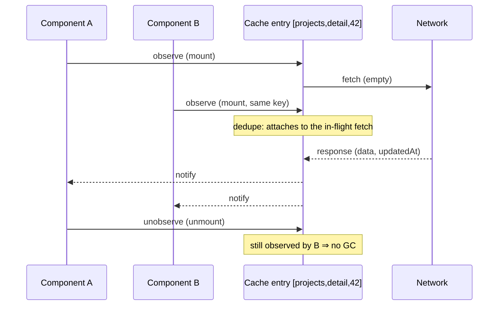

# 06 / 07 — Server State Management: A Different Kind of State, and the Responsibilities It Creates

## 1. Lesson metadata

| | |
|---|---|
| **Level** | Advanced |
| **Study time** | 5–6 hours (reading 2.5 h, experiments 1 h, exercises 2 h) |
| **Prerequisites** | [06 / 01 — The fetch lifecycle](./01-fetch-lifecycle.md), [06 / 02 — Cancellation and race conditions](./02-cancellation-and-race-conditions.md), [06 / 03 — Loading and error states](./03-loading-and-error-states.md), [06 / 04 — API normalization](./04-api-normalization.md), [06 / 05 — Optimistic updates](./05-optimistic-updates.md), [06 / 06 — Cache consistency and invalidation](./06-cache-consistency-and-invalidation.md), [04 / 16 — Server vs client state](../04-react-architecture/16-server-vs-client-state.md), [03 / 19 — UI, server, URL, and shared state](../03-react-state-and-hooks/19-ui-server-url-and-shared-state.md), [04 / 15 — State ownership](../04-react-architecture/15-state-ownership.md) |
| **Next** | [08 — TanStack Query](./08-tanstack-query.md) |
| **Related** | [09 — Redux Toolkit](./09-redux-toolkit.md), [10 — Zustand](./10-zustand.md), [11 — Context vs external stores](./11-context-vs-external-stores.md), [13 — Suspense data loading](./13-suspense-data-loading.md), [14 — Server-side data loading](./14-server-side-data-loading.md), [18 — URL state management](./18-url-state-management.md), [19 — Technology selection matrix](./19-technology-selection-matrix.md) *(files 09–19 are later lessons in this phase)* |

> **Technology claims are version-sensitive.** This lesson is *about responsibilities*, not about any one library. Where it says TanStack Query does something, that was executed against `@tanstack/react-query` 5.104 (2026-10-22); statements about other libraries (SWR, Apollo, urql, framework caches) were not re-verified. The responsibilities themselves (§2.3) are stable.

**Learning objectives.** After this lesson you can:
1. Define **server state** and list the properties that make it categorically different from client/UI state (remote ownership, asynchrony, shared mutability, staleness, identity, partial knowledge).
2. Enumerate the **responsibilities of a server-state layer** — fetch, dedupe, cache, freshness, invalidation, retry, cancellation, pagination, mutations, optimism, GC, SSR transfer, devtools — and audit any technology against that list.
3. Explain why client-state tools (`useState`, Context, Redux, Zustand) *can* hold server data but do not *manage* it, and what you re-implement if you use them that way.
4. Place server-state code in an application architecture: API client, boundary parsing, query definitions, feature hooks, components; and state the dependency direction.
5. Handle the recurring design problems: dependent queries, parallel queries, derived data (`select`), prefetching, initial/placeholder data, forms seeded from server state, pagination and infinite lists, URL-driven queries.
6. Decide, with criteria, when server state should *not* live in a client cache at all (RSC/loader, server-confirmed screens, realtime streams).
7. Compare technologies on **responsibilities covered and what remains yours**, and write down a defensible selection for a given product.

**Concepts covered:** client state vs server state, ownership, snapshot-with-timestamp model, source of truth, server-state responsibilities, query as a subscription to a cache entry, query keys as identity, observers, background revalidation, `select`/derived data, dependent and parallel queries, prefetch, placeholder vs initial data, pagination models, seeding forms from server state, URL as query parameters, hydration/dehydration, data-layer boundaries, testing seams, selection criteria.

---

## 2. Deep conceptual explanation

### 2.1 What is "server state"?

**Server state** is *a client-side copy (snapshot) of data whose source of truth lives elsewhere and which can change without the client's involvement.* The definition has three load-bearing parts:

1. **A copy.** The client never "has" the user list; it has *what the server said at 10:42:03*.
2. **Source of truth elsewhere.** The server (database, third-party API) decides what is true; the client can only *propose* changes (mutations).
3. **Can change without you.** Other users, background jobs, time (expiry), or your own other tabs may change it.

Compare it with **client state** (a.k.a. UI state): an open dropdown, the current tab, a draft input. The client *is* the source of truth; nobody else changes it; there is no snapshot, no staleness, no remote identity.

| Property | Client (UI) state | Server state |
|---|---|---|
| Source of truth | The browser/app | Remote system |
| Access | Synchronous | Asynchronous (can fail, be slow, be cancelled) |
| Changed by others | No | Yes |
| Staleness | N/A | Inherent; time-dependent |
| Shared across components | By design choice (lift/context) | By *identity of the resource* (same request → same data) |
| Persistence | Ephemeral unless chosen | Persisted by the server |
| Failure modes | Logic bugs | Network, auth, validation, conflicts, versioning |
| Typical lifetime | Component or session | Independent of any component; outlives screens |
| Needs | Setters, reducers, derived values | Fetch, cache, dedupe, refresh, invalidate, retry, mutate |

The consequence — and the reason this lesson exists — is that **using the same tool for both kinds of state forces you to re-implement the second set of needs by hand**, as lesson 01–06 demonstrated piece by piece. A framework-agnostic way to phrase the lesson: *server state is a cache, and a cache has a nontrivial list of responsibilities.*

### 2.2 The classification question

Before choosing a tool, classify each piece of state ([03 / 19](../03-react-state-and-hooks/19-ui-server-url-and-shared-state.md), [04 / 15](../04-react-architecture/15-state-ownership.md)):

| Question | If yes → |
|---|---|
| Does the data live on a server and could change without me? | **Server state** (cache with freshness) |
| Is it a view of the current page/filters/selection that should survive reload or be shareable? | **URL state** ([18](./18-url-state-management.md)) |
| Is it purely about the current interaction (open, hover, draft)? | **UI/local state** |
| Is it derived from other state? | **Don't store it** ([03 / 17](../03-react-state-and-hooks/17-derived-state.md)) |
| Is it app-global and client-owned (theme, auth *session flags*, feature toggles resolved at start)? | **Client global state** (Context/external store) |

Mixed cases are the interesting ones: the **filters** for a list are URL state; the **list** is server state keyed by those filters; the **selected row** is UI state; the **draft** of an edit form is local state seeded from server state. Keeping those four in four places — and connecting them through *keys*, not copies — is the core architectural move.

### 2.3 The responsibilities of a server-state layer

Everything in lessons 01–06 can be restated as a list of responsibilities. A technology "supports server state" to the degree that it takes these off your hands. Use this list as an **audit checklist**:

| # | Responsibility | Introduced in | What goes wrong without it |
|---|---|---|---|
| 1 | **Fetch + status** (typed lifecycle, `ok` check, typed errors) | [01](./01-fetch-lifecycle.md) | Silent failures, impossible states |
| 2 | **Parse/normalize at the boundary** | [04](./04-api-normalization.md) | Casts; crashes far from cause |
| 3 | **Cancellation / ignore stale responses** | [02](./02-cancellation-and-race-conditions.md) | Out-of-order display; stale writes |
| 4 | **Deduplication** of identical in-flight requests | [01 §3.4](./01-fetch-lifecycle.md), [06 §3.2](./06-cache-consistency-and-invalidation.md) | N components → N requests |
| 5 | **Caching by request identity** (key → entry) | [06](./06-cache-consistency-and-invalidation.md) | Refetch on every mount; no sharing |
| 6 | **Freshness policy** (stale windows, refetch triggers) | [06](./06-cache-consistency-and-invalidation.md) | Stale forever or hammering the API |
| 7 | **Background revalidation with stale display** | [03](./03-loading-and-error-states.md), [06](./06-cache-consistency-and-invalidation.md) | Spinners instead of content; flicker |
| 8 | **Invalidation after mutations** | [06](./06-cache-consistency-and-invalidation.md) | Read-your-writes violations |
| 9 | **Mutation lifecycle** (pending/error/success, variables) | [05](./05-optimistic-updates.md) | Hand-rolled booleans; duplicates |
| 10 | **Optimistic updates + rollback** | [05](./05-optimistic-updates.md) | Snapshot bugs; flicker |
| 11 | **Retry + backoff** (idempotent reads) | [15](./15-error-recovery-and-retries.md) | Transient errors surfaced to users |
| 12 | **Pagination / infinite data** | [08](./08-tanstack-query.md) | Duplicates, gaps, lost scroll position |
| 13 | **Garbage collection** of unused entries | [06 §3.2](./06-cache-consistency-and-invalidation.md) | Unbounded memory |
| 14 | **Identity scoping** (user/tenant) and clearing | [06 §2.9](./06-cache-consistency-and-invalidation.md) | Cross-user leakage |
| 15 | **SSR/hydration transfer** (server fetch → client cache) | [14](./14-server-side-data-loading.md) | Double fetch; hydration mismatch |
| 16 | **Persistence / offline** | [16](./16-offline-considerations.md) | Lost data; stale after update |
| 17 | **Devtools / observability** | — | Debugging by guesswork |
| 18 | **Suspense/error-boundary integration** | [03](./03-loading-and-error-states.md), [13](./13-suspense-data-loading.md) | Hand-wired loading trees |

Your job when selecting or building is to know **which of these 18 are covered, which are your responsibility, and which you can consciously skip.** Skipping consciously (a one-off request needs none of 4–16) is engineering; skipping accidentally is a future incident.

### 2.4 The "query is a subscription to a cache entry" model

Server-state libraries converge on one mental model, whatever their API surface:

```text
component ──subscribes──► [cache entry keyed by request identity] ◄──fetches── network
                              ▲   data, status, updatedAt, error
                              │
mutation ── invalidates / writes ┘
```

- A **query** is *not* a request; it is a **declaration of interest** in an entry, identified by key.
- Many components can subscribe to the same entry (sharing data, deduplicating the request).
- A **fetch** happens when the library decides the entry needs (re)validation, not necessarily when a component renders.
- Components re-render when the entry they observe changes (through `useSyncExternalStore`-style subscriptions — [03 / 20](../03-react-state-and-hooks/20-usesyncexternalstore-and-external-stores.md)).

This model explains the surprising-but-correct behaviors: mounting a component does not necessarily cause a request; two components need not coordinate; unmounting does not destroy data immediately; "loading" depends on whether the *entry* has data, not on whether a given component just mounted.

### 2.5 Why client-state tools fall short (and when they don't)

| Tool | What it is good at | What it does **not** do for server data (you must add it) |
|---|---|---|
| `useState` + `useEffect` | Local, simple, zero dependency | Dedupe, sharing, cache, freshness, invalidation, retry, GC, SSR |
| Context | Passing values down without prop drilling | Anything about fetching; also re-renders all consumers on value change ([03 / 14](../03-react-state-and-hooks/14-context-performance.md)) — and putting fetched data in Context tends to centralize loading logic in providers |
| Redux (hand-written thunks/reducers) | Predictable client state with devtools, middleware | Everything on the list above; you write the "loading/error/data" boilerplate per endpoint |
| Redux Toolkit **with RTK Query** | A server-state layer integrated with the store | Covers many responsibilities by design ([09](./09-redux-toolkit.md)) — an example where a "client-state" ecosystem *includes* a server-state tool |
| Zustand/Jotai-style stores | Lightweight client global state | Same as Redux: you hand-build the cache |
| TanStack Query / SWR | Server-state cache (1–10, 13, 18 largely; 11–12, 14–17 partly or with add-ons; TanStack Query checked, SWR not) | Client/UI state; business rules; boundary parsing is yours |
| Apollo/urql/Relay | Server-state for GraphQL, often normalized by entity | Non-GraphQL sources; client/UI state beyond local-only fields (varies) |
| Framework loaders / RSC | Fetch on the server; ship rendered output/props | Client interactivity-driven refetching, optimistic UI (you pair with client tools) |

The sharp claim, stated carefully: **putting server data into a client-state store is not wrong, but it makes you the maintainer of a bespoke cache.** The usual failure pattern — an `useEffect` that fetches and `dispatch`es into a store, with `loading`/`error` flags per slice — re-implements responsibilities 1, 5–9, 12–13 slowly and usually incorrectly. The legitimate cases for storing server data in a client store: *entity tables fed by realtime pushes* (see [04 §2.6](./04-api-normalization.md)); *deliberately long-lived client-owned working copies* (a document being edited offline — which is client state *seeded* from server state); and *apps already built around a store where migrating is a poor investment* ([11 — Context vs external stores](./11-context-vs-external-stores.md)).

**Responsibility comparison table** (summary used again in [19 — Technology selection matrix](./19-technology-selection-matrix.md)):

| Responsibility (§2.3) | Hand-rolled hook | TanStack Query / SWR | RTK Query | GraphQL clients | Framework loaders/RSC |
|---|---|---|---|---|---|
| 1 Status | You | Library | Library | Library | Framework/server |
| 2 Parse | You | You (select/queryFn) | You (`transformResponse`) | Schema typing; runtime validation partly you | You (server) |
| 3 Cancellation | You | Library (if signal forwarded) | Library | Library | Framework |
| 4 Dedupe | You | Library | Library | Library | Framework (request-scoped) |
| 5–6 Cache + freshness | You | Library | Library | Library (normalized) | Framework layers |
| 8 Invalidation | You | `invalidateQueries` | Tags | Refetch/evict/cache update | Revalidate path/tag |
| 9–10 Mutations/optimism | You | `useMutation` + patterns | `mutation` + `updateQueryData` | `mutate` + optimistic response | Actions + `useOptimistic` |
| 11 Retry | You | Library defaults | Library | Link-level | You/infra |
| 12 Pagination | You | Infinite-query helpers | Helpers | Cache field policies | You |
| 13 GC | You | Library | Library | Manual/policies | Framework |
| 14 Identity scoping | You | You (+`clear`) | You (reset on logout) | You | Per-request |
| 15 SSR transfer | You | Dehydrate/hydrate helpers | Framework integrations | Framework integrations | Native |
| 18 Suspense | You | Optional hooks | Limited | Supported | Native with RSC |

Only the TanStack Query column was checked against 5.104 (retry defaults, `dehydrate`/`hydrate`, `useSuspenseQuery`, `invalidateQueries`); the RTK Query, Apollo/urql and framework columns are unverified summaries — the *shape* (what you vs the library handles) is the durable lesson.

### 2.6 Where does server-state code live?

Treat the data layer as an **adapter** ([04 / 13](../04-react-architecture/13-application-services-and-adapters.md), [04 / 10](../04-react-architecture/10-clean-and-hexagonal-architecture.md)). A layered arrangement that scales:

```text
components (UI)            ── know only domain types and hooks
   ▲
feature hooks              ── useProject(id), useRenameProject() : keys, options, invalidation rules
   ▲
query definitions          ── keys (factory), queryFn bindings, select functions
   ▲
api client (per resource)  ── HTTP, auth headers, signal forwarding, error mapping
   ▲
boundary parsers/DTO map   ── wire → domain (lesson 04)
```

Dependency direction points **downward**: components never call `fetch`, never import DTOs, never construct keys by hand. Invalidation rules for a mutation live *with the mutation hook* (or a domain-level module), so "what does renaming a project refresh?" has one answer ([06 §2.7](./06-cache-consistency-and-invalidation.md)). This mirrors the feature-oriented folder structure of [04 / 06](../04-react-architecture/06-feature-vs-layer-structure.md): each feature owns its keys, queries, mutations, and parsers; cross-feature invalidation goes through exported helpers.

### 2.7 Recurring design problems

**Dependent queries.** B needs a value from A (`useProject` → `useOwner(project.ownerId)`). The second query is *disabled* until its input exists (`enabled` option). Sequential dependency creates a network **waterfall** ([01 §6](./01-fetch-lifecycle.md), [07 / 17](../07-performance/17-network-waterfalls.md)); remove it by having the server return the owner embedded, by prefetching on a route loader, or by accepting the waterfall if the second request is non-critical.

**Parallel queries.** Independent queries should start together. Several hooks in one component run in parallel naturally with an observer-based library; with Suspense-based reads, *sequential `use`/suspending reads in one component create a waterfall* (the second read does not start until the first resolves) — hoist or prefetch. Verified for TanStack Query 5.104 on React 19.3: two `useSuspenseQuery` calls in one component started 100 ms apart (the second only after the first resolved), while two sibling components each calling `useSuspenseQuery` started within a few ms of each other (React 19 pre-warms siblings, see [13](./13-suspense-data-loading.md)); `useSuspenseQueries` fetches in parallel by design.

**Derived data.** Never store derived values; compute them from the cached data. Libraries offer a `select` option to project/transform data per observer, with referential-stability caveats (a `select` that returns a new object each time defeats memoization unless stabilized; in TanStack Query 5.104 a `select` result is structurally shared, so a new-but-deep-equal object kept its identity across a refetch, and an inline `select` function still re-runs when it changes identity). Heavy transformations belong in `useMemo` or a selector with memoization ([03 / 11](../03-react-state-and-hooks/11-usememo-and-usecallback.md)).

**Prefetching.** Starting a fetch before the component that needs it renders: on hover/focus of a link, on route intent, in a loader. Prefetch *populates the cache*; the later `useQuery` finds it (fresh or stale). Prefetch obeys the same freshness rules: if the prefetched entry is fresh, no second request occurs.

**Initial vs placeholder data.** *Initial data* (from the server render or a parent) is treated as **real cached data** with a timestamp. *Placeholder data* is **not cached**; it is displayed while the real fetch runs (a list item's summary shown on the detail page) In TanStack Query 5.104 this is verified: `initialData: 'init'` was cached immediately (status `success`, no fetch with `staleTime: 1000`, one fetch with `staleTime: 0`), while `placeholderData` was never written to the cache and the observer reported `status: 'success'` with `isPlaceholderData: true` while `fetchStatus` was `fetching`. Other libraries differ. Mixing them up produces either "the placeholder was treated as fresh and never replaced" or "the real data flashes empty".

**Forms seeded from server state.** The server copy is the *baseline*; the form holds a *draft* of the user's edits. Rules: (1) do not overwrite the draft when a background refetch returns; (2) detect "baseline changed under me" (compare versions) and prompt; (3) on successful save, reset the baseline to the response and clear the draft; (4) failed saves keep the draft ([03 / 21 — Forms and complex state](../03-react-state-and-hooks/21-forms-and-complex-state.md), [05 §2.8](./05-optimistic-updates.md)).

**Pagination models.** Offset (`page`/`limit`): simple, unstable under concurrent inserts; cursor/keyset: stable, no random access; "infinite" lists accumulate pages in one entry and must dedupe by id ([04 §5.7](./04-api-normalization.md)). A page-switching UI should keep the previous page visible during the transition ([03 §5.8](./03-loading-and-error-states.md)).

**URL as the query's input.** Filters/sort/page live in the URL; the query key is derived from them; the browser's back button then works as "undo the filter" and the cache serves the earlier result instantly if still fresh ([18](./18-url-state-management.md)). The anti-pattern is storing filters in component state *and* the URL and syncing them with effects ([03 / 07](../03-react-state-and-hooks/07-you-might-not-need-an-effect.md)).

### 2.8 Server state without a client cache

Not all server data needs a client-side cache:

| Situation | Better model |
|---|---|
| Content rendered once per navigation (articles, product pages) | Fetch on the server (framework loader/RSC); the client receives HTML/props; navigation refetches ([14](./14-server-side-data-loading.md)) |
| Streams (prices, chat) | Subscription model (WebSocket/SSE) with a store; caching is per-message, not per-request ([17](./17-real-time-websockets-subscriptions.md)) |
| Server-confirmed workflow (checkout, wizard) | Each step's server response is the state; a local cache adds risk |
| One-shot data (download link, token exchange) | Plain async call; no cache semantics |
| Data that must be fresh per view (balance at transfer time) | Fetch with no/zero freshness, blocking, or server-side only |

A good senior answer to "should we use a client cache here?" often starts with "do we need *client-side* revalidation, sharing, or optimism for this data?" — if not, don't import the machinery.

### 2.9 Misconceptions

| Misconception | Reality |
|---|---|
| "Server state is just state that came from a server." | It is a *snapshot with an owner elsewhere and a lifetime*. The distinction drives different tools and rules. |
| "Put API data in Redux/Zustand for a single source of truth." | The server is the source of truth; the client store holds a cache. Copying into a second store creates a *second* cache. |
| "TanStack Query replaces Redux." | They solve different problems (server state vs client state); many apps use both, or one, depending on needs. |
| "A query runs when the component renders." | It declares interest; the cache decides whether to fetch. |
| "`useQuery` data is state; I can mutate it." | It is a cache snapshot. Treat as immutable; update through mutations/`set*Data`. |
| "More caching is always better." | Caching trades requests for wrongness windows; every layer needs a policy. |
| "A library removes the need for loading/error design." | It supplies *flags*; presentation is still your design ([03](./03-loading-and-error-states.md)). |
| "Global cache means global access to everything." | Keys partition access; auth/identity must be part of key and clearing policy. |

---

## 3. Internal mechanics

### 3.1 Observers, entries, and subscriptions (teaching model)

**Teaching model.** A cache holds **entries** (state per key) and **observers** (one per hook usage). Observer options (`staleTime`, `select`, `enabled`, `refetchInterval`…) are *per observer*; the *entry* is shared. When two components observe one key with different options, the library must reconcile: usually the entry is stale if **any** observer deems it stale, and each observer re-renders only for fields it tracks (the library may track which result fields you read to avoid unnecessary renders; TanStack Query v5 does this by default, verified: a component reading only `data` did not re-render on `isFetching` flips). The key consequences:

1. **Options are per observer; data is per entry.** Defining `staleTime` in one hook usage and not another yields different behaviors depending on mount order — centralize option definitions in query-definition modules.
2. **Select runs per observer** over the same shared data — safe, since `select` should be pure.
3. **Unsubscribing** (unmount) does not delete the entry; GC timers do.

**Public guarantee vs implementation detail.** Documented: queries with the same key share data and requests; inactive entries are garbage collected after a configurable time; observers can opt into different `select`/`enabled`. Not part of any contract: the internal class names, timer scheduling, batching of notifications.

### 3.2 React integration: how cache updates become renders

Libraries subscribe components with `useSyncExternalStore` (or equivalent) so reads are **tear-free** under concurrent rendering ([03 / 20](../03-react-state-and-hooks/20-usesyncexternalstore-and-external-stores.md)): during one render pass every component sees the same cache version. Notification batching and the exact React primitives used are implementation details. Two React-specific consequences you should know:

- **Updates triggered by external-store changes are synchronous (not transitions):** a store change that `useSyncExternalStore` observes forces a synchronous re-render, which can cause an already-revealed Suspense boundary to show its fallback rather than keep old UI — the documented caveat of the hook (the react.dev `useSyncExternalStore` reference says "mutations to the external store cannot be marked as non-blocking Transition updates, so they will trigger the nearest Suspense fallback"). Suspense-mode query hooks work around this in library-specific ways (not verified here).
- **Rendering must stay pure:** reading from the cache during render is allowed (it is a subscription read); *starting* a fetch during render is a side effect libraries move into effects/subscriptions or Suspense-integrated mechanisms ([06 / 01 §5.7](./01-fetch-lifecycle.md), [13](./13-suspense-data-loading.md)).

### 3.3 Hydration/dehydration (public concept, API-specific details)

For SSR/RSC apps, the server fetches data, renders HTML, and **transfers the cache** to the client so the first client render has the same data and does not refetch immediately. Conceptually: *dehydrate* (serialize entries—data, status, timestamps) → embed in the HTML/stream → *hydrate* (rebuild entries before React hydrates the tree). Concerns: **serialization** (only JSON-safe values; dates become strings — parse at boundary ([04](./04-api-normalization.md))); **per-request cache instances** (never module-level); **timestamps** (freshness must be evaluated against client time; hence `staleTime` > 0 for hydrated data to avoid an immediate refetch; verified with TanStack Query 5.104: a hydrated entry refetched once on the client with `staleTime: 0` and zero times with `staleTime: 60000`); **mismatches** if client renders different data than server did ([09 / 02 — Hydration internals](../09-advanced-rendering-and-ecosystem/02-hydration-internals-deep-dive.md)). Exact helper names and recommended patterns differ by library/framework and change; verify against current docs.

### 3.4 The mutation lifecycle as a state machine

`idle → pending → success | error` (per mutation instance), with *variables* (what you asked) available while pending and after ([05](./05-optimistic-updates.md)). Mutation state is **per hook instance** (not per entity) — which is why overlay-style optimism reads *mutation cache* state across components (`useMutationState`-style; exported by `@tanstack/react-query` 5.104). Retries for mutations are typically **off by default** (a retried non-idempotent write could duplicate; verified: TanStack Query's mutation `retry` default is 0) — an intentional contrast with queries, which are idempotent reads and usually retry.

### 3.5 Why keys are identity (and what that implies for `select`)

An entry is identified by its key; therefore **anything that changes the answer must be in the key**, and anything that only changes *presentation of the same answer* should be a `select` (per observer) rather than part of the key. Example: a list's *sort order* — if the server sorts, sort is in the key; if you sort client-side the same data, sort is *not* in the key and belongs in `select`/`useMemo` (cheap and avoids refetching). Mislabeling these produces either needless refetches (client concern in the key) or wrong data (server concern missing from the key).

---

## 4. Step-by-step execution walkthrough

Scenario: **Projects dashboard** built with a server-state layer (a TanStack-style cache). Route `/projects?status=active&page=2` shows a list; hovering a row prefetches the detail; clicking opens `/projects/42` with an edit form. Policies: lists `staleTime` 30 s, details 5 min.

| Step | Event | Server-state layer | UI |
|---|---|---|---|
| 1 | Navigate to `/projects?status=active&page=2` | Key `['projects','list',{status:'active',page:2}]` derived **from the URL**; entry empty → fetch | Skeleton ([03](./03-loading-and-error-states.md)) |
| 2 | Response arrives | Entry: data + `updatedAt`; boundary parser converted wire → domain | List |
| 3 | Hover row 42 (≥ 150 ms) | `prefetch(detail('42'))` — entry empty → fetch with `staleTime` 5 min | No UI change |
| 4 | Prefetch resolves | Entry `detail/42` populated | — |
| 5 | Click row → `/projects/42` | `useProject('42')` observes the entry → **fresh** → no request | Detail renders immediately |
| 6 | Edit form mounts | Draft state initialized from `project` baseline; `baselineVersion = project.version` | Form with values |
| 7 | Background trigger (window refocus after 10 min) | Detail stale (5 min) → background refetch; entry updates to version 9 (someone else edited) | Form draft untouched; banner "This project changed — review" because `baselineVersion (8) ≠ latest (9)` |
| 8 | User saves | Mutation `PATCH` with `If-Match`/version | Button pending |
| 9 | Success; response is full entity v10 | `setQueryData(detail)` (write-through); `invalidate(lists)` | Detail updated; draft cleared; list marked invalid (unmounted, no fetch) |
| 10 | Back button → `/projects?status=active&page=2` | List entry invalid ⇒ shows old data **and** refetches | List shows old row briefly; updates on response |
| 11 | User logs out | `cache.clear()` + route to login | No residual data |

**Predict:** if step 3's prefetch were wrapped in `useEffect` inside the row component, how many times might it fire in a list of 50 rows scrolling past? *Answer:* up to once per mounted row per mount (and twice per row in StrictMode dev), unless gated on hover/intent; also entries for rows never opened would accumulate until GC. Prefetch is a *deliberate speculation*; budget it (hover-intent delay, limited concurrency, `Save-Data` awareness via `navigator.connection.saveData`, which MDN lists as Chrome-only).

**What the walkthrough shows:** the URL → key → entry chain (1–2), prefetch as cache population (3–5), draft/baseline separation (6–7), write-through + invalidation (9–10), identity clearing (11). *Each* is a responsibility from §2.3, executed by a layer rather than by components.

---

## 5. Code examples

### 5.1 Minimal: what you re-implement when "just using useEffect"

```tsx
function ProjectName({ id }: { id: string }) {
  const [state, setState] = useState<AsyncState<Project>>({ status: 'loading' }); // lesson 01
  useEffect(() => { /* fetch, abort, parse, status — ~25 lines (lesson 01 §5.2) */ }, [id]);
  /* ... */
}
// <ProjectName id="42" /> rendered in header, sidebar and breadcrumb ⇒ 3 requests, 3 loading states,
// three copies that can disagree after an edit.
```

**Predict:** with three instances and a rename in the sidebar, how many components show the new name without further code? *Answer:* one — the one whose state was updated; each hook instance owns a private copy. This is the "state in `useState` is not a cache" row of lesson 01's misconceptions table, now measured in components.

### 5.2 Practical: the data layer for one feature (TanStack Query v5, executed against 5.104)

```ts
// features/projects/api.ts — HTTP only; knows nothing about React or the cache
import { fetchJson } from '@/lib/fetch-json';
import { parseProject, parseProjectPage, type Project, type ProjectPage } from './parsers';
import { projectKeys } from './keys';   // see lesson 06 §5.2

export const projectsApi = {
  list: async (filters: ListFilters, signal: AbortSignal): Promise<ProjectPage> =>
    parseProjectPage(await fetchJson(`/api/projects?${toSearch(filters)}`, signal)),

  detail: async (id: string, signal: AbortSignal): Promise<Project> =>
    parseProject(await fetchJson(`/api/projects/${encodeURIComponent(id)}`, signal)),

  rename: async (id: string, name: string, version: number): Promise<Project> =>
    parseProject(await sendJson(`/api/projects/${encodeURIComponent(id)}`, 'PATCH', { name }, { 'If-Match': String(version) })),
};
declare function toSearch(f: ListFilters): string;
declare function sendJson(url: string, method: string, body: unknown, headers?: Record<string, string>): Promise<unknown>;
export interface ListFilters { status?: 'active' | 'archived'; page?: number }
```

```ts
// features/projects/queries.ts — keys + options live together; hooks and prefetchers reuse them
import { queryOptions } from '@tanstack/react-query';   // exported by @tanstack/react-query 5.104
import { projectsApi, type ListFilters } from './api';
import { projectKeys } from './keys';

export const projectQueries = {
  list: (filters: ListFilters) =>
    queryOptions({
      queryKey: projectKeys.list(filters),
      queryFn: ({ signal }) => projectsApi.list(filters, signal),   // forward the signal ⇒ cancellation (lesson 02)
      staleTime: 30_000,
    }),

  detail: (id: string) =>
    queryOptions({
      queryKey: projectKeys.detail(id),
      queryFn: ({ signal }) => projectsApi.detail(id, signal),
      staleTime: 5 * 60_000,
    }),
};
```

```tsx
// features/projects/hooks.ts — the only things components import
import { useMutation, useQuery, useQueryClient } from '@tanstack/react-query';

export const useProjects = (filters: ListFilters) => useQuery(projectQueries.list(filters));
export const useProject = (id: string) => useQuery(projectQueries.detail(id));

export function usePrefetchProject() {
  const qc = useQueryClient();
  return (id: string) => void qc.prefetchQuery(projectQueries.detail(id));   // respects staleTime: fresh ⇒ no request
}

export function useRenameProject(id: string) {
  const qc = useQueryClient();
  return useMutation({
    mutationFn: ({ name, version }: { name: string; version: number }) => projectsApi.rename(id, name, version),
    onSuccess: (updated) => { qc.setQueryData(projectKeys.detail(id), updated); },   // write-through (06 §2.6)
    onSettled: () => { void qc.invalidateQueries({ queryKey: projectKeys.lists() }); },
  });
}
```

Line notes and design points:

- **One definition of "how to read a project"** (`projectQueries.detail`) is shared by `useQuery`, `prefetchQuery`, and any loader. If `staleTime` is defined *only* here, prefetch and hook agree (§3.1 point 1).
- `({ signal }) => …` is the library passing a cancellation signal ([02 §5.8](./02-cancellation-and-race-conditions.md)); `projectsApi` forwards it to `fetch`.
- `parseProject` runs inside the API layer, so **no cache entry ever contains a DTO** ([04](./04-api-normalization.md)).
- The mutation's invalidation rules live *with* the mutation; components calling `useRenameProject` cannot forget them.
- `queryOptions`, `signal` in the query function context, `setQueryData`, `prefetchQuery`, and `invalidateQueries` were all exercised against `@tanstack/query-core` 5.104.

### 5.3 Practical: component using the layer (UI concerns only)

```tsx
export function ProjectDetailPage({ id }: { id: string }) {
  const q = useProject(id);

  if (q.data === undefined) {
    return q.isError ? <InlineError error={q.error} onRetry={() => void q.refetch()} /> : <DetailSkeleton />;
  }
  return (
    <>
      {q.isError && <StaleBanner onRetry={() => void q.refetch()} />}
      <ProjectEditor project={q.data} isRefreshing={q.isFetching} />
    </>
  );
}
```

Pattern: *data first, then error, then loading* ([03 §5.7](./03-loading-and-error-states.md)). `isFetching`-style activity flag drives a small indicator (not a spinner replacing content). Flag names are library-specific (`isFetching` in TanStack Query v5). Notice the absence of: `fetch`, `AbortController`, keys, `useEffect`, and cache writes. **That absence is the benefit.**

### 5.4 Practical: form seeded from server state without being overwritten

```tsx
function ProjectEditor({ project, isRefreshing }: { project: Project; isRefreshing: boolean }) {
  const rename = useRenameProject(project.id);
  const [draftName, setDraftName] = useState(project.name);
  const baselineVersion = useRef(project.version);          // version the draft was based on

  const changedUnderMe = project.version !== baselineVersion.current;   // server moved on while editing
  const dirty = draftName !== project.name;

  return (
    <form
      onSubmit={(e) => {
        e.preventDefault();
        rename.mutate(
          { name: draftName, version: project.version },   // send the version we *intend* to overwrite
          { onSuccess: () => { baselineVersion.current = project.version; } },   // simplified; see note
        );
      }}
    >
      {changedUnderMe && (
        <p role="status">
          This project was updated by someone else.{' '}
          <button type="button" onClick={() => { setDraftName(project.name); baselineVersion.current = project.version; }}>
            Discard my changes and load theirs
          </button>
        </p>
      )}
      <input value={draftName} onChange={(e) => setDraftName(e.target.value)} aria-busy={isRefreshing} />
      <button disabled={!dirty || rename.isPending}>Save</button>
      {rename.isError && <p role="alert">Could not save. Your changes are kept.</p>}
    </form>
  );
}
```

Notes: the draft is **local state seeded from the baseline once** — *intentionally* a copy (the one legitimate "copy server data into `useState`"), and the code makes the *baseline version* explicit so a refetch cannot silently overwrite or silently clobber. Caveats to be explicit about: (1) `onSuccess` resetting the baseline to `project.version` reads the *captured* value from the click-time render; after a successful save the refetched/written-through entity has a *new* version — a production version re-seeds the draft **from the mutation response**; (2) sending the version enables server-side conflict detection (412/409) which the UI must handle ([03 §2.6](./03-loading-and-error-states.md)); (3) `useRef` for the baseline keeps it out of renders but the "changed under me" computation reads it during render — acceptable here, though reading a ref in render is generally discouraged; deriving from state is cleaner if you need the banner to be reactive to baseline changes ([03 / 10](../03-react-state-and-hooks/10-useref-and-mutable-references.md)).

### 5.5 Incorrect: the "fetch into the store" anti-pattern

```tsx
// Redux-style, hand-written
function ProjectsScreen() {
  const dispatch = useDispatch();
  const { items, loading, error } = useSelector((s: RootState) => s.projects);

  useEffect(() => {
    dispatch({ type: 'projects/loading' });
    fetch('/api/projects').then(r => r.json())
      .then(data => dispatch({ type: 'projects/loaded', payload: data }))
      .catch(e => dispatch({ type: 'projects/failed', payload: String(e) }));
  }, [dispatch]);

  if (loading) return <Spinner />;
  /* ... */
}
```

**Predict** five defects before reading on. (1) No `res.ok` check ([01](./01-fetch-lifecycle.md)). (2) No cancellation/ordering: two mounts or a filter change can dispatch out of order ([02](./02-cancellation-and-race-conditions.md)). (3) Every screen that mounts refetches — no freshness policy, no dedupe; two screens mounting together double-fetch. (4) `loading` and `error` as slice flags — one list per slice cannot represent per-filter entries, so a filter change shows the *previous filter's* data labeled as current, and `loading` blanks the list on every refetch ([03](./03-loading-and-error-states.md)). (5) No invalidation: a mutation elsewhere must remember to dispatch a refetch; cached `items` never expires; the store keeps data for the app's lifetime (no GC) and across logout unless a reset action exists ([06 §2.9](./06-cache-consistency-and-invalidation.md)). Plus `any`-typed payload, no parse boundary, and `String(e)` as the error model.

### 5.6 Corrected: the same screen with the server-state layer

```tsx
function ProjectsScreen() {
  const [params] = useSearchParams();                    // URL is the source of truth for filters
  const filters = parseFilters(params);                  // validate: URL input is untrusted too
  const list = useProjects(filters);
  /* render with data-first branching; keep previous page visible while next loads (placeholder/transition) */
}
```

The store (if any) is relegated to what it is good at (UI/session state). The component is 3 lines of data access; the 18 responsibilities moved into one tested layer. When the *entire app* is already on Redux, RTK Query (part of Redux Toolkit) offers this model inside the store ([09](./09-redux-toolkit.md)) — an example of choosing by *responsibility coverage*, not by brand.

### 5.7 Advanced: dependent + parallel queries, and removing a waterfall

```tsx
function ProjectOverview({ id }: { id: string }) {
  const project = useProject(id);                                     // A
  const owner = useQuery({                                            // B depends on A
    queryKey: ['users', 'detail', project.data?.ownerId],
    queryFn: ({ signal }) => usersApi.detail(project.data!.ownerId, signal),
    enabled: project.data !== undefined,                              // `enabled` (v5)
  });
  const tasks = useQuery(taskQueries.byProject(id));                  // C independent: starts in parallel with A
  /* render */
}
```

Timeline (latency 200 ms each): A and C start at t=0; B starts when A resolves (t=200) → B resolves at 400. Total 400 ms rather than 200 ms. Fixes by lowering waterfall depth, in order of preference: (1) have the API embed `owner` (or `ownerSummary`) in the project response; (2) a route loader/`prefetch` that fetches A and, on resolution, immediately starts B before the component renders (saves the render/commit gap, not the dependency); (3) accept the waterfall for a non-critical secondary section behind its own Suspense/skeleton. **Key insight:** a dependent query cannot be parallelized by cache cleverness — only by *changing what data is available when* (API shape, route knowledge).

### 5.8 Advanced: placeholder from the list while loading the detail

```tsx
export function useProjectWithPlaceholder(id: string) {
  const qc = useQueryClient();
  return useQuery({
    ...projectQueries.detail(id),
    placeholderData: () => {
      // Find the summary in any cached list; show it dimmed until the real detail arrives.
      for (const [, page] of qc.getQueriesData<ProjectPage>({ queryKey: projectKeys.lists() })) {
        const hit = page?.items.find((p) => p.id === id);
        if (hit) return toDetailPlaceholder(hit);          // fields missing from the summary are explicitly `undefined`
      }
      return undefined;
    },
  });
}
declare function toDetailPlaceholder(s: ProjectSummary): Project;
```

`placeholderData`, `getQueriesData` and the `isPlaceholderData` flag exist in 5.104. Design rules from §2.7: placeholder is **not cached**; mark UI as placeholder (the query result exposes `isPlaceholderData`) so actions requiring full data are disabled; never present the placeholder's missing fields as zeros.

### 5.9 Practical: a server-state **test seam**

```ts
// test-utils.tsx — fresh cache per test; no retries; no GC timers keeping the process alive
export function renderWithQuery(ui: React.ReactElement) {
  const client = new QueryClient({ defaultOptions: { queries: { retry: false, gcTime: Infinity }, mutations: { retry: false } } });
  return { client, ...render(<QueryClientProvider client={client}>{ui}</QueryClientProvider>) };
}
```

Principles (option names verified in 5.104): **one cache per test** (shared caches leak data between tests), **disable retries** (failure tests would otherwise take seconds), control the network with MSW/mocks rather than mocking the hook ([08 / 06](../08-testing-and-quality/06-mocking-strategies-and-msw.md)), and assert on DOM outcomes (loading → content → error → retry) rather than on library internals ([08 / 04](../08-testing-and-quality/04-testing-async-updates.md)).

---

## 6. Visual explanations

### State taxonomy and where each lives



### Layers and dependency direction



### Query as subscription



---

## 7. Alternative approaches and trade-offs

| Approach | Responsibilities covered (of §2.3) | What remains yours | Bundle/complexity | Fits best |
|---|---|---|---|---|
| Hand-rolled hooks (`useEffect` + state) | 1 (if you write it) | Almost everything | None; grows with scope | 1–3 requests total; tiny apps |
| Hand-rolled cache + `useSyncExternalStore` (lesson 06 §5.5) | 1, 4, 5, 6, partial 8 | 3, 9–18 | Moderate maintenance | Learning; very custom needs; embedded widgets |
| TanStack Query / SWR-class | 1, 3–10, 12–13, 17; partial 11, 15, 16, 18 | Parsing, identity clearing, domain rules, UI | Library size; conceptual cost | Most REST SPAs |
| RTK Query | Similar coverage inside Redux Toolkit (not re-verified) | Same; plus store architecture | Fits existing Redux apps | Redux-based apps; code-generated endpoints |
| GraphQL client with normalized cache | 1, 3–10, 12–13 + cross-entity consistency | Schema design, merge policies, non-GraphQL data | Larger; needs stable ids | GraphQL APIs with shared entities |
| Framework loaders / RSC + actions | 1, 4–6 (server layer), 8 (revalidate), 15 | Client interactivity needs (optimism, polling) | Framework lock-in | Content-heavy, SEO, server-owned data |
| Client store (Redux/Zustand) holding server data | Whatever you write | Nearly everything | Moderate; error-prone | Entity tables fed by realtime; legacy |
| Context-provided fetched data | Almost nothing | Everything + re-render cost | Low code, high smell | Static config fetched once at boot |

**When the recommended approach (a dedicated server-state library behind a feature data layer) is *not* best.**

1. **Server-rendered, mostly read-only pages** where a framework fetches and renders on the server; adding a client cache duplicates responsibility and ships JS for no gain. Use loaders/RSC and add a client cache only for interactive islands.
2. **Streaming/event data**: a request cache is the wrong abstraction; use a subscription store with a snapshot+delta protocol.
3. **Very small or embedded widgets**: a 25-line hook beats a dependency (lesson 01 §7).
4. **GraphQL with stable ids** and heavy cross-view sharing: a normalized client fits better than a request-keyed cache.
5. **Strictly server-confirmed workflows** (payments, regulated flows): caching semantics add risk; render from the latest response.
6. **A large existing Redux app with consistent patterns**: migrating wholesale may cost more than it saves; adopt RTK Query for new endpoints and migrate opportunistically.

---

## 8. Best practices and anti-patterns

**Do**

- Classify state first; give each class its own home; connect them through **keys**, not copies.
- Put **all request knowledge** (URLs, keys, parsers, invalidation) in a feature data layer; components consume domain hooks.
- Centralize query option definitions (`queryOptions`-style objects) so hooks, prefetch, and loaders agree.
- Use the URL as the source of truth for list parameters; derive keys from it.
- Treat cached data as **immutable**; update via mutations/`set*Data`; keep derived data derived.
- Seed forms from a baseline version; protect user drafts from background refetch.
- Define freshness per data type; document it next to the query definition.
- Clear caches on identity change; use per-request caches on the server.
- Test with a fresh cache per test and deterministic network control.
- Measure: request counts per screen, waterfall depth, cache hit rates.

**Anti-patterns**

| Smell | Why it hurts | Fix |
|---|---|---|
| `useEffect` → `dispatch(loaded)` for API data | Bespoke, wrong cache | Server-state layer |
| Server data in Context | Centralized loading logic; broad re-renders | Query hooks colocated with consumers |
| `useState(props.serverValue)` copies | Stale second cache | Render from source; deliberate draft |
| Components building keys or calling `fetch` | Drift, scattered invalidation | Feature hooks |
| `select` that returns fresh objects every call without care | Defeats memoization | Stable results/`useMemo` (TanStack Query structurally shares `select` output) |
| One giant "everything" query | Over-fetching; coarse invalidation | Resource-oriented queries |
| Query options defined differently at each call site | Behavior depends on mount order | Central definitions |
| Prefetching everything "to be fast" | Wasted bandwidth; battery | Intent-based, budgeted prefetch |
| Treating placeholder data as real | Wrong actions enabled | Flag + disable |
| Global `refetchOnWindowFocus` for all data | API load, flicker | Per-type policy |
| Catching and hiding query errors | Invisible failure | Visible, retryable states |

**Justified exceptions.** Local-first/offline apps *invert* the model: the client store is the source of truth and the server is a sync target — treat those as client state with a sync engine ([16](./16-offline-considerations.md)). Realtime apps may legitimately keep authoritative entity tables in a client store. Never present "server state must always go in a query library" as a rule; present *"know which responsibilities you are taking on."*

---

## 9. Real-world application

| Domain | Server-state design | Constraint |
|---|---|---|
| **E-commerce** | Catalogue lists keyed by URL filters; product detail prefetched on hover; cart as server state with write-through; checkout server-confirmed | Price/stock reconciliation; SEO pages via framework loaders; CLS-free skeletons |
| **Dashboard** | Per-widget queries with different `staleTime`/intervals; shared keys for dedupe; hidden-tab pause | API capacity = widgets × users ÷ interval; independent failure ([03 §5.4](./03-loading-and-error-states.md)) |
| **Finance** | Short freshness; transfers pessimistic; balances "as of"; clear on logout | Compliance: no persistence of sensitive data without policy; audit via request ids |
| **Forms / back-office** | Detail baseline + draft; version-checked saves; list invalidation | Conflict UI; unsaved-changes guards |
| **Auth** | `me`/permissions query at root; `staleTime` long; invalidation on role change; global 401 handler | Everything depends on it; avoid waterfalls (prefetch before render) |
| **Realtime** | Snapshot via query; deltas patch cache entries (version-guarded); fall back to invalidate on reconnect | Ordering between snapshot and first delta ([17](./17-real-time-websockets-subscriptions.md)) |
| **Multi-team** | Shared `api-client` + parsers package; each team owns feature data layers; exported invalidation helpers; lint rule: no `fetch` in components | Contract tests on keys/invalidation ([04 / 23](../04-react-architecture/23-multi-team-ownership.md)) |
| **Content/marketing** | Server fetch + revalidate; minimal client cache | Cache layers, CDN purge workflow |

Constraint worth noting: **bundle and organizational cost.** A server-state library is a dependency your whole team must understand (keys, freshness, invalidation). The cost is repaid when more than a few screens need the responsibilities in §2.3; budget onboarding and conventions (a short internal guide plus lint rules) rather than assuming the library enforces good habits.

---

## 10. Debugging and troubleshooting

### Symptom 1 — The same data is requested many times

- **Repro:** Open Network panel on a screen with several consumers.
- **Investigation:** Are the keys identical? (Compare devtools entries; a param like an inline object with unstable ordering or a `Date` in the key splits entries.) Is `staleTime` 0 with refetch-on-mount for each observer? Are requests different URLs (cache-buster param)?
- **Root cause:** Key drift or freshness 0.
- **Fix:** Key factory; sensible `staleTime`; avoid non-serializable key parts.

### Symptom 2 — Component shows data for the wrong entity

- **Investigation:** Print the key at the call site; check whether a dependency (id, user, locale) is missing from the key; check `placeholderData` leakage.
- **Root cause:** Key omits a request dependency; two questions share one entry.
- **Fix:** Include the dependency; add lint/test that keys include route params.

### Symptom 3 — Edits vanish or form resets when data refetches

- **Investigation:** Form state initialized from `data` in render (`value={data.name}`) or re-seeded in an effect on `data` change.
- **Root cause:** Draft not separated from baseline.
- **Fix:** Baseline/draft pattern (§5.4); `key` the editor by entity id (and version if re-seed is desired).

### Symptom 4 — Initial render loads twice on an SSR app

- **Investigation:** Server HTML contains data; client network shows an immediate refetch; check hydrated entry freshness (`staleTime: 0` ⇒ immediately stale) and cache transfer.
- **Root cause:** Hydrated data treated as stale; or cache not transferred (different client instance/keys).
- **Fix:** Set a non-zero `staleTime` for hydrated queries (verified); ensure same key derivation on both sides.

### Symptom 5 — Memory grows; old data resurfaces after logout

- **Investigation:** Heap snapshot; cache devtools entries survive logout.
- **Fix:** `clear()` on logout; identity in keys; GC times.

### Symptom 6 — "Why did it refetch?" mystery

- **Investigation:** Use the library's devtools or log the observer events; check triggers: mount, focus, reconnect, interval, invalidation, key change. Compare timestamps with `updatedAt`.
- **Root cause:** A trigger you did not know was enabled (global defaults).
- **Fix:** Set defaults deliberately in one `QueryClient` configuration; document them.

### Symptom 7 — Tests are flaky, leak state between tests, or take seconds on failure

- **Investigation:** Shared `QueryClient` module singleton; retries enabled; GC timers.
- **Fix:** §5.9 (fresh client per test; `retry: false`).

---

## 11. Exercises

### Level A — Knowledge
A1. Define server state and give three properties that distinguish it from UI state.
A2. List at least ten responsibilities of a server-state layer and say which lesson in Phase 6 introduces each.
A3. In the "query is a subscription" model, what is the difference between a query, an entry, and an observer?
A4. Why should the URL, not component state, hold list filters?
A5. When is `placeholderData` appropriate, and how does it differ from `initialData`?

### Level B — Code comprehension
B1. In §5.2, why do `useProject` and `usePrefetchProject` share `projectQueries.detail(id)`? What bug appears if each defines its own `staleTime`?
B2. In §5.4, trace what happens if a background refetch returns version 9 while the user's baseline is version 8 and they have typed a draft. What does the UI show? What happens on Save?
B3. In §5.7, draw the request timeline and compute total time for latencies A=200, B=150, C=300 ms. Which requests are on the critical path?
B4. In §5.5, identify which of the 18 responsibilities are missing from the hand-rolled store approach.

### Level C — Implementation
C1. Write `features/orders` with a key factory, `ordersApi` with boundary parsing, `orderQueries` (list/detail), `useOrders`, `useOrder`, and `useCancelOrder` with write-through and list invalidation.
C2. Write a `useDebouncedValue`-fed search query where the **key** includes the debounced term, previous results stay visible, and the request is cancelled when the term changes.
C3. Implement a `useIntentPrefetch(id)` hook: prefetch the detail after 150 ms of hover/focus; cancel on leave; skip when the entry is fresh; skip if `navigator.connection?.saveData` is true.
C4. Write a test utility and one test: list loading → success → refetch failure shows stale banner. Specify what you mock and what you assert.

### Level D — Debugging
D1. Two components show the project name; one updates after a rename, the other not until refresh. Devtools shows entries `['project', 42]` and `['projects','detail','42']`. Explain and fix, including how to prevent recurrence.
D2. After login as a different user, the first screen briefly shows the previous user's projects. List all contributing causes and the fix.
D3. Users report a form losing typed text every 30 seconds. Network shows a refetch each 30 s. Diagnose in two possible implementations and fix.
D4. An SSR page flashes loading skeletons on the client after hydrating server-rendered content. Diagnose.

### Level E — Architecture decisions
E1. For a B2B admin app (30 screens, REST API, 4 teams, SSR not required, strong forms), choose a server-state approach, define the folder structure, key conventions, defaults (stale/GC/retry), and error/loading standards. Justify each decision with a responsibility from §2.3.
E2. For a marketing/e-commerce site with SEO requirements and a small interactive cart, decide where each piece of data lives (server fetch, client cache, URL, local). Identify what you would *not* put in a client cache.
E3. A team wants to move all server data from Redux slices to a query library in one release. Evaluate and propose a migration plan with risks and checkpoints.

### Level F — Expert challenge
F1. Design a **technology-neutral server-state interface** (TypeScript types and rules) that feature code depends on, such that the underlying implementation could be TanStack Query today and an RSC/loader-based mechanism for some routes tomorrow. Specify the interface for reads (including freshness and keys), mutations (including invalidation intents), prefetch, and error/loading presentation; identify what cannot be abstracted without leaking and why.

---

## 12. Detailed answers and explanations

> Attempt the exercises first.

**A1.** A client-side snapshot of data owned by a remote system that can change without the client. Distinguishing properties: remote source of truth; asynchronous access with failure modes; changeable by others (staleness); identity by request/resource and sharing across components; lifetime independent of any component. Wrong answer: "state fetched from an API" (too narrow — it omits ownership and staleness).

**A2.** Any ten of §2.3, e.g. status (01), parse/normalize (04), cancellation (02), dedupe (01/06), caching (06), freshness (06), background revalidation (03/06), invalidation (06), mutation lifecycle (05), optimism (05), retry (15), pagination (08), GC (06), identity scoping (06), SSR transfer (14), persistence (16).

**A3.** A *query* is a declaration of interest (key + function + options); an *entry* is the shared cache record for that key (data, status, timestamps); an *observer* is one subscription (one hook usage) with its own options (`select`, `enabled`, `staleTime`). Many observers → one entry → one in-flight fetch.

**A4.** The URL is shareable, survives reload, supports the back button, and is the natural identity of the "question" — keys derive from it. Component state loses these properties and creates sync problems (state vs URL effects).

**A5.** Placeholder: displayed while real data loads; not stored in cache; the cache entry still has no real data (in TanStack Query v5 the observer reports `status: 'success'` with `isPlaceholderData: true` while `fetchStatus` is `'fetching'`); appropriate for summaries shown on detail pages. Initial data: treated as cached data (with timestamps), may satisfy the query without an immediate fetch depending on staleness; appropriate for server-provided or parent-provided *complete* data. Mixing them leads to wrong freshness behavior.

**B1.** Sharing the definition ensures `queryKey` and `staleTime` match across hooks/prefetch. If prefetch used `staleTime: 0`, a prefetched entry would be immediately stale; the following `useProject` (with `staleTime` 5 min) — whichever options the observer uses determine whether it refetches on mount; behavior would depend on call order and look inconsistent. Also, if keys differ, prefetch populates an entry no one reads.

**B2.** Refetch updates the entry (version 9). `project` prop changes; the draft (local state) is unchanged; `changedUnderMe` is true (9 ≠ 8) so a banner offers "Discard my changes and load theirs". If the user ignores it and Saves, the request sends `version: project.version` (9) — **this silently overwrites the other user's change** because the client is now sending the *new* version. That is a design flaw in the example as written: the version sent should be the **baseline** (8), so the server rejects with 409/412 and the UI presents a conflict. Strong answers catch this: send `baselineVersion.current`, not `project.version`.

**B3.** A: 0–200, C: 0–300 in parallel; B: 200–350 (starts after A). Total = max(350, 300) = 350 ms. Critical path: A → B. C is off the critical path (300 < 350). If B were embedded in A's response (200 ms), total would be max(200, 300) = 300, so C becomes the critical path.

**B4.** Missing: 3 cancellation, 4 dedupe, 5–6 caching/freshness, 7 background revalidation, 8 invalidation, 9–10 mutation lifecycle/optimism, 11 retry, 12 pagination, 13 GC, 14 identity scoping (unless a reset action exists), 15 SSR transfer, 17 devtools for queries, 1/2 partially (no `ok` check, no parsing). It covers only dispatching status actions.

**C1.** Sketch (abbreviated; see §5.2 for structure):
```ts
export const orderKeys = { /* from lesson 06 C2 */ };
export const ordersApi = {
  list: async (f: OrderFilters, signal: AbortSignal) => parseOrderPage(await fetchJson(`/api/orders?${toSearch(f)}`, signal)),
  detail: async (id: string, signal: AbortSignal) => parseOrder(await fetchJson(`/api/orders/${encodeURIComponent(id)}`, signal)),
  cancel: async (id: string) => parseOrder(await sendJson(`/api/orders/${encodeURIComponent(id)}/cancel`, 'POST', {})),
};
export const orderQueries = { list: (f) => queryOptions({ queryKey: orderKeys.list(f), queryFn: ({ signal }) => ordersApi.list(f, signal), staleTime: 15_000 }),
                              detail: (id) => queryOptions({ queryKey: orderKeys.detail(id), queryFn: ({ signal }) => ordersApi.detail(id, signal), staleTime: 60_000 }) };
export function useCancelOrder(id: string) {
  const qc = useQueryClient();
  return useMutation({
    mutationFn: () => ordersApi.cancel(id),
    onSuccess: (o) => qc.setQueryData(orderKeys.detail(id), o),
    onSettled: () => { void qc.invalidateQueries({ queryKey: orderKeys.lists() }); },
  });
}
```
Evaluation: key factory used everywhere; parse at boundary; signal forwarded; write-through + list invalidation; no fetch in components; `cancel` is a non-idempotent POST — no retry; consider pessimistic (it's a status change with server rules), not optimistic.

**C2.** `const term = useDebouncedValue(input, 300);` `useQuery({ queryKey: ['search', term], queryFn: ({signal}) => api.search(term, signal), enabled: term.trim() !== '', placeholderData: (prev) => prev })` — the function-form `placeholderData` keeping previous data is a documented pattern (`keepPreviousData` successor in v5; `placeholderData: (prev) => prev` and the exported `keepPreviousData` helper both exist in 5.104). Key includes `term`; cancellation via signal when the key changes (observer switches entries); previous results remain visible with a pending indicator. Edge: `term` empty → idle state.

**C3.** Implementation: `onPointerEnter`/`onFocus` set a `setTimeout(…150)` stored in a ref; `onPointerLeave`/`onBlur` clear it; on fire: `if (navigator.connection?.saveData) return; qc.prefetchQuery(projectQueries.detail(id))` (library handles freshness skip). Clean up timer on unmount. Notes: `navigator.connection` is non-standard/not universal (optional chaining required; types may need a cast). Cancellation of an *already started* prefetch on leave is optional — abandoning is fine since the result is cached.

**C4.** Mock the endpoint with MSW: first request returns 200 with data; second returns 500. Render with fresh `QueryClient` (`retry:false`). Assert: skeleton → rows; trigger refetch (user clicks Refresh or advance via `invalidate` in test); await banner `role=alert` "Couldn't refresh"; rows still present. Don't assert on library internals.

**D1.** Two keys for the same resource ⇒ two entries; only one is updated by write-through/invalidation. Fix: unify to the key factory's `detail(id)`; migrate call sites; prevention: forbid inline keys (lint rule or TypeScript branded key type), tests asserting invalidation by key factory, and code review checklist.

**D2.** Causes: cache not cleared on logout; keys lacking user identity; persisted cache restored before identity check; HTTP cache serving per-user JSON (missing `private`/`Vary`); a component reading from a module-level singleton. Fix: clear on logout *before* rendering the signed-out UI; `userId` in keys; clear persisted store; response headers; test the flow. Security-relevant: verify no other leak path.

**D3.** (1) Form value derived directly from query data (`value={data.name}`) — refetch overwrites typed text each 30 s (the `refetchInterval` or stale-on-focus). (2) Effect re-seeds draft on `data` change. Fix: baseline/draft separation; set draft once keyed by entity id; show "changed" banner; disable polling on pages with unsaved drafts.

**D4.** Hydrated entries are considered stale immediately (`staleTime` 0) and refetch on mount, causing queries to enter fetching and (with the wrong UI condition such as `isLoading`/`isFetching` driving skeletons) show skeletons; or the cache wasn't transferred so the client starts empty. Fix: transfer cache; set `staleTime` > 0 for hydrated data; base skeletons on *no data* not *fetching*.

**E1.** Strong answer: TanStack-style library (≥ 8 of 18 responsibilities needed across 30 screens); feature folders each with `api.ts`, `parsers.ts`, `keys.ts`, `queries.ts`, `hooks.ts`; boundary parsing with schema library; key conventions with entity + identity; defaults: `staleTime` per data type (reference data minutes, lists ~15–30 s), GC default or 5–10 min, retries on reads only (limited), mutation retries off; standardized `DataRegion` ([03 F1](./03-loading-and-error-states.md)); forms baseline/draft; invalidation helpers exported; lint: no `fetch` in components, no inline keys; test utilities. Each choice mapped to a responsibility.

**E2.** Server-fetch product/category pages (SEO, minimal JS); URL for facets/pagination; client cache only for interactive widgets (cart drawer, wishlist); cart as server state with write-through; prices/stock re-validated at checkout, not cached client-side; auth/session in a minimal client store. Don't cache: checkout totals, payment state, anything personalised in shared caches.

**E3.** Don't big-bang. Plan: (1) introduce the library alongside; (2) new endpoints on the library; (3) migrate read-only screens first (lowest risk), then forms/mutations; (4) keep Redux for client state; (5) adapter hooks so components don't change twice; (6) remove slices when unused; risks: duplicated caches during transition (cross-invalidate via helpers), different loading semantics (visual regressions), team learning curve; checkpoints: request count/regression metrics, error rate, test coverage. Consider RTK Query as a lower-friction alternative if the store remains central ([09](./09-redux-toolkit.md)).

**F1.** Strong answers define: `ResourceKey` (opaque, structurally comparable); `Read<T>` = `{ key, fetch(signal): Promise<T>, freshness: { staleAfterMs }, parse }` with a view result `{ data?, error?, status: 'initial'|'refreshing'|'stale'|'ready'|..., refresh() }` (the two-axis view from lesson 03); `Mutation<V,R>` = `{ run(v): Promise<R>, effects: Effect[] }` where `Effect` is declarative (`{ type:'write', key, value }`, `{ type:'invalidate', prefix }`, `{ type:'optimistic', key, apply }`) interpreted by the implementation; `prefetch(read)`; server implementations map effects to `revalidate` calls. Cannot abstract without leaking: Suspense vs flags rendering mode; streaming/hydration lifecycle; per-observer options; cache-key normalization details; optimism semantics (Actions vs cache); error boundaries. State explicitly that the abstraction costs expressiveness and should be justified by an actual migration need (YAGNI — [05 / 02](../05-design-patterns/02-dry-kiss-yagni.md)).

---

## 13. Senior engineer interview questions

1. **"What is server state, and why does it need different tooling from UI state?"** It's a snapshot of remotely owned data that can change without us, so it needs fetching, dedupe, caching, freshness, invalidation, retry, cancellation, and mutation handling. UI state has none of those problems; using one tool for both means re-implementing the former by hand.
2. **"Should server data live in Redux?"** Usually not as hand-written slices — that creates a bespoke cache. Reasonable exceptions: realtime entity tables, client-owned working copies, or using RTK Query inside Redux. Decide by responsibilities covered, not by habit.
3. **"What is a query in TanStack Query, mechanically?"** A subscription to a keyed cache entry; options are per observer; the cache decides when to fetch; many observers share one entry and one in-flight request.
4. **"How do you structure data-fetching code in a big app?"** Feature-owned data layers: API client → parsers → query definitions/keys → feature hooks; components only consume hooks; invalidation rules live with mutations; dependency direction downward.
5. **"How do you prevent a refetch from clobbering a user's edit?"** Separate baseline (server) from draft (local), version the baseline, detect baseline changes, and send the baseline version on save for server-side conflict detection.
6. **"When wouldn't you use a client query cache?"** Server-rendered read-only pages, streaming data, server-confirmed workflows, tiny widgets — where its responsibilities aren't needed or add risk.
7. **"How do you remove a data waterfall?"** Change data availability: embed dependent data in the API response, start both requests earlier (route-level prefetch/loader), or accept it for non-critical sections; caches can't parallelize a true dependency.
8. **"How do you decide `staleTime`?"** Per data type from the cost of acting on stale data, multiplied by the load budget (`users × observers ÷ interval`); then verify with metrics.

---

## 14. Further learning resources

| Resource | URL | Covers / why | Level | Study |
|---|---|---|---|---|
| TanStack Query — Overview | <https://tanstack.com/query/latest/docs/framework/react/overview> | Server-state motivation and feature list | Int | Motivation |
| TanStack Query — Important Defaults | <https://tanstack.com/query/latest/docs/framework/react/guides/important-defaults> *(link checked, HTTP 200, 2026-10-22)* | Default stale/gc/refetch/retry behavior | Int | Whole page |
| TanStack Query — Query Keys | <https://tanstack.com/query/latest/docs/framework/react/guides/query-keys> *(link checked, HTTP 200, 2026-10-22)* | Key design | Int | Whole page |
| TanStack Query — Dependent Queries | <https://tanstack.com/query/latest/docs/framework/react/guides/dependent-queries> *(link checked, HTTP 200, 2026-10-22)* | `enabled`, waterfalls | Int | Whole page |
| TanStack Query — Prefetching | <https://tanstack.com/query/latest/docs/framework/react/guides/prefetching> *(link checked, HTTP 200, 2026-10-22)* | Prefetch strategies | Int–Adv | Whole page |
| TanStack Query — Testing | <https://tanstack.com/query/latest/docs/framework/react/guides/testing> *(link checked, HTTP 200, 2026-10-22)* | Fresh client per test, retries | Int | Whole page |
| SWR documentation | <https://swr.vercel.app> | Stale-while-revalidate library model | Int | Getting started |
| RTK Query overview | <https://redux-toolkit.js.org/rtk-query/overview> | Server-state in Redux Toolkit | Int | Overview |
| Apollo Client — Caching | <https://www.apollographql.com/docs/react/caching/overview> *(link checked, HTTP 200, 2026-10-22)* | Normalized cache | Int | Overview |
| React — `useSyncExternalStore` | <https://react.dev/reference/react/useSyncExternalStore> | How external caches subscribe | Int–Adv | Caveats |
| React — Choosing the State Structure | <https://react.dev/learn/choosing-the-state-structure> | Avoiding duplicated state | Beg–Int | "Avoid duplication in state" |
| React — Sharing State Between Components | <https://react.dev/learn/sharing-state-between-components> | Lifting vs sources of truth | Beg | Whole page |
| MDN — Network Information API | <https://developer.mozilla.org/en-US/docs/Web/API/Network_Information_API> | `saveData` signal (limited support: MDN compat data lists Chrome 65 only, no Firefox or Safari) | Int | Whole page |

URLs in this table were checked for HTTP 200 on 2026-10-22; any still marked *(unverified)* could not be checked automatically (blocked or unreachable). A 200 response does not guarantee the page content still matches the description; if a link has moved, search the site for the quoted title.

---

## 15. Knowledge checkpoint

**You should now understand**
- Server state as a snapshot of remotely owned, independently changing data — and why that implies a cache with a list of responsibilities.
- The 18-item responsibilities checklist and how to audit any technology against it.
- The query-as-subscription model: queries, entries, observers; options per observer, data per entry.
- How URL, server, local, and global state connect through keys instead of copies.
- When *not* to use a client cache.

**You should be able to explain without notes**
- Why storing API responses in Redux/Context/`useState` makes you the maintainer of a bespoke cache.
- Baseline vs draft in forms, and why the version sent on save must be the baseline.
- Why a dependent query cannot be parallelized by caching and how to remove the waterfall.

**You should be able to implement**
- A feature data layer (API → parser → keys → query definitions → hooks) with write-through and targeted invalidation; intent-based prefetch; placeholder data; a test seam with a fresh cache.

**You should be able to debug**
- Duplicate requests from key drift, wrong-entity displays from missing key dependencies, clobbered drafts, hydration double-fetches, cross-user leakage, mysterious refetches.

**Before moving on:** read [08 — TanStack Query](./08-tanstack-query.md), which applies this model to one concrete library, then compare it with the other ecosystems in lessons 09–11 and the selection matrix in lesson 19, using the responsibilities list from §2.3 as your yardstick.
