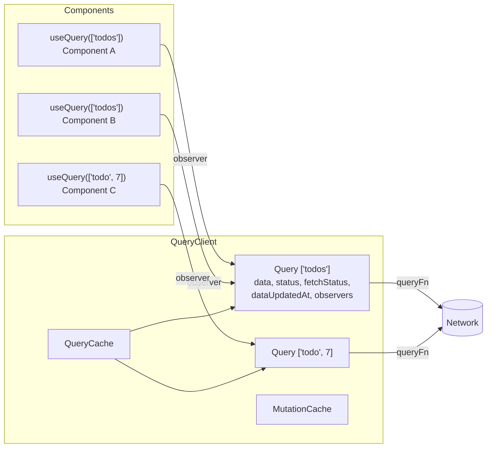
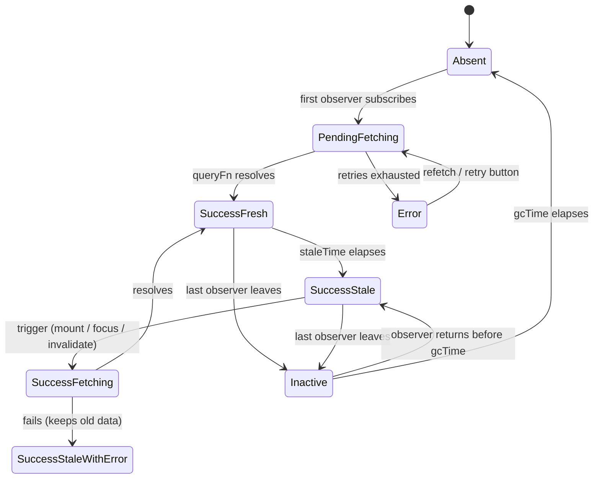
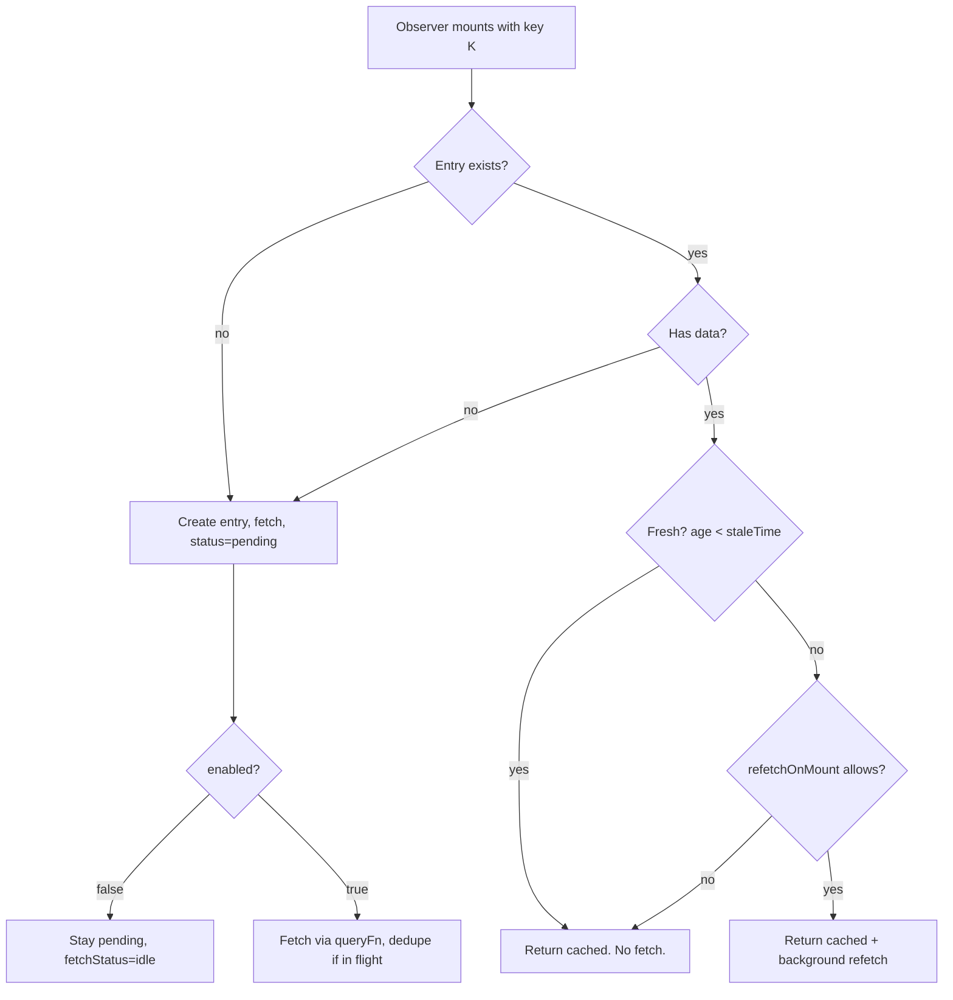

# 06 / 08 — TanStack Query: A Server-State Cache with Opinions

> **Checked against `@tanstack/react-query` 5.104 (executed and read from the shipped typings, 2026-10-22).** This lesson targets **TanStack Query v5**. Option names, defaults, and experimental APIs can still change between minors (for example, in 5.104 mutation callbacks gained a trailing `context` argument and `onMutate`'s return value is passed as `onMutateResult`); the authority is <https://tanstack.com/query/latest>. The *concepts* (cache keyed by query key, staleness, observers, garbage collection, invalidation) are stable across versions.

## 1. Lesson metadata

| | |
|---|---|
| **Level** | Intermediate–Advanced |
| **Study time** | 5–6 hours (reading 2 h, experiments 1.5 h, exercises 2 h) |
| **Prerequisites** | [07 — Server state management](./07-server-state-management.md), [06 — Cache consistency and invalidation](./06-cache-consistency-and-invalidation.md), [02 — Cancellation and race conditions](./02-cancellation-and-race-conditions.md), [03 — Loading and error states](./03-loading-and-error-states.md), [Phase 3 / 20 — `useSyncExternalStore` and external stores](../03-react-state-and-hooks/20-usesyncexternalstore-and-external-stores.md) |
| **Next** | [09 — Redux Toolkit](./09-redux-toolkit.md) |
| **Related** | [05 — Optimistic updates](./05-optimistic-updates.md), [13 — Suspense data loading](./13-suspense-data-loading.md), [14 — Server-side data loading](./14-server-side-data-loading.md), [15 — Error recovery and retries](./15-error-recovery-and-retries.md), [19 — Technology selection matrix](./19-technology-selection-matrix.md) |

**Learning objectives.** After this lesson you can:
1. State the exact responsibilities TanStack Query takes over from your components, and the ones it deliberately does not.
2. Predict, for a given `staleTime` / `gcTime` / mount sequence, whether a network request fires.
3. Design a query-key hierarchy that supports precise invalidation.
4. Implement mutations with cache updates and rollbacks, choosing between invalidate, direct `setQueryData`, and optimistic UI.
5. Distinguish `status` from `fetchStatus` and `isPending` from `isLoading`, and render each correctly.
6. Debug the common failures: refetch storms, stale data after mutation, unstable keys, and "cache is the source of truth for forms" bugs.
7. Explain when *not* to adopt it.

**Concepts covered:** query cache, query key, query function, observer, `staleTime`, `gcTime`, `status` vs `fetchStatus`, deduplication, background refetch triggers, `select`, `placeholderData`, `initialData`, mutations, invalidation, `setQueryData`, optimistic updates, infinite queries, `queryOptions`, structural sharing, `QueryClient` lifecycle, devtools.

---

## 2. Deep conceptual explanation

### 2.1 What problem is this lesson solving?

[Lesson 07](./07-server-state-management.md) argued that *server state* (data owned by a remote system, fetched asynchronously, shared, and potentially stale the moment you receive it) has different properties from UI state. Hand-rolling the machinery for it means re-implementing, per component: request lifecycle ([01](./01-fetch-lifecycle.md)), race protection ([02](./02-cancellation-and-race-conditions.md)), loading/error modelling ([03](./03-loading-and-error-states.md)), caching, deduplication, refetch policy, retries, and invalidation ([06](./06-cache-consistency-and-invalidation.md)).

TanStack Query is a library whose **entire job** is that machinery. You give it:

- a **key** that identifies a piece of server data, and
- a **function** that knows how to fetch it,

and it gives each component a **subscription** to an entry in a shared **cache**, plus a policy engine deciding *when* to (re)fetch it.

### 2.2 Responsibilities: what it owns, what it does not

This course compares technologies on **responsibilities**, not on "which is best". Here is the responsibility map for this tool:

| Responsibility | TanStack Query | Left to you |
|---|---|---|
| Fetching transport (`fetch`, axios, GraphQL client) | No. It is transport-agnostic: your `queryFn` returns a promise. | Yes |
| Cache of async results keyed by an identifier | **Yes** | |
| Deduplicating concurrent identical requests | **Yes** | |
| Staleness policy and background refetch triggers | **Yes** | |
| Retry with backoff | **Yes** (configurable) | |
| Cancellation plumbing (passes an `AbortSignal`) | **Yes** (you must forward it to the request) | Forward the signal |
| Garbage collection of unused entries | **Yes** | |
| Mutation lifecycle (pending/success/error) | **Yes** | |
| Deciding *which* queries a mutation affects | No | **Yes** (invalidate / update by key) |
| Normalizing entities across queries | No (by design; see [04](./04-api-normalization.md)) | Yes, if needed |
| UI state (modal open, selected tab, form drafts) | No | Yes — see [10](./10-zustand.md), [Phase 3](../03-react-state-and-hooks/19-ui-server-url-and-shared-state.md) |
| Server-side rendering of the first paint | Provides hydration helpers | Framework integration ([14](./14-server-side-data-loading.md)) |
| Data validation of responses | No | Yes (e.g. a schema library in `queryFn`) |

### 2.3 The mental model: a cache with observers



- A **`QueryClient`** owns a **`QueryCache`** and a **`MutationCache`**. You create exactly one per app (per request on the server) and provide it via `<QueryClientProvider>`.
- A **`Query`** is one cache entry, identified by the **hash of its query key**. It stores the data, error, timestamps, and its current in-flight promise.
- A **`QueryObserver`** is what `useQuery` creates internally: a subscription from one component to one query, carrying that component's options (`select`, `enabled`, `staleTime`...). Two components with the same key share one `Query` but have two observers.
- When the **first observer subscribes** and the data is missing or stale, the query fetches. When the **last observer unsubscribes**, a garbage-collection timer (`gcTime`) starts; if nobody re-subscribes in time, the entry is removed.

*Teaching model.* The class names (`Query`, `QueryObserver`, `QueryCache`) are documented concepts but their internals are not public API; treat them as a model.

### 2.4 Staleness is a *policy*, not a *fact*

The most important knob is **`staleTime`** (default `0`; confirmed in 5.104, and `'static'` is also accepted to mean "never stale"). A query's data is *fresh* for `staleTime` ms after it was last fetched, and *stale* afterwards. Stale does not mean "bad"; it means "eligible to be refetched when a trigger occurs". Triggers (each configurable) include:

- a new observer mounts (`refetchOnMount`),
- the window regains focus (`refetchOnWindowFocus`),
- the network reconnects (`refetchOnReconnect`),
- a `refetchInterval` fires,
- you call `invalidateQueries` / `refetchQueries`.

With the default `staleTime: 0`, data is stale immediately, so *every* mount and focus event triggers a background refetch. The user still sees cached data instantly (that is the "stale-while-revalidate" strategy, named after the HTTP cache-control extension) while fresh data loads. Raising `staleTime` is how you say "this data changes rarely; do not bother the server".

**`gcTime`** (default 5 minutes in the browser, `Infinity` on the server; confirmed in 5.104; named `cacheTime` before v5) is unrelated to freshness: it is how long an *unobserved* entry stays in memory. Mixing these two up is the single most common conceptual error.

| | `staleTime` | `gcTime` |
|---|---|---|
| Question answered | "May I show this without refetching?" | "How long do I keep this in memory when nobody is looking?" |
| Clock starts | After each successful fetch | When the last observer unsubscribes |
| Effect when elapsed | Entry becomes *stale* (still shown, refetch on trigger) | Entry is *removed* |
| Default | 0 | 5 min |

### 2.5 `status` and `fetchStatus` are different axes

In v5 a query has two orthogonal states:

- **`status`**: do we have *data*? `'pending'` (no data yet), `'error'` (last attempt failed, no data to show — or error with prior data in some flows), `'success'` (have data).
- **`fetchStatus`**: is the *queryFn running*? `'fetching'`, `'paused'` (wanted to fetch but offline), `'idle'`.

Derived booleans: `isPending` (`status === 'pending'`), `isFetching`, `isLoading` (`isFetching && isPending` — the *first* load in flight), `isRefetching`, `isError`, `isSuccess`, `isPlaceholderData`, `isStale`.

> **Version-sensitive (verified in 5.104).** In v4, `isLoading` meant "no data yet" and `status: 'loading'`. In v5, that became `isPending` / `'pending'`, and `isLoading` was redefined as `isFetching && isPending`. Many blog posts predate this. A disabled query (`enabled: false`) with no data is `isPending: true` but `isLoading: false` — it is not loading anything.

### 2.6 What React exposes versus what this library adds

React gives you `useState`, `useEffect`, `useSyncExternalStore`, Suspense and `use`. TanStack Query is built on `useSyncExternalStore` (verified: `useBaseQuery` calls `React.useSyncExternalStore` in 5.104) so that many components can subscribe to an external cache without tearing ([Phase 3 / 20](../03-react-state-and-hooks/20-usesyncexternalstore-and-external-stores.md)). It is not a React feature; the core (`@tanstack/query-core`) is framework-agnostic, with adapters for Vue, Solid, Svelte, Angular.

### 2.7 Common misconceptions

| Misconception | Reality |
|---|---|
| "React Query is a state manager like Redux." | It is an *async cache*. It will not hold your sidebar-collapsed flag; it has no concept of dispatching your own domain events. |
| "`cacheTime`/`gcTime` controls how long data is fresh." | That is `staleTime`. |
| "If I put data in `useState` from `data`, it stays in sync." | Copying server state into local state ([Phase 3 / 17](../03-react-state-and-hooks/17-derived-state.md)) creates a stale duplicate; derive or `select` instead. |
| "Query keys are just cache names." | They are *dependencies*: like `useEffect` deps, every input to the `queryFn` that changes the result must be in the key. |
| "`invalidateQueries` refetches everything." | It marks matching queries stale and refetches only the ones with **active observers**; inactive matching ones refetch when next used. |
| "Mutations update the UI automatically." | Mutations only run and report status. *You* decide which cache entries to invalidate or write. |
| "The cache is a database." | It is a per-tab in-memory cache; reload loses it unless you add persistence (a separate plugin; see [16](./16-offline-considerations.md)). |

---

## 3. Internal mechanics

### 3.1 Query keys: hashing and matching

- A key is a JSON-serializable **array**. Keys are hashed deterministically, with **object property order ignored**. `['todos', { status: 'done', page: 1 }]` and `['todos', { page: 1, status: 'done' }]` are the same entry; but array element order *matters*.
- **Partial matching** drives invalidation: `invalidateQueries({ queryKey: ['todos'] })` matches `['todos']`, `['todos', 'list', {...}]`, and `['todos', 'detail', 7]` — any key that *starts with* the given prefix. `exact: true` restricts to equality. A `predicate` callback allows arbitrary matching.

*Public guarantee:* hash-equality semantics and prefix matching. *Implementation detail:* the hashing function.

### 3.2 Deduplication

If two observers request a query whose fetch is already in flight, they share that promise: one network call. Mounting a list and a header badge that both use `['cart']` in the same render pass fires one request. Dedup applies to *in-flight* requests, not to staleness: if request one finished 1 ms ago and `staleTime` is 0, a new mount may start another fetch.

### 3.3 Retry

Queries retry failed `queryFn`s (default 3 times on the client with delay `min(1000 * 2^failureCount, 30000)` ms, i.e. 1 s, 2 s, 4 s; the default is 0 retries when the library detects a server environment; both confirmed in the 5.104 source, and a run with scaled delays made 4 attempts in total). Mutations default to *no* retry. Retries mean a failing endpoint can take ~7 s (1s, 2s, 4s delays) to surface `isError`; lower `retry` for UX-critical failures and for 4xx statuses where retrying is pointless. See [15](./15-error-recovery-and-retries.md).

### 3.4 Cancellation

`queryFn` receives a context: `({ queryKey, signal, meta })`. `signal` is an `AbortSignal`. If you pass it to `fetch(url, { signal })`, the library can cancel the request when, for example, the last observer unsubscribes mid-flight or `queryClient.cancelQueries` runs. If you ignore the signal, the request still completes (results are still cached); cancellation is *opt-in at the transport*. Compare [Lesson 02](./02-cancellation-and-race-conditions.md).

### 3.5 Structural sharing

When a refetch returns data, the library compares it against the previous data and **reuses unchanged object references** (deeply) — a form of structural sharing. Practical effects: if the refetched JSON is deeply equal, `data` keeps the same reference and components using `select`ed slices do not re-render; for partially changed data, unchanged subtrees keep identity, which helps `React.memo` and dependency arrays. It requires JSON-like data; class instances or huge payloads may warrant `structuralSharing: false` (verify cost/benefit in docs).

### 3.6 Observers, re-render tracking, and `select`

By default, an observer notifies a component only when **properties the component actually read** change (tracked property access; verified in 5.104: a component reading only `data` rendered twice in total across load and a forced refetch, i.e. the `isFetching` flips did not re-render it). A component that reads only `data` will not re-render when `isFetching` flips. `select: (data) => data.items.length` computes a derived value; the component re-renders only if the *selected result* changes (structurally). Memoize inline `select` functions with `useCallback` or define them stably if they are expensive; the docs describe when the selector is re-run (verify).

### 3.7 The lifecycle of one query entry



---

## 4. Step-by-step execution walkthrough

Scenario: `staleTime: 30_000`, `gcTime: 300_000`. A `ProductList` page and a `Header` both call `useQuery({ queryKey: ['products', 'list'], ... })`. The user navigates away, then back after 10 s, then again after 40 s.

1. **t=0, first render.** `ProductList` creates an observer; the cache has no entry. The query is created, `status: 'pending'`, `fetchStatus: 'fetching'`. `Header`'s observer subscribes in the same commit; it finds a fetch in flight and **shares** it (dedup).
2. **t=0.4 s.** The promise resolves. Cache stores data, `dataUpdatedAt = now`. Both observers are notified; both components re-render with `status: 'success'`, `isStale: false`.
3. **t=5 s.** User navigates to another route. `ProductList` unmounts; its observer unsubscribes. `Header` (in the layout) remains — so the query still has one observer and **no gc timer starts**.
4. **t=10 s.** User returns; `ProductList` mounts a new observer. The data is 10 s old < 30 s → fresh. `refetchOnMount` only refetches stale data → **no request**. UI renders from cache with no spinner.
5. **t=35 s.** Data becomes stale (staleTime elapsed). Nothing happens yet: stale is passive.
6. **t=40 s.** User switches to another tab and back. `refetchOnWindowFocus` + stale → a background refetch begins. `status` remains `'success'`, `fetchStatus: 'fetching'`, `isRefetching: true`. UI continues to show old data (possibly a subtle spinner you render from `isFetching`).
7. **t=40.3 s.** Result arrives; structural sharing keeps unchanged product objects' identity; only changed rows' components re-render if memoized.
8. **If Header were not in the layout:** at step 3 the last observer leaves, the gc timer starts at 300 s; the user returning at 40 s would find the entry still cached (inactive → active), show it immediately, and refetch because it is stale.

**Predict:** in step 4, would a `useEffect` in `ProductList` that logs `isFetching` print `true`? *Answer: No — no refetch occurs because the data is fresh, so `isFetching` stays `false`.*

---

## 5. Code examples

All examples use TypeScript and `@tanstack/react-query` v5 object-signature APIs (the v4 positional signatures `useQuery(key, fn, opts)` are removed in v5).

### 5.1 Minimal example

```tsx
// main.tsx
import { QueryClient, QueryClientProvider } from '@tanstack/react-query';
import { createRoot } from 'react-dom/client';
import { App } from './App';

const queryClient = new QueryClient(); // one per app (browser)

createRoot(document.getElementById('root')!).render(
  <QueryClientProvider client={queryClient}>
    <App />
  </QueryClientProvider>,
);
```

```tsx
// Todos.tsx
import { useQuery } from '@tanstack/react-query';

type Todo = { id: number; title: string; done: boolean };

async function fetchTodos(signal: AbortSignal): Promise<Todo[]> {
  const res = await fetch('/api/todos', { signal });
  if (!res.ok) throw new Error(`HTTP ${res.status}`); // fetch does NOT reject on 4xx/5xx
  return res.json();
}

export function Todos() {
  const { data, status, error } = useQuery({
    queryKey: ['todos'],
    queryFn: ({ signal }) => fetchTodos(signal),
  });

  if (status === 'pending') return <p>Loading…</p>;
  if (status === 'error') return <p role="alert">Failed: {error.message}</p>;
  return <ul>{data.map((t) => <li key={t.id}>{t.title}</li>)}</ul>;
}
```

Line notes:
- `new QueryClient()` is created **outside** components. Creating it inside a component body without `useState`/module scope would produce a fresh, empty cache on every render.
- The `if (!res.ok) throw` is essential: query success is "the promise resolved"; a 500 response with a JSON body would otherwise be cached as *data*.
- Branching on `status` narrows types: after the first two returns, TypeScript knows `data` is `Todo[]` (the library's result is a discriminated union).
- `error` is typed `Error` by default; the default `TError` is `Error` in v5 (it was `unknown` in v4). Register a global error type if you throw something else.

**Predict:** two `<Todos />` components are rendered on the same page. How many `GET /api/todos` requests at first load? **One** — same key, dedup.

### 5.2 Practical example — key factories, `queryOptions`, filters, mutation with invalidation

```ts
// features/todos/todoQueries.ts
import { queryOptions, keepPreviousData } from '@tanstack/react-query';

export type Todo = { id: number; title: string; done: boolean };
export type TodoFilters = { status: 'all' | 'open' | 'done'; page: number };

export const todoKeys = {
  all: ['todos'] as const,
  lists: () => [...todoKeys.all, 'list'] as const,
  list: (filters: TodoFilters) => [...todoKeys.lists(), filters] as const,
  details: () => [...todoKeys.all, 'detail'] as const,
  detail: (id: number) => [...todoKeys.details(), id] as const,
};

async function getJson<T>(url: string, signal: AbortSignal): Promise<T> {
  const res = await fetch(url, { signal });
  if (!res.ok) throw new Error(`HTTP ${res.status}`);
  return res.json() as Promise<T>;
}

export const todoListOptions = (filters: TodoFilters) =>
  queryOptions({
    queryKey: todoKeys.list(filters),
    queryFn: ({ signal }) =>
      getJson<{ items: Todo[]; total: number }>(
        `/api/todos?status=${filters.status}&page=${filters.page}`,
        signal,
      ),
    staleTime: 30_000,
    placeholderData: keepPreviousData, // keep showing previous page while next loads
  });

export const todoDetailOptions = (id: number) =>
  queryOptions({
    queryKey: todoKeys.detail(id),
    queryFn: ({ signal }) => getJson<Todo>(`/api/todos/${id}`, signal),
  });
```

```tsx
// features/todos/TodoList.tsx
import { useMutation, useQuery, useQueryClient } from '@tanstack/react-query';
import { todoKeys, todoListOptions, type Todo, type TodoFilters } from './todoQueries';

export function TodoList({ filters }: { filters: TodoFilters }) {
  const queryClient = useQueryClient();
  const { data, isPending, isError, error, isFetching, isPlaceholderData } =
    useQuery(todoListOptions(filters));

  const toggle = useMutation({
    mutationFn: async (todo: Todo) => {
      const res = await fetch(`/api/todos/${todo.id}`, {
        method: 'PATCH',
        headers: { 'Content-Type': 'application/json' },
        body: JSON.stringify({ done: !todo.done }),
      });
      if (!res.ok) throw new Error(`HTTP ${res.status}`);
      return (await res.json()) as Todo;
    },
    onSuccess: (updated) => {
      // 1. write the authoritative detail directly (no extra request)
      queryClient.setQueryData(todoKeys.detail(updated.id), updated);
      // 2. lists may now be wrong (filters!) → mark stale & refetch active ones
      return queryClient.invalidateQueries({ queryKey: todoKeys.lists() });
    },
  });

  if (isPending) return <p>Loading…</p>;
  if (isError) return <p role="alert">{error.message}</p>;

  return (
    <div aria-busy={isFetching}>
      <ul style={{ opacity: isPlaceholderData ? 0.6 : 1 }}>
        {data.items.map((t) => (
          <li key={t.id}>
            <label>
              <input
                type="checkbox"
                checked={t.done}
                disabled={toggle.isPending && toggle.variables.id === t.id}
                onChange={() => toggle.mutate(t)}
              />
              {t.title}
            </label>
          </li>
        ))}
      </ul>
    </div>
  );
}
```

Line notes:
- **Key factory** (`todoKeys`) gives a hierarchy `todos > list > {filters}` and `todos > detail > id`. Invalidating `todoKeys.lists()` hits every filter/page combination without touching details; invalidating `todoKeys.all` hits both.
- **`queryOptions`** bundles key + fn + options so `useQuery`, `prefetchQuery`, `ensureQueryData`, and `getQueryData` share one definition, with the key's type carried through (`queryOptions` returns a tagged `queryKey`, so `getQueryData(options.queryKey)` is typed).
- **`placeholderData: keepPreviousData`** (v5 form; v4 had `keepPreviousData: true`): while page 2 loads, `data` is page 1 and `isPlaceholderData` is `true`; there is no `isPending` flash between pages.
- **Returning the `invalidateQueries` promise from `onSuccess`** keeps the mutation in `isPending` until the refetch completes — useful when you want the button disabled until the list is consistent. Do not return it if you prefer an immediately responsive button.
- `toggle.variables` is the argument of the in-flight mutate call (`undefined` when idle; the `&&` handles it because `isPending` guards it, and TypeScript's `variables` type is `Todo | undefined`, so `toggle.variables?.id` is safer — here `isPending` being true implies defined, but the compiler may not narrow; prefer `?.` in real code).

### 5.3 Incorrect examples

```tsx
// ❌ A: key does not contain all inputs
function UserPosts({ userId }: { userId: number }) {
  return useQuery({
    queryKey: ['posts'],
    queryFn: () => fetch(`/api/users/${userId}/posts`).then((r) => r.json()),
  }).data;
}
```
**Why wrong:** change `userId` from 1 to 2 and the key is still `['posts']` → the cache returns user 1's posts as if they were user 2's, and no refetch triggers because the key did not change. **Fix:** `queryKey: ['users', userId, 'posts']`. Rule: *the key is the dependency array of the queryFn.*

```tsx
// ❌ B: copying query data into state
function Profile() {
  const { data } = useQuery({ queryKey: ['me'], queryFn: fetchMe });
  const [name, setName] = useState(data?.name ?? '');   // initial render: data undefined → ''
  ...
}
```
**Why wrong:** `useState`'s initializer runs once; when `data` arrives, `name` stays `''`. Even if it works for a cache hit, later background refetches never update `name`. For *editing*, initialize a form from data once data exists (e.g. render the form component only when `data` is defined and pass `defaultValue`s/`key={data.id}`; see [Phase 3 / 21](../03-react-state-and-hooks/21-forms-and-complex-state.md)).

```tsx
// ❌ C: fetching in useEffect "because I need to run something after"
useEffect(() => {
  queryClient.fetchQuery({ queryKey: ['x'], queryFn }).then(setX);
}, []);
```
**Why wrong:** you rebuilt `useQuery` without observers (no refetch triggers, no re-render on cache update) and reintroduced local copies. Use `useQuery`, or `useQueries`, or `select`.

```ts
// ❌ D: unstable key from inline object with undefined/Date/functions
queryKey: ['events', { from: new Date(), cb: () => {} }]
```
**Why wrong:** `Date` serializes to its ISO string, which changes every render → a new cache entry (and a fetch) on every render; functions are dropped from the hash. Normalize to stable primitives (`from: day.toISOString().slice(0,10)`).

### 5.4 Corrected implementation — dependent queries and `enabled`

```tsx
function Checkout({ userId }: { userId: number | null }) {
  const user = useQuery({
    queryKey: ['users', userId],
    queryFn: ({ signal }) => getJson<{ id: number; planId: string }>(`/api/users/${userId}`, signal),
    enabled: userId !== null,
  });

  const plan = useQuery({
    queryKey: ['plans', user.data?.planId],
    queryFn: ({ signal }) => getJson<{ price: number }>(`/api/plans/${user.data!.planId}`, signal),
    enabled: !!user.data?.planId,
  });
  ...
}
```
`enabled: false` means "do not run the `queryFn` automatically". The `!` non-null assertion is guarded by `enabled` at runtime but the type system cannot see that. v5 offers `skipToken` as an alternative that makes the type honest: `queryFn: planId ? () => getPlan(planId) : skipToken`. Trade-off: dependent queries create a **waterfall** (plan waits for user); if the server can do both in one request, do that instead ([Phase 7 / 17 — Network waterfalls](../07-performance/17-network-waterfalls.md)).

### 5.5 Advanced example — optimistic update with rollback (cache-based)

```tsx
const queryClient = useQueryClient();

const rename = useMutation({
  mutationFn: (v: { id: number; title: string }) => patchTodo(v.id, { title: v.title }),

  onMutate: async (v) => {
    await queryClient.cancelQueries({ queryKey: todoKeys.detail(v.id) }); // stop in-flight refetch overwriting us
    const previous = queryClient.getQueryData<Todo>(todoKeys.detail(v.id));
    queryClient.setQueryData<Todo>(todoKeys.detail(v.id), (old) =>
      old ? { ...old, title: v.title } : old,
    );
    return { previous };           // context for onError
  },

  onError: (_err, v, ctx) => {
    if (ctx?.previous) queryClient.setQueryData(todoKeys.detail(v.id), ctx.previous);
  },

  onSettled: (_data, _err, v) =>
    queryClient.invalidateQueries({ queryKey: todoKeys.detail(v.id) }), // converge on server truth
});
```

Why each step: (1) `cancelQueries` prevents a refetch started *before* the mutation from landing after our optimistic write and clobbering it; (2) snapshot for rollback; (3) functional `setQueryData` updater must return a new object, never mutate `old` (structural sharing and change detection rely on immutability); (4) `onSettled` runs for both outcomes, ensuring the cache converges to server truth, e.g. when the server normalized the title.

**Alternative (v5):** the *UI-based* optimistic pattern renders `mutation.variables` while `mutation.isPending` instead of touching the cache; simpler rollback (nothing to roll back) but visible only in the component that owns the mutation (or via `useMutationState`, exported in 5.104). Compare [Lesson 05](./05-optimistic-updates.md) for the general theory.

**Trade-offs:** cache-based optimistic updates make every consumer consistent instantly but require writing to *all* affected entries (lists too — a rename may change sort order). UI-based is simpler and local. Invalidate-only is simplest and correct but shows latency.

### 5.6 Advanced example — infinite query (v5 requirements)

```tsx
import { useInfiniteQuery } from '@tanstack/react-query';

type Page = { items: Todo[]; nextCursor: string | null };

const q = useInfiniteQuery({
  queryKey: ['todos', 'infinite'],
  queryFn: ({ pageParam, signal }) =>
    getJson<Page>(`/api/todos?cursor=${pageParam ?? ''}`, signal),
  initialPageParam: null as string | null,       // REQUIRED in v5
  getNextPageParam: (last) => last.nextCursor,   // return undefined/null → no more pages
});

const all = q.data?.pages.flatMap((p) => p.items) ?? [];
// <button disabled={!q.hasNextPage || q.isFetchingNextPage} onClick={() => q.fetchNextPage()} />
```
Notes: `initialPageParam` is mandatory in v5 (it is a required property in the 5.104 typings). All pages live under *one* query entry, so invalidation refetches **all loaded pages sequentially** — expensive for deep lists; consider `maxPages` (exists in 5.104) or cursor-free designs. Unbounded growth is a memory concern; virtualize ([Phase 7 / 09](../07-performance/09-windowing-and-virtualization.md)).

---

## 6. Visual explanations

### Decision flow at observer mount



### Where invalidation reaches

```text
Cache:
 ['todos']                              ← invalidate(['todos'])  hits all below
   ├─ ['todos','list',{status:'open',page:1}]   ← active  → refetch now
   ├─ ['todos','list',{status:'done',page:1}]   ← inactive→ marked stale only
   └─ ['todos','detail',7]                      ← active  → refetch now
invalidate(['todos','list'])  hits only the two list entries.
```

---

## 7. Alternative approaches and trade-offs

| Approach | Responsibilities covered | Boilerplate | Cache sharing | Staleness/refetch policy | Testability | Prefer when |
|---|---|---|---|---|---|---|
| `useEffect` + `useState` ([01](./01-fetch-lifecycle.md)) | Only what you code | High if done right | None | Manual | Medium | One-off fetch in a tiny app; teaching |
| **TanStack Query** | Cache, dedupe, retry, GC, mutation state | Low | Keyed, global per client | Declarative | High (fresh `QueryClient` per test) | Many components share remote data; interactive apps |
| **RTK Query** ([09](./09-redux-toolkit.md)) | Similar cache, defined as API endpoints in the Redux store | Medium (api slice) | Keyed, in Redux store | Tags-based invalidation | High | Team already on Redux; want entities + server cache in one store, DevTools time-travel |
| **SWR** | Smaller cache/revalidate core | Low | Keyed | Revalidation-centric | High | Simple read-heavy apps, smaller API surface; fewer mutation helpers (SWR was not checked in this review) |
| **Apollo / urql / Relay** | GraphQL clients with normalized caches (Apollo/Relay) | Medium–High | Entity-normalized | Cache policies | Medium | GraphQL with relational data where normalization matters ([04](./04-api-normalization.md)) |
| **Framework loaders** (RSC, route loaders) ([14](./14-server-side-data-loading.md)) | Fetch tied to routing/server | Low | Framework cache | Route navigations | Framework-dependent | Mostly read, route-shaped data, SSR critical |
| **`use(promise)` + manual cache** ([13](./13-suspense-data-loading.md)) | Reading; you build the cache | High | You build | You build | Medium | Library authors / very specialized needs |

**Scenario where TanStack Query is *not* the best fit.** A mostly-static marketing/doc site rendered on the server with route-level data and no client mutations: loaders or Server Components provide the data with no client-side cache, no `QueryClient`, and less JavaScript shipped. Adding a client cache there duplicates the server cache and adds bundle weight. Another: a live trading blotter fed by a WebSocket stream; request/response cache semantics (stale, refetch) do not map onto push streams ([17](./17-real-time-websockets-subscriptions.md)) — the cache may still be a *sink* for pushes via `setQueryData`, but it is not the right primary abstraction.

**Scenario where it is better than a normalized store:** a dashboard where each widget has its own endpoint and different freshness needs; per-widget keys and `staleTime` express that directly.

---

## 8. Best practices and anti-patterns

### Best practices
- **Keys are dependencies.** Put every variable that affects the result in the key; use key factories; order from general to specific.
- **Wrap queries in custom hooks / `queryOptions`** per feature — consumers never see raw keys.
- **Set `staleTime` deliberately** per data class: user profile minutes, inventory seconds, reference data hours. Choose a global default rather than leaving `0` if your app suffers refetch noise — but make that a *conscious* choice, not folklore.
- **Throw on `!res.ok`** in `queryFn`; validate response shapes at the boundary (schema), not in components.
- **Forward `signal`.**
- **Prefer `invalidateQueries` as the default post-mutation strategy**; add `setQueryData` for latency-sensitive paths; add optimistic updates only where the UX justifies the complexity.
- **Use `select`** for derived views, not extra state.
- **Create a fresh `QueryClient` per test and per SSR request** (see [14](./14-server-side-data-loading.md)); disable retries in tests (`retry: false`) so failures surface fast.
- **Use the devtools** (`@tanstack/react-query-devtools`) in development.

### Beginner mistakes
- Missing dependencies in key (5.3 A); copying data into state (5.3 B); forgetting `res.ok`; creating `QueryClient` inside the component; using `isLoading` to mean "no data yet" (v4 habit); mutating `data` in place.

### Experienced-developer mistakes
- **Using the cache as a global client-state store** by `setQueryData(['ui','sidebar'], …)`. It works, but GC, refetch triggers, and devtools noise are irrelevant to UI state; pick a UI-state tool ([10](./10-zustand.md)).
- **Over-invalidating** (`queryClient.invalidateQueries()` with no filter) after every mutation: refetch storms.
- **`staleTime: Infinity` without invalidation discipline** → data never updates.
- **Per-row `useQuery` for N items** (N+1 requests) instead of a list endpoint or `useQueries` with batching on the server.
- **Putting server data into Redux/Zustand as well** "so everything is in one place" — two sources of truth ([07](./07-server-state-management.md)).
- Relying on `onSuccess` callbacks for `useQuery` (removed in v5; `onSuccess`/`onError`/`onSettled` exist only on mutations in the 5.104 typings). Use effects or derive; mutations still have callbacks.

### Smells
- A `useEffect` that depends on `query.data` to `setState`.
- Query keys built with string concatenation scattered across files.
- A `queryFn` that reads mutable external state not in the key.

### Justified exceptions
- Copying data into a form's local state *is* right for a **draft being edited** — the draft diverges from the server deliberately. Do it once per entity (`key={id}`), not continuously.
- `refetchOnWindowFocus: false` is justified for expensive endpoints or kiosk-like UIs.
- `staleTime: Infinity` for immutable resources addressed by content hash/version.

---

## 9. Real-world application

**E-commerce catalog and cart** (see Project 6). Product lists keyed by `{category, sort, page}` with `placeholderData: keepPreviousData` for pagination; product detail `staleTime` of minutes; **cart** with short `staleTime` and `refetchOnWindowFocus` on (a price or stock change in another tab matters). Add-to-cart mutation: optimistic count in header via cache write, invalidate `['cart']` on settle. Constraint: price shown at checkout must be server-authoritative — never trust the optimistic value for payment; revalidate on the checkout page with `staleTime: 0`.

**Finance dashboard.** Account balances: `refetchInterval` (e.g. 15–30 s) with `refetchIntervalInBackground: false` to avoid battery drain; transaction history as infinite query. Constraints: regulatory displays of "as of" timestamps — show `dataUpdatedAt`; avoid optimistic updates on money movements; retries must **not** replay non-idempotent POSTs (mutations default to no retry — keep it that way unless the endpoint is idempotent with an idempotency key, see [15](./15-error-recovery-and-retries.md)).

**Admin tables with filters.** Filters live in the URL ([18](./18-url-state-management.md)); the URL-derived object goes into the key. Back/forward then works through cache hits.

**Multi-team platform.** Each feature owns its `todoKeys`-style factory and `queryOptions`; cross-feature invalidation goes through exported *invalidation functions* (`invalidateCart(queryClient)`), not by importing another team's key arrays — otherwise key renames silently break caches. A shared `QueryClient` defaults file (retry policy, `staleTime`, error reporting through `QueryCache`'s `onError`) is the governance point.

**Auth.** On logout, call `queryClient.clear()` (or `removeQueries`) so the next user never sees the previous user's cached data; include a user/tenant ID in keys for tenant-scoped data as defense in depth.

---

## 10. Debugging and troubleshooting

| Symptom | Likely root cause | Investigation | Fix / validation |
|---|---|---|---|
| Request fires on every focus/mount | `staleTime: 0` default; or key unstable | Devtools: the query shows "stale" immediately; check if key *string* changes between renders | Raise `staleTime`; stabilize key. Validate: Network panel quiet after navigation |
| Stale data after a mutation | No invalidation or wrong key prefix | Devtools: after the mutation, is the intended query marked "stale"/"fetching"? Log `queryClient.getQueryCache().findAll({queryKey})` | Invalidate with correct prefix; confirm refetch in Network |
| Infinite refetch loop | Key contains a fresh object/Date each render, or `queryFn` throws and `retry` + `refetchInterval` interplay | Devtools list shows hundreds of entries | Normalize key inputs |
| Spinner on every page change | Key changes (new entry has no data) | Compare `status` across pages | `placeholderData: keepPreviousData` |
| `data` undefined though request succeeded | `queryFn` returned `undefined` (v5 errors on `undefined` data; verified: `status: 'error'` with message "data is undefined" and a console error naming the key) | Console warning/error | Return `null` for "no data" |
| Cannot read properties of undefined (`data.map`) | Rendering before checking `status` | Stack trace in component | Branch on `status`; or `useSuspenseQuery` ([13](./13-suspense-data-loading.md)) |
| Test flakiness / cross-test leakage | Shared `QueryClient` between tests | Tests pass alone, fail together | New client per test; `retry: false`; `gcTime: Infinity` or cleanup |
| Hydration mismatch with SSR | Server and client data differ; client refetch changes content | Compare server HTML to first client render | Hydrate dehydrated state, set non-zero `staleTime` ([14](./14-server-side-data-loading.md)) |
| Memory growth in long sessions | Infinite queries with many pages or huge `gcTime` | Devtools cache size; heap snapshot | `maxPages`, lower `gcTime`, virtualize |

**Repro tip:** log cache events: `queryClient.getQueryCache().subscribe((e) => console.log(e.type, e.query.queryHash))` (verified in 5.104: events such as `added`, `updated` with `e.query.queryHash`). It reveals mount/refetch/invalidate sequences far faster than guessing.

---

## 11. Exercises

### Level A — Knowledge
**A1.** Define `staleTime` and `gcTime`. Which one makes an entry disappear?
**A2.** What is the difference between `status` and `fetchStatus`? Give a state where `status === 'pending'` but `fetchStatus === 'idle'`.
**A3.** Name four triggers that cause a stale query to refetch.
**A4.** Why must `signal` from the `queryFn` context be forwarded to `fetch`?
**A5.** What does `invalidateQueries({ queryKey: ['todos'] })` match, and which of the matched queries refetch immediately?
**A6.** List three v4 → v5 changes mentioned in this lesson.

### Level B — Code comprehension
**B1.** Given `staleTime: 60_000`, `gcTime: 10_000`, a component mounts, unmounts at t=5 s, remounts at t=20 s. Is a request made at 20 s? Explain.
**B2.** What does each render do here, and what is the bug?
```tsx
const [page, setPage] = useState(0);
const { data } = useQuery({ queryKey: ['items'], queryFn: () => getItems(page) });
```
**B3.** Why does `queryKey: ['t', { a: 1, b: 2 }]` equal `['t', { b: 2, a: 1 }]` but not `[{ a: 1 }, 't']`?
**B4.** In the optimistic example (5.5) what would go wrong if `cancelQueries` were omitted?

### Level C — Implementation
**C1.** Write a `useProduct(id)` hook using `queryOptions` that is disabled when `id` is `undefined`, forwards `signal`, throws on non-OK, and sets `staleTime` to 5 minutes.
**C2.** Implement an "add item" mutation for a list query keyed `['items','list']` that appends optimistically and rolls back on error. Include a final invalidation.
**C3.** Implement a prefetch-on-hover for a list row linking to the detail page.

### Level D — Debugging
**D1.** A dashboard shows another user's data for ~1 s after login switching. Diagnose and fix (hint: lifecycle of the `QueryClient`).
**D2.** Typing in a search box fires a request per keystroke and results appear out of order... or do they? Explain why the out-of-order problem is largely absent with query keys and what remains a problem.
**D3.** After editing a todo, the list in a *different* tab of the SPA (filter = "done") remains wrong. The dev used `setQueryData(todoKeys.detail(id), …)` only. Fix it.

### Level E — Architecture and engineering decisions
**E1.** Your team has Redux with 40 slices, 60% of which store API responses. Propose a migration strategy (or argue not to migrate). Identify risks.
**E2.** Choose between TanStack Query and framework loaders for a content site with a small logged-in dashboard. Justify using responsibilities.
**E3.** Decide the `staleTime` policy for: user profile, product price, stock level, country list, notifications count. Justify each.

### Level F — Expert challenge
**F1.** Design a cross-feature invalidation architecture for 6 teams sharing one `QueryClient` without coupling to each other's key shapes. Include naming, ownership, and testing approach.
**F2.** A mutation changes a record's sort position, affecting dozens of cached filtered list entries. Compare strategies (invalidate-by-prefix, patch every list, server returns affected lists, normalized cache) on correctness, latency, complexity.

---

## 12. Detailed answers and explanations

> Attempt the exercises first.

**A1.** `staleTime`: how long fetched data counts as fresh (refetch triggers skip fresh data). `gcTime`: how long an entry with *no observers* is retained. **`gcTime`** removes entries. Wrong: "cacheTime" (renamed in v5); "staleTime removes" — stale entries are still shown.

**A2.** `status` = whether data exists (`pending`/`success`/`error`). `fetchStatus` = whether the `queryFn` is running (`fetching`/`paused`/`idle`). `status: 'pending'` + `fetchStatus: 'idle'`: a query with `enabled: false` and no data. Another: `fetchStatus: 'paused'` — offline, wanted to fetch. Edge: `status: 'success'` + `fetchStatus: 'fetching'` is a background refetch.

**A3.** Observer mount (`refetchOnMount`), window focus, network reconnect, `refetchInterval`, manual `refetch`, `invalidateQueries`. (Any four.) Only if stale, except invalidate/refetch which force.

**A4.** So the library can abort the underlying request when the query is cancelled (last observer leaves mid-flight, `cancelQueries`). Without forwarding, the request continues, wasting bandwidth, and in optimistic flows the late response may still be written... (the library discards cancelled results only if the promise is actually cancelled/ignored per docs — verify exact semantics). Not forwarding is *not* a correctness failure in simple cases; it is a resource and consistency optimization.

**A5.** Prefix match: any key beginning with `'todos'`. Matching queries are marked invalidated/stale; those with **active observers** refetch immediately; inactive ones refetch on next use. `exact: true` would match only `['todos']`.

**A6.** (Any three) `cacheTime` → `gcTime`; `isLoading` → `isPending` and new `isLoading` meaning; object-only signatures; `keepPreviousData` option → `placeholderData: keepPreviousData`; `initialPageParam` required; `onSuccess/onError/onSettled` removed from `useQuery`; `useSuspenseQuery` added; default `error` type `Error`.

**B1.** At t=5 s the last observer leaves; gc timer 10 s runs to t=15 s; entry removed. At t=20 s remount finds **no entry** → request made. If remounted at t=12 s, entry exists, age 12 s < 60 s fresh → no request. Common wrong answer: "fresh for 60 s so no request" — forgetting gc removed the entry.

**B2.** The key lacks `page`. Changing `page` changes the closure but not the key; the cache entry `['items']` is reused → UI shows page 0 forever (and no refetch). Fix `queryKey: ['items', page]`, plus `placeholderData: keepPreviousData` to avoid flashes.

**B3.** Object property order is normalized when hashing; array order is significant. Hence the first pair equal, the second a different array.

**B4.** A refetch of `detail(id)` that began before `onMutate` could resolve *after* our optimistic write and replace it with older server data — the UI flickers back to the old title, then to new after invalidation (or stays old if the mutation's own refetch is skipped). `cancelQueries` prevents the stale response from landing.

**C1.**
```ts
export const productOptions = (id: number | undefined) =>
  queryOptions({
    queryKey: ['products', 'detail', id] as const,
    queryFn: async ({ signal }) => {
      const res = await fetch(`/api/products/${id}`, { signal });
      if (!res.ok) throw new Error(`HTTP ${res.status}`);
      return (await res.json()) as Product;
    },
    enabled: id !== undefined,
    staleTime: 5 * 60_000,
  });
export const useProduct = (id?: number) => useQuery(productOptions(id));
```
Evaluation: key includes `id`; `enabled` guards `undefined`; `res.ok` check; signal forwarded. Edge: `id` of `0` – `!== undefined` handles it where `!!id` would not. With `skipToken` as the `queryFn` the `enabled` option is unnecessary (confirmed: the observer stayed `pending`/`idle`; note `refetch()` is then not usable).

**C2.**
```ts
const add = useMutation({
  mutationFn: (title: string) => postItem(title),
  onMutate: async (title) => {
    await qc.cancelQueries({ queryKey: ['items', 'list'] });
    const previous = qc.getQueryData<Item[]>(['items', 'list']);
    qc.setQueryData<Item[]>(['items', 'list'], (old = []) => [
      ...old, { id: -Date.now(), title, pending: true },
    ]);
    return { previous };
  },
  onError: (_e, _t, ctx) => qc.setQueryData(['items', 'list'], ctx?.previous),
  onSettled: () => qc.invalidateQueries({ queryKey: ['items', 'list'] }),
});
```
Criteria: temp id (negative) not colliding; immutable append; rollback; invalidate. Edge: two rapid adds — rollback to snapshot of the first can erase the second; mitigations: rollback by removing the temp id rather than restoring a snapshot, or serialize via mutation `scope` (verify) .

**C3.**
```tsx
<Link to={`/p/${id}`} onMouseEnter={() => qc.prefetchQuery(productOptions(id))} />
```
`prefetchQuery` respects `staleTime`: if fresh, no request. Failures are swallowed (no throw). Evaluation: reuses same `queryOptions` so keys match.

**D1.** The `QueryClient` (and its cache) survived the logout/login, so the new user's components mount against the old user's cached entries (stale shown while refetching). Fix: `queryClient.clear()` on logout (or `removeQueries`) and/or include user ID in keys; for SSR, new client per request. Validate: log in as A, log out, log in as B: Network shows fetch and no flash of A's data. Why wrong alternatives: "lower staleTime" — still shows cache on mount while refetching.

**D2.** If the search term is in the key, each term is a separate entry and each observer renders the data for its *current* key; a late response for an older key is written to *that* key's entry and never displayed for the current key. So the out-of-order bug of [Lesson 02](./02-cancellation-and-race-conditions.md) is structurally avoided. What remains: request-per-keystroke load (debounce the term used in the key, [Phase 7 / 14](../07-performance/14-debounce-and-throttle.md)), flicker (use `placeholderData`), and server load.

**D3.** Detail was patched but lists (including `done` filter) were not. Add `invalidateQueries({ queryKey: todoKeys.lists() })` in `onSuccess`/`onSettled`. Validate by toggling and watching the done-filter list refetch in devtools. Edge: inactive lists will refetch when visited, which is fine.

**E1.** Open-ended. Criteria: separate server state from client state; inventory slices by "is this a copy of server data?"; migrate read paths first (new queries beside old slices), then mutations, then delete slices; consider **RTK Query** as a lower-friction path if the org values a single store and DevTools ([09](./09-redux-toolkit.md)); risks: normalized entities relied on by multiple slices/selectors, sagas/thunks orchestrating cross-slice flows, test rewrites, behavior changes from refetch triggers (surprises: more requests). Strong answers argue incremental migration, define a "no new API data in Redux" rule, and measure request volume before/after. A reasoned "don't migrate" is valid if the app is stable and RTK Query adoption is cheaper.

**E2.** Strong answer: public content → server-render with loaders/RSC, no client cache needed; dashboard → TanStack Query client-side (interactive, mutations, polling), possibly hydrated from the server for first paint. Responsibilities: SEO/first paint (framework), client freshness/mutations (Query). Mixed model is legitimate. Weak answers pick one "best".

**E3.** Example: profile 5–15 min (changes rarely; invalidate on edit); product price 30–60 s on listing, 0 at checkout (correctness); stock 0–10 s with focus refetch or server-confirmed at add-to-cart; country list `Infinity` or hours (static; version it); notification count short stale + `refetchInterval` or push ([17](./17-real-time-websockets-subscriptions.md)). Evaluate on explicit link between business risk of staleness and the value.

**F1.** Criteria: each team owns a key namespace with a **factory exported only as functions** (`invalidateOrders(qc, {customerId})`) in a thin public module; a lint rule or `eslint-plugin-query` forbids raw key literals outside the owner (`@tanstack/eslint-plugin-query`); contract tests: mutation in team A → asserted cache effects on team B's public invalidation function; devtools naming conventions; global `QueryCache.onError` for cross-cutting error handling; versioned key prefixes if shapes change. Example answer includes a failure story: team B renames `['order', id]` → silent stale UI; the facade prevents it.

**F2.** Compare: *Invalidate by prefix* — correct, simple, extra requests only for active lists. *Patch every list* — instant UI, but must reimplement server sorting/filtering client-side; drifts. *Server returns affected lists* — consistent, couples API to UI. *Normalized cache* (Apollo-like) — automatic entity updates, but sort/filter membership still needs refetch; heavy. Recommended default: invalidate lists, patch the entity detail; optimistic reordering only in the visible list with rollback. Stress: correctness > cleverness; a stale list order is a lower harm than wrong data in a payment screen.

---

## 13. Senior engineer interview questions

1. **"Explain `staleTime` vs `gcTime` and a bug caused by mixing them up."** *Answer shape:* freshness vs memory retention; bug: setting `gcTime: 0` "to disable caching" causes entries to be removed when unobserved, thrashing navigation back; the intended `staleTime: 0` was already default. Causal: gc is keyed to observer count, stale to time since fetch.
2. **"Why do we put variables in query keys?"** Because the key is the identity of the cached result; the cache cannot know your closure. It is the dependency array contract; missing deps show wrong data, over-broad keys destroy cache hits.
3. **"A mutation succeeded but the list is stale. Walk me through debugging."** Devtools: was an invalidation issued, does the key prefix match, is the list active (refetch now) or inactive (refetch later), did the server return stale data (replication lag), is `staleTime` irrelevant (invalidate forces).
4. **"When would you not use TanStack Query?"** RSC/loader-only content pages; push-stream primary data; tiny apps with one fetch; teams whose RTK Query investment already covers it. Reason via responsibilities.
5. **"How do optimistic updates go wrong?"** Race with in-flight refetch (cancel), lost rollback with concurrent mutations, optimistic value shown in contexts needing authority (payments), diverging derived lists. Mitigation: server-confirmed invalidate on settle, UI-based optimistic for local scope.
6. **"How does it avoid unnecessary renders?"** Tracked property access, structural sharing, and `select`; so a component that only reads `data` ignores `isFetching` flips (tracking verified in 5.104), and unchanged subtrees keep identity.
7. **"How do you test components that use it?"** New `QueryClient` per test with `retry: false`, wrap in provider, mock network with MSW ([Phase 8 / 06](../08-testing-and-quality/06-mocking-strategies-and-msw.md)), await `findBy*`, avoid mocking the library itself.
8. **"Server state vs client state — where does URL state fit?"** URL is a third category with its own source of truth; derive the query key from it ([18](./18-url-state-management.md)).

---

## 14. Further learning resources

| Resource | URL | Covers / why | Level | Study |
|---|---|---|---|---|
| TanStack Query docs (latest) | <https://tanstack.com/query/latest> | Authoritative API, guides, migration notes | All | Overview, Important Defaults, Query Keys, Mutations, Invalidation |
| TanStack Query — v5 migration guide | <https://tanstack.com/query/latest/docs/framework/react/guides/migrating-to-v5> *(link checked, HTTP 200, 2026-10-22)* | Breaking changes from v4 | Intermediate | Whole page if you meet v4 code |
| TanStack Query — Optimistic Updates guide | <https://tanstack.com/query/latest/docs/framework/react/guides/optimistic-updates> *(link checked, HTTP 200, 2026-10-22)* | Cache-based vs UI-based patterns | Advanced | Both examples |
| TanStack Query — Testing guide | <https://tanstack.com/query/latest/docs/framework/react/guides/testing> *(link checked, HTTP 200, 2026-10-22)* | Per-test client, retries | Intermediate | Whole page |
| TanStack Query GitHub | <https://github.com/TanStack/query> | Source, issues, discussions | Advanced | `query-core` package |
| React docs — `useSyncExternalStore` | <https://react.dev/reference/react/useSyncExternalStore> | The primitive libraries like this build on | Advanced | Whole page |
| MDN — AbortSignal | <https://developer.mozilla.org/en-US/docs/Web/API/AbortSignal> | What `signal` is | Beginner | Overview |
| RFC 5861 (HTTP Cache-Control stale-while-revalidate) | <https://www.rfc-editor.org/rfc/rfc5861> | Origin of the strategy name | Advanced | Section 3 |

---

## 15. Knowledge checkpoint

**You understand it if you can:**
- Explain the cache/observer model and why two components share one request.
- Predict fetch behavior for any `staleTime`/`gcTime`/mount sequence.
- Say what `isPending`, `isLoading`, `isFetching` each mean and render each state.

**You can explain it if you can:**
- Argue when a client cache is the wrong tool, using responsibilities rather than preference.
- Justify a `staleTime` per data class and an invalidation strategy per mutation.

**You can implement it if you can, without notes:**
- Write a key factory, `queryOptions`, a paginated query with `keepPreviousData`, a mutation with invalidation, and an optimistic update with rollback.

**You can debug it if you can:**
- Use the devtools and a cache subscription log to explain a refetch storm, a stale list after a mutation, and a cross-user cache leak.

**Prerequisite for next lessons:** [09 — Redux Toolkit](./09-redux-toolkit.md) (RTK Query is the same responsibility implemented inside a store), [13 — Suspense data loading](./13-suspense-data-loading.md) (`useSuspenseQuery`), [14 — Server-side data loading](./14-server-side-data-loading.md) (hydration), and [19 — Technology selection matrix](./19-technology-selection-matrix.md).
