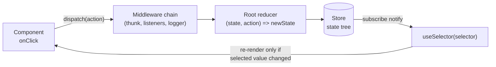
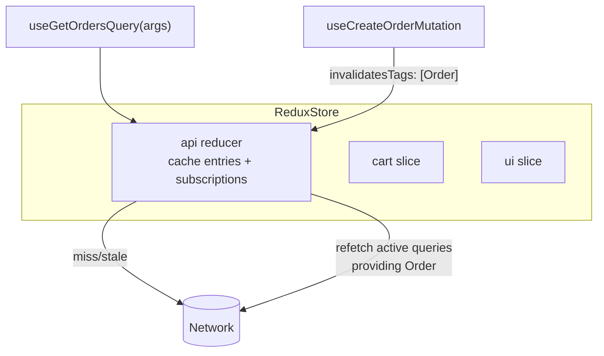
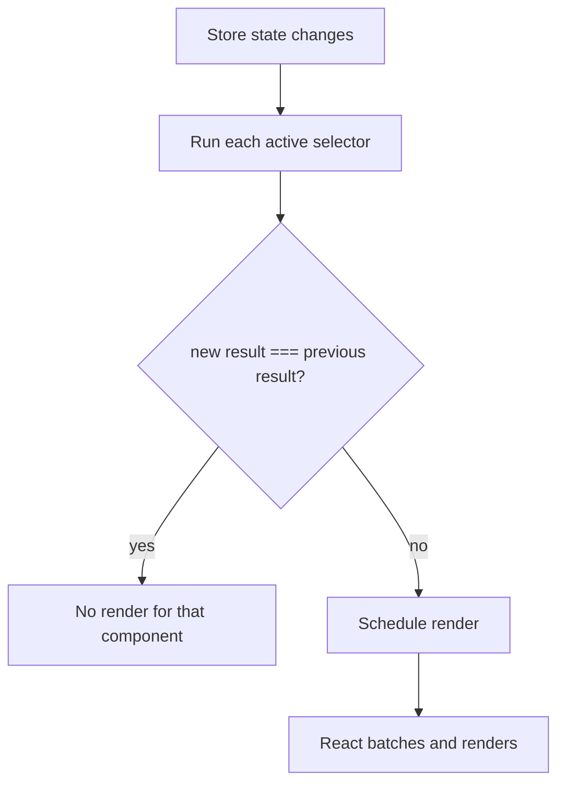

# 06 / 09 — Redux Toolkit: A Predictable Event-Sourced Store (and RTK Query)

> **Checked against `@reduxjs/toolkit` 2.13 and `react-redux` 9.3 (executed in Node, 2026-10-22).** This lesson targets **Redux Toolkit 2.x** (`@reduxjs/toolkit`), with **Redux 5** and **React-Redux 9**. Option names, defaults, and "creator callback" APIs shift between minors. Authority: <https://redux-toolkit.js.org> and <https://redux.js.org>. The *concepts* (single store, actions as events, pure reducers, selectors, middleware) are stable since Redux 1.x.

## 1. Lesson metadata

| | |
|---|---|
| **Level** | Intermediate–Advanced |
| **Study time** | 5–6 hours (reading 2 h, experiments 1.5 h, exercises 2 h) |
| **Prerequisites** | [08 — TanStack Query](./08-tanstack-query.md), [07 — Server state management](./07-server-state-management.md), [Phase 3 / 03 — `useReducer` and reducer architecture](../03-react-state-and-hooks/03-usereducer-and-reducer-architecture.md), [Phase 0 / 08 — Objects, references, immutability](../00-web-and-javascript-foundations/08-objects-references-immutability.md), [Phase 3 / 20 — `useSyncExternalStore` and external stores](../03-react-state-and-hooks/20-usesyncexternalstore-and-external-stores.md) |
| **Next** | [10 — Zustand](./10-zustand.md) |
| **Related** | [04 — API normalization](./04-api-normalization.md), [05 — Optimistic updates](./05-optimistic-updates.md), [11 — Context vs external stores](./11-context-vs-external-stores.md), [19 — Technology selection matrix](./19-technology-selection-matrix.md) |

**Learning objectives.** After this lesson you can:
1. State the responsibilities a Redux store takes on (a single serialisable state tree, an explicit event log, controlled transitions, middleware, tooling) and the ones it does not.
2. Explain why Redux Toolkit exists and exactly what it removes from "classic" Redux (boilerplate, accidental mutation, unsafe defaults).
3. Write slices with `createSlice`, explain how Immer lets "mutating" syntax produce immutable updates, and recognise the two Immer traps (returning *and* mutating; leaking drafts).
4. Design selectors, including memoised derived selectors, and predict when a `useSelector` subscriber re-renders.
5. Choose between `createAsyncThunk`, RTK Query, and listener middleware for a given async responsibility.
6. Use RTK Query's tag-based invalidation and compare it, on responsibilities, to TanStack Query.
7. Decide when a Redux store is warranted and when it is excess machinery.

**Concepts covered:** store, action, reducer, dispatch, slice, Immer draft, `configureStore`, default middleware (serializability and immutability checks), selectors, `createSelector`, `createEntityAdapter`, `createAsyncThunk`, listener middleware, RTK Query (`createApi`, tags, `onQueryStarted`), typed hooks (`.withTypes`), Redux DevTools, time-travel, store-per-request on the server.

---

## 2. Deep conceptual explanation

### 2.1 What problem is this lesson solving?

[Phase 3 / 19](../03-react-state-and-hooks/19-ui-server-url-and-shared-state.md) classified state by *who owns it*. After you remove server state ([08](./08-tanstack-query.md)) and URL state ([18](./18-url-state-management.md)), what remains is **client state shared across distant parts of the tree**: a cart, a multi-step wizard, editor document state, notification queues, feature flags, optimistic UI intent. Lifting state ([Phase 3 / 18](../03-react-state-and-hooks/18-state-colocation-and-lifting.md)) works until the shared owner is so high that threading props or a single Context becomes the bottleneck ([Phase 3 / 14](../03-react-state-and-hooks/14-context-performance.md)).

Redux answers this with one idea: **the state of the whole application is one plain object, and the only way it changes is by describing what happened as an *action* and running a pure *reducer* over it.** Everything else (devtools, time-travel, logging, undo, persistence, replay in bug reports) falls out of that discipline.

Redux Toolkit (RTK) is the officially recommended way to write Redux. It does not change the model; it removes the ceremony and the footguns.

### 2.2 Responsibilities: what a Redux store owns, what it does not

| Responsibility | Redux Toolkit store | Left to you / other tools |
|---|---|---|
| A single container for shared client state | **Yes** | |
| Making every state change an explicit, named, inspectable event | **Yes** (actions) | Naming discipline |
| Guaranteeing transitions are pure and deterministic | **Yes** (reducers are pure by contract; dev checks catch common violations) | Not mutating outside reducers |
| Notifying React subscribers selectively | **Yes** (via React-Redux `useSelector`) | Writing selectors that return stable references |
| Side-effect orchestration | Provides *hooks for it* (thunks, listener middleware) | Choosing and structuring the effects |
| Caching and deduplicating server data | **Only if you use RTK Query** (an add-on in the same package) | Otherwise: you |
| Normalising entities | Helper (`createEntityAdapter`) | Deciding what to normalise ([04](./04-api-normalization.md)) |
| Fetch transport | RTK Query's `fetchBaseQuery` is a thin `fetch` wrapper | Auth, retries beyond basics |
| Persistence | No (separate libraries) | Yes |
| Form-field state | No (supported but usually the wrong tool) | Local state / form libraries ([Phase 3 / 21](../03-react-state-and-hooks/21-forms-and-complex-state.md)) |
| Per-request isolation on a server | **Only if you create a store per request** | Yes ([14](./14-server-side-data-loading.md)) |

The course compares technologies on responsibilities, not "which is best". Redux's distinctive responsibility is **a globally observable, replayable event log of state transitions with a middleware pipeline**. If you do not need that property, you are buying machinery for nothing; if you do (complex client-side workflows, many cross-cutting reactions to the same event, strong audit/debug requirements), few tools give it to you as completely.

### 2.3 The mental model: event sourcing in the small



- **State** is a plain, serialisable tree.
- An **action** is a plain object `{ type, payload? }` describing *what happened* ("cart/itemAdded"), not *what to do* ("setCartItems").
- A **reducer** is a pure function `(state, action) => nextState`.
- **`dispatch(action)`** is the single entry for change. Middleware wraps `dispatch`.
- **Subscribers** are notified after the reducer runs; React-Redux turns that into component updates.

*Teaching model.* "Event sourcing in the small" is an analogy; Redux does not persist the log by default. *Public guarantee:* the store state changes only through dispatched actions via reducers.

### 2.4 What RTK removes

| Classic Redux pain | RTK response |
|---|---|
| Action-type constants, action creators, switch reducers | `createSlice` generates action creators and the reducer from a map of case functions |
| Hand-written immutable spreads, easy to get wrong | Immer: write "mutating" code against a draft; get an immutable result |
| Many lines of store setup (devtools, thunk) | `configureStore` wires reducer, devtools, default middleware |
| Accidental mutation / non-serialisable values in state | Dev-only default middleware that warns |
| Hand-written fetch lifecycle actions | `createAsyncThunk` (and RTK Query) |
| Hand-written normalised-collection reducers | `createEntityAdapter` |

### 2.5 What React exposes versus what Redux adds

React provides `useSyncExternalStore` ([Phase 3 / 20](../03-react-state-and-hooks/20-usesyncexternalstore-and-external-stores.md)): subscribe to something outside React and read a consistent snapshot. React-Redux 9's hooks are built on that primitive (confirmed in the 9.3 source). The store itself is plain JavaScript and runs without React (tests, Node, other frameworks).

### 2.6 Common misconceptions

| Misconception | Reality |
|---|---|
| "Redux is deprecated / replaced by Context." | Context is a *propagation* mechanism with no selector subscription, no middleware, no devtools; it is not a store ([11](./11-context-vs-external-stores.md)). Redux is maintained; the *style* of using it changed (RTK). |
| "All state must go in Redux." | The Redux docs themselves say not to. Local UI state belongs in components. |
| "Reducers can fetch data." | Reducers must be pure. Async work lives in thunks, listeners, or RTK Query. |
| "Immer makes mutation OK everywhere." | Only inside `createSlice`/`createReducer`/`produce` against the draft. Mutating state from a component or selector is still a bug. |
| "`useSelector` re-renders on any store change." | It re-renders when the *selected value* changes by reference equality (default `===`). |
| "RTK Query replaces thunks entirely." | It covers fetch/cache; multi-step workflows and non-fetch effects still need thunks or listeners. |
| "Redux means one giant reducer file." | Slices are per feature; the root is composed. |

---

## 3. Internal mechanics

### 3.1 `configureStore` and default middleware

`configureStore({ reducer })` composes: the root reducer (an object of slice reducers is passed to `combineReducers` for you), the thunk middleware, development-only checks, and Redux DevTools integration. Verified in RTK 2.13: with `NODE_ENV=production` `getDefaultMiddleware()` returns just *thunk* (1 entry); otherwise it returns 4 (thunk plus an **immutability check**, a **serialisability check** and an action-creator check), and the serialisability check warned about a `Map` payload and a `Date` in state; the middleware array is typed as a `Tuple` and customised via a callback `middleware: (getDefault) => getDefault().concat(myMiddleware)`.

- *Public guarantee:* these checks are dev-only diagnostics; they do not run in production builds and must not be relied upon for correctness.
- *Implementation detail:* how deeply they traverse and their warning thresholds.

### 3.2 Immer: drafts and structural sharing

`createSlice` case reducers run through Immer's `produce`. Conceptually:

1. Immer wraps the current state in a **draft** (a Proxy).
2. Your function "mutates" the draft; Immer records which paths were touched.
3. On return, Immer builds the next state by **copying only the touched path** and sharing every untouched subtree by reference.

Consequence: after an update to `state.items[3].qty`, `next.items[3]`, `next.items` and `next` are new objects, but `next.items[0]` is `===` to the old one. Selectors that return untouched subtrees therefore keep stable identity, and `React.memo`/`useSelector` rely on exactly that ([Phase 7 / 05](../07-performance/05-referential-equality.md)).

Two Immer rules that cause real bugs:

- **Mutate *or* return, never both** (returning a new value *and* mutating the draft throws). Return only when replacing the whole state (`return initialState`).
- **Drafts are revoked after the case reducer finishes.** Do not stash a draft in a closure, a thunk, or an outer variable.

Immer's auto-freeze makes accidental outside mutation throw, which is useful. Correction found by running RTK 2.13: state produced by `createSlice` reducers was frozen with `NODE_ENV=production` as well (`Object.isFrozen` was true), so auto-freeze is not development-only (it is on by default in all environments in current Immer, and costs a deep freeze of new state).

### 3.3 The action pipeline in order

1. `dispatch(action)` called.
2. Middleware chain runs outermost→innermost; each may inspect, delay, transform, swallow, or dispatch more actions.
3. The **root reducer** runs synchronously, producing the next state.
4. The store notifies subscribers **after** the reducer returns.
5. React-Redux runs each active selector against the new state; subscribers whose selected value changed get scheduled for re-render, batched by React ([Phase 2 / 22](../02-react-rendering-and-internals/22-automatic-batching.md)).

*Public guarantee:* reducer runs synchronously during dispatch; subscribers are notified after. *Implementation detail:* the exact subscription-notification structure in React-Redux (nested subscription ordering has changed across majors).

### 3.4 Selectors and memoisation

`useSelector(selector)` runs the selector on every store update and compares the result with the previous result using `===` by default. Therefore:

- A selector that returns **an existing reference** (`state => state.cart.items`) is stable until that slice changes.
- A selector that **creates a new object/array each call** (`state => state.cart.items.filter(...)`) returns a new reference every time and forces a re-render on *every* store update. React-Redux 9 adds dev-mode checks: `stabilityCheck` (warns when a selector returns a different reference for the same input) and `identityFunctionCheck` (warns when a selector returns its whole input); both are `Provider` props taking a frequency (`DevModeCheckFrequency`) and default to running once in development.
- `createSelector` (re-exported from Reselect) memoises on **input selector results**: it recomputes only when inputs change by reference. In Reselect 5 the default memoiser is `weakMapMemoize` (verified: both `memoize` and `argsMemoize` are `weakMapMemoize` in RTK 2.13), which also makes results cache across differing arguments.

### 3.5 Thunks

A thunk is a function dispatched instead of an object. The thunk middleware calls it with `(dispatch, getState, extra)`. `createAsyncThunk('users/fetch', payloadCreator)` generates three actions (`pending`, `fulfilled`, `rejected`) and a thunk that dispatches them around a promise, handling errors and accepting an abort signal (`thunkAPI.signal`). Its action types derive from the prefix string.

### 3.6 RTK Query's model (same responsibilities as lesson 08, inside the store)

RTK Query stores **cache entries in the Redux state under a reducer path** (conventionally `api`). Each endpoint+serialised arguments pair is a cache entry with status, data, error, and subscription counts. Components subscribe via generated hooks; when the last subscriber unsubscribes, an entry is removed after `keepUnusedDataFor` seconds (default 60 s; verified: `config.keepUnusedDataFor` is 60 in the store state). Invalidation is **tag-based**: queries declare `providesTags`, mutations declare `invalidatesTags`; matching entries refetch.



---

## 4. Step-by-step execution walkthrough

Scenario: user clicks **Add to cart** on a product card; a `<CartBadge />` elsewhere shows the item count.

1. `onClick` handler runs; calls `dispatch(itemAdded({ productId: 7, price: 1999 }))`. The action creator returns `{ type: 'cart/itemAdded', payload: {...} }`.
2. Dispatch passes through thunk middleware (not a function, so passes on) and the dev serialisability check (payload is plain → no warning).
3. The root reducer calls the `cart` slice reducer; Immer creates a draft of `state.cart`; the case reducer pushes or increments an item; Immer produces `nextCart` sharing untouched fields.
4. The root reducer returns a new root object: `cart` new, `ui` and `api` same references.
5. The store notifies subscribers synchronously.
6. `CartBadge`'s `useSelector(selectCartCount)` runs `selectCartCount(newState)`; the sum changed from 2 to 3 → schedules a re-render. A `ThemeToggle` using `useSelector(s => s.ui.theme)` reads the same reference → no re-render.
7. React renders `CartBadge` only; commits the new number to the DOM.
8. DevTools records the action and the state diff, enabling "jump to this action" later.

**Predict:** if the handler dispatches the same action twice in one handler, how many renders of `CartBadge` occur? *Answer:* two reducer runs, two notifications, but React batches the resulting updates into one render (automatic batching; React ≥ 18).

---

## 5. Code examples

### 5.1 Minimal: store, slice, typed hooks

```ts
// store/cartSlice.ts
import { createSlice, type PayloadAction } from '@reduxjs/toolkit';

export interface CartItem { productId: number; price: number; qty: number }
interface CartState { items: CartItem[] }
const initialState: CartState = { items: [] };

export const cartSlice = createSlice({
  name: 'cart',
  initialState,
  reducers: {
    itemAdded(state, action: PayloadAction<{ productId: number; price: number }>) {
      const existing = state.items.find(i => i.productId === action.payload.productId);
      if (existing) existing.qty += 1;                 // "mutation" of a draft
      else state.items.push({ ...action.payload, qty: 1 });
    },
    itemRemoved(state, action: PayloadAction<number>) {
      state.items = state.items.filter(i => i.productId !== action.payload);
    },
    cleared: () => initialState,                        // return replaces state; no mutation
  },
  selectors: {
    selectCount: s => s.items.reduce((n, i) => n + i.qty, 0),
  },
});

export const { itemAdded, itemRemoved, cleared } = cartSlice.actions;
```

```ts
// store/store.ts
import { configureStore } from '@reduxjs/toolkit';
import { cartSlice } from './cartSlice';

export const store = configureStore({
  reducer: { [cartSlice.reducerPath]: cartSlice.reducer },
});

export type RootState = ReturnType<typeof store.getState>;
export type AppDispatch = typeof store.dispatch;
```

```ts
// store/hooks.ts  (React-Redux 9 style; `.withTypes` is available in 9.3)
import { useDispatch, useSelector } from 'react-redux';
import type { RootState, AppDispatch } from './store';

export const useAppDispatch = useDispatch.withTypes<AppDispatch>();
export const useAppSelector = useSelector.withTypes<RootState>();
```

```tsx
// CartBadge.tsx
import { useAppSelector } from './store/hooks';
import { cartSlice } from './store/cartSlice';

export function CartBadge() {
  const count = useAppSelector(cartSlice.selectors.selectCount);
  return <span aria-label={`${count} items in cart`}>{count}</span>;
}
```

Line notes:
- `state.items.push` is safe because `state` is a draft. `cleared: () => initialState` *returns* and does not mutate: legal.
- `selectors` on the slice (RTK ≥ 2.0; verified: `cart.selectors.selectCount(rootState)` worked when mounted via `combineSlices`) are **slice-aware**: they take the root state when the slice is mounted at `reducerPath` and read `state.cart`. Without `selectors`, write `(s: RootState) => s.cart.items`.
- `useSelector.withTypes` avoids casting `RootState` at every call site.
- The `Provider` (`<Provider store={store}>`) wraps the app root; not shown.

**Predict:** `selectCount` returns a `number`. When another slice changes, does `CartBadge` render? *No:* `===` on equal numbers.

### 5.2 Practical: entity adapter, memoised selector, async thunk, listener

Scenario: a client-side order-draft editor with many line items, plus a "save draft" flow. (Server-fetched *lists* would normally go to RTK Query or TanStack Query; the draft is client-owned, so it lives in the store.)

```ts
// store/draftSlice.ts
import {
  createSlice, createEntityAdapter, createAsyncThunk, createSelector,
  type PayloadAction,
} from '@reduxjs/toolkit';
import type { RootState } from './store';

export interface Line { id: string; sku: string; qty: number; unitPrice: number }

const linesAdapter = createEntityAdapter<Line>(); // default: selectId = entity.id

interface DraftState {
  lines: ReturnType<typeof linesAdapter.getInitialState>;
  saveStatus: 'idle' | 'saving' | 'saved' | 'failed';
  saveError?: string;
}

const initialState: DraftState = {
  lines: linesAdapter.getInitialState(),
  saveStatus: 'idle',
};

export const saveDraft = createAsyncThunk<
  { savedAt: string },                 // fulfilled payload
  void,                                // argument
  { state: RootState; rejectValue: string }
>('draft/save', async (_, { getState, signal, rejectWithValue }) => {
  const lines = linesAdapter.getSelectors((s: RootState) => s.draft.lines)
    .selectAll(getState());
  const res = await fetch('/api/drafts', {
    method: 'PUT',
    headers: { 'Content-Type': 'application/json' },
    body: JSON.stringify({ lines }),
    signal,
  });
  if (!res.ok) return rejectWithValue(`HTTP ${res.status}`);
  return (await res.json()) as { savedAt: string };
});

export const draftSlice = createSlice({
  name: 'draft',
  initialState,
  reducers: {
    lineAdded: (s, a: PayloadAction<Line>) => { linesAdapter.addOne(s.lines, a.payload); },
    qtyChanged: (s, a: PayloadAction<{ id: string; qty: number }>) => {
      linesAdapter.updateOne(s.lines, { id: a.payload.id, changes: { qty: a.payload.qty } });
      if (s.saveStatus === 'saved') s.saveStatus = 'idle'; // edits invalidate "saved"
    },
  },
  extraReducers: builder => {
    builder
      .addCase(saveDraft.pending, s => { s.saveStatus = 'saving'; s.saveError = undefined; })
      .addCase(saveDraft.fulfilled, s => { s.saveStatus = 'saved'; })
      .addCase(saveDraft.rejected, (s, a) => {
        s.saveStatus = 'failed';
        s.saveError = a.payload ?? a.error.message;
      });
  },
});

export const { lineAdded, qtyChanged } = draftSlice.actions;

const lineSelectors = linesAdapter.getSelectors((s: RootState) => s.draft.lines);
export const selectLines = lineSelectors.selectAll;

export const selectTotal = createSelector([selectLines], lines =>
  lines.reduce((sum, l) => sum + l.qty * l.unitPrice, 0),
);
```

Line notes:
- The adapter stores `{ ids: string[], entities: Record<string, Line> }`: O(1) lookup by id and stable ordering; updating one line replaces one entity object, leaving others referentially equal.
- Inside a case reducer, adapter functions accept the draft slice. The arrow bodies use braces so they return `void`, not the adapter's result (returning a value that is not `undefined` while mutating is the "both" trap).
- `createAsyncThunk` generic order is `<Returned, ThunkArg, ThunkApiConfig>`; the third lets `getState` and `rejectWithValue` be typed (typechecks in RTK 2.13).
- `extraReducers` uses the **builder callback**. The object-map form was removed in RTK 2.0.
- `selectTotal` recomputes only when `selectLines` returns a new array (`selectAll` is itself memoised on `ids` and `entities`).

Cross-feature reaction without coupling slices, using the **listener middleware**:

```ts
// store/listeners.ts
import { createListenerMiddleware, isAnyOf } from '@reduxjs/toolkit';
import { lineAdded, qtyChanged, saveDraft } from './draftSlice';

export const listenerMiddleware = createListenerMiddleware();

listenerMiddleware.startListening({
  matcher: isAnyOf(lineAdded, qtyChanged),
  effect: async (_action, api) => {
    api.cancelActiveListeners();              // restart the debounce on each edit
    await api.delay(1500);                    // cancelled if a newer edit arrives
    api.dispatch(saveDraft());                // autosave after 1.5 s quiet
  },
});
```

```ts
// store.ts (excerpt)
export const store = configureStore({
  reducer: { draft: draftSlice.reducer /* ... */ },
  middleware: getDefault => getDefault().prepend(listenerMiddleware.middleware),
});
```

This is the "debounced autosave" pattern in ~6 lines; the equivalent in components would require an effect with timer cleanup in every editing surface.

### 5.3 Incorrect examples

```ts
// BAD 1: mutating state outside a reducer
const items = useAppSelector(s => s.cart.items);
items.sort((a, b) => a.price - b.price);   // mutates the store's array (state is auto-frozen by Immer, so in strict-mode code this throws a TypeError, in production too; with non-frozen state it would silently corrupt)

// BAD 2: selector that allocates
const expensive = useAppSelector(s => s.cart.items.filter(i => i.price > 1000));
// new array every store update → component re-renders on every dispatch anywhere

// BAD 3: returning and mutating
reducers: {
  reset(state) { state.items = []; return { items: [] }; }  // Immer throws
}

// BAD 4: non-serialisable state
dispatch(opened({ at: new Date(), el: document.body }));   // Date and DOM node in actions/state
```

Why each fails:
1. State is shared; `sort` mutates in place. Copy first (`[...items].sort(...)`) or sort in a memoised selector.
2. `filter` returns a fresh array; `===` always fails. Move to `createSelector`, or select the stable `items` and derive with `useMemo`.
3. Immer rule: mutate or return.
4. Dates and DOM nodes break DevTools replay, persistence, and SSR. Store ISO strings/timestamps; keep refs in components ([Phase 3 / 10](../03-react-state-and-hooks/10-useref-and-mutable-references.md)). The dev serialisability check warns about exactly this.

### 5.4 Corrected

```ts
const selectExpensive = createSelector(
  [(s: RootState) => s.cart.items],
  items => items.filter(i => i.price > 1000),
);
const expensive = useAppSelector(selectExpensive);   // stable until cart.items changes

reducers: { reset: () => ({ items: [] }) }           // or state.items = []
dispatch(opened({ at: Date.now() }));
```

### 5.5 Advanced: RTK Query with tags and an optimistic update

```ts
// api/ordersApi.ts
import { createApi, fetchBaseQuery } from '@reduxjs/toolkit/query/react';

export interface Order { id: number; status: 'open' | 'shipped'; note: string }

export const ordersApi = createApi({
  reducerPath: 'ordersApi',
  baseQuery: fetchBaseQuery({ baseUrl: '/api' }),
  tagTypes: ['Order'],
  endpoints: build => ({
    getOrders: build.query<Order[], { status?: Order['status'] } | void>({
      query: args => ({ url: 'orders', params: args ?? undefined }),
      providesTags: result =>
        result
          ? [...result.map(o => ({ type: 'Order' as const, id: o.id })),
             { type: 'Order' as const, id: 'LIST' }]
          : [{ type: 'Order' as const, id: 'LIST' }],
    }),
    getOrder: build.query<Order, number>({
      query: id => `orders/${id}`,
      providesTags: (_r, _e, id) => [{ type: 'Order', id }],
    }),
    updateNote: build.mutation<Order, { id: number; note: string }>({
      query: ({ id, ...body }) => ({ url: `orders/${id}`, method: 'PATCH', body }),
      invalidatesTags: (_r, _e, { id }) => [{ type: 'Order', id }],
      async onQueryStarted({ id, note }, { dispatch, queryFulfilled }) {
        const patch = dispatch(
          ordersApi.util.updateQueryData('getOrder', id, draft => { draft.note = note; }),
        );
        try { await queryFulfilled; } catch { patch.undo(); }
      },
    }),
  }),
});

export const { useGetOrdersQuery, useGetOrderQuery, useUpdateNoteMutation } = ordersApi;
```

Wiring (executed against RTK 2.13 with a custom `baseQuery`):

```ts
export const store = configureStore({
  reducer: { [ordersApi.reducerPath]: ordersApi.reducer },
  middleware: getDefault => getDefault().concat(ordersApi.middleware),
});
// optional, enables refetchOnFocus / refetchOnReconnect behaviours
setupListeners(store.dispatch);   // import from '@reduxjs/toolkit/query'
```

Notes:
- `updateQueryData` applies an Immer patch to the **cached entry**, returning an object with `undo()`. Compare with the manual snapshot/rollback of TanStack Query ([08, section 5.5](./08-tanstack-query.md)): same responsibility, different surface.
- `invalidatesTags` triggers refetch of *active* subscribers providing that tag, like `invalidateQueries`. The `'LIST'` pseudo-id pattern lets a "create" mutation invalidate list queries without knowing their args.
- Argument type `... | void` makes the argument optional in the generated hook (type ergonomics here are version-sensitive).
- Executed behaviour worth knowing: with this API, an optimistic `updateQueryData` patch showed immediately, `invalidatesTags` refetched the active `getOrders`/`getOrder` subscriptions after the mutation, and `patch.undo()` rolled the note back when the mutation failed. Note also that tags were invalidated **even though the mutation failed** (the refetches after the failed PATCH happened); if you don't want that, return `[]` from `invalidatesTags` when `error` is set. RTK 2's `invalidationBehavior` defaults to `'delayed'` (invalidation waits for in-flight queries and mutations to settle).
- Cache entries are keyed by endpoint plus serialised args; unlike TanStack Query you do not hand-write keys.

---

## 6. Visual explanations

### 6.1 Selector re-render decision



### 6.2 Who decides what, across the stack

| Layer | Question it answers | Typical tool |
|---|---|---|
| URL | Which view/filter is the user in? | Router ([18](./18-url-state-management.md)) |
| Server cache | What does the server say right now? | RTK Query / TanStack Query |
| Shared client state | What has the user done that no server knows yet? | Slices |
| Local UI | Is this popover open? | `useState` |

---

## 7. Alternative approaches and trade-offs

| Criterion | Redux Toolkit | Zustand ([10](./10-zustand.md)) | Context + `useReducer` ([11](./11-context-vs-external-stores.md)) | XState ([12](./12-state-machines-and-xstate.md)) | TanStack Query ([08](./08-tanstack-query.md)) |
|---|---|---|---|---|---|
| Primary responsibility | Global event-driven client state, with ecosystem | Lightweight shared client state | Propagating a value/dispatcher through a subtree | Explicit finite-state behaviour | Server-state cache |
| Selector-based subscriptions | Yes | Yes | No (all consumers re-render on value change) | Via `useSelector` on actors | Via observers / `select` |
| Action log / time-travel | **First-class** | Opt-in via devtools middleware | No | Inspectable events | Devtools for cache |
| Middleware / effect model | Rich (thunk, listeners) | Middleware wrappers | None | Actors, invoked services | Query lifecycle |
| Ceremony | Moderate (slices, store, hooks) | Low | Low | Higher (modelling) | Low-moderate |
| Fit for server cache | RTK Query (in-store) | No | No | No | **Primary** |

**Scenario where Redux Toolkit is *not* the best fit.** A marketing site with a theme toggle and a newsletter modal: `useState` plus one small Context or a tiny store is clearer and loads less code. A second: a team that already runs TanStack Query and has only two cross-tree client values; adding RTK would add a second state container for little responsibility gain.

**Scenario where it is notably well-suited.** A trading or logistics dashboard with dozens of cross-cutting reactions to the same event (an order fill updates blotter, risk panel, notifications, and audit trail); ordering and traceability of events matter; multiple teams contribute slices to one store.

---

## 8. Best practices and anti-patterns

### Best practices
- Model **events, not setters**: `orderSubmitted` carries intent; reducers (and listeners) decide consequences. Several slices can respond to one action via `extraReducers`.
- Keep state **minimal and normalised**; derive everything else in selectors ([Phase 3 / 17](../03-react-state-and-hooks/17-derived-state.md)).
- Export **selectors with the slice**, so components do not know the state shape.
- Select the **smallest** value needed; one `useSelector` per concern is fine.
- Keep state **serialisable**; keep non-serialisables (sockets, class instances, refs) outside the store, or in middleware closures.
- Use **RTK Query or TanStack Query for server state**, not hand-rolled thunks that copy responses into slices.
- Create the store through a **`makeStore()` factory** to support per-test and per-request instances.

### Beginner mistakes
- Putting form inputs' every keystroke in Redux.
- Calling `useSelector(state => state)`: subscribes to everything.
- Dispatching in render, or in an effect that derives state from other store state (use a selector).
- Mutating selected objects.

### Experienced-developer mistakes
- Over-granular actions that mirror setters (`setX`, `setY`) and recreate unstructured global mutable state with extra steps.
- Reducers that depend on `Date.now()` or `Math.random()` (impure): generate in the action via `prepare`.
- Storing derived data (`total`) in state, then letting it drift.
- A thunk that dispatches five other actions to coordinate; model as one event.
- Treating a single store as the module boundary, so every feature imports every other feature's slice (see [Phase 11 / 08](../11-senior-and-architect-mastery/08-state-architecture-at-scale.md)).

### Smells
- More than half the store is cached API responses with hand-written loading flags.
- Components that `dispatch` three actions in a row to perform one operation.
- Selectors returning new arrays inline.

### Justified exceptions
- Storing a `Date` or `Map` in state for a prototype, if you disable the serialisability check *knowingly* and lose replay/persistence.
- A "setter" action for a genuinely independent preference (`themeChanged`).

---

## 9. Real-world application

| Domain | Where Redux fits | Constraint to engineer for |
|---|---|---|
| E-commerce | Cart, checkout wizard, promo-code application order | Cart must survive reloads (persistence layer), reconcile with server prices; never trust client totals |
| Dashboards | Layout, widget config, cross-widget selections | Many subscribers: granular selectors, memoised derivations |
| Finance | Draft orders, audit-able event trail, undo | Money in integer minor units; events as the audit narrative; no secrets in persisted state |
| Auth | Session flags, current-user claims | Do not treat client state as authorisation; clear the store and caches on logout (per-user isolation) |
| Realtime | Applying socket events as actions | Throttle bursts; batch updates ([17](./17-real-time-websockets-subscriptions.md)) |
| Multi-team | Slice per feature, injected lazily with `combineSlices` / reducer injection | Ownership, naming conventions, avoiding cross-slice imports (`combineSlices` exists in RTK 2.13) |

Server rendering note: the store must be created **per request** and its state serialised to the client for hydration. A module-level singleton store on a server leaks one user's state into another's ([14](./14-server-side-data-loading.md)).

---

## 10. Debugging and troubleshooting

| Symptom | Likely root cause | Investigation | Fix / validation |
|---|---|---|---|
| Component re-renders on every dispatch | Selector returns new reference | React DevTools Profiler "why did this render"; add `console.count` in selector; check for `.map/.filter` inline | Memoise with `createSelector`; verify render count drops |
| "A non-serializable value was detected" warning | Date/Map/class/function in state or action | Warning names the path | Store a serialisable form; move the object out of state |
| Error: "Immer produce ... returned a new value *and* modified its draft" | Mutate-and-return | Stack trace points to the case reducer | Choose one |
| `Cannot perform 'get' on a proxy that has been revoked` | Draft used after reducer ended (async closure) | Search for drafts captured in thunks/timeouts | Copy needed primitives out of the draft first |
| State "doesn't update" | In-place mutation outside Immer, or reducer returns the same reference | DevTools shows action fired but no state diff | Mutate only drafts, or return new objects |
| Stale RTK Query data after a mutation | Tag mismatch (`providesTags` vs `invalidatesTags` ids) | Redux DevTools: inspect `api` subscriptions and `provided` tag map | Align tag types/ids; add `'LIST'` tag |
| Another user's data visible after logout / on server | Singleton store or un-reset `api` cache | Check store lifetime | `api.util.resetApiState()` on logout; store per request |
| Typed hook errors on `dispatch(thunk)` | Hook not typed with `AppDispatch` | Hover type | Use `useDispatch.withTypes<AppDispatch>()` |

Method: reproduce, open Redux DevTools, find the dispatched action, inspect the diff, then use the action trace to find the dispatching code. The *ability to do this* is the reason to pay for the store.

---

## 11. Exercises

### Level A — Knowledge
**A1.** What is the only way a Redux store's state changes?
**A2.** What does Immer do with the "mutations" in a `createSlice` case reducer, and what is shared between old and new state?
**A3.** Name the three actions `createAsyncThunk` generates and what each signals.
**A4.** Why must reducers be pure? Name two features that depend on it.
**A5.** What does `invalidatesTags` do, and which cache entries refetch immediately?
**A6.** Why does `useSelector(s => s.items.filter(f))` cause excess renders?

### Level B — Code comprehension
**B1.** What is wrong?
```ts
reducers: { added(state, a: PayloadAction<Item>) { state.items.push(a.payload); return state; } }
```
**B2.** The following slice reducer is dispatched twice with different `id`s. After both, which references (`state.entities.a`, `state.entities.b`) changed?
```ts
renamed(state, a: PayloadAction<{ id: string; name: string }>) { state.entities[a.payload.id].name = a.payload.name; }
```
**B3.** In 5.2, why does the autosave listener call `api.cancelActiveListeners()` first?
**B4.** Predict the render count of a `Badge` using `useAppSelector(s => s.cart.items.length)` when an unrelated slice dispatches 5 actions.

### Level C — Implementation
**C1.** Write a `notificationsSlice` with `added`, `dismissed`, and a `selectVisible` memoised selector (non-dismissed, newest first). Generate ids in a `prepare` callback.
**C2.** Add RTK Query `getProducts` with `providesTags` and a `createProduct` mutation that invalidates the list.
**C3.** Write a listener that, on `userLoggedOut`, resets the `api` cache and the `cart` slice.

### Level D — Debugging
**D1.** After login as user B, user A's orders flash. The store is a module singleton, API cache not reset. Diagnose and fix.
**D2.** `useSelector(selectVisibleItems)` re-renders constantly even though `createSelector` is used. The input selector is `(s) => s.items.filter(...)`. Why?
**D3.** A thunk reads `state.cart` through a captured draft after an `await` and throws. Explain and fix.

### Level E — Architecture and engineering decisions
**E1.** Your 40-slice store is 60% API responses. Propose a migration plan to RTK Query or TanStack Query. Include sequencing, risks, and how you will measure success.
**E2.** A feature team wants every form's field state in Redux "for consistency". Decide and justify on responsibilities.
**E3.** Decide between RTK Query and TanStack Query for a new app on an existing Redux store with 10 engineers.

### Level F — Expert challenge
**F1.** Design a store architecture for a 6-team product: slice ownership, lazy slice injection, cross-slice communication rules (events vs imports), and testing strategy.
**F2.** Design an undo/redo for the draft editor in 5.2 using patches or history; analyse memory, serialisation, and interaction with autosave.

---

## 12. Detailed answers and explanations

> Attempt the exercises first.

**A1.** By dispatching an action that a reducer handles. Wrong: "calling a setter on the store" (none exists); "mutating state" (frozen by Immer, so strict-mode code throws a TypeError, verified in development and production).

**A2.** Immer provides a draft Proxy, records touched paths, and produces a new immutable tree that **copies only the touched path** and shares the rest by reference. Edge: an assignment of an equal value may still be recognised as no change (Immer may return the same reference when nothing actually changed; verify).

**A3.** `pending` (started), `fulfilled` (promise resolved; payload is result), `rejected` (threw, or `rejectWithValue`, or aborted; executed: aborting gave `rejected` with `meta.aborted: true` and `error.name: 'AbortError'`; a `condition` returning false gave `rejected` with `meta.condition: true` and a `ConditionError`). Action types are `'<prefix>/pending'` etc.

**A4.** Same input must give same output, with no side effects. Time-travel and replay re-run reducers over the log; selective-render optimisations (reference equality) assume untouched subtrees are unchanged. Also concurrent React may call render-time reads repeatedly ([Phase 2 / 12](../02-react-rendering-and-internals/12-why-rendering-must-be-pure.md)).

**A5.** It marks cache entries providing matching tags as invalid; those with active subscriptions refetch; others are **removed** from the cache (verified: an entry that was unsubscribed but still inside its `keepUnusedDataFor` window was deleted by the tag invalidation without a refetch, and it is fetched fresh on next subscription).

**A6.** `filter` returns a new array each call; the default `===` comparison always sees a change, so the component re-renders on every store update. Fix with `createSelector` or select a stable reference and derive via `useMemo`. Wrong answer: "because filter is slow" (cost is the re-render, not the filter).

**B1.** Mutating the draft *and* returning it. Returning the very same draft object is tolerated by Immer (verified: `state.items.push(x); return state` produced the expected result), but it is redundant and misleading; returning a different object after mutation throws. Fix: remove `return state`. Expected "wrong plausible answer": "should use spread" — unnecessary with Immer.

**B2.** Both `state.entities.a` and `.b` changed when renamed; each rename creates a new entity object for the touched id, new `entities` object, new root; the *other* entity keeps its reference. After rename of `a` then `b`: `a` new (from first), `b` new (from second); between the two dispatches `b` was unchanged.

**B3.** Without it, each edit would start a new listener instance and every one would eventually fire `saveDraft`. Cancelling active instances makes only the latest edit's timer survive: a debounce. `api.delay` rejects with a cancellation error that the middleware swallows.

**B4.** Zero extra renders: `items.length` is a number; unrelated slices don't alter it. The selector still *runs* five times (cheap). Wrong: "5 renders because the store changed".

**C1.**
```ts
import { createSlice, createSelector, nanoid, type PayloadAction } from '@reduxjs/toolkit';

interface Note { id: string; text: string; at: number; dismissed: boolean }

export const notificationsSlice = createSlice({
  name: 'notifications',
  initialState: [] as Note[],
  reducers: {
    added: {
      reducer: (s, a: PayloadAction<Note>) => { s.push(a.payload); },
      prepare: (text: string) => ({
        payload: { id: nanoid(), text, at: Date.now(), dismissed: false } as Note,
      }),
    },
    dismissed: (s, a: PayloadAction<string>) => {
      const n = s.find(x => x.id === a.payload);
      if (n) n.dismissed = true;
    },
  },
  selectors: { selectAll: s => s },
});

export const selectVisible = createSelector(
  [notificationsSlice.selectors.selectAll],
  all => all.filter(n => !n.dismissed).sort((a, b) => b.at - a.at),
);
```
Edge: `.sort` here sorts the new array produced by `filter`, not state; safe. `prepare` keeps the reducer pure by moving randomness and time out. (A `selectors` entry returning root state of the slice is a convenience; verify against slice mount point.)

**C2.** Follow 5.5: `getProducts` with array `providesTags` plus `'LIST'`; `createProduct` with `invalidatesTags: [{ type: 'Product', id: 'LIST' }]`. Evaluation: tag types declared; list tag present; no manual refetch.

**C3.**
```ts
listenerMiddleware.startListening({
  actionCreator: userLoggedOut,
  effect: (_a, api) => {
    api.dispatch(ordersApi.util.resetApiState());
    api.dispatch(cartSlice.actions.cleared());
  },
});
```
Edge: after `resetApiState()` the cache was empty and the late response did not repopulate it in our run (whether the underlying request is aborted was not verified). An alternative is a root reducer wrapper that resets everything on logout; compare on auditability.

**D1.** Singleton store plus persisted cache; the first render shows user A's cache. Fix: on logout dispatch `resetApiState`, reset slices (root reducer wrapper or listener), and navigate after; on server, create the store per request. Validate: log in as A, out, in as B; no A data in DevTools state at any point.

**D2.** The input selector allocates, so `createSelector` sees changed inputs each call and recomputes and returns a new array. Input selectors must return existing references (`s => s.items`); put `filter` in the result function.

**D3.** Drafts exist only during the case reducer. A thunk gets `getState()` (a plain frozen state, not a draft) so a real bug must be a draft captured earlier; copy out primitives (`const qty = draft.qty`) before `await`. Validate with a test that awaits.

**E1.** Evaluation criteria: inventory slices by ownership (server-owned vs client-owned); migrate **read paths** first behind the same selectors so components do not change; incremental by feature, deleting the slice and its thunk only after traffic proves parity; handle derived data, optimistic flows, and websocket updates explicitly; metrics: lines removed, request counts, bug rate. Example answer: choose RTK Query if the store is staying and teams know it (smaller conceptual migration, same DevTools), TanStack Query if you want to leave Redux eventually; risks: tag/key redesign, double-fetching during coexistence, tests that assert store shape.

**E2.** Likely **no**: keystroke state is local to a form and ephemeral; in Redux it adds dispatch overhead, serialisation constraints, and noise in the action log. Exception: a multi-step wizard whose draft must survive navigation or be shared across routes; store the *draft*, not each keystroke (commit on blur/step change). Consistency is a team value, but responsibilities decide.

**E3.** Criteria: existing investment, need for in-store coupling (tags, `updateQueryData`) with other slices, bundle size, team familiarity, devtools preference, and framework loaders ([14](./14-server-side-data-loading.md)). A defensible answer is RTK Query (single store, one set of tools) *or* TanStack Query (richer ecosystem and features); a good answer states switching cost and refuses to say one is universally better.

**F1.** Criteria: each team owns slices and **public selectors/actions** as the only contract; cross-team reactions use listeners subscribing to *other teams' published actions*, not importing their reducers' internals; lazy-inject reducers per route; lint rule forbidding deep imports; contract tests per slice (reducer in, state out), integration tests per workflow with a real `makeStore()`.

**F2.** Strong answers: Immer patches (`enablePatches`, `produceWithPatches`) allow inverse patches for undo, memory O(changes) rather than O(snapshots); history stack lives in a dedicated slice or middleware; autosave should save the *current* state and not push undo entries; define which actions are undoable (meta flag); caveat: patches require plain, serialisable state; server reconciliation conflicts if collaborators edit.

---

## 13. Senior engineer interview questions

1. **"Why is Redux Toolkit's `createSlice` allowed to 'mutate' state?"** Because of Immer drafts: the code mutates a proxy, Immer returns an immutable result with structural sharing. Causal importance: preserves reference equality for untouched subtrees, which selectors and memoisation rely on.
2. **"When would you *not* put something in Redux?"** Ephemeral UI state, form keystrokes, server cache if you already have a query library, non-serialisable objects. Reason by ownership and lifetime.
3. **"Why must selectors return stable references?"** `useSelector` compares by `===`; unstable results force re-render on every store update, turning a selective-subscription system into broadcast.
4. **"Thunk, listener, or RTK Query?"** RTK Query for request/response cache; thunk for imperative one-off workflows triggered by the UI; listener for reactions to dispatched events (debounce, cross-slice effects). Choose by trigger and lifecycle ownership.
5. **"How do you handle logout in an app with a global store?"** Reset every slice and the API cache; ensure no persisted state remains; cancel in-flight requests; on the server, never share a store across requests.
6. **"How does RTK Query compare to TanStack Query?"** Same core responsibility (async cache, dedupe, invalidation). RTK Query: endpoints declared up-front, tag-based invalidation, results live in Redux state (inspectable alongside actions). TanStack Query: key-based invalidation, framework-agnostic, richer imperative API. Choose by existing architecture and team, not by feature count.
7. **"What does Redux give you that Context doesn't?"** Selector-based subscription, middleware, devtools/time-travel, a defined update model. Context gives propagation only; see [11](./11-context-vs-external-stores.md).
8. **"How do you test a slice?"** Reducers as pure functions (state, action → state); selectors with fixture state; workflows with a real store from `makeStore(preloadedState)` and mocked network via MSW ([Phase 8 / 06](../08-testing-and-quality/06-mocking-strategies-and-msw.md)); avoid mocking `useSelector`.

---

## 14. Further learning resources

| Resource | URL | Covers / why | Level | Study |
|---|---|---|---|---|
| Redux Toolkit docs | <https://redux-toolkit.js.org> | Authoritative API, tutorials, usage guides | All | Quick Start, `createSlice`, `configureStore`, Usage with TypeScript |
| Redux docs (Essentials and Fundamentals) | <https://redux.js.org> | Concepts, style guide | Beginner–Intermediate | Essentials; Style Guide ("Redux Style Guide" page) |
| RTK Query overview | <https://redux-toolkit.js.org/rtk-query/overview> *(link checked, HTTP 200, 2026-10-22)* | Cache behaviour, tags | Intermediate | Overview, Cache Behavior, Automated Re-fetching |
| React-Redux docs | <https://react-redux.js.org> | Hooks, `Provider`, TypeScript | Intermediate | Hooks API, TypeScript quick start |
| Immer docs | <https://immerjs.github.io/immer/> | Drafts, pitfalls, patches | Intermediate | Pitfalls, Patches |
| Reselect | <https://github.com/reduxjs/reselect> | Memoised selectors | Intermediate | README (memoisation options) |
| Redux Toolkit GitHub | <https://github.com/reduxjs/redux-toolkit> | Source, 2.0 release notes, issues | Advanced | Releases (2.0 migration notes) |
| React docs — `useSyncExternalStore` | <https://react.dev/reference/react/useSyncExternalStore> | The primitive underneath | Advanced | Whole page |

---

## 15. Knowledge checkpoint

**You understand it if you can:**
- Explain the single-store, action, reducer, subscription loop and why purity enables tooling.
- Explain Immer's structural sharing and what each re-render decision depends on.

**You can explain it if you can:**
- Justify, on responsibilities, whether a given piece of state belongs in Redux, a query cache, the URL, or local state.
- Contrast RTK Query and TanStack Query without declaring a winner.

**You can implement it if you can, without notes:**
- Write a slice with typed actions, a memoised selector, an entity adapter, an async thunk with `rejectWithValue`, and a debounced listener.
- Write an RTK Query API with tags and an optimistic update.

**You can debug it if you can:**
- Use Redux DevTools to trace an unexpected state change to its dispatch site, and use the Profiler to find a selector that returns an unstable reference.

**Prerequisite for next lessons:** [10 — Zustand](./10-zustand.md) (the lighter-weight store, compared on the same responsibilities), [11 — Context vs external stores](./11-context-vs-external-stores.md), [19 — Technology selection matrix](./19-technology-selection-matrix.md).
