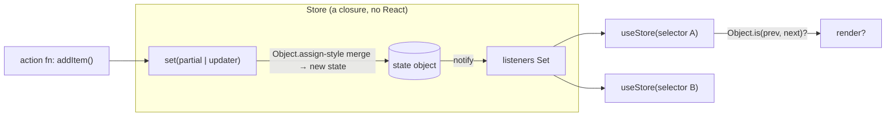
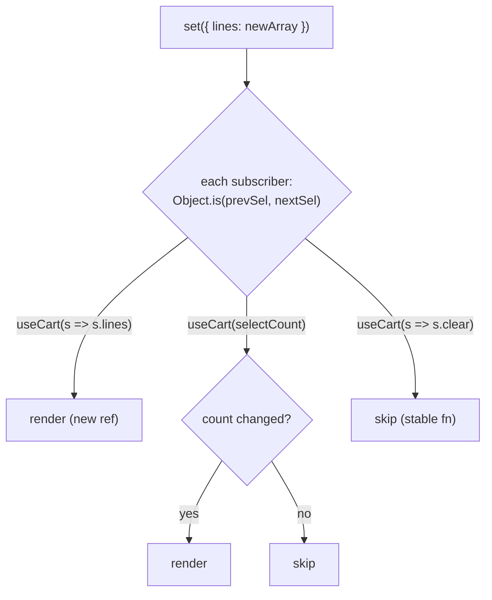
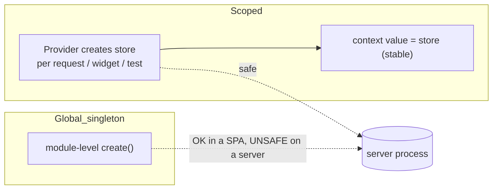

# 06 / 10 — Zustand: A Minimal External Store with Selector Subscriptions

> **Checked against `zustand` 5.0.16 (executed with Vitest + RTL and `tsc`, 2026-10-22).** This lesson targets **Zustand 5.x** (`zustand`). Import paths, middleware signatures, and the persist-middleware details change between majors. Authority: <https://zustand.docs.pmnd.rs> and <https://github.com/pmndrs/zustand>. The *concepts* (a store outside React, a setter that merges state, selector-based subscription over `useSyncExternalStore`) are stable.

## 1. Lesson metadata

| | |
|---|---|
| **Level** | Intermediate |
| **Study time** | 4–5 hours (reading 1.5 h, experiments 1.5 h, exercises 1.5 h) |
| **Prerequisites** | [09 — Redux Toolkit](./09-redux-toolkit.md), [Phase 3 / 20 — `useSyncExternalStore` and external stores](../03-react-state-and-hooks/20-usesyncexternalstore-and-external-stores.md), [Phase 3 / 14 — Context performance](../03-react-state-and-hooks/14-context-performance.md), [Phase 3 / 18 — State colocation and lifting](../03-react-state-and-hooks/18-state-colocation-and-lifting.md), [Phase 7 / 05 — Referential equality](../07-performance/05-referential-equality.md) |
| **Next** | [11 — Context vs external stores](./11-context-vs-external-stores.md) |
| **Related** | [08 — TanStack Query](./08-tanstack-query.md), [12 — State machines and XState](./12-state-machines-and-xstate.md), [14 — Server-side data loading](./14-server-side-data-loading.md), [19 — Technology selection matrix](./19-technology-selection-matrix.md) |

**Learning objectives.** After this lesson you can:
1. Explain what Zustand is *responsible for* (holding state outside React and notifying selective subscribers) and what it leaves to you (structure, event log, effects, server cache).
2. Write a typed store, subscribe with selectors, and predict which components re-render.
3. Explain why a selector that returns a new object/array breaks components in Zustand 5, and fix it with `useShallow` or by selecting primitives.
4. Use `persist`, `devtools`, `immer`, and `subscribeWithSelector` middleware and state precisely what each adds.
5. Use stores outside React (vanilla `getState`/`setState`/`subscribe`) and in tests.
6. Avoid the singleton-store-on-the-server hazard by creating stores per request with a context provider.
7. Compare Zustand to Redux Toolkit, Context, and XState on responsibilities and choose deliberately.

**Concepts covered:** `create`, `set`/`get`, merge semantics, selectors, equality, `useShallow`, curried `create<T>()(...)`, middleware, slices pattern, `createStore` + `useStore`, `persist` (`partialize`, `version`, `migrate`, hydration), `subscribe`, store-per-request, testing/reset.

---

## 2. Deep conceptual explanation

### 2.1 What problem is this lesson solving?

You have client state that several distant components share, and Context produces too many re-renders or too much provider ceremony ([Phase 3 / 14](../03-react-state-and-hooks/14-context-performance.md)); Redux Toolkit ([09](./09-redux-toolkit.md)) is more machinery than the responsibility justifies. Zustand's answer: **a store is a closure holding state, a `set` function, and a list of listeners. A hook reads from it with a selector.** No provider is required, no action vocabulary is required.

### 2.2 Responsibilities: what Zustand owns and what it does not

| Responsibility | Zustand | Left to you |
|---|---|---|
| Holding shared client state outside the React tree | **Yes** | |
| Selector-based subscriptions (render only when the selected slice changes) | **Yes** | Writing selectors that return stable values |
| A defined update API | `set(partial)` shallow-merges (or replaces) | Designing transitions |
| Event naming / action log | No (optional via `devtools` middleware, action names are manual) | Naming discipline |
| Enforcing purity or immutability | No (you must update immutably, or use the `immer` middleware) | Yes |
| Effects / async orchestration | None built in; actions may be `async` functions | Everything else |
| Server-state caching | No | TanStack Query / RTK Query ([08](./08-tanstack-query.md)) |
| Persistence | Optional `persist` middleware | Schema migration, privacy, storage choice |
| Multiple instances / scoping | You can create many stores | Per-request / per-subtree scoping via context |
| Devtools | Optional Redux DevTools bridge | Yes |

Compared on responsibilities with Redux Toolkit: **both** are external stores with selector subscriptions. Redux additionally *requires* the event/reducer discipline and bundles an ecosystem (listeners, entity adapters, RTK Query); Zustand deliberately omits them, so any of that discipline is your convention rather than the library's guarantee. Neither is "better"; the question is whether you need the guarantees.

### 2.3 The mental model



A minimal store is essentially:

```ts
type Listener<T> = (state: T, prev: T) => void;
function createStoreSketch<T>(init: (set: (p: Partial<T>) => void, get: () => T) => T) {
  let state: T;
  const listeners = new Set<Listener<T>>();
  const get = () => state;
  const set = (partial: Partial<T>) => {
    const next = { ...state, ...partial };
    if (!Object.is(next, state)) { const prev = state; state = next; listeners.forEach(l => l(state, prev)); }
  };
  state = init(set, get);
  return { get, set, subscribe: (l: Listener<T>) => (listeners.add(l), () => listeners.delete(l)) };
}
```

*Teaching model.* This sketch is not Zustand's code; it shows the shape (state, `set`, `get`, `subscribe`). The React hook is conceptually `useSyncExternalStore(subscribe, () => selector(get()))` ([Phase 3 / 20](../03-react-state-and-hooks/20-usesyncexternalstore-and-external-stores.md)). Verify in the source.

### 2.4 What React exposes versus what Zustand adds

React exposes `useSyncExternalStore` (subscribe + consistent snapshot + SSR snapshot). Zustand 5 is built directly on it (verified in 5.0.16: `create` calls `React.useSyncExternalStore` directly; `use-sync-external-store` is now only an optional peer dependency, used by `zustand/traditional`). The library adds: the store factory, merge semantics, selector API, middleware composition, and the vanilla store interface.

### 2.5 Common misconceptions

| Misconception | Reality |
|---|---|
| "Zustand is a lighter Redux, so it has the same guarantees." | It has the *subscription* model; it does not enforce actions/reducers/purity. |
| "`set` replaces the state." | By default it **shallow-merges** the top level. Nested objects are replaced wholesale unless you spread. Passing `true` as the second argument replaces. |
| "Selecting an object is fine; it's the same reference." | If the selector builds a new object each call, the snapshot differs each time; in v5 this can loop and error (section 3.3). |
| "No provider = global singleton = fine everywhere." | On a server a module-level store is shared across requests (section 5.5, [14](./14-server-side-data-loading.md)). |
| "Zustand state is reactive like MobX." | It is immutable-update-and-compare, not proxy-tracked mutation (unless you add Immer middleware, which only affects *updates*). |
| "You can mutate `state` in an action." | Not without the `immer` middleware; plain mutation will not notify subscribers. |
| "Persisting is free." | Hydration timing, migrations, quota, and storing sensitive data are your responsibility. |

---

## 3. Internal mechanics

### 3.1 Creating a store

```ts
import { create } from 'zustand';

interface CounterState {
  count: number;
  inc: () => void;
}
export const useCounter = create<CounterState>()((set) => ({
  count: 0,
  inc: () => set((s) => ({ count: s.count + 1 })),
}));
```

- `create` returns a **hook** that also carries the vanilla API: `useCounter.getState()`, `.setState()`, `.subscribe()` (confirmed; `getInitialState()` also exists in 5.0.16). The `zustand` entry point exports `create`, `createStore` and `useStore`.
- The **double call `create<T>()(...)`** is the TypeScript-recommended form: the first call fixes the type parameter, the second infers the middleware chain. Without middleware the single-call form `create<S>((set) => ...)` also typechecks (verified with `tsc`); the curried form is the one documented for TS because it keeps middleware types inferable.
- Actions live **inside** the state object as functions. That is a convention: functions are stable references (created once), so selecting them never triggers a re-render.

### 3.2 `set` semantics

`set(partial)` or `set((state) => partial)`:
1. Computes `partial`.
2. If the result is not `Object.is`-equal to the current state (an updater like `(s) => s` is therefore a no-op that notifies nobody, but `setState({ m: 1 })` called twice notifies twice because each call passes a fresh object; both verified), creates `nextState = Object.assign({}, state, partial)` (a shallow merge).
3. Replaces state and notifies listeners with `(nextState, prevState)`.

`set(partial, true)` replaces instead of merging. In v5 typings, replace requires the full state type (verified: `setState({ n: 1 }, true)` is a `tsc` error when `S` has other required fields).

*Public guarantee:* merge-vs-replace behavior. *Implementation detail:* exactly how listeners are stored and iterated.

### 3.3 Selectors, equality, and the v5 "new object" rule

The hook `useStore(selector)` re-renders the component when `selector(state)` returns a value that is not `Object.is`-equal to the previous result.

| Selector | Result | Re-renders when |
|---|---|---|
| `s => s.count` | primitive | `count` changes |
| `s => s.user` | existing reference | `user` replaced |
| `s => s.items.length` | primitive | length changes |
| `s => ({ a: s.a, b: s.b })` | **new object every call** | **every store update**; in v5 can trigger "Maximum update depth exceeded" / infinite loop errors |
| `s => s.items.filter(...)` | new array | same problem |

**Version-sensitive.** In v4 the hook accepted an optional equality function (`useStore(selector, shallow)`), which still allowed the "new object" selector. **In v5 that second argument was removed from `create`'s hook** (the equality-function variant lives in `createWithEqualityFn` from `zustand/traditional`; both `createWithEqualityFn` and `useStoreWithEqualityFn` exist in 5.0.16). Verified on React 19.3: a selector `(s) => ({ a: s.a })` threw "Maximum update depth exceeded" after React logged "The result of getSnapshot should be cached to avoid an infinite loop"; with `useShallow` the component did not re-render for an unrelated key and re-rendered once for `a`. The recommended replacement is `useShallow`:

```ts
import { useShallow } from 'zustand/react/shallow';

const { a, b } = useStore(useShallow((s) => ({ a: s.a, b: s.b })));
const [x, y] = useStore(useShallow((s) => [s.x, s.y]));
```

`useShallow` memoises the previous result and returns it when the new result is shallow-equal, so the snapshot stays referentially stable.

Why a loop? `useSyncExternalStore` requires `getSnapshot` to return the **same value** if the store has not changed; returning a fresh object on every call violates that contract ([Phase 3 / 20](../03-react-state-and-hooks/20-usesyncexternalstore-and-external-stores.md)), so React keeps seeing "changes" and re-renders.

### 3.4 Middleware as higher-order store initialisers

A middleware wraps the `(set, get, api) => state` initialiser and returns another. They compose by nesting:

```ts
create<S>()(devtools(persist(immer((set) => ({ /* ... */ })), { name: 'app' })));
```

| Middleware | What it adds | Sharp edges |
|---|---|---|
| `devtools` | Sends state and (named) actions to Redux DevTools extension | Pass an action name as the third `set` argument for readable logs; keep it out of production if needed |
| `persist` | Serialises state to a storage (default `localStorage`) and rehydrates | `partialize`, `version`, `migrate`, async hydration timing, SSR mismatch ([5.5](#55-advanced-persist-and-per-request-stores)) |
| `immer` | Lets `set` accept a mutating recipe | Requires the `immer` package; adds a dependency |
| `subscribeWithSelector` | Lets `store.subscribe(selector, listener, options)` fire only when the selected value changes | Needed for fine-grained *non-React* subscriptions |
| `combine` | Infers state type from initial state + creators | Alternative to explicit interfaces |

Middleware order affects typings and behavior (the Zustand docs recommend `devtools` outermost; order was not exhaustively tested here). Verified for `persist`: with a synchronous storage (`createJSONStorage(() => localStorage)`-style) hydration ran synchronously during `create`, `persist.hasHydrated()` was already `true`, `migrate(persisted, version)` was called with the stored version, and `partialize` limited what was written.

### 3.5 Vanilla stores and `useStore`

`createStore` (from `zustand/vanilla`, also re-exported from `zustand`) creates a store *without* a hook. `useStore(store, selector)` binds it to React. This is the form needed for **per-instance** stores (one per request, per widget instance, per test).

### 3.6 Execution order inside React

On `set`, listeners run synchronously. Each mounted hook's `getSnapshot` runs; if the result changed, React schedules a render; React batches renders ([Phase 2 / 22](../02-react-rendering-and-internals/22-automatic-batching.md)). Because the store is external, a state change during a transition cannot be "kept in the background" the way React state can; `useSyncExternalStore` updates are synchronous and non-interruptible. This is the documented trade-off of external stores under concurrent rendering (the react.dev `useSyncExternalStore` reference says store mutations cannot be Transitions); see [Phase 3 / 20](../03-react-state-and-hooks/20-usesyncexternalstore-and-external-stores.md).

---

## 4. Step-by-step execution walkthrough

Scenario: a notifications store; `<Bell />` selects `unread` count; `<List />` selects `items`; clicking "mark all read" calls `markAllRead()`.

1. Initial: `{ items: [n1(unread), n2(unread)], unread: 2 }` (assume `unread` stored; better practice is derived).
2. Both components mounted; each subscribed with its selector. Bell snapshot = `2`; List snapshot = `items` reference R1.
3. Click: `markAllRead()` runs `set((s) => ({ items: s.items.map(n => ({ ...n, read: true })), unread: 0 }))`.
4. `set` merges: new state with `items` = R2 (new array) and `unread` = 0.
5. Listeners fire. Bell: `0 !== 2` → render. List: `R2 !== R1` → render.
6. A third component `<Header />` selecting `s => s.markAllRead` (a function): same reference → **no render**.
7. React renders Bell and List; DOM updates.

**Predict:** if `markAllRead` instead did `set({ unread: 0 })` only, which components render? *Answer:* only Bell. List's `items` is the same reference.

**Predict (v5):** `const { items, unread } = useStore((s) => ({ items: s.items, unread: s.unread }))`. *Answer:* a new object every snapshot → repeated render/"getSnapshot should be cached" warning and potentially an infinite-loop error. Fix with `useShallow` or two selectors.

---

## 5. Code examples

### 5.1 Minimal

```tsx
import { create } from 'zustand';

interface ThemeState {
  theme: 'light' | 'dark';
  toggle: () => void;
}
const useTheme = create<ThemeState>()((set) => ({
  theme: 'light',
  toggle: () => set((s) => ({ theme: s.theme === 'light' ? 'dark' : 'light' })),
}));

export function ThemeButton() {
  const theme = useTheme((s) => s.theme);
  const toggle = useTheme((s) => s.toggle);
  return <button onClick={toggle}>Theme: {theme}</button>;
}
```

Notes: two selectors, each returning a stable primitive/function. No provider. Calling `useTheme()` with *no selector* subscribes to the whole state: any change re-renders the component (works, but forfeits the selective benefit).

### 5.2 Practical: a cart store with derived values, immutable updates, devtools, persist

```ts
// cartStore.ts
import { create } from 'zustand';
import { devtools, persist, createJSONStorage } from 'zustand/middleware';

export interface Line { productId: number; unitPrice: number; qty: number }

interface CartState {
  lines: Line[];
  add: (productId: number, unitPrice: number) => void;
  setQty: (productId: number, qty: number) => void;
  clear: () => void;
}

export const useCart = create<CartState>()(
  devtools(
    persist(
      (set) => ({
        lines: [],
        add: (productId, unitPrice) =>
          set(
            (s) => {
              const hit = s.lines.find((l) => l.productId === productId);
              return {
                lines: hit
                  ? s.lines.map((l) => (l === hit ? { ...l, qty: l.qty + 1 } : l))
                  : [...s.lines, { productId, unitPrice, qty: 1 }],
              };
            },
            undefined,
            'cart/add',               // devtools action name (verify signature)
          ),
        setQty: (productId, qty) =>
          set((s) => ({
            lines: s.lines
              .map((l) => (l.productId === productId ? { ...l, qty } : l))
              .filter((l) => l.qty > 0),
          })),
        clear: () => set({ lines: [] }),
      }),
      {
        name: 'cart-v1',
        version: 1,
        storage: createJSONStorage(() => localStorage),
        partialize: (s) => ({ lines: s.lines }),   // never persist functions/transient state
      },
    ),
    { name: 'cart' },
  ),
);

// Derived values live in selectors, not in state.
export const selectCount = (s: CartState) => s.lines.reduce((n, l) => n + l.qty, 0);
export const selectTotalCents = (s: CartState) =>
  s.lines.reduce((sum, l) => sum + l.qty * l.unitPrice, 0);
```

```tsx
function CartSummary() {
  const count = useCart(selectCount);          // number: stable
  const total = useCart(selectTotalCents);     // number: stable
  return <p>{count} items, {(total / 100).toFixed(2)}</p>;
}
```

Line notes:
- All updates produce new `lines` arrays and new changed `Line` objects while untouched lines keep identity.
- `partialize` writes only `lines`; the action functions are re-created on every load.
- `version` + a `migrate` function (omitted) is how you change the persisted shape safely. Without them an old payload can hydrate into a new shape and crash.
- Selectors return numbers, so there is no allocation problem even though they iterate.
- Prices as integer cents; the cart total is a *display* estimate, the server remains the authority at checkout.

### 5.3 Incorrect examples

```tsx
// BAD 1 (v5): selector builds an object
const { lines, clear } = useCart((s) => ({ lines: s.lines, clear: s.clear }));

// BAD 2: mutating state in an action
add: (id) => set((s) => { s.lines.push({ productId: id, unitPrice: 0, qty: 1 }); return s; }),

// BAD 3: server-owned data in the store, effect-fetched in every consumer
const { users, fetchUsers } = useStore();
useEffect(() => { fetchUsers(); }, []);

// BAD 4: no selector in a hot component
const state = useCart();           // re-renders on any cart change

// BAD 5: module-level store used on the server for per-user data
export const useSession = create(() => ({ user: null as User | null }));
// server: useSession.setState({ user })  // visible to the NEXT request
```

Why each fails:
1. New object each snapshot: repeated renders / error in v5. Use `useShallow` or two selectors.
2. Same `lines` array reference with the same `s` returned: `Object.is(next, state)` is true, so listeners are not notified (nothing re-renders), and you have corrupted shared data.
3. Re-implements caching badly: no dedupe, race handling, retry, or invalidation. Use a query library ([08](./08-tanstack-query.md)); the store should hold *client* state (e.g. selected row ids).
4. Not incorrect semantically, but defeats selective subscription.
5. On a server process, module state survives across requests: cross-user leakage ([14](./14-server-side-data-loading.md)).

### 5.4 Corrected

```tsx
import { useShallow } from 'zustand/react/shallow';

const { lines, clear } = useCart(useShallow((s) => ({ lines: s.lines, clear: s.clear })));
// or simply two selectors:
const lines2 = useCart((s) => s.lines);
const clear2 = useCart((s) => s.clear);

// immutable update
add: (id) => set((s) => ({ lines: [...s.lines, { productId: id, unitPrice: 0, qty: 1 }] })),
```

### 5.5 Advanced: persist and per-request stores

**Per-instance store (SSR-safe) with context.** Create the store *inside* a provider so each request/test/widget gets its own.

```tsx
// cartStoreContext.tsx
'use client';
import { createContext, useContext, useRef, type ReactNode } from 'react';
import { createStore, useStore } from 'zustand';

interface CartState { lines: number[]; add: (id: number) => void }
const makeCartStore = (initial?: Partial<Pick<CartState, 'lines'>>) =>
  createStore<CartState>()((set) => ({
    lines: [],
    ...initial,
    add: (id) => set((s) => ({ lines: [...s.lines, id] })),
  }));

type CartStore = ReturnType<typeof makeCartStore>;
const CartCtx = createContext<CartStore | null>(null);

export function CartProvider({ children, initial }: { children: ReactNode; initial?: { lines: number[] } }) {
  const ref = useRef<CartStore | null>(null);
  if (ref.current === null) ref.current = makeCartStore(initial);   // created once per provider instance
  return <CartCtx.Provider value={ref.current}>{children}</CartCtx.Provider>;
}

export function useCartStore<T>(selector: (s: CartState) => T): T {
  const store = useContext(CartCtx);
  if (!store) throw new Error('useCartStore must be used inside <CartProvider>');
  return useStore(store, selector);
}
```

Notes:
- The context value is **the store object**, which never changes, so context propagation causes **no re-renders**; the selector subscription does the work. This is the intended combination: Context for *dependency injection / scoping*, Zustand for *state and subscription* ([11](./11-context-vs-external-stores.md)).
- `useRef` lazy initialisation avoids re-creating the store per render; `useState(() => makeCartStore())` is an equivalent idiom.
- The `'use client'` directive matters in an RSC framework: the provider must be a Client Component ([Phase 2 / 27](../02-react-rendering-and-internals/27-react-server-components-intro.md)). Verify against your framework's current guidance (not checked here).

**`persist` and hydration.** `persist` rehydrates from storage, which on the client is typically synchronous for `localStorage` but modelled as potentially async. On the server there is no `localStorage`. A server render produces HTML with the initial state; the client then rehydrates stored state, which may **differ**, causing hydration mismatches or a flash ([Phase 2 / 25](../02-react-rendering-and-internals/25-hydration-and-selective-hydration.md)). Options (`skipHydration` and `persist.rehydrate()`/`hasHydrated()` exist in 5.0.16): `skipHydration` with manual `rehydrate()` after mount; render persisted-dependent UI only after a `hasHydrated` flag; or keep persisted data out of server-rendered output.

**Subscribing outside React.**

```ts
import { subscribeWithSelector } from 'zustand/middleware';
const useStore = create<S>()(subscribeWithSelector((set) => ({ /* ... */ })));

const unsub = useStore.subscribe(
  (s) => s.lines.length,
  (len, prevLen) => analytics.track('cart_size', { len, prevLen }),
);
```

The listener fires only when the selected value changes. Always call `unsub()` when the owner ends.

---

## 6. Visual explanations

### 6.1 Which components re-render



### 6.2 Store location and scoping



---

## 7. Alternative approaches and trade-offs

| Criterion | Zustand | Redux Toolkit ([09](./09-redux-toolkit.md)) | Context + `useState`/`useReducer` ([11](./11-context-vs-external-stores.md)) | Jotai / signals-style atoms *(not covered)* | XState ([12](./12-state-machines-and-xstate.md)) |
|---|---|---|---|---|---|
| Primary responsibility | Shared client state + selective subscription | Event-driven global state with ecosystem | Value propagation in a subtree | Fine-grained atom dependencies | Explicit behavioural states |
| Selector subscriptions | Yes | Yes | No | Yes (per atom) | Via selectors on actors |
| Enforced update discipline | No | Yes (actions/reducers) | No | No | Yes (events/transitions) |
| Time-travel / action log | Optional (devtools) | First-class | No | Limited | Inspector |
| Ceremony | Very low | Moderate | Very low | Low | Higher |
| Scoping to a subtree | Needs context pattern | Needs `Provider` (store per tree possible) | Native | Provider scopes | Actors per component |
| Typical failure | Ad-hoc actions, selector allocation | Over-ceremony, non-serialisable state | Over-rendering | Dependency sprawl | Over-modelling trivial UI |

**Scenario where Zustand is *not* the best fit.** An undoable multi-user editor requiring an auditable event history with ordering guarantees across many teams: Redux (or an explicit event-sourced model) gives you the conventions; in Zustand you would rebuild them. Another: a form's local field state or a single component's toggles: `useState` is simpler and unmounts with the component.

**Where it shines.** A medium app with a handful of cross-cutting client concerns (theme, sidebar, selection, command palette, draft editor), where a team wants minimal ceremony and accepts conventions over enforcement.

---

## 8. Best practices and anti-patterns

### Best practices
- **One store per concern** (or slices composed into one), not a god store.
- **Actions inside the store**, named by intent (`checkoutStarted`, not `setStep`) even though not enforced.
- **Select the minimum**: primitives and stable references; use `useShallow` for multi-field picks.
- **Derive, don't store**: totals, filtered lists, booleans computed from state ([Phase 3 / 17](../03-react-state-and-hooks/17-derived-state.md)). For expensive derivations, memoise outside the hook (`useMemo` on selected inputs).
- **Keep server state in a query cache**; keep selections, drafts, UI flags in the store.
- **`partialize` and version persisted state**; never persist tokens or personal data casually.
- **Reset between tests** (re-create the store, or `setState(initial, true)`), since module-level stores leak across tests.
- **Slices pattern** for large stores: functions `(set, get) => ({...})` composed into one initialiser; one file per feature.

### Beginner mistakes
- No selector (`useStore()`), then wondering about re-renders.
- Mutating nested state.
- Calling hooks conditionally (they are hooks; [Phase 3 / 16](../03-react-state-and-hooks/16-rules-of-hooks-and-composition.md)).
- Using `useStore.getState()` inside render to "read without subscribing" and then expecting the component to update.

### Experienced-developer mistakes
- Building an unmaintained, bespoke Redux (actions as strings, ad-hoc middleware, effects tangled in actions) inside Zustand.
- Actions that read stale values via closure instead of `get()` / the `set` updater.
- One global store holding both server data and UI state, with hand-written loading flags.
- Sharing a module-level store across SSR requests.
- Storing derived or non-serialisable values and then persisting them.

### Smells
- A component reading more than 3–4 unrelated fields from one store.
- Actions calling other stores' `getState().x.y()` (hidden coupling).
- `set` calls with large inline object construction in components rather than in actions.

### Justified exceptions
- A bare `useStore()` in a tiny component that really does use most fields.
- Cross-store `getState()` reads in a *single* orchestration module, documented as such.
- Writing `set` from outside the store (`useStore.setState`) in event bridges, e.g. a WebSocket handler, since the store is not tied to React.

---

## 9. Real-world application

| Domain | Fit | Engineering constraint |
|---|---|---|
| E-commerce | Cart, filters panel state, compare list | Server owns price and availability; cart is a *client intent* reconciled at checkout; persist with versioning |
| Dashboards | Selected rows, widget layout, global time range | Time range also belongs in URL when shareable ([18](./18-url-state-management.md)) |
| Finance | Draft tickets, UI preferences | Do not persist sensitive fields; clear on logout; store-per-session |
| Auth | UI mirror of session (`isAuthenticated`) | Authorisation is server-side; clear stores and query cache on logout |
| Realtime | Bridge a socket to the store with `setState` outside React | Batch bursts; avoid a render per message ([17](./17-real-time-websockets-subscriptions.md)) |
| Multi-team | Per-feature slice files and a published selector API | No convention enforcement: agree on naming, review for selector allocation, lint-rule imports |

---

## 10. Debugging and troubleshooting

| Symptom | Root cause | Investigation | Fix / validation |
|---|---|---|---|
| "Maximum update depth exceeded" or "getSnapshot should be cached" after upgrading to v5 | Selector returns new object/array | Find selectors returning `{}`/`[]` literals or `.map/.filter` | `useShallow` or separate selectors; confirm render stops |
| Component never updates after `set` | Mutated and returned same state; or `set` called with identical reference | Log `prev === next` in a `subscribe` | Return new objects |
| Component re-renders on every change | No selector or selector returning allocation | React DevTools Profiler | Add selector; check stability |
| Persisted state breaks after deploy | Shape changed without `version`/`migrate` | Inspect localStorage JSON | Bump `version`, write `migrate`, test with old payload |
| Hydration mismatch with `persist` | Server HTML differs from client-hydrated state | React hydration warning; compare initial vs rehydrated | Delay persisted-dependent UI until hydrated flag; `skipHydration` |
| Test A affects test B | Module-level store shared across tests | Order-dependent failures | Reset in `beforeEach`; use store factory |
| Another user's data on first server render | Singleton store on server | Reproduce with two parallel requests | Store per request via provider |

DevTools workflow: install Redux DevTools extension, wrap with `devtools`, **name actions** (third arg to `set`) so the timeline is legible. In React DevTools Profiler, enable "Record why each component rendered" and look for `hooks changed` on components that should not have rendered.

---

## 11. Exercises

### Level A — Knowledge
**A1.** What does `set({ a: 1 })` do to other keys in state? How do you replace the entire state?
**A2.** Why is `useStore((s) => s.someAction)` safe from re-renders?
**A3.** Name the three comparison outcomes that decide whether a hook's component re-renders.
**A4.** What does `useShallow` do, and which Zustand 5 problem does it address?
**A5.** What does `partialize` do in `persist`?
**A6.** Why can a module-level store be a security issue on a server?

### Level B — Code comprehension
**B1.** What renders after `inc()` in each component?
```tsx
const useC = create<{ a: number; b: number; inc: () => void }>()((set) => ({ a: 0, b: 0, inc: () => set((s) => ({ a: s.a + 1 })) }));
const A = () => <p>{useC((s) => s.a)}</p>;
const B = () => <p>{useC((s) => s.b)}</p>;
const C = () => { const { a, b } = useC(); return <p>{a + b}</p>; };
```
**B2.** Why does this action never notify subscribers?
```ts
toggle: () => set((s) => { s.flags.dark = !s.flags.dark; return s; })
```
**B3.** In 5.5, why doesn't the context value cause consumers to re-render when the store state changes?
**B4.** What goes wrong here? `const lines = useCart((s) => s.lines.filter((l) => l.qty > 1));`

### Level C — Implementation
**C1.** Implement a `useSelection` store: a `Set` of selected ids (stored as an array or object), actions `toggle(id)`, `clear()`, `selectAll(ids)`, and a hook `useIsSelected(id)` that re-renders a row only when *its* selection status changes.
**C2.** Add `persist` with `version: 2` and a `migrate` that converts v1 `{ items: string[] }` to v2 `{ items: { id: string; qty: number }[] }`.
**C3.** Write a store factory + provider + hook for a per-widget `FilterStore`, and show two widgets with independent state.

### Level D — Debugging
**D1.** After upgrading to v5 the app throws an infinite-loop error on a settings page. The code: `const { theme, locale } = useSettings((s) => ({ theme: s.theme, locale: s.locale }));`. Diagnose and give two fixes.
**D2.** Tests pass individually but fail together. The store is `export const useX = create(...)`. Fix.
**D3.** Users see a flash of an empty cart then the persisted cart on page load, plus a hydration warning in an SSR app.

### Level E — Architecture and engineering decisions
**E1.** A team of 8 on a 40-screen app uses Context for everything and complains of re-render problems. Decide: Zustand, Redux Toolkit, or split Contexts? State your criteria.
**E2.** Choose where to keep: current user claims, shopping cart, product list, selected table rows, active modal, search filters shared by link.
**E3.** Define conventions your team must adopt because Zustand does not enforce them.

### Level F — Expert challenge
**F1.** Design a store architecture supporting 5 teams with slices, cross-slice communication, devtools action naming, and persistence, without turning into an ungoverned global.
**F2.** A realtime feed pushes 200 messages per second into the store. Design update batching and selector strategy so the UI stays responsive; discuss `useSyncExternalStore`'s non-interruptible updates.

---

## 12. Detailed answers and explanations

> Attempt the exercises first.

**A1.** It shallow-merges: other top-level keys are preserved; nested objects under `a` are replaced entirely. Replace everything with `set(newState, true)`. Wrong: "set replaces state" (that is how React's `useState` setter behaves; Zustand's `set` merges by default).

**A2.** Action functions are created once at store creation, and `Object.is(prev, next)` on the same function reference is true, so the snapshot never changes.

**A3.** The component re-renders if `Object.is(previousSelected, nextSelected)` is false; the selector runs on each store update; the snapshot must be stable when state hasn't changed. (Accept: "selected value equals" / "differs" / "same reference but mutated: no update".)

**A4.** It wraps a selector so that, when its result is shallow-equal to the previous one, the previous reference is returned: stable snapshot for object/array picks. In v5 without it, selectors that allocate trigger repeated updates.

**A5.** Chooses which parts of state are written to storage (excluding functions, transient flags, sensitive fields).

**A6.** Module state lives for the process lifetime; concurrent/sequential requests share it, so one user's data can render for another.

**B1.** `inc` changes only `a`. A renders (a changed). B: `b` unchanged → no render. C: calls `useC()` without a selector → subscribes to the whole state; any change renders C, so yes, C renders. Wrong answer "all three" (B doesn't).

**B2.** It mutates and returns the **same** state object; `Object.is(next, state)` true so `set` treats it as no change; additionally `flags` is mutated in place so selectors that compare `s.flags` by reference see no change. Fix: `set((s) => ({ flags: { ...s.flags, dark: !s.flags.dark } }))` or use `immer` middleware.

**B3.** The context value is the store object, created once and never replaced; React only re-renders context consumers when the context *value reference* changes. State changes flow through `subscribe`, and only components whose selected value changed re-render.

**B4.** `filter` allocates a new array each snapshot: infinite/continuous re-rendering in v5. Fix: select `s.lines` and `useMemo(() => lines.filter(...), [lines])`, or `useShallow` (shallow-equal compares array elements: works for arrays of stable element references).

**C1.**
```ts
import { create } from 'zustand';

interface SelState {
  selected: Record<string, true>;
  toggle: (id: string) => void;
  clear: () => void;
  selectAll: (ids: string[]) => void;
}
export const useSelection = create<SelState>()((set) => ({
  selected: {},
  toggle: (id) => set((s) => {
    const next = { ...s.selected };
    if (next[id]) delete next[id]; else next[id] = true;
    return { selected: next };
  }),
  clear: () => set({ selected: {} }),
  selectAll: (ids) => set({ selected: Object.fromEntries(ids.map((i) => [i, true as const])) }),
}));

export const useIsSelected = (id: string) => useSelection((s) => s.selected[id] === true);
```
`useIsSelected` returns a boolean, so a row re-renders only when *its* boolean flips. A `Set` in state would need replacing wholesale and is not serialisable for persist/devtools; a record keyed by id is serialisable. Edge: with 10 k rows each running a selector per store change costs O(rows) cheap checks; acceptable, measure first.

**C2.**
```ts
persist(creator, {
  name: 'list',
  version: 2,
  migrate: (persisted: unknown, version) => {
    if (version < 2) {
      const old = persisted as { items: string[] };
      return { items: old.items.map((id) => ({ id, qty: 1 })) };
    }
    return persisted as { items: { id: string; qty: number }[] };
  },
});
```
Criteria: version bumped; migration handles all older versions; unknown input validated in real systems (schema check). `migrate(persistedState, version)` was executed and works as written.

**C3.** As in 5.5: `createStore` factory; provider with `useRef`/`useState` lazy init; hook with `useStore(ctx, selector)`; two providers around two widgets → independent state. Test: change widget A's filter, assert widget B unchanged.

**D1.** Selector returns a fresh object each call; v5 hook does not accept the v4 equality argument and relies on stable snapshots. Fix 1: `useSettings(useShallow((s) => ({ theme: s.theme, locale: s.locale })))`. Fix 2: two selectors. Validate: no warning, renders stop.

**D2.** Module-level store retains state between tests. Fix: store factory per test, or `beforeEach(() => useX.setState(initialState, true))`; or the documented mock pattern for Jest/Vitest (verify). Validate by running tests shuffled.

**D3.** Server HTML renders empty cart; client rehydrates persisted cart → flash and mismatch. Fix: render cart-dependent UI after a `hasHydrated` flag/mount effect (accept a controlled flash with a skeleton), or `skipHydration` and rehydrate in an effect; or store the cart server-side for logged-in users. Explain trade-off: persisted client state is unknowable on the server.

**E1.** Criteria: how many distinct shared values; need for devtools/event trace; team familiarity; whether the re-render cost is from Context value churn (split Contexts / memoise value may suffice: [Phase 3 / 14](../03-react-state-and-hooks/14-context-performance.md)); measure with the Profiler first. A defensible answer: Zustand if values are few and cross-cutting, RTK if event traceability and coordination matter; splitting Contexts if the problem is a few hot values. Weak answers pick a tool without measurement.

**E2.** User claims: from the server session (query cache / framework loader), mirrored read-only where needed. Cart: client store, persisted, reconciled with server. Product list: query cache. Selected rows: store (or URL if shareable). Active modal: local state or URL (deep link). Shareable filters: URL ([18](./18-url-state-management.md)).

**E3.** Examples: action naming (`verbNoun` events), slice file structure, selector placement and a "no allocating selectors" review checklist, how to access stores outside React, persistence and migration policy, reset in tests, SSR store-per-request rule, ban on server data in stores unless cached with a documented lifetime.

**F1.** Evaluation: slices per team behind a public selector/action API; a root-composer; cross-slice effects only through published actions or a subscription module; devtools naming convention enforced by wrapper helper; persistence only via an allowlisted `partialize` registry with version ownership; CI test to detect allocating selectors (render counting tests).

**F2.** Strong answers: accumulate messages in a buffer outside React, flush once per animation frame or at 4–10 Hz with a single `set`; store as a bounded ring buffer / append-only chunk list with stable references for old chunks; virtualise list rendering ([Phase 7 / 09](../07-performance/09-windowing-and-virtualization.md)); selectors return primitives (counts) for badges; note that external store updates are synchronous and cannot be deferred by `startTransition`; mitigate by throttling at the source or deferring derived views with `useDeferredValue` ([Phase 7 / 13](../07-performance/13-usedeferredvalue-in-practice.md)).

---

## 13. Senior engineer interview questions

1. **"How does a Zustand component know when to re-render?"** `useSyncExternalStore` subscribes it; on each store change the selector runs; React compares to the previous snapshot with `Object.is`; unequal → render.
2. **"What changed in v5 regarding selectors?"** The hook no longer takes an equality function; selectors that allocate produce unstable snapshots (loop risk); use `useShallow` or `createWithEqualityFn` from the traditional entry (verify). The cause: `getSnapshot` caching requirement.
3. **"Why combine Zustand with Context?"** Context gives scoping/injection of a *store instance* (SSR safety, tests, multiple widgets); the store gives selective subscription. The context value is stable, so it has no propagation cost.
4. **"When do you prefer Redux Toolkit?"** When you need enforced events, a first-class action log, middleware ecosystems, RTK Query in the same store, or many teams needing conventions the library enforces. Reasoned by guarantees, not popularity.
5. **"How do you handle persisted state across deployments?"** `version` + `migrate`, `partialize`, validation, and tests with old payloads; treat storage as untrusted input.
6. **"Is a global store compatible with concurrent rendering?"** `useSyncExternalStore` makes reads consistent (no tearing) but forces synchronous updates; urgent/deferred separation is not available for external state, so keep heavy derived views deferred in React or throttle at source.
7. **"Where should fetched data live?"** In a server-state cache; stores may reference ids/selection, not copies of responses.
8. **"How do you test components using a store?"** Provide a fresh store (factory/provider), set initial state via `setState`/initial args, assert behavior; avoid mocking the hook; reset between tests.

---

## 14. Further learning resources

| Resource | URL | Covers / why | Level | Study |
|---|---|---|---|---|
| Zustand documentation | <https://zustand.docs.pmnd.rs> | Official guides: TypeScript, persist, SSR/Next.js, testing | All | Getting started, Guides on TypeScript, Slices Pattern, persist middleware |
| Zustand GitHub | <https://github.com/pmndrs/zustand> | Source, releases (v5 migration), discussions | Intermediate–Advanced | Releases for v5.0; `src/react.ts`, `src/vanilla.ts` |
| Zustand v5 migration guide | <https://zustand.docs.pmnd.rs/reference/migrations/migrating-to-v5> *(link checked, HTTP 200, 2026-10-22)* | Breaking changes | Intermediate | Whole page |
| React docs: `useSyncExternalStore` | <https://react.dev/reference/react/useSyncExternalStore> | Snapshot caching rule | Advanced | Caveats section |
| Redux Toolkit docs | <https://redux-toolkit.js.org> | Comparison baseline for responsibilities | Intermediate | Why RTK |
| Immer | <https://immerjs.github.io/immer/> | Needed for the `immer` middleware | Intermediate | Pitfalls |
| React docs: Choosing the state structure | <https://react.dev/learn/choosing-the-state-structure> | Principles that apply to store design | Beginner | Whole page |

---

## 15. Knowledge checkpoint

**You understand it if you can:**
- Describe the store closure (`state`, `set`, `get`, `subscribe`) and how `useSyncExternalStore` ties it to React.
- Predict which components re-render after a `set` given their selectors.

**You can explain it if you can:**
- Say what Zustand deliberately does not provide relative to Redux Toolkit, and when that omission is a feature or a liability.
- Explain why v5 breaks allocating selectors and the two fixes.

**You can implement it if you can, without notes:**
- A typed store with immutable updates, selectors, `persist` with `partialize`/`version`, and a store-per-provider setup.

**You can debug it if you can:**
- Fix an infinite-update selector, a stale-after-mutation bug, a persisted-state migration failure, and an SSR cross-request leak.

**Prerequisite for next lessons:** [11 — Context vs external stores](./11-context-vs-external-stores.md), [12 — State machines and XState](./12-state-machines-and-xstate.md), [14 — Server-side data loading](./14-server-side-data-loading.md), [19 — Technology selection matrix](./19-technology-selection-matrix.md).
