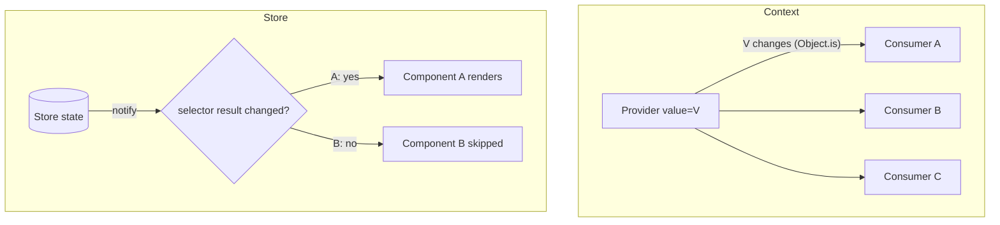
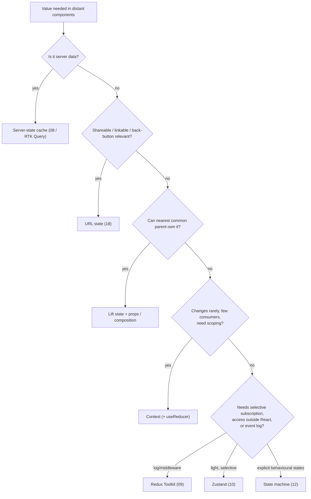

# 06 / 11 — Context vs External Stores: Propagation Is Not Subscription

> **Checked against React 19.3, `zustand` 5.0.16, `@reduxjs/toolkit` 2.13 and `react-redux` 9.3 (render counts executed with Vitest + RTL, 2026-10-22).** This lesson targets **React 19.x**. The React-side facts (Context semantics, `use`, `useSyncExternalStore`) are documented at <https://react.dev>. `use-context-selector` and the React Compiler's behaviour around Context were not checked; see [Phase 9 / 08](../09-advanced-rendering-and-ecosystem/08-react-compiler.md).

## 1. Lesson metadata

| | |
|---|---|
| **Level** | Intermediate–Advanced |
| **Study time** | 4–5 hours (reading 1.5 h, experiments 1.5 h, exercises 1.5 h) |
| **Prerequisites** | [Phase 3 / 13 — `useContext` and propagation](../03-react-state-and-hooks/13-usecontext-and-propagation.md), [Phase 3 / 14 — Context performance](../03-react-state-and-hooks/14-context-performance.md), [Phase 3 / 20 — `useSyncExternalStore` and external stores](../03-react-state-and-hooks/20-usesyncexternalstore-and-external-stores.md), [09 — Redux Toolkit](./09-redux-toolkit.md), [10 — Zustand](./10-zustand.md) |
| **Next** | [12 — State machines and XState](./12-state-machines-and-xstate.md) |
| **Related** | [Phase 3 / 18 — State colocation and lifting](../03-react-state-and-hooks/18-state-colocation-and-lifting.md), [Phase 7 / 06 — Context propagation cost](../07-performance/06-context-propagation-cost.md), [19 — Technology selection matrix](./19-technology-selection-matrix.md) |

**Learning objectives.** After this lesson you can:
1. State what Context is responsible for (delivering a value to a subtree) and what it is *not* (a store, a subscription mechanism with selectors, a state manager).
2. Predict exactly which components re-render when a Context value changes, including the interaction with `children` identity and `React.memo`.
3. List the responsibilities an external store takes over (selective subscription, updates outside React, middleware, devtools) and the one cost it imposes (synchronous updates under concurrent rendering).
4. Explain how `useSyncExternalStore` prevents tearing and why that matters for libraries.
5. Use Context and a store *together* correctly (Context for injection of a store instance).
6. Choose among: lifted `useState`, split Context, Context + reducer, a store, URL state, or a server-state cache, by responsibilities and measured cost.
7. Debug "everything re-renders when I type" and "provider re-renders my whole app" with the Profiler.

**Concepts covered:** value propagation, consumer re-render rule, provider value identity, `children` bailout, context splitting, state/dispatch split, selector subscriptions, tearing, `useSyncExternalStore`, `use(Context)`, React 19 `<Context value>`, scoping vs globals, store-per-request, `use-context-selector` pattern, decision criteria.

---

## 2. Deep conceptual explanation

### 2.1 What problem is this lesson solving?

Teams frequently ask: "Should this be Context or Redux/Zustand?" That question compares objects of different *kinds*. Context solves **how a value reaches a descendant without prop drilling** ([Phase 3 / 13](../03-react-state-and-hooks/13-usecontext-and-propagation.md)). A store solves **where shared mutable state lives and how many readers observe it selectively**. State *itself* in the Context case still comes from `useState`/`useReducer` in a component. The correct question is which *responsibilities* you need.

### 2.2 Responsibilities side by side

| Responsibility | Context (+ `useState`/`useReducer`) | External store (Redux / Zustand / custom) |
|---|---|---|
| Deliver a value to descendants without drilling | **Yes (its purpose)** | Yes, by import (no provider needed) or via provider for scoping |
| Hold state | No: state lives in the component that renders the Provider | **Yes** (outside the tree) |
| Scope state to a subtree and give each subtree instance its own copy | **Yes, naturally** (each Provider instance is a scope) | Only if you create a store instance per scope |
| Selective subscription (re-render only if the *part* I read changed) | **No**: any value change re-renders *all* consumers of that Context | **Yes** (selectors) |
| Read/write outside React (timers, sockets, tests, non-React code) | No | **Yes** |
| Middleware, action log, time-travel | No | Redux: first-class; Zustand: optional |
| Interruptible/deferrable updates (transitions work on the state) | **Yes** (it is React state) | No: external updates are synchronous; see 3.4 |
| Works with Suspense/transitions as React state | **Yes** | Limited (see 3.4) |
| Safe per-request isolation on a server | **Yes** if state is created in components | Only if a store is created per request |
| Setup cost | Very low | Low (Zustand) to moderate (Redux) |

The two columns overlap on *delivery*, and diverge on *subscription granularity*, *access outside React*, and *update scheduling*.

### 2.3 The mental model: broadcast versus subscription



- **Context** broadcasts: when the Provider's `value` changes by `Object.is`, **every** component that read that Context via `useContext`/`use` is scheduled to re-render, regardless of which *field* of the value it uses. React cannot know which property you used, because `useContext` returns the whole value.
- **A store** lets each reader declare what it reads (a selector) and compares *that* result.

*Public guarantee (documented):* consumers re-render when the context value changes; `useContext` always reads the nearest Provider above. *Implementation detail:* how React finds consumers to re-render (conceptually it propagates a change flag down through the fiber tree to matching consumers; see [Phase 3 / 13](../03-react-state-and-hooks/13-usecontext-and-propagation.md), and verify in source).

### 2.4 What React exposes versus what libraries add

React gives: Context (`createContext`, `useContext`, `use(Context)`; in React 19 you render `<MyContext value={...}>` directly instead of `<MyContext.Provider>`; `.Provider` still works; the React 19 release post says a codemod will be published and `.Provider` will be deprecated in future versions), state hooks, and `useSyncExternalStore`. It does **not** give a built-in selector for Context. Libraries add selectors on top of `useSyncExternalStore` (Redux, Zustand), or emulate selector-Context with a subscription list (e.g. `use-context-selector`; verify its API and compatibility with your React version).

### 2.5 Common misconceptions

| Misconception | Reality |
|---|---|
| "Context is a state management tool." | It is dependency injection for a value; the *state* is still `useState`/`useReducer`. |
| "Context is slow." | A broadcast to consumers is cheap when few consumers exist and values change rarely. It becomes costly with many consumers and frequently changing values. Measure ([Phase 7 / 06](../07-performance/06-context-propagation-cost.md)). |
| "Putting `useMemo` on the value fixes all Context re-renders." | It prevents *spurious* changes when the Provider re-renders for unrelated reasons; it cannot stop real changes from re-rendering all consumers. |
| "`React.memo` blocks Context updates." | No: a memoised component that *consumes* the Context re-renders on value change regardless of props. `memo` only stops re-renders caused by the *parent*. |
| "Redux/Zustand means no re-render problems." | Allocating selectors or selecting too much re-creates the problem. |
| "External stores are incompatible with React 18+/19." | `useSyncExternalStore` is the supported bridge; the cost is non-deferrable updates. |
| "A global store is just a bigger Context." | Different mechanism: subscription with equality, outside the tree, with its own lifecycle. |

---

## 3. Internal mechanics

### 3.1 Which components re-render when a Provider's value changes

Three independent causes of re-rendering interact:

1. **Parent re-rendered and created a new element for me** (the normal cascade).
2. **My own state changed.**
3. **A Context I consume changed.**

Case study. `App` holds state and renders `<ThemeCtx value={theme}><Page /></ThemeCtx>`. When `theme` changes:

- `App` re-renders (its state changed), creating a new `<Page />` *element*. `Page` re-renders because of cause 1, unless `Page` is `memo`-ised or its element identity did not change.
- If `Page`'s element comes from **`children` passed in** by a component that did *not* re-render, React reuses the same element and bails out; only the **consumers** re-render (cause 3).

This is the "children bailout" and is why a dedicated provider component is idiomatic:

```tsx
function ThemeProvider({ children }: { children: React.ReactNode }) {
  const [theme, setTheme] = useState<'light' | 'dark'>('light');
  const value = useMemo(() => ({ theme, setTheme }), [theme]);
  return <ThemeCtx value={value}>{children}</ThemeCtx>;
}
// <ThemeProvider><Page /></ThemeProvider>  — Page's element is created by the parent of ThemeProvider
```

When `theme` changes, `ThemeProvider` re-renders but `children` is the same element reference as before; `Page` is skipped unless it (or a descendant) consumes the Context. Only consumers re-render. *Public guarantee:* identical element references bail out of re-render. The React Compiler memoises JSX automatically in many cases and can change *which* components re-render without code changes (not checked in this review; see [Phase 9 / 08](../09-advanced-rendering-and-ecosystem/08-react-compiler.md)). Executed on React 19.3 without the compiler: `Child` passed as `children` rendered once at mount and zero times after the Provider's state changed, while the same `<Child />` written inline in the Provider rendered again on each change.

### 3.2 Provider value identity

`<Ctx value={{ a, b }}>` creates a new object every render of the provider, so every provider re-render notifies all consumers, even if `a` and `b` are unchanged. Remedies: `useMemo` the value; or pass a primitive; or split Contexts.

### 3.3 Splitting patterns and their limits

| Technique | What it fixes | What it does not fix |
|---|---|---|
| **State/dispatch split**: `StateCtx` + `DispatchCtx` (`dispatch` from `useReducer` is stable) | Components that only *write* never re-render on state change | Components that read state still re-render on any state field change |
| **Split by update frequency** (`UserCtx`, `ThemeCtx`, `CartCtx`) | A change to the cart does not wake theme consumers | Within one Context, all fields are still coarse |
| **Value memoisation** | Spurious provider re-renders | Real changes |
| **Per-feature providers lower in the tree** | Limits blast radius to the subtree | Cross-tree sharing |
| **Selector-Context libraries** | Field-level subscription over Context | Adds a dependency and subtleties with concurrent rendering (verify) |
| **External store** | Field-level subscription, outside React | Non-deferrable updates, conventions |

### 3.4 `useSyncExternalStore` and the concurrency trade-off

`useSyncExternalStore(subscribe, getSnapshot, getServerSnapshot?)` ([reference](https://react.dev/reference/react/useSyncExternalStore)):

- Subscribes to a store; React calls `getSnapshot` during render and again on change notifications.
- **Prevents tearing**: with concurrent rendering, a render may be paused and resumed; if an external, mutable store changes midway, two components in the *same* render could see *different* values. `useSyncExternalStore` makes React re-check snapshots and force a consistent synchronous render if the store changed during a render. See [Phase 3 / 20](../03-react-state-and-hooks/20-usesyncexternalstore-and-external-stores.md).
- **Requires a cached snapshot**: `getSnapshot` must return the same value when the store has not changed, or React loops. (This is why allocating selectors break, see [10, section 3.3](./10-zustand.md).)
- **Trade-off:** updates from an external store are treated as **synchronous**/non-transition: React cannot render a store update "in the background" the way it can with `setState` inside `startTransition`. Typing in a search box that updates a store and feeds a heavy list will block input unless you separate the *input* state from the *derived* heavy view ([Phase 7 / 12](../07-performance/12-usetransition-in-practice.md), [Phase 7 / 13](../07-performance/13-usedeferredvalue-in-practice.md)).

Context-based state does not have this restriction: it is React state, so transitions and Suspense integrate normally. That is a genuine point in Context's favour for state tied to navigations and deferred UI.

### 3.5 `use(Context)` (React 19)

`use(MyContext)` reads context like `useContext`, but may be called conditionally (after early return, inside `if`). It subscribes the same way. *Public guarantee:* `use` can be called conditionally; `useContext` cannot ([Phase 3 / 22](../03-react-state-and-hooks/22-modern-hooks-and-apis.md)). Re-render semantics are the same.

### 3.6 Scoping: the dimension Context wins

A Context Provider **is a scope**: two `<CartCtx value=...>` instances in different subtrees hold independent states. A module-level store is one global instance. For widgets rendered N times (each with its own filter), SSR requests, tests, or Storybook, scoping matters, and the standard way to give a store this property is to **put the store instance in Context** ([10, section 5.5](./10-zustand.md)). The context value never changes, so there is no propagation cost.

---

## 4. Step-by-step execution walkthrough

Scenario: a dashboard with `<FilterProvider>` holding `{ range, region, setRange, setRegion }` as one Context value. Components: `RangePicker` (reads `range`, `setRange`), `RegionPicker` (reads `region`, `setRegion`), `Chart` (reads both), `Footer` (no context).

**With a single Context**

1. User changes the range. `setRange` runs in `RangePicker`'s event handler; `FilterProvider` state updates.
2. `FilterProvider` re-renders; `useMemo` value deps changed → **new value object**.
3. `children` (the dashboard layout) is the same element reference → React bails out on those elements, but walks down to find consumers.
4. Consumers re-render: `RangePicker`, `RegionPicker`, `Chart`. **`RegionPicker` renders even though `region` did not change.**
5. `Footer` is skipped.
6. Commit; DOM changes for `RangePicker` and `Chart`; `RegionPicker` re-rendered but produced no DOM change.

**Predict:** How many components re-render if `RegionPicker` is `React.memo`'d? *Answer:* still three consumers; `memo` does not block Context-triggered renders.

**With a store and selectors (`useFilters(s => s.region)`)**

1. `setRange` → `set({ range })`.
2. Each subscriber's selector runs. `RangePicker`: new `range` → render. `Chart`: reads both via `useShallow` → render. `RegionPicker`: `region` unchanged → **skipped**.

**With two Contexts (`RangeCtx`, `RegionCtx`)**: `RegionPicker` consumes only `RegionCtx`, so it is skipped; `Chart` consumes both. This is often enough, without a library.

---

## 5. Code examples

### 5.1 Minimal: Context + `useReducer`, split state/dispatch

```tsx
import { createContext, use, useMemo, useReducer, type Dispatch, type ReactNode } from 'react';

interface Filters { range: '7d' | '30d'; region: string }
type Action = { type: 'range'; value: Filters['range'] } | { type: 'region'; value: string };

const FiltersCtx = createContext<Filters | null>(null);
const FiltersDispatchCtx = createContext<Dispatch<Action> | null>(null);

function reducer(s: Filters, a: Action): Filters {
  switch (a.type) {
    case 'range': return { ...s, range: a.value };
    case 'region': return { ...s, region: a.value };
  }
}

export function FiltersProvider({ children }: { children: ReactNode }) {
  const [state, dispatch] = useReducer(reducer, { range: '7d', region: 'EU' });
  return (
    <FiltersCtx value={state}>
      <FiltersDispatchCtx value={dispatch}>{children}</FiltersDispatchCtx>
    </FiltersCtx>
  );
}

export function useFilters(): Filters {
  const v = use(FiltersCtx);
  if (v === null) throw new Error('useFilters must be used within FiltersProvider');
  return v;
}
export function useFiltersDispatch(): Dispatch<Action> {
  const v = use(FiltersDispatchCtx);
  if (v === null) throw new Error('useFiltersDispatch must be used within FiltersProvider');
  return v;
}
```

Line notes: `state` itself is a stable reference until the reducer returns a new object, so no `useMemo` is needed for `value={state}`. `dispatch` is stable, so a component that only dispatches never re-renders on state change. The `null` default plus thrown error catches missing providers early (no silent wrong default). `<FiltersCtx value>` is the React 19 form; for React 18 use `<FiltersCtx.Provider value>`.

### 5.2 Practical: a tiny hand-rolled store with selectors over `useSyncExternalStore`

Demonstrates that the external-store property is just: subscribe + stable snapshot.

```tsx
import { useSyncExternalStore } from 'react';

type Listener = () => void;

export function createStore<T extends object>(initial: T) {
  let state = initial;
  const listeners = new Set<Listener>();
  return {
    getState: () => state,
    setState(patch: Partial<T> | ((s: T) => Partial<T>)) {
      const next = { ...state, ...(typeof patch === 'function' ? patch(state) : patch) };
      state = next;                       // new reference on every set
      listeners.forEach((l) => l());
    },
    subscribe(l: Listener) { listeners.add(l); return () => { listeners.delete(l); }; },
  };
}

export function useStoreSelector<T extends object, S>(
  store: ReturnType<typeof createStore<T>>,
  selector: (s: T) => S,
): S {
  return useSyncExternalStore(
    store.subscribe,
    () => selector(store.getState()),
    () => selector(store.getState()),     // server snapshot: must match client's initial for hydration
  );
}
```

Predict: `useStoreSelector(store, s => s.region)` in `RegionPicker` after `setState({ range: '30d' })`. *Result:* `selector` returns the same string, `Object.is` equal → no render. This works only because `selector` returns a primitive: an object-returning selector would violate the cached-snapshot rule. This is a teaching sketch, not production code (no equality option, shared singleton, no devtools); production use should rely on a maintained library.

### 5.3 Incorrect examples

```tsx
// BAD 1: one mega-context with fast-changing and slow-changing data
<AppCtx value={{ user, theme, cart, mousePos, setCart }}>   {/* new object every render */}
// every mouse move re-renders every consumer of anything

// BAD 2: context as a store replacement for high-frequency data
const [pointer, setPointer] = useState({ x: 0, y: 0 });
return <PointerCtx value={pointer}>{children}</PointerCtx>;   // 60+ updates/s to all consumers

// BAD 3: default value hides a missing provider
const ThemeCtx = createContext({ theme: 'light', setTheme: () => {} });   // setTheme silently does nothing

// BAD 4: store module-level singleton + SSR
export const useUser = create(() => ({ user: null }));  // shared across requests on the server
```

Why they fail: (1) inline object plus unrelated fields couples all update frequencies; (2) Context cannot select; high-frequency data should live in a store with selectors, a ref, or be subscribed locally; (3) the silent no-op `setTheme` produces "button does nothing" bugs; (4) cross-request leakage ([14](./14-server-side-data-loading.md)).

### 5.4 Corrected

```tsx
// (1) split by update frequency and memoise
<UserCtx value={user}>
  <ThemeCtx value={themeValue}>
    <CartProvider>{children}</CartProvider>
  </ThemeCtx>
</UserCtx>

// (2) high-frequency pointer: a store/ref + local subscription
const pointerStore = createStore({ x: 0, y: 0 });       // from 5.2, but per component tree if needed
// consumers: useStoreSelector(pointerStore, s => s.x)

// (3) strict context: null default + throwing hook (see 5.1)

// (4) per-request store created in a provider (see 10, 5.5)
```

### 5.5 Advanced: combining Context (scope) and a store (subscription), with a transition-friendly split

```tsx
// A search page: the input is React state (urgent), the heavy filtered list reads deferred input.
function Search() {
  const [query, setQuery] = useState('');            // React state: transitions apply
  const deferred = useDeferredValue(query);          // lags behind during heavy renders
  return (
    <>
      <input value={query} onChange={(e) => setQuery(e.target.value)} />
      <ResultsList query={deferred} />
    </>
  );
}
```

If `query` lived in an external store consumed by `ResultsList` directly, typing would update the list synchronously every keystroke; `useDeferredValue` on a store-derived value in the component (`const q = useStore(s => s.query); const dq = useDeferredValue(q);`) restores the lag, which is the pattern to use when the store is unavoidable. Verify behaviour with the Profiler in your app; do not assume.

---

## 6. Visual explanations

### 6.1 Decision flow: which mechanism for shared state?



### 6.2 Re-render comparison for the same change (`range` changes)

| Approach | `RangePicker` | `RegionPicker` | `Chart` | `Footer` |
|---|---|---|---|---|
| One Context object | render | **render** | render | skip |
| Two Contexts | render | skip | render | skip |
| Store + selectors | render | skip | render | skip |
| Lifted state, props, `memo` on pickers | render | skip if props equal | render | skip |

---

## 7. Alternative approaches and trade-offs

| Criterion | Lifted state + props | Context + reducer | Split contexts | Zustand | Redux Toolkit | URL state |
|---|---|---|---|---|---|---|
| Selective subscription | By `memo` + prop identity | No | Per-context only | Yes | Yes | Per param (hooks) |
| Works as React state with transitions | Yes | Yes | Yes | No (sync) | No (sync) | Router-dependent |
| Scoped instances | Natural | Natural | Natural | Needs provider pattern | Needs provider/store factory | N/A |
| Usable outside React | No | No | No | Yes | Yes | Yes (history API) |
| Devtools / log | React DevTools | React DevTools | React DevTools | Optional | Rich | Browser URL |
| Boilerplate | Low | Low-moderate | Moderate | Low | Moderate | Low |

**Scenario where an external store is *not* the best fit.** A multi-step wizard whose state is read by five components under one route and thrown away when the route unmounts: lifted state or a route-scoped Provider is simpler, scopes correctly, integrates with transitions, and has no global lifetime to clean up.

**Scenario where Context is *not* the best fit.** A realtime cursor/selection overlay updated 30–60 times per second and read by hundreds of components: Context broadcasts to all consumers each update; a store with selectors (or refs and direct DOM updates in a subscription) avoids that.

---

## 8. Best practices and anti-patterns

### Best practices
- Treat Context as **injection**: configuration, theme, current user, store instances, services, router-like handles.
- **Co-locate the Provider** as low as possible; put heavy state in a dedicated `Provider` component taking `children`.
- **Split by update frequency**, and **state from dispatch**.
- **Memoise the value** when it is an object created from unrelated state.
- **Throw on missing provider** instead of default no-ops.
- Introduce a store when you can *name* the responsibility you need (selection granularity, outside-React access, middleware), preferably backed by a Profiler measurement.
- Put **a store instance into Context** when you need scoping.

### Beginner mistakes
- Believing `memo` blocks Context re-renders.
- Putting every piece of state in one global Context "so it's available everywhere".
- Omitting `useMemo` on object values created inline.

### Experienced-developer mistakes
- Replacing a working Context with a store *before* measuring.
- Introducing a global store for state that is naturally scoped (per widget, per request).
- Using Context for high-frequency updates and then fighting memoisation.
- Putting server data into either mechanism instead of a query cache.
- Ignoring that store updates are synchronous when the same state feeds a heavy deferred view.

### Smells
- A provider component with 8+ unrelated fields.
- Consumer components that destructure a single field from a large Context object.
- Global store that mirrors Context providers one-to-one.

### Justified exceptions
- A single Context holding a rarely-changing settings object read by a few components: splitting is overkill.
- A global store for a genuinely application-wide singleton (command palette), even with few readers, if code outside React must also control it.

---

## 9. Real-world application

| Domain | Typical choice | Engineering constraint |
|---|---|---|
| Design system / theming | Context (theme, density, locale) | Rare changes; no selector needed; SSR-safe by construction |
| E-commerce | Cart in store (persisted) or Context + reducer; product data in a query cache | Cart readers numerous (header badge, drawer, checkout); server remains price authority |
| Dashboards | URL for filters; query cache for data; store for layout/selection | Many chart consumers: need selective subscription |
| Auth | Context exposing session derived from server data | Authorisation enforced server-side; clear caches on logout |
| Realtime | Store (or refs) for message streams | High frequency; batch updates ([17](./17-real-time-websockets-subscriptions.md)) |
| Multi-team / microfrontends | Store *instances* injected via Context at the shell; shared contracts, not shared singletons | Version skew between teams' libraries ([Phase 11 / 12](../11-senior-and-architect-mastery/12-microfrontends.md)) |

---

## 10. Debugging and troubleshooting

| Symptom | Likely root cause | Investigation | Fix / validation |
|---|---|---|---|
| Whole page re-renders on each keystroke | State at/above a Provider with an unmemoised value, or state lifted too high | Profiler: "why did this render?" shows parent + context changed | Move state down; memoise; split Contexts; re-profile |
| Consumers re-render though value "didn't change" | Provider value recreated each render | Log `Object.is(prev, value)` in a `useEffect` in the Provider | `useMemo`; verify counts in Profiler |
| `memo` component still re-renders | It consumes a Context that changed | DevTools shows "Context changed" | Split the Context or select via store |
| "Cannot read properties of null" from a hook | Component rendered outside Provider (tests, portals into other roots, microfrontends) | Stack trace; wrap in test render helper | Ensure Provider placement; throw helpful error |
| Store-based UI janks while typing | Synchronous external update drives heavy render | Performance panel: long task after input event | Separate input state; `useDeferredValue`/`useTransition` for the heavy view |
| Tearing-like inconsistency between components | Reading a mutable external object in render instead of via `useSyncExternalStore` | Intermittent mismatch under transitions | Use the primitive or a library built on it |
| Server request sees previous user's data | Module-level store on server | Two parallel requests | Per-request store via Provider |

---

## 11. Exercises

### Level A — Knowledge
**A1.** What is the exact condition under which a Context consumer re-renders?
**A2.** Why can't `React.memo` stop a Context consumer from re-rendering?
**A3.** What does `useSyncExternalStore` guarantee that a naive `useEffect` + `useState` subscription does not?
**A4.** Name two things a store provides that Context does not.
**A5.** What is the cost external-store updates carry under concurrent rendering?
**A6.** What does `use(Context)` allow that `useContext` does not?

### Level B — Code comprehension
**B1.** In the following, how many times does `Child` render when the button is clicked once? Assume React 19 and no Compiler.
```tsx
const Ctx = createContext(0);
function Child() { console.log('child'); return <p>static</p>; }
function Provider({ children }: { children: React.ReactNode }) {
  const [n, setN] = useState(0);
  return <Ctx value={n}><button onClick={() => setN(n + 1)}>+</button>{children}</Ctx>;
}
export default function App() { return <Provider><Child /></Provider>; }
```
**B2.** Same code but `Child` is written inline inside `Provider`'s JSX (`<Child />` instead of `{children}`). Count again.
**B3.** Why does `<Ctx value={{ a, b }}>` cause consumers of `a` only to re-render when `b`'s parent state changes?
**B4.** A selector `s => s.items.filter(Boolean)` in Redux's `useSelector`. What happens to render counts? Contrast with Zustand 5.

### Level C — Implementation
**C1.** Implement a split-context `ToastProvider` with `useToasts()` (read) and `useToast()` (write only). Show that a component using only `useToast()` does not re-render when toasts change.
**C2.** Write `createScopedStore` returning `{ Provider, useSelector }` where each Provider owns a store instance (use `createStore` from 5.2).
**C3.** Convert a single mega-context of `{ user, theme, cart }` into three providers with memoisation, preserving the public hook API.

### Level D — Debugging
**D1.** A form with 30 fields lags. All state lives in a `FormContext` object `{ values, setValue }`. Profile reasoning: what do you expect, and what are your options?
**D2.** A store-driven search input stutters on a slow device while a context-driven one did not before migration. Explain.
**D3.** Tests that render a component using a custom hook intermittently crash with "must be used within Provider". List likely causes.

### Level E — Architecture and engineering decisions
**E1.** Decide mechanism for: theme, locale, current user, cart, selected table rows, live prices ticker, wizard draft, modal stack, feature flags. Justify each by responsibilities.
**E2.** Your team wants "one way to share state". Argue for or against a single mandated mechanism.
**E3.** A microfrontend shell hosts three teams' apps; they need a shared user object and notifications. Design the sharing mechanism and say what breaks when versions diverge.

### Level F — Expert challenge
**F1.** Design (conceptually) a selector-capable Context on top of `useSyncExternalStore`. State what concurrency and tearing guarantees you provide and where you do not.
**F2.** Provide a measurement protocol to decide Context vs store for a given hot path, with metrics and thresholds, and name what could invalidate the result.

---

## 12. Detailed answers and explanations

> Attempt the exercises first.

**A1.** The nearest Provider's `value` changes by `Object.is` between renders and the component read that Context with `useContext`/`use`. Wrong: "any state in the Provider changes" (only if it changes the value); "only if the field I use changed" (React does not track fields).

**A2.** `memo` compares *props* to skip renders caused by the parent. A Context change is a separate invalidation of the consumer itself, not a prop change; React schedules the consumer regardless.

**A3.** A consistent snapshot across components within one render (no tearing), re-checking before commit, correct server/hydration snapshots, and subscription-timing safety (store changes between render and effect subscription). A naive effect subscription can render with stale values and visibly flash or tear.

**A4.** Any two of: selective subscription; reads/writes outside React; middleware; devtools/time travel; single global instance independent of tree.

**A5.** Updates are synchronous: React cannot defer or interrupt rendering for a store update the way it can for a transition-wrapped `setState`, so heavy dependent renders can block input.

**A6.** Conditional calls (after early returns, inside `if`/loops), and reading in places hooks can't be used. Same subscription semantic.

**B1.** `Child` renders **once** at mount and **zero** times on click: `children` is the same element created by `App`, which did not re-render; `Child` does not consume `Ctx`. Provider re-renders (button, Ctx), but `{children}` bails out. Wrong answer: "twice" (assuming parent cascade).

**B2.** If `<Child />` is written inline in `Provider`'s JSX, a new element is created each `Provider` render, so `Child` re-renders on click (log prints 'child' once more; unless `memo`). Lesson: element identity is the mechanism.

**B3.** The inline object is new each provider render, so `Object.is` fails and *all* consumers are scheduled, regardless of which key they read. Fix: `useMemo` or split.

**B4.** `useSelector` receives a new array each run; `===` compare fails; the component re-renders on every store update (and React-Redux 9 has dev-mode `stabilityCheck`/`identityFunctionCheck` warnings). Zustand 5 goes further and can loop/error because `getSnapshot` is unstable. Both fixed by memoised selectors / `useShallow` / selecting stable references.

**C1.**
```tsx
const ToastsCtx = createContext<Toast[] | null>(null);
const ToastActionsCtx = createContext<{ push: (t: Omit<Toast, 'id'>) => void; dismiss: (id: string) => void } | null>(null);

export function ToastProvider({ children }: { children: ReactNode }) {
  const [toasts, setToasts] = useState<Toast[]>([]);
  const actions = useMemo(() => ({
    push: (t: Omit<Toast, 'id'>) => setToasts((xs) => [...xs, { ...t, id: crypto.randomUUID() }]),
    dismiss: (id: string) => setToasts((xs) => xs.filter((x) => x.id !== id)),
  }), []);                                  // stable: uses functional updates, no deps on state
  return <ToastActionsCtx value={actions}><ToastsCtx value={toasts}>{children}</ToastsCtx></ToastActionsCtx>;
}
```
`useToast()` reads `ToastActionsCtx` only; because `actions` is memoised with `[]`, its value never changes → no re-render when `toasts` changes. Edge: if `actions` closed over `toasts` it would need it as a dependency and lose the property.

**C2.**
```tsx
export function createScopedStore<T extends object>(makeInitial: () => T) {
  const Ctx = createContext<ReturnType<typeof createStore<T>> | null>(null);
  function Provider({ children }: { children: ReactNode }) {
    const [store] = useState(() => createStore(makeInitial()));
    return <Ctx value={store}>{children}</Ctx>;
  }
  function useSelector<S>(sel: (s: T) => S): S {
    const store = use(Ctx);
    if (!store) throw new Error('Missing provider');
    return useStoreSelector(store, sel);
  }
  return { Provider, useSelector };
}
```
Evaluation: store created once per Provider instance (`useState` initialiser), context value constant, selector via `useSyncExternalStore`. Edge: `useState` initialiser runs twice in StrictMode dev, creating a discarded store; harmless if creation has no side effects.

**C3.** Three providers (`UserProvider`, `ThemeProvider`, `CartProvider`), each memoising its own value; keep exported hooks `useUser`, `useTheme`, `useCart` unchanged, so call sites do not change; remove cross-reads by passing needed values explicitly. Validate with the Profiler that a cart change no longer re-renders theme-only consumers.

**D1.** Expect all 30 inputs (all consumers) to re-render on every keystroke since `values` changes. Options in order of cost: (a) keep field state local to each input and commit on blur/submit ([Phase 3 / 21](../03-react-state-and-hooks/21-forms-and-complex-state.md)); (b) uncontrolled inputs + `FormData`; (c) a form library using subscriptions; (d) store with per-field selectors. Choose by measuring; (a)/(b) often suffice.

**D2.** Context state is React state: typing can be wrapped so the heavy list updates in a transition or deferred; the store update is synchronous, so each keystroke renders the list immediately. Fix: keep the input value in `useState`, derive `useDeferredValue`, or update the store inside `startTransition` is *not* sufficient for external stores (verified on React 19.3: inside `startTransition`, the `useSyncExternalStore` value updated in the first, urgent render while a React `useState` update in the same transition was still held back, with `isPending` true), so defer on the React side.

**D3.** Test renders the hook without a wrapper; portal/second root without provider; Provider mounted lower than the consumer; module duplication (two copies of the library/context object due to bundling, e.g. in monorepos) so `useContext` reads a different Context object; async provider mounting after consumer. Fix by wrapper helper, single-instance dependency, and a helpful thrown message.

**E1.** Suggested: theme/locale: Context (rare, global, scoping). Current user: server-derived; Context exposing query result. Cart: store (persisted) or Context + reducer if small readers. Selected table rows: store scoped to the table instance (or lifted if one parent). Live prices: store/refs with selectors. Wizard draft: route-scoped Provider/lifted. Modal stack: store or Context (if consumers few). Feature flags: Context seeded from server. Criteria: update frequency, readers count, scoping, outside-React access, SSR.

**E2.** Strong answers refuse a single mandate but standardise a *decision table* and constraints (no server data in stores, no mega-contexts). Argument for: cognitive load, onboarding, tooling; against: mismatched responsibilities, over/under-engineering. Evaluate depth of trade-offs, not the side.

**E3.** Options: shell-owned store instance injected through an explicit, versioned contract (events or a minimal interface), not a shared singleton import; `CustomEvent`/BroadcastChannel for notifications. Breakage on divergence: two React copies, mismatched Context identities, incompatible store versions. Mitigate: share React as a singleton (module federation settings: verify), contract tests, and additive-only evolution.

**F1.** Evaluation criteria: a store holding the value and a subscriber list inside Context; consumer uses `useSyncExternalStore` with the selector over the context's store; the Provider updates the store in an effect/layout effect or directly in render? (Updating a store during render is a side effect; correct designs do it in a layout effect, which accepts a one-frame window where consumers read the old value, so tearing-freedom is weaker than a store-first design.) State the trade-off honestly; reference existing libraries rather than shipping your own.

**F2.** Protocol: representative interaction script (typing, drag), Profiler commits and render counts for consumers, Performance-panel long-task duration and INP-like metrics ([Phase 7 / 21](../07-performance/21-web-vitals-and-budgets.md)), on throttled CPU; compare candidates under identical workloads; thresholds from budgets (e.g. no long tasks above 50 ms on target hardware, as an example budget, not a universal one). Threats: unrealistic data size, dev-mode overhead, StrictMode doubling, memoisation by Compiler, variance across devices.

---

## 13. Senior engineer interview questions

1. **"Is Context a state management solution?"** No: it propagates a value; state comes from `useState`/`useReducer` in the Provider. Its distinguishing features are scoping and tree-position semantics. The issue with calling it state management is the lack of selective subscription.
2. **"Why does my memoised component re-render when Context changes?"** Context invalidates consumers directly; props equality is irrelevant. Split Contexts or select via a store.
3. **"What does a store give you that Context can't?"** Selective subscription, outside-React access, middleware/devtools; cost: synchronous updates, global-instance hazards.
4. **"What is tearing and how does React address it for external stores?"** Different components seeing different values within one render due to mutable external data changing mid-render; `useSyncExternalStore` detects and forces a consistent render.
5. **"How do you scope a Zustand/Redux store per request or per widget?"** Create instances in a Provider (via `useState`/`useRef`), put the instance in Context; never a module singleton on a server.
6. **"When is Context the better choice despite re-render costs?"** Rare changes, small consumer counts, need for scoping, state interacting with transitions/Suspense, SSR safety by default.
7. **"How would you decide between them with data?"** Profile representative interactions, count consumer renders and long tasks, compare alternatives under the same workload, decide with budgets; do not decide by fashion.
8. **"What does `use(Context)` change?"** Conditional reads; same propagation semantics.

---

## 14. Further learning resources

| Resource | URL | Covers / why | Level | Study |
|---|---|---|---|---|
| React docs: Passing data deeply with Context | <https://react.dev/learn/passing-data-deeply-with-context> | Official explanation and use cases | Beginner | Whole page |
| React docs: `createContext` | <https://react.dev/reference/react/createContext> | Provider/consumer semantics, React 19 syntax | Intermediate | Whole page |
| React docs: `useContext` | <https://react.dev/reference/react/useContext> | Re-render caveats, optimising re-renders | Intermediate | "Optimizing re-renders when passing objects and functions" |
| React docs: `use` | <https://react.dev/reference/react/use> | Conditional context reads | Intermediate | Reading context with `use` |
| React docs: `useSyncExternalStore` | <https://react.dev/reference/react/useSyncExternalStore> | Snapshot caching, SSR snapshot | Advanced | Caveats |
| React docs: Scaling up with reducer and context | <https://react.dev/learn/scaling-up-with-reducer-and-context> | State/dispatch split pattern | Intermediate | Whole page |
| React Working Group: `useSyncExternalStore` discussion | <https://github.com/reactwg/react-18/discussions> *(link checked, HTTP 200, 2026-10-22; search "useSyncExternalStore")* | Origin and rationale for tearing prevention | Advanced | Search thread |
| Zustand docs | <https://zustand.docs.pmnd.rs> | Store scoping with context | Intermediate | SSR/Next.js guide |
| `use-context-selector` | <https://github.com/dai-shi/use-context-selector> *(verify maintained status and React 19 support)* | Selector-Context emulation | Advanced | README |

---

## 15. Knowledge checkpoint

**You understand it if you can:**
- Explain broadcast vs subscription and predict re-renders for provider value changes with and without `children` bailout.
- Explain tearing and the role of `useSyncExternalStore`.

**You can explain it if you can:**
- Justify, by responsibility, why a theme belongs in Context and a 60 Hz selection overlay does not.
- Describe why store updates cannot be deferred like React state.

**You can implement it if you can, without notes:**
- A split state/dispatch Context, a memoised provider, and a store-instance-in-Context scoped provider.

**You can debug it if you can:**
- Use the Profiler to attribute a re-render to Context change vs parent cascade, and apply the least costly fix.

**Prerequisite for next lessons:** [12 — State machines and XState](./12-state-machines-and-xstate.md) (explicit behaviour modelling that can sit *inside* either mechanism), [14 — Server-side data loading](./14-server-side-data-loading.md) (per-request scoping), [19 — Technology selection matrix](./19-technology-selection-matrix.md).
