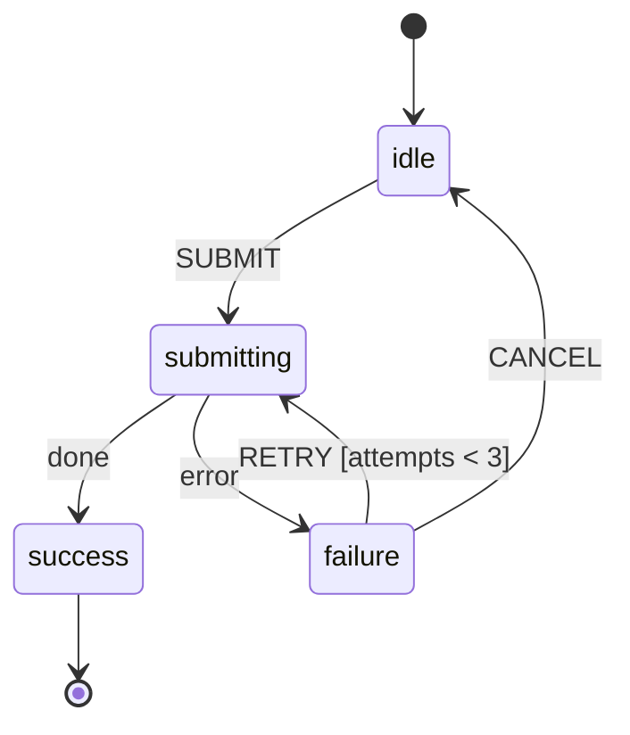
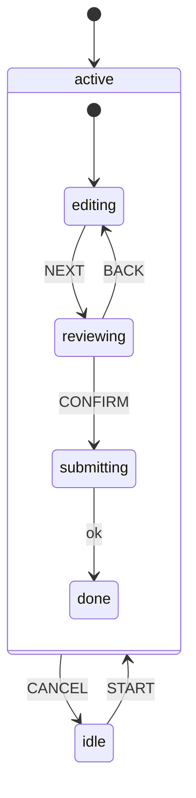
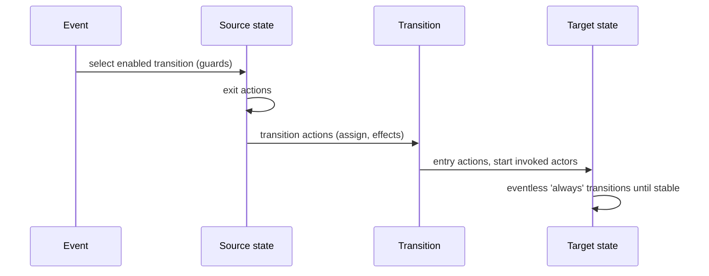

# 06 / 12 — State Machines and XState: Making Behaviour Explicit

> **Checked against `xstate` 5.33 and `@xstate/react` 6.1 (executed, 2026-10-22).** This lesson targets **XState v5** (`xstate`) with `@xstate/react`. v5 changed the API substantially from v4 (`setup()`, `createActor`, `fromPromise`, `input`, no `Machine`/`send`/`pure`/`choose`, event objects only; `interpret` still exists in 5.33 as a deprecated alias of `createActor`). Many blog posts, Stack Overflow answers, and AI-generated snippets are v4. The authority is <https://stately.ai/docs>. Concepts (finite states, events, transitions, guards, actions, hierarchy, parallel regions, actors) are stable; API spellings marked "verify" are easy to misremember.

## 1. Lesson metadata

| | |
|---|---|
| **Level** | Advanced |
| **Study time** | 5–6 hours (reading 2 h, experiments 1.5 h, exercises 2 h) |
| **Prerequisites** | [01 — Fetch lifecycle](./01-fetch-lifecycle.md) (status as a state machine), [03 — Loading and error states](./03-loading-and-error-states.md), [Phase 3 / 03 — `useReducer` and reducer architecture](../03-react-state-and-hooks/03-usereducer-and-reducer-architecture.md), [Phase 0 / 18 — TypeScript fundamentals and narrowing](../00-web-and-javascript-foundations/18-typescript-fundamentals-and-narrowing.md), [10 — Zustand](./10-zustand.md) |
| **Next** | [13 — Suspense data loading](./13-suspense-data-loading.md) |
| **Related** | [02 — Cancellation and race conditions](./02-cancellation-and-race-conditions.md), [09 — Redux Toolkit](./09-redux-toolkit.md), [11 — Context vs external stores](./11-context-vs-external-stores.md), [15 — Error recovery and retries](./15-error-recovery-and-retries.md), [19 — Technology selection matrix](./19-technology-selection-matrix.md) |

**Learning objectives.** After this lesson you can:
1. Define a finite state machine, a statechart (hierarchy, parallel regions, history), and an actor, and say what problem each solves that "a bag of booleans" does not.
2. Identify "impossible states" in boolean-flag code and eliminate them by modelling states explicitly.
3. Write an XState v5 machine with `setup`, guards, actions, `assign`, delayed transitions, and an invoked promise actor, and wire it to React.
4. Predict the order in which exit, transition, and entry actions run, and what happens when an event is not handled.
5. Subscribe to actors efficiently in React (`useSelector`) and keep context small.
6. Decide when a state machine is the right tool versus a reducer, a store, or a plain `useState`.
7. Test a machine as a pure model, separate from React.

**Concepts covered:** state vs context ("finite" vs "extended" state), events, transitions, guards, entry/exit/transition actions, `assign`, eventless (`always`) transitions, delayed (`after`) transitions, hierarchical and parallel states, history, invoked actors (`fromPromise`, `fromCallback`), spawning, snapshots, `matches`, `can`, `input`, determinism and run-to-completion, `@xstate/react` hooks, inspection, testing.

---

## 2. Deep conceptual explanation

### 2.1 What problem is this lesson solving?

[Lesson 01](./01-fetch-lifecycle.md) modelled a request as a discriminated union (`idle | loading | success | error`) rather than independent booleans. That was a state machine in embryo. Now scale up: a checkout flow with address, payment, 3-D Secure challenges, retry, timeout, cancel, and "back" behaviours; an upload with pause/resume; a media player; a drag interaction; a multi-step onboarding with branching. The common failure is **implicit state**: scattered booleans (`isLoading`, `hasError`, `isRetrying`, `isPaused`) and effects that "figure out" what is going on by inspecting combinations. Combinations multiply (2^n), most are meaningless, and bugs live in the meaningless ones.

A **state machine** makes behaviour explicit: the system is *always in exactly one* of a finite set of named states; **events** are the only inputs; **transitions** declare which state follows which event; anything not declared **cannot happen**.

### 2.2 Responsibilities: what a machine owns and what it does not

| Responsibility | XState machine/actor | Left to you / other tools |
|---|---|---|
| Representing a *behavioural* state (which phase is the system in) | **Yes (core)** | |
| Rejecting events that are invalid in the current state | **Yes** (unhandled events are ignored) | Deciding whether ignoring is acceptable |
| Orchestrating side effects around transitions (actions, invoked actors, timers) | **Yes** | Implementing the effects |
| Holding quantitative data ("context": retry count, fields) | **Yes** (small) | Large datasets, server caches |
| Cancellation of in-flight work on leaving a state | **Yes** (invoked actors stop when the state exits) | Honouring the abort signal in your function |
| Visualising behaviour | Tooling (Stately editor, inspector) | Keeping it in sync |
| Server-state caching/deduplication | **No** ([08](./08-tanstack-query.md)) | |
| Global app state / selector store | Partly (actors can be shared) but not its purpose ([09](./09-redux-toolkit.md), [10](./10-zustand.md)) | |
| Rendering | No | React |

Compared on responsibilities: a *reducer* (`useReducer`, Redux) transforms data given events but **does not stop an event being processed in a nonsensical state** unless you write the checks; a store is a place; a machine is **the rules of when things may happen**. They compose: a Redux slice's reducer can be a machine's transition function in spirit; a machine can live inside a store.

### 2.3 The mental model



- **State**: a named condition (`idle`, `submitting`, ...). Exactly one active (for non-parallel machines).
- **Event**: a message `{ type: 'SUBMIT', ... }`. In XState v5 events are always objects with a `type`.
- **Transition**: `(state, event) → next state` (+ actions), optionally guarded.
- **Context**: the "extended state", i.e. data that does not change the *mode* (attempt count, form values).
- **Action**: a side effect or `assign` triggered by a transition/entry/exit.
- **Guard**: a pure boolean predicate deciding whether a transition is enabled.
- **Actor**: a running entity with its own state that receives events and can send events to others. A *machine* is a blueprint; `createActor(machine)` creates a running instance.

*Public guarantee:* a machine definition is a declarative description; the interpreter executes it deterministically (given the same events and guards, the same transitions). *Teaching model:* the statechart notation (Harel statecharts) from which XState derives.

### 2.4 "Finite" state versus "extended" state

A frequent confusion: not everything should be a state.

| Data | Model as | Why |
|---|---|---|
| Is the request in flight, failed, or done? | **State** | Different behaviour (what events are legal, what UI shows) |
| How many retries so far? | **Context** | Quantitative; affects a guard, not the mode |
| The text typed in a field | Context (or outside the machine) | Unbounded values cannot be states |
| 1 000 fetched rows | **Neither** (query cache) | Server data does not belong in a behavioural model |

Rule of thumb: if two situations *respond differently to the same event*, they are different states. If they differ only by a value, use context.

### 2.5 What React exposes versus what XState adds

React offers `useState`, `useReducer`, effects. `useReducer` can model a machine by hand (`switch (state.status) { case 'idle': ... }`), and that is often enough. XState adds: hierarchical and parallel states, delays, invoked and spawned actors with automatic cleanup, a standard serialisable definition, visualisation, and inspection. React integration is via `@xstate/react` (`useActor`, `useActorRef`, `useSelector`), built over subscription to the actor (conceptually `useSyncExternalStore`; verify).

### 2.6 Common misconceptions

| Misconception | Reality |
|---|---|
| "State machines are only for complex apps." | Even `idle/loading/success/error` is one. The question is whether explicit modelling pays for its overhead. |
| "XState is a Redux alternative." | It models *behaviour/flow*, not a shared data store; they answer different questions. |
| "Context in a machine is where all my data goes." | Keep context small and about the flow; server data belongs in a cache. |
| "Machines make the UI declarative." | They make *behaviour* declarative. Rendering is still React. |
| "A machine prevents all bugs." | It prevents *invalid transitions*, not wrong business rules, bad guards, or ineffective effects. |
| "You must draw it in a tool." | Optional; the definition is code. |
| "v4 and v5 are the same." | v5 reorganised the API (`createActor`, `setup`, `fromPromise`, `input`). Check every snippet's version. |

---

## 3. Internal mechanics

### 3.1 Transition semantics (the part to memorise)

When an event arrives in the current state:

1. **Select** transitions: starting at the deepest active state, look for a transition whose `event` matches and whose guard (if any) passes; if none, bubble up to the parent. First enabled transition wins (document order within a state). If none anywhere, the event is **ignored** (no error; the snapshot may be unchanged).
2. **Exit** states being left (children first), running `exit` actions.
3. Run the **transition's actions** (e.g. `assign`).
4. **Enter** states being entered (parents first), running `entry` actions and starting invoked actors.
5. Process **eventless (`always`) transitions** and queued internal events until stable ("macrostep" completes). This is *run-to-completion*: one external event is fully processed before the next is taken.

*Public guarantee:* exit → transition → entry order and run-to-completion (executed: `['exit a', 'transition action', 'entry b']`). In v5, actions run in the order written, so an `assign` is visible to the actions listed after it in the same transition (executed: a plain action before `assign` saw `n=0`, one after saw `n=1`); in v4 `assign` was prioritised. Prefer `assign` for context and plain actions for effects.

### 3.2 Guards

A guard is a pure function `({ context, event }) => boolean`. Multiple transitions for the same event can be listed as an array; the first enabled one wins:

```ts
RETRY: [
  { guard: 'canRetry', target: 'submitting' },
  { target: 'exhausted' },     // fallback
]
```

Guards must be pure and fast: they may be evaluated when checking `snapshot.can(event)` as well as on dispatch.

### 3.3 Hierarchy and parallelism

- **Hierarchical (compound) states**: a state with child states. Common transitions (e.g. `CANCEL`) can be defined once at the parent; children inherit them. This eliminates the "every state needs a cancel transition" duplication.
- **Parallel states** (`type: 'parallel'`): multiple regions active simultaneously, each its own sub-machine (e.g. `upload` and `network` regions). The overall state value is an object per region. This replaces the *product* of states (n × m) with a *sum* (n + m).
- **History states** return to the last active child when re-entering a compound state.

### 3.4 Actors and invoked services

In v5 *everything* is an actor: machines, promises (`fromPromise`), callbacks (`fromCallback`), observables, transitions-functions (`fromTransition`).

- **`invoke`** starts an actor when a state is entered and **stops it when the state exits**, which is the structural answer to cancellation and stale-response races ([02](./02-cancellation-and-race-conditions.md)): a response arriving after the machine left `submitting` has nowhere to go.
- **`fromPromise(({ input, signal }) => ...)`** gives the logic an `AbortSignal` that is aborted on stop (the `{ input, signal }` parameter names were executed against 5.33).
- When the promise resolves, the parent receives an internal done event handled by `onDone`; on rejection, `onError`. The resolved value is on `event.output`; the rejection on `event.error` (both confirmed by execution).
- **`spawn`** (via `assign`) creates dynamic child actors, such as one per list item.

### 3.5 Snapshots and subscription

`actor.getSnapshot()` returns an immutable snapshot containing at least: `value` (current state value), `context`, `status` (`'active' | 'done' | 'error' | 'stopped'`), `output`, plus helpers `matches(stateValue)`, `can(event)`, `hasTag(tag)`. `actor.subscribe(observer)` notifies on snapshot changes. React hooks select from snapshots; `useSelector(actorRef, s => s.matches('failure'))` re-renders only when the selected value changes (same equality principles as [10](./10-zustand.md); `@xstate/react` 6.1's default comparator is `===`, overridable with a second argument). Note that `actor.subscribe` observers are notified for every processed event, including an event no transition handles (executed: the snapshot object stayed identical but the observer still fired), so do not treat a subscribe callback as proof that state changed.

### 3.6 Determinism and side effects

Transition *selection* is pure (given snapshot + event); *effects* (actions, invoked actors) run after. Treat actions as the only place for side effects, and keep guards pure. This is why machines test well as pure models: feed events, assert next state, without rendering.

---

## 4. Step-by-step execution walkthrough

Machine: `idle → submitting (invoke submitOrder) → success | failure`, with `RETRY` guarded by `attempts < 3`, `entry` of `submitting` increments `attempts`.

Timeline for **SUBMIT → network failure → RETRY → success**:

| # | Event / cause | Active state | Context `attempts` | What happens |
|---|---|---|---|---|
| 0 | `actor.start()` | `idle` | 0 | Initial state entered |
| 1 | `SUBMIT` | → `submitting` | 0 → 1 | Transition selected; exit `idle`; enter `submitting`: entry `assign(attempts+1)`; invoke starts promise actor with an `AbortSignal` |
| 2 | Promise rejects | → `failure` | 1 | Internal error event; `onError` transition; exit `submitting` (invoked actor already finished); enter `failure` (store `error` in context) |
| 3 | `RETRY` | `failure` → `submitting` | 1 → 2 | Guard `attempts < 3` is true; re-enter `submitting`; new invocation |
| 4 | `SUBMIT` (user double-click) | `submitting` | 2 | **No transition for `SUBMIT` in `submitting` → ignored**. No second request. (With booleans, this is the classic duplicate-submit bug) |
| 5 | Promise resolves | → `success` | 2 | `onDone`; `assign` stores `orderId` |
| 6 | `CANCEL` in `success` | `success` | 2 | Not handled → ignored |

**Predict:** at step 4, what does the React button do if it uses `disabled={!snapshot.can({ type: 'SUBMIT' })}`? *Answer:* disabled, because `can` reports whether the event would cause a transition (guards considered); the UI derives its interactivity from the machine rather than duplicating logic.

---

## 5. Code examples

### 5.1 Minimal: a toggle actor without React

```ts
import { createMachine, createActor } from 'xstate';

const toggle = createMachine({
  id: 'toggle',
  initial: 'off',
  states: {
    off: { on: { TOGGLE: 'on' } },
    on: { on: { TOGGLE: 'off' } },
  },
});

const actor = createActor(toggle);
actor.subscribe((snap) => console.log(snap.value));
actor.start();                 // logs 'off' (the initial snapshot is emitted on start; confirmed)
actor.send({ type: 'TOGGLE' }); // logs 'on'
actor.send({ type: 'TOGGLE' }); // logs 'off'
```

Notes: `createActor` replaces v4's `interpret`. `send` takes an event object (v5 removed string events in `send`: `actor.send('TOGGLE')` throws a `TypeError` in 5.33, and TypeScript rejects it). Nothing here touches React: the model is testable alone.

### 5.2 Practical: submit-with-retry machine, typed with `setup`, wired into React

```ts
// submitMachine.ts
import { setup, assign, fromPromise } from 'xstate';

export interface OrderInput { items: { sku: string; qty: number }[] }

export const submitMachine = setup({
  types: {
    context: {} as { attempts: number; error?: string; orderId?: string; order: OrderInput },
    events: {} as { type: 'SUBMIT' } | { type: 'RETRY' } | { type: 'CANCEL' },
    input: {} as { order: OrderInput },
  },
  actors: {
    submitOrder: fromPromise(async ({ input, signal }: { input: OrderInput; signal: AbortSignal }) => {
      const res = await fetch('/api/orders', {
        method: 'POST',
        headers: { 'Content-Type': 'application/json' },
        body: JSON.stringify(input),
        signal,
      });
      if (!res.ok) throw new Error(`HTTP ${res.status}`);
      return (await res.json()) as { id: string };
    }),
  },
  guards: {
    canRetry: ({ context }) => context.attempts < 3,
  },
}).createMachine({
  id: 'submit',
  initial: 'idle',
  context: ({ input }) => ({ attempts: 0, order: input.order }),
  states: {
    idle: { on: { SUBMIT: 'submitting' } },
    submitting: {
      entry: assign({ attempts: ({ context }) => context.attempts + 1, error: undefined }),
      invoke: {
        src: 'submitOrder',
        input: ({ context }) => context.order,
        onDone: {
          target: 'success',
          actions: assign({ orderId: ({ event }) => event.output.id }),
        },
        onError: {
          target: 'failure',
          actions: assign({ error: ({ event }) => (event.error as Error).message }),
        },
      },
      on: { CANCEL: 'idle' },        // leaving the state stops (aborts) the invoked promise actor
    },
    failure: {
      on: {
        RETRY: [{ guard: 'canRetry', target: 'submitting' }, { target: 'exhausted' }],
        CANCEL: 'idle',
      },
    },
    exhausted: { on: { CANCEL: 'idle' } },
    success: { type: 'final' },
  },
});
```

```tsx
// SubmitButton.tsx
import { useActorRef, useSelector } from '@xstate/react';
import { submitMachine, type OrderInput } from './submitMachine';

export function SubmitOrder({ order }: { order: OrderInput }) {
  const actorRef = useActorRef(submitMachine, { input: { order } });
  const canSubmit = useSelector(actorRef, (s) => s.can({ type: 'SUBMIT' }));
  const submitting = useSelector(actorRef, (s) => s.matches('submitting'));
  const error = useSelector(actorRef, (s) => s.context.error);
  const done = useSelector(actorRef, (s) => s.matches('success'));

  if (done) return <p role="status">Order placed.</p>;
  return (
    <div>
      <button disabled={!canSubmit} onClick={() => actorRef.send({ type: 'SUBMIT' })}>
        {submitting ? 'Placing order…' : 'Place order'}
      </button>
      {submitting && <button onClick={() => actorRef.send({ type: 'CANCEL' })}>Cancel</button>}
      {error && <p role="alert">{error}</p>}
    </div>
  );
}
```

Line notes:
- `setup({...}).createMachine({...})` is the v5 typed pattern: implementations are named in `setup` and referenced by string in the definition, keeping the definition serialisable and testable with overrides (`.provide()` confirmed).
- The `entry` `assign` runs each time `submitting` is (re-)entered, so `attempts` counts requests. The guard sees `attempts` after the increment from previous entries.
- `signal` is aborted when the state exits (user cancels); `fetch` rejects with `AbortError`. Because the invoked actor is *stopped*, its late result/error is not delivered to the machine (executed: `CANCEL` aborted the request and the machine stayed in `idle`), so the machine does not transition to `failure` on a cancelled request: no state flicker.
- `useActorRef` creates and owns the actor for the component's lifetime and does not re-render on every snapshot; each `useSelector` subscribes narrowly. `useActor` returns `[snapshot, send]` and re-renders on every snapshot: fine for small components.
- A **StrictMode** note: in dev React mounts, unmounts, and remounts; `useActorRef` is designed to handle this (the actor is stopped and restarted with its persisted snapshot; confirmed in the `@xstate/react` 6.1 source), so do not start side effects in component bodies.

**Predict:** user clicks "Place order", then Cancel after 200 ms. What are the state, attempts, and the network? *Answer:* state `idle`; `attempts` 1; the in-flight request is aborted (server may or may not have processed it, so idempotency keys matter: [15](./15-error-recovery-and-retries.md)).

### 5.3 Incorrect examples

```tsx
// BAD 1: boolean soup (the problem machines solve)
const [loading, setLoading] = useState(false);
const [error, setError] = useState<string | null>(null);
const [retrying, setRetrying] = useState(false);
const [cancelled, setCancelled] = useState(false);
// loading && error && cancelled? Who knows.

// BAD 2: machine used as a data store
context: { products: [] as Product[], page: 1, filters: {}, selectedIds: [] }
// events: PRODUCTS_LOADED, FILTER_CHANGED ... a store/query cache in disguise

// BAD 3: side effects in guards or reducers
guards: { canRetry: ({ context }) => { logAnalytics('guard'); return context.attempts < 3; } }

// BAD 4: creating the actor in the component body
function C() { const actor = createActor(machine).start(); /* new actor every render, never stopped */ }

// BAD 5: v4 snippet in a v5 project
import { Machine, interpret } from 'xstate';    // Machine/interpret removed in v5
```

Why: (1) impossible combinations; (2) loses the benefit (states determine behaviour; here all state is data) and context grows unbounded: use a query cache + a small machine for the *flow*; (3) guards must be pure: they may run on `can()` checks and in any order; (4) leaks actors, loses state each render; use `useActorRef`/`useActor` (or a provider); (5) removed API.

### 5.4 Corrected

```ts
// (1) one state variable: 'idle' | 'submitting' | 'failure' | 'success'  (a machine or discriminated union)
// (2) machine holds { selectedIds } only if it affects flow; data in query cache
// (3) analytics as an action
actions: { track: ({ context }) => analytics.track('retry', { attempts: context.attempts }) }
// (4) const actorRef = useActorRef(machine)
// (5) import { createMachine, createActor } from 'xstate';
```

### 5.5 Advanced: parallel regions, delays, and sharing an actor via Context

```ts
import { setup, assign } from 'xstate';

export const uploadMachine = setup({
  types: {
    context: {} as { progress: number },
    events: {} as
      | { type: 'START' } | { type: 'PAUSE' } | { type: 'RESUME' }
      | { type: 'PROGRESS'; value: number } | { type: 'OFFLINE' } | { type: 'ONLINE' },
  },
  delays: { retryDelay: 3000 },
}).createMachine({
  id: 'upload',
  type: 'parallel',
  context: { progress: 0 },
  states: {
    transfer: {
      initial: 'idle',
      states: {
        idle: { on: { START: 'running' } },
        running: {
          on: {
            PAUSE: 'paused',
            PROGRESS: { actions: assign({ progress: ({ event }) => event.value }) },
          },
        },
        paused: { on: { RESUME: 'running' } },
      },
    },
    network: {
      initial: 'online',
      states: {
        online: { on: { OFFLINE: 'offline' } },
        offline: {
          on: { ONLINE: 'online' },
          after: { retryDelay: { target: 'offline', reenter: true } },   // delayed self-transition (`reenter: true`)
        },
      },
    },
  },
});
```

Notes:
- Two independent regions; the state value looks like `{ transfer: 'running', network: 'online' }`. 3 + 2 = 5 states instead of 6 product combinations; adding a third region of 3 states adds 3, not ×3.
- `after` with a named delay defined in `setup` keeps timing configurable and testable (fake timers or the simulated clock).
- Whether `running` should pause when `offline` is a *policy*: to make regions interact, handle `OFFLINE` in `transfer.running` as well, or use guards that look at the other region via `snapshot.matches`/state-in guards (`stateIn` is exported by `xstate` 5.33). Parallel regions are independent unless you wire them.

Sharing across components (when the flow spans a subtree) uses Context to carry the *actor reference*, which never changes (so no propagation cost; same principle as [11](./11-context-vs-external-stores.md)):

```tsx
const UploadCtx = createContext<ActorRefFrom<typeof uploadMachine> | null>(null);
// provider: const ref = useActorRef(uploadMachine); <UploadCtx value={ref}>…</UploadCtx>
// consumer: const ref = use(UploadCtx)!; const progress = useSelector(ref, s => s.context.progress);
```

### 5.6 The same flow as a hand-written reducer (what you can do without the library)

```ts
type S =
  | { status: 'idle' }
  | { status: 'submitting'; attempts: number }
  | { status: 'failure'; attempts: number; error: string }
  | { status: 'success'; orderId: string };
type E = { type: 'SUBMIT' } | { type: 'RETRY' } | { type: 'FAIL'; error: string } | { type: 'OK'; id: string };

function reduce(s: S, e: E): S {
  switch (s.status) {
    case 'idle': return e.type === 'SUBMIT' ? { status: 'submitting', attempts: 1 } : s;
    case 'submitting':
      if (e.type === 'FAIL') return { status: 'failure', attempts: s.attempts, error: e.error };
      if (e.type === 'OK') return { status: 'success', orderId: e.id };
      return s;                                   // everything else ignored
    case 'failure':
      return e.type === 'RETRY' && s.attempts < 3 ? { status: 'submitting', attempts: s.attempts + 1 } : s;
    case 'success': return s;
  }
}
```

This gives the "ignore invalid events" property with `useReducer` and exhaustive `switch`. What it lacks: effect orchestration (you still need an effect to do the fetch and dispatch `FAIL`/`OK`, with abort and cleanup), delays, hierarchy, parallel regions, visualisation. Many flows are well served by this alone; XState pays off when effects, timing, and hierarchy dominate.

---

## 6. Visual explanations

### 6.1 Hierarchy removes duplicate transitions



`CANCEL` is declared once on `active`; it applies from `editing`, `reviewing`, and `submitting`. Leaving `active` exits whichever child is active and stops any invoked actors there.

### 6.2 Action ordering on a transition



---

## 7. Alternative approaches and trade-offs

| Criterion | `useState` flags | Discriminated union + `useReducer` | XState machine | Redux Toolkit ([09](./09-redux-toolkit.md)) | Zustand ([10](./10-zustand.md)) |
|---|---|---|---|---|---|
| Prevents impossible states | No | **Yes** (types) | **Yes** (structure) | If you model it so | If you model it so |
| Rejects invalid events by construction | No | If you write `default: return s` per status | **Yes** | Per reducer | Per action |
| Effect orchestration & cancellation | Manual (effects) | Manual (effects) | **Built in (invoke, after)** | Thunks/listeners | Manual |
| Delays/timeouts | Manual timers | Manual timers | **Declarative `after`** | Listener `delay` | Manual |
| Hierarchy / parallel regions | No | Manual | **Yes** | Manual | Manual |
| Visualisable | No | Hand-drawn | **Yes (tooling)** | Event log | No |
| Learning/maintenance cost | Lowest | Low | **Highest** | Moderate | Low |
| Bundle cost | 0 | 0 | Non-trivial (measure) | Moderate | Small |

**Scenario where XState is *not* the best fit.** A settings form or a data table: states are trivial, behaviour is data-driven, and the team has no experience with statecharts. A typed reducer or plain `useState` is cheaper to read and maintain. Also: when the "flow" is owned by the server (a backend workflow engine) and the UI is only a view over polled status, modelling the UI as a rich client machine duplicates the authority.

**Scenario where it excels.** Multi-step transactional flows with timeouts, retries, cancellation, branching, and "back" semantics; drag-and-drop, gesture recognisers; media/upload controls; anything where review by non-engineers of a *diagram* provides value.

---

## 8. Best practices and anti-patterns

### Best practices
- **Start from the states and events, on paper**, before code: list states, list events, ask "what should happen if X arrives in Y?" for each pair.
- **Name events as facts or user intents** (`SUBMIT`, `PAYMENT_DECLINED`), not setters.
- **Keep context minimal**; derive display values in selectors.
- **Use `setup`** so guards/actions/actors have names and types; unit-test the machine with overrides.
- **Keep guards pure**, effects in actions/actors.
- **Subscribe narrowly** with `useSelector`.
- **Use tags** (`tags: ['loading']`) so UI asks "is loading?" without hard-coding state names (`snapshot.hasTag` confirmed).
- **Treat the machine as a model**: test transitions without React.

### Beginner mistakes
- Copying server data into `context`.
- Modelling every field value as a state.
- Forgetting that unhandled events are silently ignored (add logging in dev inspection).
- Mixing v4 and v5 API.

### Experienced-developer mistakes
- Over-modelling trivial UI with a machine "for consistency".
- God-machines with 40 states instead of composing child actors.
- Guards that call into stores or time (impure), making `can()` flaky.
- Effects in `entry` that are not cancellable or idempotent.
- Duplicating a server-side workflow's rules in the client without a contract.

### Smells
- Context object larger than the state graph.
- Many events named like setters (`SET_NAME`, `SET_EMAIL`).
- Boolean guards that re-encode states (`context.isSubmitting`): the state *is* that fact.

### Justified exceptions
- Holding a small cache of the last loaded item *id* in context so a retry can refetch.
- A flat machine without hierarchy for a simple flow, because it is easier to read.

---

## 9. Real-world application

| Domain | Machine candidate | Engineering constraint |
|---|---|---|
| E-commerce | Checkout: cart → address → payment → 3-D Secure → confirm, with back and timeout | Idempotency keys; server is authoritative for payment state; handle redirects/reloads (persist state or recover from server) |
| Dashboards | Drag-to-select, resizable panels, brush interactions | Pointer events, cancellation on `Escape` |
| Finance | Order ticket (draft → validating → submitted → partially filled...) | Mirror server states; never invent client-only terminal states; audit trail |
| Auth | Login/MFA/session-refresh flows | Token handling server-side/cookies; avoid keeping secrets in context |
| Forms | Multi-step wizard with conditional steps | Per-step validation; persist drafts; accessibility of step navigation |
| Realtime | Connection lifecycle: connecting, open, backoff, closed | Backoff with jitter; resubscribe on reconnect ([17](./17-real-time-websockets-subscriptions.md)) |
| Multi-team | Shared flow definition reviewed via diagram | Version machine definitions like APIs; persist snapshots with a version tag |

Persisting a snapshot (`actor.getPersistedSnapshot()`; executed: a snapshot taken after start restored with `createActor(machine, { snapshot })`) and restoring it (`createActor(machine, { snapshot })`) lets a flow survive reload. Invalid or stale persisted snapshots must be handled: treat them as untrusted input.

---

## 10. Debugging and troubleshooting

| Symptom | Likely root cause | Investigation | Fix / validation |
|---|---|---|---|
| Event "does nothing" | Not handled in the current state (or an ancestor); or guard false | Log `snapshot.value` before send; inspect with `can(event)` | Add the transition or send in the right state; test with a model test |
| UI shows wrong state after reload | State not persisted/restored; or actor recreated | Check actor lifetime (component vs provider) | Lift actor; persist snapshot; recover from server |
| Duplicate network requests | Effect in `entry` without state guard, or actor created twice | Network panel; log entries | Use `invoke`; ensure one actor per flow; StrictMode awareness |
| Late response applies after cancel | Effect not tied to state lifetime (manual promise) | Reproduce with throttling | Use `invoke`/`fromPromise` + honour `signal` |
| Component re-renders constantly | `useActor` on a high-frequency machine | React Profiler | `useActorRef` + `useSelector` |
| Type errors on `event.output` | Missing `setup` typing for actors | TS error location | Declare actors in `setup`; annotate `fromPromise` |
| Behaviour differs from a blog post | v4 vs v5 semantics | Check `import` names and version | Follow v5 docs |
| Timers not firing in tests | Real timers in test | Test uses fake timers | Use fake timers or the simulated clock |

Tooling: the Stately inspector (`@statelyai/inspect`) shows live states/events; the Stately editor visualises definitions. In production, log transitions through an inspection observer sparingly.

---

## 11. Exercises

### Level A — Knowledge
**A1.** Define "finite state" and "extended state (context)" and give one example each from a checkout flow.
**A2.** In what order do exit, transition, and entry actions run?
**A3.** What happens when an event arrives that the current state (and its ancestors) does not handle?
**A4.** Why does invoking an actor in a state help with cancellation?
**A5.** Name two things a parallel state solves compared to a flat machine.
**A6.** What replaced `interpret` in v5?

### Level B — Code comprehension
**B1.** For the machine in 5.2, list the state and `attempts` after the event sequence: `SUBMIT`, (network error), `RETRY`, (network error), `RETRY`, (network error), `RETRY`.
**B2.** In 5.2, what changes if `CANCEL` is moved from `submitting.on` to a parent state wrapping `idle|submitting|failure`?
**B3.** In 5.6, what does `reduce({ status: 'idle' }, { type: 'RETRY' })` return, and why is that deliberate?
**B4.** Why does `SubmitOrder` use `useActorRef` + `useSelector` instead of `useActor`?

### Level C — Implementation
**C1.** Implement a debounced-search machine: `idle → typing (after 300 ms) → searching (invoke) → results | error`, where new `INPUT` events in `typing` restart the timer and in `searching` cancel the in-flight search.
**C2.** Write a Vitest test for the 5.2 machine using a fake `submitOrder` actor override that fails twice then succeeds.
**C3.** Convert the hand-written reducer in 5.6 into a v5 machine with identical behaviour.

### Level D — Debugging
**D1.** The "Place order" button double-submits on fast clicks. The code uses `const [loading, setLoading] = useState(false)` set inside an `async` handler. Explain the race and fix it with a machine.
**D2.** A machine's `RETRY` never fires although the UI shows the Retry button. Give three causes and how to find each.
**D3.** After navigating away and back, the wizard restarts at step 1. The actor is created in the page component. Fix.

### Level E — Architecture and engineering decisions
**E1.** Decide for each: login form, checkout flow, data table sorting, file upload manager, tooltip hover delay, onboarding tour. Use a machine or not? Justify.
**E2.** The backend already has a payment state machine. How do you design the client's checkout machine so as not to duplicate or contradict it?
**E3.** Your team of 10 has no XState experience. Propose an adoption plan (or argue against).

### Level F — Expert challenge
**F1.** Design a machine architecture for a trading-ticket UI: validation, submission, partial fills pushed over WebSocket, cancel/replace, and reconnection. Show actor composition (parent/child), event ownership, and persistence.
**F2.** Argue how machines relate to the fetch lifecycle, race conditions, and Suspense ([13](./13-suspense-data-loading.md)); what responsibility overlaps with a query library and how do you divide it?

---

## 12. Detailed answers and explanations

> Attempt the exercises first.

**A1.** Finite state: the mode, e.g. `payment.authorizing` (differs in legal events and UI). Extended state: quantitative data like `attempts`, a cart reference, a `paymentIntentId`. Wrong: treating "cart total" as a state.

**A2.** Exit (source side, children first) → transition actions → entry (target side, parents first). Then eventless transitions are processed. In v5 actions (including `assign`) run in the order written; in v4 `assign` ran first.

**A3.** Ignored: no transition, no error; the snapshot is unchanged (executed in 5.33: the same snapshot object is kept, but `subscribe` observers are still called). That is a feature (duplicate clicks are inert) and a hazard (typos in event names are silent): add inspection logging in development and type events.

**A4.** Invoked actors are owned by the state; exiting the state stops them (and aborts a `fromPromise`'s signal). Late results are not delivered to the machine. Manual `useEffect` fetching needs explicit cleanup flags ([02](./02-cancellation-and-race-conditions.md)).

**A5.** Avoids the product-of-states explosion (n × m → n + m) and models independent concerns simultaneously (transfer and network), each with its own transitions.

**A6.** `createActor(machine).start()`. Also `Machine` → `createMachine`.

**B1.** After SUBMIT: `submitting`, attempts 1. Error → `failure`. RETRY (guard 1 < 3 true) → `submitting`, 2. Error → `failure`. RETRY (2 < 3) → `submitting`, 3. Error → `failure`. RETRY: guard `3 < 3` false → fallback transition → `exhausted`; attempts 3. Final: `exhausted`, 3 attempts (three requests were made). Wrong answer: "attempts 4" (the increment is on entry to `submitting`, which does not happen on the last RETRY).

**B2.** `CANCEL` would then be available from `idle`, `submitting`, `failure` (inherited), so `failure.on.CANCEL` can be removed. From `idle` it would transition to the target (which if it is `idle` would re-enter and reset?). You must choose the target and `reenter` semantics deliberately; wrapping also changes `exhausted`. Evaluation: noting inheritance and that a child's own transition overrides the parent's.

**B3.** It returns the same state (`{ status: 'idle' }`): `RETRY` is not meaningful in `idle`; ignoring is the machine-like behaviour. Returning the same reference means React bails out of re-rendering.

**B4.** `useActor` re-renders on every snapshot; here only a few derived booleans matter, so `useSelector` re-renders only when they change. For an actor with frequent context updates (progress), that matters.

**C1.**
```ts
import { setup, assign, fromPromise } from 'xstate';

export const searchMachine = setup({
  types: {
    context: {} as { q: string; results: string[]; error?: string },
    events: {} as { type: 'INPUT'; q: string },
  },
  actors: {
    search: fromPromise(async ({ input, signal }: { input: { q: string }; signal: AbortSignal }) => {
      const r = await fetch(`/api/search?q=${encodeURIComponent(input.q)}`, { signal });
      if (!r.ok) throw new Error(`HTTP ${r.status}`);
      return (await r.json()) as string[];
    }),
  },
  delays: { debounce: 300 },
}).createMachine({
  context: { q: '', results: [] },
  initial: 'idle',
  on: {
    INPUT: { target: '.typing', reenter: true, actions: assign({ q: ({ event }) => event.q }) },
  },
  states: {
    idle: {},
    typing: { after: { debounce: 'searching' } },
    searching: {
      invoke: {
        src: 'search',
        input: ({ context }) => ({ q: context.q }),
        onDone: { target: 'results', actions: assign({ results: ({ event }) => event.output }) },
        onError: { target: 'error', actions: assign({ error: ({ event }) => String((event.error as Error).message) }) },
      },
    },
    results: {},
    error: {},
  },
});
```
`INPUT` at the root restarts `typing` (re-entering cancels the delay timer and restarts it) and, when sent during `searching`, leaves `searching` (stopping the request) and enters `typing`. Edge: empty query should go to `idle` (add a guard); `reenter: true` and the `.typing` relative target were executed: `INPUT` during `typing` restarts the debounce, and `INPUT` during `searching` aborted the request (`abort` fired once) and returned to `typing`.

**C2.** 
```ts
import { createActor, fromPromise } from 'xstate';
import { submitMachine } from './submitMachine';

it('fails twice then succeeds', async () => {
  let calls = 0;
  const machine = submitMachine.provide({
    actors: {
      submitOrder: fromPromise(async () => {
        calls += 1;
        if (calls < 3) throw new Error('boom');
        return { id: 'o1' };
      }),
    },
  });
  const actor = createActor(machine, { input: { order: { items: [] } } }).start();
  const settle = () => new Promise((r) => setTimeout(r, 0));
  actor.send({ type: 'SUBMIT' }); await settle();
  actor.send({ type: 'RETRY' });  await settle();
  actor.send({ type: 'RETRY' });  await settle();
  expect(actor.getSnapshot().value).toBe('success');
  expect(actor.getSnapshot().context.attempts).toBe(3);
});
```
Notes: `.provide` overrides implementations declared in `setup` (confirmed). `success` is `type: 'final'`, so `status` becomes `'done'`. Evaluation: no React, no network, deterministic. Prefer waiting for a state with a helper (e.g. `waitFor` from xstate, which resolved when the snapshot matched in our run) over `setTimeout(0)`.

**C3.** Same states (`idle`, `submitting`, `failure`, `success`), events `SUBMIT`, `RETRY`, `FAIL`/`OK` replaced by invoke `onDone`/`onError`; `attempts` in context; guard `attempts < 3` on `RETRY` with no fallback (so an exhausted retry is simply ignored, matching the reducer). Evaluation: identical visible behaviour; reducer ignored events correspond to missing transitions.

**D1.** `setLoading(true)` is a state update scheduled after the first click; a second click within the same frame executes the handler again with the same stale `loading === false` closure (state is a snapshot, [Phase 1 / 14](../01-react-fundamentals/14-state-as-a-snapshot.md)). A machine's `SUBMIT` in `submitting` is unhandled, hence ignored regardless of closure timing, because the actor's state is read at event-processing time. (`useRef` guard also works; the machine makes it structural.)

**D2.** (1) Guard false: `attempts` already ≥ 3 (inspect context). (2) Event sent while in a state that does not handle it (e.g. `submitting`): check `snapshot.value`. (3) Event name mismatch or sent to a different actor instance (two `useActorRef` calls, or recreated actor each render). (4) Unhandled because transitions defined on a sibling not an ancestor. Find via inspector and `can()` logging.

**D3.** The actor dies with the page component. Lift it above the route (provider), or persist `getPersistedSnapshot()` to storage and restore on mount, or store wizard progress in the URL/server. Validate persisted snapshot version.

**E1.** Login form: reducer or form library, machine only if MFA/lockout branching is significant. Checkout: **machine** (branching, timeouts, retries, back). Table sorting: `useState`/URL. Upload manager: **machine** (pause/resume, parallel retries). Tooltip delay: tiny machine or a small hook with timers; a machine only if interaction states (hover-delay, grace period, focus) grow. Onboarding tour: machine for branching/skip, or data-driven steps array if linear. Criteria: do different situations respond differently to the same event; timers/cancellation; need for review by non-engineers.

**E2.** Treat the server as the authority: client machine models *UI-level* phases (collecting, awaiting server, showing result) and mirrors server payment status as data from responses, not by re-implementing its transitions. Map server states to client states in a single adapter; contract tests; use idempotency keys; on reload recover by querying the server. Evaluation: avoids two sources of truth.

**E3.** Defensible: pilot on one flow with clear complexity (checkout/upload); provide a team template (`setup` + test + inspector), review diagrams in design reviews; measure defects and review time before expanding; avoid mandating. Arguing against is acceptable if justified by flow simplicity and cost; the criteria matter more than the side.

**F1.** Expected: parent `ticketMachine` with child actors (`validation`, `submission`, `fills`, `connection`); events owned by the actor that can cause them; WebSocket as `fromCallback` sending `FILL` events to the parent; connection actor with exponential backoff and jitter; cancel/replace as events valid only in specific states (`working`, `partiallyFilled`); server remains authoritative (events carry server order state); persist snapshot + resubscribe + reconcile on reconnect; context stores order ids/quantities (not market data); test with simulated sequences including out-of-order messages.

**F2.** Overlap: both handle in-flight lifecycle, cancellation, retry. Division: query library owns *cache, deduplication, invalidation* for *reads*; machine owns *flow* and orchestrates *mutations/multi-step processes*, invoking query/mutation calls as actors or calling the query client from actions; with Suspense ([13](./13-suspense-data-loading.md)), loading appears as a thrown promise at read sites, while the machine's phases stay for user-intent flows. Avoid machine-per-fetch for simple reads.

---

## 13. Senior engineer interview questions

1. **"What is the difference between a reducer and a state machine?"** A reducer is a function from `(state, event)` to state with no inherent notion of legality; a machine declares which events are legal per state, with hierarchy, delays, and effects as first-class. You can implement the former as the latter; the machine adds effect lifecycle and visualisation.
2. **"What is an impossible state, and how do you eliminate it?"** A combination of variables that should never co-occur (`loading && error`). Replace independent flags with a single discriminated field (type-level) or a machine (structural).
3. **"Why is context kept small?"** It holds quantitative data influencing guards/actions. Large data belongs in caches/stores; otherwise snapshots are heavy to persist, inspect, and test.
4. **"How do machines address race conditions?"** State-owned invoked actors are stopped when the state exits; late results are ignored; double events are unhandled in the wrong state.
5. **"When would you not use XState?"** Simple flows, data-centric UIs, teams without capacity to maintain the model; use union types + `useReducer`.
6. **"How do you integrate a machine with React efficiently?"** `useActorRef` to own the actor, `useSelector` for narrow subscriptions; provide the actor reference through Context for subtree sharing.
7. **"How do you test a machine?"** As a pure model: create an actor with overridden implementations, send events, assert snapshots; use fake timers for delays; add model-based path coverage if desired.
8. **"What are the v5 migration pitfalls?"** `interpret` → `createActor`; `Machine` → `createMachine`; services → actors with `src`/`input`; string events removed from `send`; `assign` and action semantics adjusted; typings through `setup`.

---

## 14. Further learning resources

| Resource | URL | Covers / why | Level | Study |
|---|---|---|---|---|
| Stately / XState documentation | <https://stately.ai/docs> | Authoritative v5 docs: machines, actors, setup, React | All | Machines, Actors, `setup`, `@xstate/react` |
| XState GitHub | <https://github.com/statelyai/xstate> | Source, releases, v5 migration notes | Intermediate–Advanced | Releases, `packages/core` |
| XState v5 migration guide | <https://stately.ai/docs/migration> *(link checked, HTTP 200, 2026-10-22)* | v4 → v5 changes | Intermediate | Whole page if you meet v4 code |
| Stately editor | <https://stately.ai/editor> *(link checked, HTTP 200, 2026-10-22)* | Visual authoring/inspection | Beginner | Build the 5.2 machine visually |
| David Harel, "Statecharts: A Visual Formalism for Complex Systems" (1987) | Search by title *(no URL asserted)* | Origin of hierarchical/parallel states | Advanced | Introduction and examples |
| Kent C. Dodds, "Implementing a simple state machine library in JavaScript" | Search by title *(unverified; do not rely on URL)* | Building the idea from scratch | Intermediate | Whole post |
| React docs: Reacting to input with state | <https://react.dev/learn/reacting-to-input-with-state> | Declarative state, eliminating impossible states | Beginner | "Step 3/4", state structure |
| React docs: Choosing the state structure | <https://react.dev/learn/choosing-the-state-structure> | "Avoid contradictions in state" | Beginner | Whole page |

---

## 15. Knowledge checkpoint

**You understand it if you can:**
- Explain state vs context, events, guards, actions, and the exit/transition/entry order.
- Spot impossible states in boolean-based code.

**You can explain it if you can:**
- Argue when a machine beats a reducer, and when it is over-engineering, by responsibilities (effect lifecycle, hierarchy, timing, reviewability).
- Explain why invoked actors solve stale-response problems structurally.

**You can implement it if you can, without notes:**
- A `setup`-typed machine with a guarded retry, an invoked `fromPromise`, a delayed transition, and a React component using `useActorRef` + `useSelector`; and a model test for it.

**You can debug it if you can:**
- Diagnose "event does nothing" via `snapshot.value`, `can()`, and the inspector; fix actor lifetime and double-instantiation bugs.

**Prerequisite for next lessons:** [13 — Suspense data loading](./13-suspense-data-loading.md) (a different answer to "loading state"), [15 — Error recovery and retries](./15-error-recovery-and-retries.md) (policy that machines can encode), [19 — Technology selection matrix](./19-technology-selection-matrix.md).
