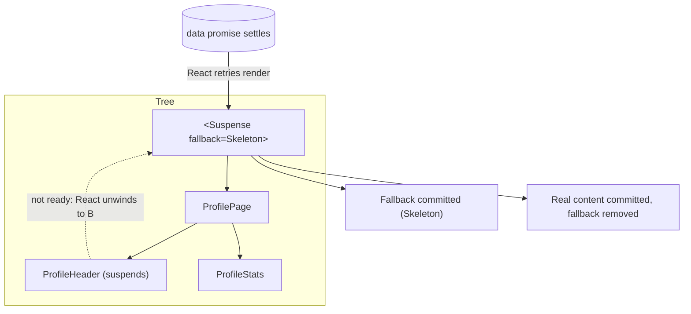
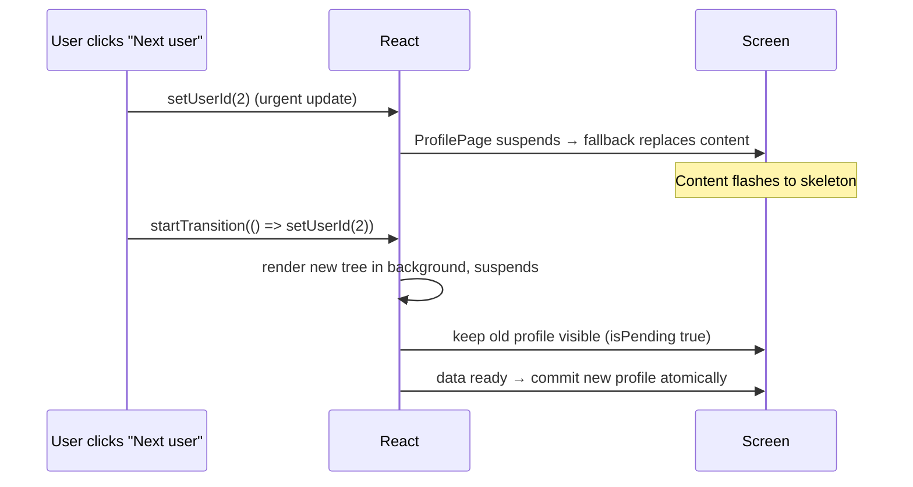
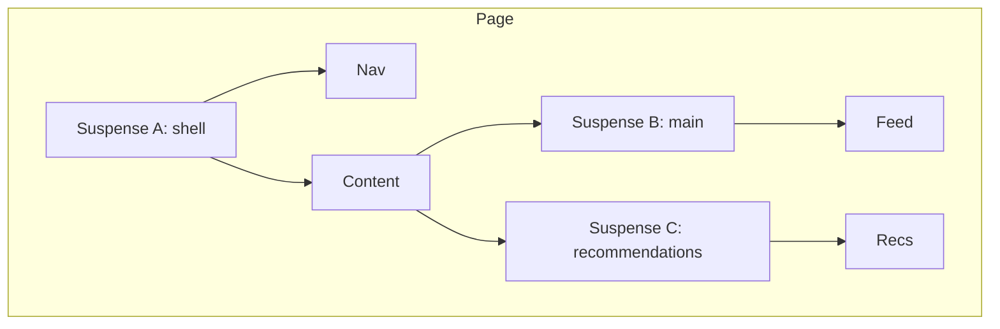

# 06 / 13 — Suspense for Data Loading: Declaring "Not Ready Yet" in the Render Tree

> **Checked against React 19.3 and react.dev (2026-10-22).** This lesson targets **React 19.x**. `use`, `<Suspense>`, transitions, and error boundaries are documented at <https://react.dev>. Data-loading *integration* is library-specific: the **only officially documented ways** to feed Suspense with data are a Suspense-enabled framework or library (`useSuspenseQuery`, Relay, Next.js/RSC data APIs, etc.), `lazy`, and `use(promise)` with a promise whose lifetime you manage. Rendering-scheduling details for sibling components, pre-warming, and fallback timing changed between React 18 and 19 (see §2.4 and §3.3; checked against React 19.3 and the react.dev Suspense reference on 2026-10-22). Library API names (TanStack Query v5, Next.js, React Router) must still be checked against current docs.

## 1. Lesson metadata

| | |
|---|---|
| **Level** | Advanced |
| **Study time** | 5 hours (reading 2 h, experiments 1.5 h, exercises 1.5 h) |
| **Prerequisites** | [Phase 2 / 24 — Suspense: conceptual internals](../02-react-rendering-and-internals/24-suspense-conceptual-internals.md), [Phase 2 / 23 — Transitions and deferred rendering](../02-react-rendering-and-internals/23-transitions-and-deferred-rendering.md), [Phase 3 / 22 — Modern hooks and APIs](../03-react-state-and-hooks/22-modern-hooks-and-apis.md), [01 — Fetch lifecycle](./01-fetch-lifecycle.md), [03 — Loading and error states](./03-loading-and-error-states.md), [08 — TanStack Query](./08-tanstack-query.md) |
| **Next** | [14 — Server-side data loading](./14-server-side-data-loading.md) |
| **Related** | [02 — Cancellation and race conditions](./02-cancellation-and-race-conditions.md), [15 — Error recovery and retries](./15-error-recovery-and-retries.md), [Phase 7 / 17 — Network waterfalls](../07-performance/17-network-waterfalls.md), [Phase 9 / 05 — Suspense architecture](../09-advanced-rendering-and-ecosystem/05-suspense-architecture.md) |

**Learning objectives.** After this lesson you can:
1. State the contract between a component that "isn't ready", a Suspense boundary, and React; and what that contract changes about how loading is modelled.
2. Distinguish **fetch-on-render**, **fetch-then-render**, and **render-as-you-fetch**, and name the waterfall each risks.
3. Use `use(promise)` correctly, explaining why a promise created *during render* of a Client Component is wrong, and how to cache or pass promises safely.
4. Use `useSuspenseQuery` (v5) or an equivalent, and place boundaries deliberately (granularity, shells, nested boundaries).
5. Combine Suspense with transitions and `useDeferredValue` so already-visible UI is not replaced by spinners.
6. Pair every Suspense boundary with an error boundary strategy and a retry/reset story.
7. Predict what renders, what is discarded, and when fallbacks appear for a given component tree.
8. Decide when Suspense for data is *not* the right model.

**Concepts covered:** suspending, fallback, boundary, thrown promise (conceptual), `use`, stable promise identity, cache, render-as-you-fetch, prefetch, waterfalls, transitions and "no new fallbacks" behaviour, `useDeferredValue`, nested/reveal ordering, error boundaries, `useSuspenseQuery`, `lazy`, server streaming (conceptual), `key`-driven reset.

---

## 2. Deep conceptual explanation

### 2.1 What problem is this lesson solving?

Without Suspense, every component that needs data owns a *loading branch*:

```tsx
if (status === 'loading') return <Spinner />;
if (status === 'error') return <ErrorView />;
return <Profile data={data} />;
```

Multiply across a page and you get: spinners popping in independently, layout shifts, inconsistent loading UX, and each component knowing about the lifecycle ([03](./03-loading-and-error-states.md)). Worse, the pattern *encourages* **fetch-on-render waterfalls**: a child can only start fetching after its parent finished fetching and rendered it.

Suspense moves "not ready yet" out of the component's *return value* and into the **tree structure**: a component that cannot render yet *suspends*; the nearest `<Suspense>` boundary above it shows a fallback; React retries rendering when the data is ready. The component's own code reads as if the data were already there.

### 2.2 Responsibilities: who does what

| Responsibility | React (Suspense / `use`) | Data library / framework | You |
|---|---|---|---|
| Showing a fallback while a descendant isn't ready | **Yes** | | Choose boundary placement and fallback design |
| Retrying the render when the awaited promise settles | **Yes** | | |
| Not committing half-ready UI inside one boundary | **Yes** | | |
| Coordinating with transitions (keep old UI instead of a new fallback) | **Yes** | | Wrap navigations/updates in transitions |
| Starting the request, deduplicating it, **caching the promise** | **No** | **Yes** (TanStack Query, Relay, framework loaders, RSC) | Or hand-write a cache (rarely wise) |
| Cache invalidation, staleness, retries | No | **Yes** | |
| Error handling | Propagates to the nearest **error boundary** | Library may reset caches | Provide error boundaries and reset behaviour |
| Cancellation | No | Library (signals) | Forward signals |
| Preventing waterfalls | No | Library prefetch APIs | **Yes**: start fetches before render (route loaders, `prefetchQuery`) |

Key point: **React tells you *when to wait*, not *how to fetch*.** This is why Suspense is a *rendering primitive*, and why it is compared on responsibilities with, not instead of, TanStack Query ([08](./08-tanstack-query.md)) and loaders ([14](./14-server-side-data-loading.md)).

### 2.3 The mental model



- **Suspending** = the component cannot produce output for this render. (Conceptually, React treats a thrown promise as "wait on this"; `use(promise)` is the supported public way to *request* that. Do not throw promises yourself; that is a library implementation detail: verify.)
- **Boundary** = the nearest `<Suspense>` ancestor decides what to show instead.
- **Retry** = when the promise settles, React re-renders from the boundary.
- **Atomicity per boundary**: content inside one boundary appears together (subject to nested boundaries).

*Teaching model.* Conceptually, "throw a promise, catch it at the boundary" is how libraries signalled this historically; the stable public surface is `use` and Suspense-enabled APIs. *Public guarantee:* a suspended component under a boundary shows that boundary's fallback instead of its children; React re-attempts after the promise settles. *Implementation detail:* how React tracks thenables, ping, and retry scheduling.

### 2.4 Three data-loading strategies

| Strategy | When does the request start? | Waterfall risk | Notes |
|---|---|---|---|
| **Fetch-on-render** | During render/effect of the component that needs it | **High**: child fetches wait for parent render | `useEffect` fetching; also naive Suspense with promises created in render |
| **Fetch-then-render** | Before rendering anything; all-or-nothing | Low, but slowest-resource latency for first paint | Route loaders that `await` everything |
| **Render-as-you-fetch** | Before/at navigation intent (event, route match), **independent of component render**; components *read* the already-started request | Lowest | What Suspense is designed for; needs a cache/promise owner |

Suspense does not magically remove waterfalls. The waterfalls that remain are **sequential reads inside one component** (the component suspends at the first read, so the second read never executes until the first resolves) and **parent-then-child** chains (a child only renders, and so only starts its request, after its suspended parent resolves). *Sibling* components are different in React 19: when a component suspends, React commits the nearest fallback immediately and then renders the suspended siblings to "pre-warm" their requests (React 19 upgrade guide, "Improvements to Suspense"). Verified on React 19.3 with a render-time promise cache: `<Suspense><A/><B/></Suspense>` where each calls `use(load(key))` starts *both* requests within a few ms, while `Parent` that `use`s a promise and then renders `Child` (which starts its own request) starts the child request only after the parent's promise resolves (~150 ms later in the experiment). React 18 stopped at the first suspension, so older articles describe a sibling waterfall that React 19 mostly removes. Remedies still apply for the cases above: start requests before render (prefetch / loaders), use `useSuspenseQueries` for known parallel queries inside one component, and avoid nested parent-then-child fetches. Do not *rely* on pre-warming as your parallelism strategy; it only helps siblings that are already in the tree.

### 2.5 What React exposes versus what libraries add

- React: `<Suspense>`, `use(promise)`, `lazy`, `startTransition`/`useTransition`, `useDeferredValue`, `<ErrorBoundary>` *(not built in: error boundaries are class components with `componentDidCatch`/`getDerivedStateFromError`; libraries such as `react-error-boundary` wrap them; verify current status in the React docs)*.
- Libraries: stable promises, caches, invalidation, prefetch, and hooks (`useSuspenseQuery`).
- Servers (RSC/SSR): async components and streaming: Suspense boundaries define the **streaming chunks** ([14](./14-server-side-data-loading.md), [Phase 9 / 01](../09-advanced-rendering-and-ecosystem/01-spa-ssr-ssg-streaming.md)).

### 2.6 Common misconceptions

| Misconception | Reality |
|---|---|
| "Suspense is a data-fetching library." | It is a rendering coordination mechanism. It does not fetch or cache. |
| "I can `use(fetch(...))` inline in a Client Component." | A new promise each render means a new pending promise each render: React cannot associate results across retries (an infinite suspend loop or a dev error; verify the message in your version). |
| "Suspense replaces error handling." | Rejections propagate as render errors to **error boundaries**; Suspense handles only *pending*. |
| "More boundaries is always better." | Too many produces popcorn loading and layout thrash; too few means large regions blank. Place by UX unit. |
| "A fallback shows every time data changes." | With transitions (or `useDeferredValue`), React keeps showing the old UI instead of re-showing a boundary's fallback for an already-revealed boundary. |
| "Suspense parallelises requests." | Not by itself: it can *serialise* them (waterfall) if requests start only when a component renders. |
| "`useEffect` is deprecated for fetching." | Effects still work (and some cases need them); they are just not the recommended default when a library or framework offers render-integrated loading ([Phase 3 / 07](../03-react-state-and-hooks/07-you-might-not-need-an-effect.md)). |

---

## 3. Internal mechanics

### 3.1 The `use` API contract

`use(resource)` accepts a **promise** or a **Context**:

- For a promise: if the promise is **pending**, the component suspends. If **fulfilled**, `use` returns its value synchronously. If **rejected**, `use` throws the reason into the nearest error boundary.
- Unlike hooks, `use` may be called conditionally and in loops (but only in components/hooks).
- **Promise identity must be stable across renders** (and across the retry that follows a suspend). Sources of stable promises: (1) a **Server Component** creates and passes the promise as a prop to a Client Component; (2) a **cache** keyed by inputs (a library, or React's `cache` in Server Components; per the react.dev `cache` reference it is for Server Components only at this time); (3) a promise created in an event handler/loader and stored in state or passed through context. A promise created inline during render of a Client Component is *not* stable.
- React *marks* settled promises with internal bookkeeping (status/value fields) to read synchronously on retry. This is an implementation detail; do not rely on adding these fields yourself; a stable, library-managed promise is the contract.

### 3.2 What happens during a suspend (conceptual timeline)

1. React renders from the root (or from the updated subtree).
2. A component calls `use(p)` with `p` pending → React **abandons that component's in-progress work** and records that boundary B must show a fallback (or, if the update is in a transition or deferred, may keep the old UI).
3. The render of the boundary's primary children is discarded for this attempt ([Phase 2 / 11](../02-react-rendering-and-internals/11-render-phase-and-commit-phase.md): render is pure, so discarding is safe). The **fallback** renders.
4. React commits (fallback appears; any already-mounted content inside B is hidden but **not unmounted**, so its state and DOM are preserved; verify details in the Suspense reference).
5. `p` settles → React is pinged → schedules a retry for B's children.
6. Retry: `use(p)` returns the value; children render; commit replaces the fallback (and re-shows preserved content).

*Public guarantee:* the fallback is shown for the suspended boundary and content becomes visible when ready; state of already-mounted content inside a boundary that re-suspends is preserved. *Implementation detail:* ping/retry lanes and exact hidden-content mechanics ([Phase 2 / 24](../02-react-rendering-and-internals/24-suspense-conceptual-internals.md)).

### 3.3 Transitions and Suspense

The important documented behaviours:

- **Initial mount** suspending shows the boundary's fallback.
- **An update that suspends an already-revealed boundary**, if it is a **normal update**, shows the fallback again (hiding content).
- **If the update is a transition** (`startTransition` / `useTransition`) or driven by `useDeferredValue`, React avoids replacing already-visible content with the fallback; it keeps the old UI on screen and renders the new one in the background until ready (with `isPending` available for subtle indicators). *New* boundaries entering (never shown before) may still show fallbacks.



The react.dev `<Suspense>` reference documents a throttle: React reveals suspended content at most once every 300 ms, measured from the last reveal, and boundaries that become ready inside that window are revealed together (checked 2026-10-22). Treat the exact number as a documented-but-tunable detail, not a contract to build timing logic on.

### 3.4 Reveal order and nested boundaries

With nested boundaries, an outer boundary can reveal content while inner boundaries still show their own fallbacks. Design rules:

- **Outer boundary = page shell/layout**; **inner boundaries = independently useful regions** (sidebar, comments).
- A boundary should wrap *regions that can independently be absent*; do not wrap two components that must look consistent together in separate boundaries.
- `SuspenseList` (coordinating reveal order) is not exported by stable `react` 19.3 (only `Suspense`, `Activity`, `ViewTransition` among the boundary-like exports); do not use it in production code.

### 3.5 Errors

If `use(p)` sees a **rejected** promise, it throws the rejection during render. The nearest **error boundary** catches it. Error boundaries are *not* Suspense boundaries: you need both. A common composition is `ErrorBoundary > Suspense > Content`, so errors replace the content area and pending states stay local (see [15 — Error recovery and retries](./15-error-recovery-and-retries.md)).

Recovery needs *two* resets: the error boundary's state **and** the cached failed promise/query. TanStack Query provides `QueryErrorResetBoundary` for this (verify names).

### 3.6 Server rendering

On the server (streaming SSR with `renderToPipeableStream`/`renderToReadableStream`, or RSC frameworks), a suspended boundary emits its **fallback HTML first**, then streams the real HTML when ready and swaps it in; the client hydrates boundaries selectively ([Phase 2 / 25](../02-react-rendering-and-internals/25-hydration-and-selective-hydration.md)). Suspense boundaries therefore also define *streaming granularity*.

---

## 4. Step-by-step execution walkthrough

Scenario: `/users/1` page. Tree:

```tsx
<ErrorBoundary fallback={<PageError />}>
  <Suspense fallback={<PageSkeleton />}>
    <UserPage id={1} />          // useSuspenseQuery(user)
  </Suspense>
</ErrorBoundary>
```

`UserPage` renders `<Header />` (reads user) and, inside its own boundary, `<Suspense fallback={<PostsSkeleton />}><Posts userId={1} /></Suspense>` where `Posts` uses `useSuspenseQuery(posts)`.

**First visit, cold cache, no prefetch (fetch-on-render):**

| t | Event | Screen | Network |
|---|---|---|---|
| 0 | Route renders; `UserPage` calls `useSuspenseQuery(user)`; cache miss; request starts; component suspends | `PageSkeleton` (outer fallback) | `GET /user/1` |
| 150 ms | user resolves; React retries | — | |
| 150 ms | `UserPage` renders; `Header` renders; `Posts` renders, calls `useSuspenseQuery(posts)`: miss; request starts; suspends | `Header` visible; `PostsSkeleton` where posts go | `GET /user/1/posts` **starts only now** |
| 400 ms | posts resolve; retry inner boundary | Posts content | |

Total: user (150) + posts (250) = **sequential waterfall**; the page is useful at 150 ms (shell) and complete at 400 ms.

**With render-as-you-fetch (route loader prefetches both):**

| t | Event | Screen | Network |
|---|---|---|---|
| 0 | Navigation intent: loader calls `prefetchQuery(user)` and `prefetchQuery(posts)` in parallel | previous page | both start |
| 0 | `UserPage` renders; promises exist → cached pending; suspends | `PageSkeleton` | |
| 150 | user ready; header renders; posts still pending → inner suspends | header + `PostsSkeleton` | |
| 250 | posts ready | complete at ~250 ms | |

**Predict:** if navigation to `/users/2` is wrapped in `startTransition`, what does the user see while user 2 loads? *Answer:* user 1's page stays visible with `isPending` indicator until user 2's outer content is ready (the outer boundary is already revealed, so React avoids the skeleton); if user 2's posts are slower than the user, the inner `PostsSkeleton` for the **new** subtree may show once the outer content commits (the inner boundary is new in that render).

Be precise in tests: "new boundary vs already revealed boundary" determines fallback visibility; verify with the Profiler/DevTools.

---

## 5. Code examples

### 5.1 Minimal: `use` with a promise created *outside* the client component

```tsx
// Server Component (RSC framework): creates the promise, passes it down.
export default async function Page({ params }: { params: Promise<{ id: string }> }) {
  const { id } = await params;
  const userPromise = getUser(id);                 // not awaited here
  return (
    <Suspense fallback={<p>Loading user…</p>}>
      <UserCard userPromise={userPromise} />
    </Suspense>
  );
}
```

```tsx
// Client Component
'use client';
import { use } from 'react';

export function UserCard({ userPromise }: { userPromise: Promise<{ name: string }> }) {
  const user = use(userPromise);        // suspends until resolved; throws if rejected
  return <h2>{user.name}</h2>;
}
```

Notes: the promise is created in the Server Component, so its identity is stable across the Client Component's renders. Un-awaited promises passed across the server/client boundary are supported by RSC serialisation (verify the serialisation constraints for your framework version in [Phase 9 / 04](../09-advanced-rendering-and-ecosystem/04-client-server-boundaries-and-serialization.md)). The `await params` form reflects recent Next.js, where `params` is async; adapt to your framework.

### 5.2 Practical: client-side with TanStack Query v5

```tsx
import { queryOptions, useSuspenseQuery, useQueryClient } from '@tanstack/react-query';
import { Suspense, useTransition, useState } from 'react';

const userOptions = (id: number) =>
  queryOptions({
    queryKey: ['users', 'detail', id] as const,
    queryFn: async ({ signal }) => {
      const r = await fetch(`/api/users/${id}`, { signal });
      if (!r.ok) throw new Error(`HTTP ${r.status}`);
      return (await r.json()) as { id: number; name: string };
    },
    staleTime: 60_000,
  });

function Profile({ id }: { id: number }) {
  const { data } = useSuspenseQuery(userOptions(id));   // data is non-undefined: no loading branch
  return <h2>{data.name}</h2>;
}

export function UserSwitcher({ ids }: { ids: number[] }) {
  const [current, setCurrent] = useState(ids[0]);
  const [isPending, startTransition] = useTransition();
  const qc = useQueryClient();

  return (
    <div>
      {ids.map((id) => (
        <button
          key={id}
          onMouseEnter={() => qc.prefetchQuery(userOptions(id))}        // start fetch before render
          onClick={() => startTransition(() => setCurrent(id))}        // keep old UI while loading
          aria-pressed={id === current}
        >
          User {id}
        </button>
      ))}
      <div aria-busy={isPending} style={{ opacity: isPending ? 0.6 : 1 }}>
        <Suspense fallback={<p>Loading…</p>}>
          <Profile id={current} />
        </Suspense>
      </div>
    </div>
  );
}
```

Line notes:
- `useSuspenseQuery` (v5) suspends on pending, throws on error, and returns data typed non-`undefined`. It does not accept `enabled`, `throwOnError`, `placeholderData` or `skipToken` (the 5.104 typings omit them: a suspense query cannot render a "disabled" or "placeholder" state), so conditional fetching is handled by conditional rendering.
- The query library owns the **promise stability**: the `Query` entry holds the in-flight promise; every render of `Profile` for the same key reads the same entry.
- `prefetchQuery` on hover: render-as-you-fetch. By click time the data may already be cached.
- `startTransition` ensures that, since the boundary is already revealed, React keeps the old profile visible and shows a subtle pending indicator, not the fallback.

**Predict:** first mount with `current = ids[0]` cold: what shows? *Answer:* the `Loading…` fallback (initial reveal). Click on a *prefetched* id: `Profile` renders immediately (fresh cache) with no pending state. Click on a non-prefetched id: old profile stays dimmed until the new one loads.

### 5.3 Incorrect examples

```tsx
// BAD 1: promise created during render of a Client Component
function Profile({ id }: { id: number }) {
  const user = use(fetch(`/api/users/${id}`).then((r) => r.json()));   // new promise each render
  return <h2>{user.name}</h2>;
}

// BAD 2: one giant boundary at the root, no transitions
<Suspense fallback={<FullPageSpinner />}><App /></Suspense>
// every navigation/refetch replaces the entire app with a spinner

// BAD 3: Suspense without error boundary
<Suspense fallback={<Spinner />}><Profile id={id} /></Suspense>   // rejection → crashes up to the root

// BAD 4: sibling waterfall via separate render-time requests
function Dashboard() {
  const a = useSuspenseQuery(aOptions());
  const b = useSuspenseQuery(bOptions());   // b's request starts only after a resolves
  return <View a={a.data} b={b.data} />;
}

// BAD 5: swallowing the pending state with try/catch around use
try { const v = use(p); } catch { /* ... */ }     // do not catch around use
```

Why each fails:
1. A new pending promise on every attempt: React cannot resume with a previous result; the retry creates another new promise → suspend loop (verified on React 19.3: with `use(new Promise(...))` in render the fallback was still showing after ~320 ms and the component had rendered 18 times; the react.dev `use` reference also documents the warning "A component was suspended by an uncached promise"). Fix: a cache (library) or a promise created outside render.
2. Fallback granularity too coarse; already-visible content is hidden for any update that suspends outside a transition.
3. Rejected data throws during render; without an error boundary the whole tree unmounts.
4. Within one component, the second hook is not reached until the first stops suspending (the first call throws control away): sequential requests. Fix: `useSuspenseQueries([...])` or prefetch both in the loader.
5. `use` is *designed* to propagate suspension/errors via exceptions; catching them interferes (the documented guidance is to use error boundaries or `.catch` on the promise itself; verify the exact wording in the `use` reference).

### 5.4 Corrected

```tsx
// (1) stable source
const user = useSuspenseQuery(userOptions(id)).data;           // or: promise passed from a server component / loader

// (2) boundaries at UX-unit granularity + transitions on navigation
<Layout>
  <Suspense fallback={<SidebarSkeleton />}><Sidebar /></Suspense>
  <main><Suspense fallback={<ContentSkeleton />}><Outlet /></Suspense></main>
</Layout>

// (3) pair with an error boundary and a reset
<QueryErrorResetBoundary>
  {({ reset }) => (
    <ErrorBoundary onReset={reset} fallbackRender={({ resetErrorBoundary }) => (
      <div role="alert">Something failed. <button onClick={resetErrorBoundary}>Retry</button></div>
    )}>
      <Suspense fallback={<Spinner />}><Profile id={id} /></Suspense>
    </ErrorBoundary>
  )}
</QueryErrorResetBoundary>

// (4) parallel
const [a, b] = useSuspenseQueries({ queries: [aOptions(), bOptions()] }).map((q) => q.data) as [A, B];
```

`ErrorBoundary` above is the `react-error-boundary` package component (a third-party wrapper; props checked against v6 typings). The cast in (4) is a pragmatic typing workaround; prefer the library's `combine` option for typed results (verify).

### 5.5 Advanced: `useDeferredValue` with a suspending list, and `key` to reset

```tsx
function Search() {
  const [q, setQ] = useState('');
  const deferredQ = useDeferredValue(q);
  const stale = q !== deferredQ;
  return (
    <>
      <input value={q} onChange={(e) => setQ(e.target.value)} aria-label="Search" />
      <div style={{ opacity: stale ? 0.5 : 1 }}>
        <Suspense fallback={<ResultsSkeleton />}>
          <Results query={deferredQ} />   {/* useSuspenseQuery inside, key includes query */}
        </Suspense>
      </div>
    </>
  );
}
```

Behaviour: typing updates `q` immediately (the input stays responsive); `Results` renders with the *previous* `deferredQ` until the new one's data is ready; the already-revealed boundary does not show the skeleton. First-ever render with an empty cache still shows the fallback. This is the "keep previous results visible" behaviour that TanStack Query's `placeholderData: keepPreviousData` provides at the *cache* level for non-Suspense queries ([08](./08-tanstack-query.md)): two different mechanisms for the same UX goal.

Resetting a subtree intentionally: `<Suspense key={userId} fallback=…>` forces a *new* boundary instance so that changing the user shows the skeleton (desired for a *different entity*, undesirable for refinement of the same list). Choose per UX.

---

## 6. Visual explanations

### 6.1 Boundary placement and what blocks what



Feed suspends → only B shows its fallback; Nav (A) and Recs (C) are unaffected. Nav suspends → A's fallback replaces everything under A (including B and C).

### 6.2 Waterfall vs parallel

```mermaid
gantt
  title Same two requests (150 ms and 250 ms)
  dateFormat X
  axisFormat %L
  section Fetch-on-render
  user  :a1, 0, 150
  posts :a2, 150, 400
  section Render-as-you-fetch
  user  :b1, 0, 150
  posts :b2, 0, 250
```



---

## 7. Alternative approaches and trade-offs

| Criterion | Suspense-based reads (`useSuspenseQuery`/`use`) | `useQuery` with explicit statuses | Route loader + `use`/hooks | Fetch in `useEffect` | RSC async components |
|---|---|---|---|---|---|
| Loading UI location | Tree (boundaries) | Component branches | Router/boundary | Component branches | Boundaries (server-streamed) |
| Waterfall risk | Moderate (needs prefetch) | Moderate | **Low** | High | Moderate (parallelise with `Promise.all`) |
| Granular control (per-component spinner variants) | Lower | **Higher** | Medium | Higher | Medium |
| Error handling | Error boundaries | Inline status | Route error elements | Inline | Error boundaries |
| Transitions keep old UI | **Yes** | Via `placeholderData` | Via router transitions | Manual | Via navigation transitions |
| Typing / ergonomics | Non-undefined data | Narrow on status | Typed loaders | Manual | Direct `await` |
| Works without a library | Not practically (promise cache needed) | N/A | Framework-specific | Yes | Framework required |
| Client interactivity after load | Normal | Normal | Normal | Normal | Needs Client Components |

**Scenario where Suspense for data is *not* the best fit.** A dashboard where each widget needs bespoke inline states (stale-but-refreshing badges, per-widget retry buttons, optimistic "last updated" labels): explicit `status`/`fetchStatus` handling gives finer control than boundary-level fallbacks. Another: a mutation-heavy form: Actions plus `useActionState` models pending/error better than Suspense ([Phase 3 / 22](../03-react-state-and-hooks/22-modern-hooks-and-apis.md)). Another: a team with no prefetching discipline will convert fetch-on-render waterfalls into *Suspense* waterfalls; the pattern needs process.

---

## 8. Best practices and anti-patterns

### Best practices
- **Start requests early** (route loaders, `prefetchQuery`, intent events), then suspend to *read*.
- **Boundaries at UX units**: shell, main, sidebar, widgets; design **skeletons that match layout** to avoid shift ([Phase 7 / 21](../07-performance/21-web-vitals-and-budgets.md)).
- **Wrap navigations and filter changes in transitions**; show `isPending` subtly.
- **Pair with error boundaries** and a reset path that also resets the data cache's error.
- **Parallelise known sets** (`useSuspenseQueries`, `Promise.all` on the server).
- **Keep fallbacks cheap** and accessible (`role="status"`, no layout jump).
- **Treat `use` with promises as advanced**: let the library/framework own promise creation.

### Beginner mistakes
- Creating promises in render and passing to `use`.
- Forgetting the error boundary.
- One `<Suspense>` around the whole app.
- Expecting Suspense to fetch.

### Experienced-developer mistakes
- Relying on Suspense without prefetching, creating hidden waterfalls.
- Over-granular boundaries causing popcorn loading.
- Using `key` on a boundary for refinement-type changes, so skeletons flash on every keystroke.
- Throwing promises manually from a hand-rolled cache (fragile, version-specific).
- Mixing `enabled: false`-style conditional queries with `useSuspenseQuery` expectations.
- Ignoring hydration: server fallback vs client expectations ([Phase 2 / 25](../02-react-rendering-and-internals/25-hydration-and-selective-hydration.md)).

### Smells
- Many `isLoading ? <Spinner/> : ...` branches *inside* Suspense-using components.
- Fallback components that do their own data fetching.
- Error handling via `try/catch` around Suspense reads.

### Justified exceptions
- A hand-rolled `use(promise)` cache for a one-off, well-understood read (e.g. a module-scope `Map` of promises keyed by id with explicit invalidation) in a small app without a data library, if you accept owning its lifetime.
- Granular, non-Suspense `useQuery` for widgets that need rich inline states.

---

## 9. Real-world application

| Domain | Pattern | Constraint |
|---|---|---|
| E-commerce | Product page shell streams immediately; reviews and recommendations in nested boundaries | LCP element must not sit behind a slow boundary ([Phase 7 / 21](../07-performance/21-web-vitals-and-budgets.md)); price/availability freshness vs caching |
| Dashboards | Per-widget boundaries + per-widget error boundaries; shared filters in the URL; transitions on filter change | Do not blank the whole dashboard when one widget's endpoint is slow; avoid N skeletons shifting layout |
| Finance | Account page with critical balance above the fold; heavy history below behind a boundary | Never show stale balances as fresh: labelled `dataUpdatedAt`; errors must be visible, not swallowed |
| Auth | Session check in the route loader; `Suspense` for user-specific content | Authorisation server-side; avoid flashing logged-out UI then logged-in |
| Realtime | Initial snapshot via Suspense; live updates via subscription into the cache | Suspense is for *initial/changed-key* loads, not streams ([17](./17-real-time-websockets-subscriptions.md)) |
| Multi-team | Each team owns boundaries around its widgets and agrees on skeleton dimensions | Shared design-system `<AsyncBoundary>` combining error + suspense + reset |

---

## 10. Debugging and troubleshooting

| Symptom | Likely root cause | Investigation | Fix / validation |
|---|---|---|---|
| Infinite loading spinner | Promise recreated each render; or promise never settles; or query key unstable | Log promise identity (`Object.is` across renders); network panel shows repeated requests | Stabilise key/promise; confirm one request, spinner resolves |
| Whole page flashes skeleton on every filter change | Update not in a transition; boundary too high | React DevTools: which boundary is suspended (the "Suspense" toggle in the components tree; verify the DevTools option) | `startTransition`/`useDeferredValue`; move boundary |
| Waterfall (requests in series in Network panel) | Requests started in render, sequentially | Network waterfall; Profiler timeline | Prefetch in loader; `useSuspenseQueries` |
| App crashes to a white screen on 500 | No error boundary | Console error "uncaught"; render error | Add error boundary near the boundary |
| Retry button doesn't retry | Error boundary reset without cache reset | Network panel: no new request | Reset query cache error (e.g. `QueryErrorResetBoundary`) |
| Hydration mismatch around Suspense | Different client/server fallback state or data | Console warnings | Ensure same initial data; dehydrate/hydrate cache ([14](./14-server-side-data-loading.md)) |
| Component state lost after loading | A `key` change or boundary remount | Components tree | Remove unnecessary `key`; keep boundary stable |
| `use` complains about uncached promise | Promise created in client render | Console message | Create outside render / use library |

DevTools: React DevTools can "suspend" a boundary for testing fallbacks (verify the control's location in your version); the Network panel's waterfall reveals serial vs parallel; the Profiler shows commit sequences (fallback commit, then content commit).

---

## 11. Exercises

### Level A — Knowledge
**A1.** What does a component do to "suspend" in current React, and what decides what is shown?
**A2.** Why can't you create the promise for `use` inline in a Client Component's render?
**A3.** Name the three loading strategies and which one Suspense is designed for.
**A4.** What is the difference between a Suspense boundary and an error boundary?
**A5.** How do transitions change what Suspense shows for an already-revealed boundary?
**A6.** What does `useSuspenseQuery` guarantee about `data`'s type, and what option can't you use with it?

### Level B — Code comprehension
**B1.** Explain the network timeline for 5.3 BAD 4, and rewrite it.
**B2.** In section 4 with the loader prefetching both queries, why does the posts skeleton still appear?
**B3.** In 5.5, why doesn't the skeleton appear on each keystroke?
**B4.** Predict: `<Suspense key={userId}>` around `Profile` under `startTransition(() => setUserId(2))`. Skeleton or old user? Explain.

### Level C — Implementation
**C1.** Build a `<AsyncBoundary>` component combining an error boundary, a Suspense boundary, and a reset that integrates with TanStack Query's reset mechanism.
**C2.** Write a route-level prefetch for a user page that starts `user` and `posts` queries in parallel, plus a component that reads both with `useSuspenseQueries`.
**C3.** Implement a tiny promise cache (module-scope `Map`) for `use` in a no-library app: `getUser(id)`, with invalidation, and explain its limits.

### Level D — Debugging
**D1.** A page shows a spinner forever; the Network panel shows the same request repeating every ~50 ms. Diagnose.
**D2.** After a 500 error, clicking "Retry" shows the error again instantly with no network request. Diagnose.
**D3.** The product page's LCP regressed after wrapping the hero in a `Suspense` boundary with a slow dependency. Diagnose and propose changes.

### Level E — Architecture and engineering decisions
**E1.** Choose boundary placement for an e-commerce product page (hero, price, reviews, recommendations, cart count). Justify with UX and performance.
**E2.** Decide between Suspense reads and explicit statuses for: a data table with inline row refresh, a profile page, a notifications badge, a search results list.
**E3.** Define an organisation-wide convention for loading/error handling across 6 teams.

### Level F — Expert challenge
**F1.** Explain how streaming SSR and Suspense boundaries interact with hydration: what the browser receives, in what order, and what a failed boundary on the server does.
**F2.** Design a render-as-you-fetch architecture with a router that supports intent-based prefetch, cancellation, and cache reuse, and discuss its failure modes.

---

## 12. Detailed answers and explanations

> Attempt the exercises first.

**A1.** It reads a not-yet-ready resource via `use(promise)` or a Suspense-enabled API/`lazy`; React unwinds to the nearest `<Suspense>` ancestor and shows its fallback. The *boundary* decides the UI. Wrong answer: "return null" or "set a loading flag".

**A2.** Each render creates a new promise, which is pending again; when the old one settles, React retries and the component creates *another* pending promise; it never reaches a settled one. The identity must be stable across attempts.

**A3.** Fetch-on-render, fetch-then-render, render-as-you-fetch; Suspense is designed to *read* in render-as-you-fetch, with fetching initiated earlier.

**A4.** Suspense boundary handles *pending* (fallback); error boundary handles *thrown errors* (fallback UI after rejection). A rejected promise in `use` throws to the error boundary. You need both.

**A5.** For a transition (or deferred) update, React avoids replacing already-visible content with the fallback; it keeps the old UI and renders the new in the background. New boundaries (not yet revealed) can still show fallbacks.

**A6.** `data` is non-`undefined` (typed as the query's data), since pending suspends and error throws. Not usable: `enabled`, `skipToken`, `placeholderData` and `throwOnError` (omitted from `UseSuspenseQueryOptions` in 5.104), because a suspense read cannot return "no data yet".

**B1.** `a` request starts; component suspends; after it resolves, React re-renders and reaches the second hook, which starts `b`: serial. Rewrite with `useSuspenseQueries({ queries: [aOptions(), bOptions()] })` (parallel start) or prefetch both in a loader before render.

**B2.** The outer data (user) finishes at 150 ms and the posts take 250 ms; the inner boundary (posts) has its own fallback, so between 150 ms and 250 ms the header is visible with a posts skeleton. That is intended progressive reveal, not a bug. Wrong answer: "prefetch should make it instant" (prefetch parallelises; it doesn't make slow endpoints fast).

**B3.** `deferredQ` lags `q`; while data for the new value loads, React keeps rendering with the old deferred value (the boundary stays revealed), so no fallback. Only the first load (cold, no previous reveal) shows the skeleton.

**B4.** A different `key` makes a **new** boundary instance, and a new boundary that suspends shows its fallback even within a transition (documented behaviour: transitions avoid hiding *revealed* content; a newly mounted boundary has none; verify). So the skeleton shows. Remove `key` to keep the old user visible. Both choices are legitimate; pick by UX.

**C1.**
```tsx
import { Suspense, type ReactNode } from 'react';
import { ErrorBoundary } from 'react-error-boundary';
import { QueryErrorResetBoundary } from '@tanstack/react-query';

export function AsyncBoundary({ pending, children }: { pending: ReactNode; children: ReactNode }) {
  return (
    <QueryErrorResetBoundary>
      {({ reset }) => (
        <ErrorBoundary
          onReset={reset}
          fallbackRender={({ error, resetErrorBoundary }) => (
            <div role="alert">
              <p>Could not load: {error instanceof Error ? error.message : 'unknown error'}</p>
              <button onClick={resetErrorBoundary}>Retry</button>
            </div>
          )}
        >
          <Suspense fallback={pending}>{children}</Suspense>
        </ErrorBoundary>
      )}
    </QueryErrorResetBoundary>
  );
}
```
Evaluation: order ErrorBoundary outside Suspense; reset both layers; accessible alert; no secrets in error text; typed props. Edge: `error` is `unknown` in recent typings (verify).

**C2.**
```tsx
// route loader
export const loader = (qc: QueryClient) => async ({ params }: { params: { id: string } }) => {
  const id = Number(params.id);
  void qc.prefetchQuery(userOptions(id));
  void qc.prefetchQuery(postsOptions(id));       // both start immediately, in parallel
  return null;
};

// component
function UserPage({ id }: { id: number }) {
  const [u, p] = useSuspenseQueries({ queries: [userOptions(id), postsOptions(id)] });
  return <View user={u.data} posts={p.data} />;
}
```
Notes: `void` fire-and-forget keeps navigation fast and lets Suspense show the shell; `await Promise.all(...)` would implement fetch-then-render (blocks navigation until done). Evaluate the explanation of that trade-off.

**C3.**
```ts
const cache = new Map<number, Promise<User>>();
export function getUser(id: number): Promise<User> {
  let p = cache.get(id);
  if (!p) {
    p = fetch(`/api/users/${id}`).then((r) => {
      if (!r.ok) throw new Error(`HTTP ${r.status}`);
      return r.json() as Promise<User>;
    });
    p.catch(() => cache.delete(id));       // allow retry after failure
    cache.set(id, p);
  }
  return p;
}
export const invalidateUser = (id: number) => cache.delete(id);
// usage: const user = use(getUser(id));
```
Limits: unbounded memory, no staleness, no dedupe across tabs, no abort, no invalidation notification (components don't re-render on `invalidateUser`), module singleton hazards on the server, and `getUser(id)` called in render returns the *same* promise (stable) only while cached. Recommend a library for anything beyond a demo.

**D1.** Promise (or query key/options object identity feeding a custom cache) is recreated each render; each retry creates a new request. Check for inline `fetch`, `new` objects in keys, a cache keyed by object identity, or clearing the cache on render. Fix by stable key/hoisting; verify one request.

**D2.** The error boundary resets but the failed promise/query result remains cached (or the library reuses the error without refetch). Fix by resetting the cache entry (`QueryErrorResetBoundary`, `queryClient.resetQueries`/invalidate) as part of retry.

**D3.** The hero (LCP) now depends on the boundary's dependency; on the server the fallback streams first and the hero arrives late; on the client the hero can't commit until its data is ready. Move the critical hero data to be fetched early/in parallel (loader), keep the boundary only around non-critical parts, render a meaningful hero without the slow dependency, and measure LCP before/after ([Phase 7 / 21](../07-performance/21-web-vitals-and-budgets.md)).

**E1.** Suggested: hero + price in the critical path (fetched early; consider no boundary or an outer shell boundary with real skeleton matching size); reviews and recommendations each in their own boundary (independently absent); cart count in the header: a separate boundary with a tiny fallback (or non-blocking), or client-only if it's per-user and uncached; all with error boundaries local to each region; transitions on variant selection. Criteria: LCP, layout stability, independence, freshness; wrong: one boundary for all.

**E2.** Table with row refresh: explicit statuses (row-level `isFetching`); profile page: Suspense; notifications badge: explicit (or a quiet fallback) because it must not block; search results: Suspense + `useDeferredValue`/transitions, or `keepPreviousData`. Reason by granularity of loading UI and independence.

**E3.** A shared `AsyncBoundary`, skeleton guidelines (dimensions), rules (prefetch in loaders, transitions on navigation, error boundaries per region), lint/review checklist, observability for loading durations ([Phase 10 / 04](../10-production-engineering/04-observability-and-logging.md)), and an escape hatch for non-Suspense widgets. Evaluate for governance and testability, not for the particular components.

**F1.** Server streams the shell HTML with fallback placeholders for pending boundaries; as each resolves, a chunk with the content HTML and a small inline instruction to swap it in arrives. The client hydrates boundaries selectively as code/data arrive, prioritising what the user interacts with ([Phase 2 / 25](../02-react-rendering-and-internals/25-hydration-and-selective-hydration.md)). If a boundary errors on the server, React can emit the fallback and leave the boundary to client-side render/retry (and error handling hooks like `onError` log it; verify the exact semantics in `react-dom/server` docs). Data must match on both sides, or hydration mismatches occur ([14](./14-server-side-data-loading.md)).

**F2.** Strong answers: router matches route → loader starts queries (de-duped by the cache) → renders; link hover/focus triggers intent prefetch with a TTL; cancellation via `AbortSignal` when navigation is superseded (careful not to cancel shared in-flight queries that other consumers use); cache reuse with `staleTime`; failure modes: over-prefetching (waste, privacy), loader/component key drift (prefetched different key than read), cache leakage across users on logout, and error handling duplicates.

---

## 13. Senior engineer interview questions

1. **"What does Suspense actually do?"** Coordinates rendering when a descendant isn't ready: shows a fallback, retries when ready, preserves atomic reveal. It doesn't fetch or cache.
2. **"Why must the promise passed to `use` be stable?"** Retry re-runs render; a new promise each time never settles from React's perspective; identity links the attempt to the eventual result.
3. **"How can Suspense produce a waterfall, and how do you avoid it?"** Requests that start only when a component renders are serial when components are nested or sequentially suspending; start requests before render (loaders/prefetch) and batch siblings.
4. **"How do transitions interact with Suspense?"** Transitions let React keep already-revealed UI on screen rather than re-showing a fallback; new boundaries can still show fallbacks; `isPending` indicates the transition.
5. **"Where do errors go?"** Rejections throw at render to the nearest error boundary; recovery requires resetting both the boundary and the data cache entry.
6. **"Suspense vs `useQuery` statuses: when each?"** Suspense for page/region-level loading states with shared fallbacks; statuses for fine-grained inline control and background-refresh indicators; mix them where justified.
7. **"How do Suspense boundaries relate to streaming SSR?"** They delimit what can be streamed later; fallbacks are in the initial HTML; hydration is selective per boundary.
8. **"What's wrong with `use(fetch(...))` in a Client Component?"** Unstable promise; each render restarts; use a cache or a promise created outside render.

---

## 14. Further learning resources

| Resource | URL | Covers / why | Level | Study |
|---|---|---|---|---|
| React docs: `<Suspense>` | <https://react.dev/reference/react/Suspense> | Fallbacks, reveal behaviour, transitions, resetting with `key` | Intermediate | Whole page, "Usage" sections |
| React docs: `use` | <https://react.dev/reference/react/use> | Promises and context in render; caveats on promise creation | Intermediate | Whole page |
| React docs: `useTransition` | <https://react.dev/reference/react/useTransition> | Keeping UI responsive/avoiding fallbacks | Intermediate | "Preventing unwanted loading indicators" |
| React docs: `useDeferredValue` | <https://react.dev/reference/react/useDeferredValue> | Deferred values with Suspense | Intermediate | "Showing stale content while fresh content is loading" |
| React docs: `lazy` | <https://react.dev/reference/react/lazy> | Code-splitting with Suspense | Beginner | Whole page |
| React docs: Error boundaries (in `Component` reference) | <https://react.dev/reference/react/Component#catching-rendering-errors-with-an-error-boundary> | Error boundary contract | Intermediate | Section |
| TanStack Query: Suspense guide | <https://tanstack.com/query/latest/docs/framework/react/guides/suspense> *(link checked, HTTP 200, 2026-10-22)* | `useSuspenseQuery`, `useSuspenseQueries`, reset boundaries | Intermediate | Whole page |
| `react-error-boundary` | <https://github.com/bvaughn/react-error-boundary> | Maintained error boundary component | Intermediate | README |
| React 18 Working Group: Suspense SSR architecture | <https://github.com/reactwg/react-18/discussions/37> *(link checked, HTTP 200, 2026-10-22)* | Streaming SSR rationale | Advanced | Thread |

---

## 15. Knowledge checkpoint

**You understand it if you can:**
- Explain what suspending, fallbacks, retry, and boundaries do, and what they do not do (fetch, cache, error handling).
- Explain why promise identity must be stable and name safe sources.

**You can explain it if you can:**
- Compare the three loading strategies and show where Suspense helps or hurts waterfalls.
- Explain the transition rule: revealed boundaries keep old UI; new boundaries can show fallbacks.

**You can implement it if you can, without notes:**
- A prefetching route plus `useSuspenseQueries` reads, an `AsyncBoundary` (error + suspense + reset), and a transition-wrapped navigation.

**You can debug it if you can:**
- Diagnose infinite spinners, waterfalls, whole-page skeleton flashes, and non-working retries using the Network panel and React DevTools.

**Prerequisite for next lessons:** [14 — Server-side data loading](./14-server-side-data-loading.md), [15 — Error recovery and retries](./15-error-recovery-and-retries.md), [Phase 9 / 05 — Suspense architecture](../09-advanced-rendering-and-ecosystem/05-suspense-architecture.md).
