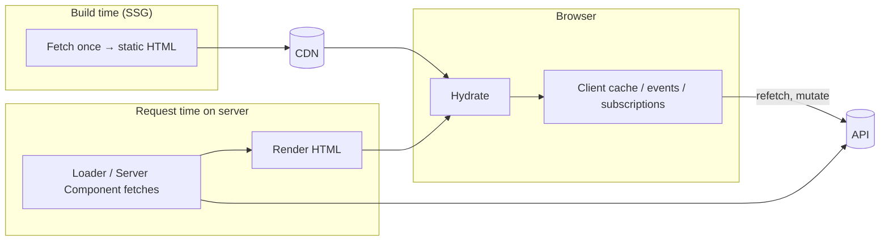
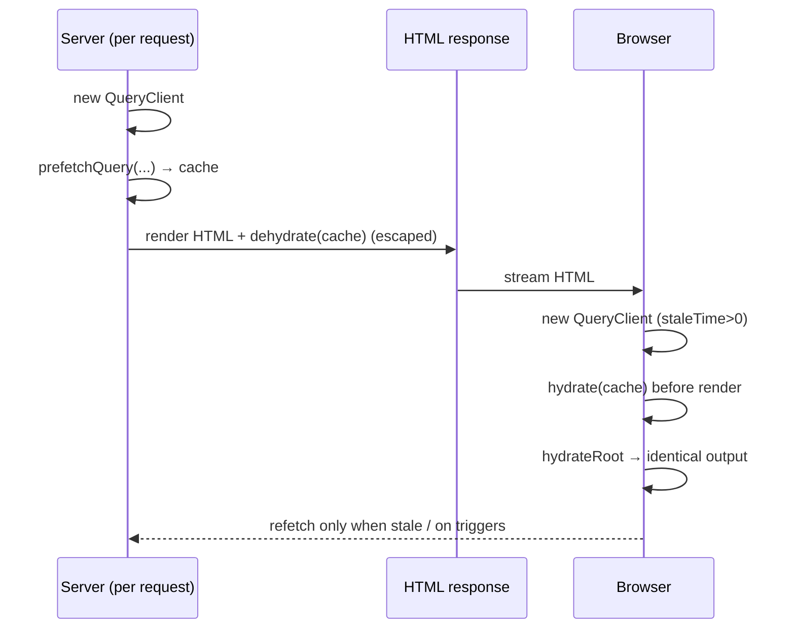
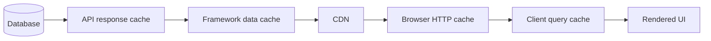

# 06 / 14 — Server-Side Data Loading: Loaders, Server Components, and Hydrating Caches

> **Checked against React 19.3 docs and `@tanstack/react-query` 5.104 (executed: dehydrate/prefetch behaviour, 2026-10-22).** This lesson is **concept-first** because the *mechanisms* (who fetches, on which machine, when, and how the result reaches the browser) are stable, while framework APIs are not. React 19.x APIs (`renderToPipeableStream`, `use`, `cache`, Suspense) are documented on <https://react.dev>. Framework specifics (Next.js App Router, React Router 7 / Remix loaders, TanStack Start) and library hydration APIs (**TanStack Query v5** `dehydrate` / `HydrationBoundary`, **Redux Toolkit 2.x** preloaded state, **Zustand 5** per-request stores) must be checked against their current docs; framework APIs (Next.js, React Router, TanStack Start) were not executed in this review.

## 1. Lesson metadata

| | |
|---|---|
| **Level** | Advanced |
| **Study time** | 5–6 hours (reading 2 h, experiments 1.5 h, exercises 2 h) |
| **Prerequisites** | [Phase 2 / 25 — Hydration and selective hydration](../02-react-rendering-and-internals/25-hydration-and-selective-hydration.md), [Phase 2 / 26 — SSR and client rendering](../02-react-rendering-and-internals/26-ssr-and-client-rendering.md), [Phase 2 / 27 — React Server Components intro](../02-react-rendering-and-internals/27-react-server-components-intro.md), [08 — TanStack Query](./08-tanstack-query.md), [13 — Suspense data loading](./13-suspense-data-loading.md) |
| **Next** | [15 — Error recovery and retries](./15-error-recovery-and-retries.md) |
| **Related** | [09 — Redux Toolkit](./09-redux-toolkit.md), [10 — Zustand](./10-zustand.md), [11 — Context vs external stores](./11-context-vs-external-stores.md), [18 — URL state management](./18-url-state-management.md), [Phase 9 / 01 — SPA, SSR, SSG, streaming](../09-advanced-rendering-and-ecosystem/01-spa-ssr-ssg-streaming.md), [Phase 9 / 03 — Server Components in depth](../09-advanced-rendering-and-ecosystem/03-server-components-in-depth.md), [Phase 9 / 12 — Auth boundaries](../09-advanced-rendering-and-ecosystem/12-auth-boundaries.md) |

**Learning objectives.** After this lesson you can:
1. Enumerate the places data can be loaded (browser after load, route loader, server render, Server Component, build time) and state, for each, *where code runs, when, and what the user sees*.
2. Explain why server-loaded data must be transferred to the client (serialised and hydrated) and what breaks when the two sides disagree.
3. Hydrate a client-side cache (TanStack Query) from server-prefetched data, explaining `staleTime`'s role in avoiding an immediate refetch.
4. Create stores and caches **per request**, and explain the cross-user leakage that module singletons cause.
5. Eliminate server-side waterfalls with parallel loading, and reason about streaming and Suspense boundaries.
6. Apply the security rules: serialisation escaping, secret handling, user-scoped caching, auth forwarding.
7. Choose between route loaders, Server Components, and client caches for a feature, using responsibilities rather than preference.

**Concepts covered:** request lifecycle on the server, route loaders, Server Components as loaders, per-request scope, request-level memoisation (`cache`), dehydrate/hydrate, serialisation constraints, escaping, hydration mismatch, `staleTime` and initial refetch, streaming, waterfalls, `Cache-Control` and CDNs, user-specific content, mutation + revalidation, secrets and taint, SSR vs SSG vs ISR (conceptual).

---

## 2. Deep conceptual explanation

### 2.1 What problem is this lesson solving?

A client-only React app has this critical path: download HTML shell → download and run JS → render → *then* start fetching data → render again. Data requests start at the end of a long chain and run from the user's (often slow) network. For content that does not depend on browser-only state, the server can start the data requests at the **start** of the chain, close to the data, and deliver HTML that already contains the content. The costs: you now have two environments, a serialisation boundary, per-request isolation to get right, and security considerations that browser-only code never had.

### 2.2 Responsibilities: where each concern lives

| Responsibility | Route loader (framework) | Server Component | Client cache (TanStack Query / RTK Query) | Plain SSR + `useEffect` |
|---|---|---|---|---|
| Start data requests before the component tree renders | **Yes** | Yes (as the component renders; parallelise manually) | Only with prefetch | **No** (effects don't run on the server) |
| Run only on the server (secrets, DB access) | Yes (server loaders) | **Yes** | No (browser) unless prefetched on server | No |
| Deliver data in the initial HTML | Yes | Yes | Only if hydrated | **No** |
| Client-side caching, refetch on focus, optimistic UI | No (revalidation instead) | No | **Yes** | Manual |
| Interactivity | Client Components | Client Components | Client | Client |
| Serialisation to the browser | Framework | RSC protocol | You (dehydrate/hydrate) | N/A |
| Per-request isolation | Framework | Framework (request scope) | **You** create a client per request | N/A |

The recurring design question: **who owns this data after the first paint?** If nothing on the client changes it, a server-only path is enough. If the client refetches, mutates, or subscribes, it needs a client cache; the server's job is to *seed* it.

### 2.3 The mental model: four places to load



| Where | When | Freshness | Personalisation | Typical use |
|---|---|---|---|---|
| **Build time (SSG)** | Deploy | As old as the last build (or incrementally revalidated) | None per user | Docs, marketing |
| **Server per request** | Each navigation/request | Fresh per request (modulo caches) | Per user (cookies) | Dashboards, product pages, authenticated pages |
| **Browser after hydrate** | After JS runs | Fresh, fastest to update | Per user | Interactions, polling, live data |
| **Edge/CDN cache** | Between | Controlled by headers | Must not mix users | Public pages |

*Teaching model.* These four are not exclusive: a typical page is *server-loaded for first paint, then client-managed after*.

### 2.4 The serialisation boundary

Server-loaded data must cross to the browser as **bytes**: embedded in the HTML (e.g. a JSON script tag) or sent via the RSC protocol. Consequences:

- **Only serialisable values**: no functions, class instances, `Map`/`Set` (unless the framework/library handles them), unresolved promises (except where RSC explicitly supports them). `Date` becomes a string through JSON; rehydrating needs deliberate parsing.
- **Escaping**: JSON embedded in HTML must be escaped so that `</script>` or `<!--` inside user-supplied data cannot break out (an **XSS** vector: [Phase 10 / 06](../10-production-engineering/06-security-xss-csrf-csp.md)). Frameworks and libraries that provide dehydration normally handle this; when hand-rolling, use a serialiser designed for it (e.g. a maintained library such as `serialize-javascript`; its `isJSON` option was run against 7.1.2) rather than raw `JSON.stringify` inside a script tag.
- **Size**: everything you embed ships twice conceptually (HTML text and as data for hydration), costing bytes and parse time ([Phase 7 / 16](../07-performance/16-bundle-analysis.md)). Embedding 2 MB of JSON "to be safe" can erase SSR's benefit.

### 2.5 Hydration requires agreement

The client's first render must produce the same output as the server's HTML for the same data ([Phase 2 / 25](../02-react-rendering-and-internals/25-hydration-and-selective-hydration.md)). If the client cache starts empty while the server rendered with data, the client's first render differs (loading state vs content): a hydration mismatch or a flash. Hence **dehydrate/hydrate** of caches: the server includes the cache state; the client restores it *before* rendering.

### 2.6 What React exposes versus what frameworks add

React exposes: server renderers (`renderToPipeableStream`, `renderToReadableStream`), `hydrateRoot`, Suspense streaming, `use`, `cache` (request-scoped memoisation in Server Components; react.dev says `cache` is for Server Components only), Server Components and Actions as *capabilities*. React does **not** provide routing, loaders, request context, or cache invalidation. **Frameworks** add: routing, loaders/data APIs, build integration, server runtime, caching layers, and mutation/revalidation conventions. This is why data-loading advice differs per framework, and why this lesson stays conceptual about them.

### 2.7 Common misconceptions

| Misconception | Reality |
|---|---|
| "`useEffect` fetching works with SSR." | Effects don't run during server rendering; server HTML contains the loading state. |
| "SSR makes the app faster by itself." | It changes *when* content is visible (and when data requests start); TTFB may rise; hydration cost remains ([Phase 9 / 02](../09-advanced-rendering-and-ecosystem/02-hydration-internals-deep-dive.md)). |
| "A module-level `QueryClient`/store is fine." | On the server it is shared across requests: data leaks between users. |
| "Server Components remove the need for a client cache." | They remove it for *read-mostly, server-owned* data. Interactive, frequently refreshed, optimistic or realtime data still wants a client cache. |
| "Dehydrated state is trusted." | It is data from your server embedded in HTML; handle escaping and don't include secrets. |
| "Prefetching on the server guarantees no client refetch." | With the default `staleTime: 0`, hydrated data is stale immediately and the client refetches on mount ([5.2](#52-practical-tanstack-query-prefetch-on-the-server-and-hydrate)). |
| "Cache the page at the CDN, it's faster." | Not if the page contains user-specific data; use `private`/`no-store` or vary correctly, or you leak accounts (see section 9). |

---

## 3. Internal mechanics

### 3.1 The server request lifecycle (conceptual)

1. Request arrives (URL, headers, cookies).
2. **Routing** selects a route and its loaders/components.
3. **Data loading** starts: loader functions, or Server Components awaiting data.
4. **Render** to HTML (stream). Suspense boundaries that are pending emit fallbacks first.
5. **Serialise** the data the client needs (dehydrated cache, RSC payload).
6. Response streams to the browser (HTML, with data inlined or following).
7. Browser parses HTML, displays content (even before JS), downloads JS.
8. **Hydration**: React attaches to existing DOM; client cache restored; interactions enabled.
9. Client takes over: refetch, mutations, subscriptions.

*Public guarantee:* React's server renderer produces HTML and supports streaming/Suspense. *Framework detail:* the order of steps 3–6 (e.g. whether loaders must all finish before rendering starts, as with "fetch-then-render" loaders, or can overlap with streaming).

### 3.2 Per-request scope and the singleton hazard

A Node process serves many requests in one JavaScript heap. Module-level variables persist for the process's lifetime.

```ts
// BAD on a server
export const queryClient = new QueryClient();       // shared by all requests
export const store = configureStore({ reducer });    // shared by all requests
export const useSession = create(() => ({ user: null }));
```

Request A (user Alice) populates the cache; request B (Bob) renders with Alice's cached data present. Data leakage, plus unbounded memory growth (cache never garbage-collected per request).

**Rule:** anything that holds *data* must be created **inside the request** and discarded after. On the browser, a singleton is fine (one user per tab).

| Tool | Per-request pattern |
|---|---|
| TanStack Query | `new QueryClient()` per request (or per `cache()`-memoised call in RSC; verify) |
| Redux Toolkit | `makeStore()` factory; `preloadedState` ([09](./09-redux-toolkit.md)) |
| Zustand | `createStore` in a Provider ([10, 5.5](./10-zustand.md)) |
| Context | Naturally scoped (state created in components) |

### 3.3 Request-level memoisation (`cache`)

Within a single server render, several Server Components may need the same data (e.g. the current user). React's `cache(fn)` memoises `fn` **for the duration of one request** in RSC environments, so calling `getUser()` in five components triggers one database call. The react.dev `cache` reference (checked 2026-10-22) says "At this time, `cache` should only be used in Server Components and the cache will be invalidated across server requests"; behaviour outside RSC differs, and frameworks may also dedupe `fetch` calls themselves.

```ts
import { cache } from 'react';
export const getUser = cache(async (id: string) => db.user.findUnique({ where: { id } }));
```

This is request scoped, not a cross-request cache; it is *not* the same as HTTP caching or a data cache layer (framework-specific; verify).

### 3.4 Dehydrate / hydrate (TanStack Query v5)

Concept: the server `QueryClient` holds successfully fetched queries; `dehydrate(queryClient)` produces a **plain serialisable snapshot** (keys, data, timestamps, status). On the client, `<HydrationBoundary state={...}>` (or `hydrate(queryClient, state)`) inserts those entries into the client's `QueryClient` cache. By default only **successful** queries are dehydrated (configurable via `shouldDehydrateQuery`; verified in 5.104), and pending-query dehydration for streaming is a newer capability to verify.

The `dataUpdatedAt` timestamp travels with the data. Therefore `staleTime` on the client decides if hydrated data is fresh: with the default `staleTime: 0`, the client considers hydrated data stale and **refetches on mount**; set a `staleTime` (e.g. 30–60 s, or whatever fits the data) in the client's defaults to avoid the immediate duplicate request.

### 3.5 Server waterfalls

On the server the same waterfall rules apply, with different costs:

```ts
// sequential: 100 ms + 120 ms
const user = await getUser(id);
const orders = await getOrders(id);

// parallel: ~120 ms
const [user, orders] = await Promise.all([getUser(id), getOrders(id)]);
```

Nested Server Components awaiting in series (parent awaits, then renders child that awaits) produce waterfalls too. Remedies: start promises early and pass them down (`use` in clients; [13](./13-suspense-data-loading.md)), hoist loading to the route level, or place Suspense boundaries so slow parts stream later.

### 3.6 Streaming and boundaries

With streaming SSR, the server can flush the shell immediately and send Suspense-wrapped parts as they resolve ([13, section 3.6](./13-suspense-data-loading.md)). Implication for data loading: *the critical content must not depend on the slowest request*; put slow, non-critical data behind boundaries. HTTP status code and headers are decided before the stream starts: an error discovered after the shell is flushed cannot change the 200 status into a 500 (frameworks provide patterns; verify).

### 3.7 Mutations and revalidation

After a mutation (a Server Action, a form POST, an API call), server-rendered or cached data must be refreshed. Mechanisms differ: framework `revalidate`/`refresh` APIs (route revalidation after actions in loader-based frameworks; tag/path revalidation in Next.js: verify), or client `invalidateQueries` for client-cached data. Rule: **know every cache layer between the data and the screen** (database → API cache → framework data cache → CDN → browser HTTP cache → client query cache) and which one your mutation invalidates ([06 — Cache consistency and invalidation](./06-cache-consistency-and-invalidation.md)).

---

## 4. Step-by-step execution walkthrough

Scenario: an authenticated `/orders` page, loaded on the server, then managed on the client by TanStack Query (refetch on focus, optimistic status changes).

**Request 1: first navigation (cold)**

1. Browser requests `/orders` with a session cookie.
2. Server: routing matches; the server code **creates a fresh `QueryClient`** and reads the session from the cookie. (Authentication must happen server-side; do not rely on client state.)
3. Server prefetches `queryClient.prefetchQuery(ordersOptions(userId))`. The `queryFn` runs server-side, calling the API with the user's credentials (forwarded cookie or a server token).
4. Server renders the tree to HTML. Client Components that call `useQuery(ordersOptions(userId))` find data already in the server client's cache and render the **table**, not a spinner.
5. Server calls `dehydrate(queryClient)` and embeds the snapshot (escaped) in the response (framework helper or `HydrationBoundary` in the RSC tree; `dehydrate`, `HydrationBoundary` and `isServer` are exported by `@tanstack/react-query` 5.104).
6. Browser paints the table HTML (before JS).
7. JS loads; client creates its own `QueryClient` (**with a default `staleTime`**), hydrates the snapshot **before** rendering the tree; `hydrateRoot` renders the same table: no mismatch.
8. Hydrated entry age < `staleTime` → no immediate refetch (if `staleTime` left at 0: one redundant refetch).
9. User tabs away and back: focus refetch (if stale) updates the table.
10. User changes an order's status: optimistic update via mutation ([05](./05-optimistic-updates.md)); invalidation refetches.

**Predict:** What does the user see if step 3's `queryFn` throws on the server? *Answer (verified in 5.104):* default dehydration omits failed queries (and queries that are still pending), so the server HTML contains the loading state (or an error boundary result, depending on whether you `await` with `prefetchQuery` (resolves to `undefined` and swallows errors, verified) or `fetchQuery` (rejects, verified)); the client then starts the query itself after hydration. A well-designed page distinguishes "prefetch failed, client will retry" from "page cannot render" (e.g. 404/500 for a missing resource).

**Request 2 from another user (the bug case):** if the `QueryClient` were a module singleton, request 2 would find `['orders', 'list']` hydrated... under a key that doesn't include the user, serving Alice's orders to Bob. Two defences: per-request client *and* user-identifying keys.

---

## 5. Code examples

### 5.1 Minimal: loader-style server loading with a plain Node renderer

A deliberately framework-free example showing the mechanics: fetch on the server, render, embed data, hydrate.

```tsx
// server.tsx (Node, Express-like; simplified: no error handling, no streaming)
import { renderToString } from 'react-dom/server';
import serialize from 'serialize-javascript';
import { App } from './App';
import { getOrders } from './db';

app.get('/orders', async (req, res) => {
  const user = await requireUser(req);                    // auth on the server
  const orders = await getOrders(user.id);                // data loading BEFORE render
  const html = renderToString(<App initialOrders={orders} />);
  res.setHeader('Cache-Control', 'private, no-store');    // user-specific
  res.send(`<!doctype html>
<html><body>
<div id="root">${html}</div>
<script>window.__INITIAL__ = ${serialize({ orders }, { isJSON: true })};</script>
<script type="module" src="/client.js"></script>
</body></html>`);
});
```

```tsx
// client.tsx
import { hydrateRoot } from 'react-dom/client';
import { App } from './App';

const initial = (window as unknown as { __INITIAL__: { orders: Order[] } }).__INITIAL__;
hydrateRoot(document.getElementById('root')!, <App initialOrders={initial.orders} />);
```

Line notes:
- `serialize-javascript` (7.1.2 checked; `isJSON: true` is a documented option) escapes characters like `<`, `>` and U+2028/2029 so embedded data cannot break out of the script tag. Raw `JSON.stringify` is unsafe here.
- Both sides render `<App initialOrders>` with the **same data**: no mismatch.
- `renderToString` is the non-streaming API (the react.dev reference carries a pitfall: "renderToString does not support streaming or waiting for data"; prefer the streaming APIs for new code). It is used here to keep the mechanism visible; production code uses `renderToPipeableStream` ([Phase 9 / 01](../09-advanced-rendering-and-ecosystem/01-spa-ssr-ssg-streaming.md)).
- No `useEffect` fetch: the data arrives through props.
- `Cache-Control: private, no-store` prevents shared caches (CDNs) from storing a user's page.

### 5.2 Practical: TanStack Query prefetch on the server and hydrate

Shape of the integration in an RSC framework (e.g. Next.js App Router). Verify against the framework's and TanStack Query's current SSR guides; this shows the pattern, not guaranteed exact syntax.

```tsx
// lib/queryClient.ts
import { QueryClient, isServer } from '@tanstack/react-query';
import { cache } from 'react';

function makeQueryClient() {
  return new QueryClient({
    defaultOptions: { queries: { staleTime: 60_000 } },   // avoid immediate refetch after hydration
  });
}

let browserClient: QueryClient | undefined;
export function getQueryClient(): QueryClient {
  if (isServer) return serverClient();                    // new per request
  return (browserClient ??= makeQueryClient());           // singleton in the browser only
}
const serverClient = cache(makeQueryClient);              // request-scoped in RSC (React `cache`, Server Components only)
```

```tsx
// app/orders/page.tsx  (Server Component)
import { dehydrate, HydrationBoundary } from '@tanstack/react-query';
import { getQueryClient } from '@/lib/queryClient';
import { ordersOptions } from '@/lib/orders';
import { OrdersTable } from './OrdersTable';

export default async function OrdersPage() {
  const user = await requireUser();
  const queryClient = getQueryClient();
  await queryClient.prefetchQuery(ordersOptions(user.id));   // runs on the server

  return (
    <HydrationBoundary state={dehydrate(queryClient)}>
      <OrdersTable userId={user.id} />
    </HydrationBoundary>
  );
}
```

```tsx
// app/orders/OrdersTable.tsx
'use client';
import { useQuery } from '@tanstack/react-query';
import { ordersOptions } from '@/lib/orders';

export function OrdersTable({ userId }: { userId: string }) {
  const { data, isFetching } = useQuery(ordersOptions(userId));
  if (!data) return <p>Loading…</p>;                          // only if prefetch failed
  return (
    <table aria-busy={isFetching}>
      {/* rows */}
    </table>
  );
}
```

Shared options (used on server **and** client so keys match exactly):

```ts
// lib/orders.ts
import { queryOptions } from '@tanstack/react-query';

export const ordersOptions = (userId: string) =>
  queryOptions({
    queryKey: ['orders', userId, 'list'] as const,           // user-identifying key
    queryFn: ({ signal }) => fetchOrders(userId, { signal }),
  });
```

Line notes:
- `isServer` from TanStack Query distinguishes environments (exported by 5.104, verified); the browser singleton persists across React suspensions/re-renders; the server instance is per request.
- Providers: the client side still needs a `QueryClientProvider` using `getQueryClient()` in a Client Component wrapper ([08](./08-tanstack-query.md)).
- Because `ordersOptions` is shared, server and client agree on the **key**; a key drift (different shapes) means hydrated data is never read.
- `prefetchQuery` does not throw: on error the query is simply absent from the dehydrated state (verified in 5.104), and the client fetches after hydration. Use `fetchQuery`/`ensureQueryData` when failure should abort the page (e.g. to trigger `notFound()`).
- `HydrationBoundary` can appear at any level, even nested per route segment, each with its own dehydrated slice.

**Predict:** With `staleTime: 0` (default) instead of 60 000, what happens network-wise on first load? *Answer:* the server fetches once; the client hydrates and, on mount, sees stale data → one more request to the same endpoint. Not a correctness bug but a doubled request on every page load.

### 5.3 Incorrect examples

```tsx
// BAD 1: fetching in useEffect and expecting SSR to include it
function Orders() {
  const [orders, setOrders] = useState<Order[]>([]);
  useEffect(() => { fetch('/api/orders').then(r => r.json()).then(setOrders); }, []);
  return <Table rows={orders} />;      // SSR HTML: empty table; user sees data only after JS+fetch
}

// BAD 2: singleton QueryClient shared across requests
const queryClient = new QueryClient();   // module scope, used on the server

// BAD 3: non-user-specific key for user-specific data
queryKey: ['orders']                      // same key for every user in a shared server cache

// BAD 4: raw JSON in a script tag
`<script>window.__DATA__ = ${JSON.stringify(data)}</script>`   // XSS if data contains "</script>"

// BAD 5: server waterfall
const user = await getUser(id);
const prefs = await getPrefs(id);        // independent of user, but serialised
const orders = await getOrders(id);

// BAD 6: leaking secrets to the client through props or dehydrated state
return <ClientPanel config={{ apiKey: process.env.API_KEY, ...publicConfig }} />;
```

Why each fails:
1. Effects run only in the browser; server HTML contains the empty state; LCP waits for JS + a request.
2. Cross-request data leakage and unbounded growth.
3. Collisions across users: wrong data; also impedes correct invalidation.
4. Attacker-controlled strings terminate the script tag and inject markup.
5. Latency = sum, not max.
6. Anything passed to a Client Component or dehydrated is shipped to the browser and visible in "view source".

### 5.4 Corrected

```tsx
// (1) loader/server-side prefetch + hydrated cache (5.2), or loader data passed as props (5.1)
// (2) per-request client (5.2: cache() + isServer branch)
// (3) queryKey: ['orders', userId, 'list']
// (4) use a serialiser that escapes (5.1) or the library/framework's built-in mechanism
// (5) const [user, prefs, orders] = await Promise.all([getUser(id), getPrefs(id), getOrders(id)]);
// (6) pass only public fields:
const publicConfig = { apiBase: process.env.NEXT_PUBLIC_API_BASE };  // names with public prefixes only
```

For (6) in RSC frameworks, some provide taint APIs to *mark* values that must never reach the client (React's `experimental_taintObjectReference`/`experimental_taintUniqueValue`, which react.dev lists as available only in the latest Experimental version of React); treat them as a safety net, not a design.

### 5.5 Advanced: parallel loading with streaming and a client island

```tsx
// Server Component: critical data awaited, slow data streamed
export default async function ProductPage({ id }: { id: string }) {
  const productPromise = getProduct(id);              // start now
  const reviewsPromise = getReviews(id);              // start now, don't await
  const recsPromise = getRecommendations(id);         // start now, don't await

  const product = await productPromise;               // critical: price, title, hero
  return (
    <>
      <ProductHero product={product} />
      <Suspense fallback={<ReviewsSkeleton />}>
        <Reviews reviewsPromise={reviewsPromise} />   {/* client or server component using use() */}
      </Suspense>
      <Suspense fallback={<RecsSkeleton />}>
        <Recommendations recsPromise={recsPromise} />
      </Suspense>
    </>
  );
}
```

All three requests start immediately (parallel); the hero renders as soon as the product resolves; reviews and recommendations stream into their boundaries. If `getReviews` throws, an error boundary should localise the failure (the framework's route error UI is too coarse; wrap in a component-level boundary; [13](./13-suspense-data-loading.md), [15](./15-error-recovery-and-retries.md)). Unhandled rejections on a promise that nobody awaits (e.g. if the component that would `use` it is not rendered) can surface as process-level warnings on the server; attach a no-op `.catch` when a promise might go unused, or restructure so every started promise is consumed (verify runtime behaviour).

---

## 6. Visual explanations

### 6.1 Client-only versus server-loaded timeline

```mermaid
gantt
  title Time to first content (illustrative, not measured)
  dateFormat X
  axisFormat %L
  section Client-only SPA
  HTML shell           :a1, 0, 50
  JS download + run    :a2, 50, 400
  Data fetch           :a3, 400, 700
  Content visible      :milestone, 700, 700
  section Server-loaded (SSR/RSC)
  Server data + render :b1, 0, 250
  HTML with content    :milestone, 250, 250
  JS download + hydrate:b2, 250, 600
  Interactive          :milestone, 600, 600
```



*Illustrative numbers only.* Real outcomes depend on API latency near the server, TTFB, caching, and JS size: measure ([Phase 7 / 01](../07-performance/01-measure-before-optimizing.md)).

### 6.2 Dehydrate and hydrate



### 6.3 Cache layers a mutation must account for



---

## 7. Alternative approaches and trade-offs

| Criterion | Client-only + query cache | Route loader (server) + props | Server Components | Server prefetch + hydrate client cache | SSG / ISR |
|---|---|---|---|---|---|
| First content timing | Late (after JS) | Early | Early | Early | **Earliest (static)** |
| Personalisation | Easy | Easy (cookies) | Easy | Easy | **Hard** (needs client fetch or edge logic) |
| Client freshness features (focus refetch, polling) | **Yes** | Revalidation only | Limited | **Yes** | Via client fetch |
| Per-request isolation required | No | Framework | Framework | **You (client per request)** | N/A |
| Duplicate/doubled requests risk | Low | Low | Low | **`staleTime` required** | Low |
| Complexity | Lowest | Moderate | Moderate–high (boundaries, serialisation) | Highest | Low–moderate |
| Bundle size effect | Larger client JS | Similar | **Smaller** (server-only code stays on server) | Larger (query lib + hydration) | Similar |
| Needs a framework | No | Yes | Yes | Yes (or custom SSR) | Yes/static generator |

**Scenario where server loading is *not* the best fit.** An internal admin tool behind a login, used on fast networks with heavy client-side interactivity and no SEO needs: a client-only SPA with TanStack Query is simpler, cheaper to run (no Node render servers), and the initial-load gain from SSR is marginal. Another: a fully realtime trading screen, where the first paint's data is stale within seconds and a socket supplies everything.

**Scenario where it is notably well-suited.** A public product page with SEO and Web Vitals targets, personalised only in a small client-side slice (cart badge, saved status): server-load the product, stream reviews, and fetch personalised bits client-side to keep the main HTML cacheable.

---

## 8. Best practices and anti-patterns

### Best practices
- **Decide data ownership per piece**: server-only, or server-seeded + client-managed.
- **Share query options** (key + function) between server and client.
- **Create caches/stores per request**; singletons only in the browser.
- **Include user/tenant identity in keys** for user-scoped data.
- **Set client `staleTime`** to avoid immediate refetch after hydration.
- **Load in parallel**; await only the critical path; stream the rest.
- **Escape serialised data**; keep it small; never serialise secrets.
- **Authenticate on the server**; treat the client's claims as untrusted.
- **Set correct cache headers**: `private`/`no-store` for personalised responses; public + short `s-maxage` + revalidation for public ones.
- **Test the server path**: render with fixtures, assert HTML contains content, assert no duplicated requests on hydrate.

### Beginner mistakes
- Fetching in `useEffect` and being surprised by empty SSR output.
- Module-level singleton clients.
- Forgetting that hydrated data needs a matching key.
- Using browser-only APIs (`window`, `localStorage`) during server render.

### Experienced-developer mistakes
- Over-fetching on the server "because it's fast" and serialising huge payloads.
- Server waterfalls from nested awaits.
- Over-relying on framework data caching without understanding invalidation (stale pages after mutation).
- Mixing request-scoped caches with cross-request caches, or caching personalised responses at the CDN.
- Treating prefetch failure as success (`prefetchQuery` swallows errors) and rendering a broken page.
- Blocking the whole page on non-critical data (no boundaries).

### Smells
- `if (typeof window === 'undefined')` scattered through components.
- Hydration warnings silenced rather than fixed.
- Two sources of truth: server props and client cache for the same data with different update paths.

### Justified exceptions
- A module-level cache for **public, immutable, cross-user** reference data (country list) on the server, with explicit TTL: this is deliberate cross-request caching, not state.
- `suppressHydrationWarning` on a single element that legitimately differs (timestamps), documented.

---

## 9. Real-world application

| Domain | Pattern | Engineering constraints |
|---|---|---|
| E-commerce | Product/category pages server-loaded and CDN-cached (public); price/stock hydrated or revalidated; cart client-side | Price/stock freshness vs cache TTL; stale price at checkout must be revalidated server-side; Vary on locale/currency |
| Dashboards | Server-prefetch the first view per user; client cache for refresh/filters; filters in the URL | Per-user data: `private`; large payload budgets; avoid hydrating huge tables |
| Finance | Server-render account summaries for fast, consistent first paint; client subscribes for live updates | Never cache across users; audit-able server logs; PII must not be embedded in analytics/error payloads; short-lived data labelled with `asOf` |
| Auth | Session resolved at the edge/server per request; redirect before render | Redirects must happen before streaming starts; do not render authenticated HTML to anonymous users |
| Forms | Server Actions or POST handlers with revalidation | CSRF protection, idempotency, progressive enhancement ([Phase 9 / 11](../09-advanced-rendering-and-ecosystem/11-progressive-enhancement.md)) |
| Realtime | Server seeds the snapshot; socket handles deltas | Snapshot/stream sequence handoff to avoid gaps ([17](./17-real-time-websockets-subscriptions.md)) |
| Multi-team | Shared data-access layer with typed query options; teams own their routes' loaders | Standardise keys, cache headers, error contracts; avoid each team inventing its own hydration approach |

**CDN and `Cache-Control` rules of thumb.** Public page, no personalisation: `public, s-maxage=…, stale-while-revalidate=…` (verify semantics with your CDN). Any response influenced by cookies/authorisation: `private` or `no-store`, and `Vary` appropriately. A personalised response cached publicly is a **data breach**, not a performance bug.

---

## 10. Debugging and troubleshooting

| Symptom | Likely root cause | Investigation | Fix / validation |
|---|---|---|---|
| "Text content does not match server-rendered HTML" / hydration error | Client's first render differs: cache not hydrated, time/locale/random differences, browser-only branches | Read the console diff; view-source vs rendered DOM; disable JS to see server HTML | Hydrate cache before render; make render deterministic; move browser-only logic to effects |
| Table flashes spinner after SSR | Query key mismatch between prefetch and client, or cache not hydrated | Compare keys in server code and `useQuery`; DevTools Query tab | Share `queryOptions`; fix provider order |
| Duplicate request on every load | `staleTime: 0` after hydration | Network panel: same endpoint twice (server logs + browser) | Set `staleTime` default |
| User sees another user's data | Singleton client/store on server, or shared CDN cache, or key without user id | Reproduce with two concurrent sessions; inspect response headers (`Cache-Control`, `Age`) | Per-request instances; `private`; user-scoped keys; purge cache |
| Data stale after mutation | A cache layer not invalidated (framework cache, CDN, client cache) | Walk each layer in 6.3; check revalidation call | Invalidate/revalidate the right layer(s) |
| `window is not defined` on server | Browser API used in render | Stack trace | Guard in effect, or lazy client-only component |
| Slow TTFB after adding loaders | Server waterfall or awaiting non-critical data | Server timing logs; tracing ([Phase 10 / 04](../10-production-engineering/04-observability-and-logging.md)) | `Promise.all`; stream with Suspense |
| Huge HTML payload | Dehydrated state includes entire lists | View source size; Network transfer | Select fields server-side; paginate; don't dehydrate non-visible queries |
| Memory growth on the server | Per-process caches growing | Heap snapshots | Per-request clients; bounded caches |

Method: **view source** and **disable JavaScript** to see exactly what the server produced; compare with the post-hydration DOM; use server logs/traces to see request fan-out; use the query devtools in the browser to confirm hydrated entries and ages.

---

## 11. Exercises

### Level A — Knowledge
**A1.** Why don't `useEffect` fetches appear in server-rendered HTML?
**A2.** What does `dehydrate` produce, and what does `HydrationBoundary` do with it?
**A3.** Why must the server `QueryClient` be created per request?
**A4.** What role does `staleTime` play right after hydration?
**A5.** Name three things that must not be serialised into client-visible state.
**A6.** What is request-level memoisation (`cache`), and how does it differ from an HTTP cache?

### Level B — Code comprehension
**B1.** In 5.2, what happens if the Server Component prefetches `['orders', userId, 'list']` but the client calls `useQuery({ queryKey: ['orders', userId], ... })`?
**B2.** In 5.1, why is `Cache-Control: private, no-store` present?
**B3.** In 5.5, which request determines when the hero appears, and what if `getReviews` takes 5 s?
**B4.** Predict network activity (server calls + browser calls) for 5.2 on first load with `staleTime: 60_000`, then after a window-focus 90 s later.

### Level C — Implementation
**C1.** Write the Provider and `getQueryClient` pattern for a Vite + custom Express SSR app (client singleton in browser, new client per request on the server).
**C2.** Implement a hydration-safe `<LocalTime iso>` component that avoids mismatches caused by time zones.
**C3.** Convert a sequential three-request loader into parallel loading with one critical and two streamed requests.

### Level D — Debugging
**D1.** After deploy, users occasionally see another user's name in the header. Investigate: list hypotheses ordered by likelihood and how to test each.
**D2.** The server HTML shows content, but the page flashes a loading state after hydration. Diagnose.
**D3.** The console shows a hydration mismatch only for users in certain time zones. Diagnose and fix.

### Level E — Architecture and engineering decisions
**E1.** Decide server vs client loading for: marketing page, product page, order history, live ticker, admin settings, search results. Justify.
**E2.** A team proposes caching all pages at the CDN for performance, including pages showing "Hello, {name}". Evaluate.
**E3.** Choose between server loaders alone and loaders + TanStack Query for a CRUD dashboard with 15 engineers.

### Level F — Expert challenge
**F1.** Design the data layer for a multi-tenant SaaS with server rendering: tenant/user scoping, per-request clients, cache layers, invalidation on mutation, and observability.
**F2.** Design a snapshot-plus-stream handoff for a server-rendered realtime page that avoids both missed and duplicated updates.

---

## 12. Detailed answers and explanations

> Attempt the exercises first.

**A1.** Effects are run by React after commit *in the browser*; server rendering produces HTML from a single render pass and never runs effects. Hence server HTML shows the initial (loading) state.

**A2.** `dehydrate(queryClient)` produces a plain, serialisable snapshot of cache entries (successful by default). `HydrationBoundary` takes that snapshot and, on the client, inserts the entries into the client's `QueryClient` before/while rendering so that the first render sees data. Not magic: keys and options on the client must match.

**A3.** The process serves many users; a shared client would mix their cached data (leak) and grow without bound. Per-request instances isolate and are garbage-collected after the response.

**A4.** Hydrated entries carry `dataUpdatedAt`; the client compares age with its `staleTime`. If stale (default 0), mount triggers a refetch; if fresh, none. Wrong answer: "hydration guarantees no refetch".

**A5.** Secrets (API keys, tokens), other users' data, internal identifiers/PII not needed by the UI, server-only configuration, and (in some designs) raw database records with sensitive columns. Everything shipped to the client is visible.

**A6.** `cache` memoises a function's result for the duration of one server render so repeated calls dedupe; it is discarded after the request. An HTTP cache stores responses across requests/users according to headers. Different scope and invalidation.

**B1.** The hydrated entry is under `['orders', userId, 'list']` and the client reads `['orders', userId]`: different keys, so a cache miss: loading state and a fresh fetch; the hydrated data sits unused. Fix: share `ordersOptions`. (Partial prefix matching applies to invalidation, not reads.)

**B2.** The page contains user-specific data; shared caches (CDN) must not store it; `private` forbids shared caches, `no-store` forbids storage entirely. Without it a CDN could serve user A's HTML to user B.

**B3.** `getProduct` (awaited) gates the hero. If `getReviews` takes 5 s, the hero and recommendations still render; the reviews skeleton shows ~5 s then streams in. If `getReviews` rejects with no local error boundary, the error may propagate to the route-level error UI (framework-dependent); add a local boundary.

**B4.** First load: server makes the orders API call (1); browser makes none (entry fresh for 60 s). Focus at 90 s: entry is stale (age 90 s > 60 s) so the browser refetches (1 browser request) and updates in place. Wrong: "browser refetches on load" (only with `staleTime: 0`).

**C1.**
```tsx
// shared
export function createClient() {
  return new QueryClient({ defaultOptions: { queries: { staleTime: 60_000 } } });
}
// server.tsx (per request)
const queryClient = createClient();
await queryClient.prefetchQuery(ordersOptions(user.id));
const state = dehydrate(queryClient);
const html = renderToString(
  <QueryClientProvider client={queryClient}>
    <HydrationBoundary state={state}><App /></HydrationBoundary>
  </QueryClientProvider>,
);
// embed `state` with an escaping serialiser: window.__RQ__ = serialize(state, { isJSON: true })

// client.tsx (singleton in browser)
const queryClient = createClient();
const state = (window as any).__RQ__;
hydrateRoot(
  document.getElementById('root')!,
  <QueryClientProvider client={queryClient}>
    <HydrationBoundary state={state}><App /></HydrationBoundary>
  </QueryClientProvider>,
);
```
Evaluation: new client per request on server, singleton on client, same `staleTime`, escaped serialisation, shared options. The data transformer for non-JSON values (Dates) is the app's responsibility: verified that `dehydrate` keeps a `Date` as a `Date`, which becomes a string after JSON serialisation; 5.104 exposes `serializeData`/`deserializeData` options on dehydrate/hydrate for this.

**C2.**
```tsx
function LocalTime({ iso }: { iso: string }) {
  const [text, setText] = useState(() => iso.slice(0, 16).replace('T', ' ') + ' UTC'); // deterministic initial
  useEffect(() => {
    setText(new Intl.DateTimeFormat(undefined, { dateStyle: 'medium', timeStyle: 'short' }).format(new Date(iso)));
  }, [iso]);
  return <time dateTime={iso}>{text}</time>;
}
```
The first render (server and client) is deterministic (UTC string); the effect upgrades to local formatting after hydration. Alternative: format with a fixed `timeZone` on both sides, or `suppressHydrationWarning` on that element (documented escape hatch; use sparingly).

**C3.** 
```ts
const productP = getProduct(id), reviewsP = getReviews(id), recsP = getRecs(id);
const product = await productP;      // critical
// pass reviewsP and recsP to Suspense-wrapped consumers (use / async components)
```
Explain: all three start at once; only the critical one gates the shell; failure isolation via boundaries.

**D1.** Hypotheses: (1) a module singleton store/client populated with user data on the server (test: two parallel requests with different cookies; grep for module-level state); (2) CDN/proxy caching the personalised HTML (check `Cache-Control`, `Age`, `Vary`, CDN rules; test with a second account); (3) a server-side `cache`/memo keyed without user id (review keys); (4) React Context default or module variable set in render. Mitigation: purge CDN, hotfix headers, add regression test with concurrent requests.

**D2.** Likely the client cache wasn't hydrated or keys differ, so the client's `useQuery` starts as pending after hydration (and React either shows the loading branch or re-renders), or a `staleTime` of 0 with `isFetching`-based spinner rendering a flash. Check keys, check provider placement (hydration boundary above the consumer), and render `isFetching` as a subtle indicator, not a spinner replacing content.

**D3.** Server renders in UTC (or server's time zone), the client's `Intl` uses the user's zone: output differs only for users whose zone shifts the string. Fix as in C2 or format with an explicit shared time zone.

**E1.** Marketing: SSG. Product: server-loaded, CDN-cacheable public data + client slice for personal bits. Order history: server-loaded per user (private) + client cache for refresh. Live ticker: client socket (SSR a snapshot at most). Admin settings: client-only acceptable or server loader; choose by team constraints. Search results: server-load initial results for the URL query (SEO) + client transitions; URL is the state ([18](./18-url-state-management.md)).

**E2.** Reject for personalised pages: a shared cache would serve one user's name to others; options: cache the static shell and fetch the personalised part client-side, use `private` responses, or edge personalisation with correct `Vary`. Evaluate as a security issue plus performance trade-off, propose the safe alternative.

**E3.** Criteria: client interactivity (optimistic updates, polling, pagination), number of cache layers to reason about, team skill, and consistency of invalidation. A defensible answer: loaders + revalidation suffice for mostly navigational CRUD; add TanStack Query where client freshness/optimism matter; avoid using both for the same data without a clear ownership rule.

**F1.** Expect: tenant id resolved server-side from the session, included in every key and every backend call; per-request client; cache-layer map with owner for each layer and a revalidation tag scheme (`tenant:{id}:orders`); `private` headers for tenant pages; hydrate only visible slices; tracing with tenant/request ids; tests with concurrent tenants; incident playbook for suspected leakage.

**F2.** Embed a sequence number/version with the server snapshot; the client opens the socket after hydration and subscribes from `since=seq`; server replays missed events or the client buffers incoming events until the snapshot's seq is applied, discarding events with seq ≤ snapshot seq; handle reconnects with the same protocol; idempotent event application keyed by id.

---

## 13. Senior engineer interview questions

1. **"Why does SSR with `useEffect` data fetching not produce content?"** Effects don't run during server render; use loaders/Server Components or prefetch + hydrate.
2. **"How do you prevent cross-request data leakage?"** Never keep request data in module scope; create clients/stores per request; include identity in keys; set correct cache headers; test concurrent requests.
3. **"What does hydrating a query cache buy you, and what are the pitfalls?"** First client render matches server HTML (no spinner/mismatch) and avoids a client waterfall; pitfalls: key mismatch, `staleTime` 0 doubling requests, payload size, serialisation of non-JSON.
4. **"Loaders vs Server Components vs client cache: how do you choose?"** By ownership after first paint, interactivity, personalisation, freshness needs, and framework constraints; often combine (server seeds, client manages).
5. **"How do you avoid server waterfalls?"** Start independent requests together (`Promise.all`), pass promises down, hoist data requirements to the route, stream non-critical parts.
6. **"What are the security concerns of embedding data in HTML?"** XSS via unescaped serialisation, exposing secrets/PII, caching personalised pages publicly.
7. **"What is the status-code problem with streaming?"** Headers/status are sent before later boundaries resolve; errors discovered later can't change them; design critical checks (auth, 404) before the stream begins.
8. **"How do mutations interact with server-rendered pages?"** They must invalidate every cache layer involved; frameworks offer revalidation primitives; client caches need invalidation; verify end-to-end freshness.

---

## 14. Further learning resources

| Resource | URL | Covers / why | Level | Study |
|---|---|---|---|---|
| React docs: Server Components | <https://react.dev/reference/rsc/server-components> | What runs where; async components | Intermediate | Whole page |
| React docs: `renderToPipeableStream` | <https://react.dev/reference/react-dom/server/renderToPipeableStream> | Streaming SSR | Advanced | Usage, "Streaming more content as it loads" |
| React docs: `hydrateRoot` | <https://react.dev/reference/react-dom/client/hydrateRoot> | Hydration contract and mismatch caveats | Intermediate | Caveats |
| React docs: `cache` | <https://react.dev/reference/react/cache> | Request-scoped memoisation (RSC) | Intermediate | Whole page |
| React docs: `use` | <https://react.dev/reference/react/use> | Streaming data from server to client | Intermediate | "Streaming data from server to client" |
| TanStack Query: SSR / Advanced SSR guides | <https://tanstack.com/query/latest/docs/framework/react/guides/ssr> *(link checked, HTTP 200, 2026-10-22)* | Hydration, per-request clients | Advanced | Both guides |
| Next.js docs: Data fetching and caching | <https://nextjs.org/docs> | App Router data model (volatile; verify) | Intermediate | Data fetching, caching, revalidation sections |
| React Router docs: Data loading / loaders | <https://reactrouter.com> | Loader model, revalidation | Intermediate | Data loading, actions |
| MDN: Cache-Control | <https://developer.mozilla.org/en-US/docs/Web/HTTP/Headers/Cache-Control> | `private`, `no-store`, `s-maxage` | Intermediate | Directives |
| MDN: Vary | <https://developer.mozilla.org/en-US/docs/Web/HTTP/Headers/Vary> | Shared cache correctness | Intermediate | Whole page |
| `serialize-javascript` | <https://github.com/yahoo/serialize-javascript> | Escaping serialiser used in SSR examples | Intermediate | README |

---

## 15. Knowledge checkpoint

**You understand it if you can:**
- Describe the server request lifecycle, the serialisation boundary, and why hydration needs agreement.
- Explain per-request scoping and the singleton leak.

**You can explain it if you can:**
- Choose between loaders, Server Components, and client caches by ownership and freshness, and explain what server-seeding buys.
- Explain `staleTime`'s effect after hydration.

**You can implement it if you can, without notes:**
- Server prefetch + dehydrate + hydrate with shared `queryOptions`, parallel loading with streamed non-critical sections, and safe serialisation.

**You can debug it if you can:**
- Diagnose hydration mismatches, doubled requests, cross-user leaks, and stale-after-mutation bugs by inspecting server HTML, headers, and cache layers.

**Prerequisite for next lessons:** [15 — Error recovery and retries](./15-error-recovery-and-retries.md), [17 — Real-time: WebSockets and subscriptions](./17-real-time-websockets-subscriptions.md), [18 — URL state management](./18-url-state-management.md), [19 — Technology selection matrix](./19-technology-selection-matrix.md), and [Phase 9 / 03 — Server Components in depth](../09-advanced-rendering-and-ecosystem/03-server-components-in-depth.md).
