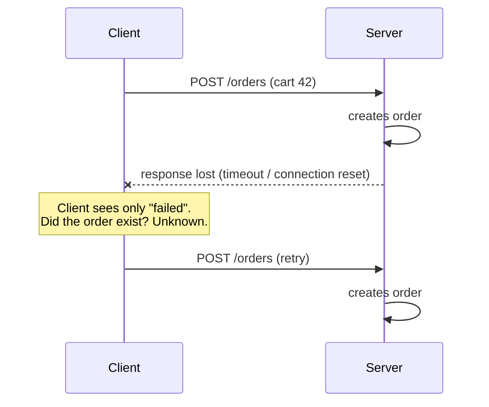
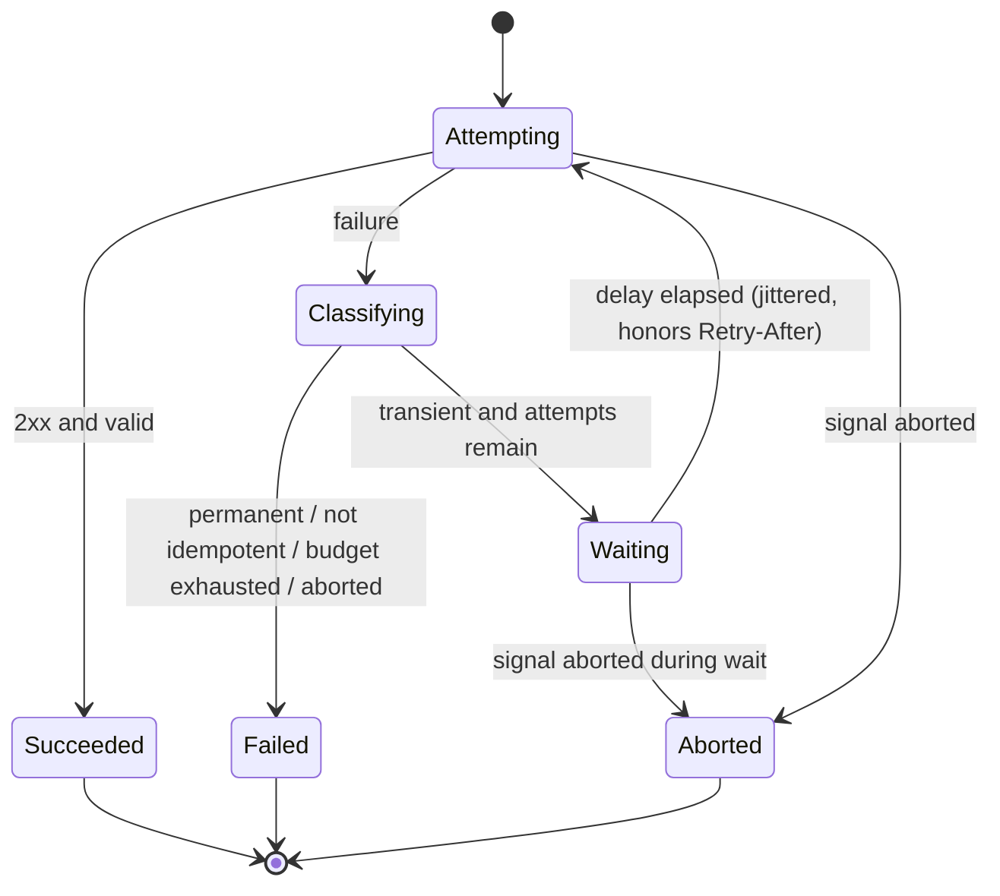
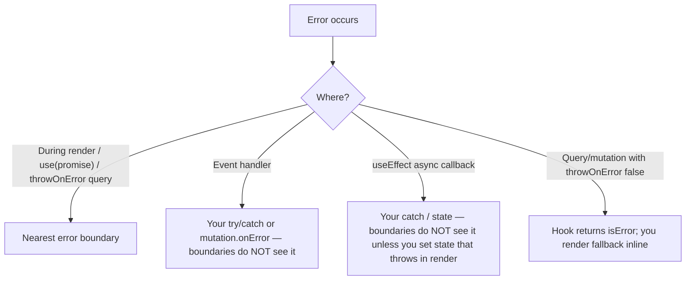
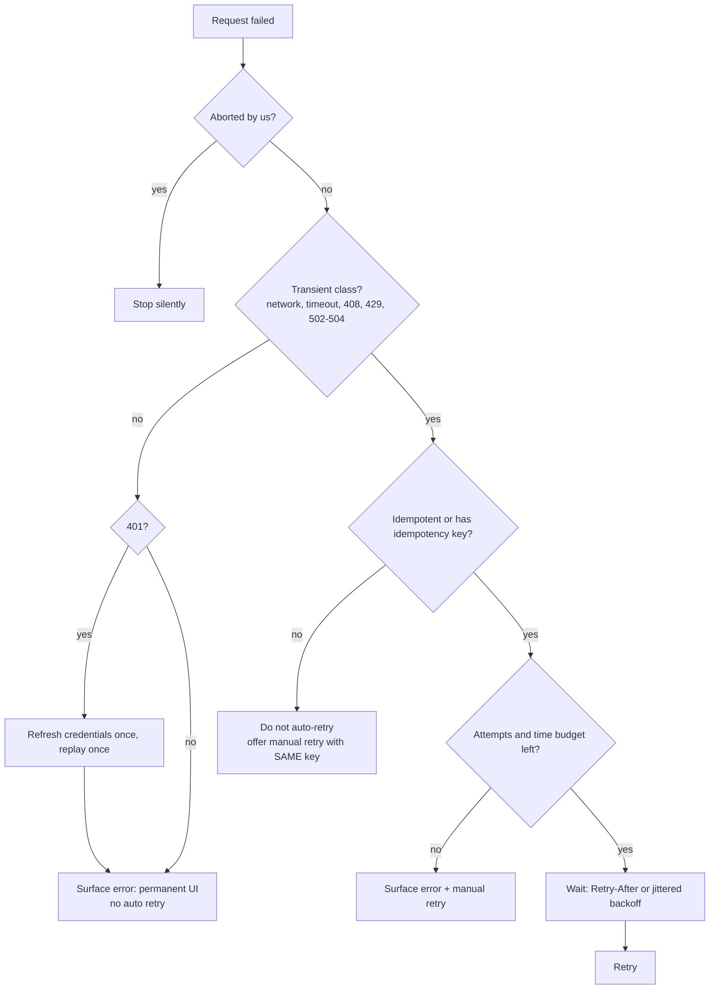
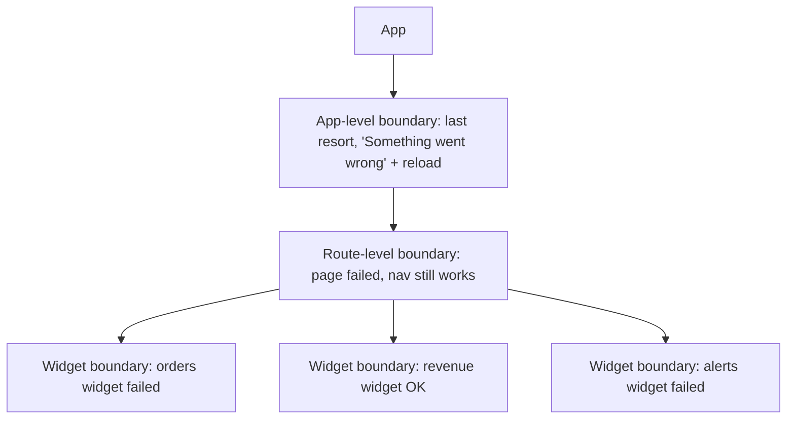

# 06 / 15 — Error Recovery and Retries: Failing Gracefully, Retrying Responsibly

> **Checked 2026-10-22:** TanStack Query retry counts and delays were executed against `@tanstack/query-core` 5.104, `react-error-boundary` 6.1 props were read from its typings and the §5.7 pattern was run with React 19.3, and the React 19 root error callbacks were checked against react.dev. The *concepts* (error taxonomy, idempotency, backoff with jitter, retry budgets, boundary scoping) are stable and independent of any library.

## 1. Lesson metadata

| | |
|---|---|
| **Level** | Advanced |
| **Study time** | 4–5 hours (reading 1.5 h, experiments 1 h, exercises 2 h) |
| **Prerequisites** | [01 — Fetch lifecycle](./01-fetch-lifecycle.md), [02 — Cancellation and race conditions](./02-cancellation-and-race-conditions.md), [03 — Loading and error states](./03-loading-and-error-states.md), [05 — Optimistic updates](./05-optimistic-updates.md), [08 — TanStack Query](./08-tanstack-query.md), [Phase 4 / 19 — Error boundaries](../04-react-architecture/19-error-boundaries.md) |
| **Next** | [16 — Offline considerations](./16-offline-considerations.md) |
| **Related** | [13 — Suspense data loading](./13-suspense-data-loading.md), [Phase 5 / 21 — Error handling patterns](../05-design-patterns/21-error-handling-patterns.md), [Phase 10 / 05 — Error monitoring](../10-production-engineering/05-error-monitoring.md), [Phase 10 / 10 — Resilience and degradation](../10-production-engineering/10-resilience-and-degradation.md) |

**Learning objectives.** After this lesson you can:
1. Classify any failure of a request into a taxonomy that determines *whether*, *when*, and *how* it may be retried.
2. Explain why retrying is dangerous for non-idempotent operations and design an idempotency-key flow that makes it safe.
3. Implement exponential backoff with jitter, honoring `Retry-After`, with cancellation and a total time budget.
4. Predict the timeline of a TanStack Query retry sequence, and customize `retry` / `retryDelay` per error class.
5. Place error boundaries and "retry" affordances at the right granularity, and reset them so a retry actually refetches.
6. Recognize and prevent retry storms (client multiplication, thundering herd, layered retries).
7. Decide when *not* to retry automatically at all.

**Concepts covered:** error taxonomy (network, timeout, abort, HTTP 4xx/5xx, parse, validation), transient vs permanent failure, idempotency and idempotency keys, exponential backoff, jitter, `Retry-After`, retry budgets, circuit breakers, manual vs automatic retry, error boundary reset, query error reset, partial failure, graceful degradation, error reporting hooks.

---

## 2. Deep conceptual explanation

### 2.1 What problem is this lesson solving?

Every request in [Lesson 01](./01-fetch-lifecycle.md) has an error branch. Lesson 03 modelled how to *display* that branch. This lesson answers the next three questions, each of which is harder than it looks:

1. **Is this failure worth another attempt?** A dropped Wi‑Fi packet is; a `404` for a deleted product is not; a `422` validation failure will fail identically forever.
2. **Is another attempt *safe*?** Re-sending "charge the card" after a timeout may charge twice, because a timeout tells you only that *you* stopped waiting, not that the server did nothing.
3. **What does the user do next?** Wait, press a button, get a degraded screen, or be sent elsewhere?

Naïve answers — "wrap it in `try/catch` and retry three times" — produce the two characteristic production failures of this topic: **duplicate side effects** and **retry storms** that turn a brief server hiccup into a prolonged outage.

### 2.2 A failure is not a single thing: the taxonomy

A request can fail at distinct *layers*. They differ in what you know about server-side effects, so they differ in retry policy.

| Class | How it appears in the browser | Server reached? | Typically transient? | Retry policy |
|---|---|---|---|---|
| **Offline / DNS / connection refused / TLS failure** | `fetch` rejects with `TypeError` (the spec deliberately does not say why) | No (usually) | Often | Retry with backoff; also wait for connectivity ([16](./16-offline-considerations.md)) |
| **Timeout (you gave up)** | `AbortSignal.timeout()` aborts → rejection with `DOMException` named `TimeoutError` | **Unknown** | Often | Retry only if idempotent |
| **Aborted by you** (navigation, unmount, newer request) | Rejection with `AbortError` | Unknown | n/a | Never "retry"; it is intentional ([02](./02-cancellation-and-race-conditions.md)) |
| **HTTP 5xx: 500 / 502 / 503 / 504** | Resolved `Response`, `ok === false` | Yes | 502/503/504 usually; 500 sometimes | Bounded retry, backoff |
| **HTTP 408 / 429** | Resolved, `ok === false` | Yes | Yes | Retry after waiting; obey `Retry-After` if present |
| **HTTP 4xx other (400, 401, 403, 404, 409, 422)** | Resolved, `ok === false` | Yes | **No** | Do not auto-retry; 401 → refresh credentials then replay once; 409 → reconcile |
| **Parse failure** (`response.json()` throws; body truncated) | Rejection with `SyntaxError` or `TypeError` | Yes | Rarely | Usually do not retry; investigate; truncated bodies on flaky links *may* succeed |
| **Contract violation** (JSON parses but fails your schema) | Your own thrown error | Yes | No | Never retry; report; it is a bug |

*Public guarantee:* `fetch` rejects only on network-level failure or abort; HTTP error statuses resolve ([Phase 0 / 14](../00-web-and-javascript-foundations/14-web-apis-and-network-requests.md), [Lesson 01](./01-fetch-lifecycle.md)). *Teaching model:* the table's "typically transient" column is a heuristic, not a law: a `500` caused by a deterministic bug in your server is permanent for that input.

The key discipline: **convert every failure into a typed error at the boundary of your data layer**, so retry logic can switch on a field instead of parsing message strings.

### 2.3 Idempotency: the property that makes retry safe

An operation is **idempotent** if performing it N times has the same *effect on server state* as performing it once. HTTP semantics (RFC 9110) define `GET`, `HEAD`, `OPTIONS`, `PUT`, and `DELETE` as idempotent methods, and `POST` and `PATCH` as not necessarily so. That is a *contract about intent*; a server can violate it (a `GET` that increments a counter) and a `POST` can be made safe by design.

Why it matters: after a timeout or dropped connection the client is in the **unknown-outcome** state.



The standard remedy is an **idempotency key**: the client generates a unique token per *logical operation* (not per attempt) and sends it, commonly as an `Idempotency-Key` header. The server stores the key with the result of the first execution and returns that stored result for later requests carrying the same key. This is a widely used convention (payment APIs popularized it) and has been drafted as an IETF specification; confirm the exact header semantics your backend implements, since details (key lifetime, behavior on concurrent duplicates, behavior if the payload differs) vary.

The crucial client rule: **generate the key when the user's intent is formed (e.g. when the form is submitted, or even when the form mounts), keep it across retries, and discard it when the operation reaches a definitive outcome.** A key generated *inside* the retry loop defeats the purpose.

### 2.4 Backoff and jitter

If a server is overloaded and every client retries at fixed intervals, the retries arrive in synchronized waves. Two techniques fix this:

- **Exponential backoff:** the delay grows geometrically — e.g. `base * 2^attempt`, capped at a maximum — so persistent failure quickly reduces load.
- **Jitter:** randomize the delay so clients desynchronize. "Full jitter" picks uniformly in `[0, min(cap, base * 2^attempt)]`. Without jitter, 10,000 tabs that all lost connection at the same moment all retry at exactly t+1 s, t+3 s, t+7 s.

`Retry-After` (a response header, either seconds or an HTTP date) is the *server's* explicit instruction for when to come back, typically sent with `429` and `503`. When present it should win over your computed delay (still capped by your own maximum, because a server bug can send a one-hour value).

### 2.5 Retry budgets and amplification

Retries multiply load. If a page issues 6 requests, each retries 3 times, and the failing service sits behind two layers that *also* retry 3 times (an API gateway, a backend-for-frontend), one user action can generate 6 × 4 × 4 × 4 = 384 backend calls during an outage. Mitigations:

- **Retry at one layer** where possible, usually the layer closest to the caller that has enough context to know idempotency.
- A **retry budget**: cap retries as a fraction of recent traffic, or a cap per time window per client, rather than only per request.
- A **circuit breaker**: after N consecutive failures to a dependency, stop calling it for a cool-down period and fail fast (or serve degraded content), then probe with a single request ("half-open"). On the frontend this is less common than on the server but valuable for polling and subscriptions.

### 2.6 What React exposes versus what you build

React itself offers almost nothing for *network* retry. What it does offer is the **rendering failure** side:

- **Error boundaries** (class components with `static getDerivedStateFromError` / `componentDidCatch`; there is no hook-based equivalent in React 19) catch errors thrown during rendering, in lifecycle methods, and in constructors of descendants. They do **not** catch errors in event handlers, in asynchronous code (promises, `setTimeout`), or errors thrown in the boundary itself. See [Phase 4 / 19](../04-react-architecture/19-error-boundaries.md).
- **`use(promise)` / Suspense** ([13](./13-suspense-data-loading.md)): a rejected promise passed to `use` throws at render, so the nearest error boundary handles it. This is how asynchronous data errors become *render* errors.
- **React 19 root callbacks:** `createRoot(container, { onCaughtError, onUncaughtError, onRecoverableError })` give a central place to report errors caught by boundaries, errors that escaped all boundaries, and recoverable errors (such as hydration mismatches). Option names confirmed against the react.dev `createRoot` reference and by running `onCaughtError` on React 19.3.

Everything else (classification, backoff, idempotency keys, circuit breaking) is application or library code. That is why this lesson is a design lesson.

### 2.7 Common misconceptions

| Misconception | Reality |
|---|---|
| "Retries make the app more reliable." | Only for *transient* faults on *idempotent* operations. Otherwise they add latency, load, or duplicate effects. |
| "A timeout means the request failed." | A timeout means *you stopped waiting*. The server may have completed it. |
| "`fetch` throws on 404/500." | It resolves. You must check `response.ok` and throw yourself. |
| "Exponential backoff alone prevents thundering herds." | Without jitter, clients that failed together retry together. |
| "An error boundary catches failed `fetch` calls." | Only if the error is thrown *during render* (e.g. via `use` or a Suspense-enabled query). A rejected promise in an event handler or `useEffect` is invisible to boundaries unless you rethrow in render. |
| "Retry the whole page." | Boundaries and queries can fail independently; one broken widget should not blank the dashboard. |
| "More retries = better UX." | 3 retries with 1-2-4 s backoff keeps the user staring at a spinner for ~7 s before they see the error; sometimes that is correct, often not. |
| "401 is retryable after refresh, so retry all requests on 401 forever." | Replay at most once per refresh, serialize concurrent refreshes, and give up (log out) if the replay returns 401 again. |

---

## 3. Internal mechanics

### 3.1 The retry loop as a state machine

Whether hand-written or inside a library, a retry loop is this machine:



Two details commonly missed in hand-written loops: (a) the **wait itself must be abortable** — a `setTimeout`-based sleep that ignores the signal keeps the loop alive after unmount; (b) the **total elapsed time** (all attempts plus all waits) is the number the user experiences, so cap it.

### 3.2 TanStack Query's retry (conceptually)

*Verified in 5.104 (source and a run with scaled delays):* queries retry failed `queryFn`s 3 times by default on the client, with an exponential delay (`min(1000 * 2^failureCount, 30000)` ms, i.e. ~1 s, 2 s, 4 s), and mutations default to **no retry**. `retry` accepts a number, a boolean, or a function `(failureCount, error) => boolean`; `retryDelay` accepts a number or `(failureCount, error) => number`. During retries, the query's `fetchStatus` stays `'fetching'` and `status` stays `'pending'` (or `'success'` if it already had data); `failureCount` and `failureReason` expose the in-progress failures; only after retries are exhausted does `status` become `'error'`. If the app is offline, the default `networkMode: 'online'` *pauses* fetching (`fetchStatus: 'paused'`) rather than burning retries — this interaction is the subject of [Lesson 16](./16-offline-considerations.md).

*Implementation detail:* the library's retryer is also what honors cancellation; if your `queryFn` ignores the `signal`, a cancelled query's request still completes ([Lesson 08 §3.4](./08-tanstack-query.md)).

Note what the default retry does *not* know: it does not know HTTP status semantics. A `404` thrown by your `queryFn` is retried three times unless you tell it not to. That is the single most common misconfiguration, and it makes "not found" pages take seven seconds to appear.

### 3.3 Error boundaries and reset keys

A boundary holds an error in its own state. After it catches, it renders its fallback *until its state is cleared*. Clearing the state alone is insufficient: if the failed query's cache entry still holds the error, re-rendering children throws again immediately. Therefore **retry = reset boundary state + reset the data source's error state**. TanStack Query provides `QueryErrorResetBoundary` and the `useQueryErrorResetBoundary` hook for exactly this coupling, and the `react-error-boundary` package (a widely used community library; v6 checked) provides `resetKeys` and a `resetErrorBoundary` callback.

*Public guarantee:* a boundary can only recover by re-rendering its subtree with cleared state. *Teaching model:* "keys reset" — changing a prop value listed in `resetKeys` clears the error automatically, so navigating to a different entity recovers without a button.

### 3.4 Where the error is thrown decides who can handle it



A useful pattern is to decide *per failure class* whether it is handled inline (a failed "like" button shows a toast) or escalated (the product page itself cannot render without the product). TanStack Query's `throwOnError` option (accepting a boolean or a function of the error) expresses that choice per query (`throwOnError` exists in 5.104 and `useErrorBoundary` does not; it was the v4 name).

---

## 4. Step-by-step execution walkthrough

Scenario: a product detail query using default TanStack Query retry, a flaky API that returns `503` twice and then `200`. Component is mounted at t = 0 inside a Suspense-free layout with inline error rendering.

| Time | Event | `status` / `fetchStatus` | `failureCount` | UI |
|---|---|---|---|---|
| 0 ms | Mount; no cache; `queryFn` runs | `pending` / `fetching` | 0 | Skeleton |
| ~120 ms | Response `503`; `queryFn` throws; retryer asks "retry?" (count 0 < 3) → yes; delay `1000 ms` | `pending` / `fetching` | 1 | Still skeleton (no data, no final error) |
| ~1,120 ms | Second attempt starts | same | 1 | Skeleton |
| ~1,240 ms | `503` again; delay `2000 ms` | same | 2 | Skeleton |
| ~3,240 ms | Third attempt | same | 2 | Skeleton |
| ~3,360 ms | `200` with body | `success` / `idle` | 0 | Product renders |

The user waited ~3.4 s staring at the same skeleton and never learned there was trouble. Predict: *what would the timeline be if the server returned `503` forever?* Three retries after the original attempt → 4 attempts total, delays 1 + 2 + 4 s → `isError` at ≈ 7.x s. The UI stays a skeleton for that entire time unless you read `failureCount` and show "Still trying…". That is a design decision, not an accident: see §8.

Now the same scenario with `retry: (n, e) => !(e instanceof HttpError && e.status < 500) && n < 2`. Attempt 0 fails with 503 → `n = 0 < 2` and not a 4xx → retry; attempt 1 fails → `n = 1 < 2` → retry; attempt 2 fails → `n = 2` → stop. Total 3 attempts, delays 1 + 2 s.

---

## 5. Code examples

### 5.1 Minimal: typed errors at the data-layer boundary

```ts
// http.ts
export class HttpError extends Error {
  constructor(
    public readonly status: number,
    public readonly retryAfterMs: number | null,
    message: string,
  ) {
    super(message);
    this.name = 'HttpError';
  }
}

export class NetworkError extends Error {
  constructor(cause: unknown) {
    super('Network request failed', { cause });
    this.name = 'NetworkError';
  }
}

function parseRetryAfter(value: string | null): number | null {
  if (!value) return null;
  const seconds = Number(value);
  if (Number.isFinite(seconds)) return seconds * 1000;
  const date = Date.parse(value); // HTTP-date form
  return Number.isNaN(date) ? null : Math.max(0, date - Date.now());
}

export async function getJson<T>(url: string, signal?: AbortSignal): Promise<T> {
  let res: Response;
  try {
    res = await fetch(url, { signal });
  } catch (err) {
    if (err instanceof DOMException && err.name === 'AbortError') throw err; // intentional; do not wrap
    throw new NetworkError(err);
  }
  if (!res.ok) {
    throw new HttpError(res.status, parseRetryAfter(res.headers.get('Retry-After')), `HTTP ${res.status}`);
  }
  return (await res.json()) as T;
}
```

Notes: `NetworkError` is constructed with the ES2022 `cause` option (requires `lib` ES2022; fine in a modern TS target). Abort errors are passed through untouched so downstream code can distinguish "I cancelled" from "it broke". `parseRetryAfter` handles both documented forms of the header.

**Predict:** what does `getJson('/missing')` do against a server answering `404`? *It rejects with `HttpError(404, null, 'HTTP 404')`* — not a `NetworkError`, because the exchange completed.

### 5.2 Classification: the single place that encodes retry policy

```ts
// retryPolicy.ts
import { HttpError, NetworkError } from './http';

export function isTransient(error: unknown): boolean {
  if (error instanceof NetworkError) return true;
  if (error instanceof DOMException && error.name === 'TimeoutError') return true;
  if (error instanceof HttpError) {
    return error.status === 408 || error.status === 429 || error.status === 502 || error.status === 503 || error.status === 504;
  }
  return false; // validation errors, parse errors, AbortError, unknown: never auto-retry
}
```

`500` is deliberately excluded here. That is a *policy choice*: a generic 500 is often a deterministic server bug and retrying it three times triples the load on a broken endpoint. Some teams include 500 for idempotent reads. Make it a documented, reviewed decision.

### 5.3 Practical: a hand-written, abortable retry with full jitter and a time budget

```ts
// withRetry.ts
import { HttpError } from './http';
import { isTransient } from './retryPolicy';

interface RetryOptions {
  retries?: number;        // retries after the first attempt
  baseMs?: number;
  capMs?: number;
  budgetMs?: number;       // max total time including waits
  signal?: AbortSignal;
  isIdempotent: boolean;   // required: forces the caller to think about it
}

function sleep(ms: number, signal?: AbortSignal): Promise<void> {
  return new Promise((resolve, reject) => {
    if (signal?.aborted) return reject(signal.reason);
    const id = setTimeout(() => {
      signal?.removeEventListener('abort', onAbort);
      resolve();
    }, ms);
    const onAbort = () => {
      clearTimeout(id);
      reject(signal!.reason);
    };
    signal?.addEventListener('abort', onAbort, { once: true });
  });
}

export async function withRetry<T>(
  op: (attempt: number) => Promise<T>,
  { retries = 3, baseMs = 500, capMs = 8000, budgetMs = 15000, signal, isIdempotent }: RetryOptions,
): Promise<T> {
  const startedAt = Date.now();
  for (let attempt = 0; ; attempt++) {
    try {
      return await op(attempt);
    } catch (error) {
      const outOfAttempts = attempt >= retries;
      if (!isIdempotent || outOfAttempts || !isTransient(error)) throw error;

      const exp = Math.min(capMs, baseMs * 2 ** attempt);
      const hinted = error instanceof HttpError ? error.retryAfterMs : null;
      const delay = hinted != null ? Math.min(hinted, capMs) : Math.random() * exp; // full jitter

      if (Date.now() - startedAt + delay > budgetMs) throw error; // would exceed budget
      await sleep(delay, signal);
    }
  }
}
```

Line notes:
- `isIdempotent` is a **required** option on purpose: an API that makes the dangerous default impossible beats documentation.
- `sleep` rejects with `signal.reason` (a standard `AbortSignal` property) and removes its listener on normal completion to avoid leaks.
- The delay uses `Retry-After` when present, but capped by `capMs`; otherwise full jitter `random() * exp`.
- The budget check happens *before* sleeping: there is no point waiting if the next attempt cannot finish in time.
- The `for (;;)` form with `return`/`throw` leaves no unreachable code, and TypeScript accepts it as returning `T` on all paths.

### 5.4 Practical: TanStack Query configured per error class

```tsx
import { QueryClient } from '@tanstack/react-query';
import { HttpError } from './http';
import { isTransient } from './retryPolicy';

export const queryClient = new QueryClient({
  defaultOptions: {
    queries: {
      retry: (failureCount, error) => isTransient(error) && failureCount < 3,
      retryDelay: (failureCount, error) => {
        if (error instanceof HttpError && error.retryAfterMs != null) {
          return Math.min(error.retryAfterMs, 30_000);
        }
        const exp = Math.min(30_000, 1000 * 2 ** failureCount);
        return Math.random() * exp; // full jitter
      },
    },
    mutations: {
      retry: false, // be explicit even though it is the default for mutations (verified: mutation `retry` defaults to 0)
    },
  },
});
```

Why this matters: the library's default retry applies to every thrown error, including 404s. With this config a 404 surfaces immediately (`isTransient` is false → no retry), a 503 retries with jitter, and `Retry-After` is honored. The first argument to both callbacks is the number of failures so far (verified: the library passes 0 for the first failure, so `retry: 3` allows failure counts 0, 1 and 2 to be retried, 4 attempts in total).

### 5.5 Incorrect: retry inside a mutation without an idempotency key

```ts
// ❌ Duplicate orders under flaky networks
async function placeOrder(cart: Cart) {
  return withRetry(
    () => fetch('/api/orders', { method: 'POST', body: JSON.stringify(cart) }).then(r => r.json()),
    { isIdempotent: true }, // ← a lie
  );
}
```

*What happens:* the first `POST` reaches the server and creates order #1001; the response is lost; the retry creates #1002. The user is charged twice. Marking `isIdempotent: true` for a bare `POST` is the bug, not the retry helper.

### 5.6 Corrected: idempotency key stable across attempts

```tsx
import { useMutation, useQueryClient } from '@tanstack/react-query';
import { useRef } from 'react';

interface Order { id: string }

export function useCheckout() {
  const qc = useQueryClient();
  // One key per *intent*; regenerated only after a definitive outcome.
  const keyRef = useRef<string | null>(null);

  return useMutation({
    mutationFn: async (cart: Cart): Promise<Order> => {
      keyRef.current ??= crypto.randomUUID();
      const key = keyRef.current;
      return withRetry(
        async () => {
          const res = await fetch('/api/orders', {
            method: 'POST',
            headers: { 'Content-Type': 'application/json', 'Idempotency-Key': key },
            body: JSON.stringify(cart),
          });
          if (!res.ok) throw new HttpError(res.status, null, `HTTP ${res.status}`);
          return (await res.json()) as Order;
        },
        { isIdempotent: true }, // true *because* the server dedupes on Idempotency-Key
      );
    },
    onSuccess: () => {
      keyRef.current = null; // definitive success: next checkout is a new intent
      void qc.invalidateQueries({ queryKey: ['cart'] });
    },
    // On definitive client errors (e.g. 422) the user must edit the cart, so the intent changes:
    onError: (error) => {
      if (error instanceof HttpError && error.status >= 400 && error.status < 500) keyRef.current = null;
    },
  });
}
```

Notes: `crypto.randomUUID()` is available in secure contexts (HTTPS / localhost; Chrome 92, Firefox 95, Safari 15.4). The key is generated lazily on first attempt and **reused** across the `withRetry` attempts and any manual re-press of "Pay" (the user clicking again after an error is the same intent). It is cleared on success and on 4xx outcomes where the payload must change. `Cart` is assumed defined elsewhere. Verify that your backend honors the header; a client-only key does nothing.

### 5.7 Advanced: boundary + query reset (retry that actually refetches)

```tsx
import { QueryErrorResetBoundary, useSuspenseQuery } from '@tanstack/react-query';
import { ErrorBoundary, type FallbackProps } from 'react-error-boundary';
import { Suspense } from 'react';
import { HttpError } from './http';

function ProductError({ error, resetErrorBoundary }: FallbackProps) {
  if (error instanceof HttpError && error.status === 404) {
    return <p role="alert">This product no longer exists.</p>; // no retry button: permanent
  }
  return (
    <div role="alert">
      <p>We couldn't load this product.</p>
      <button onClick={resetErrorBoundary}>Try again</button>
    </div>
  );
}

function Product({ id }: { id: string }) {
  const { data } = useSuspenseQuery({
    queryKey: ['product', id],
    queryFn: ({ signal }) => getJson<{ name: string }>(`/api/products/${id}`, signal),
  });
  return <h1>{data.name}</h1>;
}

export function ProductPanel({ id }: { id: string }) {
  return (
    <QueryErrorResetBoundary>
      {({ reset }) => (
        <ErrorBoundary onReset={reset} resetKeys={[id]} FallbackComponent={ProductError}>
          <Suspense fallback={<p>Loading…</p>}>
            <Product id={id} />
          </Suspense>
        </ErrorBoundary>
      )}
    </QueryErrorResetBoundary>
  );
}
```

How it works: `useSuspenseQuery` throws the error during render once retries are exhausted → the `ErrorBoundary` catches. Pressing the button calls `resetErrorBoundary`, which invokes `onReset` (the query reset marks errored queries so they refetch on remount) and clears boundary state, so children re-render and fetch again. `resetKeys={[id]}` auto-recovers when the user navigates to another product. A 404 gets a *different* fallback with no retry button, because retrying a permanent error teaches users to click pointlessly. Executed with React 19.3, `@tanstack/react-query` 5.104 and `react-error-boundary` 6.1: the first load failed and showed the fallback, "Try again" refetched (2nd request) and rendered the product, and changing `id` (`resetKeys`) re-ran the query and recovered. Note that these are community/library APIs, not React APIs; in v6 `FallbackProps.error` is typed `unknown`, which is why the `instanceof` narrowing above is needed.

### 5.8 Advanced: simple client-side circuit breaker for polling

```ts
type BreakerState = 'closed' | 'open' | 'half-open';

export function createBreaker({ failureThreshold = 5, coolDownMs = 30_000 } = {}) {
  let state: BreakerState = 'closed';
  let failures = 0;
  let openedAt = 0;

  return {
    async run<T>(op: () => Promise<T>): Promise<T> {
      if (state === 'open') {
        if (Date.now() - openedAt < coolDownMs) throw new Error('Circuit open: skipping request');
        state = 'half-open'; // allow one probe
      }
      try {
        const result = await op();
        failures = 0;
        state = 'closed';
        return result;
      } catch (e) {
        failures += 1;
        if (state === 'half-open' || failures >= failureThreshold) {
          state = 'open';
          openedAt = Date.now();
        }
        throw e;
      }
    },
  };
}
```

This minimal version has a known weakness: while `half-open`, concurrent callers all pass through as probes. Production libraries gate to exactly one probe. Use it for polling endpoints ([17](./17-real-time-websockets-subscriptions.md)) where repeated failure should reduce traffic, not for user-initiated mutations where "skipping request" is a worse UX than an error.

---

## 6. Visual explanations

### Decision flow after a failure



### Backoff with and without jitter

```text
Without jitter, 4 clients that failed at t=0:
  client A  |--x....x..........x
  client B  |--x....x..........x     all retry at the same instants:
  client C  |--x....x..........x     1 s, 3 s, 7 s  -> synchronized waves
  client D  |--x....x..........x

With full jitter:
  client A  |--x...x.........x
  client B  |--x.x...........x....x    load is spread
  client C  |--x.......x..x
  client D  |--x..x..........x
```

### Failure granularity



---

## 7. Alternative approaches and trade-offs

| Approach | Handles | Cost / risk | Best when | Weak when |
|---|---|---|---|---|
| **Library retry (TanStack Query, RTK Query)** | Queries; backoff; pause offline | Defaults ignore HTTP semantics; mutation retry off | Reads in an already-adopted cache library | You need `Retry-After`, budgets, or idempotency orchestration (add via options) |
| **Hand-rolled `withRetry` at the fetch layer** | Any call; central policy; testable | You own subtle bugs (abort, budget) | No cache library, or non-React callers (workers, services) | Duplicates what the cache library does if both retry (retry multiplication) |
| **Manual retry only (button)** | Everything; user decides | Slower recovery for blips | Mutations with side effects; admin tools; destructive actions | High-traffic reads where blips are common |
| **Service-worker / Background Sync retry** | Retry after tab closes | Complexity, browser support differences ([16](./16-offline-considerations.md)) | Offline-first writes | Short-lived reads |
| **Server-side retry (BFF/gateway)** | Hides blips from the browser | Hides latency; layering amplifies load | You control the backend and can budget | Your retries compound client retries |
| **Fail fast + degrade** | Optional features | User loses a feature | Non-critical widgets, recommendations | Core flows (checkout) |

**Scenario where automatic retry is *not* best:** a payment confirmation endpoint that is not idempotency-keyed. Automatic retry risks double charges; the better design is to *not retry*, show "We couldn't confirm your payment — check your orders before trying again", and reconcile by reading state (`GET /orders?cart=42`) before offering another submit. Equally, a user typing into a search box: aggressive retry of an outdated query wastes resources — the newer query supersedes it ([02](./02-cancellation-and-race-conditions.md)).

---

## 8. Best practices and anti-patterns

### Best practices
- **Type your errors at the data-layer boundary**; one function classifies transience. Do not scatter `status >= 500` checks through components.
- **Make idempotency an explicit parameter** of any retry helper; default to *not* retrying unsafe operations.
- **Always jitter**, always cap, always bound total time, always honor `Retry-After` (bounded by your own cap).
- **Retry at one layer.** Document which layer owns retries (library vs fetch wrapper vs backend). Disable the others.
- **Make the wait abortable** and tie it to the request's `AbortSignal` ([02](./02-cancellation-and-race-conditions.md)).
- **Show progress honestly.** After the first failure, surface "Still trying…" using `failureCount` rather than a silent spinner; after exhaustion, give a specific message and a retry control.
- **Keep stale data on screen on refetch failure** where the domain allows ("Showing data from 10:42; couldn't refresh"). TanStack Query keeps `data` from a previous success even when a refetch errors; render both `data` and `isError`.
- **Scope boundaries to features**, with an app-level last resort.
- **Report once.** Send errors to monitoring from a central place (`QueryCache`'s `onError`, React 19 `onCaughtError`/`onUncaughtError`, [Phase 10 / 05](../10-production-engineering/05-error-monitoring.md)), not from every `catch`; retried-then-succeeded failures can be logged at lower severity as a *health signal*.
- **Test the failure paths** with a mock server returning 503-then-200, timeouts, and malformed JSON ([Phase 8 / 07](../08-testing-and-quality/07-testing-api-interactions.md)).

### Beginner mistakes
- Treating `catch` as only "show a toast".
- Not checking `response.ok`, then trying to retry a non-throwing 500.
- Retrying on 4xx.
- Retry loops with no delay (a tight loop that DoS-es your own backend).
- Showing raw `error.message` to users.

### Experienced-developer mistakes
- Stacking retries in the SDK, the gateway, and the query library (multiplication).
- Generating the idempotency key *inside* the retry loop, or per click rather than per intent.
- Auto-retrying `401` in parallel from ten requests, triggering ten token refreshes (serialize the refresh behind a single shared promise).
- Resetting the error boundary without resetting the data source, creating an infinite fallback loop.
- Letting an error boundary hide errors from monitoring because nothing logs inside it.
- Using one global boundary so one failing widget blanks the entire page.

### Smells
- `retry: 10` anywhere.
- `setTimeout(retry, 1000)` with no cleanup.
- `isError` checked but `error` never classified.
- "Try again" buttons on 404/403 screens.
- An `isIdempotent` flag that is always `true`.

### Justified exceptions
- **Retry 500s for idempotent reads** if your backend is known to emit occasional spurious 500s and you have a budget.
- **Zero retries** in tests (`retry: false`) and in "fail fast" fault-tolerant polling where the next poll is the retry.
- **Aggressive retry with short caps** for background telemetry that is allowed to drop.
- **More retries with longer budgets** for offline-first sync in [Lesson 16](./16-offline-considerations.md), where the user is not waiting.

---

## 9. Real-world application

- **E-commerce checkout.** Place-order uses a client-generated idempotency key persisted for the duration of the checkout session (e.g. in `sessionStorage` keyed to the cart version) so that a page reload mid-payment can *resume the same intent*. On unknown outcome (timeout), the UI reconciles by querying the order status before allowing a new attempt. Product catalog reads retry transparently with jitter. Constraint: payment provider rate limits (429 with `Retry-After`).
- **Dashboard with many widgets.** Each widget has its own query and boundary; polling widgets use a circuit breaker or `refetchInterval` with failure-aware backoff (a function-valued interval is supported in TanStack Query v5; verified in the typings). A single failing dependency should not trigger 12 independent retry sequences against the same backend — share a failure signal or route through one aggregation endpoint.
- **Finance.** Money movements are never auto-retried without server-side idempotency and an audit trail; read-only balance refreshes retry; stale values display an "as of" timestamp.
- **Authentication.** A single-flight token refresh (one shared promise), replay each failed request once, then redirect to sign-in. Beware replaying non-idempotent requests after a refresh unless the server guarantees the first attempt did not execute (a `401` means the request was rejected *before* execution, so replay is safe — but confirm your gateway semantics).
- **Real-time.** WebSocket reconnect uses the same backoff + jitter ([17](./17-real-time-websockets-subscriptions.md)); after reconnect, *resync state* rather than assuming no events were missed.
- **Multi-team platform.** A shared `http` client and `queryClient` defaults owned by a platform team encode the retry taxonomy, and ESLint/ code-review rules forbid ad-hoc `setTimeout` retry loops.

---

## 10. Debugging and troubleshooting

| Symptom | Likely root cause | Investigation | Fix / validation |
|---|---|---|---|
| "Not found" page appears after ~7 s | Default retry applied to a 404 | Network tab shows 4 identical requests with 1/2/4 s gaps | Make `retry` function return false for non-transient errors; reload; expect one request |
| Duplicate orders under flaky networks | Non-idempotent retry; key regenerated per attempt | Server logs show two POSTs with different/no keys | Stable per-intent key + server dedupe; replay test with a dropped response |
| Retry button does nothing | Boundary reset without query reset (error still cached) | React DevTools: boundary re-renders; Network: no request | Wrap in `QueryErrorResetBoundary` and call `reset` in `onReset`; verify request fires |
| Server meltdown after a brief blip | No jitter; layered retries | Load graph shows periodic spikes at 1/3/7 s multiples | Add jitter, remove duplicate layers; replay with a load test |
| Spinner forever after going offline | Paused fetch (`fetchStatus: 'paused'`) treated as loading | Query devtools shows "paused" | Handle `paused` explicitly ([16](./16-offline-considerations.md)) |
| Component keeps retrying after unmount | Hand-rolled loop's sleep ignores signal | Network tab shows requests after navigation | Make `sleep` abortable; abort on cleanup |
| Errors invisible in monitoring | Errors swallowed by boundary or `catch` | No report from fallback | Report in `componentDidCatch`/`onCaughtError`, `QueryCache.onError` |
| Ten token refreshes at once | Parallel 401 replay without single-flight | Network tab shows ten `/refresh` calls | One shared in-flight refresh promise |
| Fallback flashes then immediately returns | Reset triggers re-render that throws again, instantly | Console shows repeated same error | Fix the data source reset or add `resetKeys` that actually change |

**Repro technique:** Chrome DevTools → Network → throttling "Offline", or per-request "Block request URL" for a specific endpoint; for status codes use a mock service (MSW, [Phase 8 / 06](../08-testing-and-quality/06-mocking-strategies-and-msw.md)) with a handler that fails N times then succeeds. For lost-response simulation use a proxy or a test double that executes the handler then drops the response.

---

## 11. Exercises

### Level A — Knowledge
**A1.** Why does `fetch('/x')` against a server returning `500` not reject?
**A2.** List four failure classes that are usually *not* worth auto-retrying.
**A3.** Define idempotency and name two HTTP methods defined as idempotent and one that is not.
**A4.** What problem does jitter solve that exponential backoff does not?
**A5.** What does `Retry-After` communicate and what are its two value forms?
**A6.** Name two kinds of errors an error boundary does **not** catch.

### Level B — Code comprehension
**B1.** With `retry: 3` and the default delay, a query fails at each attempt with a network error taking 100 ms to fail. Approximately when does `isError` become true? (default delays verified in the solutions)
**B2.** What is wrong with this?
```ts
async function save(data: Data) {
  for (let i = 0; i < 3; i++) {
    try { return await post('/save', data); } catch {}
  }
}
```
**B3.** In §5.6, why is the idempotency key stored in a `useRef` rather than created inside `mutationFn` each call?
**B4.** In §5.7, remove `onReset={reset}`. What happens when the user presses "Try again"?

### Level C — Implementation
**C1.** Write a `single-flight` token refresh helper: concurrent callers share one in-flight promise; failures clear the shared promise.
**C2.** Extend `withRetry` to accept an `onRetry(attempt, delayMs, error)` callback for logging and implement a unit test with fake timers.
**C3.** Write a `useRetryMessage(query)` hook that returns "Still trying…" after the first failure and "Taking longer than usual…" after 5 s, using `failureCount` (the field exists on the v5 result; `failureReason` holds the latest error).

### Level D — Debugging
**D1.** Users report that tapping "Pay" on a slow train sometimes charges twice. Network traces show two POSTs ~10 s apart, different `Idempotency-Key` values. Find the bug and fix it.
**D2.** After deployment, the error dashboard shows 4× the backend traffic during a partial outage. The client uses TanStack defaults; the gateway retries 3×. Explain and propose the remedy.
**D3.** An error boundary fallback "Try again" button re-shows the fallback instantly. Why?

### Level E — Architecture and engineering decisions
**E1.** Design the retry policy for three endpoints: `GET /products`, `POST /orders`, `DELETE /cart/items/9`. State retry count, delay, idempotency approach, and UI for each.
**E2.** Where should errors be reported — each `catch`, a boundary, or the query cache? Justify.
**E3.** Your team debates "retry everything 5 times to improve reliability". Argue against with specifics; state what evidence would change your mind.

### Level F — Expert challenge
**F1.** Design a client-side retry budget shared by all requests in the tab: allow retries only while retries ≤ 10% of requests in the last minute (plus a small floor). Sketch the data structure, integration point with TanStack Query, and failure modes (multiple tabs, SSR).
**F2.** A mutation succeeded server-side but the response was lost, and the user closed the tab. Describe how the next session can detect and reconcile the unknown outcome, including what to persist and where.

---

## 12. Detailed answers and explanations

> Attempt the exercises first.

**A1.** The `fetch` promise settles when the HTTP exchange completes; reasons for rejection are network failure and abort. `500` is a complete, valid response, so the promise *resolves* with `res.ok === false`. Wrapper code must throw. A wrong belief — "fetch throws on 4xx/5xx" — is an axios-era habit (axios rejects by default on non-2xx).

**A2.** Any four of: 400/422 validation errors, 401 (without credential refresh), 403, 404, 409 conflicts (need reconciliation), contract/schema violations, parse errors, intentional aborts, non-idempotent operations with unknown outcome. Reasoning: the outcome will be the same, or retry is unsafe.

**A3.** An operation applied N times equals applied once in server-state effect. Idempotent: `GET`, `PUT`, `DELETE` (also `HEAD`, `OPTIONS`). Not (by definition): `POST` (and `PATCH` generally). Caveat: a server can violate these; idempotent *intent* must be implemented, e.g. `DELETE` second call returns 404 but state is unchanged — still idempotent in effect.

**A4.** Backoff reduces average load but keeps clients synchronized if they failed simultaneously. Jitter randomizes retry times so arrivals are spread out, preventing synchronized waves (thundering herd).

**A5.** The server's instruction for how long the client should wait before retrying; values are a non-negative integer number of seconds or an HTTP-date. It is commonly sent with 429 and 503. Cap it on the client.

**A6.** Errors in event handlers; errors in asynchronous code (promise rejections, `setTimeout` callbacks, effects' async bodies); errors thrown in the boundary component itself; SSR errors (handled elsewhere). Any two.

**B1.** Attempt 0 fails at 0.1 s; delay 1 s → attempt 1 starts at 1.1 s, fails at 1.2 s; delay 2 s → attempt 2 at 3.2 s, fails at 3.3 s; delay 4 s → attempt 3 at 7.3 s, fails at 7.4 s; no retries left → `isError` at ≈ 7.4 s. Total attempts: 4 (the original plus 3 retries). Wrong answer "3 attempts" confuses `retry: 3` (retries) with total attempts. Defaults verified in 5.104.

**B2.** Multiple bugs: (1) empty `catch {}` swallows all errors including programmer errors; (2) no delay → immediate three-in-a-row requests; (3) no classification — 4xx retried; (4) no idempotency — `/save` might create duplicates; (5) after three failures the function silently returns `undefined` (no rethrow), so callers believe success; (6) no cancellation. Corrected: use `withRetry` with classification and rethrow the last error.

**B3.** `mutationFn` runs once per `mutate` call; if the user presses "Pay" again after an error, the new call would generate a new key, defeating dedupe. The ref persists across calls *within the same component instance* and across `withRetry` attempts; it is only cleared on a definitive outcome. Limitation: a reload loses the ref; for reload-safe behavior persist the key (e.g. `sessionStorage`) keyed to the cart version. Wrong approach: `useState` also works but triggers renders for a value that is never rendered; refs are for values not used in output ([Phase 3 / 10](../03-react-state-and-hooks/10-useref-and-mutable-references.md)).

**B4.** The boundary clears its state and re-renders children; `useSuspenseQuery` re-reads the cache entry, which still holds the error (or re-throws due to error state with no data), so the component throws again and the fallback reappears — the "fallback flicker" loop. `QueryErrorResetBoundary`'s `reset` marks the errored queries for refetch on next mount, so the retry actually triggers a request. The exact internal mechanism is library-specific; verify in the docs.

**C1.** Sample:
```ts
let inFlight: Promise<string> | null = null;

export function refreshToken(doRefresh: () => Promise<string>): Promise<string> {
  inFlight ??= doRefresh().finally(() => { inFlight = null; });
  return inFlight;
}
```
Reasoning: every concurrent caller receives the same promise; `finally` clears the slot on both success and failure so a failed refresh does not poison future attempts. Edge cases: if the refresh fails with 401/invalid refresh token, all waiting callers reject → trigger sign-out once, not per caller; module-level state is per-tab, so multiple tabs may refresh concurrently (rotate-on-use refresh tokens need a cross-tab lock, e.g. Web Locks API; MDN compat: Chrome 69, Firefox 96, Safari 15.4). On SSR, module-level state is shared across requests — scope it per request.

**C2.** Evaluation criteria: callback invoked before each wait with the attempt number and chosen delay; not invoked on the final failure; test uses `vi.useFakeTimers()` ([Phase 8 / 02](../08-testing-and-quality/02-unit-testing-with-vitest.md)), mocks `Math.random` to a fixed value, asserts `onRetry` calls `[ [0, 250, err], [1, 500, err] ]` for `baseMs=500` and `random=0.5`, and advances timers with `await vi.advanceTimersByTimeAsync(...)`. Pitfall: forgetting to flush promises between timer advances.

**C3.** Sample:
```ts
import { useEffect, useState } from 'react';
import type { UseQueryResult } from '@tanstack/react-query';

export function useRetryMessage(q: Pick<UseQueryResult, 'failureCount' | 'isFetching'>) {
  const [slow, setSlow] = useState(false);
  useEffect(() => {
    if (!q.isFetching || q.failureCount === 0) { setSlow(false); return; }
    const id = setTimeout(() => setSlow(true), 5000);
    return () => clearTimeout(id);
  }, [q.isFetching, q.failureCount]);
  if (!q.isFetching || q.failureCount === 0) return null;
  return slow ? 'Taking longer than usual…' : 'Still trying…';
}
```
Reasoning: the effect synchronizes a timer with external state and cleans up ([Phase 3 / 06](../03-react-state-and-hooks/06-effect-cleanup.md)). The synchronous `setSlow(false)` in an effect is acceptable here but could be replaced by deriving from a timestamp; discuss trade-off. Check `failureCount` exists on the result in your version.

**D1.** Root cause: the key is generated per attempt/per click (inside the retry or inside the click handler), so the server sees two distinct operations. Fix: generate once per intent (ref/session storage), reuse on every attempt and manual re-press, clear on definitive outcome; confirm the backend dedupes. Validate by simulating a dropped response and asserting one order exists. Wrong fix: disabling the button for 10 s — it hides the symptom and does not survive reloads or double tabs.

**D2.** Multiplication: client 1 + 3 retries = up to 4 requests per call, each of which the gateway retries up to 3 more times → up to 16 backend calls per user-visible call (plus more across further layers). Remedy: choose a retry owner. Typically keep the gateway's retry for idempotent calls with a *budget* and make the client retry fewer times with jitter (or only on connection-level failures), or disable client retries for those endpoints. Monitor backend requests-per-user-action as a metric.

**D3.** The fallback remounts children, the same query still holds the error (not reset) or the underlying cause persists (e.g. permanent 404/schema violation), so the children throw again on the first render. Fix: reset the data source and, for permanent errors, do not show a retry button at all; give a navigation action. Also check `resetKeys` that depend on values which don't change.

**E1.** Criteria: classification, idempotency, UX, limits. Example answer:
- `GET /products`: idempotent; retry transient (network, 408, 429, 502–504) up to 3 with full jitter (base 1 s, cap 8 s), honor `Retry-After`; show skeleton → "Still trying…" after first failure → error with button after exhaustion; keep stale data if present.
- `POST /orders`: not idempotent by default → require `Idempotency-Key` from the backend; if present, same retry policy as reads but bounded by a short budget (the user waits); on unknown outcome after exhaustion, reconcile via `GET` before allowing a new attempt; if the backend lacks idempotency support, *no* auto-retry, manual retry only after reconciliation.
- `DELETE /cart/items/9`: idempotent in effect; one or two automatic retries are fine; treat `404` on retry as success (already gone); optimistic removal with rollback ([05](./05-optimistic-updates.md)).
A weak answer applies one policy to all.

**E2.** Strong answer: report at the *chokepoints* that see every error once — `QueryCache`/`MutationCache` `onError` for data errors, root `onCaughtError`/`onUncaughtError` (React 19) or boundary `onError` for render errors — and avoid per-`catch` reporting, which duplicates and loses context. Add the *retry outcome* (succeeded-after-retry vs final failure) as metadata. Trade-off: central hooks lose local intent unless you pass `meta` ([Phase 10 / 05](../10-production-engineering/05-error-monitoring.md)). Avoid logging PII from request bodies.

**E3.** Evidence-based argument: retries only help transient faults; 5 retries with doubling delay take ~31 s uncapped before surfacing an error; load multiplication up to 6× on a degraded dependency; duplicate effects for non-idempotent calls; masks genuine defects (a retry hides a flaky endpoint from dashboards unless instrumented). Counter-evidence that would change the decision: measured data showing failures are overwhelmingly transient and fast-recovering (e.g. 98% of failed requests succeed on the first retry within 2 s), an existing retry budget and server capacity, and idempotent endpoints. Then adopt *1–2 retries with jitter*, not 5.

**F1.** Criteria: sliding window counters (ring buffer of per-second buckets) of `requests` and `retries`; check `retries < max(floor, 0.1 * requests)` before scheduling a retry; integrate via the `retry` callback in `QueryClient` defaults (consult the budget, record on retry) and in `withRetry`. Failure modes: per-tab only (multiple tabs multiply load; a `BroadcastChannel`/ shared worker could share counts); budget starvation during a real outage means retries stop early — acceptable by design; SSR must use per-request budgets (module state would be shared across requests); counting must happen on *attempts started*, not responses, to include timeouts. Test with simulated outage and assert amplification ≤ 1.1×.

**F2.** Strong answer: before sending, persist an *intent record* `{key, endpoint, payload hash, createdAt, state:'in-flight'}` durably (IndexedDB; `localStorage` is synchronous and small but workable for tiny records). On next load, scan for in-flight intents older than a threshold; reconcile by resending with the **same idempotency key** (the server returns the original result if it executed, or executes now) or by querying a status endpoint by key; update the record to `done`/`failed` and surface a notification ("Your order was placed"). Edge cases: payload changed between sessions (never reuse a key with a different payload); key TTL expiry on the server; multi-tab double-resume (use Web Locks or a `BroadcastChannel` election); privacy (don't persist sensitive payloads unencrypted). This ties directly to [Lesson 16](./16-offline-considerations.md).

---

## 13. Senior engineer interview questions

1. **"A POST times out. Do you retry?"** Only if the operation is idempotent or protected by an idempotency key, because a timeout means "unknown outcome". Otherwise reconcile state first (read-after-timeout), or give the user an explicit retry that reuses the same key.
2. **"Why add jitter to exponential backoff?"** Backoff alone keeps clients that failed together in lockstep; jitter spreads their retries so the recovering server is not hit by synchronized waves.
3. **"What's wrong with the default TanStack retry?"** It retries any thrown error, so 404/422 are retried 3 times, delaying error display ≈ 7 s and adding useless load. Provide a `retry` function driven by an error taxonomy.
4. **"Where do retries belong in a layered system?"** At one owning layer, ideally the one with idempotency knowledge; stacked retries multiply (n₁ × n₂ × n₃), turning small outages into storms.
5. **"Why doesn't my error boundary catch this failed fetch?"** Boundaries catch render-phase errors. A rejection in an event handler or effect does not propagate to them; surface it via state that throws in render, `use`/Suspense queries, or `throwOnError`.
6. **"How do you design the retry button?"** It must reset *both* the boundary state and the data source error, and should not appear for permanent errors. Reset keys let navigation auto-recover.
7. **"401 handling at scale?"** Single-flight refresh, replay once, serialize concurrent callers, and escalate to sign-out on second 401; consider cross-tab locking.
8. **"How do you know your retries are healthy?"** Metrics: retry rate, success-after-retry rate, requests-per-user-action, p95 end-to-end latency including retries, and backend load during incidents. If success-after-retry is low, retries are just load.
9. **"Should the UI hide transient errors?"** Hide the *noise* (silent retry within a small budget) but surface prolonged trouble (“Still trying…”), because indefinite silence is worse than a clear failure.
10. **"When would you refuse to auto-retry?"** Payments or destructive operations without server-enforced idempotency; user-initiated actions where the user should decide; permanent errors; when a newer request supersedes it.

---

## 14. Further learning resources

| Resource | URL | Covers / why | Level | Study |
|---|---|---|---|---|
| TanStack Query — Query Retries guide | <https://tanstack.com/query/latest/docs/framework/react/guides/query-retries> *(link checked, HTTP 200, 2026-10-22)* | `retry`, `retryDelay`, defaults | Intermediate | Whole page |
| TanStack Query — Docs hub | <https://tanstack.com/query/latest> | Error boundaries, `throwOnError`, network mode | All | Guides section |
| React — Error boundaries (Component reference) | <https://react.dev/reference/react/Component> | `getDerivedStateFromError`, `componentDidCatch` | Intermediate | "Catching rendering errors" |
| React — `createRoot` | <https://react.dev/reference/react-dom/client/createRoot> | Root error callbacks (`onCaughtError`, `onUncaughtError`, `onRecoverableError`) | Advanced | Parameters |
| MDN — `AbortSignal` | <https://developer.mozilla.org/en-US/docs/Web/API/AbortSignal> | `timeout()`, `reason`, `any()` | Intermediate | Static methods |
| MDN — `Retry-After` | <https://developer.mozilla.org/en-US/docs/Web/HTTP/Headers/Retry-After> | Header forms | Beginner | Whole page |
| MDN — HTTP response status codes | <https://developer.mozilla.org/en-US/docs/Web/HTTP/Status> | 4xx/5xx meanings | Beginner | 408, 429, 5xx |
| RFC 9110 — HTTP Semantics | <https://www.rfc-editor.org/rfc/rfc9110> | Idempotent methods definition | Advanced | Section on method properties |
| `react-error-boundary` | <https://github.com/bvaughn/react-error-boundary> | Community boundary component, `resetKeys` | Intermediate | README |
| AWS Architecture Blog — Exponential backoff and jitter | <https://aws.amazon.com/blogs/architecture/exponential-backoff-and-jitter/> *(link checked, HTTP 200, 2026-10-22)* | Analysis of jitter strategies | Advanced | Whole article |

---

## 15. Knowledge checkpoint

**You understand it if you can:**
- Classify any failure into the taxonomy and state whether the server may have acted.
- Explain why timeout means "unknown outcome" and how idempotency keys resolve it.
- Explain backoff, jitter, `Retry-After`, and retry amplification.

**You can explain it if you can:**
- Argue for an owning retry layer and a retry budget with numbers.
- Justify per-endpoint retry/UX policy rather than one global setting.

**You can implement it if you can, without notes:**
- Write a typed `HttpError`/`NetworkError` layer, an abortable `withRetry`, a TanStack `retry` function by error class, and a boundary + query reset wrapper.

**You can debug it if you can:**
- Trace duplicate side effects to a non-stable key, a retry storm to stacked layers, and a looping fallback to a missing data reset.

**Prerequisite for next lessons:** [16 — Offline considerations](./16-offline-considerations.md) (paused fetches, persisted mutation queues, replay), [17 — Real-time](./17-real-time-websockets-subscriptions.md) (reconnect backoff), and [19 — Technology selection matrix](./19-technology-selection-matrix.md).
