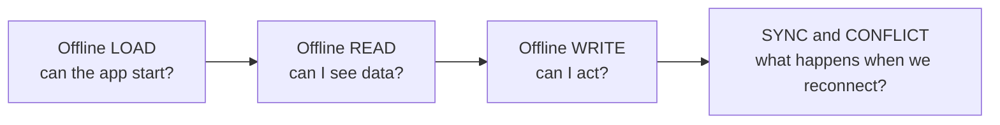
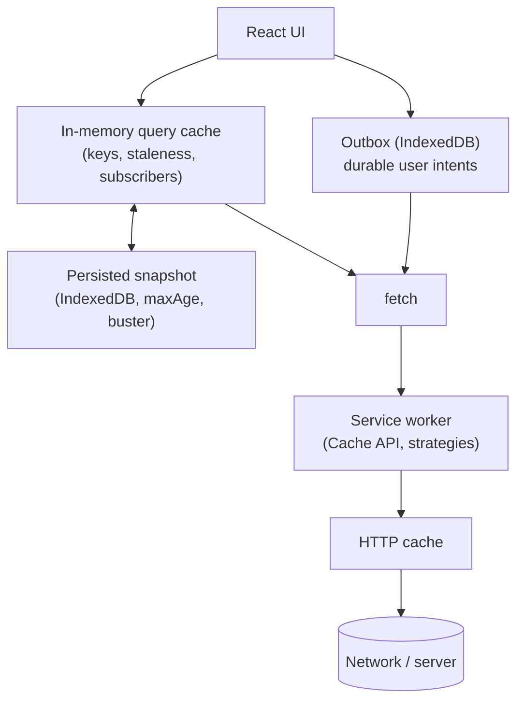
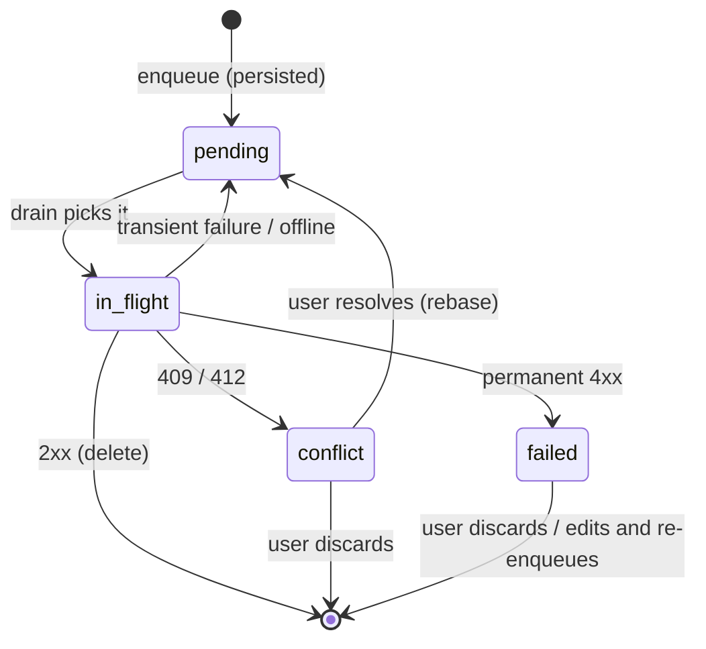

# 06 / 16 — Offline Considerations: Designing for Absent, Slow, and Lying Networks

> **Checked 2026-10-22:** TanStack Query `networkMode`/`onlineManager` behaviour was executed against `@tanstack/query-core` 5.104, persistence option names were read from the 5.104 typings of `@tanstack/react-query-persist-client`, `@tanstack/query-persist-client-core` and `@tanstack/query-async-storage-persister`, and browser support figures come from MDN browser-compat data. Storage quotas and eviction policies were **not** verified (they differ per browser and change). The *design concepts* (online status is a hint, offline reads vs offline writes, outbox, conflict policy, cache invalidation of persisted data) are stable; check concrete numbers against current MDN before shipping.

## 1. Lesson metadata

| | |
|---|---|
| **Level** | Advanced |
| **Study time** | 5 hours (reading 2 h, experiments 1.5 h, exercises 1.5 h) |
| **Prerequisites** | [06 — Cache consistency and invalidation](./06-cache-consistency-and-invalidation.md), [05 — Optimistic updates](./05-optimistic-updates.md), [08 — TanStack Query](./08-tanstack-query.md), [15 — Error recovery and retries](./15-error-recovery-and-retries.md), [Phase 0 / 14 — Web APIs and network requests](../00-web-and-javascript-foundations/14-web-apis-and-network-requests.md), [Phase 0 / 15 — HTTP caching and navigation](../00-web-and-javascript-foundations/15-http-caching-and-navigation.md), [Phase 3 / 20 — `useSyncExternalStore`](../03-react-state-and-hooks/20-usesyncexternalstore-and-external-stores.md) |
| **Next** | [17 — Real-time: WebSockets and subscriptions](./17-real-time-websockets-subscriptions.md) |
| **Related** | [07 — Server state management](./07-server-state-management.md), [Phase 10 / 10 — Resilience and degradation](../10-production-engineering/10-resilience-and-degradation.md), [Phase 10 / 06 — Security: XSS, CSRF, CSP](../10-production-engineering/06-security-xss-csrf-csp.md) |

**Learning objectives.** After this lesson you can:
1. Explain why `navigator.onLine` cannot be trusted as a truth source, and design around "connectivity is a spectrum".
2. Separate the four offline problems — offline **load**, offline **read**, offline **write**, and **sync/conflict** — and choose a solution level for each.
3. Choose between HTTP cache, Cache API (service worker), in-memory query cache, persisted query cache, and IndexedDB for a given dataset.
4. Implement a connectivity hook with `useSyncExternalStore`, a persisted TanStack Query cache, and an outbox for queued mutations.
5. Define a conflict-resolution policy (last-write-wins, version check, merge, CRDT) and justify it by domain.
6. Identify the security, privacy, and staleness risks of persisting server data on a device.
7. Decide when *not* to build offline support.

**Concepts covered:** `navigator.onLine`, `online`/`offline` events, captive portals and "lie-fi", service workers, Cache API, caching strategies (cache-first, network-first, stale-while-revalidate), IndexedDB, storage quota and eviction, persisted query cache, `networkMode`, paused queries/mutations, outbox pattern, idempotency, optimistic concurrency (ETag / `If-Match`), CRDTs (conceptual), Background Sync, schema versioning (cache busting), logout hygiene.

---

## 2. Deep conceptual explanation

### 2.1 What problem is this lesson solving?

Every earlier lesson in this phase assumed that requests eventually resolve one way or the other. Real devices violate that assumption routinely: elevators, trains, airplane mode, congested stadium Wi‑Fi, corporate proxies, captive portals. For some products (field service, warehouse scanning, note-taking, medical rounds) offline is a *core requirement*. For most (a dashboard on an office desktop) it is a **degradation concern**: what should the app do for the 30 seconds when the network misbehaves?

"Offline support" is not a feature toggle; it is a set of decisions about **what the app promises when it cannot reach the server**:

| Level | Promise | Typical cost |
|---|---|---|
| 0 | Nothing: blank page / spinner | None |
| 1 | **Honest failure**: clear message, no data loss on forms, retry when back | Low |
| 2 | **Offline load**: app shell loads without network (service worker) | Medium |
| 3 | **Offline read**: previously viewed data is visible and labeled stale | Medium |
| 4 | **Offline write**: user actions are queued and synced later | High |
| 5 | **Offline-first with multi-device merge**: local DB is primary; sync is background (CRDTs or server reconciliation) | Very high |

Most teams should deliberately choose Level 1–3 and refuse the jump to Level 4–5 unless the domain demands it, because **offline writes turn a request/response app into a distributed system** with all of its consistency problems.

### 2.2 First principles: why the browser cannot tell you if you are online

A network is not a boolean. Between "works" and "doesn't" lie: connected to Wi‑Fi without internet, behind a captive portal that returns HTML for every URL, a link that delivers 2 KB/s ("lie-fi"), a corporate proxy blocking one domain, DNS failure for your API only, TLS interception errors, server outage. The browser knows only what its network stack and OS report.

- **`navigator.onLine`** returns `false` when the browser is *definitely* not connected to any network, and `true` when it is connected to *some* network (a router with no uplink still counts). Per MDN, `false` is dependable; `true` is **not** proof you can reach your server. The `online` and `offline` events on `window` fire when that state changes. (Documented behavior; exact heuristics vary between browsers.)
- Therefore: **treat `offline` as a strong hint, `online` as a weak hint, and the only real evidence as the outcome of an actual request** to your own origin.

*Teaching model:* think of connectivity as three signals — what the OS says (`onLine`), what recent requests did (failures/timeouts), and what a lightweight health probe returns. Libraries combine the first two; mature offline apps add the third.

### 2.3 The four offline problems



Each stage depends on the previous, and each has different technologies:

| Problem | Needs | Technologies |
|---|---|---|
| Load | App shell + assets available without network | HTTP cache (limited), **service worker + Cache API** (precache) |
| Read | Previously fetched API data retained across reloads/offline | Persisted query cache, IndexedDB, service worker runtime caching of API GETs |
| Write | Durable queue of user intents | Outbox in IndexedDB + replay; idempotent server endpoints |
| Sync | Detect and resolve divergent changes | Versioning (ETag/If-Match), field-level merge, CRDTs, server-authoritative with user resolution UI |

### 2.4 What React exposes versus what you build

React has **no offline concept**. Relevant React features:

- `useSyncExternalStore` ([Phase 3 / 20](../03-react-state-and-hooks/20-usesyncexternalstore-and-external-stores.md)) is the correct primitive to expose browser connectivity as a subscribed value (concurrent-safe, SSR-aware with `getServerSnapshot`).
- `useOptimistic` and Actions ([Phase 3 / 22](../03-react-state-and-hooks/22-modern-hooks-and-apis.md)) provide *temporary* optimistic state during a pending Action; they do not persist anything across reloads.
- Suspense and error boundaries ([13](./13-suspense-data-loading.md), [15](./15-error-recovery-and-retries.md)) shape how loading/failed states appear.

Everything else — service workers, Cache API, IndexedDB, persistence, sync — is browser platform and library territory. Frameworks (Next.js, Remix/React Router, etc.) generally do not provide offline behavior by default; PWA plugins exist for some bundlers (verify per framework).

### 2.5 Server state is *already* a cache; offline is mostly "cache that outlives the tab"

[Lesson 07](./07-server-state-management.md) framed server state as "a local copy of remote truth that may be stale". Offline reading is simply a **longer-lived, persisted copy with a more honest staleness label**. That reframing leads to the central design questions:

1. **Persistence scope:** which queries are safe and useful to persist? (Not auth-scoped secrets, not huge lists, not highly volatile data such as stock prices.)
2. **Max age:** after how long is a persisted copy too old to show at all? Seconds for prices; days for a product catalog.
3. **Invalidation:** when the app version, the schema, or the user changes, the persisted cache must be discarded.
4. **Labeling:** the UI must show "as of 09:42" for data that may be stale.

### 2.6 Common misconceptions

| Misconception | Reality |
|---|---|
| "`navigator.onLine === true` means I can reach my API." | It means a network interface is connected. Captive portals and dead uplinks report `true`. |
| "A PWA is offline-capable automatically." | A manifest makes an app installable (in supporting browsers). Offline behavior requires a service worker and deliberate caching. |
| "Service worker caching replaces data-layer caching." | They solve different layers: the SW caches HTTP responses; the query cache holds parsed, keyed, subscribed data with invalidation semantics. They can be combined, but double caching causes confusing staleness. |
| "localStorage is fine as an offline database." | It is synchronous (blocks the main thread), string-only, and small (commonly ~5 MB per origin). IndexedDB is asynchronous and larger. |
| "Browsers guarantee that stored data stays." | Storage is "best-effort" by default and can be evicted under pressure; some browsers cap or expire script-writable storage for sites that are not installed or revisited (WebKit documents such policies; the specific limits were not verified here). `navigator.storage.persist()` requests persistence but may be declined. |
| "Queueing writes offline is just retrying later." | Queued writes may conflict with changes made elsewhere, or be rejected after permissions changed. Replay requires idempotency and a conflict policy ([15](./15-error-recovery-and-retries.md)). |
| "Offline-first is just `onLine` + localStorage." | See above; it is a distributed-systems design problem. |

---

## 3. Internal mechanics

### 3.1 Service workers and the Cache API (platform model)

A **service worker** is a script the browser runs separately from the page, registered for a *scope*; it can intercept `fetch` events from controlled pages and respond from the network, from the **Cache API** (`caches.open(name)` → key/value store of `Request`→`Response`), or synthesize a response. Service workers require a secure context (HTTPS or localhost), have an install/activate/update lifecycle (a new worker installs while the old one still controls pages and by default waits until all controlled pages close, unless you call `skipWaiting()` deliberately), and run no DOM code. *Public guarantee:* these semantics are specified (Service Workers spec) and documented on MDN. *Implementation detail:* when the browser terminates idle workers is up to the browser.

The standard **strategies** (named by the Workbox library and the "Offline Cookbook" tradition; not browser features):

| Strategy | Behavior | Good for | Risk |
|---|---|---|---|
| **Cache-first** | Serve from cache; network only on miss | Versioned static assets (hashed filenames) | Serves stale if not versioned |
| **Network-first** | Try network (with timeout), fall back to cache | HTML navigation, frequently changing API reads | Slow on lie-fi until timeout |
| **Stale-while-revalidate** | Serve cache immediately, update cache from network in background | Avatars, non-critical API reads | User sees old data first |
| **Network-only** | Never cache | Auth, payments | No offline |
| **Cache-only** | Only cache (precached) | App shell | Needs precache manifest |

Build-tool integrations (e.g. Workbox, bundler PWA plugins) generate a precache manifest of hashed assets. Service worker bugs are among the most dangerous front-end bugs: a bad worker can pin users to a broken version, because the worker controls how the page that would fetch the fix is loaded. Always have a kill-switch strategy (a worker that unregisters itself) and short-cache the worker script itself.

### 3.2 Where data can live

| Store | Capacity (typical; verify) | Async? | Structured data? | Survives reload | Notes |
|---|---|---|---|---|---|
| In-memory (query cache) | RAM | n/a | Yes | No | Fast, per tab |
| `sessionStorage` | ~5 MB | **No (sync)** | Strings | Per tab session | Small, simple |
| `localStorage` | ~5 MB | **No (sync)** | Strings | Yes | Blocks main thread on large reads/writes |
| **IndexedDB** | Large, quota-based | Yes | Structured clone (objects, Blobs, Dates) | Yes | Best general local DB; awkward API → wrappers |
| **Cache API** | Quota-based | Yes | `Response` objects | Yes | For HTTP-shaped data, usable from page and worker |
| HTTP cache | Browser-managed | n/a | n/a | Yes | Controlled by headers; not an offline guarantee |
| Origin Private File System | Quota-based | Yes | Files | Yes | For large/binary workloads; newer (MDN compat for `FileSystemDirectoryHandle`: Chrome 86, Firefox 111, Safari 15.2) |

Quotas are shared per origin across these stores and are *estimates*: `navigator.storage.estimate()` returns approximate usage and quota. Writes can fail with `QuotaExceededError`, which must be handled like any other failure.

### 3.3 TanStack Query: network mode and pausing

*Verified in 5.104:* TanStack Query tracks online status via an `onlineManager` backed by the browser's `online`/`offline` events (the source starts with `online = true` and flips only on those events; it does not read `navigator.onLine` at startup). Each query/mutation has a **`networkMode`**:

- `'online'` (default): if offline, queries do not fire; they go to `fetchStatus: 'paused'`. Mutations similarly become paused (`isPaused`) and resume when online. Retries pause too.
- `'always'`: ignore online status; always try (for non-network `queryFn`s, e.g. reading local storage, or intranet-only cases where `onLine` is unreliable).
- `'offlineFirst'`: try the first request regardless of online status (so a service-worker/HTTP cache can answer), and pause *retries* when offline.

Consequences: in the default mode the UI must handle `status === 'pending' && fetchStatus === 'paused'` ("waiting for connection") — a state that is neither loading nor error ([08 §2.5](./08-tanstack-query.md)). And the library reacts to the browser's `offline` event (which follows `navigator.onLine` becoming `false`, the reliable signal); it assumes online otherwise, so a `true`/lying network leads to a real fetch attempt which will then fail and retry per [15](./15-error-recovery-and-retries.md). Executed with `onlineManager.setOnline(false)`: a default-mode query sat at `status: 'pending'`, `fetchStatus: 'paused'` with zero calls to `queryFn`; `networkMode: 'always'` fetched anyway; a mutation was `isPaused: true` with zero calls; `'offlineFirst'` made exactly one attempt and then paused its retries. Paused work resumes when the `online` event arrives (a mounted `QueryClient` handles this; call `queryClient.resumePausedMutations()` yourself if you replay manually).

### 3.4 Persisting the query cache

The library offers persistence helpers (`@tanstack/react-query-persist-client` with `persistQueryClient` / `PersistQueryClientProvider`, plus persister packages for sync storage and async storage such as IndexedDB via a wrapper; verify current package names). Conceptually:

1. **Dehydrate** the cache into a JSON-serializable snapshot (`dehydrate(queryClient)`), omitting non-serializable/unwanted queries (`shouldDehydrateQuery`).
2. A **persister** writes it (throttled) to storage.
3. On startup, the snapshot is **restored** (`hydrate`) into the new `QueryClient` *before* queries mount, gated by `maxAge` and a `buster` string (bump it on app version/schema changes).
4. Restored data is treated by normal rules: stale per `staleTime`, refetched when online.

Constraints worth memorizing: (a) data must be JSON-serializable (no `Date` objects/Map/class instances without custom serialization); (b) **`gcTime` must be at least as long as the persistence `maxAge`**, otherwise entries are garbage-collected from memory before they can be written/kept — a classic "persistence does nothing" bug; (c) functions cannot be persisted — which matters for mutations (§3.6).

### 3.5 Detecting connectivity honestly

The `online`/`offline` events and `navigator.onLine` are the base. For real evidence, combine with:

- **Request outcomes:** consecutive network-level failures → "probably offline/unreachable".
- **A health probe:** a tiny `GET /health` (no-cache, short timeout) when the OS says online but requests fail, to distinguish "no internet" from "our API is down". Do not poll aggressively; probe with backoff ([15](./15-error-recovery-and-retries.md)).
- **`navigator.connection`** (Network Information API): effective type/`saveData` hints; **not** available in all browsers (MDN compat data lists `saveData` as Chrome 65 only, no Firefox or Safari) and not a reliability signal.

### 3.6 Mutations offline: why they are hard to persist

A mutation in memory is `{ mutationFn: Function, variables }`. Functions cannot be serialized. Therefore persisted mutations restore only their **variables and state** and need the `mutationFn` re-attached by *key*: TanStack Query's pattern is `queryClient.setMutationDefaults(['addTodo'], { mutationFn, ... })` registered at startup, then `resumePausedMutations()` after restore (both `setMutationDefaults` and `resumePausedMutations` exist on `QueryClient` in 5.104; `resumePausedMutations` was called in our run). The same limitation applies to any outbox design: persist **data describing the intent** (`{ type: 'ADD_TODO', payload, idempotencyKey, createdAt }`), not closures, and map type → handler at replay time.

### 3.7 Conflict models (conceptual)

| Model | How it works | Pros | Cons | Fits |
|---|---|---|---|---|
| **Last-write-wins (LWW)** | Highest timestamp (or arrival) wins | Trivial | Silent data loss; clock skew | Preferences, "last viewed" |
| **Optimistic concurrency (version/ETag)** | Client sends `If-Match: <etag>` / version; server answers `412 Precondition Failed` / `409` if changed | Detects conflict explicitly | Needs UI to resolve | Documents, orders, records |
| **Field-level merge** | Merge non-overlapping field changes; conflict only on same field | Fewer conflicts | Server complexity | Forms/profile entities |
| **Operational transform / CRDT** | Operations or data structures designed to commute and converge | Automatic convergence; real-time collaborative editing | Complex; library choice; data growth | Collaborative text, shared canvases |
| **Server-authoritative + user resolution** | Server rejects stale writes; client shows both versions | Safe | UX work | Money, inventory, compliance |

*Public guarantee:* `ETag`, `If-Match`, `412` are HTTP-defined (RFC 9110). *Teaching model:* the other rows are design patterns, not standards.

---

## 4. Step-by-step execution walkthrough

Scenario: a field-service technician's app (Level 3 reads + Level 4 writes) with persisted TanStack cache and an outbox. Timeline for "mark job complete" while entering a dead zone:

| Step | Event | Detail |
|---|---|---|
| 1 | App starts online | `PersistQueryClientProvider` restores cache (jobs list from yesterday, `maxAge` 24 h, `buster` matches). Jobs render immediately labeled "Updated 08:02". Online → background refetch (stale per `staleTime`) → fresh data replaces. |
| 2 | Technician drives into a tunnel | OS reports offline → `offline` event → `onlineManager` flips; connectivity hook re-renders banner: "Offline — changes will sync". |
| 3 | Taps "Complete job #42" | Handler creates outbox record `{id, type:'COMPLETE_JOB', payload:{jobId:42}, idempotencyKey, createdAt}` in IndexedDB **first** (durable), then applies an optimistic update to the query cache ([05](./05-optimistic-updates.md)). UI shows job as complete with a "pending sync" badge. |
| 4 | Technician closes the tab | Outbox persists in IndexedDB. Optimistic cache change is gone with memory, but on next load the app **re-applies pending outbox entries on top of restored data** (read-your-writes). |
| 5 | Reopens app, still offline | Cache restored; outbox loaded; jobs show with job #42 as "pending sync". |
| 6 | Network returns | `online` event → sync runner drains outbox in order, one at a time: `POST /jobs/42/complete` with `Idempotency-Key`. |
| 7a | Server `200` | Mark outbox entry done; remove it; `invalidateQueries(['jobs'])` to fetch truth; badge disappears. |
| 7b | Server `409/412` (dispatcher reassigned the job meanwhile) | Entry moves to `conflict` state; UI shows "Job #42 changed while you were offline" with options; **do not** silently drop or overwrite. |
| 8 | Network flaps during replay | Transient failures retry with jittered backoff and budgets ([15](./15-error-recovery-and-retries.md)); idempotency key makes the replay safe even if step 6's response was lost. |

Predict: *if step 3 applied the optimistic update but wrote the outbox record only after the request was attempted, what is lost?* Closing the tab between the attempt and the write loses the user's action entirely — **persist intent before side effects**.

---

## 5. Code examples

### 5.1 Minimal: connectivity as an external store

```tsx
import { useSyncExternalStore } from 'react';

function subscribe(onChange: () => void) {
  window.addEventListener('online', onChange);
  window.addEventListener('offline', onChange);
  return () => {
    window.removeEventListener('online', onChange);
    window.removeEventListener('offline', onChange);
  };
}

const getSnapshot = () => navigator.onLine;
const getServerSnapshot = () => true; // SSR/hydration: assume online

export function useOnlineStatus(): boolean {
  return useSyncExternalStore(subscribe, getSnapshot, getServerSnapshot);
}

export function ConnectivityBanner() {
  const online = useOnlineStatus();
  if (online) return null;
  return <div role="status">You are offline. Changes will be saved and synced when you reconnect.</div>;
}
```

Notes: `subscribe` must return a cleanup; `getSnapshot` returns a primitive, so identity is stable. `getServerSnapshot` avoids hydration mismatches: the client's *first* render uses the server snapshot value and then re-renders if `navigator.onLine` differs ([Phase 2 / 25](../02-react-rendering-and-internals/25-hydration-and-selective-hydration.md)). React's own documentation uses this exact example for `useSyncExternalStore` (the react.dev reference mentions `navigator.onLine` and the `online`/`offline` events). Role `status` makes the banner a polite live region ([Phase 8 / 10](../08-testing-and-quality/10-accessibility-testing.md)).

**Predict:** user toggles airplane mode; how many renders? One per snapshot change (true→false), and only in components that call the hook.

### 5.2 Incorrect: trusting `onLine` as a gate

```tsx
// ❌ Misses lie-fi, captive portals, and API-only outages; blocks the user when onLine is wrong
async function save(data: Note) {
  if (!navigator.onLine) {
    alert('You are offline');
    return;
  }
  await fetch('/api/notes', { method: 'POST', body: JSON.stringify(data) });
}
```

Problems: (1) when `onLine` is `true` but the request fails, the user's data is simply lost with a generic error; (2) when `false`, the data is rejected rather than queued; (3) no persistence of the note. A better stance: **always attempt or enqueue; use `onLine` only to choose messaging and pause expensive background work**.

### 5.3 Practical: persisted TanStack Query cache with versioning

```tsx
import { QueryClient } from '@tanstack/react-query';
import { PersistQueryClientProvider } from '@tanstack/react-query-persist-client';
import { createAsyncStoragePersister } from '@tanstack/query-async-storage-persister';
import { get, set, del } from 'idb-keyval';
import type { ReactNode } from 'react';

const DAY = 24 * 60 * 60 * 1000;

const queryClient = new QueryClient({
  defaultOptions: {
    queries: {
      gcTime: DAY,        // must be >= persistence maxAge, or entries are GC'd before they persist
      staleTime: 60_000,
    },
  },
});

const persister = createAsyncStoragePersister({
  storage: {
    getItem: (key) => get<string>(key).then((v) => v ?? null),
    setItem: (key, value) => set(key, value),
    removeItem: (key) => del(key),
  },
  throttleTime: 1000,
});

export function AppProviders({ children, appVersion, userId }: { children: ReactNode; appVersion: string; userId: string }) {
  return (
    <PersistQueryClientProvider
      client={queryClient}
      persistOptions={{
        persister,
        maxAge: DAY,
        buster: `${appVersion}:${userId}`, // new version or user => discard persisted cache
        dehydrateOptions: {
          shouldDehydrateQuery: (query) =>
            query.state.status === 'success' && query.meta?.persist === true, // opt-in per query
        },
      }}
    >
      {children}
    </PersistQueryClientProvider>
  );
}
```

Line notes:
- `idb-keyval` is a small third-party IndexedDB wrapper (not checked in this review; verify it fits your needs); the persister interface needs async `getItem/setItem/removeItem`.
- `buster` includes **the user id**: a different user on the same device must never see another user's persisted data. This is a security requirement, not a nicety.
- **Opt-in persistence** (`meta.persist`) is safer than persisting everything — the default cache may include sensitive responses or volatile data.
- Package names and option shapes (`PersistQueryClientProvider`, `createAsyncStoragePersister` with `storage`/`throttleTime`, and `persistOptions` with `persister`, `maxAge`, `buster`, `dehydrateOptions.shouldDehydrateQuery`) were confirmed in the 5.104 typings; they have changed names across majors, so pin versions. `idb-keyval` was not checked.

Usage in a query:

```tsx
export const jobsQuery = () =>
  queryOptions({
    queryKey: ['jobs', 'list'],
    queryFn: ({ signal }) => getJson<Job[]>('/api/jobs', signal),
    meta: { persist: true },
  });
```

### 5.4 Practical: rendering "paused" and "stale" honestly

```tsx
import { useQuery } from '@tanstack/react-query';

function JobList() {
  const q = useQuery(jobsQuery());

  if (q.status === 'pending') {
    return q.fetchStatus === 'paused'
      ? <p>Waiting for a connection… (nothing cached yet)</p>
      : <p>Loading jobs…</p>;
  }
  if (q.status === 'error' && !q.data) return <p role="alert">Couldn't load jobs.</p>;

  const stale = q.fetchStatus === 'paused' || q.isError;
  return (
    <>
      {stale && (
        <p role="status">
          Showing saved data from {new Date(q.dataUpdatedAt).toLocaleTimeString()}.
        </p>
      )}
      <ul>{q.data!.map((j) => <li key={j.id}>{j.title}</li>)}</ul>
    </>
  );
}
```

Explanation: with persisted data, `status` is `'success'` immediately and `fetchStatus` may be `'paused'` offline. `dataUpdatedAt` is the timestamp of the last successful fetch, so the UI reports truthfully how old the data is. The `q.data!` assertion is safe because the earlier branches return when there is no data, but a stricter type-narrowing helper is preferable in production code.

### 5.5 Advanced: an IndexedDB outbox with idempotent replay

```ts
// outbox.ts
import { openDB, type DBSchema } from 'idb';

type OutboxStatus = 'pending' | 'in-flight' | 'conflict' | 'failed';

interface OutboxItem {
  id: string;               // also the Idempotency-Key
  type: 'COMPLETE_JOB' | 'ADD_NOTE';
  payload: unknown;
  createdAt: number;
  status: OutboxStatus;
  attempts: number;
  baseVersion?: string;     // ETag/version the user edited from
}

interface OutboxDB extends DBSchema {
  outbox: { key: string; value: OutboxItem; indexes: { 'by-created': number } };
}

const dbPromise = openDB<OutboxDB>('app-outbox', 1, {
  upgrade(db) {
    const store = db.createObjectStore('outbox', { keyPath: 'id' });
    store.createIndex('by-created', 'createdAt');
  },
});

export async function enqueue(type: OutboxItem['type'], payload: unknown, baseVersion?: string) {
  const item: OutboxItem = {
    id: crypto.randomUUID(), type, payload, createdAt: Date.now(),
    status: 'pending', attempts: 0, baseVersion,
  };
  await (await dbPromise).put('outbox', item); // durable BEFORE any network or optimistic work
  return item;
}

const handlers: Record<OutboxItem['type'], (item: OutboxItem) => Promise<Response>> = {
  COMPLETE_JOB: (i) => fetch(`/api/jobs/${(i.payload as { jobId: number }).jobId}/complete`, {
    method: 'POST',
    headers: { 'Idempotency-Key': i.id, ...(i.baseVersion ? { 'If-Match': i.baseVersion } : {}) },
  }),
  ADD_NOTE: (i) => fetch('/api/notes', {
    method: 'POST',
    headers: { 'Content-Type': 'application/json', 'Idempotency-Key': i.id },
    body: JSON.stringify(i.payload),
  }),
};

let draining = false;

export async function drain(onSettled: () => void) {
  if (draining) return; // single runner per tab
  draining = true;
  try {
    const db = await dbPromise;
    const items = await db.getAllFromIndex('outbox', 'by-created'); // preserve user's order
    for (const item of items) {
      if (item.status === 'conflict' || item.status === 'failed') continue;
      let res: Response;
      try {
        res = await handlers[item.type](item);
      } catch {
        return; // network-level failure: stop, keep order, try again on next trigger
      }
      if (res.ok) await db.delete('outbox', item.id);
      else if (res.status === 409 || res.status === 412) await db.put('outbox', { ...item, status: 'conflict' });
      else if (res.status >= 400 && res.status < 500 && res.status !== 408 && res.status !== 429)
        await db.put('outbox', { ...item, status: 'failed' });
      else return; // 5xx / 429: stop and retry later with backoff
      item.attempts += 1;
    }
  } finally {
    draining = false;
    onSettled();
  }
}

window.addEventListener('online', () => void drain(() => {}));
```

Design notes:
- `idb` is a community promise wrapper over IndexedDB (not checked here). The outbox item **is** the idempotency key: replays after a lost response are safe if the server honors it ([15 §2.3](./15-error-recovery-and-retries.md)).
- **Order preservation:** drain sequentially by `createdAt`, and *stop at the first transient failure* so later dependent operations don't overtake earlier ones.
- **Classification** reuses lesson 15's taxonomy. Conflicts and permanent failures are **parked**, not dropped, and must surface in UI.
- Weaknesses to discuss: multi-tab concurrency (two tabs drain simultaneously — `draining` is per tab; use the Web Locks API (`navigator.locks`; MDN compat: Chrome 69, Firefox 96, Safari 15.4) for cross-tab exclusion); no backoff scheduler; `item.attempts += 1` after possible `put`/`delete` is cosmetic here (persist it if you need it); dependent operations (create then edit the created entity needs temporary IDs and rewriting) are the hardest part and are deliberately omitted.

### 5.6 Corrected usage: persist intent first, then optimistic update

```tsx
import { useQueryClient, useMutation } from '@tanstack/react-query';

function useCompleteJob() {
  const qc = useQueryClient();
  return useMutation({
    mutationFn: async (jobId: number) => {
      const item = await enqueue('COMPLETE_JOB', { jobId });   // 1. durable intent
      qc.setQueryData<Job[]>(['jobs', 'list'], (jobs) =>        // 2. optimistic cache update
        jobs?.map((j) => (j.id === jobId ? { ...j, status: 'complete', pendingSync: true } : j)),
      );
      await drain(() => void qc.invalidateQueries({ queryKey: ['jobs'] })); // 3. try to sync now
      return item.id;
    },
  });
}
```

Here the mutation represents "accept the action locally and attempt sync", not "complete on the server". The `networkMode` of this mutation should be `'always'` because its work (writing to IndexedDB) does not need the network; leaving the default `'online'` would pause it while offline (`networkMode` is an option on `useMutation`/mutation defaults). On reload the app must re-apply pending outbox items onto restored cache (not shown), otherwise the optimistic state vanishes.

### 5.7 Advanced: optimistic concurrency with ETag

```ts
// Read: remember the version
const res = await fetch(`/api/jobs/42`);
const etag = res.headers.get('ETag'); // e.g. '"v17"'

// Write: only succeed if unchanged
const put = await fetch(`/api/jobs/42`, {
  method: 'PUT',
  headers: { 'If-Match': etag ?? '', 'Content-Type': 'application/json' },
  body: JSON.stringify(edited),
});
if (put.status === 412) {
  // Precondition Failed: someone else changed it. Fetch the latest and let the user merge.
}
```

If your backend does not provide ETags, an explicit `version` field in the JSON with a conditional update achieves the same thing. Note CORS: reading `ETag` cross-origin requires `Access-Control-Expose-Headers: ETag` ([Phase 0 / 15](../00-web-and-javascript-foundations/15-http-caching-and-navigation.md)).

---

## 6. Visual explanations

### Layers of caching and where each helps



### Outbox lifecycle



### Connectivity is not binary

```text
Reality                 navigator.onLine   Request outcome
─────────────────────   ────────────────   ───────────────────────
Airplane mode           false              fails instantly
Wi-Fi, router no WAN    true               times out
Captive portal          true               200 + wrong HTML (!)
Lie-fi (2 KB/s)         true               very slow, partial
API down, CDN up        true               5xx only on API
Corporate proxy block   true               blocked / TLS error
```

---

## 7. Alternative approaches and trade-offs

| Approach | Offline load | Offline read | Offline write | Complexity | Fit |
|---|---|---|---|---|---|
| **Online-only, honest errors** (Level 1) | No | No | No (preserve form drafts) | Very low | Most internal dashboards, admin tools |
| **HTTP caching headers only** | Partial/unreliable | Partial | No | Low | Public static content |
| **Service worker precache + runtime caching** | Yes | Yes (GET) | No | Medium | Content apps, docs, read-heavy PWAs |
| **Persisted query cache** | With SW only | Yes (keyed, labeled) | Optional via paused mutations | Medium | Data apps needing recent-data viewing |
| **Outbox + idempotent API** | – | – | Yes | High | Field apps, notes, checklists |
| **Local-first database with sync (CRDT or sync engine)** | Yes | Yes | Yes | Very high | Collaborative editors, long offline periods |
| **Native/hybrid app wrapper** | Yes | Yes | Yes | High | Needs device background sync; not web-only |

**Scenario where the recommended "persist and queue" approach is *not* best:** a trading or banking screen. Showing a persisted price or balance offline is misleading and potentially harmful; queueing a trade for later execution at an unknown price is a product decision most regulators would reject. Correct design: Level 1 — clear offline state, disable actions, no persisted financial figures (or show them with a loud "as of" timestamp and disabled write actions). Another non-fit: an app whose data is subject to strict retention policy: persisting to device storage may violate it.

---

## 8. Best practices and anti-patterns

### Best practices
- **Choose a level deliberately** (§2.1) per product area, and write it down as a requirement. Not every screen needs the same level.
- **Treat `onLine` as a hint**; derive truth from request outcomes; always label stale data with its age.
- **Persist intent before effects**: write the outbox record before optimistic UI or network.
- **Make every replayable operation idempotent** (keys) and every conflict *visible*.
- **Version your persisted data** (`buster`, DB schema versions with `upgrade` migrations) and wipe on logout and on user change.
- **Opt in** which queries persist; exclude PII-heavy or high-volatility data; set `maxAge` per data class.
- **Preserve drafts** (form state) even at Level 1: losing a half-written message to a network error is the worst offline UX. Save drafts to `sessionStorage`/IndexedDB on change (debounced) ([Phase 3 / 21](../03-react-state-and-hooks/21-forms-and-complex-state.md)).
- **Handle `QuotaExceededError`** and unavailable storage (private modes, blocked cookies) with try/catch and graceful fallback.
- **Test offline** explicitly: DevTools offline mode, throttling, service worker "Offline" checkbox, airplane mode on a device, and automated tests with network blocked ([Phase 8 / 09](../08-testing-and-quality/09-e2e-with-playwright.md)).
- **Avoid refetch storms on reconnect**: `refetchOnReconnect` across 40 mounted queries after a long outage can swamp the server; stagger, limit active queries, or lower concurrency ([15 §2.5](./15-error-recovery-and-retries.md)).

### Beginner mistakes
- Gating all behavior on `navigator.onLine`.
- Using `localStorage` for large JSON.
- Believing "installable PWA" implies offline.
- Persisting everything, including auth tokens, in plain storage.
- Showing offline data without a timestamp.

### Experienced-developer mistakes
- **A service worker that caches the HTML shell with cache-first and no versioning**, pinning users to an old build.
- Double caching: SW stale-while-revalidate on API GETs *plus* a query cache with `staleTime`; the UI shows data that is stale twice over and `invalidateQueries` appears not to work (the refetch hits the SW's cached response).
- Persisting dehydrated queries without `buster`; schema change → crashes on restored malformed data.
- Replay without ordering: "create list" and "add item to list" executed out of order.
- No cross-tab coordination: two tabs drain the outbox simultaneously and double-submit (idempotency keys mitigate but don't excuse).
- Using LWW silently for data where loss matters.

### Smells
- `if (!navigator.onLine) return;` in a mutation handler.
- `setInterval(() => fetch('/ping'), 1000)` as "connectivity detection".
- Offline mode that has never been demonstrated by an automated test.
- Persisted cache keyed globally rather than per user.
- No UI for conflicts ("the server will sort it out").

### Justified exceptions
- Keep `localStorage` for tiny, synchronous, non-critical values (a draft flag) despite its limits.
- LWW is fine for per-user preferences where "last device wins" is acceptable.
- Using `networkMode: 'always'` in an intranet app where `onLine` is routinely wrong because of VPN configuration.
- Skipping offline entirely for authenticated, security-sensitive apps where device persistence is prohibited by policy.

---

## 9. Real-world application

- **Field service / logistics.** Level 4: outbox, idempotency keys, per-entity version checks, photo uploads as resumable queued tasks (large Blobs in IndexedDB; mindful of quota). Constraints: devices shared between shifts → wipe on logout; conflict UX when dispatchers reassign jobs; background sync is unavailable on some browsers so sync-on-open is the dependable baseline.
- **E-commerce.** Level 2–3: precache the shell and key static pages, persist the *catalog browsing* cache for short `maxAge`, never persist cart pricing as authoritative. Checkout is online-only; the cart's local copy is reconciled with server prices on reconnect.
- **Finance.** Level 1 with drafts. Persisted balances are risky; if shown, always "as of" and writes are disabled while offline. Respect retention and device-security policies.
- **Dashboards.** Pause polling when offline/hidden; show last-known values with age; avoid persisted caches for volatile metrics; upon reconnect refetch only visible widgets.
- **Forms (long, multi-step).** Autosave drafts locally; submit via outbox only if the server supports idempotency; keep files in IndexedDB until upload succeeds.
- **Realtime.** After a reconnect, the WebSocket must resync missed events or fall back to a full fetch; see [17](./17-real-time-websockets-subscriptions.md).
- **Auth.** Offline sessions: tokens expire; a refresh attempt offline fails; define whether the app locks after N hours offline. Persisting refresh tokens in script-readable storage is an XSS risk ([Phase 10 / 06](../10-production-engineering/06-security-xss-csrf-csp.md)).
- **Multi-team.** One platform team owns the service worker (shared scope, high blast radius) and the persistence defaults; feature teams opt queries in via `meta`, and cannot register their own workers.

---

## 10. Debugging and troubleshooting

| Symptom | Likely root cause | Investigation | Fix / validation |
|---|---|---|---|
| Persisted cache "does nothing" after reload | `gcTime` < `maxAge`; or queries not dehydrated (`shouldDehydrateQuery`) | Application tab → IndexedDB: key missing/empty | Raise `gcTime`; check opt-in `meta`; reload and see data before network |
| Users see old UI after deploy | SW cache-first on HTML; update stuck in "waiting" | DevTools → Application → Service Workers: "waiting to activate" | Network-first for navigations; hashed asset precache; prompt-to-reload flow; kill switch |
| "Invalidate doesn't work" | SW or HTTP cache answering the refetch with a cached response | Network tab shows "(ServiceWorker)" / "from disk cache" | Bypass SW for API or use `no-cache`/revalidation headers; one caching layer per resource |
| App shows online but all requests hang | Lie-fi / captive portal | Network tab: pending forever / HTML response for JSON | Timeouts (`AbortSignal.timeout`), content-type checks, health probe |
| JSON parse error offline→online | Captive portal returned HTML with 200 | Response preview shows login page | Verify `Content-Type`, throw typed error ([15](./15-error-recovery-and-retries.md)) |
| Different user sees previous user's data | Persisted cache not keyed/busted by user | Inspect IndexedDB contents after account switch | `buster` includes user id; clear storage on logout; test it |
| Duplicate records after reconnect | Outbox replay without idempotency or two tabs draining | Server logs: same payload twice | Idempotency key = outbox id; Web Locks for single drainer |
| `QuotaExceededError` | Large Blobs/caches, no cleanup | `navigator.storage.estimate()` | Evict by age/size; handle errors; cap |
| Hydration mismatch on offline banner | Server render assumed online but client first render read `navigator.onLine` | Console hydration warning | Use `getServerSnapshot` in `useSyncExternalStore` |
| Paused mutation never runs | `networkMode: 'online'` and device lying/offline flag stuck | Devtools: mutation `isPaused` | Verify `onlineManager` state; call resume on reconnect; use `'always'` for local-only work |

**DevTools workflow:** Application tab → Service Workers (offline checkbox, update on reload, unregister), Cache Storage, IndexedDB, Storage (clear site data, quota). Network tab → throttling presets, "Offline", and the Size column showing `(ServiceWorker)` or `(disk cache)`. Always test with **Disable cache** unchecked for offline behavior, since checking it bypasses the very layers under test.

---

## 11. Exercises

### Level A — Knowledge
**A1.** What does `navigator.onLine === true` guarantee? What does `false` guarantee?
**A2.** Name the four distinct offline problems and one technology for each.
**A3.** Why is `localStorage` a poor choice for offline data? When is it acceptable?
**A4.** What are TanStack Query's three `networkMode` values and when would you choose `'always'`?
**A5.** What does `buster` do in persisted-cache options and why should it include the user id?
**A6.** Why can mutations not be persisted as-is?

### Level B — Code comprehension
**B1.** In §5.3, what happens if `gcTime` is 5 minutes and `maxAge` is 24 hours?
**B2.** In §5.1, why is `getServerSnapshot` provided?
**B3.** In §5.5, why does `drain` `return` (rather than `continue`) after a transient network failure?
**B4.** A query shows `status: 'pending'`, `fetchStatus: 'paused'`. Describe the situation and the correct UI.

### Level C — Implementation
**C1.** Implement a `useDraft(key)` hook that persists a form draft to `sessionStorage` (debounced 500 ms) with try/catch around storage, and restores on mount.
**C2.** Add a health probe to `useOnlineStatus` so the hook reports `'online' | 'offline' | 'unreachable'`, probing only when the OS says online and a recent request failed. Include backoff.
**C3.** Write the cache re-application step: on startup, apply pending outbox items of type `COMPLETE_JOB` onto the restored `['jobs','list']` cache.

### Level D — Debugging
**D1.** After a release, some users keep seeing the old UI for days. The app has a service worker with cache-first for `index.html`. Diagnose and fix.
**D2.** A shared tablet shows yesterday's technician's jobs for a moment after login of a new technician. Diagnose and fix.
**D3.** The team added a service worker with stale-while-revalidate for `/api/*` GETs; now `invalidateQueries` after a mutation refetches stale data. Explain.

### Level E — Architecture and engineering decisions
**E1.** A product manager asks for "offline support" in an invoicing app. List the clarifying questions and propose a leveled plan with justification.
**E2.** Choose a conflict strategy for (a) user preferences, (b) a shared inspection checklist, (c) inventory counts. Justify each.
**E3.** Argue for or against persisting the entire query cache by default.

### Level F — Expert challenge
**F1.** Design offline creation of dependent entities (create Order with temporary client ID, add Items referencing it) in the outbox, including ID remapping, ordering, partial failure, and idempotency.
**F2.** Design the logout flow for a shared device that guarantees no cached user data remains: list every storage location, service worker caches, in-memory caches, and edge cases (pending outbox items, multiple tabs).

---

## 12. Detailed answers and explanations

> Attempt the exercises first.

**A1.** `true`: the browser is connected to *a* network; **no** guarantee your server (or the internet) is reachable. `false`: the browser is not connected to any network; reliable enough to treat as offline. Reasoning: browsers cannot probe your origin; MDN documents this asymmetry. Wrong answer: "true means requests will succeed".

**A2.** Load → service worker + Cache API precache. Read → persisted query cache / IndexedDB / SW runtime cache of GETs. Write → outbox in IndexedDB with idempotent replay (Background Sync where available). Sync/conflict → ETag/version checks, field-level merge, CRDTs, user resolution UI.

**A3.** Synchronous API (blocks the main thread on large reads/writes), string-only (needs serialization), small quota (~5 MB typical), no transactions or indexing. Acceptable for tiny non-critical flags or small settings where blocking cost is negligible.

**A4.** `'online'` (default; pause when offline), `'always'` (never pause; fetch regardless — for `queryFn`s that don't hit the network, e.g. reading IndexedDB, or networks where `onLine` is unreliable), `'offlineFirst'` (run the first attempt regardless, e.g. to let a service worker answer, then pause retries when offline). Verify in the docs.

**A5.** It is a string compared against the persisted snapshot's buster; if different, the snapshot is discarded. Include the user id so user B on the same device never restores user A's data (privacy/security), and the app version/schema so incompatible shapes aren't restored.

**A6.** Mutations contain functions (`mutationFn`, callbacks) that cannot be serialized to storage. Only variables and state can be saved; the functions must be re-registered by key at startup (`setMutationDefaults`) so resumed mutations know what to run.

**B1.** Entries not observed for 5 minutes are garbage-collected from the in-memory cache, so the persisted snapshot (written from the in-memory cache) will no longer include them after 5 minutes of non-use; the 24-hour `maxAge` is effectively unreachable for inactive queries. Fix: `gcTime >= maxAge`. Wrong thought: "maxAge alone controls persistence".

**B2.** For server rendering/hydration React needs a snapshot value on the server (no `navigator`) and for the first client render during hydration. Returning `true` makes the server HTML and first client render agree; if `navigator.onLine` differs, React re-renders after hydration with the real value. Without it, React throws on the server (no `getServerSnapshot`).

**B3.** The outbox must preserve causal order: later items may depend on earlier ones. Continuing after a network failure would send later items first (or fail them for the same reason). Stopping, then retrying later from the first undelivered item, preserves order. Items that have *permanently* failed or conflicted are skipped (`continue`) only because they were explicitly parked; this is a policy that assumes later items are independent of them — which may be false for dependent entities (see F1).

**B4.** No data exists yet and the query wants to fetch but the device is offline (default `networkMode`). It is neither loading nor an error. UI: "Waiting for a connection…", maybe with the option to continue offline if drafts are possible. Showing a spinner forever or a generic error are both wrong.

**C1.** Sample:
```ts
import { useEffect, useRef, useState } from 'react';

export function useDraft<T>(key: string, initial: T) {
  const [value, setValue] = useState<T>(() => {
    try {
      const raw = sessionStorage.getItem(key);
      return raw ? (JSON.parse(raw) as T) : initial;
    } catch { return initial; }
  });
  const timer = useRef<number | undefined>(undefined);

  useEffect(() => {
    window.clearTimeout(timer.current);
    timer.current = window.setTimeout(() => {
      try { sessionStorage.setItem(key, JSON.stringify(value)); } catch { /* quota/blocked: ignore */ }
    }, 500);
    return () => window.clearTimeout(timer.current);
  }, [key, value]);

  const clear = () => { try { sessionStorage.removeItem(key); } catch {} setValue(initial); };
  return [value, setValue, clear] as const;
}
```
Evaluation: lazy initializer reads storage once; every storage access guarded; debounced with cleanup; clear on successful submit. Edge case: StrictMode double effects just reschedule the timer (idempotent). A different `key` after mount should re-read; extend with a `useEffect` or a `key` prop on the component.

**C2.** Evaluation criteria: states derived from `onLine` + a failure counter (exposed from the fetch wrapper) → probe only if `onLine && recentNetworkFailures >= 2`; probe via `fetch('/health', { cache: 'no-store', signal: AbortSignal.timeout(3000) })`; schedule next probes with exponential backoff (cap 30–60 s) and jitter; cancel on unmount or when `offline` fires; expose through `useSyncExternalStore` over a small store object rather than local state so multiple components share one prober; stop probing when the document is hidden. Pitfalls: probe storms, caching the probe response, treating a CDN/health route that is up while the API is down as "online".

**C3.** Sketch:
```ts
import { listPending } from './outbox'; // returns items with status pending|in-flight

export async function reapplyPending(qc: QueryClient) {
  const items = await listPending();
  qc.setQueryData<Job[]>(['jobs', 'list'], (jobs) => {
    if (!jobs) return jobs;
    const done = new Set(items.filter(i => i.type === 'COMPLETE_JOB').map(i => (i.payload as { jobId: number }).jobId));
    return jobs.map(j => (done.has(j.id) ? { ...j, status: 'complete', pendingSync: true } : j));
  });
}
```
Call after restore and **also after every successful refetch** (a refetch would otherwise overwrite optimistic state with server truth that doesn't yet contain pending changes — implement via `select` that overlays pending items rather than mutating the cache). The `select`/overlay design is preferred because the cache then stays pure server state ([07](./07-server-state-management.md)).

**D1.** Cache-first for `index.html` serves the old shell, which references old hashed assets (which the SW also has precached), so the new worker never gets noticed until it takes control; the update may also wait because open tabs keep the old worker active. Fix: network-first (or revalidate) for navigations; short-cache or no-cache `sw.js` (browsers check the script byte-for-byte on navigation/updates; verify HTTP caching specifics); precache only hashed assets; provide "new version available — reload" UI using the worker `waiting` state and `skipWaiting` with a user-driven reload; keep a kill-switch worker. Validate by deploying a dummy change and observing activation without clearing site data.

**D2.** Persisted cache restored before auth state is known/cleared, and not keyed per user. Fix: `buster` containing the user id (or key the IndexedDB database per user), clear storage and in-memory client (`queryClient.clear()`) on logout, restore only after the session is known, and avoid rendering restored data until the user matches. Validate with an automated login-A → logout → login-B test inspecting both UI and IndexedDB.

**D3.** `invalidateQueries` triggers a refetch through `fetch`, which goes through the service worker; stale-while-revalidate **returns the cached response first**, so the query cache receives old data and only later (on the next request) the revalidated copy. Two cache layers disagree about freshness. Fix: don't SWR the same API routes the query library manages; use network-first or bypass the SW for those routes, or let the SW only handle assets. One owner per resource.

**E1.** Evaluation criteria: asks about *who* works offline and for how long, which entities, whether edits are single-user, regulatory/security constraints (device persistence), expected conflicts, sync latency tolerance, existing API idempotency/versioning, file attachments, multi-device. Example plan: Level 1 now (honest errors, drafts, no data loss), Level 3 next (read invoices viewed recently with "as of"), Level 4 only for *creating draft invoices*, keyed with client IDs and idempotency; sending/finalizing invoices remains online-only. Justification: reading is low-risk; drafts are user-owned (low conflict); finalization has legal/numbering constraints (server-authoritative). Say what would change the plan (long offline periods, multi-user editing).

**E2.** (a) Preferences: LWW with per-field timestamps; low harm. (b) Shared checklist: field-level merge (each item's checked state) with server-side versions per item; conflicts only when the same item changes differently; surface merge results. (c) Inventory counts: the *delta* operations ("-2 units") are commutative if modeled as events rather than absolute counts; absolute counts with LWW lose updates; use server-authoritative events or optimistic concurrency with user resolution. Reasoning: model the domain's operations, not just the state.

**E3.** Against by default: leaks (PII, other-user data), staleness hazards, large writes (performance), schema fragility, compliance. Opt-in per query with `maxAge`. For: simplicity and instant start. Reasonable conclusion: opt-in allow-list for non-sensitive, moderately stable data. What would change the opinion: a strict data classification policy that already guarantees all API data may be stored on device, plus encryption.

**F1.** Evaluation criteria and sketch: client generates a temporary ID `tmp_<uuid>` for the Order and uses it in locally created Items; each outbox entry records `dependsOn` and `produces`; the Order's POST includes an idempotency key and, ideally, accepts a *client-supplied ID* (best: server accepts UUIDs, eliminating remapping). If server IDs differ: after the Order POST returns `{id: 981}`, the runner stores mapping `tmp_x → 981`, rewrites payloads of dependent entries (and cached entities, and any URLs the user navigated to) before sending them. Failure handling: if the Order creation fails permanently, dependent items are marked `blocked` and the user is told; transient failures stop the drain preserving order; crash after POST success but before saving the mapping is safe because replay with the same idempotency key returns the same result. Also discuss atomicity: a single "create order with items" endpoint removes the whole problem. A strong answer prefers changing the API to client-generated IDs or a batch endpoint over clever client remapping.

**F2.** Evaluation criteria: enumerate locations — in-memory `QueryClient` (`clear()`), module-level caches/singletons, React state held by providers (unmount/reset by key), `localStorage`/`sessionStorage`, IndexedDB databases (query persister, outbox), Cache API (`caches.keys()` → delete), service worker runtime caches containing authenticated responses, cookies (server-side session invalidation + `Set-Cookie` expiry), `BroadcastChannel`/other tabs (broadcast "logout" so other tabs clear), `Clear-Site-Data` response header (a documented mechanism; verify browser support) as a belt-and-braces measure. Edge cases: outbox items pending at logout (block logout with a warning, sync first, or export/discard explicitly — never silently send them as the next user), in-flight requests resolving after logout (abort via signal and ignore results), service worker not unregistered but caches cleared, timing (clear before navigating to login), and verifying via an automated test that inspects storage afterward.

---

## 13. Senior engineer interview questions

1. **"Is `navigator.onLine` reliable?"** `false` is, `true` isn't: it reports network *attachment*, not reachability of your server. Design for request outcomes and timeouts; use events as hints.
2. **"What does it take to make a React app work offline?"** It depends on the level: offline load needs a service worker and precache; offline read needs a persisted cache with age labels; offline write needs an outbox, idempotency, and a conflict policy. React itself provides none; it only renders the states.
3. **"Why persist intents rather than closures?"** Closures can't be serialized, and code can change between sessions; intents are data that handlers interpret at replay time, enabling versioned migrations.
4. **"Cache-first vs network-first for a SPA's HTML?"** Network-first (with timeout fallback) for HTML so deployments propagate; cache-first only for content-hashed assets. Otherwise users are pinned to old builds.
5. **"How do you avoid duplicate writes on replay?"** Idempotency keys generated at intent creation, honored by the server, plus ordered single-runner draining with cross-tab locking.
6. **"How do you handle conflicts?"** By domain: LWW for low-stakes prefs, version checks with `412`/`409` and a resolution UI for records, event/delta modeling for counters, CRDTs for collaborative text. The wrong default is silent LWW.
7. **"What are the security implications of persisting data?"** Device sharing, XSS exposure of script-readable storage, stale permissions, retention policy. Mitigate with allow-listing, per-user busters, wipe on logout, short `maxAge`, avoiding tokens in script-readable storage.
8. **"Why does `invalidateQueries` sometimes not refetch fresh data after adding a service worker?"** The refetch is served from the SW cache; two caching layers with different freshness rules. Give each resource one cache owner.
9. **"What do you do when the user comes back online with 40 active queries?"** Rate-limit the thundering refetch: stagger, prioritize visible data, rely on `staleTime`, and consider disabling `refetchOnReconnect` for low-value queries.
10. **"When do you say no to offline support?"** When data is volatile/regulated (financial figures), when conflicts can't be resolved safely, or when the user population is reliably online; spend the effort on fast, honest failure and draft preservation instead.

---

## 14. Further learning resources

| Resource | URL | Covers / why | Level | Study |
|---|---|---|---|---|
| MDN — `Navigator.onLine` | <https://developer.mozilla.org/en-US/docs/Web/API/Navigator/onLine> | Semantics and caveats | Beginner | Whole page |
| MDN — Service Worker API | <https://developer.mozilla.org/en-US/docs/Web/API/Service_Worker_API> | Lifecycle, fetch interception | Intermediate | Concepts and usage |
| MDN — Cache | <https://developer.mozilla.org/en-US/docs/Web/API/Cache> | Cache API | Intermediate | Methods |
| MDN — IndexedDB API | <https://developer.mozilla.org/en-US/docs/Web/API/IndexedDB_API> | Local structured storage | Intermediate | Using IndexedDB |
| MDN — Storage quotas and eviction criteria | <https://developer.mozilla.org/en-US/docs/Web/API/Storage_API/Storage_quotas_and_eviction_criteria> | Quota/eviction rules (not re-verified; they change) | Advanced | Whole page |
| MDN — Progressive web apps | <https://developer.mozilla.org/en-US/docs/Web/Progressive_web_apps> | Installability vs offline | Beginner | Guides |
| React — `useSyncExternalStore` | <https://react.dev/reference/react/useSyncExternalStore> | Subscribing to browser state; includes an online-status example | Intermediate | Usage |
| TanStack Query docs — Network Mode / Persist | <https://tanstack.com/query/latest> | `networkMode`, `persistQueryClient` (locate via docs search) | Intermediate | Guides |
| Workbox | <https://developer.chrome.com/docs/workbox> *(link checked, HTTP 200, 2026-10-22)* | Service worker tooling and strategies | Intermediate | Strategies |
| RFC 9110 — HTTP Semantics | <https://www.rfc-editor.org/rfc/rfc9110> | ETag, conditional requests, 412 | Advanced | Conditional requests |
| web.dev — Learn PWA | <https://web.dev/learn/pwa> *(link checked, HTTP 200, 2026-10-22)* | Offline patterns | Intermediate | Service worker and caching modules |

---

## 15. Knowledge checkpoint

**You understand it if you can:**
- Explain why connectivity is not boolean and what `navigator.onLine` does and doesn't tell you.
- Distinguish offline load / read / write / sync and map each to technologies.
- Explain paused queries and mutations and the interplay with retries.

**You can explain it if you can:**
- Justify an offline level for a product area and argue against over-building.
- Choose a conflict strategy by domain operations rather than by default.

**You can implement it if you can, without notes:**
- Build an online-status hook with `useSyncExternalStore`, configure a persisted cache with `gcTime`/`maxAge`/`buster`, and write an ordered, idempotent outbox drain.

**You can debug it if you can:**
- Diagnose pinned old builds, double-cached stale data, cross-user cache leaks, and duplicate replays using the Application and Network panels.

**Prerequisite for next lessons:** [17 — Real-time: WebSockets and subscriptions](./17-real-time-websockets-subscriptions.md) (reconnect and resync), [19 — Technology selection matrix](./19-technology-selection-matrix.md) (offline capability as a selection axis), and [Phase 10 / 10 — Resilience and degradation](../10-production-engineering/10-resilience-and-degradation.md).
