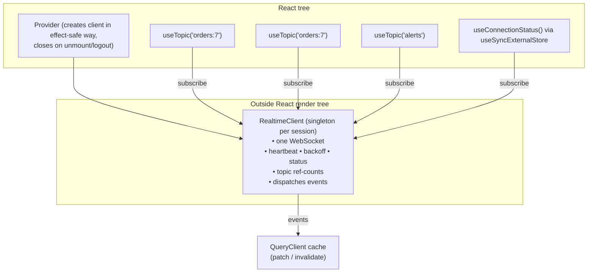
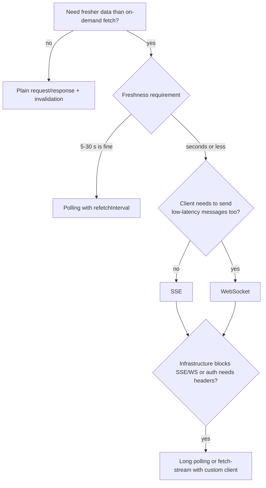
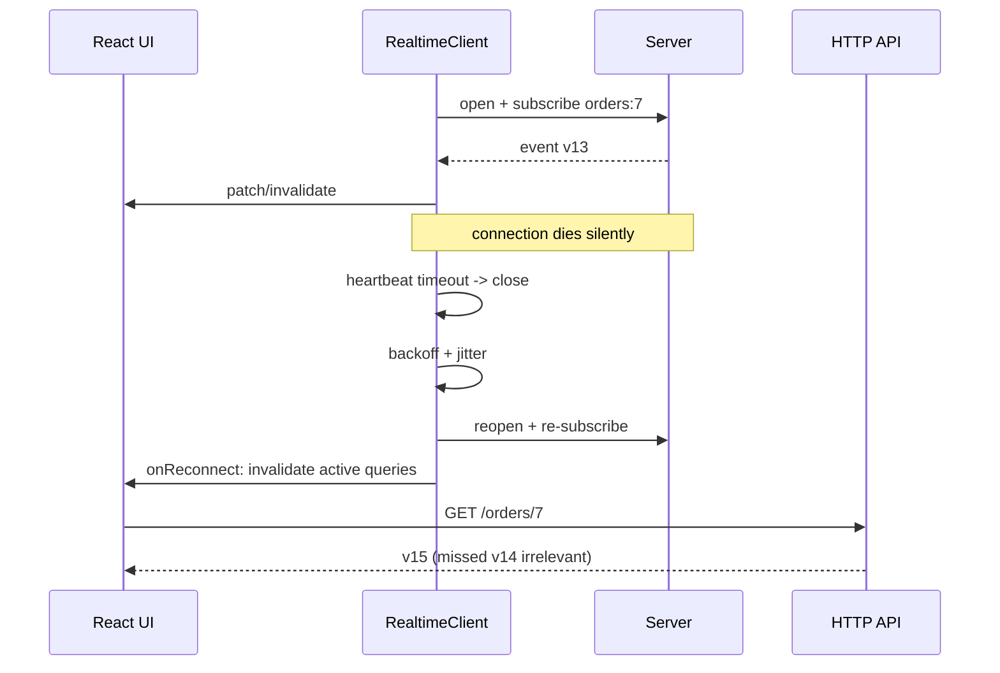

# 06 / 17 — Real-Time: WebSockets, Server-Sent Events, and Subscriptions

> **Checked 2026-10-22 against MDN browser-compat data (support versions) and the TanStack Query 5.104 typings; the WebSocket/SSE protocol facts are RFC 6455 / HTML-standard behaviour and were not executed against a live server in this review.** Browser API details (WebSocket close codes, `EventSource` behavior, experimental streaming APIs such as `WebSocketStream`/WebTransport) and library APIs (TanStack Query cache methods, GraphQL subscription clients) evolve. The *architecture* (connection ownership, event-to-cache reconciliation, reconnection with resync, backpressure) is stable.

## 1. Lesson metadata

| | |
|---|---|
| **Level** | Advanced |
| **Study time** | 5 hours (reading 2 h, experiments 1.5 h, exercises 1.5 h) |
| **Prerequisites** | [02 — Cancellation and race conditions](./02-cancellation-and-race-conditions.md), [06 — Cache consistency and invalidation](./06-cache-consistency-and-invalidation.md), [07 — Server state management](./07-server-state-management.md), [08 — TanStack Query](./08-tanstack-query.md), [15 — Error recovery and retries](./15-error-recovery-and-retries.md), [16 — Offline considerations](./16-offline-considerations.md), [Phase 3 / 06 — Effect cleanup](../03-react-state-and-hooks/06-effect-cleanup.md), [Phase 3 / 20 — `useSyncExternalStore`](../03-react-state-and-hooks/20-usesyncexternalstore-and-external-stores.md), [Phase 2 / 28 — Strict Mode](../02-react-rendering-and-internals/28-strict-mode-behavior.md) |
| **Next** | [18 — URL state management](./18-url-state-management.md) |
| **Related** | [12 — State machines and XState](./12-state-machines-and-xstate.md), [Phase 5 / 14 — Observer and subscription](../05-design-patterns/14-observer-and-subscription.md), [Phase 7 / 11 — Scheduling and perceived responsiveness](../07-performance/11-scheduling-and-perceived-responsiveness.md), [Phase 10 / 10 — Resilience and degradation](../10-production-engineering/10-resilience-and-degradation.md) |

**Learning objectives.** After this lesson you can:
1. Compare polling, long polling, Server-Sent Events, WebSockets, and GraphQL subscriptions by direction, protocol, reconnection, scaling, and browser limits.
2. Explain why a real-time connection is a **resource with a lifecycle that must be owned outside individual components**, and design its ownership.
3. Reconcile pushed events with a server-state cache: patch, invalidate, or both, with ordering and gap handling.
4. Implement reconnection with backoff + jitter, heartbeats, and **resync after reconnect**.
5. Survive React Strict Mode's mount/unmount/mount cycle without duplicate connections or listeners.
6. Control high-frequency updates (batching, throttling, transitions) so rendering stays responsive.
7. Decide when real-time is not warranted.

**Concepts covered:** push vs pull, polling, long polling, SSE and `EventSource`, WebSocket lifecycle and close codes, application-level heartbeats, subscription multiplexing, ref-counted subscriptions, event ordering and sequence numbers, at-most-once vs at-least-once delivery, resume cursors (`Last-Event-ID`), cache patching vs invalidation, backpressure, batching, authentication and cross-site WebSocket hijacking, presence, graceful degradation to polling.

---

## 2. Deep conceptual explanation

### 2.1 What problem is this lesson solving?

HTTP request/response is **pull**: the client asks, the server answers. When data changes on the server at times the client cannot predict (chat messages, order status, stock ticks, collaborative edits, job progress), pull forces a trade-off: poll frequently (wasteful, still laggy) or rarely (stale). **Push** lets the server send when something happens.

But push introduces problems that pull never had:

- A connection is now a **long-lived resource** that must be opened, kept alive, detected dead, re-established, and closed.
- Events arrive **unsolicited and possibly out of order**, interleaved with your own fetches and mutations, and must be merged into the same cache that [Lesson 06](./06-cache-consistency-and-invalidation.md) taught you to keep consistent.
- Connections drop silently. After a reconnect, **you do not know what you missed**.
- A single hot topic can deliver hundreds of messages per second into a UI that can render maybe sixty frames per second.

This lesson treats real-time not as "use socket.io" but as the extension of server-state management to a *stream of invalidation or patch events*.

### 2.2 The transport options

| Option | Direction | Mechanism | Reconnect | Strengths | Limits |
|---|---|---|---|---|---|
| **Polling** | Pull | Repeated `GET` on an interval | Implicit | Simplest; works through any proxy; trivially cacheable; resilient | Latency ≈ interval/2 average; wasteful when idle |
| **Long polling** | Pull-as-push | `GET` held open until data or timeout, then immediately re-issued | Implicit | Works where WebSockets blocked | Server holds many requests; ordering/duplication care |
| **Server-Sent Events (SSE)** | Server → client | One long-lived HTTP response with `Content-Type: text/event-stream`; browser `EventSource` parses events | **Built in**, with `Last-Event-ID` resume | Simple; plain HTTP; text; proxies/HTTP/2 friendly | One-way; `EventSource` cannot set custom headers (e.g. `Authorization`); text only; per-origin connection limit on HTTP/1.1 (browsers commonly cap ~6; HTTP/2 multiplexes) |
| **WebSocket** | Bidirectional | HTTP Upgrade, then framed messages over one TCP connection | **None** (you build it) | Low latency, full duplex, text/binary | No built-in resume; cannot set headers from browser JS; proxies/load balancers need configuration; no backpressure in the classic API; auth and origin checks are your job |
| **GraphQL subscriptions** | Server → client | A GraphQL operation over WebSocket (e.g. the `graphql-ws` protocol) or SSE | Library-provided | Typed, selective fields, same schema | Server infrastructure; client library required |
| **WebTransport / WebSocketStream** | Bidirectional | Newer streaming APIs over HTTP/3 or with backpressure | Varies | Backpressure, multiple streams | Not universally supported (MDN compat data: `WebSocketStream` Chrome 124 only; `WebTransport` Chrome 97, Firefox 114, Safari 26.4); check before relying |
| **Web Push / mobile push** | Server → device | Browser push service + service worker | Platform | Works when the app is closed | Not a data channel; permission-gated; payload limits |

*Public guarantee:* the WebSocket protocol (RFC 6455) and the HTML Standard's `EventSource` semantics. *Teaching model:* the "Strengths/Limits" cells are generalizations; infrastructure (reverse proxies, CDNs, corporate firewalls) frequently decides what really works.

**A pragmatic default ordering** (not a rule): polling when freshness within seconds is enough and traffic is moderate → SSE when you only need server-to-client events → WebSocket when you need low-latency bidirectional communication (chat, collaborative cursors, games) → specialized stacks beyond that. Many "real-time" requirements are satisfied by polling every 5–30 seconds plus invalidation on user actions, with an order of magnitude less operational complexity.

### 2.3 The central design question: what does an event *mean*?

An incoming message can carry three different semantics, and conflating them is the origin of most real-time bugs:

| Event kind | Example | Client reaction | Failure behavior |
|---|---|---|---|
| **Invalidation hint** ("something changed") | `{ type: 'order.updated', id: 7 }` | `invalidateQueries(['order', 7])` → refetch via HTTP | Lost event ⇒ stale until next refetch; self-healing on resync |
| **Full-state snapshot** | `{ type: 'order', data: {...full order...} }` | `setQueryData` replace | Out-of-order delivery can regress state unless versioned |
| **Delta / patch / command** | `{ type: 'item.added', orderId: 7, item }` | Apply to cache incrementally | Lost or duplicated event ⇒ **permanently wrong** state unless sequence-checked and resynced |

Invalidation hints are the most robust (the HTTP API remains the source of truth, the event is only a nudge), at the cost of extra round trips. Deltas are the most efficient and the most fragile. The rule of thumb: **the more state your events carry, the more machinery (sequence numbers, resync, dedupe) you need.** Start with hints; graduate to patches only for hot paths where refetching is too expensive, and keep a resync path regardless.

### 2.4 Delivery semantics you must assume

Most WebSocket/SSE servers provide **at-most-once, best-effort** delivery per connection unless you build or buy more. Concretely:
- Events sent while the client is disconnected are not delivered unless the server keeps a replay buffer addressed by a cursor (SSE's `Last-Event-ID` is one standard way; for WebSockets you design it).
- Duplicates occur if the server replays from an earlier cursor.
- Order is preserved *within one connection*, not across reconnects or across multiple topics/connections.

Therefore every non-trivial client needs a **resync strategy**: on (re)connect, determine what was missed — via a cursor/sequence number ("send me everything after seq 1042") or, simply, by **refetching the affected queries via HTTP**. The latter requires no server support and is the default recommendation.

### 2.5 What React exposes versus what you build

React does not provide networking, but it shapes how you integrate:

- **A connection is an external system**, so it is synchronized via effects with proper cleanup ([Phase 3 / 04](../03-react-state-and-hooks/04-useeffect-synchronization.md), [06](../03-react-state-and-hooks/06-effect-cleanup.md)) — or, better, owned by a module/provider outside components and *subscribed to* via `useSyncExternalStore` ([Phase 3 / 20](../03-react-state-and-hooks/20-usesyncexternalstore-and-external-stores.md)).
- **Strict Mode** in development mounts, unmounts, and re-mounts each component once ([Phase 2 / 28](../02-react-rendering-and-internals/28-strict-mode-behavior.md)); an effect that opens a socket will open, close, and open again. Correct code tolerates that: it is a free test of your cleanup.
- **Rendering is the bottleneck**: each incoming event that calls `setState` schedules a render. React batches updates within the same tick ([Phase 2 / 22](../02-react-rendering-and-internals/22-automatic-batching.md)) but cannot coalesce messages arriving in different tasks. Throttling and transitions ([Phase 7 / 12](../07-performance/12-usetransition-in-practice.md)) are your tools.
- **Suspense/`use`** model a *single* promised value, not a stream; streams are consumed via subscription stores.

### 2.6 Common misconceptions

| Misconception | Reality |
|---|---|
| "WebSockets reconnect automatically." | The browser API does not. `EventSource` does; `WebSocket` does not. Libraries add it. |
| "If the socket is open, my data is current." | You may have missed events before connecting, and messages may be dropped under load. State at (re)connect must come from a fetch or cursor. |
| "Open one socket per component." | Duplicate connections multiply server cost and ordering problems. One shared connection, many subscriptions. |
| "Push replaces my data fetching layer." | Push complements it: the HTTP layer provides initial state, resync, and writes; push provides low-latency change notifications. |
| "The browser tells me when the connection died." | A half-open TCP connection (laptop sleep, NAT timeout) can look open for minutes. You need heartbeats/timeouts. |
| "`ws.send` waits for the network." | `send` buffers; you can queue unbounded data. Check `bufferedAmount`. |
| "Real-time means sub-second." | Often "within a few seconds" is acceptable; define the freshness requirement first. |

---

## 3. Internal mechanics

### 3.1 WebSocket lifecycle (documented behavior)

`new WebSocket(url)` begins the opening handshake (an HTTP `GET` with `Upgrade: websocket`; secure form `wss://`). `readyState` moves through `CONNECTING (0) → OPEN (1) → CLOSING (2) → CLOSED (3)`. Events: `open`, `message`, `error`, `close`. Notable facts (MDN/RFC 6455):

- The `error` event carries **no useful detail** by design (security), and is followed by `close`.
- `close` provides `code`, `reason`, `wasClean`. Code `1000` is normal closure, `1001` "going away" (server shutting down or page navigating), `1006` is abnormal closure (no close frame received — typically a network drop or killed server; the browser *reports* 1006, it is never sent on the wire), `1008` policy violation, `1011` server error. Application-defined codes live in the 4000–4999 range (e.g. `4401` unauthorized, which you can use to *stop* retrying and re-authenticate).
- Browser JavaScript **cannot set arbitrary request headers** on the handshake; credentials travel via cookies (same-origin or with appropriate cookie attributes), via a token in the URL (it ends up in logs; use short-lived tokens), or via a first application message after open. The `protocols` argument (`Sec-WebSocket-Protocol`) is sometimes (ab)used to pass a token; this works but is a trade-off to weigh.
- Ping/pong control frames exist in the protocol, but **browser JS does not expose them**; the browser may answer server pings automatically. For liveness detection from the client you implement an **application-level heartbeat** (periodic `{type:'ping'}` and expect a `pong` within a timeout).
- `bufferedAmount` reports bytes queued but not yet sent; there is no built-in backpressure on receive in the classic API (the newer `WebSocketStream` aims to fix this; MDN compat data lists it for Chrome 124 only, not Firefox or Safari).

### 3.2 SSE specifics

`new EventSource(url, { withCredentials })` opens a GET that stays open. The server sends UTF‑8 text records: `id:`, `event:`, `data:`, `retry:` lines separated by blank lines. The browser:
- Reconnects automatically after drops, waiting `retry` ms (server-suggestable; default browser-defined).
- Sends `Last-Event-ID` on reconnect, carrying the last received `id`, enabling server-side resume.
- Exposes `readyState` and `error`; calling `close()` stops reconnection.
- **Cannot send custom headers**; authentication therefore uses cookies, URL tokens, or `fetch`-based SSE clients (reading a streaming `fetch` response body with a reader, or a library that does so, which can send headers but loses built-in reconnect and must re-implement it).

### 3.3 Why the connection must be owned outside components

A component can mount and unmount many times (routing, conditional rendering, Strict Mode). If each owns a socket, you get connection churn, duplicate subscriptions, and lost messages during remounts. The robust ownership model:



- **Ref-counting:** the first subscriber to topic `orders:7` sends `subscribe`; the last to leave sends `unsubscribe`. This is the same pattern as TanStack Query observer counting ([08 §2.3](./08-tanstack-query.md)).
- **Provider lifecycle** must be Strict-Mode-safe (see §5.3 and §10).
- **Auth change** (logout, token refresh) tears down and rebuilds the client.

### 3.4 Ordering and dedupe

If events carry a monotonically increasing **sequence number** (per topic or per stream) or an entity **version**, the client can:

- Drop **duplicates** (`seq <= lastSeq`).
- Detect **gaps** (`seq > lastSeq + 1`) → trigger a resync instead of applying a delta onto an incomplete state.
- Discard **stale snapshots** (`event.version <= cached.version`).

Without any such field, the safe subset is invalidation hints, which are idempotent (refetching twice is harmless).

### 3.5 Interaction with the HTTP cache and in-flight fetches

A race ([02](./02-cancellation-and-race-conditions.md)) specific to push: the client starts a refetch for order 7 at t=0; at t=1 an event says "order 7 now shipped" and patches the cache; at t=2 the *older* fetch response (computed by the server before the change) arrives and overwrites the patch with stale data. Mitigations: cancel in-flight queries before patching (`queryClient.cancelQueries`), include versions in responses so stale ones are rejected, or prefer invalidation which refetches *after* the event. This mirrors the optimistic-update protocol in [05](./05-optimistic-updates.md).

---

## 4. Step-by-step execution walkthrough

Scenario: order-tracking page for order 7; the app uses a single shared WebSocket; events are invalidation hints plus a `version`.

| t | Event | Client state / effect |
|---|---|---|
| 0 | Page mounts; `useOrder(7)` (TanStack Query) fetches `/orders/7` → `{status:'packed', version: 12}`; `useTopic('orders:7')` subscribes | Client has no socket yet → opens it; status `connecting` |
| 0.2 s | Socket `open` | Status `open`; client sends `subscribe orders:7`; because events before `open` could have been missed, the client **refetches** (or the server sends a snapshot) once subscribed |
| 5 s | Server pushes `{topic:'orders:7', type:'updated', version: 13}` | Handler compares `13 > cachedVersion 12` → `invalidateQueries(['order', 7])` → HTTP refetch → UI updates to `shipped` |
| 9 s | User's laptop sleeps; TCP connection silently dies; no `close` event | Status still `open`; heartbeat timer pending |
| 40 s | Laptop wakes; heartbeat `ping` sent; no `pong` within timeout 5 s | Client declares connection dead → closes socket → status `reconnecting` (attempt 1) |
| 41–43 s | Reconnect with jitter delay; `open` | Re-subscribe all active topics; **resync**: `invalidateQueries` for all queries tied to active topics |
| 43.4 s | Refetch returns `{status:'delivered', version: 15}` | UI jumps to `delivered`; two events (14, 15) were missed during sleep and never needed individually (hint-based design) |
| 60 s | User navigates away; last subscriber to `orders:7` unmounts | Client sends `unsubscribe`; if no topics remain, optionally close socket after a grace period |

Predict: *if events were deltas ("status → shipped") and the client had applied the first before sleep but missed the second and third?* The cache would display `shipped` forever (until a refetch) — hence the resync rule: **after any reconnect, discard trust in the delta stream and reload authoritative state.**

---

## 5. Code examples

### 5.1 Minimal: a socket in an effect (and what Strict Mode shows)

```tsx
import { useEffect, useState } from 'react';

export function PriceTicker({ symbol }: { symbol: string }) {
  const [price, setPrice] = useState<number | null>(null);

  useEffect(() => {
    const ws = new WebSocket(`wss://example.com/prices?symbol=${encodeURIComponent(symbol)}`);
    ws.onmessage = (e: MessageEvent<string>) => {
      const msg = JSON.parse(e.data) as { price: number };
      setPrice(msg.price);
    };
    return () => ws.close(); // cleanup: runs on unmount, on symbol change, and in Strict Mode's simulated unmount
  }, [symbol]);

  return <output>{price ?? '—'}</output>;
}
```

**Predict (development, Strict Mode):** one mount produces open → close → open: the first socket is closed during `CONNECTING`, which makes the browser log a warning ("WebSocket is closed before the connection is established") and fire `error`/`close`; the second is the real one. This is expected and harmless; it demonstrates that cleanup works. In production, one socket. Limitation: this component owns a connection by itself — acceptable for a single, isolated widget, not for an app.

### 5.2 Incorrect: leaking handlers and stale closures

```tsx
// ❌ Three bugs
const socket = new WebSocket('wss://example.com/live'); // module-level, never closed, no reconnect

function Orders() {
  const [orders, setOrders] = useState<Order[]>([]);

  useEffect(() => {
    socket.addEventListener('message', (e) => {
      const o = JSON.parse(e.data) as Order;
      setOrders([...orders, o]);          // (1) stale closure: `orders` captured at effect creation
    });
  }, []);                                  // (2) no cleanup: listener added on every mount, never removed
  // (3) messages before mount are lost; socket never reconnects after drop
  return <ul>{orders.map(o => <li key={o.id}>{o.id}</li>)}</ul>;
}
```

(1) With `[]` deps the closure always sees the initial empty `orders`, so each message *replaces* the list with `[o]`. The fix is the functional update `setOrders(prev => [...prev, o])` ([Phase 3 / 02](../03-react-state-and-hooks/02-functional-state-updates.md)). (2) Remounting (navigation, Strict Mode) stacks listeners: after three mounts every message triggers three updates. (3) Messages arriving before the component mounted are dropped; and a dropped connection is permanent.

### 5.3 Practical: a `RealtimeClient` with backoff, heartbeat, ref-counted topics

```ts
// realtime.ts
type Status = 'idle' | 'connecting' | 'open' | 'reconnecting' | 'closed';
type Listener = () => void;
type Handler = (event: ServerEvent) => void;

export interface ServerEvent {
  topic: string;
  type: string;
  version?: number;
  data?: unknown;
}

interface Options {
  url: () => Promise<string>;     // may fetch a short-lived signed URL/token
  onReconnect: () => void;        // resync hook (invalidate queries etc.)
  heartbeatMs?: number;
  heartbeatTimeoutMs?: number;
}

export class RealtimeClient {
  private ws: WebSocket | null = null;
  private status: Status = 'idle';
  private statusListeners = new Set<Listener>();
  private topics = new Map<string, { count: number; handlers: Set<Handler> }>();
  private attempt = 0;
  private reconnectTimer: number | undefined;
  private heartbeatTimer: number | undefined;
  private pongTimer: number | undefined;
  private everOpened = false;
  private stopped = false;

  constructor(private opts: Options) {}

  // --- external-store API for useSyncExternalStore ---
  subscribeStatus = (l: Listener) => {
    this.statusListeners.add(l);
    return () => void this.statusListeners.delete(l);
  };
  getStatus = () => this.status;
  private setStatus(s: Status) {
    if (this.status === s) return;
    this.status = s;
    this.statusListeners.forEach((l) => l());
  }

  // --- topic subscription with ref counting ---
  subscribe(topic: string, handler: Handler): () => void {
    let entry = this.topics.get(topic);
    if (!entry) {
      entry = { count: 0, handlers: new Set() };
      this.topics.set(topic, entry);
    }
    entry.count += 1;
    entry.handlers.add(handler);
    if (entry.count === 1) this.send({ type: 'subscribe', topic }); // no-op if not open; re-sent on open
    this.connect();
    return () => {
      const e = this.topics.get(topic);
      if (!e) return;
      e.handlers.delete(handler);
      e.count -= 1;
      if (e.count === 0) {
        this.topics.delete(topic);
        this.send({ type: 'unsubscribe', topic });
      }
    };
  }

  private send(msg: unknown) {
    if (this.ws?.readyState === WebSocket.OPEN) this.ws.send(JSON.stringify(msg));
  }

  private async connect() {
    if (this.stopped || this.ws || this.reconnectTimer !== undefined) return;
    this.setStatus(this.everOpened ? 'reconnecting' : 'connecting');
    let url: string;
    try { url = await this.opts.url(); } catch { return this.scheduleReconnect(); }
    if (this.stopped) return;

    const ws = new WebSocket(url);
    this.ws = ws;

    ws.onopen = () => {
      this.attempt = 0;
      this.setStatus('open');
      for (const topic of this.topics.keys()) this.send({ type: 'subscribe', topic }); // re-subscribe all
      if (this.everOpened) this.opts.onReconnect();                                   // RESYNC after any reconnect
      this.everOpened = true;
      this.startHeartbeat();
    };

    ws.onmessage = (e: MessageEvent<string>) => {
      this.clearPongWatch(); // any traffic proves liveness: cancel the outstanding ping deadline
      let msg: ServerEvent | { type: 'pong' };
      try { msg = JSON.parse(e.data); } catch { return; }
      if (msg.type === 'pong') return;
      const ev = msg as ServerEvent;
      this.topics.get(ev.topic)?.handlers.forEach((h) => h(ev));
    };

    ws.onclose = (e) => {
      this.cleanupTimers();
      this.ws = null;
      if (this.stopped) return this.setStatus('closed');
      if (e.code === 4401) { this.setStatus('closed'); return; } // app-defined: unauthorized -> do NOT hammer the server
      this.scheduleReconnect();
    };
    // 'error' is always followed by 'close'; handle recovery there.
  }

  private scheduleReconnect() {
    this.setStatus('reconnecting');
    const exp = Math.min(30_000, 1000 * 2 ** this.attempt++);
    const delay = Math.random() * exp; // full jitter
    this.reconnectTimer = window.setTimeout(() => {
      this.reconnectTimer = undefined;
      void this.connect();
    }, delay);
  }

  private startHeartbeat() {
    const every = this.opts.heartbeatMs ?? 20_000;
    this.heartbeatTimer = window.setInterval(() => {
      this.send({ type: 'ping' });
      this.armPongWatch();
    }, every);
  }
  private armPongWatch() {
    window.clearTimeout(this.pongTimer);
    this.pongTimer = window.setTimeout(() => this.ws?.close(), this.opts.heartbeatTimeoutMs ?? 10_000); // 1005/1006-ish: triggers onclose -> reconnect
  }
  private clearPongWatch() {
    window.clearTimeout(this.pongTimer);
  }
  private cleanupTimers() {
    window.clearInterval(this.heartbeatTimer);
    window.clearTimeout(this.pongTimer);
  }

  close() {
    this.stopped = true;
    window.clearTimeout(this.reconnectTimer);
    this.cleanupTimers();
    this.ws?.close(1000);
    this.ws = null;
    this.setStatus('closed');
  }
}
```

Line-by-line notes:
- **Ownership:** a plain class, not a hook; React never "renders" the socket.
- **`subscribeStatus` / `getStatus`** satisfy `useSyncExternalStore` (stable arrow-function identities; snapshot is a primitive string).
- **Ref-counting:** `subscribe` sends `subscribe` only for the first handler; returns an unsubscribe closure.
- **`onopen` re-subscribes all topics** because the server forgets subscriptions when the connection dies, and calls `onReconnect()` only after the *first* successful open to run the resync hook.
- **Heartbeat:** `armPongWatch` is armed only when a ping is sent, and *any* incoming message (a pong or ordinary traffic) cancels it with `clearPongWatch`; if neither pong nor traffic arrives within the timeout, `ws.close()` is called. (Correction found by running this class against a fake socket with fake timers: an earlier draft re-armed the watch on every message, including the pong, which closed a perfectly healthy connection 10 s after each pong. With the version shown, a server that answers pings stayed open for 100 s, and a silent server was closed and the client moved to `reconnecting`.) For a dead connection, `ws.close()` may take time to complete the closing handshake. Calling `close()` on a half-open connection can leave `readyState` at `CLOSING` for a while in some browsers (not verified here); production clients often also abandon the old socket object (detach handlers, null the reference) and reconnect immediately. Test in the browsers you support.
- **Code `4401`** is a documented *convention you define*, not a standard; the server must send it. It prevents an infinite reconnect loop when credentials are invalid.
- **Backoff with full jitter** reuses [15 §2.4](./15-error-recovery-and-retries.md).
- Known limitations (intentional for brevity): no message queue while offline, no `visibilitychange` handling, no max reconnect attempts, unauthenticated `JSON.parse` assumes server trust.

### 5.4 Practical: Strict-Mode-safe provider and hooks

```tsx
import { createContext, useContext, useEffect, useRef, useState, useSyncExternalStore, type ReactNode } from 'react';
import { useQueryClient } from '@tanstack/react-query';
import { RealtimeClient, type ServerEvent } from './realtime';

const Ctx = createContext<RealtimeClient | null>(null);

export function RealtimeProvider({ children }: { children: ReactNode }) {
  const qc = useQueryClient();
  const [client, setClient] = useState<RealtimeClient | null>(null);

  useEffect(() => {
    const c = new RealtimeClient({
      url: async () => (await (await fetch('/api/realtime-token')).json()).url as string,
      onReconnect: () => void qc.invalidateQueries({ refetchType: 'active' }), // blunt but safe resync
    });
    setClient(c);
    return () => c.close(); // Strict Mode: first client closed, second created
  }, [qc]);

  return <Ctx.Provider value={client}>{children}</Ctx.Provider>;
}

export function useConnectionStatus() {
  const client = useContext(Ctx);
  return useSyncExternalStore(
    client ? client.subscribeStatus : () => () => {},
    client ? client.getStatus : () => 'idle',
    () => 'idle',
  );
}

export function useTopic(topic: string, onEvent: (e: ServerEvent) => void) {
  const client = useContext(Ctx);
  const handlerRef = useRef(onEvent);
  useEffect(() => { handlerRef.current = onEvent; }); // always call the latest handler without resubscribing

  useEffect(() => {
    if (!client) return;
    return client.subscribe(topic, (e) => handlerRef.current(e));
  }, [client, topic]);
}
```

Why this shape:
- The client is created **inside an effect** (not during render, not at module level) so that SSR never opens sockets and Strict Mode's simulated unmount closes the first instance; `setClient` triggers a render with the second.
- `handlerRef` implements the "latest ref" pattern ([Phase 3 / 10](../03-react-state-and-hooks/10-useref-and-mutable-references.md)): the subscription depends only on `topic`, but the handler always sees current props/state — avoiding both stale closures and resubscribe churn. (`useEffectEvent` is the purpose-built alternative and is stable in React 19.2+; it is exported by `react` 19.3 and documented on react.dev, with the restriction that an Effect Event may only be called from inside Effects — [Phase 3 / 22](../03-react-state-and-hooks/22-modern-hooks-and-apis.md).)
- `onReconnect` invalidates **all active queries**: crude but correct. Refine to topic-linked queries when load matters.
- The `useSyncExternalStore` guards for `client === null` provide stable fallback functions at module-stable identity? The inline arrow `() => () => {}` creates a new `subscribe` each render, which makes React resubscribe each render; hoist constants (`const noopSubscribe = () => () => {}`) in production code. This is a deliberate small defect to spot (Exercise B3).

### 5.5 Practical: reconciling events with TanStack Query (patch with version guard, else invalidate)

```tsx
import { useQueryClient } from '@tanstack/react-query';

interface Order { id: number; status: string; version: number }

export function useOrderLive(orderId: number) {
  const qc = useQueryClient();
  const key = ['order', orderId] as const;

  useTopic(`orders:${orderId}`, (ev) => {
    if (ev.type !== 'updated') return;

    const current = qc.getQueryData<Order>(key);
    const incoming = ev.data as Order | undefined;

    if (incoming && current && incoming.version === current.version + 1) {
      // In-order full snapshot: safe to apply directly
      void qc.cancelQueries({ queryKey: key });           // don't let an older in-flight fetch overwrite
      qc.setQueryData<Order>(key, incoming);
    } else if (!current || (incoming && incoming.version > current.version + 1) || !incoming) {
      // Gap, unknown state, or hint-only event: authoritative refetch
      void qc.invalidateQueries({ queryKey: key });
    }
    // else: duplicate/old (version <= current.version): ignore
  });
}
```

Reasoning: three outcomes — **apply** (next version), **resync** (gap or hint), **ignore** (stale/duplicate). `cancelQueries` before `setQueryData` closes the race from §3.5. Note the dependency on a `version` field the server must provide and increment per entity; without it, always invalidate. In a list-detail UI, a `created`/`deleted` event should invalidate the **list** key while an `updated` event patches the detail key and, if the list shows summaries, patches them with `setQueriesData` using a prefix filter ([06](./06-cache-consistency-and-invalidation.md)).

### 5.6 Practical: SSE with resume and a shared subscription

```tsx
import { useEffect } from 'react';
import { useQueryClient } from '@tanstack/react-query';

export function useJobProgressSSE(jobId: string) {
  const qc = useQueryClient();

  useEffect(() => {
    const es = new EventSource(`/api/jobs/${jobId}/events`, { withCredentials: true });

    es.addEventListener('progress', (e) => {
      const { percent } = JSON.parse((e as MessageEvent<string>).data) as { percent: number };
      qc.setQueryData<{ percent: number }>(['job', jobId, 'progress'], { percent });
    });
    es.addEventListener('done', () => {
      void qc.invalidateQueries({ queryKey: ['job', jobId] });
      es.close(); // terminal state: stop auto-reconnect
    });
    es.onerror = () => {
      // EventSource retries by itself, sending Last-Event-ID if the server set `id:` fields.
      // Only intervene for terminal failures (readyState === CLOSED).
      if (es.readyState === EventSource.CLOSED) {
        void qc.invalidateQueries({ queryKey: ['job', jobId] }); // fall back to HTTP truth
      }
    };

    return () => es.close();
  }, [jobId, qc]);
}
```

Notes: SSE is a good fit here (one-way progress, plain HTTP, built-in reconnect). `es.close()` on `done` matters: otherwise the browser reconnects after the server ends the stream. Server must emit `id:` per event and honor `Last-Event-ID` for lossless resume; without it, a reconnect restarts or skips, so the `done` handler and error fallback invalidate to get HTTP truth.

### 5.7 Advanced: batching high-frequency messages to render once per frame

```tsx
import { useEffect, useRef, useState, useTransition } from 'react';

interface Tick { symbol: string; price: number }

export function useBatchedTicks(subscribe: (cb: (t: Tick) => void) => () => void) {
  const [prices, setPrices] = useState<Record<string, number>>({});
  const buffer = useRef<Record<string, number>>({});
  const scheduled = useRef<number | null>(null);
  const [, startTransition] = useTransition();

  useEffect(() => {
    const flush = () => {
      scheduled.current = null;
      const batch = buffer.current;
      buffer.current = {};
      startTransition(() => setPrices((prev) => ({ ...prev, ...batch }))); // last write per symbol wins within a frame
    };

    const off = subscribe((t) => {
      buffer.current[t.symbol] = t.price;                   // coalesce: only the latest price per symbol matters
      scheduled.current ??= requestAnimationFrame(flush);   // at most one flush per frame
    });

    return () => {
      off();
      if (scheduled.current !== null) cancelAnimationFrame(scheduled.current);
      scheduled.current = null;
      buffer.current = {};
    };
  }, [subscribe]);

  return prices;
}
```

Key ideas: the *messages* are data, not render triggers; coalescing by key means 500 ticks/s collapse to ≤60 state updates/s; `startTransition` marks the update as non-urgent so input stays responsive ([Phase 3 / 22](../03-react-state-and-hooks/22-modern-hooks-and-apis.md)). Trade-off: `requestAnimationFrame` does not run in background tabs, so buffers can grow while hidden — in production, cap or drop based on `document.visibilityState` and resync when visible. Also, `subscribe` must be a stable reference or the effect resubscribes every render.

---

## 6. Visual explanations

### Transport choice



### Reconnect and resync



### Event kinds and robustness

```text
Robustness vs efficiency
 hint (invalidate)  ████████████  robust     | extra HTTP round trip
 snapshot + version ████████      safe if ordered
 delta / patch      ███           fragile: needs seq numbers, dedupe, resync
```

---

## 7. Alternative approaches and trade-offs

| Approach | Latency | Complexity | Server cost | Failure behavior | Best when |
|---|---|---|---|---|---|
| **Polling (`refetchInterval`)** | seconds | Very low | Predictable, cacheable | Self-healing | Dashboards, status pages |
| **Long polling** | sub-second | Medium | Many held requests | Self-healing | WS/SSE blocked |
| **SSE + invalidation** | sub-second | Low-Medium | Many open connections | Auto-reconnect; resync via HTTP | Notifications, job progress, feeds |
| **WebSocket + invalidation hints** | sub-second | Medium | Many open connections | Needs reconnect/heartbeat/resync | Multi-entity apps with a robust HTTP API |
| **WebSocket + deltas/patches** | lowest | High | Efficient bandwidth | Fragile without seq/resync | Trading, collaborative editing, games |
| **GraphQL subscriptions** | sub-second | Medium-High | Infra heavy | Library-dependent | Already on GraphQL with subscription support |
| **Managed real-time service** (hosted pub/sub) | sub-second | Low (client) / vendor cost | Offloaded | Vendor SLA | Small teams, bursty traffic |
| **Push notification + refetch on open** | seconds-minutes | Medium | Platform | App closed OK | Re-engagement; not live UI |

**Scenario where WebSockets are *not* best:** an admin order-status dashboard viewed by 20 staff where a 10-second delay is fine. Polling every 10 s (with `refetchIntervalInBackground: false`, an option in the TanStack Query v5 typings) is simpler, trivially cacheable at a CDN or reverse proxy, survives corporate proxies, needs no connection-state UI, and has *no* resync problem because every poll is a full read. Another: mobile networks with aggressive NAT timeouts, where long-lived connections flap and polling is more predictable.

---

## 8. Best practices and anti-patterns

### Best practices
- **One connection, many subscriptions**, owned outside components; ref-count topics.
- **Treat events as hints when you can**; patch only with versions/sequence numbers and a gap → resync fallback.
- **Always resync on reconnect** (invalidate/refetch or cursor replay). Initial state comes from HTTP, not from the socket.
- **Reconnect with exponential backoff + jitter**, cap attempts or total time, and **stop on auth failure** (custom close code or 401 on token fetch) ([15](./15-error-recovery-and-retries.md)).
- **Application-level heartbeat** with a timeout to detect half-open connections; also reconnect on `online` and on `visibilitychange` to visible ([16](./16-offline-considerations.md)).
- **Expose connection status** in the UI where freshness matters ("Live" / "Reconnecting…" / "Data may be out of date").
- **Coalesce and throttle** high-frequency messages; keep the latest-per-key; render with transitions where appropriate; virtualize large lists ([Phase 7 / 09](../07-performance/09-windowing-and-virtualization.md)).
- **Authenticate deliberately**: prefer cookies (SameSite, `Secure`) or short-lived single-use tokens; **validate the `Origin` header on the server** to prevent cross-site WebSocket hijacking (browsers send `Origin` on handshake; WebSockets are not subject to same-origin policy/CORS in the way `fetch` is, so the server must check) ([Phase 10 / 06](../10-production-engineering/06-security-xss-csrf-csp.md)).
- **Validate message shapes** (schema) before touching the cache; treat the stream as untrusted input.
- **Close the connection on logout** and on idle when no topics remain.
- **Test the failure modes**: dropped connection, duplicate event, out-of-order event, gap, server restart, token expiry, slow consumer.

### Beginner mistakes
- Socket per component; no cleanup; stale closures in `onmessage`.
- Appending to state without functional updates.
- Assuming the first message after connecting means "fully caught up".
- `JSON.parse` without try/catch.
- Reconnect in a tight loop with no delay.

### Experienced-developer mistakes
- Storing socket events in a separate global store that diverges from the query cache (two sources of truth for the same entity).
- Applying deltas without sequence checks.
- Forgetting that background tabs throttle timers (`setInterval`, `requestAnimationFrame`) so heartbeats and flushes misbehave when hidden.
- Closing and reopening the socket on every route change.
- Infinite re-subscription due to unstable handler/props in effect deps.
- Leaking secrets in WebSocket URLs that end up in server/proxy logs.

### Smells
- `setInterval` polling that nobody can switch off.
- `useEffect(() => { ws = new WebSocket... }, [someObjectDep])` with an unstable dependency.
- No visible connection status in a "live" UI.
- Message handlers that `setState` per message with no batching at 100+ msgs/s.
- Reconnect code with no jitter.

### Justified exceptions
- A **component-local socket** is fine for an isolated, short-lived feature (a one-off progress modal).
- **Applying deltas without resync** can be acceptable for ephemeral, self-correcting data (cursor positions, typing indicators).
- **Polling over push** for corporate/regulated environments where long-lived connections are blocked.
- **Dropping messages** under load is correct for "latest value" streams (prices) but wrong for event logs.

---

## 9. Real-world application

- **Chat / collaboration.** WebSocket, per-room topics, sequence numbers per room, optimistic send with client message IDs (dedupe on echo), resume from last seq on reconnect, presence/typing as ephemeral deltas. Constraints: ordering across devices, history pagination via HTTP, unread counters.
- **Trading / market data.** High-frequency ticks: coalesce per symbol, render at ≤ frame rate, show "stale" indicator when no tick for N ms, never present a last-known price as live after disconnect; order submission via HTTP with idempotency keys ([15](./15-error-recovery-and-retries.md)). Regulatory constraints on timestamp display.
- **Dashboards.** Mostly polling or SSE with invalidation; pause when tab hidden; per-widget topics; avoid 30 sockets (multiplex).
- **E-commerce.** Order tracking via SSE/polling; inventory "only 2 left" is a *hint* with a final server check at checkout, not a real-time guarantee; flash-sale countdown uses server time offset, not push.
- **Forms.** Collaborative edit conflict notices ("Alex is editing") as presence events; actual saves via HTTP with optimistic concurrency ([16 §3.7](./16-offline-considerations.md)).
- **Auth.** Tokens expire during long-lived connections: define whether the server closes with an auth code and how the client refreshes and reconnects; revoke on logout.
- **Multi-team platform.** A platform team owns the `RealtimeClient` and topic naming/versioning conventions; feature teams subscribe via `useTopic` and own the event→cache reducers for their entities. Event schemas are versioned and validated (shared contract tests; [Phase 8 / 11](../08-testing-and-quality/11-component-contract-testing.md)).

---

## 10. Debugging and troubleshooting

| Symptom | Likely root cause | Investigation | Fix / validation |
|---|---|---|---|
| Every message handled 2–3× | Listener leak: no cleanup, or Strict Mode + module-level connection adding listeners per mount | Add a counter in handler; DevTools → Network → WS → Messages shows one frame but handler runs thrice | Return cleanup that removes listeners; subscribe via ref-counted client; validate in dev (Strict Mode) |
| In dev: socket opens twice and logs "closed before the connection is established" | Strict Mode simulated unmount | Expected; check production build has one | Ensure cleanup is correct; do not "fix" by disabling Strict Mode |
| UI shows list of length 1 | Stale closure in `onmessage` | Inspect effect deps; log `state` in handler | Functional `setState(prev => …)` or ref-based handler |
| UI frozen after laptop sleep; status says "Live" | Half-open connection; no heartbeat | WS tab shows no frames; `readyState` stays `OPEN` | Heartbeat + timeout; reconnect on `online`/visible |
| Data permanently wrong after brief outage | Deltas applied without resync | Compare cache with HTTP response | Resync on reconnect; sequence/version gap detection |
| Older value overwrites newer | In-flight fetch response arrives after push patch | Network tab timeline vs WS frame timeline | `cancelQueries` before patch; versions; prefer invalidation |
| Reconnect storm after server restart | No jitter; all clients retry together | Server connection graph spikes | Full jitter + cap; server-side connection rate limit |
| Endless reconnect with 401 | Token expired; client retries with same token | Close code / handshake failure | Fetch fresh token per attempt; stop on auth-failure code |
| Memory growth in a long session | Unbounded message buffer / list; unsubscribed topics | Performance → Memory heap snapshot; `buffer` sizes | Cap and trim; unsubscribe on unmount; windowing |
| Input lag during bursts | One `setState` per message | React Profiler: many commits per second | Coalesce with rAF; `startTransition`; throttle |
| Works locally, fails in prod | Proxy/load balancer idle timeout or lacks WS upgrade support | `1006` closes at fixed intervals (e.g. 60 s) | Heartbeat below idle timeout; configure upgrade headers; sticky sessions if needed |

**DevTools workflow:** Chrome Network → filter "WS" → select the connection → Messages (frames with timing, direction). EventSource streams appear under "EventStream" tab for the request. Use the React Profiler to correlate commit frequency with message rate ([Phase 2 / 30](../02-react-rendering-and-internals/30-react-devtools-profiler.md)); TanStack Query Devtools to watch invalidations and fetches triggered by events.

---

## 11. Exercises

### Level A — Knowledge
**A1.** Name two differences between SSE and WebSocket that affect authentication and reconnection.
**A2.** What does close code `1006` mean, and who generates it?
**A3.** Why do you need an application-level heartbeat even though TCP/WebSocket have keepalive mechanisms?
**A4.** What is the difference between an invalidation-hint event and a delta event, in terms of failure behavior?
**A5.** What does `Last-Event-ID` do?
**A6.** Why must a WebSocket server validate the `Origin` header?

### Level B — Code comprehension
**B1.** In §5.1 with Strict Mode, how many `WebSocket` objects are created on first mount in development, and what happens to the first?
**B2.** Why does `useTopic` use `handlerRef` instead of putting `onEvent` in the effect's dependency array?
**B3.** §5.4 contains a small defect in `useConnectionStatus`. Find it and fix it.
**B4.** In §5.5, what happens for events with `version === current.version` and with `version === current.version + 3`?

### Level C — Implementation
**C1.** Add a `visibilitychange` handler to `RealtimeClient`: on hidden for more than 60 s, close the socket (status `idle`); on visible, reconnect and trigger resync.
**C2.** Implement sequence-number gap detection per topic: `lastSeq`, drop duplicates, call `onGap(topic)` on gaps.
**C3.** Write a `useLiveList` hook that merges `created/updated/deleted` events into a list query cache entry with `setQueryData`, handling duplicates and unknown-id updates.

### Level D — Debugging
**D1.** "After switching between two chat rooms five times, messages appear five times." Diagnose and fix.
**D2.** Users report a stock widget "frozen" after resuming from sleep, still labeled Live. Diagnose and fix.
**D3.** After a deployment that restarted the socket servers, the servers were overwhelmed for minutes by reconnects. Diagnose and fix on both sides.

### Level E — Architecture and engineering decisions
**E1.** Choose a transport and event semantics for: (a) CI build progress, (b) collaborative whiteboard cursors, (c) order status in an e-commerce app, (d) market data. Justify.
**E2.** Where should event→cache reducers live in a multi-team codebase, and how do you version event schemas?
**E3.** Argue for or against opening a WebSocket at application start vs lazily on first subscription.

### Level F — Expert challenge
**F1.** Design exactly-once *effects* (not delivery) for chat messages sent by the user over WebSocket, including client IDs, server acks, retries, offline queue, and echo dedupe.
**F2.** Your app needs both a low-latency price stream and a paginated trade history that must remain consistent with the stream. Design the cache model, resync, and ordering guarantees.

---

## 12. Detailed answers and explanations

> Attempt the exercises first.

**A1.** (1) Auth: `EventSource` cannot send custom headers (use cookies/URL tokens or a fetch-based client); WebSocket from browsers also cannot set headers on the handshake but allows first-message auth. (2) Reconnection: `EventSource` reconnects automatically and sends `Last-Event-ID`; `WebSocket` never reconnects on its own and has no built-in resume. (Also acceptable: SSE is one-way text over HTTP; WS is bidirectional text/binary.)

**A2.** "Abnormal closure": the connection ended without a close frame (network drop, killed process, proxy reset). It is generated **locally by the browser** to report that no close frame was received; it is never sent over the wire.

**A3.** TCP keepalive intervals are typically long (hours by default) and not controllable from browser JS; protocol ping/pong frames aren't exposed to JS and proxies/NATs may drop idle connections silently; a half-open connection can appear `OPEN`. An application heartbeat with a timeout gives you detection within a bounded time and also keeps intermediaries from idling the connection out.

**A4.** Hints are idempotent: losing or duplicating them leaves the cache stale at worst until the next refetch, and the refetch is authoritative. Deltas mutate state incrementally: loss or duplication leaves **permanently incorrect** state unless detected (sequence numbers) and repaired (resync).

**A5.** On reconnect, the browser sends the last received event `id` in the `Last-Event-ID` request header; the server can replay events after that ID so the client doesn't miss data. It only works if the server sets `id:` fields and keeps a replay buffer.

**A6.** WebSocket handshakes are not restricted by CORS; any web page can attempt to connect to your server using the user's cookies (cross-site WebSocket hijacking). The browser includes `Origin` and the server must check it against an allow-list (and still authenticate).

**B1.** Two. Strict Mode (dev only) runs effects, then cleanups, then effects again. The first socket is closed while still `CONNECTING` (the browser may warn/log); the second is the one that stays. Production: one.

**B2.** Because including it would resubscribe whenever the parent re-renders with a new inline function — i.e. every render — causing subscribe/unsubscribe churn and potentially lost events between. The ref decouples subscription lifetime (depends on `client` and `topic`) from handler identity while always invoking the latest handler (no stale closure).

**B3.** The inline `() => () => {}` and `() => 'idle'` fallbacks are new function identities every render when `client` is null; `useSyncExternalStore` resubscribes when `subscribe` changes. Fix with module-level constants:
```ts
const noopSubscribe = () => () => {};
const idleSnapshot = () => 'idle' as const;
```
and use them for the `client === null` case. Also note `client ? client.getStatus : …` yields a stable bound function because `getStatus` is an arrow property.

**B4.** `version === current.version`: duplicate → falls to neither branch (first `if` requires `+1`; the `else if` requires missing current, gap `> +1`, or no incoming) → ignored (correct). `current.version + 3`: gap → `invalidateQueries` → HTTP refetch gets the authoritative latest. A wrong answer is "apply it": that would skip versions +1 and +2 that might include other fields, leaving cached data inconsistent if events are partial patches.

**C1.** Evaluation criteria: listener on `document` `visibilitychange` added in the constructor/`connect` and removed in `close()`; a timer started when hidden (60 s), cleared when visible; on timeout call a `pause()` that closes with code 1000, sets status `idle`, and sets a `paused` flag so `scheduleReconnect` doesn't fire; on visible when paused, `connect()` and `everOpened` remains true so `onReconnect()` runs. Edge cases: timers throttled in background (use timestamps: record `hiddenAt` and compare when visible instead of relying only on timers); don't pause if the app plays a "must stay live" role (calls); multiple tabs.

**C2.** Sketch:
```ts
private lastSeq = new Map<string, number>();
private onGap: (topic: string) => void;

private accept(ev: ServerEvent & { seq: number }): boolean {
  const last = this.lastSeq.get(ev.topic);
  if (last !== undefined && ev.seq <= last) return false;            // duplicate / old
  if (last !== undefined && ev.seq > last + 1) {                      // gap
    this.lastSeq.delete(ev.topic);                                    // force fresh baseline
    this.onGap(ev.topic);
    return false;
  }
  this.lastSeq.set(ev.topic, ev.seq);
  return true;
}
```
First event for a topic establishes the baseline (or the server sends a `snapshot` with the seq). After a gap, the resync response must re-establish the baseline (e.g., the HTTP response includes the current seq). Reset on reconnect. Edge: multiple connections/servers with different seq spaces, wraparound (unlikely with 53-bit integers).

**C3.** Evaluation criteria: `setQueryData<Item[]>(key, prev => …)`; `created`: add if id not present (dedupe against the optimistic/echoed item); `updated`: replace by id if present, else `invalidateQueries` (unknown id means our list is stale or filtered); `deleted`: filter out; return `prev` unchanged when nothing changes to keep referential stability ([Phase 7 / 05](../07-performance/05-referential-equality.md)); respect filters/pagination (an item created may not belong to this filtered list → prefer invalidation for paginated/filtered lists); sort order preserved. Include version checks if available.

**D1.** Each room mount adds a message listener to a shared module-level socket without removing it (no cleanup), or creates a new subscription without unsubscribing. After five switches there are five active handlers. Fix: effect cleanup that removes the listener / returns the unsubscribe from the ref-counted client; verify handler count with a debug counter; Strict Mode in dev would have exposed it as double handling. Wrong fix: deduping messages by ID in the UI — masks the leak (handlers still run).

**D2.** Half-open connection after sleep: the browser still reports `OPEN`. No heartbeat → no detection. Fix: heartbeat with timeout; on `visibilitychange`→visible and `online` events send a ping or reconnect; display "last update at HH:MM:SS" and mark stale when no tick for N seconds, independent of connection state. Validate by simulating sleep: use DevTools network "Offline" doesn't replicate half-open; use a proxy that stops forwarding (or kill the server process without a close frame) to confirm detection.

**D3.** Thundering herd: all clients reconnect immediately (or with synchronized backoff) when servers restart, and each reconnect triggers a full resync refetch burst. Client fixes: full jitter, longer cap, randomized initial delay on `1001`/`1006`, resync refetch staggering (only visible/active queries, `staleTime` respected). Server fixes: graceful drain on deploy (send `1001` in batches over time), connection-rate limiting, `Retry-After`-style hints in a close reason or message, autoscaling, resumable cursors to avoid full refetch. Validate with a load test simulating N thousand clients reconnecting.

**E1.** Evaluation criteria: matches direction, latency, loss tolerance, infra. Example: (a) CI progress: SSE (one-way, resumable with `Last-Event-ID`), final state via HTTP invalidation on `done`. (b) Whiteboard cursors: WebSocket, ephemeral deltas, latest-wins, no resync needed (cursor positions self-correct), throttled to ~30 Hz. (c) Order status: SSE or polling with invalidation hints; HTTP is source of truth; latency of seconds is fine. (d) Market data: WebSocket, snapshot-then-deltas with sequence numbers per symbol, coalescing per frame, stale indicator, HTTP for orders. A weak answer says "WebSockets for everything".

**E2.** Strong answer: reducers live with the feature owning the entity (colocated with query keys/`queryOptions`) and are registered with the platform client via a registry or `useTopic` calls — not in the platform package (which would couple it to every domain). Schemas: versioned event types (`order.updated.v2`), a shared contract package (TypeScript types + runtime validators), backward-compatible additions only, tolerant readers (ignore unknown fields/events), deprecation windows, contract tests ([Phase 8 / 11](../08-testing-and-quality/11-component-contract-testing.md)); servers send version in handshake to allow negotiated downgrade. Trade-off: central registry vs decentralized subscriptions.

**E3.** Eager: lower latency to first event, simpler lifecycle; but costs server connections for users who never use live features and fails in environments blocking sockets. Lazy (on first subscription, ref-counted, with idle grace period): fewer connections, faster first paint, but first event pays handshake latency (mitigate by prefetching on route intent). Reasonable conclusion: lazy with grace period unless the entire product is real-time (then eager). What would change it: measured connection cost, strict first-event latency SLO, or corporate environments where a failed handshake is slow and should be detected early.

**F1.** Evaluation criteria and outline: client generates `clientMsgId` (UUID) at send time and persists it in the local outbox ([16 §5.5](./16-offline-considerations.md)); renders the message optimistically with status `sending`; sends over WS; server dedupes by `(senderId, clientMsgId)`, assigns the authoritative `serverId` and `seq`, broadcasts to the room including the sender, and acks with `{clientMsgId, serverId, seq}`; client reconciles by replacing the pending message (match by `clientMsgId`) — echo dedupe — and marks `sent`; if no ack within timeout, retry with same `clientMsgId` (safe due to server dedupe) with backoff ([15](./15-error-recovery-and-retries.md)); on reconnect resend unacked outbox items in order, then resync from `lastSeq`; permanent rejection (moderation, 403) marks `failed` with a UI affordance. "Exactly-once effect" = at-least-once delivery + idempotent processing. Edge cases: same user on two devices (server-side dedupe by id, not by content), clock skew (order by `seq`), outbox cleanup on ack, message edit/delete referencing temp IDs.

**F2.** Evaluation criteria: model trade history as a *paginated/infinite query* whose first page is live-updated by events; price stream as a separate store (not in the query cache) optimized for frequency. Consistency protocol: snapshot + sequence: fetch history page with `asOfSeq`; subscribe to trade events with `seq`; buffer events during the fetch; after the fetch resolves discard buffered events with `seq <= asOfSeq` and apply the rest in order; on gap → refetch page 1 and rebuild baseline. Older pages are immutable → cache with long `staleTime`; page 1 is "hot". Handle reordering with `(timestamp, seq)` tie-break, corrections/cancels as events that modify earlier trades (require ID-based reducers), reconnect resync, and memory bounds (cap the live tail; windowing). Mention testing with a deterministic event simulator.

---

## 13. Senior engineer interview questions

1. **"WebSocket or SSE?"** SSE for server→client streams over plain HTTP with built-in reconnect and resume, easier through proxies; WebSocket for bidirectional low-latency messaging at the cost of building reconnect, heartbeats, resume, and auth yourself. And often polling is enough: decide from freshness requirements and infrastructure.
2. **"A socket drops for 10 seconds. What does the client do?"** Detect via close/heartbeat, reconnect with backoff + jitter, re-subscribe, then resync authoritative state (refetch or cursor replay) because events may have been missed; show a status indicator meanwhile.
3. **"How do you integrate push with TanStack Query?"** Treat events as invalidation hints by default; patch with `setQueryData` only for versioned/sequenced full snapshots with `cancelQueries` first; keep HTTP as source of truth and for resync; avoid a second store for the same entity.
4. **"Why does my component receive the same message several times?"** Listener leaks from missing cleanup, per-mount subscriptions on a shared connection, or Strict Mode revealing them. Fix with ref-counted subscriptions and correct cleanup.
5. **"How do you handle 1,000 messages per second?"** Coalesce (latest per key), flush at most once per frame, mark updates as transitions, virtualize lists, and drop/skip when hidden; the bottleneck is rendering, not the socket.
6. **"Is a WebSocket subject to CORS?"** No; the handshake is not blocked by CORS, so the server must validate `Origin` and authenticate (cookies are sent automatically — CSRF-like hijack risk).
7. **"How do you keep long-lived connections authenticated?"** Short-lived tokens obtained over HTTP per connection attempt, server closes with a defined code on expiry, client refreshes and reconnects, and logout closes the connection.
8. **"Where does the connection live in React?"** Outside the render tree (singleton client created in a provider effect), exposed through `useSyncExternalStore` for status and hooks for topics; not per component.
9. **"What breaks when you scale to many servers?"** Subscriptions are per-connection state; you need pub/sub fan-out between nodes, sticky sessions or a shared broker, graceful draining at deploy, and per-connection backpressure and rate limits.
10. **"When do you not use real-time?"** If seconds-level staleness is acceptable, polling plus invalidation after user actions is cheaper, more robust, and more cacheable; reserve push for requirements that polling cannot meet economically.

---

## 14. Further learning resources

| Resource | URL | Covers / why | Level | Study |
|---|---|---|---|---|
| MDN — WebSocket | <https://developer.mozilla.org/en-US/docs/Web/API/WebSocket> | API, `readyState`, events, `bufferedAmount` | Intermediate | Properties and events |
| MDN — CloseEvent | <https://developer.mozilla.org/en-US/docs/Web/API/CloseEvent> | Close codes | Intermediate | Status codes table |
| MDN — Server-sent events | <https://developer.mozilla.org/en-US/docs/Web/API/Server-sent_events> | `EventSource`, stream format | Beginner | Using server-sent events |
| MDN — WebSockets API guides | <https://developer.mozilla.org/en-US/docs/Web/API/WebSockets_API> | Concepts, writing clients | Intermediate | Overview |
| RFC 6455 — The WebSocket Protocol | <https://www.rfc-editor.org/rfc/rfc6455> | Handshake, framing, close codes, origin | Advanced | Sections on opening handshake and closing |
| HTML Standard — Server-sent events | <https://html.spec.whatwg.org/multipage/server-sent-events.html> | Normative `EventSource` behavior, reconnection, `Last-Event-ID` | Advanced | Whole section |
| React — `useSyncExternalStore` | <https://react.dev/reference/react/useSyncExternalStore> | Subscribing to external stores | Intermediate | Usage |
| React — Synchronizing with Effects / You Might Not Need an Effect | <https://react.dev/learn/synchronizing-with-effects> | Connect/disconnect lifecycle, Strict Mode | Intermediate | Whole page |
| TanStack Query — Docs | <https://tanstack.com/query/latest> | `setQueryData`, `invalidateQueries`, `cancelQueries`; the docs include a WebSocket guide (locate via search; deep link unverified) | Intermediate | Query invalidation |
| `graphql-ws` | <https://github.com/enisdenjo/graphql-ws> | GraphQL subscriptions over WebSocket reference implementation | Advanced | README |

---

## 15. Knowledge checkpoint

**You understand it if you can:**
- Compare polling, SSE, and WebSocket on direction, reconnection, auth, and infrastructure constraints.
- Explain why events can be missed and why a resync is mandatory after reconnect.
- Distinguish hint, snapshot, and delta events by failure behavior.

**You can explain it if you can:**
- Justify connection ownership outside components and ref-counted subscriptions.
- Argue when polling beats push, with operational reasons.

**You can implement it if you can, without notes:**
- Write a reconnecting client with jittered backoff, heartbeat, and resync; a Strict-Mode-safe provider; an event→cache reconciler with version guards; a frame-batched update hook.

**You can debug it if you can:**
- Diagnose duplicate handlers, stale closures, half-open connections, reconnect storms, and stale-fetch-overwrites-push races from DevTools and the WS frame view.

**Prerequisite for next lessons:** [18 — URL state management](./18-url-state-management.md) (another external source of state with subscription semantics), [19 — Technology selection matrix](./19-technology-selection-matrix.md) (real-time as a selection axis), and [Phase 10 / 10 — Resilience and degradation](../10-production-engineering/10-resilience-and-degradation.md).
