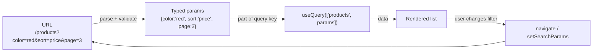
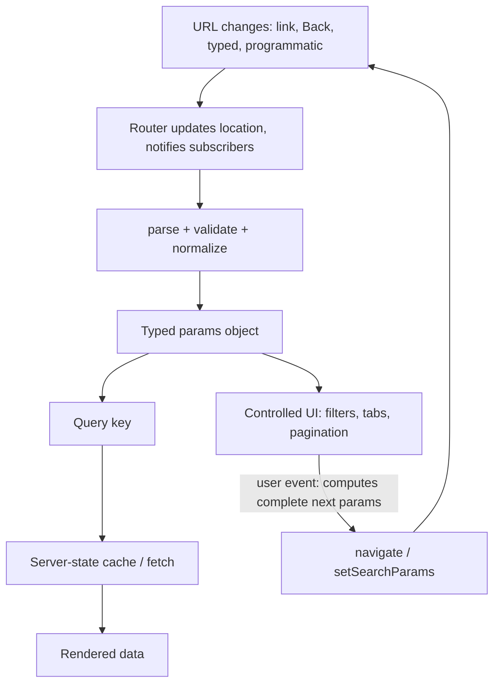
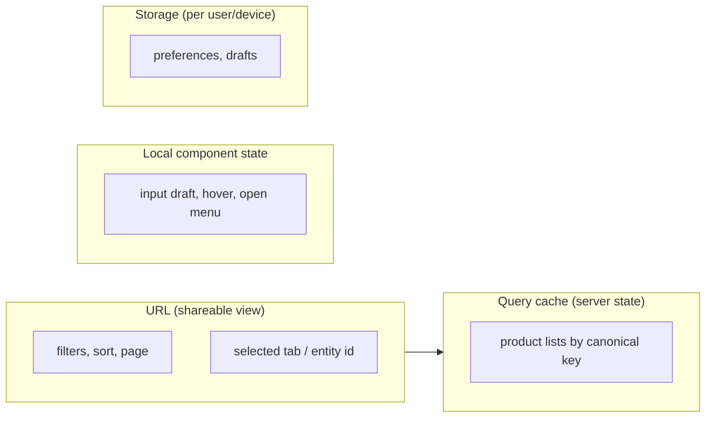

# 06 / 18 — URL State Management: The Address Bar as a State Store

> **Checked 2026-10-22:** the History API facts and the §5.1 hook were run in jsdom (React 19.3); React Router claims were read from the `react-router` 8.5 typings and changelog; TanStack Router, Next.js and `nuqs` were not executed. Router APIs (React Router `useSearchParams`, TanStack Router `validateSearch`, Next.js `useSearchParams`/`useRouter`), the Navigation API, and URL-state helper libraries change between versions. The *model* (URL = serialized, shareable, user-visible state; parse and validate on read; push vs replace; single source of truth) is stable. Router-specific code below is illustrative; confirm signatures in the docs of the version you use.

## 1. Lesson metadata

| | |
|---|---|
| **Level** | Intermediate–Advanced |
| **Study time** | 4–5 hours (reading 1.5 h, experiments 1 h, exercises 2 h) |
| **Prerequisites** | [Phase 3 / 17 — Derived state](../03-react-state-and-hooks/17-derived-state.md), [Phase 3 / 19 — UI, server, URL, and shared state](../03-react-state-and-hooks/19-ui-server-url-and-shared-state.md), [Phase 3 / 20 — `useSyncExternalStore`](../03-react-state-and-hooks/20-usesyncexternalstore-and-external-stores.md), [Phase 0 / 15 — HTTP, caching, navigation](../00-web-and-javascript-foundations/15-http-caching-and-navigation.md), [07 — Server state management](./07-server-state-management.md), [08 — TanStack Query](./08-tanstack-query.md), [Phase 4 / 18 — Routing architecture](../04-react-architecture/18-routing-architecture.md) |
| **Next** | [19 — Technology selection matrix](./19-technology-selection-matrix.md) |
| **Related** | [02 — Cancellation and race conditions](./02-cancellation-and-race-conditions.md), [14 — Server-side data loading](./14-server-side-data-loading.md), [Phase 7 / 14 — Debounce and throttle](../07-performance/14-debounce-and-throttle.md), [Phase 9 / 10 — Routing and nested layouts](../09-advanced-rendering-and-ecosystem/10-routing-and-nested-layouts.md) |

**Learning objectives.** After this lesson you can:
1. Decide, for any piece of state, whether it belongs in the URL, and defend the decision with the criteria shareability, restorability, history semantics, size, sensitivity, and update frequency.
2. Explain how the browser's History API and `URLSearchParams` work, and why `pushState` does not notify your app.
3. Build a typed, validated search-parameter layer with defaults, normalization, and canonical serialization.
4. Choose `push` vs `replace` correctly and avoid back-button traps and history pollution.
5. Make the URL the single source of truth for server-state query keys, without duplicating it into local state.
6. Handle debouncing, resets (pagination on filter change), arrays, dates, and complex filters.
7. Recognize security and privacy hazards of URL state, and SSR/hydration considerations.
8. Decide when *not* to use the URL.

**Concepts covered:** URL anatomy (path, search, hash), `URLSearchParams`, percent-encoding, History API (`pushState`, `replaceState`, `popstate`), `history.state` vs search params, Navigation API (conceptual), router-managed search params, parse/validate/serialize, canonical URLs, defaults omission, push vs replace, debounced commits, URL-driven query keys, `keepPreviousData`, selection and modal routes, deep linking, SSR, security (PII, open redirect, reflected input).

---

## 2. Deep conceptual explanation

### 2.1 What problem is this lesson solving?

Open a product list, filter to "red shoes under 100 euros, sorted by price, page 3", open one product, press Back. What should happen? What should happen if you copy the address into a chat message? What if you press refresh? If your filter state lives in `useState`, the answers are: Back leaves the whole list; the link opens an unfiltered list; refresh loses everything. Users experience this as the app "forgetting".

The browser already provides a persistence, sharing, and navigation mechanism for exactly this: **the URL**. Putting the right state there gives you, nearly for free: shareable links, bookmarks, refresh-resilience, Back/Forward integration, multiple tabs with independent views, analytics by path, and server-side rendering of the same view. The price: the URL is **a public, string-typed, user-editable, size-limited global store**, so everything read from it must be parsed, validated, and treated as untrusted input.

### 2.2 The categories-of-state model, revisited

[Phase 3 / 19](../03-react-state-and-hooks/19-ui-server-url-and-shared-state.md) introduced four state categories (UI, server, URL, shared). This lesson deepens the third, and shows how it **drives** the second: URL parameters are usually the *inputs* of server-state queries.



This is a **unidirectional loop** where the URL is the single source of truth. The anti-pattern is a bidirectional sync between `useState` and the URL ("two sources of truth"), which produces the loops and desyncs catalogued in §10.

### 2.3 What belongs in the URL: a decision procedure

Ask six questions. If most answers are "yes", use the URL.

| Question | Yes → URL | No → elsewhere |
|---|---|---|
| Would a user want to **share or bookmark** this view? | Filters, sort, page, search query, selected tab, selected entity | Hover state, tooltip, transient animations |
| Should **Back/Forward** restore it? | Navigations between meaningfully different views | Every keystroke; toggles that are not "places" |
| Should **refresh** preserve it? | Current view | Draft text (use storage), animation progress |
| Is it **small and serializable** as strings? | IDs, enums, numbers, short text | Large objects, binary, whole documents |
| Is it **safe to expose** (logs, referrer, history, screen shares)? | Non-sensitive | Tokens, PII, secrets, medical/financial detail |
| Does it change at a **low frequency**? | Discrete choices | Slider drags, scroll position at 60 Hz, typing without debounce |

Examples: pagination, sort, filters, selected tab, search query, "which row is open", date range, map viewport (coarse, debounced) → **URL**. Open dropdown, input focus, hover, drag in progress, unsaved form drafts, auth tokens, bulky response data → **not URL**.

Some states are *debatable* and should be decided per product: a modal's open flag (URL if it is a "place" like a product quick-view that people share; not URL for a confirmation dialog), a wizard step (URL if resumable and Back should go to the previous step), expanded/collapsed sidebar (usually local or persisted preference).

### 2.4 First principles: what a URL is to the browser

A URL decomposes into origin (scheme, host, port), **path**, **search** (query string, beginning with `?`), and **hash** (fragment, beginning with `#`). Facts relevant to state:

- The **hash** is never sent to the server; it is purely client-side. That makes it historically popular for client-only state ("hash routing"), but it conflicts with in-page anchors and is invisible to server rendering.
- The **search** string is sent to the server, appears in server logs, and is available during SSR.
- Both are **strings**. Anything richer is encoded by convention.
- **Percent-encoding** protects reserved characters. `URLSearchParams` serializes spaces as `+` (form-encoding), while `encodeURIComponent` emits `%20`; both decode correctly via `URLSearchParams`, but be consistent when comparing URLs textually.
- Duplicate keys are legal: `?tag=a&tag=b` → `getAll('tag')` returns `['a','b']`; `get('tag')` returns only the first.
- Practical length limits exist (servers/proxies often cap around 8 KB; some older clients ~2 KB). Do not put large payloads in URLs.

### 2.5 The History API: how the address bar changes without a reload

`history.pushState(state, '', url)` adds a history entry and changes the URL **without loading** the page; `history.replaceState` modifies the current entry. Facts that explain every router's behavior (documented on MDN / HTML Standard):

- **Neither fires an event.** `popstate` fires only on *traversal* (Back/Forward/`history.go`) between entries of the same document, not when you call `pushState`/`replaceState`. Routers therefore wrap these calls and notify their subscribers themselves.
- The **state object** (second-class "location state") is structured-cloned and stored with the entry; it survives Back/Forward and reload (in the same tab/session) but **not** when someone opens the URL in another tab or shares it. Use it only for ephemeral, non-essential data (for example "where did I come from" for a back link), never for state needed to reconstruct a view.
- **Scroll restoration** on traversal is handled by the browser via `history.scrollRestoration` (`'auto'`/`'manual'`); SPAs that render asynchronously often need manual handling (router features).
- The **Navigation API** (`window.navigation`) is a newer, more complete model with an event for all navigations. MDN compat data (checked 2026-10-22) lists Chrome 102, Firefox 147 and Safari 26.2, so all three engines now ship it, but older browser versions in the wild do not; check your support matrix before depending on it. Routers are gradually adopting it; app code rarely needs it directly.

*Public guarantee:* the semantics above (HTML Standard). *Teaching model:* "the router is a thin wrapper that keeps a subscription list in sync with `location` and the History API".

### 2.6 What React exposes versus what routers add

React has no URL concept. A router library provides: matching paths to components, navigation functions, **hooks that expose location/search params** (conceptually `useSyncExternalStore` or equivalent over history), link components with prefetch, scroll restoration, and—in framework routers—data-loading integration ([14](./14-server-side-data-loading.md)). Because the URL is an external mutable store, correct integration requires the same concerns as [Phase 3 / 20](../03-react-state-and-hooks/20-usesyncexternalstore-and-external-stores.md): consistent snapshots (no tearing) and stable references.

React 18/19 concurrency interplay: URL changes drive renders that can be **interrupted/deferred** if wrapped in a transition (`startTransition` / `useTransition`, [Phase 3 / 22](../03-react-state-and-hooks/22-modern-hooks-and-apis.md)); many routers wrap navigations in transitions internally (not checked per router and version). Practical consequence: after navigation, the old UI may remain visible briefly while the new route renders, which is generally what you want, but means "pending navigation" state must be read from the router (e.g. a navigation state hook) rather than assumed.

### 2.7 Common misconceptions

| Misconception | Reality |
|---|---|
| "URL state is just for routing." | Routing is the *path*; search params are a general serializable state store tied to the history entry. |
| "I'll sync `useState` ↔ URL with an effect." | Two sources of truth → loops, flicker, stale reads. Derive from the URL; write via navigation. |
| "`history.pushState` re-renders React." | It changes the URL only; nothing re-renders unless something subscribes and updates state. |
| "Put it in `location.state`, it's invisible and clean." | It is not shareable, not bookmarkable, not server-visible, and lost on new tab. |
| "Each filter change should `push`." | That floods history; Back becomes a chore. Use `replace` for refinements within a "place" (policy-dependent). |
| "URL params are typed." | Always strings. `page=abc` happens. Parse and validate. |
| "Anything in the URL is private because it's HTTPS." | Query strings appear in browser history, server and proxy logs, analytics, and `Referer` headers (subject to referrer policy). |
| "The URL is the right place for form drafts." | Drafts belong in local state/storage ([16](./16-offline-considerations.md)); URLs are for *shareable view state*. |

---

## 3. Internal mechanics

### 3.1 `URLSearchParams` essentials

```ts
const sp = new URLSearchParams('?color=red&tag=a&tag=b&page=3');
sp.get('color');        // 'red'   (string | null)
sp.getAll('tag');       // ['a', 'b']
sp.get('page');         // '3'     (string, not number!)
sp.get('missing');      // null
sp.set('page', '4');    // replaces all 'page' entries
sp.append('tag', 'c');  // adds another
sp.delete('color');
sp.toString();          // 'tag=a&tag=b&tag=c&page=4'  (no leading '?')
```

Points to internalize: values are `string | null`; `set` replaces all values for the key, `append` adds; insertion order is preserved in serialization, so **two semantically identical URLs can differ textually** (`?a=1&b=2` vs `?b=2&a=1`). For caching and equality, normalize (§3.4). `sp.sort()` sorts keys in place (stable by key).

### 3.2 A router-agnostic URL store (teaching model)

All router hooks reduce to this shape:

```ts
type Listener = () => void;
const listeners = new Set<Listener>();

function notify() { listeners.forEach((l) => l()); }

export function navigate(url: string, { replace = false } = {}) {
  if (replace) history.replaceState(null, '', url);
  else history.pushState(null, '', url);
  notify();                                  // pushState/replaceState emit no event: we must notify
}

window.addEventListener('popstate', notify); // Back/Forward

export const urlStore = {
  subscribe(l: Listener) { listeners.add(l); return () => void listeners.delete(l); },
  getSnapshot: () => window.location.search, // primitive string => stable snapshot identity
};
```

`useSyncExternalStore(urlStore.subscribe, urlStore.getSnapshot)` yields the current search string. Notice **why returning the raw string** from `getSnapshot` matters: returning `new URLSearchParams(...)` each call would create a new object per call and cause infinite re-render warnings ([Phase 3 / 20](../03-react-state-and-hooks/20-usesyncexternalstore-and-external-stores.md)). Parse *outside* `getSnapshot`, with `useMemo` keyed on the string.

*Implementation detail:* real routers keep their own location objects and may use their own history abstraction, but the information flow is the same.

### 3.3 Parse → validate → normalize → serialize

The URL is **untrusted input**. A robust layer has four steps:

1. **Parse** raw strings from `URLSearchParams`.
2. **Validate/coerce**: numbers must be finite integers within range; enums must be members; unknown or malformed values fall back to **defaults** (don't throw — a hand-edited URL must not crash the page).
3. **Normalize**: apply defaults, clamp, sort array values, trim whitespace → a *canonical* object.
4. **Serialize**: write back the canonical object, **omitting defaults** so URLs stay short and clean (`/products` and `/products?page=1&sort=relevance` represent the same view; pick one canonical form, ideally the shortest).

The same canonical object forms the **query key** for server state. Because `useQuery`'s key hashing ignores object property order but not array order ([08 §3.1](./08-tanstack-query.md)), normalizing array order (e.g. sort tags) prevents duplicate cache entries for equivalent views.

### 3.4 Updating URL state: push, replace, and merging

Two independent decisions on every update:

| Decision | Options | Guidance |
|---|---|---|
| **History entry** | `push` (new entry) vs `replace` (overwrite) | `push` for changes a user would regard as "going somewhere else" (new page of results, new tab, new selection that opens detail). `replace` for refinements and high-churn updates (typing in a search box, slider adjustments, normalizing an invalid URL, redirecting from a default). |
| **Merge strategy** | Replace all params vs merge into existing | Usually *merge*: changing `sort` must preserve `color`. But **resetting dependents**: changing any filter should reset `page` to 1, or you land on page 7 of a result set that now has 2 pages. |

A common compromise policy: *filter/sort changes → replace + reset page; pagination → push; opening a detail → push.* It is a product decision, document it.

### 3.5 Concurrency and ordering

Rapid sequential updates in the same tick can overwrite each other when each computes from the **stale current URL**. Some routers' `setSearchParams` accept a function `(prev) => next`, but, unlike React's `setState` updater, successive calls in the same tick do not queue (each sees the same `prev`): the React Router `useSearchParams` documentation (checked in the 8.5 typings) warns that the function form "does not support the queueing logic that React's `setState` implements. Multiple calls to `setSearchParams` in the same tick will not build on the prior value." Safer: compute one combined update per user event. This is an instance of the stale-snapshot problem from [Phase 3 / 02](../03-react-state-and-hooks/02-functional-state-updates.md), but with the URL as the store.

### 3.6 SSR and hydration

On the server there is no `window`; the router is given the request URL. The server renders from the *same parsed params* as the client will, so the HTML matches ([Phase 2 / 25](../02-react-rendering-and-internals/25-hydration-and-selective-hydration.md)). Pitfalls: reading `window.location` during render (crashes on the server, or mismatches); parsing differently on server and client (e.g. locale-dependent number parsing); in Next.js's App Router, reading search params in client components can opt the route into client-side rendering for that subtree or require a Suspense boundary during static generation (version-sensitive; not checked in this review). See [14](./14-server-side-data-loading.md) for loader-based flows where the URL feeds the data fetch before render.

---

## 4. Step-by-step execution walkthrough

Scenario: `/products?color=red&page=3` is open. User changes the color filter to "blue" using React Router's `setSearchParams` in a design where filters `replace` and reset the page, and the list uses TanStack Query with `placeholderData: keepPreviousData`.

| Step | What happens |
|---|---|
| 1 | Click event handler runs: computes next params `{color:'blue'}` + resets `page` (omitted = default 1). Calls `setSearchParams(next, { replace: true })`. |
| 2 | Router calls `history.replaceState(...)` (current entry overwritten: no new Back step), updates its internal location, and notifies subscribers. |
| 3 | React schedules a render (router navigations typically run as transitions; verify). Components reading search params re-render. |
| 4 | `parseSearch(sp)` produces `{color:'blue', page:1, sort:'relevance', tags:[]}`; canonical. |
| 5 | `useQuery({ queryKey: ['products', params], ... })` sees a **new key**. No cache entry (first time) → `status: 'pending'` for the new key, but with `placeholderData: keepPreviousData` the hook returns the previous result (`isPlaceholderData: true`) so the list doesn't blank. |
| 6 | The previous key's observer is released (its entry remains in cache until `gcTime`). If the old request was still in flight and `signal` was forwarded, the library can cancel it ([02](./02-cancellation-and-race-conditions.md)). |
| 7 | The new response arrives; UI swaps from placeholder to real data. Pressing Back now leaves the *page* (not the previous filter), because step 2 replaced. |
| 8 | If the user returns to `color=red&page=3` (typed manually), the entry may still be in the query cache and render instantly, with a background refetch if stale. |

Predict: *what if step 1 used `push` instead?* Back would walk through each filter change (blue → red, page 3), which some products want (e.g. a map search) and most do not. And *what if step 1 forgot to reset `page`?* The URL would be `?color=blue&page=3`; if blue has only 2 pages the API returns empty or 404 — a classic bug. The validation layer should clamp or the UI should reset page on filter change; both is best.

---

## 5. Code examples

### 5.1 Minimal: a hand-rolled `useSearchParam` (teaching the mechanism)

```tsx
import { useCallback, useSyncExternalStore } from 'react';

const listeners = new Set<() => void>();
const notify = () => listeners.forEach((l) => l());

function subscribe(l: () => void) {
  listeners.add(l);
  window.addEventListener('popstate', l);
  return () => {
    listeners.delete(l);
    window.removeEventListener('popstate', l);
  };
}

const getSearch = () => window.location.search;
const getServerSearch = () => '';

export function useSearchParam(name: string, fallback: string) {
  const search = useSyncExternalStore(subscribe, getSearch, getServerSearch);
  const value = new URLSearchParams(search).get(name) ?? fallback;

  const setValue = useCallback(
    (next: string, { replace = true } = {}) => {
      const sp = new URLSearchParams(window.location.search);
      if (next === fallback) sp.delete(name); else sp.set(name, next); // omit defaults
      const qs = sp.toString();
      const url = `${window.location.pathname}${qs ? `?${qs}` : ''}${window.location.hash}`;
      if (replace) history.replaceState(null, '', url); else history.pushState(null, '', url);
      notify(); // pushState/replaceState emit no event
    },
    [name, fallback],
  );

  return [value, setValue] as const;
}
```

Notes: the snapshot is a **string**, so identity is stable. `notify` is required because `pushState`/`replaceState` do not fire events. Hash is preserved. This hook demonstrates the model; in an application, use your router's hooks, which also integrate with transitions, scroll restoration, and SSR.

**Predict:** component A and B both call `useSearchParam('q', '')`. A calls `setValue('x')`. *Both re-render* because both subscribe and the shared store notifies. If they instead used independent `useState`, B would not update — the URL is a shared store.

### 5.2 Incorrect: mirrored state, unvalidated parsing, and push-per-keystroke

```tsx
// ❌ Many bugs in one component
function ProductsPage() {
  const [sp, setSp] = useSearchParams();
  const [page, setPage] = useState(Number(sp.get('page')));     // (1) copy of URL into state; NaN if missing
  const [q, setQ] = useState(sp.get('q') ?? '');

  useEffect(() => { setSp({ page: String(page), q }); }, [page, q]);  // (2) effect syncing state -> URL

  const filters = JSON.parse(sp.get('filters')!);                 // (3) throws on missing/malformed

  return (
    <input value={q} onChange={(e) => { setQ(e.target.value); setSp({ q: e.target.value }, { replace: false }); }} /> // (4) push per keystroke
  );
}
```

(1) `useState` initializes once, so Back/Forward, links, and external navigation never update `page` — and `Number(null)` is `0`, `Number('abc')` is `NaN`. (2) The effect and the handler both write the URL; the effect also fires on mount, rewriting the URL (and with default `push` semantics, polluting history). (3) `JSON.parse(null!)` throws on a missing param and on malformed hand-edited input — an uncaught render error from user-editable input. (4) One history entry per keystroke makes Back useless and the app janky. Also: `setSp({ q })` *replaces* all params, dropping `page`.

### 5.3 Corrected: a typed schema layer (parse / normalize / serialize)

```ts
// productSearch.ts
export const SORTS = ['relevance', 'price-asc', 'price-desc'] as const;
export type Sort = (typeof SORTS)[number];

export interface ProductSearch {
  q: string;
  color: string | null;
  tags: string[];      // canonical: sorted, unique
  sort: Sort;
  page: number;        // >= 1
}

export const DEFAULTS: ProductSearch = { q: '', color: null, tags: [], sort: 'relevance', page: 1 };

function toInt(raw: string | null, fallback: number, min: number, max: number): number {
  if (raw === null) return fallback;
  const n = Number.parseInt(raw, 10);
  if (!Number.isFinite(n)) return fallback;
  return Math.min(max, Math.max(min, n));
}

export function parseProductSearch(sp: URLSearchParams): ProductSearch {
  const sortRaw = sp.get('sort');
  return {
    q: (sp.get('q') ?? '').trim().slice(0, 100),
    color: sp.get('color') || null,
    tags: [...new Set(sp.getAll('tag').map((t) => t.trim()).filter(Boolean))].sort(),
    sort: (SORTS as readonly string[]).includes(sortRaw ?? '') ? (sortRaw as Sort) : DEFAULTS.sort,
    page: toInt(sp.get('page'), DEFAULTS.page, 1, 10_000),
  };
}

export function serializeProductSearch(s: ProductSearch): URLSearchParams {
  const sp = new URLSearchParams();
  if (s.q) sp.set('q', s.q);
  if (s.color) sp.set('color', s.color);
  for (const t of [...s.tags].sort()) sp.append('tag', t);
  if (s.sort !== DEFAULTS.sort) sp.set('sort', s.sort);
  if (s.page !== DEFAULTS.page) sp.set('page', String(s.page));
  return sp; // defaults omitted; keys written in a fixed order => canonical
}
```

Line notes: `SORTS as const` gives a literal union without duplicating the type; `includes` check narrows unknown strings to the default (hand-edited URLs never crash); tags are de-duplicated and sorted, so `?tag=b&tag=a` and `?tag=a&tag=b` parse to the same object (same query key); `serialize` writes keys in a fixed order and omits defaults → one canonical URL per view. In larger apps, a schema library (Zod, Valibot, ArkType) can express the same; the logic is identical. Test this module in isolation with a table of inputs ([Phase 8 / 02](../08-testing-and-quality/02-unit-testing-with-vitest.md)).

### 5.4 Practical: React Router integration with replace/push policy and page reset

```tsx
import { useMemo } from 'react';
import { useSearchParams } from 'react-router';           // 'react-router' in v7 and v8; 'react-router-dom' is the v6 name, kept as a compat re-export in v7 and removed in v8 (only RouterProvider/HydratedRouter move to 'react-router/dom')
import { parseProductSearch, serializeProductSearch, type ProductSearch } from './productSearch';

export function useProductSearch() {
  const [sp, setSp] = useSearchParams();
  const search = useMemo(() => parseProductSearch(sp), [sp]);

  function update(patch: Partial<ProductSearch>, opts: { resetPage?: boolean; replace?: boolean } = {}) {
    const { resetPage = true, replace = true } = opts;
    const next: ProductSearch = { ...search, ...patch, page: patch.page ?? (resetPage ? 1 : search.page) };
    setSp(serializeProductSearch(next), { replace });
  }

  return {
    search,
    setFilter: (patch: Partial<Omit<ProductSearch, 'page'>>) => update(patch, { resetPage: true, replace: true }),
    setPage: (page: number) => update({ page }, { resetPage: false, replace: false }), // pagination pushes
  };
}
```

Why this shape: one function computes a *complete* next state from the *parsed* current state, so there is no partial-update drift; a filter change resets `page` by construction; the push/replace policy lives in one place. `useMemo([sp])` relies on the router returning a stable `sp` between unrelated renders (the React Router docs state `searchParams` is a stable reference). Because `serialize` writes only non-defaults, `setSp` receives the canonical form.

### 5.5 Practical: debounced text input (local state for the input, URL for the commit)

```tsx
import { useEffect, useState } from 'react';

export function SearchBox() {
  const { search, setFilter } = useProductSearch();
  const [text, setText] = useState(search.q);

  // Adopt external URL changes (Back/Forward, links) into the input
  useEffect(() => { setText(search.q); }, [search.q]);

  // Commit to URL after the user pauses typing
  useEffect(() => {
    if (text === search.q) return;
    const id = setTimeout(() => setFilter({ q: text }), 300);
    return () => clearTimeout(id);
  }, [text, search.q, setFilter]);

  return <input value={text} onChange={(e) => setText(e.target.value)} aria-label="Search products" />;
}
```

Why *two* states here is legitimate: the input needs a **per-keystroke, synchronous** value (controlled input, [Phase 1](../01-react-fundamentals/)), while the URL is committed at human pace. The text state is a *draft*, not a second source of truth; the first effect re-syncs the draft whenever the URL's value changes externally. Subtle: the two effects can fight — if the user types "ab", pauses (commit "ab"), and meanwhile the URL changes to "x" via Back, the second effect would see `text("ab") !== search.q("x")` and schedule committing "ab" back after the first effect updates `text`. Because the first effect sets `text` to "x" in the same commit, the second effect's next run sees equality, and cancels. This was verified with a test (typing "ab", then an external change to `?q=x` before the debounce fired: the input ended as `x`, no commit happened and the URL stayed `?q=x`); still add a test for your own router; a state machine or a keyed remount (`<SearchBox key={search.q} />` with an uncontrolled-until-commit pattern) are alternative designs. Because `setFilter` is recreated every render in the sketch, `useCallback` in `useProductSearch` (or reading it via a ref) avoids resetting the timer unnecessarily.

### 5.6 Practical: the URL drives the server-state query

```tsx
import { keepPreviousData, queryOptions, useQuery } from '@tanstack/react-query';
import type { ProductSearch } from './productSearch';

export const productKeys = {
  all: ['products'] as const,
  list: (s: ProductSearch) => [...productKeys.all, 'list', s] as const,
};

export const productListQuery = (s: ProductSearch) =>
  queryOptions({
    queryKey: productKeys.list(s),                // the canonical search object IS the key
    queryFn: async ({ signal }) => {
      const sp = serializeProductSearch(s);       // reuse the same serializer for the API call (or map explicitly)
      const res = await fetch(`/api/products?${sp}`, { signal });
      if (!res.ok) throw new Error(`HTTP ${res.status}`);
      return (await res.json()) as { items: Product[]; totalPages: number };
    },
    placeholderData: keepPreviousData,            // v5: keep showing previous page while next loads
    staleTime: 30_000,
  });

function ProductList() {
  const { search, setPage } = useProductSearch();
  const { data, isPlaceholderData } = useQuery(productListQuery(search));

  if (!data) return <p>Loading…</p>;
  return (
    <section aria-busy={isPlaceholderData}>
      <ul>{data.items.map((p) => <li key={p.id}>{p.name}</li>)}</ul>
      <button disabled={search.page <= 1} onClick={() => setPage(search.page - 1)}>Previous</button>
      <button disabled={search.page >= data.totalPages} onClick={() => setPage(search.page + 1)}>Next</button>
    </section>
  );
}
```

Observations: **no `useState` for filters, no effect to fetch** — the URL change *is* the trigger, via the changed key ([01](./01-fetch-lifecycle.md) → [08](./08-tanstack-query.md) evolution). `Product` is assumed defined elsewhere; `serializeProductSearch` is imported. The API contract (`/api/products?...`) may differ from the URL contract; mapping explicitly is better when they diverge (URL names are user-facing, API names are backend-facing). Normalization guarantees `?tag=b&tag=a` and `?tag=a&tag=b` share one cache entry.

### 5.7 Advanced: selection in the URL (detail panel) with prefetch and a safe fallback

```tsx
import { useQueryClient } from '@tanstack/react-query';
import { Link, useSearchParams } from 'react-router';

function ProductRow({ p }: { p: Product }) {
  const qc = useQueryClient();
  const [sp] = useSearchParams();
  const next = new URLSearchParams(sp);
  next.set('item', String(p.id));

  return (
    <li>
      <Link
        to={{ search: next.toString() }}          // keeps all other params, adds ?item=ID; default navigation = push
        onMouseEnter={() => void qc.prefetchQuery(productDetailQuery(p.id))}
      >
        {p.name}
      </Link>
    </li>
  );
}

function DetailPanel() {
  const [sp, setSp] = useSearchParams();
  const raw = sp.get('item');
  const id = raw && /^\d+$/.test(raw) ? Number(raw) : null;      // validate; never trust
  const { data, isError } = useQuery({ ...productDetailQuery(id ?? 0), enabled: id !== null });

  if (id === null) return null;
  if (isError) return <p role="alert">Product not found. <button onClick={() => close()}>Close</button></p>;
  if (!data) return <p>Loading…</p>;

  function close() {
    const next = new URLSearchParams(sp);
    next.delete('item');
    setSp(next, { replace: true }); // closing shouldn't create a forward/back ping-pong
  }
  return <aside><h2>{data.name}</h2><button onClick={close}>Close</button></aside>;
}
```

Design notes: opening is a **push** (Back closes the panel — natural for "peek" UIs), closing uses **replace** to avoid the Back→re-open loop where Back would re-open what you just closed (a policy choice: some apps prefer `navigate(-1)` if the previous entry is known to be the closed state; this is fragile if the user landed directly on the deep link — a known pitfall). `enabled: id !== null` with `id ?? 0` is a type workaround; production code often uses `skipToken` (TanStack Query v5) to express "no query". The validation regex rejects `item=abc`, `item=-1`, and `item=1;DROP`. Every URL-supplied identifier must still be authorized server-side; client validation is UX, not security.

### 5.8 Advanced (sketch): typed search params in a router that supports them

```tsx
// TanStack Router style (illustrative; not executed here; recent versions accept Standard Schema validators such as Zod 4 directly)
import { createFileRoute } from '@tanstack/react-router';
import { z } from 'zod';

const searchSchema = z.object({
  q: z.string().catch(''),
  sort: z.enum(['relevance', 'price-asc', 'price-desc']).catch('relevance'),
  page: z.number().int().min(1).catch(1),
});

export const Route = createFileRoute('/products')({
  validateSearch: searchSchema,
});

// In a component: const { q, sort, page } = Route.useSearch();
// Navigating:     <Link to="/products" search={(prev) => ({ ...prev, page: 2 })} />
```

What this illustrates: some routers make search params **first-class typed state** — parsed and validated at the route boundary, with typed navigation helpers, so invalid URLs are caught structurally and every `Link` is checked at compile time. The trade-off is router lock-in; the hand-rolled schema layer in §5.3 gives the same discipline with any router. Libraries such as `nuqs` offer a `useState`-like API over search params for Next.js and other routers (2.x on npm at the time of checking; verify current support).

---

## 6. Visual explanations

### The unidirectional URL loop



### Push vs replace over a session

```text
Policy: filter=replace, pagination=push, open detail=push

User action                 History stack (top = current)
-------------------------   -------------------------------------------
land on /products           [/products]
type search 'sh' -> 'shoes' [/products?q=shoes]          (replace, debounced)
color=red                   [/products?q=shoes&color=red] (replace, page reset)
next page                   [..., /products?q=shoes&color=red&page=2]  (push)
open item 42                [..., ?...&page=2, ?...&page=2&item=42]    (push)
Back                        returns to page 2 list (panel closed)
Back                        returns to /products?q=shoes&color=red (page 1)
Back                        leaves the products page
```

### What lives where



---

## 7. Alternative approaches and trade-offs

| Approach | Shareable | Back/Forward | Refresh | SSR | Complexity | Fit |
|---|---|---|---|---|---|---|
| **Search params (this lesson)** | Yes | Yes (push) / No (replace) | Yes | Yes | Medium (parse/serialize) | Filters, sort, pagination, selection |
| **Path segments** (`/products/shoes/red`) | Yes | Yes | Yes | Yes | Route design | Hierarchical identity (categories, entity ids) |
| **Hash params** (`#q=...`) | Yes | Yes | Yes | **No** (not sent to server) | Low | Client-only tools, static hosting, in-page state |
| **`history.state` / router location state** | **No** | Yes | Tab-local | No | Low | Ephemeral hints (return-to) |
| **Local component state** | No | No | No | n/a | Lowest | Ephemeral UI |
| **Global store (Zustand/Redux)** | No | No | No (unless persisted) | Hydration | Medium | Cross-component UI not meant to be shared by link |
| **localStorage/session persistence** | No | No | Yes (same browser) | No | Medium | Preferences, drafts |
| **Encoded blob in URL** (JSON/base64/compressed) | Yes | Yes | Yes | Yes | High (size, readability, versioning) | Complex shareable configurations (charts, query builders) |
| **Server-stored "saved view" + short ID** (`?view=abc123`) | Yes | Yes | Yes | Yes | Server work | Large/complex or sensitive filter sets |

**Scenario where URL state is *not* best:** a multi-step checkout with payment details, or an analytics query builder with 40 nested conditions. Putting card-related or personal data in the URL leaks it into history, logs, and referrers; a 40-condition tree makes an unreadable, fragile, size-limited URL. Better: keep sensitive step data in server/session state, use only the *step identifier* in the URL, and for the query builder store the configuration server-side and share a short opaque ID (`?view=…`). Another non-fit: a physics slider updating 60 times per second — local state with commit on release.

---

## 8. Best practices and anti-patterns

### Best practices
- **URL = single source of truth** for shareable view state; derive everything else from it; write only via navigation.
- **Centralize the schema**: one module with parse, normalize, serialize, defaults, and tests; used by routes, links, and API calls.
- **Treat URL input as untrusted**: validate, clamp, default; never `JSON.parse` raw params without try/catch and schema validation; never let a bad param throw during render.
- **Canonicalize**: sorted arrays, fixed key order, omit defaults; redirect or `replace` non-canonical URLs once.
- **Choose push/replace by user intent** and write the policy down.
- **Reset dependent params** (page) when upstream params change; clamp page to `totalPages` when data returns.
- **Debounce free text** (300–500 ms typical), commit with `replace`.
- **Use the canonical object as the query key** and `keepPreviousData`/`placeholderData` for smooth transitions ([08](./08-tanstack-query.md)).
- **Prefetch likely next URLs** on hover/viewport intent ([Phase 7 / 17](../07-performance/17-network-waterfalls.md)).
- **Preserve unrelated params and hash** when updating (merge).
- **Keep URLs human-readable and stable**: they become public API (bookmarks, emails, docs); changing param names breaks links. Support legacy names with a redirect/normalizer.
- **Test deep links**: render with initial URL entries (memory router) and assert both UI and requests ([Phase 8 / 08](../08-testing-and-quality/08-integration-testing.md)).

### Beginner mistakes
- Copying params into `useState` and then wondering why Back does nothing.
- `Number(param)` without NaN handling; trusting enums.
- Replacing all params when changing one.
- Pushing on every keystroke.
- Putting tokens, emails, or identifiers into the URL for convenience.

### Experienced-developer mistakes
- Bidirectional sync via effects between a global store and the URL (loops, flicker); choose one owner.
- Non-canonical URLs creating duplicate query-cache entries and duplicate analytics pages.
- Unbounded values (`?pageSize=1000000`) forwarded to the API unvalidated.
- Using `location.state` for state needed after sharing a link.
- Forgetting SSR: reading `window.location` in render, hydration mismatches.
- Navigating inside render or in an effect without guards, causing redirect loops.
- Open-redirect parameters (`?next=https://evil.example`) honored without validation.
- Storing complex objects as JSON in the URL without versioning, breaking old links after a schema change.

### Smells
- An effect whose only job is `setSearchParams` after `setState`.
- `useEffect(() => { fetch(...) }, [searchParams])` with `searchParams` as an object dependency (identity changes) — derive primitives or use a query key instead.
- Multiple components each parsing the same params differently.
- A URL that grows with every interaction (leftover defaults, duplicate keys).
- Tests that pass only with a pre-populated `useState` default.

### Justified exceptions
- Duplicate a value into local state when it needs per-keystroke feedback (the draft pattern).
- Use hash for state on static hosts or embedded widgets where you don't control server routing.
- Put non-shareable *return-to* hints in `location.state`.
- Use `push` for every filter change in a map/search "exploration" UI where Back-as-undo is the product feature.
- Skip URL state entirely for internal, single-view tools where sharing/back behavior is irrelevant (but weigh: users still press Back).

---

## 9. Real-world application

- **E-commerce listing/search.** URL holds category (path), filters, sort, page, query; SEO and sharing demand canonical, crawlable URLs; indexable pages should avoid infinite param combinations (canonical links, `noindex` on filter permutations — SEO specifics are [Phase 9 / 14](../09-advanced-rendering-and-ecosystem/14-accessibility-and-seo.md)). Constraint: analytics funnels often key off URLs; renaming params breaks reports.
- **Admin tables / dashboards.** Date range, filters, selected row in the URL so support staff can paste a link to exactly what they see. Constraint: *data in the URL must not include customer PII*; use IDs. Date ranges serialize as ISO dates (`2025-01-01`) and interpret in a documented timezone — a classic source of off-by-one-day bugs.
- **Finance.** Account ID and statement period in the URL are acceptable (IDs, not balances or account numbers if sensitive); never include amounts or personal data; all params authorized server-side. Referrer policy matters when linking out ([Phase 10 / 06](../10-production-engineering/06-security-xss-csrf-csp.md)).
- **Auth.** `?next=/path` post-login redirect: validate that it is a relative same-origin path (open-redirect vulnerability otherwise). OAuth callbacks put short-lived codes in the URL: remove them from history immediately after use (`replace` to a clean URL) so they don't linger.
- **Forms/wizards.** Step in the URL (`/checkout/shipping`) enables Back and resume; field values stay in state/storage and server session. Guard routes: arriving at step 3 directly must redirect if step 2 data is missing.
- **Realtime views.** The *subscription topic* derives from URL params; changing the URL changes the subscription ([17](./17-real-time-websockets-subscriptions.md)).
- **Multi-team platforms.** A shared "URL contract" package per feature exports `parse`, `serialize`, and typed link builders; other teams link via builders, not string concatenation, so param renames are compile-time changes (compare the invalidation-function guidance in [08 §9](./08-tanstack-query.md)).

---

## 10. Debugging and troubleshooting

| Symptom | Likely root cause | Investigation | Fix / validation |
|---|---|---|---|
| Back button "doesn't work" (stays on page) | `replace` where `push` intended; or effect rewriting URL on mount | Watch `history.length` and the Network panel; log navigations; DevTools → Application → Back/forward cache pane | Adjust policy; remove mount-time writes; test the sequence |
| Back button needs many clicks | Push per keystroke/filter | Count entries after interactions | `replace` for refinements; debounce |
| UI doesn't update when URL changes | State copied from URL once (`useState` init) | React DevTools: state differs from URL | Derive from URL; remove mirrored state |
| Infinite render/redirect loop | Effect writes URL when parsed value differs from raw (non-canonical) with unstable deps | Console shows repeated navigations; Profiler shows continuous commits | Canonicalize once with a guard (`if (canonical !== current) replace`); stabilize deps |
| Page shows empty list after filter change | Page not reset (`page=7` beyond range) | Network tab: request has `page=7` | Reset page on filter change; clamp when `totalPages` known |
| Two cache entries for the "same" view | Non-canonical array/key order | Query Devtools lists both | Normalize in parser (sort/dedupe) |
| Crash from a hand-edited URL | Unvalidated `JSON.parse`/enum cast | Reproduce with `?filters=%7B` | Schema validation with defaults/catch |
| Hydration mismatch warning | Server and client parse params differently, or `window.location` read in render | Console warning; compare server HTML to client | Single parser; use router-provided location; `getServerSnapshot` |
| Lost params after clicking a `Link` | `to="/products"` replaces search | Inspect href | Merge existing params in link builders |
| Stale params after rapid updates | Two `setSearchParams` calls in one tick computed from the same prev | Log `prev` in both | Compute one combined update per event |
| Typing lags | URL commit per keystroke triggers route-wide render/fetch | Profiler: commits per keystroke | Local draft state + debounced commit; transition |
| Sensitive data seen in logs/analytics | PII in query string | Inspect proxy/analytics logs | Remove from URL; use POST/session; set `Referrer-Policy` |

**DevTools workflow:** in the console, run `history.length`, `location.search`, `history.state` to inspect the model directly; Application → Back/forward cache to see bfcache eligibility (pages using `unload` handlers or certain APIs may be ineligible; relevant to Back performance); React DevTools to see which components subscribe to location; TanStack Query Devtools to see key hashing and duplicates.

---

## 11. Exercises

### Level A — Knowledge
**A1.** Which part of a URL is never sent to the server? Name one consequence for SSR.
**A2.** Does `history.pushState` fire `popstate`? What does fire `popstate`?
**A3.** What does `new URLSearchParams('?a=1&a=2').get('a')` return, and how do you get both values?
**A4.** Give four criteria for deciding whether state belongs in the URL.
**A5.** Why should defaults be omitted when serializing?
**A6.** Why is `location.state` unsuitable for a filter?

### Level B — Code comprehension
**B1.** Why does `getSnapshot` in §3.2 return `window.location.search` (a string) rather than a `URLSearchParams`?
**B2.** In §5.4, what happens to the URL if the user is on `?color=red&page=3` and calls `setFilter({ color: 'blue' })`? And `setPage(4)` from there?
**B3.** In §5.7 why is closing the panel a `replace` while opening is a `push`? What goes wrong with `navigate(-1)` for closing?
**B4.** Explain what the §5.5 draft pattern does when the user presses Back while the input contains an uncommitted draft.

### Level C — Implementation
**C1.** Write `parseDateRange(sp)` / `serializeDateRange` for `?from=2025-01-01&to=2025-01-31` with validation (invalid → defaults; `from <= to`; max 366 days) and timezone-safe handling (treat as plain dates).
**C2.** Implement a `useUrlState<T>(key, codec)` hook generalizing §5.1 to typed values with a codec `{ parse(raw: string | null): T; format(v: T): string | null }`.
**C3.** Write tests (Vitest + a memory router) asserting: initial URL → rendered filters; clicking page 2 → URL and query request; Back → page 1.

### Level D — Debugging
**D1.** After adding URL-synced filters, the browser tab freezes with the CPU pinned. The code: `useEffect(() => { setSp({ tags: tags.join(',') }); }, [tags])` where `tags` is derived from `sp.get('tags')?.split(',') ?? []`. Diagnose.
**D2.** QA reports: "On page 5, when I change the filter, I see 'No results' until I click Previous." Diagnose and fix at two layers.
**D3.** A product link shared on social media opens a blank page for some users; the URL contains `?filters={"color":"red"}` pasted from an app where the quote characters got converted to curly quotes. Diagnose and harden.

### Level E — Architecture and engineering decisions
**E1.** For each, decide URL / local / store / storage and justify: (a) table sort column, (b) "sidebar collapsed", (c) a date-range picker's *open* state, (d) selected rows for bulk action (could be hundreds), (e) map viewport, (f) draft comment text.
**E2.** Design the URL contract for an analytics dashboard with date range, up to 10 segments, and a comparison period, considering length, readability, versioning, and privacy.
**E3.** Your team debates adopting a typed-search-params router versus keeping the current router with a hand-rolled schema layer. Provide decision criteria.

### Level F — Expert challenge
**F1.** Design a migration of an existing app whose URLs use `?cat=…&p=…` to `?category=…&page=…` without breaking inbound links, analytics, or SEO.
**F2.** Design correct behavior for modal-as-route ("photo viewer") including direct-load deep link, in-app open (background page preserved), Back/Forward, refresh, and focus/scroll restoration.

---

## 12. Detailed answers and explanations

> Attempt the exercises first.

**A1.** The hash/fragment (`#…`). On the server the fragment is invisible, so server rendering cannot depend on it; a view driven by hash state renders incorrectly (default view) on first server paint and only corrects on the client.

**A2.** No. `pushState`/`replaceState` change the URL silently. `popstate` fires on history *traversal* (Back/Forward, `history.go()`, and some browser UI actions) within the same document. Hence libraries notify subscribers themselves.

**A3.** `get('a')` returns `'1'` (the first). `getAll('a')` returns `['1','2']`.

**A4.** Any four of: shareable/bookmarkable; should Back/Forward restore it; should refresh preserve it; small and serializable; safe to expose (not sensitive); low update frequency; needed by the server for SSR; independent per tab.

**A5.** To keep one canonical URL per view (`/products` instead of `/products?page=1&sort=relevance`), to shorten URLs, to avoid duplicate cache keys/analytics entries, and to make changes of defaults not break shared links (an omitted param tracks the default; an explicit one pins it — a subtle trade-off).

**A6.** It isn't shared by copying the URL, doesn't exist for a new tab, isn't visible to the server, and breaks refresh semantic expectations in a new session. Only the entry in the current tab's history holds it.

**B1.** `useSyncExternalStore` compares successive snapshots with `Object.is` and re-renders when they differ. A new `URLSearchParams` object each call would always differ → render loop and a development warning about uncached `getSnapshot`. A string compares by value. Parse in render with `useMemo`.

**B2.** `setFilter({color:'blue'})` → `replace` to `?color=blue` (page reset to default 1 → omitted). Then `setPage(4)` → `push` to `?color=blue&page=4`. History: one entry for the blue view (replacing red/3), one more for page 4. A wrong answer is `?color=blue&page=3`, which misses the reset.

**B3.** Opening pushes so Back closes the panel (a natural "undo"). Closing with `replace` removes the `item` param from the current entry so that Back doesn't return to the open state and cause a "can't escape the panel" loop (close → Back re-opens). `navigate(-1)` assumes the previous entry is the closed state; if the user arrived via a deep link `?item=42`, `-1` leaves the app (or goes to an unrelated page). Either strategy has edge cases; some apps track "opened from within the app" in `location.state` to decide.

**B4.** The URL changes (Back), `search.q` becomes the older value; the first effect sets `text` to that value, discarding the uncommitted draft. That is the *intended* behavior: external navigation wins, and the pending debounce timer is cancelled by the cleanup when deps change. The alternative design (preserve draft) conflicts with user expectation that Back restores the previous view. Tests should cover this.

**C1.** Evaluation criteria and sample:
```ts
const DAY = 86_400_000;
const ISO = /^\d{4}-\d{2}-\d{2}$/;

function parseDay(raw: string | null): number | null {
  if (!raw || !ISO.test(raw)) return null;
  const t = Date.parse(`${raw}T00:00:00Z`);        // UTC midnight: no local timezone drift
  if (Number.isNaN(t)) return null;
  return new Date(t).toISOString().slice(0, 10) === raw ? t : null;   // reject rolled-over dates like 2025-02-31
}

export function parseDateRange(sp: URLSearchParams, today = Date.now()) {
  const defTo = Math.floor(today / DAY) * DAY;
  const defFrom = defTo - 29 * DAY;
  let from = parseDay(sp.get('from')) ?? defFrom;
  let to = parseDay(sp.get('to')) ?? defTo;
  if (from > to) [from, to] = [to, from];
  if (to - from > 365 * DAY) from = to - 365 * DAY;
  return { from, to };
}

export function serializeDateRange(r: { from: number; to: number }, sp = new URLSearchParams()) {
  sp.set('from', new Date(r.from).toISOString().slice(0, 10));
  sp.set('to', new Date(r.to).toISOString().slice(0, 10));
  return sp;
}
```
Reasoning: treat values as UTC calendar dates, not instants, to avoid timezone shifts; validate format with a regex *and* check the date is real: a `NaN` check alone is **not** enough. Run in Node 24 (V8): `new Date('2025-02-31T00:00:00Z')` is *not* NaN, it rolls over to 3 March, and only out-of-range fields such as month 13 give `NaN`. Use a round-trip check, e.g. `const d = new Date(s + 'T00:00:00Z'); ok = !Number.isNaN(d.getTime()) && d.toISOString().slice(0, 10) === s` (verified: it rejects `2025-02-31` and `2025-04-31`, and accepts `2024-02-29`); clamp the span; swap reversed ranges or reject — pick one policy. The `today` parameter makes it testable. Edge: defaults depending on "today" make omitted params *time-dependent* — document or serialize them explicitly for shared links.

**C2.** Sample:
```ts
interface Codec<T> { parse(raw: string | null): T; format(v: T): string | null } // null => remove param

export function useUrlState<T>(key: string, codec: Codec<T>, opts: { replace?: boolean } = {}) {
  const search = useSyncExternalStore(subscribe, getSearch, getServerSearch); // from §5.1
  const value = useMemo(() => codec.parse(new URLSearchParams(search).get(key)), [search, key, codec]);

  const set = useCallback((v: T) => {
    const sp = new URLSearchParams(window.location.search);
    const raw = codec.format(v);
    if (raw === null) sp.delete(key); else sp.set(key, raw);
    const qs = sp.toString();
    const url = `${location.pathname}${qs ? `?${qs}` : ''}${location.hash}`;
    (opts.replace ?? true) ? history.replaceState(null, '', url) : history.pushState(null, '', url);
    notify();
  }, [key, codec, opts.replace]);

  return [value, set] as const;
}
```
Criteria: stable `codec` identity (define codecs at module level), `format` returning `null` for defaults, parse never throws. Pitfall: object-valued `T` produce a new identity every `parse`; memoize on the raw string so consumers' effects don't loop.

**C3.** Criteria: render the app within `createMemoryRouter([...], { initialEntries: ['/products?color=red'] })` (or the router's test utility); mock network via MSW ([Phase 8 / 06](../08-testing-and-quality/06-mocking-strategies-and-msw.md)) with a handler recording the request URL; assert the filter UI reflects `red`; click "Next" and `await findBy…`; assert the recorded request has `page=2` and `router.state.location.search` is `?color=red&page=2`; navigate back via `router.navigate(-1)`; assert page-1 UI. Avoid asserting internal hook state. Test the parser separately with a table of malformed inputs.

**D1.** `tags` is derived with `?.split(',') ?? []` — a **new array every render**; the effect depends on `tags`, so it runs every render; it calls `setSp`, which navigates and re-renders → effect again → infinite loop (and even when serialized value is identical, a new object is created). Fixes: remove the effect (write to the URL from the event handler that changes tags); derive `tags` with `useMemo` on the raw string; compare before writing (`if (next !== current)`). The root error is "effect syncing derived state back to its own source" ([Phase 3 / 07](../03-react-state-and-hooks/07-you-might-not-need-an-effect.md)).

**D2.** Root cause: `page` isn't reset when filters change (and the API returns an empty/404 for out-of-range pages). Fix layer 1 (client interaction): `setFilter` resets `page` to default. Fix layer 2 (robustness): when data arrives with `totalPages < page`, `replace` the URL to `page = totalPages` (or 1); also clamp on the server (return the last page or a clear 400/redirect). Also check old links with large `page` values.

**D3.** The app does `JSON.parse(sp.get('filters')!)` and the curly quotes make it throw SyntaxError during render → blank page (error boundary absent or the whole app crashes). Harden: never parse unvalidated JSON in render; wrap in try/catch with schema validation and defaults; prefer flat, human-typed params (`?color=red`) over JSON blobs; add an error boundary at the route level showing "This link seems broken" with a link to the default view; log malformed-parameter events (rate-limited) to spot link corruption. Consider short-ID saved views if the filters are complex.

**E1.** (a) Sort column: URL (shareable, Back restoration optional → replace). (b) Sidebar collapsed: local state persisted to storage as a user preference — not about a "view". (c) Date picker open state: local state; transient. (d) Selected rows (hundreds): not URL (size); keep in component/store state, or server-side saved selection; the URL could carry a *selection ID* if shareable. (e) Map viewport: URL with coarse precision and debounced `replace` (e.g. `?c=48.21,16.37&z=12`) when shareable map positions matter; else local. (f) Draft comment: local state + storage; never URL. Good answers apply the six-question procedure, not intuition alone.

**E2.** Criteria: **readability/length**: dates `from`, `to`, `cmp=prev|yoy|custom`; segments as repeated `seg=` with stable IDs (not display names), cap at 10; **canonicalization**: sorted segment IDs; **versioning**: `v=2` param (or version in path) so old links can be migrated by a normalizer; **privacy**: IDs only, no customer names/PII; authorization checked server-side; **size**: ≤ ~1 KB typical; if exceeding, store the view server-side and use `?view=<id>`; **semantic defaults**: "last 30 days" default vs explicit dates in shared links (relative vs absolute: provide a "share with fixed dates" option). **Testing**: round-trip property tests `parse(serialize(x)) == normalize(x)`.

**E3.** Criteria: number of routes with complex search params; frequency of param-related bugs; team TypeScript maturity; SSR/framework constraints (framework-bound routers aren't swappable); migration cost; community/maintenance risk; escape hatches. A balanced answer: adopt typed-param routing if starting greenfield with heavy search-param usage and no framework lock-in; otherwise a schema layer + typed link builders captures most value at low cost. What would change the decision: if parse/serialize logic is duplicated across more than a few routes, or typo-driven broken links recur.

**F1.** Outline: (1) Introduce a normalizer that reads **both** old and new param names (`cat`→`category`, `p`→`page`) and always writes the new. (2) On load, if old names detected, `replace` to the new canonical URL client-side; on the server/edge issue a **301/308 redirect** from old to new so crawlers and analytics consolidate (SEO: canonical tags, sitemap update). (3) Keep the legacy reader for a long deprecation window (inbound links in emails and docs persist for years); monitor legacy-param hit rate and retire when negligible. (4) Update analytics definitions and dashboards (map both). (5) Update internal link builders; add a lint/test forbidding old names in new code. (6) Test with a table of legacy URLs → canonical outputs. Edge cases: mixed old+new params (new wins), unknown params preserved, fragment preserved, A/B tests keyed to URLs.

**F2.** Outline: Model with two routes or a route with a `modal` outlet: in-app open navigates to `/photos/42` **while preserving the background location** (router "location state" containing `backgroundLocation`, as a hint only) so the gallery stays rendered behind the modal; deep-link load (no background state) renders the standalone page version of `/photos/42`; Back from the modal returns to the gallery (entry with background), Forward reopens; refresh on the modal URL loses `location.state` hint in some cases → renders the standalone page (acceptable, consistent with deep link — design for this). Focus: on open, move focus into the dialog and trap; on close, restore focus to the triggering thumbnail (store a ref/ID) ([Phase 8 / 10](../08-testing-and-quality/10-accessibility-testing.md)); scroll: lock background scroll while open and restore position on close (browser scroll restoration may fight; verify with router options). Evaluate: tests for four entry paths (in-app, deep link, refresh, Back/Forward), and accessible semantics (`role="dialog"`, `aria-modal`, Escape to close).

---

## 13. Senior engineer interview questions

1. **"Why put state in the URL?"** To get sharing, bookmarking, refresh persistence, Back/Forward behavior, SSR, and analytics for free for *view* state, in exchange for string serialization, validation, and exposure.
2. **"What would you never put in the URL?"** Secrets/tokens, PII and sensitive financial/medical data, large objects, draft text, and high-frequency transient state, because URLs leak to history, logs, referrers, and screenshots and have size limits.
3. **"Push or replace for a search box?"** Replace (debounced): each keystroke is a refinement of one view, not a new place; push-per-keystroke ruins Back. Use push for discrete navigation like pagination or opening a detail.
4. **"Why not mirror the URL into `useState`?"** Two sources of truth: Back/Forward, links, and other tabs change the URL but not the copy; syncing with effects causes loops. Derive from the URL and update through navigation; use local state only as an input draft.
5. **"How do URL params relate to caching?"** The canonical parsed params become the query key, so each distinct view caches independently; non-canonical forms (array order, defaults) cause duplicate entries and refetches.
6. **"How do you harden URL parsing?"** Parse to a typed object with schema validation, fallbacks to defaults, clamping, length limits; never throw in render; log malformed input; authorize everything server-side.
7. **"A user edits `?page=-5` — what happens?"** Validation clamps to 1 (and optionally `replace`s the URL to canonical); the server also validates. The API must not trust the client's param even if the client validated.
8. **"How do you avoid duplicate history entries and loops when normalizing?"** Normalize with `replace`, only when the canonical string differs from the current, and avoid effects that write unconditionally.
9. **"URL state in SSR?"** The server parses the request URL with the same function the client uses, so initial HTML matches; avoid `window` access in render; for frameworks, understand when search-param reads force client rendering or Suspense boundaries.
10. **"What are the security concerns?"** Reflected injection if params are rendered unsafely, open redirects in `next` params, PII in logs/referrers, parameter tampering to access others' resources (IDOR) — mitigate with escaping (React escapes by default except `dangerouslySetInnerHTML`), allow-listed redirect targets, `Referrer-Policy`, and server-side authorization.

---

## 14. Further learning resources

| Resource | URL | Covers / why | Level | Study |
|---|---|---|---|---|
| MDN — `URLSearchParams` | <https://developer.mozilla.org/en-US/docs/Web/API/URLSearchParams> | API semantics (get/getAll/set/append/sort) | Beginner | Whole page |
| MDN — History API | <https://developer.mozilla.org/en-US/docs/Web/API/History_API> | `pushState`, `replaceState`, `popstate` | Intermediate | Concepts and usage |
| MDN — `Window: popstate` event | <https://developer.mozilla.org/en-US/docs/Web/API/Window/popstate_event> | When it fires | Intermediate | Whole page |
| MDN — Navigation API | <https://developer.mozilla.org/en-US/docs/Web/API/Navigation_API> | Modern navigation model (check support) | Advanced | Concepts |
| HTML Standard — Session history and navigation | <https://html.spec.whatwg.org/multipage/nav-history-apis.html> | Normative history semantics | Advanced | History interface |
| MDN — `Referrer-Policy` | <https://developer.mozilla.org/en-US/docs/Web/HTTP/Headers/Referrer-Policy> | Controlling URL leakage via referrer | Intermediate | Directives |
| React Router docs | <https://reactrouter.com> | `useSearchParams`, navigation, data APIs (v8.5 is current on npm; v7 APIs used here still exist) | Intermediate | Search params |
| TanStack Router docs | <https://tanstack.com/router> | Typed, validated search params | Intermediate | Search params guide |
| Next.js docs — routing and `useSearchParams` | <https://nextjs.org/docs> | App Router behavior and constraints (version-sensitive) | Intermediate | `useSearchParams` reference |
| `nuqs` | <https://nuqs.dev> | Type-safe URL query state hooks | Intermediate | Docs overview |
| React — `useSyncExternalStore` | <https://react.dev/reference/react/useSyncExternalStore> | Mechanism routers use to subscribe to location | Advanced | Whole page |

---

## 15. Knowledge checkpoint

**You understand it if you can:**
- Apply the six-question procedure to place any state in or out of the URL.
- Explain why `pushState` doesn't notify React and how routers compensate.
- Explain canonicalization and why it matters for caching.

**You can explain it if you can:**
- Defend a push/replace policy for a product and describe the failure modes of each choice.
- Argue against mirrored state and effect-synchronized URL state.

**You can implement it if you can, without notes:**
- Write a parse/normalize/serialize module with defaults and tests; wire it to a router hook, a debounced input, and a query key with `keepPreviousData`.

**You can debug it if you can:**
- Diagnose redirect/render loops, un-reset pagination, duplicate cache entries, hydration mismatches, and malformed-URL crashes.

**Prerequisite for next lessons:** [19 — Technology selection matrix](./19-technology-selection-matrix.md) (URL state as one category of state ownership in the decision framework) and [Phase 9 / 10 — Routing and nested layouts](../09-advanced-rendering-and-ecosystem/10-routing-and-nested-layouts.md).
