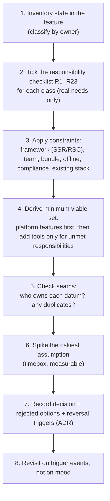
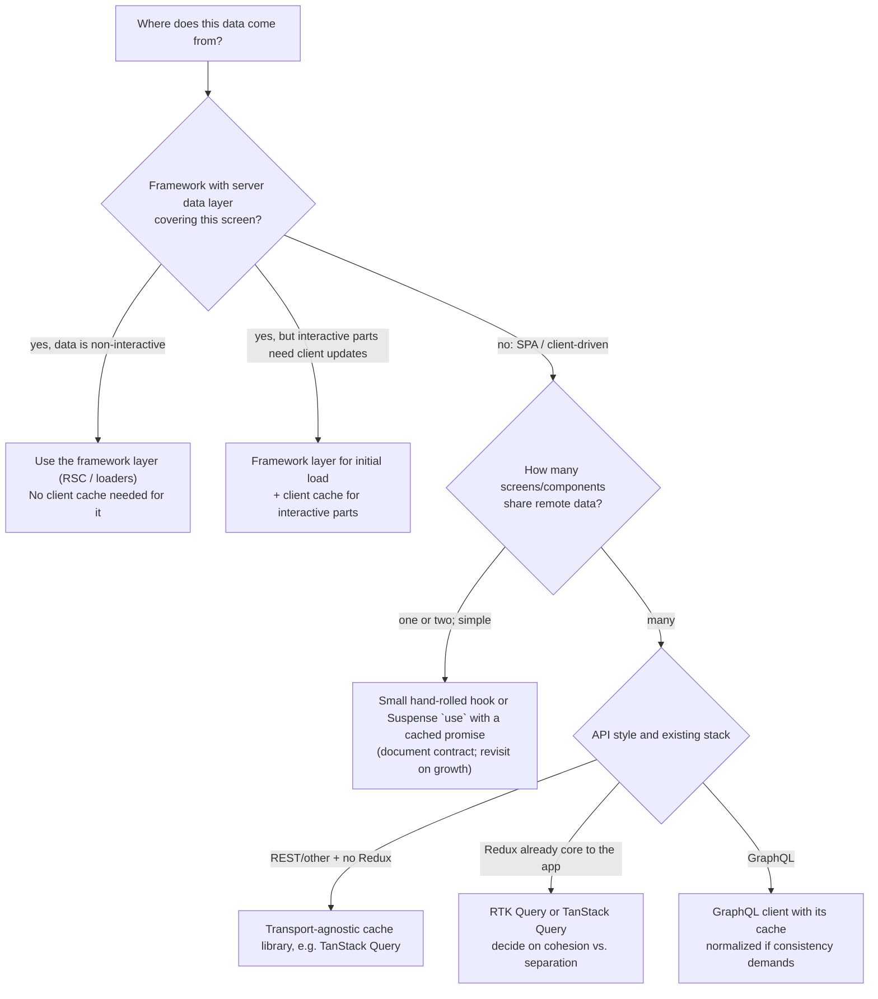
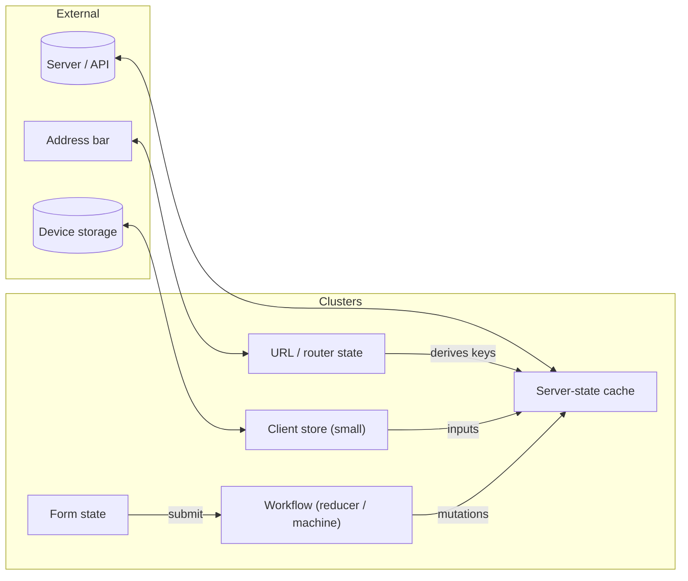

# 06 / 19 — Technology Selection Matrix: Choosing Data and State Tools by Responsibility

> **Checked 2026-10-22:** the code in §5 was typechecked/executed where it uses TanStack Query 5.104, Zustand 5.0.16, RTK 2.13 and XState 5.33, and the ESLint sketch in §5.4 was run against ESLint 10.13. Library comparisons below (bundle sizes, maintenance status, SWR, Apollo, Jotai-style atoms, framework data layers) were **not** verified. This lesson compares *responsibilities*, not release-specific features. Library capabilities, bundle sizes, maintenance status, and framework data APIs change; every comparison below is a **starting hypothesis to be verified for your versions** (and, for consequential decisions, by a time-boxed spike). There is intentionally **no single winner** in this lesson. If you finish it believing "X is best", you have misread it.

## 1. Lesson metadata

| | |
|---|---|
| **Level** | Advanced–Professional |
| **Study time** | 5 hours (reading 2 h, case studies 1.5 h, exercises 1.5 h) |
| **Prerequisites** | All earlier Phase 6 lessons: [01 — Fetch lifecycle](./01-fetch-lifecycle.md), [02 — Cancellation and race conditions](./02-cancellation-and-race-conditions.md), [03 — Loading and error states](./03-loading-and-error-states.md), [04 — API normalization](./04-api-normalization.md), [05 — Optimistic updates](./05-optimistic-updates.md), [06 — Cache consistency and invalidation](./06-cache-consistency-and-invalidation.md), [07 — Server state management](./07-server-state-management.md), [08 — TanStack Query](./08-tanstack-query.md), [09 — Redux Toolkit](./09-redux-toolkit.md), [10 — Zustand](./10-zustand.md), [11 — Context vs external stores](./11-context-vs-external-stores.md), [12 — State machines and XState](./12-state-machines-and-xstate.md), [13 — Suspense data loading](./13-suspense-data-loading.md), [14 — Server-side data loading](./14-server-side-data-loading.md), [15 — Error recovery and retries](./15-error-recovery-and-retries.md), [16 — Offline considerations](./16-offline-considerations.md), [17 — Real-time](./17-real-time-websockets-subscriptions.md), [18 — URL state management](./18-url-state-management.md) |
| **Next** | [20 — Phase assessment](./20-phase-assessment.md) |
| **Related** | [Phase 4 / 15 — State ownership](../04-react-architecture/15-state-ownership.md), [Phase 4 / 16 — Server vs client state](../04-react-architecture/16-server-vs-client-state.md), [Phase 10 / 16 — Architecture decision records](../10-production-engineering/16-architecture-decision-records.md), [Phase 11 / 01 — Trade-off analysis](../11-senior-and-architect-mastery/01-trade-off-analysis.md), [Phase 11 / 08 — State architecture at scale](../11-senior-and-architect-mastery/08-state-architecture-at-scale.md), [Phase 11 / 14 — Build vs buy](../11-senior-and-architect-mastery/14-build-vs-buy.md) |

**Learning objectives.** After this lesson you can:
1. Classify any piece of state by *ownership and lifecycle* (server, URL, UI-local, UI-shared, workflow/process, form, derived, persisted) and name the responsibilities each class demands.
2. Map each candidate technology (hand-rolled hooks, TanStack Query, RTK Query, SWR-style hooks, GraphQL clients, Redux Toolkit, Zustand, Context, XState, framework loaders/RSC, `use` + Suspense, URL/router state, form libraries) to the responsibilities it **does** and **does not** cover.
3. Apply a repeatable decision procedure that produces a *justified, revisable* recommendation including rejected alternatives and the conditions under which you would change your mind.
4. Combine tools without creating two sources of truth, and place the seams (adapters, query-option factories) that make later replacement cheap.
5. Recognize decision anti-patterns: resume-driven development, state-manager-for-everything, premature global state, and "framework of the week" churn.
6. Write a concise architecture decision record (ADR) for a data/state choice.

**Concepts covered:** responsibility matrix, state taxonomy, ownership, lifecycle and scope, cost of coordination, reversibility, adapter boundaries, hybrid architectures, team and organizational factors, bundle and runtime cost, SSR/RSC fit, offline and real-time needs, testing cost, migration paths, decision records, spike methodology.

---

## 2. Deep conceptual explanation

### 2.1 What problem is this lesson solving?

Phase 6 taught the *machinery* of data and state: request lifecycle, races, errors, caching, invalidation, optimistic updates, stores, machines, Suspense, server loading, retries, offline, real-time, URL state. Each lesson introduced tools that implement some of that machinery. What remains is the question every real project faces on day one and again at every scale threshold: **which of these do we adopt, for which kinds of state, and why?**

Bad answers are widespread and predictable:
- **Popularity-driven:** "everyone uses X."
- **Single-tool maximalism:** put everything in one global store (or, conversely, in Context).
- **Resume-driven:** pick what the team wants to learn.
- **Premature generality:** pick the heaviest tool "to be safe".
- **Inertia:** keep the 2018 tool because it is there.

A good answer is **derived from the responsibilities the application actually has**, constrained by the framework, team, and operational context, and documented with its reversal conditions. This lesson provides the framework for deriving it, not a verdict.

### 2.2 First principle: state has *owners*, and tools are *owner-specific*

[Phase 4 / 15](../04-react-architecture/15-state-ownership.md) and [Phase 3 / 19](../03-react-state-and-hooks/19-ui-server-url-and-shared-state.md) established that bugs concentrate where **ownership is ambiguous**. Technology selection is therefore step 2; step 1 is classifying state by owner:

| State class | Authoritative owner | Typical lifetime | Failure when mishandled |
|---|---|---|---|
| **Server state** | Remote system | Until server changes; local copy goes stale | Stale/duplicated/inconsistent data; races; refetch storms |
| **URL state** | The address bar | Per history entry | Not shareable; Back/refresh broken; two sources of truth |
| **Local UI state** | One component | Component lifetime | Over-globalization; unnecessary re-renders elsewhere |
| **Shared UI state** | Several components (client-only) | Session or feature lifetime | Prop drilling vs Context over-rendering; accidental global coupling |
| **Form state** | The form (draft until submit) | Until submit/abandon | Re-render storms; validation drift; lost drafts |
| **Workflow / process state** | A state machine, conceptually | Per flow instance | Impossible states ("loading and error"); scattered booleans |
| **Derived state** | Computed from others | Computed | Stale copies; sync effects |
| **Persisted client state** | Storage on the device | Across sessions | Schema drift; privacy leaks; cross-user leakage |
| **Real-time stream state** | Remote publisher | Subscription lifetime | Missed events; ordering; leaks |

A tool is a good fit for a class when it implements that class's **responsibilities** (§2.3). A tool used outside its class pays a translation cost on every feature (e.g. a global store used as a server cache must re-implement staleness, deduplication, and invalidation; a server-cache library used for modal-open flags is ceremony without benefit).

### 2.3 The responsibility checklist

When a lesson in this phase says "the library handles X", X comes from this list. For each project area, tick the responsibilities that **actually exist** (not hypothetically):

**R1.** Request lifecycle modelling (idle/loading/success/error) · **R2.** Cancellation and race protection · **R3.** Caching keyed by identity · **R4.** Request deduplication · **R5.** Staleness policy / background refetch · **R6.** Retry/backoff ([15](./15-error-recovery-and-retries.md)) · **R7.** Invalidation after mutations ([06](./06-cache-consistency-and-invalidation.md)) · **R8.** Optimistic updates with rollback ([05](./05-optimistic-updates.md)) · **R9.** Normalization across entities ([04](./04-api-normalization.md)) · **R10.** Pagination/infinite scroll · **R11.** Prefetching · **R12.** SSR/streaming/hydration ([14](./14-server-side-data-loading.md)) · **R13.** Suspense integration ([13](./13-suspense-data-loading.md)) · **R14.** Persistence/offline ([16](./16-offline-considerations.md)) · **R15.** Real-time subscriptions ([17](./17-real-time-websockets-subscriptions.md)) · **R16.** Cross-component client state sharing · **R17.** Fine-grained subscriptions (selectors) · **R18.** Complex workflow modelling with explicit transitions ([12](./12-state-machines-and-xstate.md)) · **R19.** Time-travel/devtools/auditing · **R20.** URL synchronization ([18](./18-url-state-management.md)) · **R21.** Form draft/validation · **R22.** Type-safe API contract (end-to-end types) · **R23.** Testability.

Most applications have R1–R7 for *some* data, R16 for a small amount of UI state, R20 for list pages, and R21 for a few forms. Fewer have R8–R9 at scale, R14–R15, or R18 — but when they do, those dominate the architecture.

### 2.4 The candidate technologies, by responsibility coverage (hypotheses)

The table lists the *primary* design intent of each option. "●" = a core design responsibility; "○" = possible with additional code/plugins/conventions; blank = outside the tool's scope. These are generalizations to be verified for your versions.

| Capability | Hand-rolled hooks ([01](./01-fetch-lifecycle.md)) | TanStack Query ([08](./08-tanstack-query.md)) | RTK Query ([09](./09-redux-toolkit.md)) | GraphQL clients (Apollo/urql/Relay) | Redux Toolkit store ([09](./09-redux-toolkit.md)) | Zustand ([10](./10-zustand.md)) | Context ([11](./11-context-vs-external-stores.md)) | XState ([12](./12-state-machines-and-xstate.md)) | `use`+Suspense ([13](./13-suspense-data-loading.md)) | Framework loaders / RSC ([14](./14-server-side-data-loading.md)) | URL/router ([18](./18-url-state-management.md)) |
|---|---|---|---|---|---|---|---|---|---|---|---|
| R1 lifecycle states | ○ | ● | ● | ● | ○ | ○ | | ● | ○ (via boundaries) | ● | |
| R2 cancellation | ○ | ● | ● | ● | ○ | | | ○ | ○ | ● (per navigation) | |
| R3 keyed cache | | ● | ● | ● (document or normalized) | ○ | ○ | | | ○ (you cache promises) | ○ (framework cache) | |
| R4 dedupe | | ● | ● | ● | ○ | | | | ○ | ● (per request) | |
| R5 staleness/refetch | | ● | ● | ● | ○ | | | | | ○ | |
| R6 retry | ○ | ● | ● | ● | | | | ○ | | ○ | |
| R7 invalidation | | ● | ● (tags) | ● (refetch/cache updates) | ○ | | | | | ○ (revalidation) | |
| R8 optimistic | ○ | ● | ● | ● | ○ | ○ | | ○ | ○ (`useOptimistic`) | ○ | |
| R9 normalization | | ○ (by design not) | ○ (not by default; entity adapters) | ● (Apollo/Relay) | ● (entity adapters) | ○ | | | | | |
| R12 SSR | | ● (hydration helpers) | ● | ● | ● | ● | ● | ● | ● | ● | ● |
| R13 Suspense | | ● (suspense hooks) | ○ | ○ | | | | | ● | ● | |
| R14 persistence | | ○ (plugin) | ○ | ○ | ○ | ● (persist middleware) | | ○ | | | ● (URL) |
| R15 real-time | ○ | ○ (patch cache) | ○ (cache update hooks) | ● (subscriptions) | ○ | ○ | | ○ | | | |
| R16 shared client state | | | | ○ (local state) | ● | ● | ● (low frequency) | ● (actors) | | | ● (for shareable) |
| R17 fine-grained selectors | | ● (`select`) | ● | ● | ● | ● | (all consumers) | ○ | n/a | n/a | ○ |
| R18 workflow modelling | | | | | ○ | ○ | | ● | | | |
| R19 devtools/time travel | | ● (devtools) | ● (Redux DevTools) | ● | ● | ○ (middleware) | | ● (inspector) | | | |
| R20 URL sync | | ○ (keys from URL) | ○ | ○ | ○ | ○ | | ○ | | ● (router loaders) | ● |
| R22 e2e types | ○ | ○ | ○ | ● (codegen) | ○ | ○ | | ○ | | ● (in some frameworks) | ○ |

Two-line interpretation: **no column is full**, and the columns that look most similar (TanStack Query / RTK Query / GraphQL clients) differ mainly in *what they assume about your stack* (transport-agnostic vs Redux-integrated vs GraphQL-schema-driven). Also absent from the table but legitimate candidates in your own evaluation: SWR-style hooks (lighter-weight cache-and-revalidate hook libraries), atom-based stores (Jotai and similar), signals libraries, and form libraries (React Hook Form, TanStack Form, framework form actions). Treat them with the same checklist.

### 2.5 What React itself provides (the baseline you compete with)

Before adopting any tool, measure it against what React 19 already offers: `useState`/`useReducer` (local and lifted state), Context (dependency injection and low-frequency broadcast), `useSyncExternalStore` (the sanctioned way to build stores), `use` + Suspense (reading promises/context at render), Actions with `useActionState`/`useOptimistic`/`useFormStatus` (mutation lifecycle and optimistic UI, notably for forms), and, in frameworks supporting Server Components, **server-side data access without a client cache at all** ([14](./14-server-side-data-loading.md)). The relevant questions are *what responsibilities remain after using these*, because every tool you add is a dependency, a learning curve, a testing surface, and an upgrade burden.

### 2.6 The costs the matrix doesn't show

| Cost | Examples |
|---|---|
| **Cognitive** | Concepts to learn (keys, tags, selectors, middleware, actors); how many engineers will *actually* learn them; onboarding time |
| **Coordination** | Two tools = two mental models and a seam between them; each seam is a possible source of duplicated state |
| **Bundle/runtime** | Library size (verify with a bundle analyzer; [Phase 7 / 16](../07-performance/16-bundle-analysis.md)), render overhead, memory for caches |
| **Operational** | Devtools maturity, error reporting hooks, upgrade cadence, breaking-change history |
| **Testing** | Per-test client instances, mocking at network vs module boundary ([Phase 8 / 07](../08-testing-and-quality/07-testing-api-interactions.md)) |
| **Reversibility** | How hard to remove: does the tool's API leak into every component, or sit behind a small hook layer? |
| **Org fit** | Hiring pool, existing platform choices, framework mandates, security reviews |

*Reversibility is the most underrated criterion.* A decision that is cheap to reverse needs less certainty than one that spreads through the codebase. §5.4 shows how to architect for reversibility.

### 2.7 Common misconceptions

| Misconception | Reality |
|---|---|
| "Pick a state management library first." | Classify the state first; most "global state" is server state or URL state. |
| "Redux is obsolete / TanStack Query replaces Redux." | They own different classes of state; many apps use a server-state cache *and* a small client store. RTK Query merges both into Redux for teams already there. |
| "Context is a state manager." | It is a dependency-injection channel; it re-renders all consumers on value change ([11](./11-context-vs-external-stores.md)), which is fine for low-frequency values and poor for hot data. |
| "Server Components remove the need for client data libraries." | They remove client fetching for *non-interactive, server-rendered* data. Interactive, frequently-changing, or client-driven data (filters, polling, optimistic mutations) still needs client-side state/caching in most apps. |
| "Normalization is always better." | It buys cross-query consistency at the cost of schema knowledge, complexity, and subtle bugs ([04](./04-api-normalization.md)); many apps are well served by keyed caches with targeted invalidation. |
| "A state machine library is for complex apps only." | Machines apply to *workflows with impossible states*, whatever app size (a 4-step upload with retry is a good candidate). |
| "More tools = more capability." | More tools = more seams. Capability comes from responsibilities covered with the fewest independent owners. |
| "We can always change later." | Only if the API surface is abstracted; otherwise "later" costs rewrites. |

---

## 3. Internal mechanics

### 3.1 A decision procedure (not an algorithm)

Technology selection is a *judgment*, but a disciplined sequence prevents the typical failure modes:



The *minimum viable set* in step 4 is deliberately conservative: start from what the platform gives (local state, URL, Context for DI, framework data APIs), then add one tool per **unmet responsibility cluster**. Resist adding a tool for responsibilities you merely *might* need.

### 3.2 Responsibility clusters usually map to one tool each

Observing real systems, responsibilities cluster:

| Cluster | Responsibilities | Typical single owner |
|---|---|---|
| **Server-state cache** | R1–R7, R10, R11, R13, often R8 | One of: framework loaders/RSC cache, TanStack Query, RTK Query, GraphQL client |
| **Client-shared state** | R16, R17, R19 | One of: Zustand-like store, Redux store, Context (low-frequency), signals/atoms |
| **Shareable view state** | R20 | Router/URL |
| **Workflow state** | R18 | Machine library or a `useReducer` with a discriminated union ([Phase 3 / 03](../03-react-state-and-hooks/03-usereducer-and-reducer-architecture.md)) |
| **Form state** | R21 | Form library or React 19 form Actions |
| **Streaming state** | R15 | Subscription client feeding the server-state cache ([17](./17-real-time-websockets-subscriptions.md)) |

The architectural rule that falls out: **at most one owner per cluster, and explicit seams between clusters.** Two server-state caches in one app (say TanStack Query *and* Apollo for different endpoints) is sometimes justified (two backends) but must be a deliberate decision, because invalidation and consistency cannot cross them automatically.

### 3.3 Seams: how clusters talk without becoming one

Healthy seams are **one-directional and derive, not copy**:

- URL → params → query keys ([18](./18-url-state-management.md)): server state *derives* from URL state.
- Server state → UI via selectors: no copying into client store ([Phase 3 / 17](../03-react-state-and-hooks/17-derived-state.md)).
- Client store → query inputs: e.g. a `selectedOrgId` from the client store becomes part of query keys; changing it changes the keys; no manual refetch calls.
- Real-time events → server-state cache via `setQueryData` / invalidate ([17](./17-real-time-websockets-subscriptions.md)).
- Workflow machine → invokes mutations or queries as *services/actors*, receives results as events ([12](./12-state-machines-and-xstate.md)).

Unhealthy seams: bidirectional sync effects, duplicated entities in two stores, "refresh the other store when this one changes" callbacks, and shared mutable singletons.

### 3.4 The adapter boundary (making the decision reversible)

The principle ([Phase 4 / 14](../04-react-architecture/14-api-boundaries-and-data-access.md), [Phase 4 / 13](../04-react-architecture/13-application-services-and-adapters.md)): **components depend on feature hooks and query-option factories, not on library primitives.** Concretely, feature code imports `useProduct(id)` from `features/products/api`, never `useQuery` directly from the library. Then replacing the library touches one directory, not every component. The cost is a thin layer; the benefit is optionality and consistency (one place for key factories, retry policy, error mapping). Over-abstracting is also a risk: wrapping a library's *entire* surface in a lowest-common-denominator interface throws away its strengths. Wrap at the level of **your domain operations**, not at the level of the library's generic API.

### 3.5 Where frameworks constrain the choice

If you use a framework with an opinionated data layer (loaders/actions, server components, or its own caching), that layer is your server-state owner for *what it covers* ([14](./14-server-side-data-loading.md)). Adding a client cache on top is justified only for responsibilities the framework layer doesn't cover (interactive client-driven fetching, optimistic UI beyond what Actions provide, polling, infinite scroll). Framework data APIs are the most volatile part of this ecosystem (not verified in this review): verify against current docs before committing, and prefer designs where the framework-specific part is thin.

---

## 4. Step-by-step execution walkthrough

A worked decision, performed as the procedure in §3.1 prescribes. **Scenario:** a B2B analytics dashboard for a SaaS product; React 19 SPA served as static assets behind an existing REST API; 6 engineers; users filter and drill into reports; some widgets refresh every 30 s; a "report builder" wizard; role-based UI; no offline requirement; a small real-time alert feed.

**Step 1 — Inventory and classify**

| State | Class |
|---|---|
| Report data, user list, org settings | Server |
| Date range, filters, selected report, selected tab | URL |
| Sidebar collapsed, theme | Persisted client (preference) |
| Current user/permissions | Server (session), exposed via Context (low-frequency) |
| Report builder wizard (4 steps, validation, async save with retry) | Workflow + form |
| Alert feed | Real-time stream |
| Hover/tooltip/dropdown | Local UI |

**Step 2 — Responsibilities actually needed:** R1–R7 for report/user data (many widgets share data), R5 polling, R10 pagination for tables, R11 prefetch for drill-in, R20 for filters, R15 small, R18 for the wizard (impossible states: saving + editing), R21 for builder forms, R16 for a small amount of UI preference state. Not needed: R9 (reports are read-only aggregates; few shared mutable entities), R14 offline, R12 SSR (SPA), R13 maybe.

**Step 3 — Constraints:** SPA static hosting (no server components); six engineers with solid React but limited state-library experience; bundle matters moderately; no GraphQL; existing REST API with no GraphQL gateway planned.

**Step 4 — Minimum viable set:**
- Server-state cache: **a keyed cache with polling/prefetch/invalidation** (TanStack Query is the candidate; RTK Query would be equal *if* Redux were already present — it isn't; hand-rolled hooks would re-implement R3–R7 across 30+ widgets, which [Lesson 01 E2](./01-fetch-lifecycle.md) argued is the point where a library wins).
- URL state: router search params with the schema layer from [18](./18-url-state-management.md).
- Client-shared UI state: only theme and sidebar → **Context + `useState` + localStorage**, or a tiny store; a Redux/Zustand store would be overkill for two values. A decision *not* to add a tool.
- Wizard: **`useReducer` with a discriminated union** first; add a machine library only if the flow gains parallel states, timers, or many guards (cost/benefit; [12](./12-state-machines-and-xstate.md)).
- Forms: a form library or native forms with Actions; decision deferred to Phase 3 / 21 guidance.
- Alerts: a small WebSocket/SSE client feeding query cache with invalidation hints ([17](./17-real-time-websockets-subscriptions.md)).

**Step 5 — Seams:** URL → query keys; wizard calls mutations via the query library's mutation hook; alerts → `invalidateQueries`; no entity lives in two places.

**Step 6 — Spike the riskiest assumption:** "polling 12 widgets + prefetch won't hammer the API." Timebox one day: implement three widgets with shared keys, measure request count in the Network panel with filters toggling. Expected: dedupe collapses identical keys; staleTime reduces mount refetches. If the numbers fail, adjust `staleTime`/endpoint design (maybe a combined endpoint) rather than switch tools.

**Step 7 — ADR** (see §5.6) captures: chosen set, rejected (RTK Query: no Redux in app; Redux store: no complex shared client state; GraphQL client: no GraphQL), reversal triggers ("if we adopt Next.js with server components for this app, re-evaluate server-state ownership"; "if client-shared state grows beyond ~10 independent slices or needs middleware, introduce a store").

**Step 8 — Revisit triggers:** framework migration, GraphQL adoption, offline requirement, team growth beyond several squads (consider governance of keys/stores).

Predict: *what if the same product had an offline-capable mobile web mode and long-lived edits?* R14 and R8-with-persistence become first-class, shifting weight toward a stack with persisted caches and an outbox ([16](./16-offline-considerations.md)) and toward stricter idempotency — the same procedure, different outputs. **That is the point: the process is stable; the answer is not.**

---

## 5. Code examples

### 5.1 Minimal: a responsibility scorecard as data (a thinking tool, not a product)

```ts
// A deliberately simple, reviewable artifact for the ADR conversation.
type Weight = 0 | 1 | 2 | 3; // 0 = not needed, 3 = critical

interface Need { id: string; label: string; weight: Weight }
interface Coverage { [needId: string]: 0 | 1 | 2 } // 0 = not covered, 1 = with extra work, 2 = core capability

interface Candidate { name: string; coverage: Coverage; notes?: string }

const needs: Need[] = [
  { id: 'cache',      label: 'Keyed cache + dedupe',            weight: 3 },
  { id: 'staleness',  label: 'Staleness/refetch policy',        weight: 3 },
  { id: 'invalidate', label: 'Invalidation after mutation',     weight: 3 },
  { id: 'ssr',        label: 'SSR / streaming',                 weight: 0 },
  { id: 'offline',    label: 'Persistence / offline',           weight: 0 },
  { id: 'normalize',  label: 'Entity normalization',            weight: 1 },
  { id: 'realtime',   label: 'Real-time patching',              weight: 1 },
];

export function score(c: Candidate): number {
  return needs.reduce((sum, n) => sum + n.weight * (c.coverage[n.id] ?? 0), 0);
}

export function explain(candidates: Candidate[]) {
  return candidates
    .map((c) => ({ name: c.name, score: score(c), gaps: needs.filter((n) => n.weight > 0 && (c.coverage[n.id] ?? 0) < 2).map((n) => n.label) }))
    .sort((a, b) => b.score - a.score);
}
```

How to use it *correctly*: the numbers are an aid to **make assumptions explicit and arguable**, not to compute a winner. A tool scoring highest on a weighted sum can still lose to a lower-scoring option on a factor the table omits (team familiarity, framework lock-in). If stakeholders argue about weights, you have found the real disagreement — that is the output. Never present the total as objective truth.

### 5.2 Incorrect: one global store for everything (server data hand-rolled in a client store)

```tsx
// ❌ Server state managed as client state
interface AppState {
  user: User | null;
  products: Product[];
  productsLoading: boolean;
  productsError: string | null;
  selectedProductId: string | null;
  filters: { color: string | null; sort: string };
  sidebarOpen: boolean;
}

const useAppStore = create<AppState & { loadProducts: () => Promise<void> }>((set, get) => ({
  user: null, products: [], productsLoading: false, productsError: null,
  selectedProductId: null, filters: { color: null, sort: 'relevance' }, sidebarOpen: true,
  loadProducts: async () => {
    set({ productsLoading: true });
    try {
      const res = await fetch(`/api/products?color=${get().filters.color ?? ''}`);
      set({ products: await res.json(), productsLoading: false });
    } catch (e) {
      set({ productsError: String(e), productsLoading: false });
    }
  },
}));
```

What is wrong, mapped to responsibilities: **R2** (a slow response for an old filter overwrites a newer one), **R3/R4** (no cache: each mount refetches; two components can double-fetch), **R5/R7** (no staleness or invalidation: must remember to call `loadProducts` everywhere), **R1** (booleans instead of a state union; `productsError` is never cleared), **R20** (filters live in a client store, not the URL: not shareable, lost on refresh), and it mixes **five state classes in one object**. The store is not "wrong" (a store is fine for `sidebarOpen`); the *scope creep* is. The fix is not a better store but separate owners.

### 5.3 Corrected: each class with its owner, connected by derivation

```tsx
// URL owns filters ([18]); server-state cache owns products ([08]); a small store owns UI preference ([10]).

// features/products/api.ts  -- the adapter boundary
import { keepPreviousData, queryOptions, useQuery } from '@tanstack/react-query';
import type { ProductSearch } from './productSearch';

export const productKeys = {
  all: ['products'] as const,
  list: (s: ProductSearch) => [...productKeys.all, 'list', s] as const,
};

export const productListQuery = (s: ProductSearch) =>
  queryOptions({
    queryKey: productKeys.list(s),
    queryFn: ({ signal }) => getJson<ProductPage>(`/api/products?${toApiParams(s)}`, signal),
    placeholderData: keepPreviousData,
    staleTime: 30_000,
  });

export function useProductList(s: ProductSearch) {
  return useQuery(productListQuery(s)); // components import THIS, not useQuery
}

// features/ui/uiStore.ts
import { create } from 'zustand';
interface UiState { sidebarOpen: boolean; toggleSidebar: () => void }
export const useUiStore = create<UiState>((set) => ({
  sidebarOpen: true,
  toggleSidebar: () => set((s) => ({ sidebarOpen: !s.sidebarOpen })),
}));

// ProductsPage.tsx
function ProductsPage() {
  const { search } = useProductSearch();          // URL-derived, typed ([18])
  const { data } = useProductList(search);        // server state keyed by the URL-derived object
  const sidebarOpen = useUiStore((s) => s.sidebarOpen); // selector => subscribes to one field
  /* … */
}
```

Reading guide: three owners, **zero copies**, one-directional derivation (URL → key → data). Swapping the cache library changes `features/products/api.ts` only. Swapping Zustand for Context changes `uiStore.ts` and its import sites (a tiny surface). `getJson`, `toApiParams`, `ProductPage` are assumed defined elsewhere (see [15 §5.1](./15-error-recovery-and-retries.md) for `getJson`). **Trade-off:** the adapter layer adds files and a rule ("don't import the library in components") that must be enforced (lint rule or code review; [Phase 4 / 25](../04-react-architecture/25-architectural-fitness-and-enforcement.md)).

### 5.4 Practical: enforcing the seam with a lint rule (conceptual configuration)

```js
// eslint.config.js (flat config; executed with ESLint 10.13: the rule flagged a `useQuery` import outside the ignored folders)
export default [
  {
    files: ['src/**/*.{ts,tsx}'],
    ignores: ['src/features/**/api/**', 'src/lib/query/**'],
    rules: {
      'no-restricted-imports': ['error', {
        paths: [{
          name: '@tanstack/react-query',
          importNames: ['useQuery', 'useMutation', 'useQueryClient'],
          message: 'Import data hooks from the feature api module, not directly from the library.',
        }],
      }],
    },
  },
];
```

Rationale: boundaries that are not enforced erode. This is one inexpensive guardrail; teams choose the strictness (some allow `useQueryClient` in UI for cache utilities). The rule documents the architectural decision in executable form.

### 5.5 Practical: combining a workflow machine with the server-state cache

```tsx
import { useMutation, useQueryClient } from '@tanstack/react-query';
import { useReducer } from 'react';

type Wizard =
  | { step: 'details'; draft: Draft }
  | { step: 'review'; draft: Draft }
  | { step: 'saving'; draft: Draft }
  | { step: 'failed'; draft: Draft; message: string }
  | { step: 'done'; id: string };

type Event =
  | { type: 'NEXT' } | { type: 'BACK' } | { type: 'EDIT'; patch: Partial<Draft> }
  | { type: 'SAVE' } | { type: 'SAVED'; id: string } | { type: 'FAILED'; message: string } | { type: 'RETRY' };

function reducer(s: Wizard, e: Event): Wizard {
  switch (s.step) {
    case 'details': return e.type === 'EDIT' ? { ...s, draft: { ...s.draft, ...e.patch } }
                         : e.type === 'NEXT' ? { step: 'review', draft: s.draft } : s;
    case 'review':  return e.type === 'BACK' ? { step: 'details', draft: s.draft }
                         : e.type === 'SAVE' ? { step: 'saving', draft: s.draft } : s;
    case 'saving':  return e.type === 'SAVED' ? { step: 'done', id: e.id }
                         : e.type === 'FAILED' ? { step: 'failed', draft: s.draft, message: e.message } : s;
    case 'failed':  return e.type === 'RETRY' ? { step: 'saving', draft: s.draft }
                         : e.type === 'BACK' ? { step: 'review', draft: s.draft } : s;
    case 'done':    return s;
  }
}

export function useReportWizard(initial: Draft) {
  const qc = useQueryClient();
  const [state, dispatch] = useReducer(reducer, { step: 'details', draft: initial } as Wizard);
  const save = useMutation({
    mutationFn: (d: Draft) => createReport(d),
    onSuccess: (r) => { dispatch({ type: 'SAVED', id: r.id }); void qc.invalidateQueries({ queryKey: ['reports'] }); },
    onError: (e) => dispatch({ type: 'FAILED', message: e instanceof Error ? e.message : 'Unknown error' }),
  });

  // Side effect is triggered by the *transition*, not by effect-watching state:
  const send = (e: Event) => {
    dispatch(e);
    if (e.type === 'SAVE' || e.type === 'RETRY') save.mutate(state.step === 'review' || state.step === 'failed' ? state.draft : initial);
  };
  return { state, send };
}
```

What this shows: **workflow state (R18) owned by a reducer**, **server mutation (R1/R7) owned by the cache library**, connected only by events — no duplicate "isSaving" boolean (the `saving` state *is* the truth). This is the seam pattern of §3.3. When this grows (timeouts, parallel regions, history states, spawned actors), the reducer becomes a candidate for XState ([12](./12-state-machines-and-xstate.md)); because the interface is `{state, send}`, replacing the implementation is local. Caveats: `send` reads `state` at call time (fine in event handlers); `createReport` and `Draft` assumed defined; exhaustive `switch` over `s.step` relies on TypeScript checking all cases (add a `never` check in production). Calling `mutate` right after `dispatch` assumes the draft doesn't change in between; for more robust designs, trigger the mutation from the transition handler with the *next* state value.

### 5.6 Advanced: an ADR template filled for a data/state decision

```markdown
# ADR-014: Server-state caching for the analytics dashboard

Status: Accepted (2025-xx-xx) · Owners: Platform FE · Reviewers: Backend, Security
Supersedes: none · Revisit trigger: see bottom

## Context
- React SPA (static hosting), REST API, 6 FE engineers, ~40 data widgets, 12 polling widgets (30 s).
- Requirements: dedupe shared requests, per-widget error isolation, prefetch on drill-in, URL-driven filters.
- Not required: SSR, offline, GraphQL.

## Decision drivers (weights)
Responsibilities R1–R7, R10, R11 (critical); R15 (small); reversibility (high); team learning cost (medium).

## Options considered
1. Hand-rolled hooks per widget — rejected: would re-implement R3–R7 across 40 widgets; inconsistent policy; test cost.
2. TanStack Query — chosen.
3. RTK Query — rejected: no Redux in the app; adopting a store solely for cache coupling is unjustified.
4. Apollo/urql — rejected: backend is REST; no gateway planned.

## Decision
Adopt TanStack Query v5 behind feature `api` modules (key factories + queryOptions). URL (router search params) is the owner of filters. No global client store until client-shared state exceeds triggers below.

## Consequences
+ One policy for retry/staleness/GC; devtools; prefetch.
− New concept set (keys, staleness); per-test client discipline; no normalization across lists (accepted: targeted invalidation).
− Version-sensitive APIs: pin major; review release notes quarterly.

## Validation
Spike: 3 widgets, filter toggling; request counts within budget (see attached measurements).

## Revisit if
- We adopt a framework with a server data layer (re-evaluate ownership).
- GraphQL gateway lands.
- Offline/persisted mutations become a requirement.
- Shared mutable entities appear in ≥3 views needing cross-list consistency (consider normalization).
```

Explain: the ADR is short, factual, and **falsifiable** (revisit triggers). It records *rejected* options and *why*, which is the part future engineers need most ([Phase 10 / 16](../10-production-engineering/16-architecture-decision-records.md)).

---

## 6. Visual explanations

### Decision tree for server state (a heuristic, not a verdict)



### Ownership map (target architecture)



### Complexity vs need (rough shape)

```text
Responsibilities needed ->  few                              many
Tools:
  local state + URL          [██████████]
  + hand-rolled hook         [████████ ]
  + server-state library              [██████████████]
  + client store                              [████████████]
  + machines / normalization / persistence                [████████ ... ]
The line is not "right" or "wrong"; each addition is justified only by an unmet responsibility.
```

---

## 7. Alternative approaches and trade-offs

### 7.1 Server-state ownership options

| Option | Strengths | Weaknesses | Choose when | Not when |
|---|---|---|---|---|
| **Hand-rolled hooks** | Zero dependency; total control; tiny bundle | You re-implement R2–R7; inconsistent across features; tests per hook | Few screens, simple reads, embedded widgets | ≥3 distinct needs across many screens ([01 E2](./01-fetch-lifecycle.md)) |
| **TanStack Query** | Transport-agnostic; mature defaults; devtools; SSR helpers; suspense hooks | Not normalized; key discipline needed; concept load | Most SPAs and framework apps needing client caching | Single trivial fetch; strict bundle limits |
| **RTK Query** | Integrated with Redux store/devtools/middleware; tag-based invalidation; codegen options | Requires Redux; tied to store conventions | Existing Redux apps; teams standardizing on Redux | Greenfield without Redux need |
| **SWR-style hook libs** | Small; simple mental model | Fewer built-in mutation/devtools conveniences (not verified here) | Light read-mostly apps | Complex invalidation/optimistic needs |
| **GraphQL client (normalized)** | Cross-query consistency; schema-driven types; subscriptions | Backend and tooling commitment; cache complexity | GraphQL backends with entity overlap | REST backends |
| **Framework loaders/RSC** | No client waterfall for initial data; server-side secrets; streaming | Framework lock-in; interactivity needs client state; volatile APIs | Content-heavy, SEO, framework-first apps | Highly interactive client-driven UIs alone |
| **`use` + cached promises** | Minimal, React-native | You own cache/invalidation; easy to create unstable promises ([13](./13-suspense-data-loading.md)) | Small apps, framework-provided cached promises | Hand-managing invalidation at scale |

### 7.2 Client-shared state options

| Option | Strengths | Weaknesses | Choose when | Not when |
|---|---|---|---|---|
| **`useState` + lifting** | Simplest; explicit data flow | Prop drilling at depth | Local or near-local sharing | Deep trees with many consumers |
| **Context** | Built-in DI; no dependency | All-consumer re-render on change; no selectors | Low-frequency values (theme, auth, locale, services) | Hot state; large objects ([11](./11-context-vs-external-stores.md)) |
| **Zustand-like store** | Minimal API; selectors; no provider required; middleware | Convention-light → needs team discipline | Moderate client state; cross-tree sharing | Strict auditability/time-travel mandates |
| **Redux Toolkit** | Predictable actions, devtools/time travel, middleware ecosystem, large-team conventions | More ceremony; indirection | Large teams needing audit trail, complex cross-slice logic, existing Redux | Small apps; mostly server state |
| **Atoms/signals libraries** | Fine-grained updates; derived state composition | Different mental model; ecosystem varies (maintenance status not verified here) | Highly interactive canvases/graphs with many derived values | Teams unfamiliar and no perf need |
| **XState** | Explicit transitions; impossible states unrepresentable; visualizable | Learning curve; overhead for trivial flows | Multi-step flows, protocols, retries/timeouts | Simple toggles |

### 7.3 When the recommended choice is *not* best

Several concrete reversals:
- **A content site on a framework with server components:** the "right" answer is *no client data library* at all for article pages; adding TanStack Query "by habit" duplicates what the framework caches and complicates hydration.
- **A Redux-heavy enterprise app:** recommending TanStack Query "because it's better for server state" ignores that RTK Query gives tag invalidation, devtools, and consistency *inside the existing store and team conventions*; the reduction in coordination cost may outweigh library preferences. Equally, a **hybrid** in which TanStack Query coexists with Redux for client state is common and valid; the deciding factor is team cohesion.
- **A tiny embedded widget (a script on third-party pages):** bundle size and zero global collisions dominate; a 30-line hook beats any library.
- **A real-time trading UI:** the server-state cache is secondary; the primary design is the streaming/batching model of [17](./17-real-time-websockets-subscriptions.md), possibly with a purpose-built store for the hot path.
- **A GraphQL backend with highly relational data:** a normalized GraphQL cache may be *simpler* overall than manual invalidation in a REST-style cache, despite being "heavier".

---

## 8. Best practices and anti-patterns

### Best practices
- **Classify state before choosing tools**; write the classification in the design doc.
- **Prefer fewer owners**: one per cluster; justify every additional tool by an unmet responsibility.
- **Make decisions reversible**: adapter modules, query-option factories, selectors; avoid leaking library types across your codebase.
- **Prefer derivation to synchronization**; never keep the same fact in two stores.
- **Spike the riskiest assumption** with a measurable test, time-boxed; keep the spike code disposable.
- **Write ADRs with rejected options and revisit triggers.**
- **Pin major versions and schedule upgrade windows**; read release notes for data libraries because defaults changed historically (e.g. naming and status semantics between majors; [08](./08-tanstack-query.md)).
- **Standardize defaults centrally** (retry policy, staleTime, error reporting) in one module owned by a platform group.
- **Measure**, don't assume: bundle size (analyzer), render counts (Profiler), request counts (Network panel).
- **Choose for the team you have**, including onboarding and review burden; a "better" tool nobody understands is worse than a "good enough" one everybody does.
- **Teach the seams**: document how clusters interact with a diagram in the repo.

### Beginner mistakes
- Putting everything in one global store, or everything in Context.
- Adopting a library because a tutorial used it.
- Copying server data into client state "to make it easier to update".
- Confusing the loading state of the app (`isLoading`) with the existence of data.

### Experienced-developer mistakes
- **Resume-driven choices** and chasing new libraries per feature, creating a zoo of patterns.
- **Overgeneralized abstraction** that hides all library capabilities behind a lowest-common-denominator interface, losing the benefits that justified the library.
- **Premature normalization** and premature global stores.
- **Treating the matrix as an authority** instead of a tool for argument.
- **Ignoring the framework**: layering a client data stack over a framework that already provides the capability, or fighting its caching model.
- **Deciding once and never revisiting** after the context changed (framework migration, new requirements).
- **Not budgeting for upgrades** of fast-moving libraries.

### Smells
- An app with three different ways to fetch data and no stated reason.
- `useEffect` + `fetch` + `setState` in components next to library hooks.
- A store with fields named `*Loading` and `*Error` (server state in client store).
- Entities duplicated in a store and a query cache.
- A "state" folder with no ownership documentation.
- An ADR that lists only the chosen option.

### Justified exceptions
- **Two server-state caches** when two distinct backends/protocols (REST + GraphQL) exist and consistency across them isn't needed.
- **Redux *and* a server cache library** in an app where Redux governs complex client workflows and audit requirements.
- **Hand-rolled** hooks in a library you publish (no peer dependency imposed on consumers).
- **Global store for server-derived but client-owned data** (e.g. an edited draft copy of an entity — the draft is client state; see [Phase 3 / 17](../03-react-state-and-hooks/17-derived-state.md)).
- **A heavy tool chosen for organizational reasons** (security-approved, existing training), documented as such.

---

## 9. Real-world application

Five case studies, each with constraints, a defensible recommendation, and an equally defensible alternative. Resist reading them as verdicts.

**9.1 E-commerce storefront (SEO-critical, personalized cart).**
Needs: SSR/streaming, fast first paint, product listing with URL filters, cart with optimistic updates, checkout reliability. *Recommendation:* framework data layer (server rendering/loaders or RSC) for catalog and product pages; URL for filters ([18](./18-url-state-management.md)); client cache for cart and interactive parts with optimistic updates and idempotent mutations ([05](./05-optimistic-updates.md), [15](./15-error-recovery-and-retries.md)); small client store or Context for ephemeral UI. *Alternative:* a client-heavy SPA with prerendered shell and a cache library for everything if SEO isn't needed. *Constraints that drive it:* Core Web Vitals, SEO, personalization at the edge, checkout idempotency.

**9.2 Finance/ledger dashboard (accuracy over speed).**
Needs: correctness and auditability, "as of" timestamps, no stale money values, strict retry rules, role-based UI. *Recommendation:* server-state cache with conservative `staleTime`, explicit "as of" display, no optimistic money movement, idempotency keys, centralized error reporting; a Redux-style audit trail for **client-side user actions** only if compliance requires it. *Alternative:* RTK Query if the organization standardizes on Redux for audit logging. *Constraints:* regulatory, privacy (no persisted balances; [16](./16-offline-considerations.md)), access control.

**9.3 Collaborative editing / chat.**
Needs: low-latency streaming, ordering, presence, offline queue. *Recommendation:* a purpose-built real-time layer (WebSocket client with sequence numbers) owning hot data, bridged into the query cache for non-hot entities; local-first or CRDT tooling if offline multi-device merge is real ([16 §3.7](./16-offline-considerations.md), [17](./17-real-time-websockets-subscriptions.md)). *Alternative:* a managed real-time backend with a client SDK that provides its own cache. *Constraint:* the hot path must not go through general-purpose cache invalidation.

**9.4 Internal admin tool (many CRUD screens, small team).**
Needs: speed of delivery, consistency of patterns, tables with server pagination/sorting/filters, forms. *Recommendation:* server-state cache library + router search params for table state + a form library; **no** global client store initially; conventions via feature `api` modules and generated types from the API schema if available. *Alternative:* a CRUD framework/low-code platform ([Phase 11 / 14](../11-senior-and-architect-mastery/14-build-vs-buy.md)). *Constraint:* maintainability by whoever inherits it.

**9.5 Multi-team product with micro-frontends.**
Needs: team autonomy, shared platform concerns, version skew tolerance. *Recommendation:* per-team caches with *no shared mutable singleton across bundles* unless explicitly provided by the host; communicate across boundaries via URL, events, or a small, versioned contract rather than sharing store instances; governance of shared defaults in a platform package ([Phase 11 / 12](../11-senior-and-architect-mastery/12-microfrontends.md), [Phase 11 / 08](../11-senior-and-architect-mastery/08-state-architecture-at-scale.md)). *Alternative:* a single shared QueryClient provided by the shell so caches dedupe across teams — a trade of autonomy for efficiency; requires strict key namespacing. *Constraints:* independent deploys, bundle duplication, org boundaries (Conway's law).

---

## 10. Debugging and troubleshooting

Technology-selection "bugs" present as recurring symptoms. Diagnose them as *architecture* problems.

| Symptom | Likely root cause | Investigation | Corrective direction |
|---|---|---|---|
| Same entity shows different values in two places | Duplicate ownership (store + cache, or two caches) | Search the codebase for where each value originates; DevTools of both libraries | Choose one owner; derive the other; invalidate rather than copy |
| Every feature reinvents loading/error handling | No server-state owner or no adapter layer | Count distinct fetching patterns (`grep` for `fetch(`, `useEffect` + fetch) | Introduce the cache + feature api modules; migrate incrementally |
| Excessive re-renders on unrelated updates | Hot state in Context, or non-selective store subscriptions | React Profiler "why did this render"; check Context value churn | Selectors, split contexts, move hot state to a selector-capable store ([Phase 7 / 06](../07-performance/06-context-propagation-cost.md)) |
| Refetch storms / API overload | Defaults (`staleTime: 0`, focus refetch) unexamined across many widgets | Network panel counts; Query devtools | Per-data-class `staleTime`; shared keys; combine endpoints |
| Tests flaky and slow | Shared global singletons (client, store) across tests | Run a single test vs the suite | Per-test instances; reset helpers |
| "We can't upgrade" | Library API leaked everywhere | Count import sites | Adapter modules; codemods; staged migration |
| Hydration mismatches | Client store or cache initialized differently from server data | Compare server HTML to client first render | Dehydrate/hydrate; per-request instances ([14](./14-server-side-data-loading.md)) |
| Bundle bloat | Multiple overlapping libraries (two cache libs, two form libs) | Bundle analyzer ([Phase 7 / 16](../07-performance/16-bundle-analysis.md)) | Consolidate by cluster |
| Team arguments recur | No ADR / no revisit triggers | Look for the decision record | Write the ADR; agree on triggers |
| Onboarding takes weeks | Too many concepts, inconsistent patterns | Time a new hire's first PR | Reduce tools; document seams; example feature template |

**Investigation technique — the ownership audit:** pick one user-visible fact (e.g. "the user's display name") and trace every place it is *stored* (not read). If you find more than one store of record, you have found the bug class. Repeat for three facts per feature.

---

## 11. Exercises

### Level A — Knowledge
**A1.** List the nine state classes from §2.2 and name the authoritative owner of each.
**A2.** Name five responsibilities from the checklist that a server-state cache library typically covers and two that it deliberately does not.
**A3.** What is the difference between Context and an external store in terms of re-rendering?
**A4.** Why is reversibility a first-class selection criterion?
**A5.** What does "derive, don't copy" mean for seams between a URL and a query cache?
**A6.** Give two situations in which not adding a client data library is the correct decision.

### Level B — Code comprehension
**B1.** In §5.2, identify which responsibilities fail and give the exact scenario in which an old response overwrites a new one.
**B2.** In §5.3, which file changes if you replace Zustand with Context? Which if you replace TanStack Query with RTK Query?
**B3.** In §5.5, what prevents an "isSaving && isEditing" impossible state? What would introduce one?
**B4.** In §5.1, why should the weighted score not be reported as "the answer"?

### Level C — Implementation
**C1.** Refactor a component that contains `useEffect(() => { fetch(...).then(setData) }, [filters])` plus `useState` for filters into the §5.3 architecture (URL + feature api module + query hook).
**C2.** Write an ESLint `no-restricted-imports` configuration forbidding direct imports of `@tanstack/react-query` hooks outside `features/*/api` and `lib/query`, and a test project example showing the error.
**C3.** Write an ADR (one page) for choosing between Zustand and Context for a theme + feature flags + "currently selected organization" requirement.

### Level D — Debugging
**D1.** A team has TanStack Query *and* a Redux slice `products` holding the same list (copied in `onSuccess`). Users see stale prices after edits. Diagnose, propose the minimal fix and the end-state.
**D2.** After adopting a global store for "convenience", a settings panel toggle makes the whole product table re-render. Diagnose and fix without removing the store.
**D3.** An app uses Context to hold `{ user, cart, notifications, theme }` in one value; typing in a chat box lags. Diagnose and propose a restructure.

### Level E — Architecture and engineering decisions
**E1.** For each system below, produce: state inventory, responsibilities needed, a recommended stack, one rejected option with reasons, and one revisit trigger: (a) a recipe-sharing site with SSR and user favourites; (b) a hospital shift-scheduling tool with offline tablets; (c) a stock-screener dashboard with streaming ticks and saved screens; (d) a design-tool-like canvas editor.
**E2.** Your org has three squads using three different server-state approaches. Propose a convergence plan with decision criteria, migration order, and governance — and state when you would *not* converge.
**E3.** Critique this statement: "We chose Redux for all state because consistency matters more than fit."

### Level F — Expert challenge
**F1.** Design the state architecture for a multi-tenant SaaS app combining: server-rendered public pages, an authenticated client-heavy dashboard, real-time notifications, offline-capable mobile web for a subset of screens, and three squads. Specify owners per cluster, seams, adapter boundaries, data flow diagram, failure modes, and an evolution plan over 18 months.
**F2.** You must choose between adopting a normalized cache (GraphQL client) and keeping a keyed REST cache with targeted invalidation for a product whose entities appear in ~15 views and are mutated from ~8. Provide a quantitative-leaning evaluation method (what you would measure in a spike), decision thresholds, and a rollback plan.

---

## 12. Detailed answers and explanations

> Attempt the exercises first.

**A1.** Server (remote system); URL (address bar/history entry); local UI (the component); shared UI (a shared client store or lifted state); form (the form/draft until submit); workflow/process (a state machine/reducer); derived (computed from its sources; no owner); persisted client (device storage); real-time stream (the remote publisher). The *point*: ownership dictates tool; derived state has no owner by definition — it must not be stored.

**A2.** Covered (any five): lifecycle, cancellation, keyed caching, dedupe, staleness/refetch, retry, invalidation, prefetching, pagination helpers, optimistic updates (via patterns). Deliberately not: normalization across queries (TanStack Query by design), UI state, deciding which queries a mutation affects (you configure it), validating response shapes, transport itself.

**A3.** Context re-renders every consumer of that context whenever the provided value changes identity; there are no selectors. External stores with `useSyncExternalStore` (or libraries built on it) let each component subscribe to a *slice* via selectors and re-render only when its slice changes. Consequence: Context suits low-frequency values; hot state belongs in selector-capable stores ([11](./11-context-vs-external-stores.md)).

**A4.** Because the information available on day one is the weakest you will ever have. If a choice leaks into every file, the cost of being wrong is a rewrite; if it is behind an adapter, the cost is local. Reversibility lets you decide with less certainty and avoid analysis paralysis.

**A5.** The URL is the source of truth for view parameters; the cache key is computed from the parsed URL state each render; changing the URL changes the key and thus the data subscription. You never copy URL values into state or manually "refetch with new params"; and you never store query results back into the URL.

**A6.** (1) A content-heavy page on a framework with server components where the framework layer fetches and caches the data and the UI is non-interactive. (2) A single, one-shot request in a small tool or embeddable widget where bundle size and simplicity dominate. (3) A purely client-only feature (drag state, local toggles) with no remote data. Any two with reasoning in terms of unmet responsibilities.

**B1.** Failures: R2 (no cancellation/race protection), R3/R4 (no cache/dedupe), R5/R7 (no staleness/invalidation), R1 (booleans), R20 (filters not in URL). Scenario: user changes `filters.color` from red to blue; `loadProducts` for red started first but responds *after* blue's response; `set({ products })` for red runs last, so the UI shows red products under a blue filter. Wrong answer: "just add a loading flag" — that doesn't ensure ordering. Fix pattern: a library keyed by filters (so each response writes to its own key) or an abort/ignore strategy ([02](./02-cancellation-and-race-conditions.md)).

**B2.** Zustand → Context: `uiStore.ts` plus the import sites of `useUiStore` (a small surface, because the selector hook is the only API). TanStack Query → RTK Query: `features/products/api.ts` internals (and the provider setup); component call sites keep calling `useProductList(search)` if the adapter hook signature is stable — that is the point of the adapter. Anything else (like `ProductsPage`) remains unchanged, except where components imported library types directly.

**B3.** The union type `Wizard` makes *`step`* the single source of truth: `saving` and `details` cannot both be true. An impossible state would be introduced by adding a separate `isSaving` boolean (from `mutation.isPending`, say) *and* using it to drive UI that conflicts with `state.step`, or by adding optional flags to variants (`{ step: 'details'; isSaving?: boolean }`). Rule: derive display state from `step`; treat `mutation.isPending` as an *event source*, not as a second state.

**B4.** Scores encode assumed weights and coverage ratings, which are judgments; the model omits factors (team familiarity, framework fit, maintenance risk). Presenting a sum as objective gives false precision and ends discussion prematurely. Its value is exposing disagreement about weights/coverage so the group argues the *right* thing. Report gaps and assumptions, not just totals.

**C1.** Evaluation criteria and sketch: remove the effect; create `parseProductSearch` ([18 §5.3](./18-url-state-management.md)) and a `useProductSearch` hook; create `features/products/api.ts` with `productKeys` and `productListQuery`; component reads `search` from URL and `data` from `useProductList(search)`; filter change handlers call `setFilter` (URL write) rather than `setState`. Verify: Back/Forward restores filters; Network panel shows one request per distinct key; stale responses cannot overwrite (keys). Pitfall: leaving the old `useState` in place "just in case" (two sources of truth).

**C2.** Configuration: as in §5.4 with `ignores` for the allowed directories and `importNames` restrictions. Demonstration: a component file importing `useQuery` from the library fails lint with the custom message; the same import inside `features/products/api/useProducts.ts` passes. Criteria: precise `files`/`ignores`, message teaching the rule, an escape hatch process (`// eslint-disable-next-line` requires justification in review), and CI enforcement ([Phase 8 / 15](../08-testing-and-quality/15-ci-checks.md)).

**C3.** Evaluation criteria and example: Context decided? Theme, flags, and selected organization are **low-frequency**, read by many components, set rarely; they are dependency-injection-like; Context avoids a dependency; split contexts (`ThemeContext`, `FlagsContext`, `OrgContext`) to prevent cross-triggered re-renders; memoize the provider value ([Phase 3 / 14](../03-react-state-and-hooks/14-context-performance.md)). Selected organization **also drives server-state keys**, so expose it to the cache layer through query-key inputs (changing the org changes keys). Rejected: Zustand — nothing here benefits from selectors; adds a dependency. Revisit if: state grows hot (frequent updates), needs persistence middleware, or consumers re-render excessively (Profiler evidence). Persistence of theme (storage) is a side concern handled with `useSyncExternalStore` or an effect. Also mention that flags may come from the server (server state) and need caching/refresh semantics — then they belong in the server-state cache and Context only distributes the *reader*.

**D1.** Root cause: duplicate ownership — products live in the cache and in Redux; edits invalidate/update the cache, but Redux holds the old copy (set once in `onSuccess`). Minimal fix: stop reading products from Redux; read via the query hook everywhere (or `select` from the cache for derived views); delete the slice. If some Redux reducers need products for client logic, store only *IDs/selection*, not the entities. End-state: Redux (if retained) owns client/workflow state; the cache owns server entities; seams are IDs and keys. A wrong "fix": add another `dispatch` after each mutation — it deepens the duplication.

**D2.** Likely cause: the table subscribes to the entire store (`useStore()` without a selector or with a selector returning a new object each time), so any change re-renders it. Fix: subscribe with selectors that return primitives or use shallow equality for object selections; split the store into slices by feature; ensure the table component only reads what it renders ([10](./10-zustand.md), [Phase 7 / 03](../07-performance/03-why-components-rerender.md)). Verify with the Profiler: toggle settings → the table should not commit. Keeping the store is fine; the subscription granularity was the defect.

**D3.** One Context value containing unrelated, differently-changing pieces causes every consumer to re-render when any piece changes; chat typing updates `notifications` or `cart` frequently, re-rendering unrelated consumers (and possibly the chat input if it consumes the context). Restructure: split by update frequency and consumer (`ThemeContext`, `AuthContext`), move hot state (typing indicators, notifications) to a selector-capable store or the server-state cache with `select`; memoize provider values; keep input value local state ([Phase 7 / 06](../07-performance/06-context-propagation-cost.md)).

**E1.** Evaluation criteria: classification before tools; checklist-driven; at most one owner per cluster; reversal triggers present; one rejected option per system with a responsibility-based reason. Example answers: (a) Recipe site: inventory — recipes (server, SEO), favourites (server + optimistic), search filters (URL), UI toggles (local). Needs R12 (SSR), R7/R8 for favourites. Stack: framework server rendering/loaders for recipes; URL for filters; small client cache or Actions with `useOptimistic` for favourites; no global store. Rejected: global store (no shared complex client state). Trigger: if favourites expands into collections with cross-view consistency, add a client cache with invalidation. (b) Shift scheduler (offline tablets): server state with conflict-prone writes → persisted cache + outbox + version checks ([16](./16-offline-considerations.md)); URL for week/team; workflow state for swap requests (machine); rejected: online-only cache without persistence (fails offline requirement). Trigger: multi-device simultaneous editing → evaluate CRDT/sync engine. (c) Stock screener: streaming ticks in a purpose-built store with per-frame batching ([17](./17-real-time-websockets-subscriptions.md)); saved screens as server state with a cache; URL for the active screen/criteria; rejected: pushing ticks through the query cache invalidation (too hot). Trigger: need for historical queries consistent with the live stream → snapshot+seq protocol. (d) Canvas editor: document state is client-owned and fine-grained → atoms/signals or a normalized client store with command history (undo/redo); server sync as background persistence; rejected: Context/Query as the document store. Trigger: collaborative editing → CRDT/OT evaluation.

**E2.** Evaluation criteria: start from outcomes, not tools — inconsistency costs (duplicated bugs, onboarding), not aesthetic preference. Plan: (1) audit usage, classify by cluster and framework constraints; (2) define criteria (responsibilities, framework fit, team skills, maintenance) and run a bake-off on a real feature; (3) choose a **default** (paved road) and an exception process; (4) provide adapter templates and lint rules; (5) migrate by opportunity (new features first, touching code second, big-bang never) using adapter hooks so call sites don't change; (6) governance via ADRs, a platform owner, quarterly review. When not to converge: squads on different frameworks/backends where each choice is locally optimal and cross-squad data sharing is minimal; convergence cost exceeds duplication cost; a squad's product has special requirements (real-time/offline) justifying a different stack. Strong answers quantify the cost (bugs, onboarding time) rather than assert it.

**E3.** Weak because "consistency" is valued over "fit" without evidence: Redux's ceremony cost is paid for every piece of state including local UI and server cache (re-implemented), which re-creates the problems it claims to avoid (R2–R7 hand-written). Valid core: consistency reduces cognitive load and enforces audit/devtools — achievable partly with RTK Query and guidelines. Counter-position: consistency at the *seam* level (shared conventions for adapters, keys, errors) can be achieved across tools. What would make the statement defensible: a compliance requirement for a single audit trail, or a team too small to maintain multiple models. The critique should identify the false dichotomy and ask for evidence (cost data, incidents).

**F1.** Evaluation criteria (open-ended): owners — public pages: framework server layer; dashboard: server-state cache (client) + URL state + small client store; notifications: WebSocket/SSE client with invalidation hints into cache; offline mobile subset: persisted cache + outbox only for those screens with idempotency keys and conflict policy; workflow: reducers/machines for multi-step flows. Seams: URL → keys; events → invalidation; outbox → mutations; adapters per feature; shared platform package with defaults (retry, staleTime, error reporting), key namespaces per squad, typed link builders. Failure modes: duplicate ownership, cross-squad key collisions (namespaces), cross-user cache leakage on shared devices (buster per user), version skew in event schemas (versioned contracts), SSR cache leaks (per-request clients). Evolution: months 0–3 paved road + adapters; 3–9 real-time + offline subset with feature flags; 9–18 consolidation, governance, retire legacy. Include a data-flow diagram and risks with mitigations, plus metrics (request counts, error rates, p95 latency, bundle size).

**F2.** Criteria: define the actual problem — cross-view consistency bugs measured by incident count or QA defects; the spike builds a vertical slice of ~3 entities across 4 views with the *mutation-heavy* flows. Metrics: number of lines/handlers to keep views consistent after each mutation (keyed approach: invalidation lists / `setQueriesData`; normalized: automatic but needs ID and `__typename`-like conventions), defect injection tests (mutate in view A, assert views B–D without reloading), request counts and latency after mutation, bundle size delta, devtools/debuggability, team time-to-implement. Thresholds (illustrative): choose normalized if consistency code in the keyed approach exceeds ~X lines or yields ≥N escaped defects per release in the spike and the backend can support the schema/ID guarantees; else keep keyed + invalidation. Rollback plan: adapter modules in both cases; run the spike behind a feature flag in one view first; keep REST keyed caching for non-overlapping screens. Strong answers also note that normalization complexity (pagination, deletion, partial entities, cache eviction) is a real cost and that backend constraints (stable IDs, GraphQL availability) may decide the question before the frontend does.

---

## 13. Senior engineer interview questions

1. **"Which state management library should we use?"** First ask what state we have and who owns it; classify (server, URL, local, shared, workflow, form). Most "global state" is server or URL state. Then choose per cluster by unmet responsibilities and constraints, and record the decision with reversal triggers. Answering with a library name before this analysis is the red flag.
2. **"TanStack Query or Redux Toolkit?"** They overlap only if you use RTK Query. TanStack Query owns server-state caching and is transport-agnostic; Redux Toolkit owns client state with conventions and audit tooling. Many apps use a cache library plus a small store; teams already invested in Redux may prefer RTK Query for cohesion. The deciding factors are existing stack, team conventions, and which responsibilities are unmet.
3. **"When is Context enough?"** For low-frequency, widely-read values (theme, locale, auth user, injected services). It has no selectors; hot or large state causes broad re-renders. Split contexts and memoize values; otherwise use a selector-capable store.
4. **"Do Server Components make client data libraries obsolete?"** No; they remove client fetching for server-rendered, non-interactive data. Interactive, user-driven, polling, optimistic, or highly dynamic client data still benefits from a client cache. Framework specifics were not verified here; the boundary moves per screen.
5. **"How do you make a data-layer choice reversible?"** Components depend on feature hooks and query-option factories (domain-level adapters), not on library primitives; centralize keys, retry, and error mapping; enforce with lint rules. Wrap domain operations, not the entire library API.
6. **"How do you avoid two sources of truth?"** Assign one owner per fact; derive other views (selectors, query `select`, URL → keys); never copy server data into a client store; treat sync effects as a smell.
7. **"How do you decide whether to normalize?"** If the same entities appear in many views and mutate from many places, and stale cross-view inconsistency is costly, normalization (or targeted cache updates) pays off; otherwise keyed caches with targeted invalidation are simpler. Measure with a spike of the hardest mutation flows; consider backend ID guarantees.
8. **"How do you run a technology bake-off?"** Pick a real, representative slice including the hardest assumption; define measurable criteria (code size for consistency logic, request counts, bundle delta, defect injection); timebox; compare on the same slice; document results and rejected options in an ADR.
9. **"What if the team disagrees?"** Surface the disagreement as differing weights/assumptions in the responsibility matrix; test the load-bearing assumption with a spike; choose the more reversible option when evidence is thin; decide, record, and set a revisit trigger. Avoid decisions by seniority or novelty.
10. **"When do you re-evaluate?"** On trigger events recorded in the ADR: framework migration, a new requirement class (offline, real-time, GraphQL), measured pain (defects, performance), team scale changes, or maintenance risk of a dependency — not on every new library release.

---

## 14. Further learning resources

| Resource | URL | Covers / why | Level | Study |
|---|---|---|---|---|
| React docs — Managing State | <https://react.dev/learn/managing-state> | Official guidance on structuring state, lifting, reducers, Context | Beginner–Intermediate | Whole section |
| React docs — `useSyncExternalStore` | <https://react.dev/reference/react/useSyncExternalStore> | Primitive underlying external stores | Advanced | Whole page |
| TanStack Query docs | <https://tanstack.com/query/latest> | Server-state cache concepts, comparison page (locate via docs) | Intermediate | Overview, Comparison to other libraries (link checked, HTTP 200) |
| Redux Toolkit docs | <https://redux-toolkit.js.org> | RTK and RTK Query | Intermediate | Overview, RTK Query overview |
| Zustand repository | <https://github.com/pmndrs/zustand> | Minimal store API and patterns | Intermediate | README |
| XState docs | <https://stately.ai/docs> *(link checked, HTTP 200, 2026-10-22)* | State machines and actors | Advanced | Intro, React integration |
| Apollo Client docs | <https://www.apollographql.com/docs/react> | Normalized caching for GraphQL | Advanced | Caching overview |
| URQL docs | <https://commerce.nearform.com/open-source/urql/docs/> | Document and normalized caching options | Advanced | Basics, caching |
| SWR docs | <https://swr.vercel.app> | Alternative cache-and-revalidate hook model | Intermediate | Getting started |
| Michael Nygard — "Documenting Architecture Decisions" (ADR origin) | <https://cognitect.com/blog/2011/11/15/documenting-architecture-decisions> *(link checked, HTTP 200, 2026-10-22)* | The original ADR format | Intermediate | Whole article |
| Your framework's data-fetching docs (Next.js, React Router, Remix, TanStack Start) | consult the official site of your framework | Volatile; verify before deciding | Intermediate | Data loading / caching chapters |

---

## 15. Knowledge checkpoint

**You understand it if you can:**
- Classify any state by owner and name the responsibilities it needs.
- Explain why no technology column in the matrix is complete and why clusters usually map to one owner each.
- Distinguish framework-provided data layers from client caches and say where each is justified.

**You can explain it if you can:**
- Defend a recommendation *and* the strongest alternative, including the conditions where the alternative wins.
- Argue why reversibility and seams matter more than any single library choice.

**You can implement it if you can, without notes:**
- Structure a feature with URL → keys → adapter hooks → UI, a small client store for UI-only state, and a reducer/machine for workflow, connected without copies.
- Write an ADR with rejected options and revisit triggers; write a lint rule enforcing the adapter boundary.

**You can debug it if you can:**
- Run an ownership audit to find duplicated state, and trace stale-data and re-render problems to architecture-level causes.

**Prerequisite for next lesson:** [20 — Phase assessment](./20-phase-assessment.md), which tests all of Phase 6 (01–19), including selecting and justifying data/state technologies for scenario-based systems; and later [Phase 11 / 08 — State architecture at scale](../11-senior-and-architect-mastery/08-state-architecture-at-scale.md).
