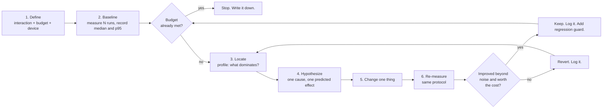
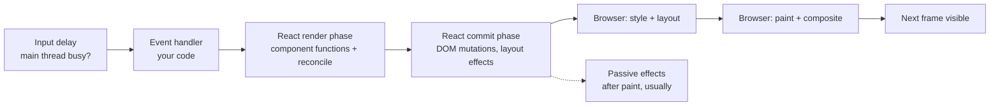
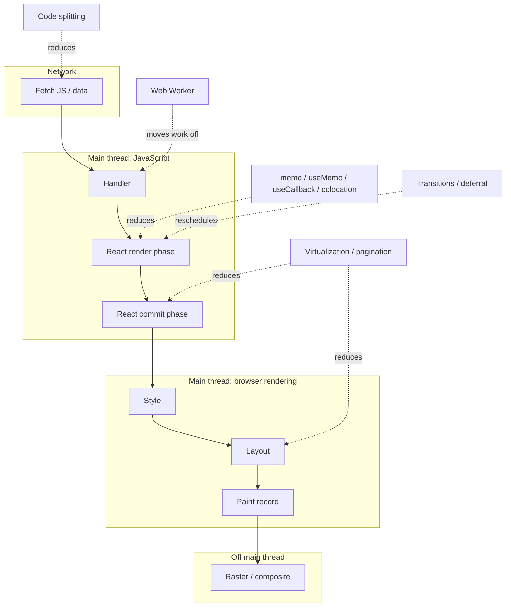

# 07 / 01 — Measure Before Optimizing: Baselines, Budgets, and Honest Experiments

## 1. Lesson metadata

| | |
|---|---|
| **Level** | Intermediate |
| **Study time** | 4–5 hours (reading 1.5 h, experiments 1.5 h, exercises 1.5 h) |
| **Prerequisites** | [00 / 01 — How the browser works](../00-web-and-javascript-foundations/01-how-the-browser-works.md) (main thread, frame budget, long tasks); [02 / 01 — What triggers a render](../02-react-rendering-and-internals/01-what-triggers-a-render.md); [02 / 29 — Reasoning about unnecessary renders](../02-react-rendering-and-internals/29-reasoning-about-unnecessary-renders.md); [03 / 11 — useMemo and useCallback](../03-react-state-and-hooks/11-usememo-and-usecallback.md) |
| **Next** | [02 — Profiler workflows](./02-profiler-workflows.md) |
| **Related later** | [10 — Expensive computations](./10-expensive-computations.md), [21 — Web Vitals and budgets](./21-web-vitals-and-budgets.md), [23 — Counterproductive optimizations](./23-counterproductive-optimizations.md) |

**Learning objectives.** After this lesson you can:
1. State a performance problem as a measurable claim about a user-visible interaction, with a budget and a test environment.
2. Explain why development builds, unthrottled developer machines, and single runs produce misleading numbers.
3. Run a controlled before/after experiment: baseline, one change, re-measure, decide, and record the outcome.
4. Use `<Profiler>`, `performance.mark/measure`, the browser Performance panel, and field data (INP) at the right level of the investigation.
5. Recognize an "optimization" that is a no-op, a regression, or a trade you did not intend to make, and revert it.

**Concepts covered:** user-perceived performance, budgets, lab vs field data, development vs production builds, CPU throttling, warm-up and variance, median/percentiles, controlled experiments, `<Profiler>` `actualDuration`/`baseDuration`, user timing, cost model of an optimization, the optimization log.

---

## 2. Deep conceptual explanation

### 2.1 What problem is this lesson solving?

Most React performance work that goes wrong goes wrong *before* any code changes: the engineer has not established that a problem exists, where it is, how large it is, or what "fixed" means. The usual pattern is:

1. Someone says "the app feels slow".
2. An engineer remembers that "unnecessary re-renders are bad", wraps a dozen components in `React.memo`, and sprinkles `useCallback`.
3. The app "feels" a bit better (placebo, or an unrelated change in the same PR), the PR merges, and the code base permanently carries comparison logic, dependency arrays, and stale-closure risk that buys nothing.

This lesson replaces that loop with an engineering one. It is deliberately the first lesson of Phase 7, because every later lesson (memoization, context splitting, virtualization, transitions, code splitting) is a *tool whose benefit must be verified on your workload*. A tool applied without measurement has an expected value of roughly zero in cost-free cases and negative in the rest.

### 2.2 What "performance" means to a user

Users do not experience "renders". They experience:

| User-visible quantity | Meaning | Typical engineering metric |
|---|---|---|
| **Responsiveness** | Time between an input (click, key, tap) and the next visual update | Event latency, Interaction to Next Paint (INP) |
| **Smoothness** | Whether animation and scrolling keep up with the display's refresh rate | Frame rate, dropped frames, long animation frames |
| **Load speed** | Time until meaningful content appears and becomes usable | LCP, TTFB, Time to Interactive-like measures |
| **Stability** | Layout not jumping | CLS |
| **Resource use** | Battery, memory, data | Heap size, CPU time, bytes transferred |

React render time is an *input* to the first two, not a metric in itself. A component that takes 40 ms to render but only renders on page load is probably irrelevant; a component that takes 3 ms but renders on every keystroke across 200 instances is probably central. So the first act of measurement is to **pick an interaction**, not a component.

### 2.3 The optimization loop



Three details distinguish this from "profile and fix":

- **Step 1 includes a budget.** Without a target there is no stopping condition, and optimization work expands indefinitely.
- **Step 4 requires a *prediction*.** "Memoizing `Row` should cut the render count of rows from 5,000 to 2 per keystroke." If you cannot predict the effect, you do not yet understand the cause, and the experiment cannot falsify anything.
- **Step 6 uses the identical protocol as step 2.** Changing the measurement method *and* the code simultaneously makes the comparison meaningless.

### 2.4 Why intuition fails

Developer intuition about React performance is unreliable for structural reasons:

| Intuition | Why it misleads |
|---|---|
| "A re-render is expensive." | A render is a function call plus allocation of elements and a diff. For most components this is microseconds. The expensive things are *how many* components render, what each does (sorting, formatting, large JSX), and the DOM work after commit. |
| "Fewer renders is always faster." | Skipping a render is only faster if (cost of the skipped render × probability of skipping) exceeds the cost of the check. See [04 — Memoization trade-offs](./04-memoization-trade-offs.md). |
| "It feels laggy on my machine, so it is slow." / "It is instant on my machine, so it is fine." | Developer machines are often 3–10× faster than median user devices. Both statements can be wrong in the same direction. |
| "Dev tools say it took 120 ms." | Development builds include extra checks, warnings, and (with StrictMode) double invocation of render functions. They are not a model of production timing. |
| "I ran it twice and the second run was faster, so the fix worked." | JIT compilation, caches, and garbage collection make the first runs slower than later ones regardless of your change. |

### 2.5 Lab data vs field data

| | **Lab (synthetic)** | **Field (real user monitoring, RUM)** |
|---|---|---|
| Where | Your machine, CI, a device farm | Users' browsers |
| Strength | Controlled, repeatable, can attach a profiler, can A/B a single code change | Real devices, networks, data sizes, behavior; reveals what actually hurts |
| Weakness | May not represent real users; you choose the scenario | No flame chart; noisy; slow feedback loop (days) |
| Use for | Locating causes, validating fixes, regression tests | Deciding *what is worth fixing*, verifying the fix mattered |

A healthy workflow uses field data to choose the target ("p75 INP on the orders page is 480 ms on mid-range Android"), lab data to diagnose and fix, and field data again to confirm. Lesson [21](./21-web-vitals-and-budgets.md) and [22](./22-production-performance-investigations.md) go deeper; here you need only the principle.

### 2.6 Budgets

A **performance budget** is a numeric limit on a metric under defined conditions. Examples:

- "Typing in the filter box: input-to-paint ≤ 100 ms at p95 on a 4× CPU-throttled profile, with 5,000 rows."
- "Opening the order drawer: ≤ 200 ms from click to first paint of drawer content."
- "Dashboard route: initial JavaScript ≤ 250 kB gzip." *(bundle budgets are Phase 7 / 16)*

A number such as 100 ms is a *convention*, not a law of physics; common guidance (for example, in web.dev's responsiveness material) treats responses within roughly 100 ms as feeling immediate and INP "good" thresholds are published by the web-vitals program (currently good ≤ 200 ms, poor > 500 ms at the 75th percentile, per web.dev). Treat published thresholds as defaults and re-check web.dev before you encode them in CI, since thresholds are periodically revised.

### 2.7 Common misconceptions

| Misconception | Reality |
|---|---|
| "Profiling is for when things are slow." | Profiling is how you find out whether things are slow. Without a baseline you cannot tell a regression from normal. |
| "Re-render counts are the performance metric." | Render counts are a diagnostic. A count of 500 cheap renders may cost less than one render of a huge table. Time and user-visible latency decide. |
| "Production builds are only about bundle size." | They also remove development-only checks, so React itself runs substantially faster. Measure in production mode. |
| "If it does not matter now, optimize anyway to be safe." | Premature memoization adds permanent complexity and bug surface (stale closures, incorrect deps). Optimization has a maintenance cost. |
| "Use `console.time` around the component." | That measures a single function call, not React's render of the subtree, commit, layout, and paint. See §5. |

---

## 3. Internal mechanics

### 3.1 What the number actually contains

When you click a button that calls `setState`, the user-perceived latency is the sum of several phases. Only some are "React":



This decomposition mirrors the INP breakdown into *input delay*, *processing time*, and *presentation delay*. Practical consequence: a "React is slow" complaint may be dominated by the browser's style/layout cost of a large commit ([00 / 03](../00-web-and-javascript-foundations/03-browser-rendering-pipeline.md)), by a long task that was already running (input delay), or by a layout effect that forces synchronous layout. Memoizing components fixes only the render phase portion.

### 3.2 Public guarantees vs implementation details

- **Public guarantee.** `<Profiler>` is a documented component that reports render timing to an `onRender` callback; it is disabled in production builds unless you use the profiling build. The callback receives `id`, `phase`, `actualDuration`, `baseDuration`, `startTime`, `commitTime`. (Verify the exact current signature on react.dev; earlier versions passed an additional `interactions` set that has since been removed.)
- **Teaching model.** `actualDuration` is "time spent rendering the `Profiler` and its descendants for this commit" and reflects memoization: components that bailed out contribute little. `baseDuration` estimates what a full re-render of the subtree would cost without any memoization, based on the most recent render time of each component. Comparing the two shows how much memoization is saving *in the subtree being profiled*.
- **Implementation detail.** How React measures these durations internally (timer calls inserted in the work loop) and the overhead of the profiling build are not part of the contract; treat profiler numbers as relative, not absolute.

### 3.3 Development vs production

Version-sensitive but stable in spirit across React 18/19:

| Aspect | Development build | Production build |
|---|---|---|
| Extra warnings and checks | Many (keys, hooks misuse, hydration diffs…) | Stripped |
| StrictMode double render / double effect (on mount) | Yes (when `<StrictMode>` is used) | No ([02 / 28](../02-react-rendering-and-internals/28-strict-mode-behavior.md)) |
| `<Profiler>` callback | Fires | **Does not fire** unless using the profiling build |
| Timing realism | Poor | Good |
| Source maps / readable names | Yes | Minified unless you keep names |

Rule: use the development build to *discover which components render and why*; use a **production (or profiling) build** to *measure how long things take*. For Vite, that means `vite build && vite preview` (optionally with an alias to `react-dom/profiling`; see [lesson 02](./02-profiler-workflows.md)).

### 3.4 Sources of measurement noise

| Noise source | Effect | Mitigation |
|---|---|---|
| JIT warm-up | First executions slower | Discard warm-up runs, report steady-state *and* first-interaction if both matter |
| Garbage collection | Occasional long pause inside a run | Many runs; look at median and p95, not mean |
| Other tabs / extensions | Random slowdowns | Fresh profile, incognito, extensions disabled |
| Thermal throttling / power mode (laptops) | Drift over minutes | Plugged in, interleave baseline and variant runs |
| Network / cache state | Affects load, not interaction | Fix cache state in the protocol |
| Timer resolution | Browsers coarsen `performance.now()` for security (resolution can be coarser in some contexts) | Measure operations long enough (≫ 1 ms) or repeat many times |

---

## 4. Step-by-step execution walkthrough: investigating "typing in the search box is laggy"

A realistic investigation, in order:

1. **Reproduce and define.** Open the products page in a *production build*. Throttle CPU 4× (DevTools Performance panel → CPU throttling). Seed 5,000 products. Interaction: type "shoe" (4 keystrokes) in the filter box. Budget: each keystroke produces a visual update within 100 ms at p95.
2. **Baseline with the cheapest tool.** Record three Performance-panel traces of the same interaction. Look for tasks ≥ 50 ms (marked as long tasks). Suppose each keystroke produces a ~280 ms task. Baseline established: ~280 ms (illustrative number; yours will differ).
3. **Locate.** In the flame chart, the task is mostly React work (`renderWithHooks`-like frames in a production build are minified; use the DevTools Components/Profiler tab for names). Switch to React Profiler: one commit per keystroke, `ProductList` and 5,000 `ProductRow` instances rendered; `actualDuration` ≈ 230 ms. The rest is commit and layout.
4. **Hypothesize.** "Rows re-render because the parent re-renders on each keystroke; rows receive stable props. Wrapping `ProductRow` in `memo` and keeping props stable should make 4,900+ of the 5,000 rows skip, since only the filtered subset changes." *Prediction:* `actualDuration` falls below 30 ms for keystrokes after the first.
5. **Change one thing.** Add `memo` to `ProductRow` — and also fix the one unstable prop (an inline `onSelect` arrow) because without that the memo is a no-op. Treat that pair as *one change* (the experiment is "make rows memo-effective").
6. **Re-measure with the same protocol.** Three recordings. Suppose `actualDuration` drops to ~12 ms but the *filtered list* is replaced by a different set of rows on each keystroke, so the mount/unmount of up to thousands of DOM nodes now dominates (commit + layout ≈ 90 ms). The memo worked on its stated hypothesis; the budget is still not met. Log it; the next hypothesis targets DOM size (see [08 — Rendering large collections](./08-rendering-large-collections.md) and [09 — Windowing](./09-windowing-and-virtualization.md)).
7. **Record.** Keep the memo (measured win), note the remaining bottleneck, and add a lightweight regression guard (a render-count test, §5.5).

This walkthrough illustrates the point of the loop: step 6 reveals the *second* bottleneck, which no amount of render-count intuition would have exposed.

---

## 5. Code examples

All timings in this lesson's prose are **illustrative**; they demonstrate how to read results, not results you should expect.

### 5.1 Minimal example — `<Profiler>`

```tsx
import { Profiler, type ProfilerOnRenderCallback } from "react";

const onRender: ProfilerOnRenderCallback = (
  id,
  phase,
  actualDuration,
  baseDuration,
) => {
  // phase: "mount" | "update" | "nested-update"
  console.log(
    `${id} ${phase}: actual=${actualDuration.toFixed(1)}ms ` +
      `base=${baseDuration.toFixed(1)}ms`,
  );
};

export function App() {
  return (
    <Profiler id="ProductList" onRender={onRender}>
      <ProductList />
    </Profiler>
  );
}
```

Line notes:
- `id` identifies the profiled tree; use stable, descriptive ids because you will aggregate by them.
- `phase` separates the initial mount from updates. Mount costs and update costs have different optimizations (code splitting vs memoization).
- **Predict:** with `<StrictMode>` in a dev build, is the logged `actualDuration` of the mount larger or smaller than in production? *Answer:* typically larger, because development checks and double rendering add work. Do not compare it with production numbers.
- Reminder: in a normal production build this callback never fires.

### 5.2 Practical example — a sampling collector that reports medians

Single numbers lie. This collector gathers samples per `Profiler` id and summarizes them, so you can run an interaction 20 times and read a median and p95.

```tsx
import { Profiler, type ProfilerOnRenderCallback, type ReactNode } from "react";

type Samples = Map<string, number[]>;
const samples: Samples = new Map();

export const onRender: ProfilerOnRenderCallback = (id, phase, actualDuration) => {
  if (phase === "mount") return; // measure updates separately
  const list = samples.get(id) ?? [];
  list.push(actualDuration);
  samples.set(id, list);
};

function percentile(sorted: number[], p: number): number {
  if (sorted.length === 0) return NaN;
  const idx = Math.min(sorted.length - 1, Math.ceil((p / 100) * sorted.length) - 1);
  return sorted[Math.max(0, idx)];
}

export function report(): Record<string, { n: number; median: number; p95: number; max: number }> {
  const out: Record<string, { n: number; median: number; p95: number; max: number }> = {};
  for (const [id, list] of samples) {
    const sorted = [...list].sort((a, b) => a - b);
    out[id] = {
      n: sorted.length,
      median: percentile(sorted, 50),
      p95: percentile(sorted, 95),
      max: sorted[sorted.length - 1],
    };
  }
  return out;
}

export function reset(): void {
  samples.clear();
}

// Expose in profiling/dev builds only:
if (import.meta.env.DEV || import.meta.env.VITE_PROFILE === "1") {
  (window as unknown as { __perf: unknown }).__perf = { report, reset };
}

export function Measured({ id, children }: { id: string; children: ReactNode }) {
  return (
    <Profiler id={id} onRender={onRender}>
      {children}
    </Profiler>
  );
}
```

Usage: wrap the region under investigation in `<Measured id="ProductList">`, perform the interaction 20 times, then call `__perf.report()` in the console. Compare before/after using the same count of runs.

Notes:
- We skip `phase === "mount"` because we are measuring updates; mounts get their own analysis.
- `import.meta.env` is Vite-specific. `VITE_PROFILE` is a flag you define; no production user ever sees the hook.
- A `Profiler` adds small overhead itself. Use few, coarse profilers.

### 5.3 Incorrect example — "optimizing" without measurement

```tsx
// ❌ Added "to be safe", with no baseline and no profile.
const Badge = memo(function Badge({ count }: { count: number }) {
  const label = useMemo(() => `${count} items`, [count]);       // cheap string
  const onClick = useCallback(() => console.log("clicked"), []); // passed to a DOM <span>
  return (
    <span className="badge" onClick={onClick} style={{ color: "red" }}>
      {label}
    </span>
  );
});
```

**Predict:** does this make anything faster? *No*, and it plausibly makes things marginally slower:
- `useMemo` for a template string costs more bookkeeping (dependency comparison, storing the cached value, closure allocation) than recomputing the string.
- `useCallback` for a handler passed to a host element (`<span>`) gains nothing: host elements do not bail out on prop identity; React updates the handler reference on the instance regardless.
- `memo` only helps if `Badge` re-renders often *with unchanged props* and rendering it is non-trivial. Neither has been demonstrated.
- The inline `style={{ color: "red" }}` is a new object every render, but because `Badge` is memoized and it is created *inside* `Badge`, it does not matter for memoization. It does show how easy it is to create the *appearance* of optimization.

None of this is a bug — the code behaves correctly — but it adds three concepts for a reader to hold in mind and zero measured benefit.

### 5.4 Corrected implementation — the experiment record

The "fix" for the incorrect example is not different code; it is a different process. Replace the speculative PR with an **optimization log entry**:

```md
### Product list typing latency (PERF-412)

- Interaction: type "shoe" in filter, 5,000 products, production build, CPU 4x throttle, Chrome stable, M-series laptop
- Budget: p95 keystroke-to-paint <= 100 ms
- Baseline (n=20 keystrokes): median 285 ms, p95 340 ms; Profiler actualDuration median 231 ms
- Hypothesis: all 5,000 rows re-render; rows have stable props; memo(ProductRow) will skip unaffected rows
- Change: memo(ProductRow); replaced inline onSelect with stable (id) => void passed from parent
- Result (n=20): median 118 ms, p95 150 ms; Profiler actualDuration median 14 ms
- Remaining cost: commit + layout of filtered subset ~95 ms (DOM nodes)
- Decision: keep memo. Next: reduce DOM nodes (virtualization or pagination).
- Guard: render-count test asserts <= 200 row renders per keystroke
```

(The numbers are illustrative; the *shape* of the entry is the deliverable.) The log is valuable precisely because it also records negative results; the next engineer will not repeat a failed experiment.

### 5.5 Advanced example — automated, throttled measurement with Playwright

This script measures a keystroke interaction in a built app under 4× CPU throttling and reports median/p95. It uses Chromium's DevTools protocol (CDP) through Playwright.

```ts
// perf/typing.spec.ts  (Playwright Test, Chromium only)
import { test, expect } from "@playwright/test";

function percentile(values: number[], p: number): number {
  const s = [...values].sort((a, b) => a - b);
  const i = Math.min(s.length - 1, Math.ceil((p / 100) * s.length) - 1);
  return s[Math.max(0, i)];
}

test("filter typing latency stays within budget", async ({ page, context }) => {
  const cdp = await context.newCDPSession(page);
  await cdp.send("Emulation.setCPUThrottlingRate", { rate: 4 });

  await page.goto("http://localhost:4173/products?seed=5000"); // vite preview
  const input = page.getByRole("searchbox", { name: "Filter products" });
  await input.waitFor();

  // Install an in-page timer: from keydown to the frame after the next paint.
  await page.evaluate(() => {
    (window as any).__samples = [] as number[];
    document.addEventListener(
      "keydown",
      () => {
        const t0 = performance.now();
        requestAnimationFrame(() => {
          // a rAF callback runs before the *next* paint; a timeout queued from
          // it runs after that paint's task, approximating "visible".
          setTimeout(() => (window as any).__samples.push(performance.now() - t0), 0);
        });
      },
      { capture: true },
    );
  });

  // Warm up (discarded), then measure.
  for (const ch of "warmup") await input.press(ch);
  await input.fill("");
  await page.evaluate(() => ((window as any).__samples.length = 0));

  for (let round = 0; round < 5; round++) {
    await input.fill("");
    for (const ch of "shoe") await input.press(ch);
    await page.waitForTimeout(100); // let the last frame settle
  }

  const samples: number[] = await page.evaluate(() => (window as any).__samples);
  const p95 = percentile(samples, 95);
  console.log({ n: samples.length, median: percentile(samples, 50), p95 });
  expect(p95).toBeLessThan(150); // budget with CI slack
});
```

Line notes and caveats:
- CPU throttling is a *relative* slowdown of the machine running the test; it is not a faithful phone emulator. Use it to make regressions visible, not to claim "this takes X ms on a Pixel".
- The rAF + `setTimeout(0)` pattern approximates "next paint finished". It is a heuristic; for rigorous results compare against trace data or use the browser's Event Timing API (`PerformanceObserver` with `type: "event"`), which reports processing and presentation times for interactions in Chromium-based browsers. *Verify Event Timing support on your target browsers.*
- Warm-up runs are executed and discarded to reduce JIT effects.
- Thresholds in CI need slack because shared CI machines are noisy; prefer *relative* checks (variant vs baseline in the same job) over absolute ones where possible.
- `fill` dispatches input events directly; `press` dispatches keyboard events. Choose the one that matches the real interaction.

---

## 6. Visual explanations

### 6.1 Where an optimization acts



Choose the technique that attacks the dominant segment. Memoization cannot reduce layout cost; virtualization cannot reduce a slow `sort()` in your handler.

### 6.2 Reading a before/after distribution

```text
Baseline (n=20)            After change (n=20)
|  . ::::::::.   .   |     |::::::.. |
220   280   340  ms        90  120 150 ms
median 285 / p95 340       median 118 / p95 150
```

If the two clouds overlap substantially, you have not demonstrated an improvement. A rough but useful rule: with ~20 samples each, an improvement is credible when the *entire bulk* of the new distribution sits left of the old one; a median shift smaller than the run-to-run spread is noise.

---

## 7. Alternative approaches and trade-offs

| Approach | Strengths | Weaknesses | Best when |
|---|---|---|---|
| **Intuition-driven optimization** | Fast to apply | Unreliable; adds permanent complexity; cannot be falsified | Never as the only input; ok as a *source of hypotheses* |
| **Manual DevTools profiling** | Rich detail (flame chart, React names, "why rendered") | Not repeatable at scale; operator-dependent | Diagnosis, one-off investigations |
| **`<Profiler>` + in-app collector** | Programmatic, per-subtree numbers; works in tests/CI with profiling build | Only React render phase; overhead; skips browser layout/paint | Comparing memoization changes; render-time regression tracking |
| **Automated lab tests (Playwright + CDP)** | Repeatable, CI-gated, end-to-end timing | Noisy on shared runners; throttling is approximate; Chromium-centric | Guarding budgets against regressions |
| **Lighthouse / synthetic audits** | Cheap, standardized | Mostly load-oriented; weak for interactions after load | Load performance, bundle regressions |
| **RUM (field INP, custom marks)** | Real users and devices; ground truth for priorities | No stack-level detail; slow feedback; sampling/consent constraints | Choosing targets, verifying real-world impact |
| **Render-count assertions in unit tests** | Deterministic, fast, no noise | Counts are not time; can enshrine implementation details | Protecting a specific memoization you *proved* valuable |

**Scenario where measuring first is *not* the best approach.** When the fix is free and obviously correct — for example, a `useEffect` that fetches on every keystroke due to a missing debounce, or an `O(n²)` loop you can replace with a `Map` lookup in two lines — you do not need a profile to justify it. You are removing waste, not trading complexity for speed. The discipline applies most strongly when the optimization *adds* concepts (memoization, caching, virtualization, workers). Even then, a record of the before/after is cheap insurance.

Another scenario: a hard external requirement ("we must pass Lighthouse performance ≥ 90 for the procurement checklist"). Measure still; but the target is dictated, not discovered.

---

## 8. Best practices and anti-patterns

### 8.1 Best practices

1. **Name the interaction and the device.** "Typing in the filter with 5,000 rows on a 4× throttled profile" is a testable sentence.
2. **Measure in production mode** for timings; use dev mode for *structure* (what renders, why).
3. **Collect ≥ 10–20 samples** and report median and a high percentile.
4. **Change one variable at a time**, or declare the bundle of changes as one experiment.
5. **Predict before you measure.** Write the expected effect size in the PR description.
6. **Keep an optimization log** including failures.
7. **Add a cheap guard** for what you fixed (render-count test, bundle size check, Playwright latency check).
8. **Prefer structural fixes** (move state down, reduce DOM size, avoid work) before *caching fixes* (memoization); structural fixes have lower ongoing cost. Lessons [07](./07-state-colocation-for-perf.md) and [08](./08-rendering-large-collections.md).

### 8.2 Beginner mistakes

- Measuring with `console.time` around a component function or around `setState` (the render happens later, asynchronously).
- Profiling a dev build and quoting the numbers.
- Comparing two recordings made on different days, different power states, or with different data sizes.
- Optimizing the component at the top of the "most renders" list rather than the one in the long task.

### 8.3 Experienced-developer mistakes

- **Optimizing the profile, not the experience.** A 40% reduction in React `actualDuration` that does not move INP is a hobby, not a fix.
- **Regressing correctness for speed.** Custom `memo` comparators that skip updates a component needs; `useMemo` deps trimmed to quiet a lint rule.
- **Trusting a single CI number.** One slow CI minute fails the build; one fast one hides a regression. Use thresholds with slack and trend charts.
- **Assuming a measurement on one browser transfers.** Safari and Firefox have different engines and different profiling tools.

### 8.4 Smells

- A PR titled "perf improvements" with no numbers.
- `useCallback`/`useMemo` count rising while no one can state which ones matter.
- A dev-mode screenshot of the Profiler used as evidence for a production claim.

### 8.5 Justified exceptions

- Library authors may add `memo` or stable references defensively because they cannot know consumers' workloads. This should still be balanced against API clarity.
- Known-quadratic algorithms and per-keystroke network requests should be fixed without a benchmark.
- If you adopt the React Compiler ([09 / 08](../09-advanced-rendering-and-ecosystem/08-react-compiler.md)), automatic memoization shifts the *default*, but the measurement discipline still applies to what the compiler cannot fix. The compiler is documented as stable on react.dev; re-check its docs for current setup and limits.

---

## 9. Real-world application

**E-commerce product grid.** Field data shows poor INP on filter changes for category pages with 2,000+ SKUs. Engineering constraints: marketing requires the full list to be crawlable (SSR), designers want instant filtering. Measurement plan: seeded datasets of 500/2,000/5,000 items, 4× throttle, p95 target; compare memoized rows, pagination, and virtualization at each size. Likely outcome: memoization wins at 500, pagination or virtualization needed at 5,000, and the SSR requirement determines how.

**Analytics dashboard.** A global date-range picker re-renders eight chart widgets on every drag tick. Instead of memoizing all widgets, measure: which widgets are expensive (Profiler per widget), and whether the drag should update state continuously at all (commit on release; see [07](./07-state-colocation-for-perf.md)). Budget: drag stays at 60 fps (≤ 16 ms per frame of main-thread work) on a 4× throttle.

**Finance (trading blotter).** Streaming updates at 20 Hz to a table of 10,000 rows. The relevant measurement is *main-thread utilization* over time (Performance panel, "Main" track busy percentage) and dropped frames, not single interaction latency. Here batching updates per animation frame often beats any memoization.

**Multi-team shell app.** A micro-frontend host cannot see inside remotes. You can still wrap each remote mount in a `<Profiler id="remote:billing">` and publish metrics to the shared observability stack, giving teams a common baseline and ownership of their own budgets.

Engineering constraints common to all: shared CI noise, privacy rules on RUM payloads, devices you do not own, and the cost of keeping benchmarks maintained as the product changes.

---

## 10. Debugging and troubleshooting

### Symptom: "My optimization made no measurable difference."

1. **Verify the change is active.** Is the memoized component actually skipping? In React DevTools Profiler, with "Record why each component rendered" enabled, check that the component shows as *not rendered* (grey) in the commits you expected.
2. **Verify the build.** Are you measuring a dev build? Dev numbers can mask a production win and vice versa.
3. **Check the dominant segment.** Open the Performance panel: is most of the long task *React render* or *Recalculate style / Layout*? If layout dominates, render-side optimizations cannot help.
4. **Check the workload.** Does your test data match real data sizes and shapes?
5. **Root causes seen in practice:** unstable props defeat `memo`; the expensive work lives in a child that still renders; the time is in commit/layout; the interaction triggers a network call that dominates.

### Symptom: "Numbers are wildly different between runs."

- Check for background tabs, extensions, power mode. Run each variant interleaved (A, B, A, B) instead of all A then all B to cancel drift.
- Increase sample count; look at distribution rather than mean.
- Look for GC pauses in the trace (the Performance panel's memory/GC markers).

### Symptom: "It is fast in the profiler but users still complain."

- Compare lab setup to the user's: device class, data size (power users have 50× more data), browser extensions, cold cache.
- Instrument field INP with attribution (`import { onINP } from 'web-vitals/attribution'`, the library's attribution build; verified against the web-vitals README, 2026-10-22) to find *which interaction and element* is slow.

### Validating a fix

A fix is validated when (a) the metric improved beyond noise under the same protocol, (b) the user-visible interaction meets the budget, (c) there is no regression in other metrics (mount time, memory, correctness tests), and (d) a guard exists.

---

## 11. Exercises

### Level A — Knowledge
A1. Why should timing measurements be taken from a production build, while "what rendered and why" investigation can use development?
A2. What is the difference between `actualDuration` and `baseDuration` in the `<Profiler>` callback?
A3. Name three sources of noise in lab measurements and one mitigation each.
A4. Give one reason lab data alone is insufficient and one reason field data alone is insufficient.

### Level B — Code comprehension
B1. What does this log in production, and why?
```tsx
<Profiler id="x" onRender={(id) => console.log(id)}>
  <Heavy />
</Profiler>
```
B2. A teammate measures a click handler like this. What is wrong with the measurement?
```tsx
function onClick() {
  console.time("update");
  setItems(newItems);
  console.timeEnd("update");
}
```
B3. In §5.3, why is `useCallback` on a handler passed to `<span>` useless for rendering performance?

### Level C — Implementation
C1. Write a TypeScript function `compare(baseline: number[], variant: number[])` that returns the median of each, the relative improvement of the median, and a boolean `likelyReal` that is `true` only if the variant's 90th percentile is lower than the baseline's 10th... *(choose a defensible rule; justify it)*. Keep it under 30 lines.
C2. Write a Vitest + React Testing Library test that asserts a `Row` component renders at most N times when its parent re-renders 10 times with unchanged row data.

### Level D — Debugging
D1. You added `memo(Row)`. The Profiler (dev build, StrictMode on) shows `Row` rendering twice per commit for new rows and the numbers look worse than before. What explains it, and how do you re-measure correctly?
D2. After optimization, median latency improved 30% in your Playwright test but field INP did not change after release. List four hypotheses and how you would test each.

### Level E — Architecture and engineering decisions
E1. Your team of 12 keeps shipping "perf PRs" without numbers. Design a lightweight process (templates, CI guards, review rule) that raises evidence quality without blocking small fixes.
E2. Decide whether to add a Playwright latency test to CI that fails the build when p95 exceeds a budget. Discuss flakiness, cost, and alternatives.

### Level F — Expert challenge
F1. Design an experiment to decide whether to adopt a new global state library for a dashboard whose widgets re-render too often. Include hypotheses, workload definition, metrics (lab and field), controls for noise, decision rule, and what result would make you *not* adopt.

---

## 12. Detailed answers and explanations

> Attempt the exercises first.

**A1.** Development builds add warnings, checks, and (with StrictMode) double invocation of render functions, so absolute timings overstate production cost and may distort *relative* costs (some checks scale with component count). Dev builds also provide richer information (component names, "why rendered" data, warnings), which is why they suit structural investigation. Wrong answer: "dev is always slower by a constant factor" — the factor is not constant, so a dev measurement cannot be rescaled into a production one.

**A2.** `actualDuration` is time actually spent rendering the profiled subtree in this commit, including memoization benefits (bailed-out components cost little). `baseDuration` estimates the time to render the whole subtree without any memoization, derived from the last-known render duration of each component. A large gap between them shows memoization is saving a lot *in that subtree*; equal values mean everything re-rendered. Wrong answer: "base is the first-render time" — it is updated as components re-render.

**A3.** Examples: JIT warm-up → discard warm-up runs; GC pauses → many samples and percentiles; thermal throttling / power mode → plug in and interleave variants; other tabs/extensions → clean profile; timer coarsening → repeat or measure longer operations.

**A4.** Lab-only: you may optimize a scenario no user cares about and miss real device/data conditions. Field-only: no stack-level insight and slow, noisy feedback, so you cannot attribute cause or verify a candidate fix quickly. Together they cover *what matters* and *why*.

**B1.** In a standard production build, nothing logs: the `Profiler` callback is disabled in production unless the profiling build is used. In development it logs `x` on mount and each update commit. Common wrong answer: "logs once per render of `Heavy`" — it is per commit affecting the subtree, and not in production.

**B2.** `setItems` only schedules an update; React renders later (batched, after the handler finishes). `console.time` brackets the *scheduling* call, typically microseconds. The real cost (render, commit, layout, paint) occurs after `timeEnd`. Measure with `<Profiler>`, performance marks that end after a frame, or the Event Timing API. Edge case: `flushSync(() => setItems(...))` would force synchronous rendering inside the bracket, but even then layout/paint remain outside and `flushSync` changes behavior and is not for measuring.

**B3.** Host elements (`span`, `button`) do not skip rendering based on prop identity; React simply updates the event handler on the host instance as part of normal work. `useCallback` only matters if the function is a prop to a memoized child, a dependency of another hook, or otherwise identity-sensitive. Here it costs a hook slot and dependency comparison with no benefit.

**C1.** One defensible approach (with caveat that this is a heuristic, not a hypothesis test):

```ts
function quantile(xs: number[], q: number): number {
  const s = [...xs].sort((a, b) => a - b);
  const i = Math.min(s.length - 1, Math.max(0, Math.ceil(q * s.length) - 1));
  return s[i];
}

export function compare(baseline: number[], variant: number[]) {
  const bMed = quantile(baseline, 0.5);
  const vMed = quantile(variant, 0.5);
  return {
    baselineMedian: bMed,
    variantMedian: vMed,
    relativeImprovement: (bMed - vMed) / bMed,
    // The bulk of the variant (its p90) is faster than the bulk of the baseline
    // (its p10) only when distributions barely overlap: very conservative.
    likelyReal: quantile(variant, 0.9) < quantile(baseline, 0.1),
  };
}
```
Evaluation criteria: handles empty arrays or documents the precondition; uses medians and percentiles rather than means; justifies the rule. The "p90 of variant below p10 of baseline" rule is conservative — it will miss real but modest gains. A less strict rule: variant median below baseline p25 plus a minimum effect size. For publication-grade claims use a non-parametric test (Mann–Whitney) or bootstrap confidence intervals; for engineering decisions, a visible separation plus a mechanism (the Profiler shows rows skipped) is usually enough.

**C2.** 
```tsx
import { render } from "@testing-library/react";
import { memo, useState, act } from "react";
import { expect, test, vi } from "vitest";

const renders = vi.fn();
const Row = memo(function Row({ label }: { label: string }) {
  renders();
  return <li>{label}</li>;
});

function List({ rows }: { rows: string[] }) {
  const [, setTick] = useState(0);
  (globalThis as any).__tick = () => setTick((t) => t + 1);
  return <ul>{rows.map((r) => <Row key={r} label={r} />)}</ul>;
}

test("rows do not re-render when parent re-renders with same data", () => {
  const rows = ["a", "b", "c"];
  render(<List rows={rows} />);
  renders.mockClear();
  for (let i = 0; i < 10; i++) act(() => (globalThis as any).__tick());
  expect(renders).toHaveBeenCalledTimes(0);
});
```
Notes: `act` is exported from `react` in React 19 (also from `@testing-library/react`); use whichever your versions support. Test files do not run StrictMode unless you wrap the tree, which would double-invoke render functions and change counts. `label` is a primitive so `memo` works; passing a new object per render would make the test fail, which is the point of the guard. Edge case: asserting `0` is stricter than "at most N"; choose based on the invariant you want.

**D1.** StrictMode in development intentionally double-invokes component functions (and, on mount, effects) to surface impurities, so you see two render calls for new rows, and development checks add time. The numbers are not representative. Re-measure in a production or profiling build without StrictMode double invocation (production does not double-invoke anyway), same protocol, interleaved with the baseline.

**D2.** Hypotheses: (1) Lab scenario differs from real use (data size, device class) → compare field data distribution to lab setup, add field attribution. (2) The slow interaction in the field is a *different* one (e.g., opening a menu) → INP attribution to find the interaction and target. (3) The change shipped behind a flag or was not deployed to the measured cohort → verify release and cohort. (4) INP dominated by input delay from unrelated long tasks (third-party scripts) → check long animation frames/long tasks around interactions. Also: field metric aggregation window and low sample counts may hide a small shift.

**E1.** Evaluation criteria: proportional (a fast path for obviously-correct fixes); a PR template with "interaction, environment, before, after, n"; a shared harness (collector component, Playwright helper) to lower the cost of evidence; render-count/bundle guards; periodic review of the optimization log; leadership of reviewers asking "what's the number?" Example answer: tag PRs `perf`; require a short measurement block for those that add memoization/caching/virtualization; exempt deletions of waste; maintain `docs/perf-log.md`; run Playwright budget tests nightly with trend tracking rather than as blockers at first.

**E2.** Evaluation criteria: acknowledges flakiness on shared runners, proposes mitigations (dedicated runner, relative A/B vs main in the same job, medians over repeated runs, slack), weighs maintenance cost, and offers alternatives (render-count tests, bundle-size gates, nightly trend jobs, RUM alerts). A reasonable decision: do not make a hard-failing absolute-latency gate initially; use relative comparisons or a non-blocking trend until the signal is trusted.

**F1.** Evaluation criteria: states hypotheses (e.g., "selector-based subscriptions reduce widgets re-rendered per update by ≥ 80%"), realistic workload (update frequency, widget count, data sizes), metrics (commits per update, `actualDuration`, INP in a prototype with real users via flag), noise controls (production build, throttle, interleaved runs, n ≥ 20), decision rule (adopt only if improvement exceeds X *and* migration cost/complexity is justified; compare against cheaper alternatives such as splitting context or colocating state), and a "do not adopt" outcome (cheaper fix achieves the budget; or gains vanish under realistic data). Also mentions bundle size and learning/maintenance costs. Top-quality answers include a baseline of the *existing* app with the cheapest structural fix applied, so the library is compared to the best alternative and not to the worst version of current code.

---

## 13. Senior engineer interview questions

**Q1. "A page feels slow. What do you do first?"**
Establish what "slow" means: which interaction, on which device and data, observed how (field metric or complaint). Then get a baseline in a production-like build. Reason: without a defined target and a baseline, any change is unfalsifiable and the work has no stopping point.

**Q2. "Why not just wrap everything in `memo`?"**
Memoization trades extra comparison work, memory, and cognitive/maintenance cost for skipping renders. If props change most of the time or the render is cheap, the check is a net loss. It also turns on correctness hazards (stale closures with `useCallback`/`useMemo`). Measure whether the skip probability and render cost justify it.

**Q3. "Your fix improved React render time 60%, but INP didn't move. Why?"**
INP includes input delay and presentation delay, not just React render. The dominating cost may be browser layout/paint after a big commit, an unrelated long task, a layout effect forcing sync layout, or a different interaction than the one measured. The profile shows which segment dominates.

**Q4. "How do you make performance results trustworthy?"**
Production build, throttled CPU, fixed dataset, warm-up discard, ≥ 10–20 samples, median and p95, interleaved A/B, same protocol before and after, and a mechanism that explains the result (e.g., Profiler shows rows skipped). Reason: noise and confounders otherwise masquerade as improvements.

**Q5. "When would you skip measurement?"**
When removing clear waste at zero complexity cost (per-keystroke fetch without debounce, quadratic loop). Reason: the risk and complexity cost that measurement protects against is absent.

**Q6. "How do you prevent regressions after you fix something?"**
A guard proportional to the fix: render-count tests for memo boundaries, bundle-size checks, throttled Playwright latency tests with slack or relative comparison, field alerts on INP. Reason: performance fixes decay as code changes, and guards make decay visible.

---

## 14. Further learning resources

| Resource | URL | Covers / why | Level | Study |
|---|---|---|---|---|
| React docs — `<Profiler>` | <https://react.dev/reference/react/Profiler> | `onRender` signature and caveats (disabled in production) | Intermediate | Whole page |
| React docs — `memo` | <https://react.dev/reference/react/memo> | When memoization helps and its caveats | Intermediate | "Usage", "Troubleshooting" |
| React docs — `useMemo` | <https://react.dev/reference/react/useMemo> | "How to tell if a calculation is expensive" guidance | Intermediate | "Usage" |
| React Developer Tools | <https://react.dev/learn/react-developer-tools> | Installing the DevTools extension | Beginner | Whole page |
| web.dev — Interaction to Next Paint | <https://web.dev/articles/inp> | INP definition, thresholds, phases | Intermediate | Whole page |
| web.dev — Optimize INP | <https://web.dev/articles/optimize-inp> | Input delay, processing, presentation delay | Intermediate | Decomposition sections |
| Chrome DevTools — Performance panel | <https://developer.chrome.com/docs/devtools/performance> | Recording, throttling, reading traces | Beginner | Reference + features |
| MDN — Performance API | <https://developer.mozilla.org/en-US/docs/Web/API/Performance_API> | `mark`, `measure`, `PerformanceObserver` | Intermediate | User timing |
| GitHub — GoogleChrome/web-vitals | <https://github.com/GoogleChrome/web-vitals> | Field measurement library, attribution build | Intermediate | README |
| Playwright docs | <https://playwright.dev/docs/intro> | Test runner and CDP sessions | Intermediate | "CDPSession" in API reference |

URLs in this table were checked for HTTP 200 on 2026-10-22; any still marked *(unverified)* could not be checked automatically (blocked or unreachable). A 200 response does not guarantee the page content still matches the description; if a link has moved, search the site for the quoted title.

---

## 15. Knowledge checkpoint

**You should now understand**
- That performance is defined by user-visible interactions, budgets, and devices, not render counts.
- Why dev builds, single runs, and unthrottled machines mislead.
- The optimization loop and why a prediction and a stopping condition are part of it.
- Which segment of the click-to-pixels pipeline a given technique can affect.

**You should be able to explain without notes**
- The difference between `actualDuration` and `baseDuration`.
- Why `console.time` around `setState` measures nothing useful.
- The difference between lab and field data and how they complement each other.

**You should be able to implement**
- A profiler-based sampling collector with median/p95.
- A throttled, warmed-up Playwright latency check.
- An optimization log entry and a render-count regression test.

**You should be able to debug**
- "No measurable improvement" by checking activation, build mode, dominant segment, and workload.

**Before moving on:** read [02 — Profiler workflows](./02-profiler-workflows.md), which turns the tools named here into concrete investigation procedures.
