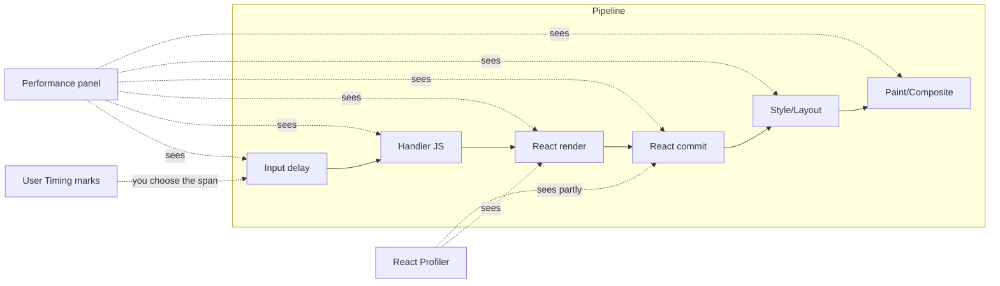
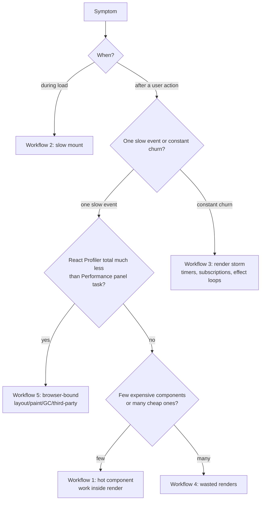

# 07 / 02 — Profiler Workflows: React DevTools, the Performance Panel, and Programmatic Profiling

## 1. Lesson metadata

| | |
|---|---|
| **Level** | Intermediate |
| **Study time** | 4–5 hours (reading 1.5 h, hands-on profiling 2 h, exercises 1 h) |
| **Prerequisites** | [01 — Measure before optimizing](./01-measure-before-optimizing.md); [02 / 30 — React DevTools Profiler](../02-react-rendering-and-internals/30-react-devtools-profiler.md); [02 / 02 — Render, reconcile, commit, paint](../02-react-rendering-and-internals/02-render-reconcile-commit-paint.md) |
| **Next** | [03 — Why components re-render](./03-why-components-rerender.md) |
| **Related later** | [20 — Long tasks and the main thread](./20-long-tasks-and-main-thread.md), [22 — Production performance investigations](./22-production-performance-investigations.md) |

**Learning objectives.** After this lesson you can:
1. Choose the correct tool for a question: React DevTools Profiler, the browser Performance panel, `<Profiler>`, or user timing marks.
2. Record a clean, reproducible profile and interpret flamegraph, ranked, and commit views.
3. Use "Record why each component rendered" and "Highlight updates" to find the cause of a render, and know the limits of each.
4. Profile a production-like (profiling) build and read exported profiles.
5. Execute five named workflows: slow interaction, slow mount, render storm, wasted renders, and "fast in React, slow in browser".

**Concepts covered:** commit, flamegraph, ranked chart, commit chart, "why did this render", highlight updates, profiling build, CPU throttling, Performance panel tracks (Main, Interactions, Frames, Timings), Bottom-Up/Call Tree, user timing, long animation frames, trace export/import.

---

## 2. Deep conceptual explanation

### 2.1 What problem is this lesson solving?

Lesson 01 established *that* you must measure. This lesson is about *how to read the instruments*. Each tool answers a different question, and using the wrong tool for a question is the leading cause of confusing investigations: for instance, using the React Profiler to explain a 300 ms delay that is actually browser layout, or using the Performance panel to learn why a specific component rendered.

### 2.2 The toolbox: which tool answers which question

| Question | Best tool | Why |
|---|---|---|
| Which components rendered in this update, and why? | React DevTools Profiler with "Record why each component rendered while profiling" | Knows component identities and hook/prop/state reasons |
| How long did React take to render this subtree? | React DevTools Profiler (flamegraph/ranked) or `<Profiler>` | Render-phase timings per component |
| Where did the *total* time go: JS, style, layout, paint? | Browser Performance panel | Sees the whole main thread, not only React |
| How long from input to next frame? | Performance panel *Interactions* track / Event Timing API / INP | End-to-end including input delay and presentation |
| Which function inside my code is hot? | Performance panel flame chart / Bottom-Up | Real JS call stacks with self time |
| Is the main thread blocked for long stretches? | Performance panel long tasks; `PerformanceObserver("longtask")` or long animation frames | Task-level view |
| Are my renders happening too often at runtime, e.g. tests? | `<Profiler>` callback counting | Programmatic, scriptable |
| What happens to real users? | Field monitoring (INP via the web-vitals library) | Real conditions |

### 2.3 What React DevTools actually records

The **React DevTools Profiler** (browser extension or standalone) records *commits*: each time React finished rendering and committed a batch of updates. For each commit it stores which components rendered, how long each took (self and total), and, if enabled, why each rendered. It does **not** record browser layout, paint, or time spent in your event handler outside of React's render.

Consequently, a commit bar's width represents *React's measured render work for that commit*, not user-perceived latency.

Key views:

| View | Shows | Use it to |
|---|---|---|
| **Flamegraph** | Component tree for one commit; bar width ≈ time for component and its subtree; grey = did not render in this commit; color scale by relative render time | See what rendered and where time went hierarchically |
| **Ranked** | Components that rendered in this commit sorted by *self* time | Find the single most expensive component(s) quickly |
| **Commit bar chart** (top) | One bar per commit, height/color by duration | Spot outlier commits and count commits per interaction |
| **Component details sidebar** | Props/state/hooks changed, "Why did this render?" | Identify the cause |

*Version-sensitive.* DevTools UI changes between releases (labels, additional tabs such as a scheduling timeline, indicators for components optimized by the React Compiler). Verify against the current DevTools release notes on the React repository if a label here differs from your UI.

### 2.4 What the browser Performance panel adds

Chrome's Performance panel (and equivalents in Firefox Profiler and Safari Web Inspector) records the main thread's call stacks, tasks, rendering steps, and paints. Useful tracks and views:

- **Main**: flame chart of tasks. A task over 50 ms is flagged as a *long task* (red marker/hatching).
- **Interactions** (Chrome): pointer/keyboard interactions with their input delay, processing time, and presentation delay.
- **Frames**: dropped/slow frames.
- **Timings**: User Timing marks and measures *you* inserted (`performance.mark/measure`), plus tracks emitted by React itself: React Performance Tracks (introduced in React 19.2) appear in Chrome's Performance panel for development and profiling builds, including a Scheduler track group (by priority) and a Components track; the Components track lists only subtrees wrapped in `<Profiler>` unless the React DevTools extension is enabled. See react.dev's "React Performance tracks" reference.
- **Bottom-Up / Call Tree / Event Log**: aggregate by function, with self vs total time.
- **Recalculate Style / Layout / Paint** entries: the non-JS main-thread cost.

Strength: truth about wall-clock time. Weakness: in production builds, React frames are minified; you will see function names like `Ah` or `Xu` unless you keep names or read through source maps. That is why you pair it with the React Profiler for *which component*, and use the Performance panel for *which segment*.

### 2.5 Misconceptions

| Misconception | Reality |
|---|---|
| "The React Profiler shows everything slow." | It shows React render work (and commit-phase component work if recorded) only. Layout, paint, GC, and third-party scripts are invisible to it. |
| "Highlight updates shows cost." | It shows *occurrence* (a flash around DOM nodes whose component rendered). Cheap renders flash the same as expensive ones. |
| "Grey means fast." | Grey means *did not render in this commit*. It is not a duration. |
| "Self time and total time are the same." | Total includes children. The expensive thing is usually a leaf with high *self* time, or a parent rendering thousands of children (high total, low self). Ranked view uses self time. |
| "The first profile I take is representative." | Warm-up, caches, and one-off effects skew it; record the steady-state interaction several times. |

---

## 3. Internal mechanics

### 3.1 How DevTools gets its data

DevTools attaches to the page's React renderer through a global hook that React DOM installs on startup when a DevTools extension is present. When profiling is active, React records timing information for each fiber as it renders, and the DevTools backend collects this per commit.

- **Public guarantee.** The DevTools integration is supported; profiling data are available in development and in the *profiling build* of React DOM.
- **Teaching model.** "React stamps each component's render with start/end timing during the render phase; DevTools collects stamps per commit."
- **Implementation detail.** The precise hook protocol, the use of timer APIs, and what overhead profiling adds are internal and change between versions. Profiling itself slows the app slightly; absolute durations during recording are *relative evidence*.

### 3.2 Why "why did this render" can be incomplete

DevTools can report: *props changed* (which keys), *state changed*, *hooks changed* (which hook index), *context changed*, or *the parent rendered* (no own change). It cannot always tell you:

- *Which line of code* caused a parent to render (it tells you the parent did, then you walk up).
- *Why a prop's identity changed* (it tells you the prop changed; [lesson 05](./05-referential-equality.md) teaches how to find the unstable source).
- Whether a render was *worth* skipping.

### 3.3 Profiling builds

React DOM ships a profiling build, `react-dom/profiling`, that keeps profiling instrumentation enabled with production optimizations. Bundler setup is typically an alias so that imports of `react-dom/client` resolve to the profiling variant. React's docs recommend aliasing `react-dom/client` to `react-dom/profiling` at build time (verified on react.dev's Performance Tracks page). Older React 16/17 setups also aliased `scheduler/tracing`; that is no longer needed. In Vite:

```ts
// vite.config.ts
import { defineConfig } from "vite";
import react from "@vitejs/plugin-react";

export default defineConfig(({ mode }) => ({
  plugins: [react()],
  resolve: {
    alias:
      mode === "profile"
        ? { "react-dom/client": "react-dom/profiling" }
        : {},
  },
  build: {
    // keep readable names in the profiling bundle only
    minify: mode === "profile" ? false : "esbuild",
  },
}));
```

Run with `vite build --mode profile && vite preview`. Disabling minification in the profile build keeps component names readable in both the Performance panel and DevTools; the cost is that the build's timing differs somewhat from the minified production build, so use the profile build for *attribution* and the true production build for *final numbers*.

### 3.4 Commit vs render vs "update"

DevTools lists **commits**. A single user interaction can produce several commits (state update → render/commit → effect sets state → second commit). A very common finding is "one keystroke, three commits": that is a design smell, usually effects that synchronize derived state ([03 / 07](../03-react-state-and-hooks/07-you-might-not-need-an-effect.md)).

---

## 4. Step-by-step execution walkthrough: a clean React DevTools recording

1. **Prepare the environment.** Production-like build (profiling build) or dev build for structure. Close unrelated tabs. In DevTools settings (React → Profiler), enable **Record why each component rendered while profiling**. Optionally enable **Hide commits below X ms** to reduce noise.
2. **Prepare the app state.** Navigate to the starting state *before* recording (e.g., products page loaded, filter empty). Recording the mount mixes mount costs into your interaction.
3. **Start recording** (blue circle) *immediately before* the interaction.
4. **Perform exactly one interaction** (for example, type one character, open one drawer).
5. **Stop recording.** Wait for DevTools to process.
6. **Count commits.** The commit bar chart tells you how many commits the interaction produced. One interaction → ideally one commit.
7. **Select the tallest commit.** In Ranked view, read the top three components by self time.
8. **Switch to Flamegraph** for the same commit. Grey bars are skipped components; coloured ones rendered.
9. **Click a rendered component** and read the "Why did this render?" line in the sidebar.
10. **Form a hypothesis** (not yet a fix). Write it in the optimization log from lesson 01.
11. **Repeat** three times to confirm the pattern is stable.
12. **Export** the profile (save icon) to attach to a ticket; others can import it.

For the Performance panel, the equivalent sequence is: set CPU throttling → click Record → perform the interaction → Stop → find the long task → select it → inspect the Bottom-Up and the Main-thread flame chart.

---

## 5. Code examples

### 5.1 Minimal example — a deliberately slow component to practice on

```tsx
import { useState } from "react";

function SlowItem({ text }: { text: string }) {
  // Artificial 1ms of work per item (for practice only).
  const start = performance.now();
  while (performance.now() - start < 1) {
    /* busy wait */
  }
  return <li>{text}</li>;
}

export function Playground() {
  const [value, setValue] = useState("");
  const items = Array.from({ length: 200 }, (_, i) => `Item ${i}`);

  return (
    <div>
      <input value={value} onChange={(e) => setValue(e.target.value)} />
      <ul>
        {items.map((t) => (
          <SlowItem key={t} text={t} />
        ))}
      </ul>
    </div>
  );
}
```

**Predict:** with the profiler recording one keystroke, how many commits, how many `SlowItem` renders, and roughly what total time? *Answer:* one commit; 200 renders of `SlowItem` (the parent re-rendered because its state changed, and `SlowItem` is not memoized); roughly 200 ms of work (200 × ~1 ms) plus overhead. In the Ranked view all `SlowItem`s show similar self time (~1 ms) and "The parent component rendered" as the reason. (`<StrictMode>` in dev would double the render invocations in dev; compare within one build.)

Busy-wait is only for practice: it gives the exercise a controlled, deterministic cost. Do not use it in application code.

### 5.2 Practical example — marking an interaction with user timing

```tsx
import { useEffect, useRef, useState, startTransition } from "react";

export function FilterBox({ onChange }: { onChange: (q: string) => void }) {
  const [value, setValue] = useState("");
  const pending = useRef<string | null>(null);

  function handleChange(e: React.ChangeEvent<HTMLInputElement>) {
    const next = e.target.value;
    setValue(next);
    performance.mark("filter:start");
    pending.current = next;
    onChange(next); // parent sets list filter state
  }

  // Runs after the commit that applied the update. Measure to next frame.
  useEffect(() => {
    if (pending.current === null) return;
    pending.current = null;
    requestAnimationFrame(() => {
      setTimeout(() => {
        performance.mark("filter:end");
        performance.measure("filter:keystroke-to-paint", "filter:start", "filter:end");
      }, 0);
    });
  });

  return <input value={value} onChange={handleChange} aria-label="Filter" />;
}
```

Notes:
- `performance.measure` entries show up in the Performance panel's **Timings** track, aligned with the main-thread flame chart. That lets you see "this 180 ms user-timing bar contains this React render and this layout".
- The effect has no dependency array, so it runs after every commit of this component; the `pending` ref prevents measuring non-interaction commits. This is a measurement tool, not production code. (Unconditional-effect smells are discussed in lesson [03/05](../03-react-state-and-hooks/05-effect-dependencies-and-stale-closures.md).)
- If the parent's update is a transition (`startTransition`), commit timing differs; the mark pair still brackets total time but the input commit and the list commit are separate. Be explicit about which commit you intend to measure.
- Remove or gate this instrumentation (feature flag, build-time define) before shipping.

### 5.3 Incorrect example — profiling the wrong thing

```tsx
// ❌ Measuring in development with StrictMode, in a full-speed browser,
//    reading only the first commit after page load.
```

An engineer opens the dev server, starts recording, reloads the page, and sees a 900 ms first commit with every component double-rendered. They conclude "initial render is slow because of component X" and spend a day memoizing X. Problems:

1. The reload commit is a *mount*, where memoization does not skip anything (nothing to compare against).
2. StrictMode dev double render roughly doubles apparent render work.
3. No CPU throttling or dataset realism.
4. The dominant cost might be network/bundle parse, which the React Profiler does not show at all.

### 5.4 Corrected implementation — separating the questions

Two recordings, two questions:

| Question | Recording | Reading |
|---|---|---|
| "Why is time-to-content slow?" | Performance panel with throttling, reload with cache state fixed, production build | Network → script evaluation → React mount → first paint segment sizes |
| "Why is the filter slow?" | React Profiler on the loaded page, one keystroke | Commit count, ranked self-time, why-rendered |

The corrected habit: *one profile answers one question.* A mount-time investigation uses code splitting/bundle tools ([15](./15-code-splitting-and-lazy-loading.md), [16](./16-bundle-analysis.md)); an update-time investigation uses memoization/colocation.

### 5.5 Advanced example — a programmatic "render storm" detector

Detects an interaction that produces more commits than expected (a sign of cascading effects), using `<Profiler>` in a test or in a dev-only wrapper.

```tsx
import { Profiler, type ProfilerOnRenderCallback, type ReactNode } from "react";

interface Window {
  __commits?: Array<{ id: string; phase: string; actual: number; at: number }>;
}

const onRender: ProfilerOnRenderCallback = (id, phase, actualDuration, _base, _start, commitTime) => {
  const w = window as unknown as Window;
  (w.__commits ??= []).push({ id, phase, actual: actualDuration, at: commitTime });
};

export function CommitRecorder({ id, children }: { id: string; children: ReactNode }) {
  return (
    <Profiler id={id} onRender={onRender}>
      {children}
    </Profiler>
  );
}

// In a Playwright test (profiling/dev build):
//   await page.evaluate(() => { (window as any).__commits = []; });
//   await page.getByRole("button", { name: "Add to cart" }).click();
//   const commits = await page.evaluate(() => (window as any).__commits);
//   expect(commits.filter(c => c.phase !== "mount").length).toBeLessThanOrEqual(2);
```

Line notes:
- `commitTime` is a timestamp comparable with `performance.now()`-based times, so you can align commits with user timing marks.
- A `Profiler` fires once per commit in which its subtree rendered, not once per component. Two nested `Profiler`s with different ids fire independently.
- Asserting "≤ 2 commits per click" is a *structure* guard. It is deterministic, unlike timing guards; it fails when someone introduces an effect chain.

---

## 6. Visual explanations

### 6.1 Which tool sees which segment



### 6.2 The five workflows as a decision tree



---

## 7. Alternative approaches and trade-offs

| Tool | Granularity | Production-safe? | Needs source maps / names | Cost to adopt | Best for |
|---|---|---|---|---|---|
| React DevTools Profiler | Component, commit | Profiling build only | Component names (keep `displayName`/function names) | Low | Which component, why |
| Chrome Performance panel | Function, task, frame | Yes (any build) | Source maps for readability | Medium | Wall-clock truth, non-React work |
| Firefox Profiler / Safari Web Inspector | Function, task | Yes | Same | Medium | Cross-browser verification |
| `<Profiler>` component | Subtree, commit | Profiling build only | None | Low | Programmatic checks, tests |
| User Timing marks | You choose | Yes (cheap) | None | Low | Field and lab measurements of named flows |
| Long Animation Frames API | Frame-level script attribution | Yes in supporting browsers | None | Medium | Field attribution of slow frames *Chromium-first; verify support* |
| Sampling profiler in Node (SSR) | Function | Yes | Source maps | Medium | Server render cost |
| Tracing/APM (Datadog, Sentry, Honeycomb…) | Session/transaction | Yes | N/A | High | Fleet-wide field data |

**Scenario where the React Profiler is *not* the best tool:** an INP problem where the slow part is a third-party chat widget's script running on every click; React's tree is irrelevant. The Performance panel's Bottom-Up grouped by third party (or by URL domain) identifies it in seconds.

**Scenario where the Performance panel is *not* the best tool:** diagnosing why a specific component re-renders 40 times; you need names and "why rendered", which only DevTools provides.

---

## 8. Best practices and anti-patterns

### 8.1 Best practices
1. **One interaction per recording**; label recordings (`filter-keystroke-baseline`, `…-after-memo`).
2. **Enable "Record why each component rendered"** every time; the cost is small compared with the answer.
3. **Throttle CPU** (4×–6×) in the Performance panel to make scripting costs visible; remember it is relative.
4. **Start with commit count** before looking at durations: the number of commits per interaction is the cheapest signal.
5. **Use Ranked for "who is expensive", Flamegraph for "what rendered".**
6. **Keep readable names** in profiling builds (named function components, not anonymous arrow components assigned inline).
7. **Export profiles** and attach them to tickets.

### 8.2 Beginner mistakes
- Profiling with the browser DevTools panel open in a docked state that changes layout, or with heavy extensions installed.
- Recording the whole user session, not a single interaction, then drowning in commits.
- Reading durations from a profile with Profiler recording overhead and calling them exact.

### 8.3 Experienced-developer mistakes
- **Attributing parent re-renders to children.** The flamegraph shows many yellow children; the *cause* is one state update high above. Walk up to the first component with an own change.
- **Trusting "Highlight updates" as a performance score.** It indicates *that* something rendered; it's a good first look for obvious storms but says nothing about cost.
- **Ignoring commit-phase costs.** A layout effect or ref callback measuring DOM can dominate while render looks cheap; look at Performance panel "Layout" and forced reflow warnings.

### 8.4 Smells
- Commit bar chart with many same-height bars per interaction.
- A component rendering with reason "hooks changed: 5" every commit (a hook returning new identity each render).
- Anonymous components shown as `Anonymous`/`_c` that block attribution. (Components compiled by the React Compiler may be labeled specially in DevTools; *verify current DevTools behavior*.)

### 8.5 Justified exceptions
- In a mature app with thousands of components, "Hide commits below X ms" can hide many tiny commits that *together* constitute churn (e.g., a 2 ms commit every 16 ms). Turn it off when diagnosing continuous updates.
- When the investigation is in a framework with server rendering, profile the client commits after hydration separately from the server render; they use different tools (Node profiler vs browser).

---

## 9. Real-world application

**Dashboard with live data (realtime).** Symptom: CPU fans spin when the dashboard is open and idle. Workflow 3 (render storm): in the React Profiler, the commit chart shows a commit every ~100 ms with no user input. "Why did this render" says "Hooks changed: useSyncExternalStore" for a socket store. The fix is upstream (batch messages per frame, subscribe selectively; see [03 / 20](../03-react-state-and-hooks/20-usesyncexternalstore-and-external-stores.md)). Constraint: product wants "live" feel, so the compromise is a 250 ms update cadence with measurable CPU reduction.

**E-commerce checkout form.** Symptom: typing in the address field lags on low-end Android. Performance panel with 6× throttling shows each keystroke's task is 120 ms; React Profiler shows 15 ms of React render. Conclusion: not React render. The Bottom-Up reveals a synchronous address-validation library on each keystroke (self time) → debounce/validate on blur ([14 — debounce and throttle](./14-debounce-and-throttle.md)).

**Admin table (multi-team).** A shared `DataTable` from the design system is slow for the orders team's use case. Profiling gives *evidence to hand to the design-system team*: ranked self-time per cell renderer, commit counts, and the exported profile. Constraint: cross-team change requests require reproducible artifacts.

**Authentication shell.** After login, a first route mount takes 1.4 s. Performance panel (throttled) shows 700 ms of script evaluation before React even mounts. That goes to bundle analysis, not to the component tree.

---

## 10. Debugging and troubleshooting

### Symptom: "The Profiler tab is empty / says no profiling data."
- Ensure you are using a development or profiling build; a plain production build disables profiling.
- Ensure you started recording before the interaction and the page actually re-rendered.
- Reload DevTools or the page if the extension attached late.

### Symptom: "The flamegraph shows names like `Anonymous` or minified symbols."
- Name your components (`function Foo()`, not `export default () => ...`).
- Disable minification in the profiling build (§3.3) or keep function names (`keep_fnames` in terser, `keepNames` in esbuild).
- Remember wrappers (HOCs, `memo`, `forwardRef` historical) may show in the tree.

### Symptom: "Total commit time is small but the interaction is slow."
- Cross-check the Performance panel: look for Recalculate Style / Layout entries after the React frames, forced reflow markers, or long tasks from other sources. Compare React's `actualDuration` with the main-thread task length: a big gap means the cost is not React render.

### Symptom: "Why did this render says only 'parent rendered' but I can't find the parent."
- Click the parent chain in the Components tab; look for the nearest ancestor with a *state/hook/context* change. If many ancestors render with "parent rendered", the root cause is the topmost one that has an own change reason.

### Symptom: "The recording is huge and slow to open."
- Shorten the recording to one interaction; raise the "Hide commits below" threshold for exploration; avoid recording with animations running.

### Validating the fix
Take the same recording protocol after the fix; confirm commit count, ranked top-N, and total commit time moved as predicted, **and** confirm the Performance panel's end-to-end task shrank. If only the React numbers moved, report that honestly.

---

## 11. Exercises

### Level A — Knowledge
A1. List three things the React DevTools Profiler cannot see that the Performance panel can.
A2. In the flamegraph, what does a grey bar mean?
A3. What is the difference between Ranked and Flamegraph views and when would you use each?
A4. Why enable "Record why each component rendered while profiling"?

### Level B — Code comprehension
B1. In §5.1, what would the Ranked view show for `Playground` itself, and why is its self time small?
B2. In §5.2, why does the measurement use `requestAnimationFrame` and then `setTimeout`, instead of ending the measure inside the effect?
B3. In §5.5, why is "≤ 2 non-mount commits per click" a more stable CI assertion than "commit time < 50 ms"?

### Level C — Implementation
C1. Write a Vitest/RTL helper `countCommits(ui, action)` that renders `ui` wrapped in a `<Profiler>`, runs `action` and returns the number of update commits caused by it.
C2. Write a `PerformanceObserver` snippet (browser, TypeScript) that logs long animation frames' duration and the first script's source URL, with feature detection and a note on browser support.

### Level D — Debugging
D1. A recording of one click shows five commits. The first renders the button, the second a list, the third a badge count, the fourth a tooltip, the fifth the list again. Describe how you would locate the cause and what you expect to find.
D2. Profile shows React `actualDuration` 18 ms, but the click handler's long task is 260 ms. List the steps to find the missing 240 ms.

### Level E — Architecture and engineering decisions
E1. Your organization has eight product teams. Design a "performance investigation kit": which tools/builds/dashboards do you standardize, what do you leave to teams, and how do you transfer profiles between teams?
E2. Should the production app ship `<Profiler>` wrappers around every route for field metrics? Weigh benefits and costs.

### Level F — Expert challenge
F1. You are given only an exported DevTools profile (JSON) from a customer escalation, with no ability to reproduce. Describe what you can and cannot conclude, which additional data you would request, and how you would turn the profile into a hypothesis that you can test in the lab.

---

## 12. Detailed answers and explanations

> Attempt the exercises first.

**A1.** Examples: style recalculation and layout time, paint/composite, garbage collection, time in non-React JS (your handlers, third-party scripts), network activity, input delay. Wrong answer: "it can't see JavaScript" — it sees React's component render work, which is JS.

**A2.** The component did *not* render during this commit (React bailed out or it was not reached). It does not indicate duration. Wrong answer: "fast component". A grey component could be expensive when it *does* render.

**A3.** Ranked sorts rendered components of the selected commit by self time: use it to find the most expensive components quickly. Flamegraph shows the tree structure with total subtree time: use it to see hierarchy, to see which ancestors cause lots of descendants to render, and to see skipped (grey) branches.

**A4.** Without it, you see *that* a component rendered; with it, DevTools reports the reason (props, state, hooks, context, parent). That turns "re-render storm" into a specific, fixable cause, and distinguishes unstable-props from legitimate state changes.

**B1.** `Playground` has a small self time: it creates an array of 200 strings and 200 elements, which is cheap relative to 200 busy-wait renders. Total time for `Playground` is large because it includes children. Ranked uses self time, so the 200 `SlowItem`s dominate. Common wrong answer: "`Playground` is the most expensive because it's the root"; root ≠ high self time.

**B2.** When the effect runs, React has committed DOM mutations but the browser may not have recalculated style/layout or painted. `requestAnimationFrame` callbacks run before the next paint; a `setTimeout` queued from within one runs after that frame's rendering step, so it approximates "after the next paint". Ending in the effect would measure through commit only. The caveat: it is a heuristic, and passive effects may themselves run after paint depending on the update's priority; for discrete events like clicks and key presses React flushes passive effects synchronously at the end of the commit, *an implementation behavior that has varied across versions, so verify before relying on exact ordering.*

**B3.** Commit counts are deterministic: they depend on code structure (effects, state updates), not machine speed. Durations depend on CPU, noise, and data. A count guard rarely flakes and catches structural regressions (introduced effect chains); a duration threshold flakes and needs slack. The trade-off: counts do not reflect cost and can be satisfied by a single huge commit.

**C1.**
```tsx
import { Profiler, type ReactElement } from "react";
import { render, act } from "@testing-library/react";

export async function countCommits(
  ui: ReactElement,
  action: () => void | Promise<void>,
): Promise<number> {
  let updates = 0;
  let armed = false;
  render(
    <Profiler
      id="count"
      onRender={(_id, phase) => {
        if (armed && phase !== "mount") updates++;
      }}
    >
      {ui}
    </Profiler>,
  );
  armed = true;
  await act(async () => {
    await action();
  });
  return updates;
}
```
Notes: In the Vitest/jsdom environment `<Profiler>` callbacks fire in the *development* build of React (the default for tests; executed in the sandbox with React 19.3). `phase` is `"mount"`, `"update"` or `"nested-update"`. Executed check (React 19.3, RTL): a `setState` inside a passive `useEffect` was reported as `"update"`; `"nested-update"` is reported for updates scheduled during the commit phase itself (e.g. in `useLayoutEffect`), and this counts either as an update commit, which is usually what you want. `armed` excludes the initial mount. Edge case: with `act`, React may batch multiple state updates into one commit, which is exactly the behavior you are measuring.

**C2.**
```ts
if (PerformanceObserver.supportedEntryTypes?.includes("long-animation-frame")) {
  const po = new PerformanceObserver((list) => {
    for (const entry of list.getEntries() as any[]) {
      const first = entry.scripts?.[0];
      console.log(
        `LoAF ${entry.duration.toFixed(0)}ms`,
        first ? `${first.sourceURL}:${first.sourceFunctionName}` : "(no script attribution)",
      );
    }
  });
  po.observe({ type: "long-animation-frame", buffered: true });
}
```
Notes: `any[]` because TypeScript's DOM lib may not include the LoAF types in your version; define a minimal interface if you prefer type safety. Support is Chromium-first; the feature detection keeps other browsers silent. The `scripts` field names (`sourceURL`, `sourceFunctionName`, `invoker`) are confirmed on MDN's `PerformanceScriptTiming` page.

**D1.** Method: enable "Why did this render" and inspect each commit. A likely structure: click → state A (commit 1) → effect sets state B based on A (commit 2) → effect sets C (commit 3) → … Each commit's *first* rendered component with an own hook change identifies the effect-driven state. Expect `useEffect` with `setState` that syncs derived data, or a context update triggered by an effect. Fix by deriving values during render, or moving the update into the event handler so React batches ([22 — automatic batching](../02-react-rendering-and-internals/22-automatic-batching.md)). Wrong approach: memoizing the components in each commit; they rendered for legitimate state changes.

**D2.** Steps: (1) Open the Performance panel for the same interaction; locate the long task and expand it. (2) Identify which segments are React (`render`/`commit` frames) versus other JS (handler code, third-party), then style/layout. (3) Use Bottom-Up grouped by "Group by Domain/Script" to find third-party scripts; check self-time of your handler. (4) Look for "Forced reflow" warnings, large layout (Layout nodes affected count), image decode, or GC. (5) Verify with a user-timing measure around the suspected code. Likely culprits: synchronous validation or logging in the handler, layout thrash, large layout after a big commit.

**E1.** Evaluation criteria: a standard profiling build recipe (documented, one command); named-components lint rule; a shared `Measured`/`CommitRecorder` helper; a profile-sharing practice (export JSON + trace attached to tickets); field INP dashboard by route with attribution; clear ownership (platform provides tooling, teams own budgets); training on reading the two core views. Leave to teams: choosing scenarios and budgets. Example answer: provide a `pnpm profile` script that builds with the profiling alias and serves; a CONTRIBUTING page with the five workflows from this lesson; CI job running a handful of Playwright commit-count guards; dashboards from the web-vitals library per route.

**E2.** Benefits: real-user render timings per route/subtree (not available otherwise), regression detection. Costs: profiling builds are not the default production build (extra instrumentation/overhead and bundle differences), data volume/privacy/cost for telemetry, and `onRender` runs on every commit (must be cheap, sample). A reasonable decision: do not ship Profiler wrappers broadly to everyone; use field INP and user-timing marks for key flows, and run Profiler-based checks in CI/lab. Sample small percentage of sessions if render timings are needed. Verify whether `<Profiler>` is active in your production build configuration; by default it is not.

**F1.** What you can conclude: commit counts and durations, which components rendered in each commit, hot components by self-time, and (if "why rendered" was on) reasons. You cannot conclude: build type/device, the exact interaction sequence (unless the user describes it), the non-React portion of latency, data size (maybe inferred from list lengths), or whether it is representative. Request: device/browser/OS, Performance trace if possible, steps taken, data size, build version, whether extensions were installed, a field INP attribution payload. Convert to a hypothesis: "Commit N rendered 3,200 `Row`s with reason 'parent rendered'; with a seeded 3,200-row dataset, 4× throttle, we should see ≈X ms of render". Reproduce, then run the loop from lesson 01. Evaluation criteria: explicit boundaries of inference, a request list, and a path to reproduction.

---

## 13. Senior engineer interview questions

**Q1. "What do you look at first in a React profile?"**
Commit count per interaction, then the tallest commit's ranked self-time, then "why rendered" for the top components. Reason: counts reveal structural problems cheaply; durations reveal where cost lives; reasons reveal the cause.

**Q2. "The React Profiler says 20 ms but the user waits 300 ms. What now?"**
Switch to the Performance panel to see what else is in the task: handlers, third-party scripts, style/layout, forced reflow, GC, or input delay. Reason: React Profiler only covers React render work.

**Q3. "How do you profile production?"**
Use a profiling build with minification adjusted for names, throttled CPU, and the Performance panel; in the field, use user timing and INP attribution. Reason: dev builds mislead on timing, and plain production builds disable the React Profiler.

**Q4. "How do you find why a memoized component still re-renders?"**
Record with "why rendered" enabled; the reason will be a prop change (which prop), context, or hook. Then trace the source of the changed identity (inline object/function, new array from `.map`, context value) and fix or pass primitives. Reason: memo compares props shallowly, so any unstable prop defeats it ([05](./05-referential-equality.md)).

**Q5. "What are the limits of Highlight updates?"**
It flashes DOM nodes whose component rendered; it shows occurrence, not duration, and can't show non-DOM or skipped work. Good for spotting storms; use the Profiler for cost.

**Q6. "One click produces five commits. Is that a problem?"**
Often yes: each commit can include layout/paint work, and cascading commits usually come from effects syncing state. Investigate the chain; derive during render or batch updates in the handler.

---

## 14. Further learning resources

| Resource | URL | Covers / why | Level | Study |
|---|---|---|---|---|
| React docs — `<Profiler>` | <https://react.dev/reference/react/Profiler> | Programmatic profiling API and parameters | Intermediate | Whole page |
| React docs — React Developer Tools | <https://react.dev/learn/react-developer-tools> | DevTools installation | Beginner | Whole page |
| GitHub — facebook/react (DevTools) | <https://github.com/facebook/react/tree/main/packages/react-devtools> | DevTools README, release notes, standalone usage | Intermediate | README |
| Chrome DevTools — Analyze runtime performance | <https://developer.chrome.com/docs/devtools/performance> | Performance panel features and reading traces | Beginner–Int. | Reference sections |
| MDN — User Timing / `Performance.measure()` | <https://developer.mozilla.org/en-US/docs/Web/API/Performance/measure> | Marks and measures | Intermediate | API reference |
| MDN — PerformanceObserver | <https://developer.mozilla.org/en-US/docs/Web/API/PerformanceObserver> | Observing performance entries | Intermediate | Constructor, `observe()` |
| Firefox Profiler | <https://profiler.firefox.com/> | Cross-browser sampling profiler | Intermediate | Docs link on site |
| web.dev — Long Animation Frames | <https://developer.chrome.com/docs/web-platform/long-animation-frames> | LoAF API and attribution | Advanced | Whole page |

URLs in this table were checked for HTTP 200 on 2026-10-22; any still marked *(unverified)* could not be checked automatically (blocked or unreachable). A 200 response does not guarantee the page content still matches the description; if a link has moved, search the site for the quoted title.

---

## 15. Knowledge checkpoint

**You should now understand**
- What each tool can and cannot see, and the decision tree for choosing one.
- How to read commit counts, ranked self time, flamegraph structure, and "why rendered".
- Why profiling builds and named components matter.

**You should be able to explain without notes**
- Why grey does not mean fast, and why Highlight updates is not a cost metric.
- How a one-interaction → five-commit pattern arises.

**You should be able to implement**
- A clean DevTools recording, a user-timing measure, a `<Profiler>`-based commit counter, and a long-animation-frame observer.

**You should be able to debug**
- "React says fast, user says slow" by locating the non-React segment.

**Before moving on:** read [03 — Why components re-render](./03-why-components-rerender.md) to learn how to *reason* about the "why rendered" reasons you will now be collecting.
