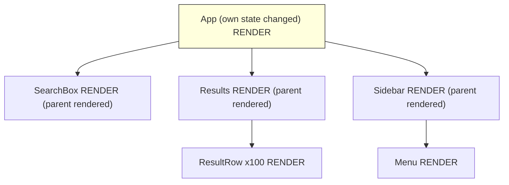
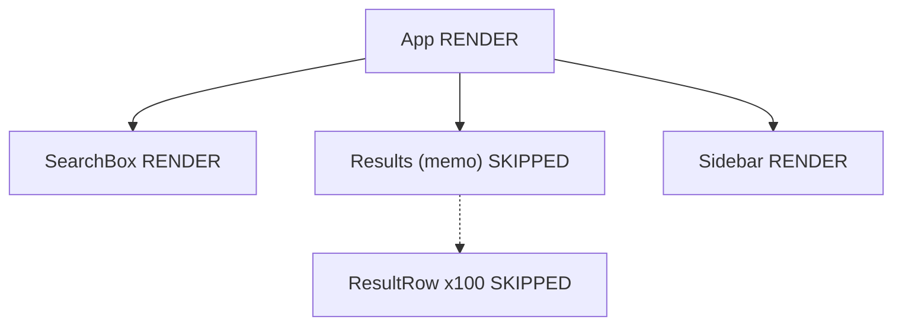
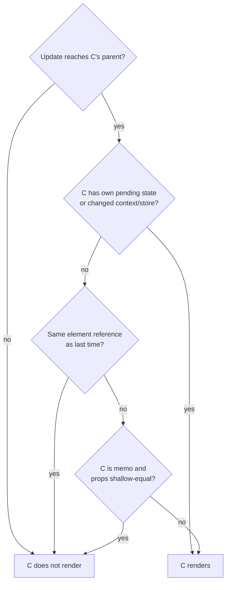

# 07 / 03 — Why Components Re-render: A Causal Model You Can Debug With

## 1. Lesson metadata

| | |
|---|---|
| **Level** | Intermediate |
| **Study time** | 4–5 hours (reading 1.5 h, experiments 1.5 h, exercises 1.5 h) |
| **Prerequisites** | [01 — Measure before optimizing](./01-measure-before-optimizing.md); [02 — Profiler workflows](./02-profiler-workflows.md); [02 / 01 — What triggers a render](../02-react-rendering-and-internals/01-what-triggers-a-render.md); [02 / 06 — Reconciliation fundamentals](../02-react-rendering-and-internals/06-reconciliation-fundamentals.md) |
| **Next** | [04 — Memoization trade-offs](./04-memoization-trade-offs.md) |
| **Related** | [02 / 29 — Reasoning about unnecessary renders](../02-react-rendering-and-internals/29-reasoning-about-unnecessary-renders.md), [02 / 32 — Scenario A: parent re-render](../02-react-rendering-and-internals/32-scenario-a-parent-rerender.md) |

**Learning objectives.** After this lesson you can:
1. List every mechanism that can cause a function component to render, and the single rule that makes children render.
2. Predict, for a given tree and update, exactly which components render, without running the code.
3. Explain when React skips ("bails out of") rendering a component and what is *not* a bail-out.
4. Use "why did this render" evidence and a custom diagnostic hook to attribute a render to a cause.
5. Distinguish *necessary*, *wasteful but cheap*, and *wasteful and expensive* renders.

**Concepts covered:** render triggers (state, context, parent, external store, remount), render vs commit, bailout conditions, the `children` identity pattern, same-state bail-out and its caveat, `memo`, key-driven remounts, StrictMode double invocation, render-cost classification.

---

## 2. Deep conceptual explanation

### 2.1 What problem is this lesson solving?

You cannot fix a re-render problem you cannot attribute. "Component X re-renders too much" is not a diagnosis; "X re-renders because its parent holds a `query` state that changes on every keystroke and X is neither memoized nor receiving the work as `children`" is. This lesson gives you a causal model that is small enough to hold in your head and complete enough to explain every render you will see in a profile.

For the mechanics behind this (fibers, lanes, work loops), see Phase 2. Here we need the *consequences* for performance.

### 2.2 What "render" means (and does not)

A **render** is React calling your component function (and hooks) to compute the next element tree for that component. It is *not* a DOM update. After rendering, React reconciles the new elements with the previous ones and only **commits** actual DOM changes where they differ. A component can render a thousand times and commit zero DOM changes.

Why this matters for performance: rendering costs CPU (your function body, element allocation, diffing). DOM commits cost CPU and trigger browser layout/paint. Reducing renders helps only to the extent that the skipped render work was significant; it never reduces DOM writes that were not going to happen anyway.

### 2.3 The causal model: why does a component render?

A component renders in an update if and only if **React reaches it during that update's render pass and does not bail out**. React reaches a component by:

| # | Cause | What triggers it | Notes |
|---|---|---|---|
| 1 | **Own state/reducer update** | `setState`/`dispatch` from this component's hooks, with a value that differs (by `Object.is`) from the current state | The component is the *origin* of the update |
| 2 | **Parent rendered** | The parent's render produced a new element for this component | This is the dominant source of "unnecessary" renders |
| 3 | **Context value changed** | A provider above passes a new value (`Object.is`) and this component consumes that context (`useContext`/`use`) | Bypasses `memo` ([06](./06-context-propagation-cost.md)) |
| 4 | **External store changed** | A `useSyncExternalStore` subscription's snapshot changed | Applies to libraries built on it (Redux, Zustand, etc.) |
| 5 | **Mount / remount** | First render, or `key` / element type changed so React discards and recreates | Remount also discards state and DOM |
| 6 | **Forced** | Legacy `forceUpdate` (class components, legacy); `root.render` called again | Rare in modern code |

Note what is **not** on the list: *"its props changed."* Props changing is not itself a trigger; the parent rendering is. A component receives *new props* because the parent rendered. If the parent did not render, the child cannot see new props. Conversely, with no `memo`, a child renders on *every* parent render even if every prop is identical. This single observation resolves most confusion.

### 2.4 The rule that makes children render

> When a component renders and returns elements, React renders each child component **unless it can bail out** for that child.

A bail-out for a child happens in one of these documented/observable cases:

1. **The child is `memo`-wrapped and its props are shallow-equal** (per `Object.is` on each prop) to the previous render, *and* the child has no pending own update and no changed context. React skips calling it.
2. **The element identity is the same.** If the parent returns the *same element object* it returned last time (same reference), React does not need to re-render that subtree. This happens when the element was created elsewhere and passed down as props (typically `children`) and the parent's own re-render didn't recreate it ([§5.3](#53-incorrect-example)).
3. **State bail-out.** If `setState` is called with a value equal to the current state, React may skip rendering the component and its children. Documented nuance (confirmed on react.dev's `useState` reference and by an executed test, where a repeated same-value `setState` re-ran the component once more before bailing out): React may still call the component function *once more* before bailing out, without committing or rendering children. So "same state means my function never runs" is not guaranteed.
4. **Nothing reached it.** The update originated lower in the tree; React does not visit siblings or ancestors for state updates originating in a subtree (ancestors do not re-render because a descendant set state).

Everything else renders. In particular, **passing identical props does not prevent a re-render of a non-memoized child**.

### 2.5 Misconceptions

| Misconception | Reality |
|---|---|
| "A child re-renders when its props change." | A child (non-memo) re-renders when its *parent renders*, whether or not props changed. `memo` converts it to "re-renders when props change (shallowly) or other triggers apply". |
| "setState in a child re-renders the parent." | No. State updates re-render the component that owns the state and its descendants (minus bail-outs). |
| "A re-render means the DOM was updated." | Render ≠ commit. DOM mutation happens only for diffs. |
| "Calling `setCount(count)` is free." | Often cheap, but React may call the component once more before bailing out; and with objects `setObj({...obj})` always counts as a change. |
| "Context consumers re-render only if the part they read changed." | They re-render whenever the *value identity* changes, regardless of which field they read ([06](./06-context-propagation-cost.md)). |
| "StrictMode double-rendering means my component renders twice in production." | Double invocation is development-only ([02 / 28](../02-react-rendering-and-internals/28-strict-mode-behavior.md)). |
| "More renders always means slow." | Renders are classified by cost and by whether they change output; see §2.6. |

### 2.6 Classifying renders

Not every re-render deserves action. Classify first:

| Class | Definition | Action |
|---|---|---|
| **Necessary** | Output changes and the user needs to see it | None |
| **Wasteful and cheap** | Output unchanged; render function is trivial; count is small | Usually none; fixing costs more than it saves |
| **Wasteful and expensive** | Output unchanged; render is costly (large subtree, heavy computation) or extremely frequent | Fix structurally first (colocate state, pass children), then consider `memo` |
| **Cascading** | A render triggers effects that set state that triggers more renders | Remove the effect chain (derive during render) |

Lesson [01](./01-measure-before-optimizing.md)'s loop applies: measure to decide the class.

---

## 3. Internal mechanics

### 3.1 The mental algorithm

**Teaching model** (conceptual; not the literal implementation):

```
processUpdate(origin component C with new state):
  mark C as needing work
  start render at root; walk down only into subtrees that contain work or whose parent re-rendered
  for each component visited:
      if component has own pending update OR context it reads changed:
          render it
      else if parent produced the same element reference and no work below:
          bail out (skip subtree if nothing in it has pending work)
      else if memo and props shallow-equal:
          bail out
      else:
          render it
```

Public guarantees relevant to this:
- React re-renders a component when its state changes ([react.dev: "Render and commit"](https://react.dev/learn/render-and-commit)) and, by default, re-renders children of a re-rendered component.
- `memo` skips re-rendering when props are unchanged. It is documented as a performance optimization, not a semantic guarantee: React may in some cases re-render a memoized component anyway, so correctness must not depend on it.

**Implementation detail** *(verify in source if you need precision)*: React tracks pending work through the fiber tree with lanes and child-lane bit flags so it can skip subtrees without pending work. This is why a state update deep in the tree does not walk the whole app. Names and exact mechanics vary by version.

### 3.2 The "children as props" bail-out, explained

```tsx
function Parent({ children }: { children: React.ReactNode }) {
  const [n, setN] = useState(0);
  return (
    <div>
      <button onClick={() => setN(n + 1)}>{n}</button>
      {children}
    </div>
  );
}
```

When `Parent` re-renders because `setN` fired, the `children` value is whatever was last given to `Parent` by *its* parent. Since the grandparent did not re-render, `children` is the *same element reference* as before. React sees an identical element and skips re-rendering it. The expensive subtree is untouched by `Parent`'s state. This is the foundation of the "lift content up" technique in [07 — State colocation](./07-state-colocation-for-perf.md).

It is a **documented behavior of React's element model**, though it is mostly described in educational material rather than as a formal API contract. It is robust in practice but should be verified with the Profiler in your app rather than assumed.

### 3.3 Same-state bail-out nuance

`useState`'s setter compares the new value to the current state with `Object.is`. If equal, React will bail out without re-rendering children and without firing effects. But the documentation notes React may need to render the component *again* before bailing out. So if you log in the body, you may see one extra log after a no-op set. That log does not correspond to a commit and does not render children.

### 3.4 Key and type changes

React matches previous and next elements by **type and key** at each position ([02 / 07](../02-react-rendering-and-internals/07-identity-keys-and-reconciliation.md)). If type or key changes, React unmounts the old subtree and mounts a new one. Remounts are the most expensive "re-render": state lost, DOM destroyed/recreated, effects cleaned and re-run. Performance anti-pattern: using `key={Math.random()}` or defining components *inside* other components (a new function identity each render → a new type → remount every render).

### 3.5 Development-only double invocation

In development with StrictMode, React intentionally calls component functions (and some other functions such as reducers, state initializers) twice to find impurities. That doubles *logs and render counts* in development, but not commits or production behavior. When counting renders, **account for it or disable StrictMode for the measurement**.

---

## 4. Step-by-step execution walkthrough

Given:

```tsx
function App() {
  const [query, setQuery] = useState("");
  return (
    <>
      <SearchBox query={query} onChange={setQuery} />
      <Results />          // no props
      <Sidebar />          // no props
    </>
  );
}
```

User types "a". Timeline:

1. **Event:** `onChange` handler → `setQuery("a")` is called inside a React event handler. The update is enqueued at the root with a lane (discrete input → urgent).
2. **Scheduling:** React schedules a render (microtask/scheduler; implementation detail). Updates in the same event are batched ([02 / 22](../02-react-rendering-and-internals/22-automatic-batching.md)).
3. **Render phase:**
   - `App` renders (own state changed). It returns three elements; two have *new element objects* (JSX creates them each time).
   - `SearchBox` renders (new element, new props, not memo).
   - `Results` renders (new element; not memo; **no props, but the parent rendered**).
   - `Sidebar` renders (same reason).
   - All descendants of `Results` and `Sidebar` render too unless memoized.
4. **Reconciliation:** each rendered component's output is diffed. Suppose only the input's `value` differs.
5. **Commit phase:** one DOM mutation: the `<input>` value property/attribute sync. Layout effects run; the browser then lays out/paints.
6. **Passive effects** run afterwards.

**Predict:** how many components render if `Results` is wrapped in `memo`? *Answer:* `App`, `SearchBox` still render. `Results` is skipped: props `{}` are shallow-equal. `Sidebar` still renders. Now, if `<Sidebar />` is passed in as `children` from outside `App`, it would be skipped as well, with no `memo`.

---

## 5. Code examples

### 5.1 Minimal example — a render logger

```tsx
import { useRef } from "react";

export function useRenderCount(name: string): number {
  const count = useRef(0);
  count.current += 1; // intentional impurity: diagnostic only
  // eslint-disable-next-line no-console
  console.log(`[render] ${name} #${count.current}`);
  return count.current;
}
```

Notes:
- Mutating a ref during render is normally avoided because render must be pure ([02 / 12](../02-react-rendering-and-internals/12-why-rendering-must-be-pure.md)). It is acceptable for *temporary diagnostics* only, and it will double count in dev StrictMode.
- Use it to confirm hypotheses; delete it afterwards.

### 5.2 Practical example — find *why* a component rendered

A reusable, typed diagnostic that diffs props between renders by `Object.is`:

```tsx
import { useRef } from "react";

export function useWhyDidYouRender<P extends Record<string, unknown>>(
  name: string,
  props: P,
): void {
  const prev = useRef<P | null>(null);

  if (prev.current) {
    const changed: Record<string, { from: unknown; to: unknown }> = {};
    const keys = new Set([...Object.keys(prev.current), ...Object.keys(props)]);
    for (const k of keys) {
      if (!Object.is(prev.current[k], props[k])) {
        changed[k] = { from: prev.current[k], to: props[k] };
      }
    }
    if (Object.keys(changed).length === 0) {
      console.log(`[why] ${name}: props identical (parent/context/state caused render)`);
    } else {
      console.log(`[why] ${name}: changed props`, changed);
    }
  }
  prev.current = props;
}

// usage
function ProductRow(props: { product: Product; onSelect: (id: string) => void }) {
  useWhyDidYouRender("ProductRow", props);
  /* ... */
  return <li>{props.product.name}</li>;
}
```

How to read output:
- `props identical` → the render came from the parent rendering (no memo), own state, or context. Not from props.
- `changed props { onSelect: {from: ƒ, to: ƒ} }` → an unstable function identity ([05](./05-referential-equality.md)). The log shows two different function references; to tell *which line* creates it, look for inline arrows in the parent.

Caveats: it does not cover hooks or context; use DevTools' reasons for those. It writes to a ref during render (diagnostic only). It adds overhead.

### 5.3 Incorrect example

```tsx
// ❌ Expensive chart re-renders on every keystroke in the unrelated input.
function Dashboard() {
  const [note, setNote] = useState("");
  return (
    <section>
      <input value={note} onChange={(e) => setNote(e.target.value)} />
      <RevenueChart data={useBigDataset()} />  {/* no memo; 150 ms render */}
    </section>
  );
}
```

**Predict:** how often does `RevenueChart` render, and what is the user-visible effect? *Answer:* on every keystroke, because `Dashboard` re-renders for its own state change and `RevenueChart` is rendered by `Dashboard`. Even if `useBigDataset()` returned an identical array each time, a non-memo child renders anyway. Result: typing lags by ~150 ms per keystroke (illustrative).

Beginner reaction: "props didn't change, why does it render?" Because "props didn't change" is irrelevant without `memo`.

### 5.4 Corrected implementations (three ways)

**A. Move the state down (colocation, preferred).**

```tsx
function NoteField() {
  const [note, setNote] = useState("");
  return <input value={note} onChange={(e) => setNote(e.target.value)} />;
}

function Dashboard() {
  const data = useBigDataset();
  return (
    <section>
      <NoteField />
      <RevenueChart data={data} />
    </section>
  );
}
```
`NoteField` owns the state; `Dashboard` never re-renders for it. No memo, no deps, no stale-closure risk. 

**B. Pass the expensive part as `children` (when state must stay in the parent).**

```tsx
function NoteLayout({ children }: { children: React.ReactNode }) {
  const [note, setNote] = useState("");
  return (
    <section>
      <input value={note} onChange={(e) => setNote(e.target.value)} />
      {children}
      <p>{note.length} characters</p>
    </section>
  );
}

// elsewhere
<NoteLayout>
  <RevenueChart data={data} />
</NoteLayout>
```
The `<RevenueChart/>` element is created by the *grandparent*, which doesn't re-render, so the reference is stable and React skips it.

**C. `memo` (when A and B are not possible).**

```tsx
const RevenueChart = memo(function RevenueChart({ data }: { data: Point[] }) {
  /* ... */
});
```
This works only if `data` keeps the same identity between parent renders. Trade-offs in [04](./04-memoization-trade-offs.md) and [05](./05-referential-equality.md).

### 5.5 Advanced example — a test that guards "does not render"

Use a render spy that is only valid when StrictMode is off:

```tsx
import { render, screen, fireEvent } from "@testing-library/react";
import { Profiler, memo } from "react";
import { expect, test, vi } from "vitest";

test("typing in the note field does not re-render the chart", () => {
  const chartRender = vi.fn();
  const Chart = memo(function Chart({ data }: { data: number[] }) {
    chartRender();
    return <div>{data.length}</div>;
  });
  const data = [1, 2, 3];

  function Dashboard() {
    return (
      <>
        <NoteField />
        <Chart data={data} />
      </>
    );
  }

  render(<Dashboard />);
  chartRender.mockClear();

  fireEvent.change(screen.getByRole("textbox"), { target: { value: "hello" } });

  expect(chartRender).not.toHaveBeenCalled();
});
```

The test passes because `NoteField` owns the state. If someone lifts the state to `Dashboard` and forgets to keep `Chart` memoized and `data` stable, it fails. That is an intentional design guard around a decision that was measured to matter ([01](./01-measure-before-optimizing.md)). Note `Profiler` imported above is not required for this test; use it if you want to assert on commits.

---

## 6. Visual explanations

### 6.1 Who renders when `App` state changes



With `Results` wrapped in `memo` and receiving no changing props:



### 6.2 Decision flow: will component C render in this update?



---

## 7. Alternative approaches and trade-offs

| Technique to prevent a re-render | Mechanism | Cost | Risk | Use when |
|---|---|---|---|---|
| **Colocate state** | Update never reaches the subtree | Restructuring components | Low | State is only used by a small subtree |
| **`children` / element props** | Stable element identity | Slightly unusual composition | Low | A layout component holds fast-changing state |
| **`React.memo`** | Shallow prop comparison | Compare per render + prop stability work | Stale-data bugs with custom comparators; ineffective with unstable props | Heavy child, frequent parent renders, stable props |
| **`useMemo` on the element** (`useMemo(() => <Chart/>, [data])`) | Reuse element reference | Hook + deps | Deps mistakes; hard to read | Rare; one-off when you cannot restructure |
| **External store with selectors** | Components subscribe to slices | Library, indirection | Selector identity pitfalls | Many components need different slices of frequently changing state |
| **Transition/deferred value** | Don't skip; reschedule so input stays responsive | Hooks; may show stale content | UX staleness | Work is legitimate but slow ([12](./12-usetransition-in-practice.md), [13](./13-usedeferredvalue-in-practice.md)) |
| **React Compiler** | Automatic memoization at build time | Build integration | Verify compatibility; opaque to hand-optimization | Broad low-effort baseline verify current guidance |

**Scenario where preventing the re-render is *not* the best approach:** the re-rendered subtree is cheap (≈ 0.3 ms) and the app has a 100 ms budget. The mitigation adds code and reasoning cost for nothing. Another: the re-render is *legitimate but slow* (the chart really needs the new data). Skipping is impossible; you want deferral, a cheaper render, or less data.

---

## 8. Best practices and anti-patterns

### 8.1 Best practices
1. **Attribute before acting**: find the origin update (first component with own state/context/store change), then ask which descendants truly need it.
2. **Prefer structure to memoization**: colocation and children composition have no runtime comparison cost and fewer bugs.
3. **Keep state as low as it can live**, but no lower than the components that need it ([03 / 18](../03-react-state-and-hooks/18-state-colocation-and-lifting.md)).
4. **Make render functions pure** so skipping them is always safe.
5. **Define components at module scope**, never inside other components' bodies.
6. **Use stable keys** from data identity, not array index for reorderable lists, and never random keys.

### 8.2 Beginner mistakes
- Believing identical props prevent re-render without `memo`.
- Using `useEffect` to copy props into state ("sync state"), causing an extra render per change.
- Placing rarely-needed state (e.g., hover) in a high-level component.

### 8.3 Experienced-developer mistakes
- Wrapping a component in `memo` and leaving an unstable prop (`style={{…}}`, `onX={() => …}`), making the memo a no-op while paying its cost.
- Subscribing broad contexts (theme + user + feature flags in one value) so unrelated updates ripple.
- "Fixing" renders with custom comparators that ignore some props, causing stale UI later.
- Confusing a component's *own* renders with renders caused by StrictMode.

### 8.4 Smells
- A `console.log` in a component that logs on every keystroke from unrelated inputs.
- Components defined as `const Inner = () => ...` within another component.
- A `useEffect` whose only job is `setX(f(props))`.

### 8.5 Justified exceptions
- Toggling a `key` to *intentionally* reset a form's state (cheaper and clearer than manual reset logic).
- Accepting re-renders of cheap leaf components in order to keep code simple.

---

## 9. Real-world application

**Product listing with filters (e-commerce).** Filter state (price range, brand) lives in the page component; each of 40 product cards re-renders on every slider tick. Attribute: origin = slider state in `ListingPage`. Options: debounce the committed filter, keep the slider's transient value in the slider component and commit on release; memoize cards with stable props (`product` from a cache keyed by id). Constraint: URL sync for sharing filters ([03 / 19](../03-react-state-and-hooks/19-ui-server-url-and-shared-state.md)).

**Trading dashboard.** A price tick updates one cell, but the whole table renders because the ticks live in a table-level array state. Attribute: origin = array state update. The fix is data-structure oriented (normalized by id, per-row subscription), see [08](./08-rendering-large-collections.md).

**Forms (finance onboarding).** A large multi-section form stores all fields in one `useState` object; every keystroke re-renders all sections. Options: field-level components with their own state and commit on blur, a form library with uncontrolled inputs, or splitting sections. Constraint: validation across fields, so some state needs to be shared (cross-field validation reads from a ref or runs on submit).

**Auth/permissions.** A `UserContext` with `{user, permissions, preferences}` re-renders every consumer on any preference change; consumers rarely need preferences. Fix by splitting the context ([06](./06-context-propagation-cost.md)).

---

## 10. Debugging and troubleshooting

### Symptom: "This component re-renders and I don't know why."
1. In DevTools Profiler, enable *Record why each component rendered*. Record one interaction.
2. Select the component in a commit and read the reason:
   - **"Props changed: …"** → identify unstable props ([05](./05-referential-equality.md)).
   - **"State changed" / "Hooks changed"** → it's the origin, or a hook returns new identity each time.
   - **"Context changed"** → find the provider; check whether its `value` is recreated each render or really changes ([06](./06-context-propagation-cost.md)).
   - **"The parent component rendered"** → walk up to the origin.
3. If still unclear, temporarily add `useWhyDidYouRender`.

### Symptom: "I memoized, and it still re-renders."
- Props include a new object/array/function each parent render.
- The component reads a context that changed.
- It receives `children` (JSX is a new object each parent render).
- `memo` is applied to an inline wrapper (`memo(() => …)` defined inside render → new component type each render).

### Symptom: "It renders twice."
- Development StrictMode (expected). Verify by checking a production build or removing StrictMode temporarily.
- Or two legitimate commits (e.g., effect sets state). Count commits in the Profiler, not logs.

### Symptom: "Child re-renders although parent did not."
- It consumes a context, uses `useSyncExternalStore`/a store hook, or has its own state change; the origin is the child.

### Validating a fix
Re-record the same interaction. Confirm the component is grey (skipped) for the unrelated interaction, and also that it still renders when it should (**test the positive case** — a too-aggressive memo that never updates is a correctness bug).

---

## 11. Exercises

### Level A — Knowledge
A1. List the six causes of a component render. Which one is behind most "unnecessary" renders?
A2. What is the difference between render and commit?
A3. Name two ways a child can be skipped without `memo`.
A4. Why doesn't a descendant's `setState` re-render its ancestors?

### Level B — Code comprehension
B1. In the following, how many times does `Child` render after clicking the button once (production build)? After clicking again?
```tsx
function Parent() {
  const [n, setN] = useState(0);
  return (
    <>
      <button onClick={() => setN(1)}>set</button>
      <Child />
    </>
  );
}
```
B2. What changes if `Child` is passed as `children` to `Parent` instead of being rendered inside it?
B3. Why does this component remount on every render of its parent, and what does it cost?
```tsx
function Page() {
  const [x, setX] = useState(0);
  const Row = () => <li onClick={() => setX(x + 1)}>{x}</li>;
  return <ul><Row /></ul>;
}
```

### Level C — Implementation
C1. Implement `useRenderReason(name, props)` that additionally logs whether *any* prop changed using `Object.is` and prints a list of changed keys. (Extend §5.2 with a boolean return.)
C2. Refactor a page component that holds both a `search` input state and a heavy `Table` so that `Table` does not re-render per keystroke, using two different techniques.

### Level D — Debugging
D1. A `memo(Row)` component shows reason "Props changed: onSelect" in the Profiler on every parent render. The parent passes `onSelect={(id) => select(id)}`. Fix it two ways and state trade-offs.
D2. A profile shows `Sidebar` re-rendering when the user types in an input in `Main`; they are siblings under `Layout`. `Layout` holds `const [draft, setDraft] = useState("")`. Explain and fix.

### Level E — Architecture and engineering decisions
E1. Your design system exports `Modal` that re-renders all its children on every open-state change. Product teams complain. Decide how to change the API, considering backward compatibility.
E2. Compare "memoize aggressively everywhere" vs "colocate and memoize selectively" for a 30-engineer team. Include onboarding, review costs, and bug classes.

### Level F — Expert challenge
F1. Write a diagnostic specification (not necessarily full code) for a dev-only tool that detects *wasteful and expensive* renders automatically: define "wasteful", "expensive", data you collect, and false-positive risks.

---

## 12. Detailed answers and explanations

> Attempt the exercises first.

**A1.** (1) own state/reducer change, (2) parent rendered, (3) context change, (4) external store change, (5) mount/remount (key/type change), (6) forced update/root re-render. "Parent rendered" produces most unnecessary renders because children render by default whenever the parent does. Wrong answer: "props changed."

**A2.** Render = calling components to compute the element tree (plus reconcile diff); commit = applying the DOM changes and running layout effects (and later passive effects). A render can produce zero DOM changes. Render cost is CPU in JS; commit cost includes DOM mutation and triggers browser layout/paint.

**A3.** (a) The element reference is identical (e.g., `children` passed from a non-re-rendering ancestor), (b) the update never reaches it because the origin is elsewhere (siblings and ancestors are not visited for descendant state updates, apart from the path to the origin), (c) state bail-out where the new state equals the old. (A fourth: `memo`.) Wrong answer: "when props are the same" (only with `memo`).

**A4.** React updates flow downward from the component with the pending update; ancestors have no new state and nothing re-evaluates them. React walks from the root only to find the path to pending work, not to *re-render* ancestors on that path. Wrong answer: "React re-renders everything above to keep consistent"; no, rendering a component requires a reason.

**B1.** First click: state `0 → 1` → `Parent` renders, so `Child` renders: +1 render (in production; dev StrictMode doubles invocations). Second click: `setN(1)` with current state 1 → `Object.is` equal → bail-out: React may call `Parent` once more but will not render `Child` or commit. So `Child` renders once more after the first click, and zero times after the second. Wrong answer: "Child renders on each click" (ignores same-state bail-out). Caveat: the extra `Parent` call is the documented nuance.

**B2.** If `Parent` receives `<Child />` as `children` from its own parent, `Parent`'s state update reuses the same element reference for `children`, so `Child` is skipped (given no other triggers). Prediction: zero renders of `Child` on clicks. Caveat: if `Child` reads context or has state it can still render from those.

**B3.** `Row` is declared inside `Page`, so each `Page` render creates a *new function* and thus a new component type at that position. React sees a different type, unmounts the old subtree, and mounts a new one: state lost, DOM replaced, effects re-run, even `memo` would not help. Fix: move `Row` to module scope and pass `x` and `onClick` as props (or colocate the state in `Row`). Edge case: if you need closure access, pass props; do not define components in render.

**C1.**
```tsx
import { useRef } from "react";

export function useRenderReason<P extends Record<string, unknown>>(
  name: string,
  props: P,
): { changed: string[] } {
  const prev = useRef<P | null>(null);
  const changed: string[] = [];
  if (prev.current) {
    for (const k of new Set([...Object.keys(prev.current), ...Object.keys(props)])) {
      if (!Object.is(prev.current[k], props[k])) changed.push(k);
    }
    console.log(
      changed.length
        ? `[reason] ${name}: props changed -> ${changed.join(", ")}`
        : `[reason] ${name}: no prop changed (parent/state/context)`,
    );
  }
  prev.current = props;
  return { changed };
}
```
Evaluation: uses `Object.is`, handles added/removed keys, documents that it covers props only. Wrong implementations use `!==` (misreports `NaN`, and `-0`) or `JSON.stringify` (hides identity changes and is expensive).

**C2.** Technique 1: colocate: extract `SearchInput` that owns `search` and calls a debounced `onCommit(q)` when the table should actually update (if the table needs the value, state must still live above; you then pass `deferredQuery`). Technique 2: `Table` as `children` of a `SearchLayout` that owns `search` for display only; or `memo(Table)` with stable props. Evaluation: whichever you choose, verify with the Profiler that `Table` is grey on keystrokes and still updates when the committed query changes. Trade-offs: colocation changes component structure; `memo` adds comparison and prop-stability obligations; `children` composition changes API shape.

**D1.** Option 1: `useCallback((id: string) => select(id), [select])` where `select` is stable (e.g., from a reducer's `dispatch` or a `useCallback` itself) — trade-off: deps must be right; the benefit only exists because `Row` is memoized. Option 2: pass `select` directly (`onSelect={select}`) if its signature matches and it's stable, and let `Row` call `onSelect(product.id)` — trade-off: fewest hooks; requires `select` itself to be stable. Option 3 (alternative): `Row` receives `dispatch` from context or a stable store action. Wrong fix: removing `memo` (loses the benefit) or custom comparator ignoring `onSelect` (stale closure risk).

**D2.** `Layout` owns `draft` state; typing re-renders `Layout`, which re-renders its children `Main` and `Sidebar` (parent rendered). The origin is `Layout`. Fix: move `draft` into a component that renders the input only (`DraftInput`), or lift content up via `children`, or memoize `Sidebar` (if props are stable). Prefer colocation since `Sidebar` doesn't need `draft`. If `Main` *does* need `draft`, keep the state in `Main` rather than `Layout`.

**E1.** Evaluation criteria: root cause (modal state held in a wrapper that renders children inline), non-breaking additions (e.g., support `children` as already-created elements so open-state changes do not rerender them; document that content passed as children is not re-rendered by the modal's state; or render the content lazily only when open); semver considerations (additive props, deprecations); measurement (Profiler comparisons in consumer apps). Example answer: restructure `Modal` so its open state is internal and the content subtree is owned by the caller (children composition); add docs and an `unmountOnClose` option; do not require consumers to memoize.

**E2.** Evaluation criteria: acknowledges costs of aggressive memoization (noise, deps errors, review burden, false confidence, memo overhead on every component) and benefits (insurance against regressions in unknown workloads). Selective strategy: structural fixes first, `memo` at measured boundaries (list rows, heavy widgets), guard tests. Mentions the React Compiler as a way to change the default verify current guidance. A good answer proposes policies (e.g., "memo requires a note on the measured benefit") rather than absolutes.

**F1.** Evaluation criteria: defines *wasteful* as "rendered, output element tree structurally equal to the previous (or DOM commit empty), and no state change in that component" (detectable via the Profiler's reasons + a comparison of rendered output or by marking commits that did not mutate DOM); *expensive* as `actualDuration` above a threshold or aggregated per-second; collects per-component render count, reason, duration, and whether the props were identity-different but deep-equal (a strong signal of unstable props). False positives: legitimate renders caused by context; renders needed for effects; cheap components with high count; StrictMode double invocation; instrumentation overhead altering timing. Good answers also mention sampling to avoid perturbation and that a tool should *suggest* investigation, not auto-apply memoization.

---

## 13. Senior engineer interview questions

**Q1. "Why does a child re-render when its props haven't changed?"**
Because a non-memo child re-renders whenever its parent renders; React doesn't compare props unless `memo` is used. Props changing is not the trigger. Reason: React's default is to re-render and then diff output, which keeps the model simple and correct.

**Q2. "How can you stop a heavy subtree re-rendering without `memo`?"**
Colocate the changing state below the subtree's parent, or pass the subtree as `children`/an element prop so its element reference is stable. Reason: React skips subtrees whose element reference is unchanged and that have no pending work.

**Q3. "Does `setState` with the same value avoid rendering?"**
Usually it bails out without re-rendering children and without committing; React may call the component function once more before bailing out. Reason: documented nuance; don't rely on "never runs".

**Q4. "A component re-renders twice per update in dev. Bug?"**
Probably StrictMode's intentional double invocation; verify in production or by counting commits. Reason: dev-only purity check; commits are not doubled.

**Q5. "Why can `memo` be useless even when you added it?"**
Unstable props (inline objects/functions/new arrays), `children` JSX props, changing context, or defining the memoized component inside another component. Reason: shallow equality compares identities.

**Q6. "How do you decide whether to optimize a re-render?"**
Classify: is the output changing, how expensive is the render, how frequent? Use the Profiler to quantify; apply structure first, then memoization if still justified. Reason: optimizations cost complexity; only wasteful *and* expensive renders pay for themselves.

---

## 14. Further learning resources

| Resource | URL | Covers / why | Level | Study |
|---|---|---|---|---|
| React docs — Render and Commit | <https://react.dev/learn/render-and-commit> | Official model of render vs commit | Beginner | Whole page |
| React docs — State as a Snapshot | <https://react.dev/learn/state-as-a-snapshot> | Why renders see consistent state | Beginner | Whole page |
| React docs — Queueing a Series of State Updates | <https://react.dev/learn/queueing-a-series-of-state-updates> | Batching and updater functions | Beginner–Int. | Whole page |
| React docs — Preserving and Resetting State | <https://react.dev/learn/preserving-and-resetting-state> | Key and type identity; remount behavior | Intermediate | "Same component at the same position" |
| React docs — `memo` | <https://react.dev/reference/react/memo> | Shallow props comparison, caveats | Intermediate | "Usage", "Troubleshooting" |
| React docs — `useState` (bail-out notes) | <https://react.dev/reference/react/useState> | Same-state bail-out nuance | Intermediate | "Caveats" |
| React docs — `StrictMode` | <https://react.dev/reference/react/StrictMode> | Dev double invocation | Intermediate | "Usage" |
| GitHub — facebook/react | <https://github.com/facebook/react> | Source; read the reconciler to verify mechanics | Advanced | `packages/react-reconciler` *(path unverified; check repo)* |

URLs in this table were checked for HTTP 200 on 2026-10-22; any still marked *(unverified)* could not be checked automatically (blocked or unreachable). A 200 response does not guarantee the page content still matches the description; if a link has moved, search the site for the quoted title.

---

## 15. Knowledge checkpoint

**You should now understand**
- The six causes of a render and that "props changed" is not one of them.
- That child components render by default when the parent renders, and the four ways React skips them.
- The distinction between render and commit and why it limits what render optimizations can achieve.

**You should be able to explain without notes**
- Why `children` composition prevents re-renders.
- Why same-state `setState` mostly (but not strictly) avoids work.
- Why components defined inside components remount every render.

**You should be able to implement**
- A render-reason diagnostic hook and a render-count test.
- Structural fixes (colocation, children) for a parent-driven re-render.

**You should be able to debug**
- "memo not working" cases by reading Profiler reasons and tracing unstable props.

**Before moving on:** read [04 — Memoization trade-offs](./04-memoization-trade-offs.md) to learn when the *tools* (`memo`, `useMemo`, `useCallback`) are worth their cost.
