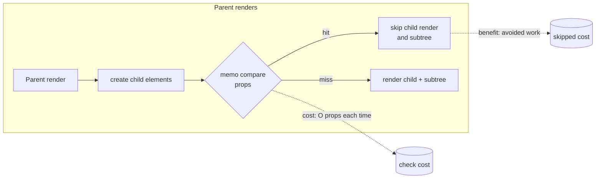

# 07 / 04 — Memoization Trade-offs: A Cost Model for `memo`, `useMemo`, and `useCallback`

## 1. Lesson metadata

| | |
|---|---|
| **Level** | Intermediate–Advanced |
| **Study time** | 5 hours (reading 1.5 h, experiments 2 h, exercises 1.5 h) |
| **Prerequisites** | [03 — Why components re-render](./03-why-components-rerender.md); [03 / 11 — useMemo and useCallback](../03-react-state-and-hooks/11-usememo-and-usecallback.md); [03 / 12 — React.memo](../03-react-state-and-hooks/12-react-memo.md); [00 / 07 — Functions and referential identity](../00-web-and-javascript-foundations/07-functions-and-referential-identity.md) |
| **Next** | [05 — Referential equality](./05-referential-equality.md) |
| **Related later** | [10 — Expensive computations](./10-expensive-computations.md), [23 — Counterproductive optimizations](./23-counterproductive-optimizations.md), [09 / 08 — React Compiler](../09-advanced-rendering-and-ecosystem/08-react-compiler.md) |

**Learning objectives.** After this lesson you can:
1. Write the cost/benefit model of a memoization and estimate its break-even.
2. Predict whether a given `memo`, `useMemo`, or `useCallback` will have any effect by checking its preconditions.
3. Measure a memoization with render counts, `actualDuration`, and mount-time cost, and decide to keep or revert it.
4. Recognize five successful patterns and six counterproductive ones.
5. Explain how the React Compiler changes the default and what remains your responsibility.

**Concepts covered:** cache hit rate, compare cost, memory cost, dependency correctness, stale closures, shallow comparison, custom comparators, "memo that never hits", memoizing cheap work, memoization at list-row boundaries, expensive computations, compiler-based memoization.

---

## 2. Deep conceptual explanation

### 2.1 What problem is this lesson solving?

Memoization is the most overused and most misunderstood React performance tool. It is overused because it is easy to apply and appears to be "free insurance"; misunderstood because its benefit depends on three independent facts (how often the inputs are unchanged, how expensive the skipped work is, and how cheap the check is) that nobody measures at the time of writing. Using it blindly leaves code with extra moving parts and, in the worst case, extra latency and subtle bugs.

### 2.2 What memoization is, concretely, in React

Three tools, one idea: *remember a result keyed by inputs; reuse it if inputs are equal*.

| Tool | Remembers | Inputs | Equality | Skips |
|---|---|---|---|---|
| `React.memo(Component)` | The last rendered output of that component instance (conceptually: skips calling it) | Props | Shallow `Object.is` per prop (or your custom comparator) | The component's render *and its subtree's render*, if nothing else triggers |
| `useMemo(fn, deps)` | The last return value of `fn` | `deps` array | `Object.is` per dep | Recomputing `fn` |
| `useCallback(fn, deps)` | The function `fn` itself (identity) | `deps` array | `Object.is` per dep | Creating a new function identity (the function body still is allocated each render) |

Important: `useCallback(fn, deps)` is equivalent to `useMemo(() => fn, deps)`. It never makes the function *run* less; it only keeps the *reference* stable. Its sole purpose is to preserve referential equality for something that compares references: a `memo` child's props, another hook's deps, an effect's deps, or a subscription identity.

React docs describe these as **performance optimizations, not semantic guarantees**: React may discard cached values in some situations (for example in future versions or during certain features), so code must remain correct if the cache is dropped. (Verified on react.dev's `useMemo` reference, 2026-10-22: React throws the cache away on file edit in development and when a component suspends during initial mount.)

### 2.3 The cost model

For a given memoization point `M`:

```
Gain per render   =  P(hit) × C_skipped  −  C_check
Gain total        =  renders × Gain per render  −  C_maintenance
```

where:

- `P(hit)`: probability that inputs are unchanged on a given render. For `memo(Row)`, this is the fraction of parent renders where *all* props are equal. If one unstable prop makes this 0, the memo is pure cost.
- `C_skipped`: cost of the render work avoided (the component, plus subtree renders avoided, plus the allocations). For `useMemo`, the cost of the computation.
- `C_check`: cost of comparing inputs (O(number of props or deps)), plus, on a miss, cost of storing a new result. For `memo`, the compare happens on *every* parent render.
- `C_maintenance`: the human costs: reading burden, review time, dependency-array bugs, lint noise, refactoring friction. Not measured in milliseconds, but real.

Break-even in words: memoization pays when **the work skipped is large relative to the check, and hits are frequent**. It does *not* pay when work is trivial, when props change nearly every time, or when the component renders rarely.

Rule-of-thumb guidance from the React docs for `useMemo`: measure a calculation with `console.time`/`performance.now` (in a representative, ideally throttled setup) and consider memoizing if it takes on the order of a millisecond or more; below that, memoization overhead and complexity usually dominate. Treat that as a starting heuristic, not a law. (react.dev says: "say, 1ms or more".)

### 2.4 Preconditions for effectiveness (a checklist)

A `memo` on component `C` has an effect only if **all** are true:

1. `C`'s parent renders *more often than `C`'s inputs change*.
2. Every prop passed to `C` is referentially stable across those parent renders (primitives are; objects, arrays, functions, JSX elements are not, unless you stabilize them). `children` is a prop; JSX children are new objects each parent render.
3. `C` does not consume a context that changes at the same frequency (context bypasses memo).
4. `C`'s render (plus its subtree) costs more than the prop comparison.
5. `C` is not remounting (key/type instability).

A `useMemo` on value `v` has an effect only if:

1. The computation is nontrivial (≥ ~1 ms or large allocations) **or** the *identity* of `v` matters to a memoized consumer or hook deps.
2. Its dependencies are mostly stable across renders.

A `useCallback` on function `f` has an effect only if `f` is passed to something that compares identity (memo child, hook deps, effect deps, subscriptions). Passing it to DOM elements has no benefit.

### 2.5 Misconceptions

| Misconception | Reality |
|---|---|
| "`useCallback` makes my function faster." | It doesn't. It preserves identity; the function body runs exactly as often as before. |
| "`useMemo` guarantees the value won't be recomputed." | It's an optimization hint; correctness must not depend on it. |
| "memo is free." | Each render of the parent runs the comparison for every memoized child; memory holds previous props. For thousands of memoized instances this adds up. |
| "Memoizing everything is safe." | Wrong deps cause stale values; unnecessary memoization hides the real structural problem and adds review burden. |
| "The compiler removes the need to think about memoization." | It automates many cases, but patterns it cannot analyze, impure code, and structural problems (state too high, too many DOM nodes) remain your problem. Volatile: verify current compiler capabilities and limits on react.dev. |

---

## 3. Internal mechanics

### 3.1 What `memo` does

- **Public guarantee.** `memo(Component, arePropsEqual?)` returns a component that skips re-rendering when `arePropsEqual(prevProps, nextProps)` returns true; by default each prop is compared with `Object.is`. State changes inside the component and context changes still re-render it.
- **Teaching model.** Before rendering the memo component, React compares the *new props object's fields* to the *previous props object's fields*. If all equal, it reuses the previous output and skips the subtree (unless descendants have pending work of their own).
- **Implementation detail.** The comparison happens in the reconciler as part of the "begin work" for that fiber; names and exact flow vary. Don't depend on whether comparison is invoked for every parent render in a given implementation; depend only on the documented outcome.

### 3.2 What `useMemo`/`useCallback` do

Each call occupies a hook slot (an entry in the component's hook list stored on the fiber). On render, React compares the deps array with the stored one using `Object.is` element-wise; if equal, return the stored value; else call `fn`, store `{value, deps}`. Consequently:

- Deps array allocation and comparison happen on every render (small, nonzero cost).
- The *callback you pass is always allocated* (a new arrow function each render); `useCallback` just returns the older one if deps are equal. So `useCallback` does not avoid allocation.
- Closures keep references alive: a memoized callback retains the variables it captured at the time it was created, which is the origin of stale-closure bugs when deps are wrong.

### 3.3 Mount-time cost

`memo` and hooks cost something on mount too: wrapper component type, hook slots, initial deps storage. For thousands of rows, this is measurable (illustrative: a few percent of mount time for tiny rows). A memoization that never hits has pure overhead on both mount and update.

### 3.4 Custom comparators

`memo(C, (prev, next) => …)` can express deep or partial equality. Pitfalls:
- A comparator that ignores a function prop produces stale closures: the component keeps calling the *old* function.
- A deep comparator on large props costs O(size) on *every parent render*, potentially more than rendering.
- The docs warn that, if you use a custom comparator, you should compare every prop including functions, and that deep equality can be slow and freeze the UI if data structures change; confirmed in the `memo` reference (`arePropsEqual`).

---

## 4. Step-by-step execution walkthrough: measuring a `memo` on list rows

Setup: `ProductList` with 2,000 `ProductRow`s. A header filter input updates `query` state in `ProductList`; the filtered rows change only when `query` matches differently, but on each keystroke `ProductList` renders.

**Baseline (no memo):** keystroke → `ProductList` renders → 2,000 `ProductRow` renders (parent rendered) → 2,000 element diffs → commit (few DOM diffs). Illustrative: `actualDuration` 85 ms, commit 4 ms.

**Change:** `ProductRow = memo(ProductRowImpl)`, with `onSelect` stabilized, `product` objects from stable data.

**After:** keystroke → `ProductList` renders → React creates 2,000 `ProductRow` elements (cheap) → for each memo element, compares props (3 props × `Object.is`) → bails out → only rows whose props changed render. Illustrative: `actualDuration` 11 ms.

**Cost side:** mount time +3% (illustrative), +1 compare pass per parent render.

**Predict:** if `onSelect` is `() => select(p.id)` created inline inside `.map`, what happens? *Answer:* a new function per row per render: all comparisons fail, all 2,000 rows render, and you pay compare cost on top: slower than baseline by the comparison overhead (small, but strictly negative), plus complexity. This is "memo that never hits".

Decision rule used: keep if median `actualDuration` improves beyond noise and mount regression is acceptable; revert otherwise.

---

## 5. Code examples

### 5.1 Minimal example — effective `memo`

```tsx
import { memo, useState } from "react";

const ExpensiveTree = memo(function ExpensiveTree({ items }: { items: readonly string[] }) {
  // imagine 5,000 nodes
  return <ul>{items.map((s) => <li key={s}>{s}</li>)}</ul>;
});

const ITEMS = Array.from({ length: 5000 }, (_, i) => `Item ${i}`); // module scope: stable identity

export function Screen() {
  const [tick, setTick] = useState(0);
  return (
    <>
      <button onClick={() => setTick((t) => t + 1)}>{tick}</button>
      <ExpensiveTree items={ITEMS} />
    </>
  );
}
```

Why it works: `ITEMS` is created once at module scope; `Screen` rerenders on every click, and `ExpensiveTree`'s only prop is identical by `Object.is`. Result: 0 renders of 5,000 `li`s per click.

Variation: replace `ITEMS` with `Array.from(...)` inside `Screen`: every render creates a new array, `memo` never hits, the tree re-renders each click. Predict then verify with the Profiler.

### 5.2 Practical example — memoized rows with stable callbacks and primitive props

```tsx
import { memo, useCallback, useReducer } from "react";

interface Product { id: string; name: string; priceCents: number; }

type Action = { type: "toggle"; id: string };
function selectionReducer(state: ReadonlySet<string>, action: Action): ReadonlySet<string> {
  const next = new Set(state);
  if (next.has(action.id)) next.delete(action.id);
  else next.add(action.id);
  return next;
}

const Row = memo(function Row({
  product,
  selected,
  onToggle,
}: {
  product: Product;
  selected: boolean;
  onToggle: (id: string) => void;
}) {
  return (
    <li aria-selected={selected}>
      <label>
        <input type="checkbox" checked={selected} onChange={() => onToggle(product.id)} />
        {product.name} — {(product.priceCents / 100).toFixed(2)}
      </label>
    </li>
  );
});

export function ProductList({ products }: { products: readonly Product[] }) {
  const [selected, dispatch] = useReducer(selectionReducer, new Set<string>());
  const onToggle = useCallback((id: string) => dispatch({ type: "toggle", id }), []);

  return (
    <ul>
      {products.map((p) => (
        <Row key={p.id} product={p} selected={selected.has(p.id)} onToggle={onToggle} />
      ))}
    </ul>
  );
}
```

Line notes:
- `selected={selected.has(p.id)}` converts a shared collection into a **primitive boolean per row**. When one row toggles, only that row's boolean flips; every other row's props are equal → skipped. Passing the whole `Set` would break memoization for all rows.
- `dispatch` is stable by contract, so `useCallback(…, [])` is correct: the closure captures only `dispatch`. If `onToggle` closed over changing state, deps would be needed.
- `product` objects must keep identity across renders when unchanged (from a cache/query layer with structural sharing; see [05](./05-referential-equality.md)).
- **Predict:** toggling one row of 2,000 → renders: `ProductList` (1), `Row` (1). Others skipped. With a new Set per toggle, `selected.has` returns the same booleans for others.

### 5.3 Incorrect example — six ways memoization fails

```tsx
// ❌ 1. Inline object prop defeats memo
<Row product={p} style={{ color: "red" }} />

// ❌ 2. Inline arrow defeats memo
<Row product={p} onToggle={(id) => dispatch({ type: "toggle", id })} />

// ❌ 3. JSX children are a new object each render
<Card><p>hello</p></Card>     // Card = memo(...) never hits because `children` changes

// ❌ 4. Memoizing cheap work
const fullName = useMemo(() => `${first} ${last}`, [first, last]);

// ❌ 5. useCallback for a DOM handler
const onClick = useCallback(() => setOpen(true), []);
<button onClick={onClick}>open</button>

// ❌ 6. memo component created inside render
function Parent() {
  const Child = memo(() => <div />);   // new type every render, remounts, memo useless
  return <Child />;
}
```

**Predict, then explain.**
1. New `style` object each render → shallow compare fails → memo skipped; cost paid. Fix: hoist the constant, `useMemo` it, or use a class name.
2. New arrow each render → same. Fix: stable callback taking an id, as in §5.2.
3. `<p>hello</p>` is an element object created each time `Parent` renders → `children` prop changes → miss. Fix: hoist constant JSX (`const hello = <p>hello</p>` outside the component) or don't memoize `Card`.
4. A template string is nanoseconds of work; the hook's bookkeeping costs more and adds a dependency list. Revert.
5. A host element doesn't care about handler identity. The hook is dead weight. (If `onClick` were passed to a memoized child or an effect's deps, it would matter.)
6. The component type changes every render; React unmounts and mounts a new subtree each time, losing state and DOM. Always define components at module scope.

### 5.4 Corrected implementation — measured decision with a counter test

```tsx
import { Profiler, memo, useCallback, useState, type ProfilerOnRenderCallback } from "react";

const Row = memo(function Row({ label, onPick }: { label: string; onPick: (l: string) => void }) {
  return <li onClick={() => onPick(label)}>{label}</li>;
});

const labels = Array.from({ length: 2000 }, (_, i) => `Row ${i}`);

export function Bench({ useMemoizedCallback }: { useMemoizedCallback: boolean }) {
  const [n, setN] = useState(0);
  const stable = useCallback((l: string) => console.debug(l), []);
  const unstable = (l: string) => console.debug(l);
  const onPick = useMemoizedCallback ? stable : unstable;

  const onRender: ProfilerOnRenderCallback = (id, phase, actual, base) => {
    if (phase === "update") console.table({ id, actual, base });
  };

  return (
    <Profiler id="list" onRender={onRender}>
      <button onClick={() => setN(n + 1)}>{n}</button>
      <ul>
        {labels.map((l) => <Row key={l} label={l} onPick={onPick} />)}
      </ul>
    </Profiler>
  );
}
```

Experiment: render `<Bench useMemoizedCallback />` and `<Bench useMemoizedCallback={false} />` in separate builds/runs, click 20 times each, compare `actual` and `base`. Expected: with a stable callback, `actual` ≪ `base`; with the unstable callback, `actual ≈ base` (memo wasted) — *and* slightly above the no-memo baseline due to the comparison. Because `actual` and `base` are both reported by the `Profiler`, the ratio `actual/base` is a convenient "memo effectiveness" indicator for the subtree. (Illustrative interpretation; confirm in your build.)

### 5.5 Advanced example — a `useMemo` that is justified, with measurement

```tsx
import { useMemo, useState } from "react";

interface Txn { id: string; accountId: string; cents: number; postedAt: number }

function summarize(txns: readonly Txn[]): Map<string, number> {
  const totals = new Map<string, number>();
  for (const t of txns) totals.set(t.accountId, (totals.get(t.accountId) ?? 0) + t.cents);
  return totals;
}

export function LedgerSummary({ txns }: { txns: readonly Txn[] }) {
  const [expanded, setExpanded] = useState(false); // toggles frequently, unrelated to txns

  const totals = useMemo(() => {
    const t0 = performance.now();
    const result = summarize(txns);
    if (import.meta.env.DEV) {
      console.debug(`summarize: ${(performance.now() - t0).toFixed(2)}ms for ${txns.length} txns`);
    }
    return result;
  }, [txns]);

  return (
    <section>
      <button onClick={() => setExpanded((e) => !e)}>{expanded ? "Collapse" : "Expand"}</button>
      <ul>
        {[...totals].map(([acct, cents]) => (
          <li key={acct}>{acct}: {(cents / 100).toFixed(2)}</li>
        ))}
      </ul>
    </section>
  );
}
```

Why justified: with 200,000 transactions (illustrative), `summarize` takes tens of ms; `expanded` toggles produce re-renders where `txns` identity is unchanged → `useMemo` hits → no recomputation. Measurement protocol: log the duration (dev) in a throttled run; if it is < 1 ms for realistic `txns` sizes, remove the `useMemo`. The deps array `[txns]` is correct *only if* `txns` identity changes when and only when contents change; if the parent mutates the array in place (`push`), the memo returns stale totals: an immutability requirement ([00 / 08](../00-web-and-javascript-foundations/08-objects-references-immutability.md)).

Alternative: move `summarize` to the data layer (computed once when data arrives or on the server), eliminating the need for `useMemo` in the component.

---

## 6. Visual explanations

### 6.1 Where the cost and benefit land



### 6.2 Break-even intuition

```text
Gain per parent render = P(hit) * C_render_skipped - C_compare

C_render_skipped (ms)
   |                       WIN
 5 |                 .  .  .
   |             .  .  .
 1 |  .  .  .  .                 <- cheap components: rarely worth it
   |   LOSS / NEUTRAL
 0 +--------------------------------
   0       0.5       1.0      P(hit)
```

(Conceptual sketch. Cheap renders need a hit rate near 1 and many instances to matter; expensive renders are worth memoizing even at moderate hit rates.)

---

## 7. Alternative approaches and trade-offs

| Approach | Benefit | Cost | Risk | Best when |
|---|---|---|---|---|
| **No memoization** | Simplest code | None | Wasted renders in hot paths | Default for cheap subtrees |
| **Structural fix** (colocation, `children`) | Removes the problem; no compare cost | Refactor | Low | State is higher than needed ([07](./07-state-colocation-for-perf.md)) |
| **`memo` with stable props** | Skips subtree renders | Compare + prop discipline | Unstable-prop regressions | Heavy components/rows with frequent parent renders |
| **`useMemo` for computation** | Skips repeated heavy work | Hook + deps | Stale value from wrong deps | ≥ ~1 ms work with stable inputs |
| **Compute upstream** (selector, server, query layer) | Computed once, reusable | Architecture change | Duplication of logic | Many consumers need the same derived data |
| **Virtualization / pagination** | Fewer rendered components altogether | Library, UX constraints | Complexity | Rows count in the thousands ([09](./09-windowing-and-virtualization.md)) |
| **React Compiler** | Automatic memoization of components and values | Build setup; adopt incrementally | Compatibility with impure code verify | Broad low-effort baseline |
| **Custom comparator** | Fine-grained skipping | Compare cost; correctness | Stale UI if incomplete | Rare: e.g., compare by `product.version` instead of identity |

**Scenario where memoization is *not* the best approach:** a table of 10,000 rows. Even with perfect memoization, every parent render creates 10,000 elements and runs 10,000 comparisons; mount cost is also 10,000 components and DOM nodes. Virtualization reduces the *count*, which memoization cannot.

**Scenario where memoization is clearly right:** a 60 ms chart component rendered beside a text input that updates state on each keystroke, where restructuring to colocate the input is not possible because the input's value is shared with sibling logic: `memo(Chart)` with stable `data` removes the 60 ms per keystroke.

---

## 8. Best practices and anti-patterns

### 8.1 Best practices

1. **Memoize at boundaries that matter**: list rows, heavy widgets, chart/map/editor components.
2. **Make the memo effective before adding it**: audit props for stability first (`useWhyDidYouRender`, Profiler reasons).
3. **Pass primitives and ids** instead of objects/collections when possible (`selected: boolean`, `id: string`).
4. **Pair `memo` with stable callbacks** only when the callback is a prop to a memo child; skip it otherwise.
5. **Use `useMemo` for expensive derived data**, measured, and keep `deps` exhaustive (trust the `react-hooks/exhaustive-deps` lint rule).
6. **Never rely on memoization for correctness**; code must work with the cache cleared.
7. **Write a guard** (render-count test) for any memo you proved valuable, and a comment explaining *what was measured*.

### 8.2 Beginner mistakes
- Wrapping every component in `memo` "to be safe".
- Adding `useCallback` to every handler.
- Using `useMemo` for string concatenation and trivial derivations.
- Forgetting a dependency and silencing the linter.

### 8.3 Experienced-developer mistakes
- Using a deep-equality comparator on large props, making every parent render slower.
- Memoizing the leaf instead of fixing a state-too-high problem.
- `useMemo` for *referential identity of context values* only partly (see [06](./06-context-propagation-cost.md)): memoizing the value but depending on an object that changes anyway.
- Treating `useCallback` like a performance feature rather than an identity feature, then cargo-culting it into every component.
- Mutating data and expecting `memo`/`useMemo` to notice.

### 8.4 Smells
- More than a handful of `useCallback`s in a component that has no memoized children.
- `// eslint-disable-next-line react-hooks/exhaustive-deps` near memoization.
- `memo` wrappers on components that take `children`.
- A custom `areEqual` that compares fewer keys than the component uses.

### 8.5 Justified exceptions
- **Library/design-system components** where consumers' usage is unknown: memoizing leaf primitives with simple props can be a defensible default, but document it and measure on representative consumers.
- **Identity requirements** unrelated to speed: `useCallback` to keep an event subscription stable, or `useMemo` to keep an object stable for an effect's deps, are correctness/behavior tools, not performance tools.
- When adopting the React Compiler, hand-written memoization should not be stripped wholesale; the compiler docs describe how it interacts with existing `useMemo`/`useCallback` ; react.dev currently recommends leaving existing memoization in place, because removing it can change what the compiler outputs, or testing carefully before removing it.

---

## 9. Real-world application

**E-commerce product grid.** Rows: `memo` + primitive props + id-based callbacks; images lazy loaded; filter results come from a query cache with structural sharing so unchanged products retain identity. Measure: at 500 items, memoization alone may meet the budget; at 5,000, pagination/virtualization. Constraint: cards include rating widgets with their own state: do not memoize away needed updates.

**Financial ledger.** Aggregations (totals by account) via `useMemo` on large transaction arrays; better: compute in the data layer/worker for 100k+ rows ([10](./10-expensive-computations.md)). Constraint: correctness is crucial: avoid memoization with mutable inputs; use immutable updates and tests that compare memoized vs recomputed totals.

**Analytics dashboard.** Widgets `memo` wrapped with props `{query, range}`; the `range` comes from a date-picker that updates state continuously during drag. The `range` object is rebuilt each tick → memo misses. Fix: keep ephemeral drag state local; commit `range` on release; or pass `from`/`to` numbers (primitives).

**Realtime collaboration editor.** Presence indicators update at 10 Hz and sit near a big document component. `memo(Document)` plus keeping presence state separate prevents the document from re-rendering with each cursor update; measure with `actualDuration` per commit.

Engineering constraints: team conventions on when `memo` is allowed, lint rules, the cost of review, and whether the React Compiler will be adopted (making manual memoization partly obsolete).

---

## 10. Debugging and troubleshooting

### Symptom: "`memo` doesn't skip."
1. Profiler with *why rendered*: "Props changed: X" → find unstable X ([05](./05-referential-equality.md)).
2. If the reason is "context changed" → it consumes a changing context ([06](./06-context-propagation-cost.md)).
3. If `children` is a prop → JSX children are new each render.
4. Check the component type isn't re-created per render.

### Symptom: "`useMemo` recomputes every render."
- A dependency is a new object/array/function each render. Log `Object.is` of deps between renders using a small diagnostic hook.
- The deps array is missing (recompute on every render) because of a typo (`useMemo(fn)` without deps).

### Symptom: "My callback sees old state."
- Stale closure from `useCallback`/`useMemo` with missing or wrong deps. Use the functional updater (`setX(x => …)`), include deps, or store the latest value in a ref when intentionally decoupling. ([03 / 05](../03-react-state-and-hooks/05-effect-dependencies-and-stale-closures.md))

### Symptom: "The UI doesn't update after I memoized."
- Custom comparator ignores a prop; `useMemo` deps omit a changing value; mutated input kept same identity. Remove the memo to confirm; then fix equality/deps/immutability.

### Symptom: "Mount got slower after adding memo/hooks everywhere."
- Measure mount phase `actualDuration` before/after; for thousands of instances overhead matters. Remove memoization where hit-rate was low.

### Validating a change
Record 20 interactions before and after; compare commit `actualDuration` medians; check hit evidence (components grey); check mount regression; run tests to confirm updates still reflect state changes.

---

## 11. Exercises

### Level A — Knowledge
A1. State the break-even condition for `memo` in words, naming the three variables that drive it.
A2. Does `useCallback(fn, deps)` prevent `fn` from being created each render? What does it preserve?
A3. Why is `memo` ineffective on a component that takes JSX `children`?
A4. Give two non-performance reasons you might still use `useCallback`/`useMemo`.

### Level B — Code comprehension
B1. How many `Row` renders occur per click, and why?
```tsx
const Row = memo(({ id }: { id: number }) => <li>{id}</li>);
function List() {
  const [n, setN] = useState(0);
  return (
    <>
      <button onClick={() => setN(n + 1)}>{n}</button>
      {[1, 2, 3].map((id) => <Row key={id} id={id} />)}
    </>
  );
}
```
B2. Same code, but `<Row key={id} id={id} style={{ margin: 4 }} />` with `style` in props. What changes?
B3. What bug can this introduce?
```tsx
const onSave = useCallback(() => save(draft), []);
```

### Level C — Implementation
C1. Convert the following slow list to an effective memoized version, with a test asserting only one row renders after toggling one item.
```tsx
function List({ items }: { items: Item[] }) {
  const [selected, setSelected] = useState<string[]>([]);
  return <ul>{items.map((i) => (
    <li key={i.id} onClick={() => setSelected([...selected, i.id])}>{i.name} {selected.includes(i.id) ? "✓" : ""}</li>
  ))}</ul>;
}
```
C2. Write a `useWhyMemoMissed` hook (or reuse a diagnostic) that logs which deps of a `useMemo` changed.

### Level D — Debugging
D1. `memo(Chart)` is applied but still re-renders on each parent render. `Chart` props: `{ data: Point[]; options: { smooth: boolean } }`. Parent: `<Chart data={points} options={{ smooth: true }} />`. Diagnose and fix.
D2. After adding `useMemo(() => filter(items, query), [items])`, the list no longer updates when `query` changes. Why? Fix.

### Level E — Architecture and engineering decisions
E1. Draft a team policy on memoization (when allowed, required evidence, lint rules, compiler plans) for a 20-engineer team.
E2. A table component is used in twelve screens; its rows vary from 20 to 20,000. Choose between memoizing rows, pagination, or virtualization, justify with criteria, and propose a measurement plan.

### Level F — Expert challenge
F1. Show analytically and experimentally that a `memo`-wrapped component with k props can be a net loss. Design an experiment to find the break-even for k, render cost, and hit rate. Discuss threats to validity.

---

## 12. Detailed answers and explanations

> Attempt the exercises first.

**A1.** Memoization pays when `P(hit) × (cost of the work skipped) > cost of the check`, plus maintenance cost. Variables: hit probability, skipped work cost, check cost. Wrong answer: "when the component is large" (size alone is insufficient: hits matter).

**A2.** No. The function expression is allocated every render; `useCallback` returns the previously stored function if deps are equal. It preserves *identity* so that consumers comparing by identity (memo children, deps arrays) see "no change". It does not make the function run faster or less often.

**A3.** `children` is a prop; JSX like `<p>hi</p>` creates a new element object each parent render, so shallow comparison sees a different `children` value. Fix: hoist constant JSX, pass a stable element created above the re-rendering component, or don't memoize.

**A4.** (1) Stable subscription identity: e.g., `useCallback` for a handler registered with an external event emitter inside an effect whose deps include it, to avoid resubscribing; (2) stable object for effect deps to avoid re-running side effects; (3) preserving a created resource (e.g., `useMemo(() => new Worker(...), [])`, though effects/refs are often better); (4) preventing infinite effect loops from unstable deps.

**B1.** Per click: `List` renders (state), `Row` skipped for ids 1–3 (primitive `id` equal), so zero `Row` renders after mount. Mount: 3 renders (6 in dev StrictMode). Wrong answer: "3 renders per click". Edge: `key={id}` is stable so no remount.

**B2.** `style={{ margin: 4 }}` creates a new object each `List` render → shallow compare fails → all rows render on each click, plus compare cost. Fix: hoist `const rowStyle = { margin: 4 }` outside, or use CSS classes.

**B3.** Stale closure: `draft` is captured when the callback is first created (`[]` deps); `onSave` always saves the initial draft. Fix: include `[draft]` in deps, or read from a ref updated on change, or use a form's `FormData`/reducer. The lint rule would flag this.

**C1.** 
```tsx
import { memo, useCallback, useState } from "react";

interface Item { id: string; name: string }

const Row = memo(function Row({
  id, name, selected, onToggle,
}: { id: string; name: string; selected: boolean; onToggle: (id: string) => void }) {
  return <li onClick={() => onToggle(id)}>{name} {selected ? "✓" : ""}</li>;
});

export function List({ items }: { items: Item[] }) {
  const [selected, setSelected] = useState<ReadonlySet<string>>(new Set());
  const onToggle = useCallback((id: string) => {
    setSelected((prev) => {
      const next = new Set(prev);
      next.has(id) ? next.delete(id) : next.add(id);
      return next;
    });
  }, []);
  return <ul>{items.map((i) => (
    <Row key={i.id} id={i.id} name={i.name} selected={selected.has(i.id)} onToggle={onToggle} />
  ))}</ul>;
}
```
Why: the original recreated an array and closure per row and compared nothing. Here props are primitives plus a stable `onToggle` (functional updater avoids depending on `selected`). Test sketch: wrap `Row`'s body with a `vi.fn()` call (or use `Profiler` per row via a render spy), render 3 items, clear the spy, click one item, assert the spy called once. Edge: the original had a bug (the `selected` array allowed duplicates on repeated clicks); the Set fixes toggle semantics.

**C2.**
```ts
import { useRef } from "react";

export function useDepDiff(name: string, deps: readonly unknown[]): void {
  const prev = useRef<readonly unknown[] | null>(null);
  if (prev.current) {
    const changed = deps
      .map((d, i) => (Object.is(d, prev.current![i]) ? null : i))
      .filter((i): i is number => i !== null);
    if (changed.length) console.log(`[deps] ${name}: changed indexes`, changed);
  }
  prev.current = deps;
}
// usage: useDepDiff("filtered", [items, query]); const v = useMemo(..., [items, query]);
```
Evaluation: uses `Object.is`; handles first render; reminds that it is a dev tool and writes a ref during render.

**D1.** `options={{ smooth: true }}` is a new object each parent render; `memo` sees a changed prop. If `points` is stable, the only failing prop is `options`. Fixes: hoist `const OPTIONS = { smooth: true }` at module scope; or flatten to a primitive prop `smooth`; or `useMemo(() => ({smooth}), [smooth])` if it depends on state. Verify in Profiler that `Chart` goes grey. Also check whether `points` is recreated by a parent computation.

**D2.** The `useMemo` deps omit `query`, so the memo is only recomputed when `items` changes; `query` changes leave the old result. Fix: `[items, query]`. The lint rule `react-hooks/exhaustive-deps` flags it. Lesson: a missing dependency produces *stale* values, which is a correctness bug, worse than slowness.

**E1.** Evaluation criteria: states defaults (no memo by default), allowed points (list rows, measured heavy components, expensive computations ≥ threshold), required evidence in PR (before/after Profiler numbers), lint rules (exhaustive-deps as error), guard tests, plan for the React Compiler (pilot on a subset; remove manual memo gradually after measurement; verify compatibility ), review checklist, ownership for the shared perf harness, periodic audit to delete unproven memoization. A good answer balances rigor with cost (e.g., exempt design-system leaf components or require a library-level decision).

**E2.** Criteria: row count scale (20 → memo not needed; 2,000 → memo may suffice; 20,000 → virtualization/pagination needed), feature constraints (find-in-page, accessibility, row heights variable, print), data source (server pagination), team cost, and measurement (Profiler `actualDuration` at 20/2,000/20,000 rows, commit/layout in Performance panel, memory, INP). Likely decision: a single table API with built-in memoized rows, and an opt-in virtualization mode for large datasets; default pagination for server-backed screens. Lists conditions under which this decision would flip.

**F1.** Analytical: per parent render, cost with memo = k comparisons + (miss ? render : 0); without memo = render. Net loss when `P(hit) × R < k × c` where `c` is the per-prop compare cost and `R` render cost. For tiny components (R ≈ c×k), even high hit rates yield little. Experiment: create components with synthetic render cost R (busy-wait or work loop), variable prop counts k, and forced hit rates h by controlling whether props change; run N parent renders with m instances; measure total `actualDuration` with and without memo across a grid; use many repetitions and report medians/CIs. Threats: JIT warm-up differences, dev vs prod, GC from allocation, timer resolution at sub-ms scales (measure batches), unrealistic synthetic workloads, interaction with React's other optimizations, and compiler transformations. Expected finding: the compare cost is small, so the break-even is dominated by hit rate and R; for trivial components overhead ≈ benefit, so differences hide in noise; the practical significance threshold, not statistical, decides.

---

## 13. Senior engineer interview questions

**Q1. "When would you add `useCallback`?"**
When the function is a prop of a `memo` child, a dependency of another hook/effect, or needs a stable identity for a subscription. Not for DOM handlers. Reason: its only effect is stable identity.

**Q2. "Why might `React.memo` make an app slower?"**
If props change every render (or comparison is expensive), you pay compare + memory for no skips; mount cost increases for many instances. Reason: memo's cost is on every parent render; benefit exists only on hits.

**Q3. "How do you verify a memoization worked?"**
Profiler with why-rendered: the component is grey in unrelated updates and renders when relevant props change; compare `actualDuration` before/after; check mount overhead; add a render-count test. Reason: both "skipped" and "still updates correctly" must hold.

**Q4. "What is the risk of a custom comparator?"**
It can ignore props (stale UI/closures) or be O(n) deep comparisons executed on every parent render. Reason: correctness and cost are both shifted onto you.

**Q5. "How does the React Compiler change your approach?"**
It memoizes automatically where it can analyze code as pure, reducing manual memoization; but structural issues and compiler-opaque code remain; verify with profiling and current docs. Reason: automation changes the default, not the need to measure. Volatile area.

**Q6. "Is `useMemo` a semantic guarantee?"**
No. It's a performance hint; React may discard cached values. Code must be correct without it. Reason: documented; relying on it for identity-critical correctness is fragile (use refs/state for that).

---

## 14. Further learning resources

| Resource | URL | Covers / why | Level | Study |
|---|---|---|---|---|
| React docs — `memo` | <https://react.dev/reference/react/memo> | Skipping re-renders with unchanged props; caveats; custom comparators | Intermediate | "Usage", "Troubleshooting" |
| React docs — `useMemo` | <https://react.dev/reference/react/useMemo> | Caching calculations; how to tell if expensive; caveats | Intermediate | "Usage", "Troubleshooting" |
| React docs — `useCallback` | <https://react.dev/reference/react/useCallback> | Function identity caching | Intermediate | "Usage" |
| React docs — React Compiler | <https://react.dev/learn/react-compiler> | Automatic memoization, adoption guidance | Intermediate | Introduction, installation |
| React docs — Profiler | <https://react.dev/reference/react/Profiler> | Measuring the effect | Intermediate | Whole page |
| GitHub — facebook/react | <https://github.com/facebook/react> | Compiler and runtime source/discussions | Advanced | Compiler package README *(path unverified)* |
| MDN — `Object.is()` | <https://developer.mozilla.org/en-US/docs/Web/JavaScript/Reference/Global_Objects/Object/is> | The equality used by memo/deps | Beginner | Whole page |

URLs in this table were checked for HTTP 200 on 2026-10-22; any still marked *(unverified)* could not be checked automatically (blocked or unreachable). A 200 response does not guarantee the page content still matches the description; if a link has moved, search the site for the quoted title.

---

## 15. Knowledge checkpoint

**You should now understand**
- The cost model (hit rate × skipped work − check − maintenance) and when memoization has an effect.
- That `useCallback` is about identity, not speed.
- The six common ways memoization silently fails.

**You should be able to explain without notes**
- Why `memo` with JSX `children` or inline objects never hits.
- Why passing a `Set` to rows breaks memo but `selected: boolean` works.
- Why mutation breaks `useMemo`/`memo`.

**You should be able to implement**
- Memoized rows with stable callbacks and primitives, a justified `useMemo`, and a render-count guard test.

**You should be able to debug**
- Misses (Profiler reason + dep diff), stale closures, and wrongly-ignoring comparators.

**Before moving on:** read [05 — Referential equality](./05-referential-equality.md); every memoization failure above is ultimately an identity problem.
