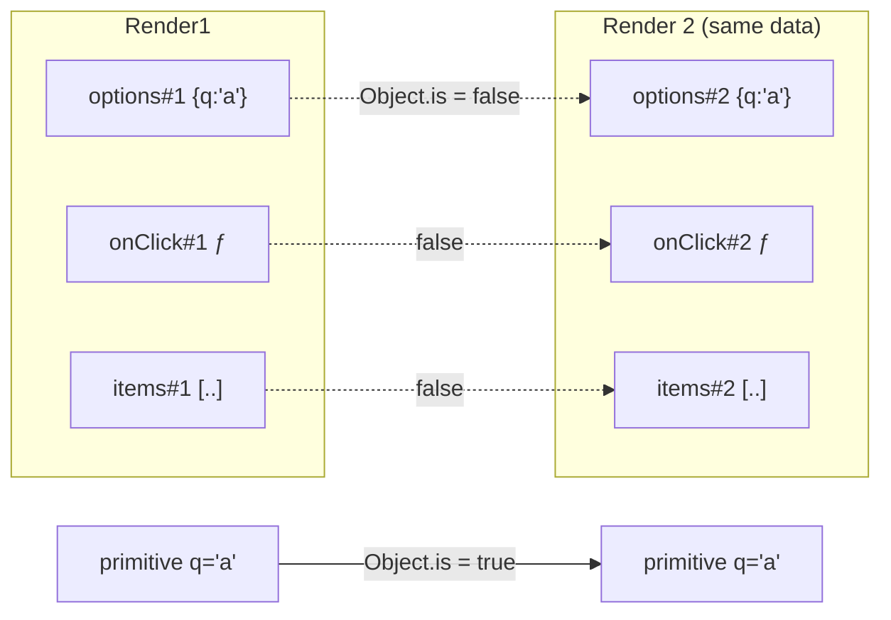
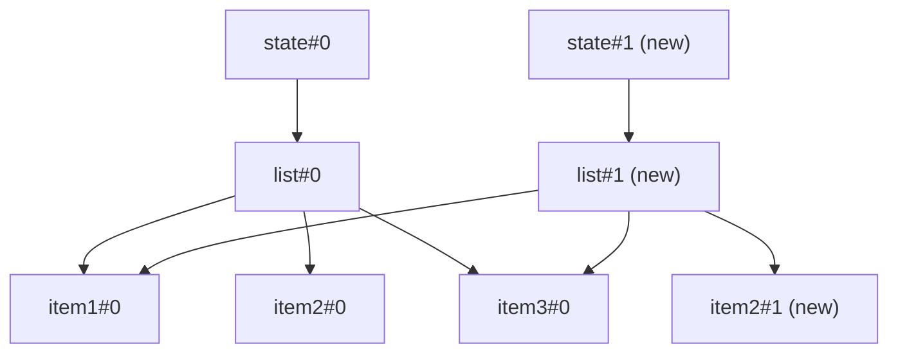

# 07 / 05 — Referential Equality: Making Identity Stable on Purpose

## 1. Lesson metadata

| | |
|---|---|
| **Level** | Intermediate–Advanced |
| **Study time** | 4–5 hours (reading 1.5 h, experiments 1.5 h, exercises 1.5 h) |
| **Prerequisites** | [04 — Memoization trade-offs](./04-memoization-trade-offs.md); [00 / 07 — Functions and referential identity](../00-web-and-javascript-foundations/07-functions-and-referential-identity.md); [00 / 08 — Objects, references, immutability](../00-web-and-javascript-foundations/08-objects-references-immutability.md) |
| **Next** | [06 — Context propagation cost](./06-context-propagation-cost.md) |
| **Related** | [03 / 05 — Effect dependencies and stale closures](../03-react-state-and-hooks/05-effect-dependencies-and-stale-closures.md), [03 / 20 — useSyncExternalStore and external stores](../03-react-state-and-hooks/20-usesyncexternalstore-and-external-stores.md) |

**Learning objectives.** After this lesson you can:
1. State the exact equality React uses in props comparison, hook dependencies, and state bail-out, and list its edge cases.
2. Enumerate the common sources of fresh identity on every render and choose the least costly fix for each.
3. Design data flow so unchanged data keeps its identity (structural sharing) while changed data does not.
4. Diagnose identity bugs: memo misses, effect loops, `useSyncExternalStore` snapshot warnings, selector re-renders.
5. Decide when *not* to stabilize identity (including why deep equality is usually the wrong tool).

**Concepts covered:** `Object.is`, reference vs value equality, shallow vs deep comparison, identity sources (literals, closures, array methods, default parameters, context values, selectors), structural sharing, immutable updates, ref callbacks and identity, stable selector results, hoisting constants, `useRef` for latest values.

---

## 2. Deep conceptual explanation

### 2.1 What problem is this lesson solving?

Lesson 04 showed that memoization works only if inputs are *equal*; lesson 03 showed that skipping renders depends on identity of elements and props. Equality in React is *reference* equality for non-primitives. Nearly every "memo doesn't work", "effect runs forever", and "selector re-renders everything" bug is an identity bug. This lesson gives you the vocabulary and the repair patterns, and shows where identity-stabilization is wasted effort.

### 2.2 `Object.is`: the equality React uses

React compares with `Object.is` (not `===`) in:

| Place | What is compared |
|---|---|
| `useState` / `useReducer` bail-out | New state vs current state |
| `useMemo` / `useCallback` / `useEffect` / `useLayoutEffect` deps | Each dep vs its previous value |
| `memo` default comparison | Each prop vs its previous value (shallow) |
| `useSyncExternalStore` | New snapshot vs previous snapshot |
| Context | Provider `value` vs previous `value` |

`Object.is(a, b)` differs from `===` only for: `Object.is(NaN, NaN) === true` (while `NaN === NaN` is false) and `Object.is(+0, -0) === false` (while `+0 === -0` is true). For objects, arrays, functions, Dates, Maps, and Sets, both mean "same reference".

| Value pair | `Object.is` | Consequence |
|---|---|---|
| `1, 1` / `"a","a"` / `true,true` | `true` | Primitives compare by value |
| `{}` , `{}` | `false` | Two object literals are different objects |
| `[1,2]`, `[1,2]` | `false` | Equal contents, different arrays |
| `() => {}`, `() => {}` | `false` | Two closures created in separate calls |
| `x, x` (same variable) | `true` | Same reference |
| `NaN, NaN` | `true` | No infinite re-render from NaN state |
| `0, -0` | `false` | Edge case when computing numbers |

**Shallow** comparison (used by `memo` on props) compares each top-level prop with `Object.is`; it does not look inside objects. **Deep** comparison walks the structure and compares values. React does not do deep comparison for you anywhere.

### 2.3 Where fresh identity comes from (the catalog)

Every render of a component function creates a new scope, so anything *created inside the component body* has a new identity per render, unless memoized or derived from stable inputs.

| # | Source | Example | Fix |
|---|---|---|---|
| 1 | Object/array literal | `style={{ margin: 4 }}`, `options={[1,2]}` | Hoist to module scope; or `useMemo` if it depends on props/state; or pass primitives |
| 2 | Inline function | `onClick={() => select(id)}`, `onChange={e => ...}` | `useCallback`, or pass `id` and let child call `onSelect(id)`; or hoist if no closure |
| 3 | Array method result | `items.filter(...)`, `.map(...)`, `.sort()` (mutates!), `[...a, b]` | `useMemo` with proper deps, or compute upstream (selector/query) |
| 4 | Default parameter / default prop value | `function C({ tags = [] })` | Hoist `const EMPTY: readonly string[] = []` |
| 5 | Object spread / merge | `{...base, x}` as prop | `useMemo`; or pass `base` and `x` separately |
| 6 | Context value object | `<Ctx.Provider value={{ user, setUser }}>` | `useMemo` the value; or split contexts ([06](./06-context-propagation-cost.md)) |
| 7 | Derived values from `Date`, `Math.random`, `crypto.randomUUID()` | `key={Math.random()}`, `new Date()` in render | Derive from state/stable inputs; avoid random keys |
| 8 | Store selectors returning new objects | `useStore(s => ({ a: s.a, b: s.b }))` | Select primitives separately, or use a shallow-equal wrapper provided by the library |
| 9 | Inline ref callbacks | `ref={(el) => { … }}` | `useCallback` ref callback; or `useRef`. React 19 detail below |
| 10 | Components defined in render | `const Row = () => …` inside a component | Module scope |
| 11 | JSX elements | `<Child />` as a prop (`icon={<Icon />}`, `children`) | Hoist constant JSX, or restructure so the element is created above the re-rendering component ([03](./03-why-components-rerender.md)) |
| 12 | Query/Network results | Parsing JSON anew on every refetch | Use a data layer with structural sharing (e.g., TanStack Query's `structuralSharing` default) default `true` |

### 2.4 Stable identity is a *contract with consumers*

A reference is "stable" if it changes **only when its meaning changes**. For memo/dep consumers the contract is: *new identity ⟺ new content*. It is violated in two directions:

- **False changes**: identity changes though content is the same (unstable inline props, new arrays from `.filter` with same content). Result: wasted renders and effect re-runs.
- **False sameness**: identity stays though content changed (in-place mutation, `push`, `sort()` on state array). Result: stale UI, memo hits that should be misses, effects that never rerun.

Performance work usually fixes false changes. Correctness work (immutability) prevents false sameness. Both are needed. A deep comparison "fixes" false changes by ignoring identity but costs O(size) at every comparison, and cannot repair false sameness.

### 2.5 Structural sharing

When data updates immutably, unchanged branches should keep their old references:

```ts
const next = { ...state, items: state.items.map(i => i.id === id ? { ...i, done: true } : i) };
// next !== state, next.items !== state.items, but every item except one is the same reference.
```

Libraries implement this systematically: Immer (used by Redux Toolkit) produces new references only along changed paths; TanStack Query applies structural sharing to query results so a refetch with identical data returns the same reference and with partially changed data returns shared sub-trees. Structural sharing is what makes `memo(Row)` hit for all unchanged rows after a refetch. TanStack Query's `structuralSharing` defaults to on (per its Important Defaults docs).

### 2.6 Misconceptions

| Misconception | Reality |
|---|---|
| "If the contents are the same, React treats them as equal." | Only primitives compare by contents. Objects, arrays, functions compare by reference. |
| "`useMemo` the object once and it's stable forever." | It's stable *while deps are equal*. A dep that changes each render rebuilds it each render. |
| "Deep equality is the safe fix." | It's O(n) per check, runs on every render, can hide bugs (mutation), and doesn't help `Object.is`-based hooks anyway. |
| "`useRef` is just for DOM nodes." | A ref gives stable identity for a mutable box; commonly used to hold the latest callback/value without changing effect deps. |
| "Stabilizing everything is good hygiene." | Each stabilization costs reading effort and deps risk. Do it where a consumer compares identity and the measurement says it matters. |

---

## 3. Internal mechanics

### 3.1 Dependency comparison

For hooks with deps, React stores the previous deps array on the hook's memoized state and, on the next render, runs `areHookInputsEqual`-style logic: same length (React warns in development if length changes between renders) and `Object.is` for each pair. If any pair differs, the hook's function runs (effects) or recomputes (memo). *Conceptually*; do not rely on internal names.

Public guarantee: dependencies are compared with `Object.is`; the deps array's length must remain constant. Teaching model: "deps array is a tiny cache key". Implementation detail: the storage layout and development warnings.

### 3.2 Props shallow comparison

`memo`'s default comparison iterates the keys of prev/next props objects; it is O(number of props). If the *number* of keys differs, or any value differs by `Object.is`, props are "not equal".

### 3.3 `useSyncExternalStore` snapshot rule

`getSnapshot` must return a cached/immutable value: calling it twice without store change must return `Object.is`-equal results. If you return a new object each call (`() => ({ a: store.a })`), React sees a change every time and (in development) warns that `getSnapshot` should be cached; in some situations it can cause repeated re-rendering. Libraries built on it (Redux `useSelector`, Zustand hooks) require selectors that return stable results for unchanged state, or an equality function / shallow wrapper. Zustand 5 note: selectors returning a new object/array each call can cause infinite re-render loops; use `useShallow` (from `zustand/react/shallow`) or select primitives; `useShallow` import path confirmed in the installed zustand 5 package.

### 3.4 Ref callbacks in React 19

Verified by an executed test (React 19.3). In React 19, ref callbacks may return a cleanup function. When the ref callback *identity* changes between renders (as with an inline arrow), React treats it as a new ref: it runs the previous callback's cleanup (or calls the old one with `null` if no cleanup is returned) and calls the new callback with the node, on each commit where the identity changed. An inline ref callback therefore re-attaches on every render. This is usually harmless, but if the callback sets state or subscribes (e.g., `ResizeObserver`), it can cause loops or churn. Fix: `useCallback` for the ref callback, or `useEffect` with a ref object.

---

## 4. Step-by-step execution walkthrough: an infinite effect loop from unstable identity

```tsx
function Results({ query }: { query: string }) {
  const [rows, setRows] = useState<Row[]>([]);
  const options = { q: query, limit: 20 }; // new object every render

  useEffect(() => {
    fetchRows(options).then(setRows);
  }, [options]);

  return <List rows={rows} />;
}
```

Timeline:
1. **Render 1:** `options#1` created. Effect runs after commit (dep `options#1` is new relative to "nothing").
2. Fetch resolves; `setRows(newArray)` → state changes (new array identity).
3. **Render 2:** component re-renders for state change. `options#2` is a *new object*; `Object.is(options#1, options#2)` is false → effect re-runs → fetch again.
4. Fetch resolves → `setRows(anotherNewArray)` (fresh parse; new identity even if equal content) → Render 3 → effect again…

Result: an infinite fetch loop (rate-limited only by network latency), even though `query` never changed. The user sees flicker or high network usage.

**Predict:** if `fetchRows` returned a cached identical array and `setRows` bailed out due to `Object.is` equality, would the loop stop? *Answer:* the loop would stop after the first redundant fetch because state would not change and there would be no render 3. This is why caching/structural sharing at the data layer matters (but the effect should not depend on the unstable `options` either).

**Fix:** depend on primitives: `useEffect(() => { fetchRows({ q: query, limit: 20 }).then(setRows) }, [query])`. (Also handle cancellation/race conditions; prefer a data library, see Phase 6.)

---

## 5. Code examples

### 5.1 Minimal example — what `Object.is` says

```ts
console.log(Object.is(1, 1));               // true
console.log(Object.is({}, {}));             // false
console.log(Object.is(NaN, NaN));           // true
console.log(Object.is(0, -0));              // false
const a = { x: 1 };
const b = a;
console.log(Object.is(a, b));               // true
console.log(Object.is([...[1, 2]], [1, 2])); // false
```

Predict each line before reading the comment. Notice the last: spread creates a new array even though contents match.

### 5.2 Practical example — hoist, derive, and pass primitives

```tsx
import { memo, useMemo } from "react";

interface Point { x: number; y: number }
interface ChartProps {
  readonly points: readonly Point[];
  readonly smooth: boolean;
  readonly margin: Readonly<{ top: number; bottom: number }>;
}

const Chart = memo(function Chart({ points, smooth, margin }: ChartProps) {
  /* expensive rendering */
  return <svg data-points={points.length} data-smooth={smooth} data-margin={margin.top} />;
});

// 1. Constants hoisted: identity never changes
const DEFAULT_MARGIN = { top: 8, bottom: 8 } as const;
const NO_POINTS: readonly Point[] = [];

export function Panel({ raw, compact, smooth }: { raw?: readonly Point[]; compact: boolean; smooth: boolean }) {
  // 2. Derived value: recomputed only when inputs change
  const points = useMemo(
    () => (raw ?? NO_POINTS).filter((p) => p.y >= 0),
    [raw],
  );

  // 3. Value depending on a prop: memoized by that prop
  const margin = useMemo(() => (compact ? { top: 2, bottom: 2 } : DEFAULT_MARGIN), [compact]);

  return <Chart points={points} smooth={smooth} margin={margin} />;
}
```

Line notes:
- `raw ?? NO_POINTS` uses a hoisted empty array instead of `= []` default (a default-parameter `[]` is a *new array each render*, which would make `useMemo`'s dep unstable when `raw` is undefined).
- `margin` depends on `compact`; each branch yields a stable object. The `{ top: 2, bottom: 2 }` literal inside the memo callback is created only when `compact` changes.
- Better still, if `compact` were the only variation, hoist two constants and select between them without `useMemo`.
- `smooth` is a boolean primitive: stable by value.
- **Predict:** when `Panel` re-renders from an unrelated parent update with the same `raw`, `compact`, `smooth`, does `Chart` render? *Answer:* no. `points` memoized, `margin` memoized or constant, `smooth` primitive.

### 5.3 Incorrect example — three identity traps

```tsx
// ❌ Trap 1: default prop creates a new array each render
function TagList({ tags = [] }: { tags?: string[] }) {
  const sorted = useMemo(() => [...tags].sort(), [tags]); // recomputes every render when tags undefined
  return <ul>{sorted.map((t) => <li key={t}>{t}</li>)}</ul>;
}

// ❌ Trap 2: selector returns a fresh object
const { a, b } = useStore((s) => ({ a: s.a, b: s.b })); // new object each call

// ❌ Trap 3: mutation keeps identity
function addTodo(todos: Todo[], t: Todo) {
  todos.push(t);                 // mutate
  setTodos(todos);               // same reference: React bails out, no re-render!
}
```

**Predict.** Trap 1: `tags` is a new `[]` on every render when the prop is missing → `useMemo` recomputes each time (harmless here but defeats the point; with memoized consumers it cascades). Trap 2: re-renders on every store change, even unrelated slices; in some store/React combos it can loop. Trap 3: React compares `Object.is(next, current)` → same reference → bails out; the UI doesn't update; the data *did* change, so later unrelated renders reveal the "ghost" state (confusing bug).

### 5.4 Corrected implementation

```tsx
// ✅ Trap 1
const NO_TAGS: readonly string[] = [];
function TagList({ tags = NO_TAGS }: { tags?: readonly string[] }) {
  const sorted = useMemo(() => [...tags].sort(), [tags]);
  return <ul>{sorted.map((t) => <li key={t}>{t}</li>)}</ul>;
}

// ✅ Trap 2: primitives (Zustand-style API)
const a = useStore((s) => s.a);
const b = useStore((s) => s.b);
// or, when you truly need an object selection, use the library's shallow helper:
// import { useShallow } from "zustand/react/shallow";
// const { a, b } = useStore(useShallow((s) => ({ a: s.a, b: s.b })));

// ✅ Trap 3: immutable update
setTodos((prev) => [...prev, t]);
```

Why each works: the hoisted constant keeps one reference; separate primitive selectors compare by value; and a new array reference tells React the state changed. Also note `[...tags].sort()` copies before sorting (`sort()` mutates in place), important because mutating a prop array would break upstream identity.

### 5.5 Advanced example — a stable callback with "latest value" semantic (ref pattern)

When a callback must keep stable identity *and* see fresh props/state, store the latest function in a ref:

```tsx
import { useCallback, useLayoutEffect, useRef } from "react";

export function useStableCallback<Args extends unknown[], R>(
  fn: (...args: Args) => R,
): (...args: Args) => R {
  const ref = useRef(fn);
  useLayoutEffect(() => {
    ref.current = fn;
  });
  return useCallback((...args: Args) => ref.current(...args), []);
}

// usage
function Search({ onResults }: { onResults: (rows: Row[]) => void }) {
  const [q, setQ] = useState("");
  const stableOnResults = useStableCallback(onResults); // identity never changes

  useEffect(() => {
    const controller = new AbortController();
    fetchRows(q, controller.signal).then(stableOnResults).catch(() => {});
    return () => controller.abort();
  }, [q, stableOnResults]); // effect re-runs only when q changes

  return <input value={q} onChange={(e) => setQ(e.target.value)} />;
}
```

Notes and cautions:
- The returned function has constant identity, so effects and memo children depending on it never re-run because of it.
- It reads `ref.current` at *call* time, so it always invokes the latest `fn` (no stale closure).
- Trade-offs: the callback must not be called *during render* (the ref may be stale until the layout effect); this pattern bypasses React's data flow, so reasoning about what the effect "depends on" becomes implicit. It's the pattern behind `useEffectEvent`, which became a stable built-in in React 19.2 (see react.dev's `useEffectEvent` reference; it is only valid for functions called from Effects and must not be put in dependency arrays).
- `useLayoutEffect` on the server issues a warning in older React versions for SSR; verify behavior for your React version or use an isomorphic variant. Lesson [03 / 08](../03-react-state-and-hooks/08-uselayouteffect.md).

---

## 6. Visual explanations

### 6.1 One render, three identities



### 6.2 Structural sharing after one update



`item1` and `item3` keep their old references → `memo(Row)` hits for them; only `item2` re-renders.

---

## 7. Alternative approaches and trade-offs

| Approach | What it stabilizes | Cost | Risk | Best when |
|---|---|---|---|---|
| **Hoist constants** | Identity of static values | None at runtime | None | Value doesn't depend on props/state |
| **Pass primitives / ids** | Avoids needing identity at all | Slightly more prop plumbing | Low | Child needs only a few scalar fields |
| **`useMemo` / `useCallback`** | Identity per deps | Hook + deps | Stale values if deps wrong | Value depends on props/state; consumer compares identity |
| **Structural sharing in data layer** | Identity of unchanged sub-trees | Library/convention | Mutation bugs break it | Rows/entities from server or reducers |
| **Normalization (byId + ids)** | Per-entity identity | Modeling cost | Complexity | Large collections, partial updates |
| **Ref-based latest callback** | Callback identity with fresh behavior | Indirection | Hidden coupling; stale if called in render | Effect deps churn due to callback props |
| **Custom shallow/deep comparator** | "Equality by value" | O(size) per check | Stale UI; hidden cost | Rare, small, immutable structures |
| **Selector libraries (`createSelector`, `useShallow`)** | Derived values and selected objects | Dependency | Selector misuse | Redux/Zustand derived state |
| **Immutable data libs (Immer)** | Safe immutable updates with sharing | Dependency, proxy cost | Learning curve | Complex nested updates |

**Scenario where stabilizing identity is *not* the best approach:** a non-memoized child that renders in 0.1 ms; stabilizing its props adds hooks without effect. Another: data that changes on every update by nature (live ticks); identity changes are correct, and the fix is to reduce how much depends on them.

**Why deep equality is usually a bad answer:** consider `memo(Chart, deepEqual)` with 10,000 points: each parent render costs O(10,000) comparisons; if the parent renders at 60 Hz that's 600k comparisons per second just to *decide* to skip. Versus structural sharing: O(1) per comparison. Deep equality can still be appropriate for small configs (a handful of keys) or in an effect dependency where you have a tiny serializable object, but prefer destructuring into primitives.

---

## 8. Best practices and anti-patterns

### 8.1 Best practices
1. **Treat props as a cache key**: prefer primitives and stable references.
2. **Hoist what is static** (constants, empty arrays, style objects, config objects) to module scope.
3. **Update immutably**; keep unchanged branches intact (spread selectively, Immer, normalized state).
4. **Compute derived data in one place** (selectors, query `select`, or a `useMemo`), not at each consumer.
5. **Depend on primitives in effects** when possible: `[query, page]` rather than `[params]`.
6. **Verify with tooling**: lint rule `react-hooks/exhaustive-deps`, Profiler reasons, and diagnostic hooks.
7. **Document identity contracts** in component APIs (e.g., "`options` should be memoized").

### 8.2 Beginner mistakes
- Using `[]` or `{}` default props.
- Sorting state in place (`state.sort()`), which both mutates and keeps identity.
- Disabling the exhaustive-deps lint rule to stop an effect loop.

### 8.3 Experienced-developer mistakes
- JSON.stringify in dependency arrays or comparators ("deep equal by serialization"): slow, order-sensitive, drops functions/`undefined`/`Map`, and still O(size).
- Introducing deep-equal hooks (`useDeepCompareEffect`) as a default, hiding unstable identity instead of removing it.
- Assuming a library returns stable references without checking (selectors, query `select`, form libraries' values).
- Stabilizing the callback but not its *arguments* (e.g., creating the `filter` object per call).

### 8.4 Smells
- Components with many `useMemo`s whose only purpose is to feed other `useMemo`s ("memo chains").
- Effects that depend on objects or arrays created in the same component.
- `// eslint-disable-next-line react-hooks/exhaustive-deps` on effects.

### 8.5 Justified exceptions
- A tiny config object (2–3 primitive fields) used in an effect: serialize or destructure into primitives; a deep compare of this size is cheap.
- Library code that cannot require consumers to memoize options may keep a ref with the latest options and compare shallowly internally; document it.
- If the React Compiler is enabled, many inline-object/callback patterns are stabilized automatically in compiled components; keep writing pure code and verify. Volatile: confirm compiler behavior for your React version.

---

## 9. Real-world application

**E-commerce catalog (server state).** Product lists come from TanStack Query. With structural sharing enabled (the default in TanStack Query v5), a background refetch that returns identical data produces no re-render; a refetch where 3 of 1,000 products changed re-renders only those rows if rows are memoized and receive the product objects directly. Constraint: if you map products through a transformer in the component (`products.map(toViewModel)`), you create new objects every render and negate sharing. Do the transformation in the query's `select` (which is also memoized by identity of function and data; stabilize `select` or hoist it), or memoize per product.

**Dashboard with filters in the URL.** `useSearchParams` returns a new object per render; passing it directly to effects causes refetch loops. Derive primitives (`const range = params.get("range")`) and depend on those.

**Finance forms.** Form libraries expose `values` objects. Passing `values` to a memoized child triggers misses on every keystroke. Pass the specific field value or use the library's field-level subscription.

**Realtime collaboration.** Presence updates replace an object each tick; split into per-user stores so a single user's update changes only their entry's identity.

Engineering constraints: team knowledge (immutable conventions), library defaults, TypeScript `readonly` annotations to discourage mutation, and test strategies (equality assertions on selectors: `expect(select(state)).toBe(select(state))`).

---

## 10. Debugging and troubleshooting

### Symptom: "Effect runs on every render / infinite loop."
1. Log deps identity: `useDepDiff("effect", [a, b, c])` ([04](./04-memoization-trade-offs.md) C2).
2. Find which dep is created in the render body or comes from a hook returning new identity.
3. Fix by hoisting, memoizing, destructuring into primitives, or using the ref-latest pattern. Do not silence the lint rule.

### Symptom: "`memo` shows 'Props changed: X'."
- Check how X is created: inline literal? `.map` result? default prop? context-derived? Use the Profiler's component details to see its type; compare previous/next with the diagnostic hook.

### Symptom: "`getSnapshot` should be cached" warning (or infinite loop with an external store).
- Snapshot function returns new object each call. Cache the snapshot in the store (compute on change, not on read), or select primitive fields.

### Symptom: "UI doesn't update after state change."
- Mutation. Search for `.push`, `.splice`, `.sort`, `.reverse`, direct property assignment on state. Fix with immutable updates; in dev, freeze data or use `readonly` types/Immer.

### Symptom: "Selector re-renders every component on any store change."
- Selector returns new objects or runs `filter/map`. Use memoized selectors (`createSelector`) or `useShallow`; ensure result is stable when inputs are unchanged.

### Validating a fix
Re-record: the component is grey when unrelated state changes, effects run once per real input change (count calls), and tests assert stability (`expect(a).toBe(b)` for memoized selectors).

---

## 11. Exercises

### Level A — Knowledge
A1. Which equality does React use for state bail-out, deps, and `memo`? Name two differences from `===`.
A2. List five sources of a new object identity per render.
A3. What does "structural sharing" mean and what does it buy `memo`?
A4. Why does React warn if the deps array length changes?

### Level B — Code comprehension
B1. Predict the logs (production, no StrictMode):
```tsx
function C({ id }: { id: number }) {
  const a = useMemo(() => ({ id }), [id]);
  const b = { id };
  const prevA = useRef(a); const prevB = useRef(b);
  console.log(Object.is(prevA.current, a), Object.is(prevB.current, b));
  prevA.current = a; prevB.current = b;
  return null;
}
// render <C id={1} /> then re-render with <C id={1} /> again
```
B2. Why does `useState([])` followed by `setItems(items.sort())` often not re-render?
B3. Explain why `useCallback(() => save(draft), [draft])` passed to `memo(Button)` re-renders `Button` on each keystroke.

### Level C — Implementation
C1. Write `useShallowStable<T extends object>(value: T): T` that returns the previous reference if `value` is shallow-equal to the previous one. Discuss when it's appropriate.
C2. Rewrite an effect depending on an `options` object so that it depends only on primitives. Show before/after and a test that counts effect runs.

### Level D — Debugging
D1. A Zustand component `const { user, theme } = useStore(s => ({ user: s.user, theme: s.theme }))` re-renders on every store update and sometimes loops. Explain and fix in two ways.
D2. `memo(Row)` receives `product` from `products.map(toViewModel)` in the parent. The Profiler says "Props changed: product" for all rows after a refetch with identical data. Explain and propose two fixes with trade-offs.

### Level E — Architecture and engineering decisions
E1. Decide on an immutability strategy (conventions, TypeScript `readonly`, Immer, freezing in dev) for a 40-developer codebase, with enforcement mechanisms.
E2. Evaluate adopting `useDeepCompareEffect`-style hooks across the code base.

### Level F — Expert challenge
F1. Design a `useQuerySlice(selector, equalityFn)` hook on top of `useSyncExternalStore` that avoids returning new snapshots when the selected slice is equal. Explain how you keep `getSnapshot` stable, avoid tearing, and handle selector identity changes.

---

## 12. Detailed answers and explanations

> Attempt the exercises first.

**A1.** `Object.is`. Differences from `===`: `Object.is(NaN, NaN)` is true; `Object.is(+0, -0)` is false. All non-primitive comparisons are by reference. Wrong answer: "deep equality for props."

**A2.** Object literal, array literal, inline arrow function, `.map/.filter/.slice/[...x]` results, default parameter `= []/{}`, context value object, selector returning object, JSX element passed as prop, spread merges, new Date/Map/Set. (Any five.)

**A3.** Updates reuse unchanged branches of old data and create new references only along changed paths. `memo(Row)` then sees identical `product` references for unchanged products and skips them. Without sharing, any update creates all-new objects and all rows re-render.

**A4.** Because deps are positional: if length changes, React cannot compare slot-by-slot meaningfully. It indicates conditional dependency construction, which usually signals a bug. The warning is development-time.

**B1.** First render: both refs initialized with current values → logs `true true`. Second render (same `id`): `a` is memoized → same reference → `true`; `b` is a new object → `false`. So logs: `true true` then `true false`. Wrong answer: both `true` (forgetting the new object literal per render).

**B2.** `items.sort()` sorts in place and returns the *same array reference*; `setItems(sameRef)` → `Object.is` equal → bail-out. Even though contents changed order, React won't re-render (later renders may show it). Fix: `setItems([...items].sort())` or `items.toSorted()` where available (ES2023; verify target support).

**B3.** `useCallback` with `[draft]` creates a new function whenever `draft` changes, which is every keystroke. `Button`'s prop changes → memo misses. The callback legitimately closes over `draft`. To avoid it, use a ref-latest pattern (`useStableCallback`), pass `draft` into the handler at call time (e.g., read from a form), or make the button not depend on the changing draft by moving the save logic to a handler that reads draft from a ref. Trade-off: correctness vs identity stability.

**C1.**
```ts
import { useRef } from "react";

function shallowEqual(a: object, b: object): boolean {
  if (Object.is(a, b)) return true;
  const ak = Object.keys(a) as (keyof typeof a)[];
  const bk = Object.keys(b);
  if (ak.length !== bk.length) return false;
  return ak.every((k) => Object.prototype.hasOwnProperty.call(b, k) && Object.is(a[k], (b as typeof a)[k]));
}

export function useShallowStable<T extends object>(value: T): T {
  const ref = useRef(value);
  if (!shallowEqual(ref.current, value)) ref.current = value;
  return ref.current;
}
```
When appropriate: wrapping a small options object made of primitives before using it as an effect/memo dependency or memo prop. Caveats: writes a ref during render (a pattern React discourages but commonly used for "stable value" hooks; concurrent rendering may discard a render, so the ref could hold a value from an uncommitted render in rare cases), shallow only. Prefer destructuring primitives.

**C2.**
Before:
```tsx
const options = { q, page };
useEffect(() => { load(options); }, [options]);
```
After:
```tsx
useEffect(() => { load({ q, page }); }, [q, page]);
```
Test: render with a spy on `load`, re-render with the same `q`/`page` several times (via a state tick), assert `load` toHaveBeenCalledTimes(1); change `q`, assert 2. Edge: if `load` is itself a prop with changing identity, stabilize it (parent `useCallback`) or use the ref-latest pattern.

**D1.** The selector returns a new object on every call; the store hook compares selector results by `Object.is` (default), so it sees a change on any store notification and re-renders; with `useSyncExternalStore`-based implementations, an unstable snapshot may trigger loops/warnings. Fix 1: separate primitive selectors (`const user = useStore(s => s.user)`, `const theme = useStore(s => s.theme)`). Fix 2: wrap with the library's `useShallow` (Zustand) or provide an equality function (Redux's `useSelector(selector, shallowEqual)`). Trade-off: two subscriptions vs shallow comparison per notification. Verify API names in your library version.

**D2.** `toViewModel` creates new objects every render (and every refetch), so references differ though contents match. Fix 1: do the transform in the query layer (`select`) or a selector memoized per input so unchanged inputs yield same outputs (cache by product identity/`version`), trade-off: cache bookkeeping. Fix 2: pass the original `product` and compute view fields inside `Row` (cheap transforms), trade-off: transform repeated per render of Row, but only when Row renders. Also ensure the query layer's structural sharing preserves `product` identity across refetch.

**E1.** Evaluation criteria: addresses types (`readonly`, `ReadonlyArray`, `as const`), tooling (ESLint rules against mutating methods on state like `no-param-reassign` with props, or immutable-data plugins), libraries (Immer/Redux Toolkit for nested updates), dev-time freezing (`Object.freeze` deep in dev or Immer's auto-freeze), testing (tests asserting identity stability for selectors), education, and cost (Immer proxy overhead). Example answer: standardize on RTK/Immer for global state; spread updates for local state; `readonly` in shared types; code review checklist; dev-only freeze middleware; measure Immer overhead before adopting in hot paths.

**E2.** Evaluation criteria: acknowledges the convenience and the costs (hides unstable identity; O(size) compare on every render; incorrect with functions/Dates/cycles; can mask real bugs; teaches the wrong model), alternatives (primitives, hoisting, memo), and a restricted allowance (small config objects only, with documented size limits). Likely decision: do not adopt broadly; allow in an audited helper for tiny objects, and measure.

**F1.** Evaluation criteria: store holds immutable state and a version/subscribe; the hook keeps `selector` in a ref (or `useCallback` identity in deps), caches `lastState` and `lastSelection`; `getSnapshot` is: `const s = store.getState(); if (Object.is(s, lastState)) return lastSelection; const next = selector(s); if (equalityFn(lastSelection, next)) { lastState = s; return lastSelection; } lastState = s; lastSelection = next; return next;`. Tearing avoided by using `useSyncExternalStore` (it forces synchronous consistent reads); selector identity changes handled by recomputing when the selector changes (include it in the memo of the `getSnapshot` closure); server snapshot parameter for SSR. Edge cases: selector throws; equality function cost; stale selections after unsubscribed/unmounted. Real implementations: `useSyncExternalStoreWithSelector` from the `use-sync-external-store` shim package (verify), which does this. A top answer notes that writing it yourself is rarely warranted.

---

## 13. Senior engineer interview questions

**Q1. "Why does `[] === []` matter in React?"**
Because React compares props, state, and deps by reference; a new array each render looks like a change. It causes memo misses and effect re-runs. Reason: identity is how React cheaply detects change.

**Q2. "How would you fix a component that refetches on every render?"**
Find the unstable dependency (object/array/function created in render), replace with primitives or stable references, or use the ref-latest pattern for callbacks; consider a data library with caching. Reason: effect deps compare by `Object.is`.

**Q3. "Why not deep-compare props in `memo`?"**
Cost O(size) on every parent render, can freeze on large structures, hides mutation bugs, and incorrect for functions. Structural sharing gives O(1) comparisons. Reason: moving cost to the hot path.

**Q4. "What does immutability have to do with performance in React?"**
Immutable updates produce new references where data changed and reuse where unchanged, enabling cheap equality checks for `memo`, `useMemo`, selectors. Mutation breaks change detection (stale UI). Reason: reference equality is the change detector.

**Q5. "What's the problem with selectors that return new objects?"**
External store hooks compare selector results by identity; fresh objects always differ → re-render on every store notification, and possible loops. Reason: `Object.is` on results; use primitives or shallow equality helpers.

**Q6. "Inline ref callback in React 19: concern?"**
A new callback identity per render causes React to run cleanup/null and re-attach each commit; harmless for trivial refs but problematic for observers/state-setting. Reason: ref identity is part of the ref's contract. Verify version behavior.

---

## 14. Further learning resources

| Resource | URL | Covers / why | Level | Study |
|---|---|---|---|---|
| MDN — `Object.is()` | <https://developer.mozilla.org/en-US/docs/Web/JavaScript/Reference/Global_Objects/Object/is> | The equality used throughout React | Beginner | Whole page |
| MDN — Equality comparisons and sameness | <https://developer.mozilla.org/en-US/docs/Web/JavaScript/Equality_comparisons_and_sameness> | `==`, `===`, `Object.is` comparison | Beginner | Whole page |
| React docs — Updating Objects in State | <https://react.dev/learn/updating-objects-in-state> | Immutable updates, why mutation fails | Beginner | Whole page |
| React docs — Updating Arrays in State | <https://react.dev/learn/updating-arrays-in-state> | Immutable array updates | Beginner | Whole page |
| React docs — Removing Effect Dependencies | <https://react.dev/learn/removing-effect-dependencies> | Fixing unstable deps | Intermediate | "Do you want to read a value without reacting to it?" |
| React docs — `useSyncExternalStore` | <https://react.dev/reference/react/useSyncExternalStore> | Snapshot caching rules | Advanced | "Troubleshooting" |
| React docs — `useEffectEvent` | <https://react.dev/reference/react/useEffectEvent> | Built-in alternative to ref-latest pattern (stable since React 19.2) | Advanced | Whole page |
| Immer docs | <https://immerjs.github.io/immer/> | Structural sharing via drafts | Intermediate | Introduction |
| TanStack Query — Render optimizations | <https://tanstack.com/query/latest/docs/framework/react/guides/render-optimizations> | Structural sharing, `select` | Intermediate | Whole page |
| Zustand docs | <https://zustand.docs.pmnd.rs/> | `useShallow`, selector guidance | Intermediate | v5 migration/selectors |

URLs in this table were checked for HTTP 200 on 2026-10-22; any still marked *(unverified)* could not be checked automatically (blocked or unreachable). A 200 response does not guarantee the page content still matches the description; if a link has moved, search the site for the quoted title.

---

## 15. Knowledge checkpoint

**You should now understand**
- That React equality is `Object.is`, and non-primitives compare by reference.
- The catalog of fresh-identity sources and the fixes ranked by cost.
- Structural sharing and why mutation is both a correctness and a performance hazard.

**You should be able to explain without notes**
- Why a default `= []` prop can break `useMemo`.
- Why deep equality is not a good default.
- Why a selector returning an object causes re-renders.

**You should be able to implement**
- Hoisted constants, memoized derived values, primitive selectors, a ref-latest stable callback, and a shallow-stable hook.

**You should be able to debug**
- Effect loops and memo misses by diffing deps/props identity.

**Before moving on:** read [06 — Context propagation cost](./06-context-propagation-cost.md); context `value` identity is the same problem at provider scale.
