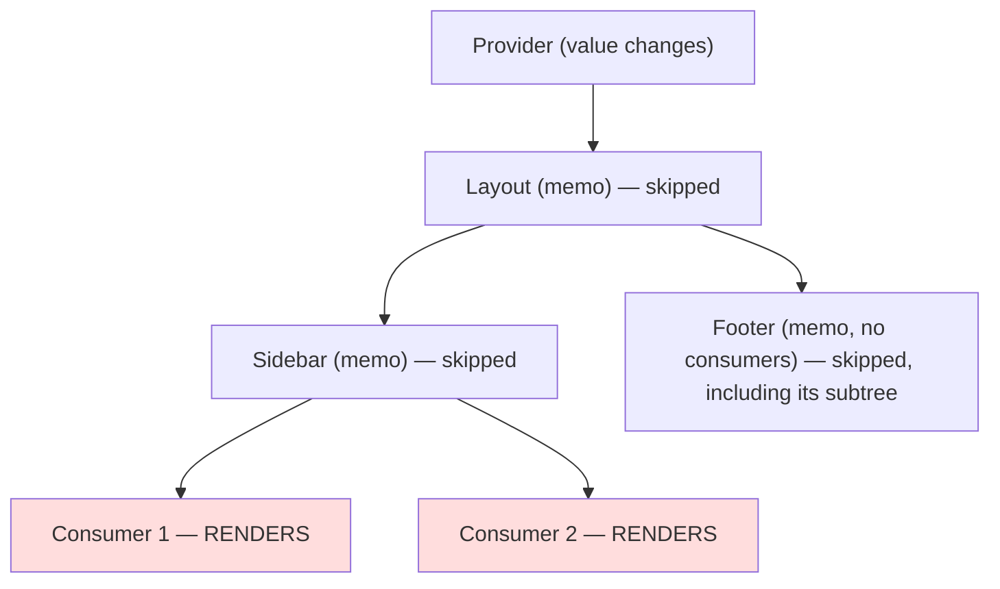
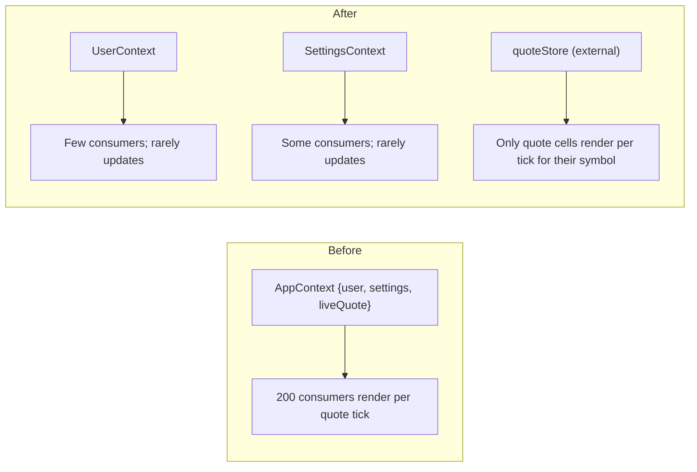
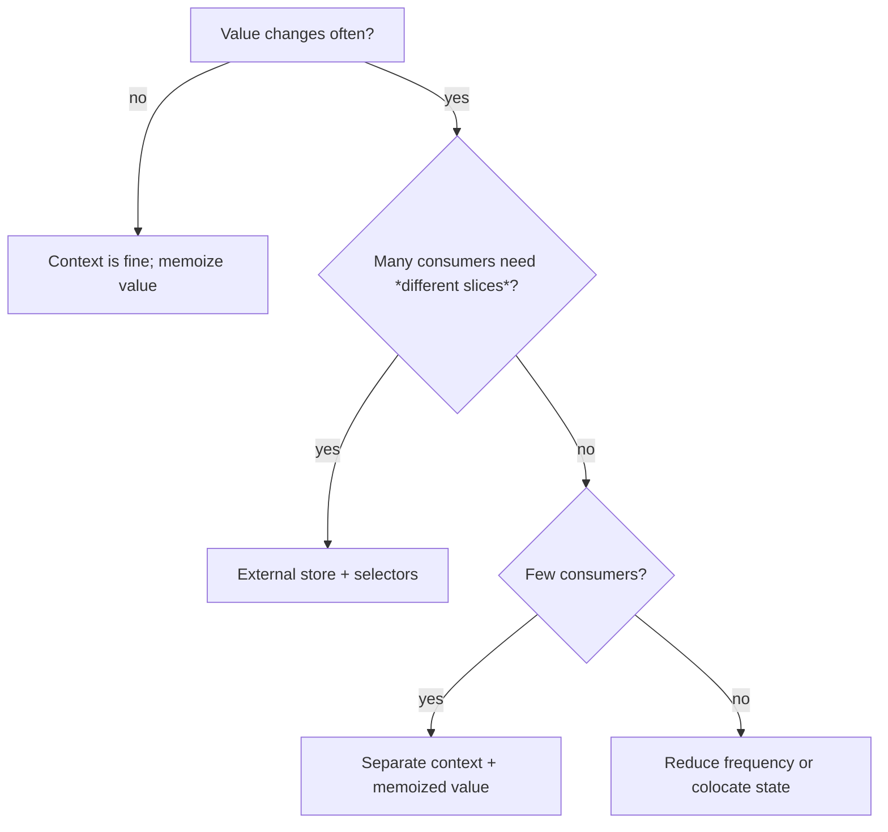

# 07 / 06 — Context Propagation Cost: Quantifying and Reducing Provider-Driven Renders

## 1. Lesson metadata

| | |
|---|---|
| **Level** | Advanced |
| **Study time** | 5 hours (reading 1.5 h, experiments 2 h, exercises 1.5 h) |
| **Prerequisites** | [05 — Referential equality](./05-referential-equality.md); [04 — Memoization trade-offs](./04-memoization-trade-offs.md); [03 / 13 — useContext and propagation](../03-react-state-and-hooks/13-usecontext-and-propagation.md); [03 / 14 — Context performance](../03-react-state-and-hooks/14-context-performance.md) |
| **Next** | [07 — State colocation for performance](./07-state-colocation-for-perf.md) |
| **Related** | [05 / 08 — Provider pattern](../05-design-patterns/08-provider-pattern.md), [03 / 20 — useSyncExternalStore and external stores](../03-react-state-and-hooks/20-usesyncexternalstore-and-external-stores.md) |

**Learning objectives.** After this lesson you can:
1. Model the cost of a context update as (number of consumers that re-render) × (cost of each consumer's subtree), and measure it.
2. Explain why `memo` cannot stop a consumer from re-rendering on a context change, and which structural techniques can.
3. Apply and compare five mitigations: memoized value, split by update frequency, split by domain, consumer-side memoized child, and external store with selectors.
4. Recognize when context is *fine* (low-frequency, few consumers) and when it is the wrong tool.
5. Design a measurement experiment that quantifies renders per update for each variant.

**Concepts covered:** provider value identity, consumer re-render, `memo` bypass, state/dispatch split, value memoization, context splitting, the "children of provider" stability, consumer-side selector via memoized child, `use(Context)`, external stores and selectors, propagation cost model, measuring context renders in Profiler.

> This lesson does not re-teach context basics or the Phase 3 patterns; it quantifies their cost and decides between them with measurement.

---

## 2. Deep conceptual explanation

### 2.1 What problem is this lesson solving?

Context is React's built-in way to avoid prop drilling. It is also the most common cause of "everything re-renders when I type" in applications that used a single `AppContext` holding user, theme, settings, and some ever-changing state. The mechanism is easy to state and easy to underestimate:

> **When a Provider's `value` changes (by `Object.is`), every component that reads that context re-renders, regardless of which part of the value it uses and regardless of any `memo` between it and the provider.**

Cost, therefore, scales with the number of consumers and the cost of their subtrees. You cannot "select" a field from context the way you can with a store selector. Understanding what to measure and which fixes reduce which term of the cost is the goal of this lesson.

### 2.2 The propagation model

Conceptually, when a provider re-renders with a new `value`:

1. React compares the new `value` to the previous one with `Object.is`.
2. If equal, nothing happens for consumers (they may still render if their parent renders for other reasons).
3. If different, React finds all consumers of that context within the provider's subtree and schedules them to re-render, *even if intermediate components bail out*. Intermediate memoized components are skipped for their own render but the path to the consumers is still traversed.

That second point is why `memo` doesn't protect consumers: context propagation is *not* props flow. It is a separate channel.

**Teaching model**, not implementation: React marks consumers as having pending work by walking the subtree below the provider. **Implementation detail**: the walk uses dependency lists attached to fibers; its cost is proportional to the subtree size (work to *find* consumers) plus the cost of rendering consumers. Names and details are version-specific; verify in the source if you need precision. The key consequence for performance: even if all consumers are skipped by an optimization (none exist), a provider above a huge tree incurs a traversal; in practice the render cost of consumers dominates.

### 2.3 Cost model

For an update to context `C`:

```
Cost(update) = Walk(subtree)  +  Σ over consumers k of [ Render(k) + Render(subtree not bailed out below k) ]
```

Reduction strategies attack different terms:

| Strategy | Attacks |
|---|---|
| Memoize provider value | Eliminates *spurious* updates (identity change with same content) |
| Split by update frequency | Reduces *who consumes the frequently changing value* |
| Split by domain | Reduces the *number of consumers per context* |
| Consumer-side memoized child | Reduces `Render(subtree below k)` by making the consumer a thin shell |
| External store with selectors | Reduces consumers to those whose *selected slice* changed |
| Lower the update frequency (debounce, batching, transitions) | Reduces the *number of updates* |
| Move state out of context entirely (colocation) | Removes the term |

### 2.4 When context is perfectly fine

- Values that change rarely: current user, locale, theme, feature flags, router location (if consumed by few components).
- Few consumers.
- Consumers that are cheap or sit near leaves.
- Configuration/DI containers whose identity never changes after mount (e.g., an API client). These cost nothing at update time because no updates happen.

Context is risky for: high-frequency state (mouse position, drag, typing, streaming ticks), large derived objects, and "global store" usage where hundreds of components subscribe to one object.

### 2.5 Misconceptions

| Misconception | Reality |
|---|---|
| "`memo` on the consumer protects it from context changes." | `memo` compares props; context is a different channel and always triggers a re-render of consumers when the value changes. |
| "If I only read `ctx.theme`, I won't re-render when `ctx.user` changes." | `useContext` returns the whole value; re-render is triggered by value identity change. |
| "Wrapping the provider value in `useMemo` fixes performance." | It fixes *spurious* identity changes only. If the content truly changes often, consumers still re-render. |
| "Context is a state management library." | It transports a value down the tree. State management concerns (updates, selectors, batching) are yours to design. |
| "Splitting context into many providers is always better." | It reduces coupling of updates but increases provider nesting and API surface; do it along real update-frequency boundaries. |
| "Only components that call `useContext` re-render." | Correct for propagation *itself*; but their children also re-render (unless memoized/bailed out), so the *subtree* cost matters. |

---

## 3. Internal mechanics

### 3.1 Public guarantees

- A component that reads a context re-renders when the nearest matching provider's `value` changes by `Object.is`. (Documented in the `useContext` reference.)
- React docs note that changes are detected by `Object.is` and warn that passing a new object literal as the value on each render causes consumers to re-render.
- `use(Context)` (React 19) reads a context like `useContext` and, unlike hooks, can be called conditionally; its re-render semantic is the same. (confirmed on react.dev's `use` reference: `use(Context)` can be read inside an `if`.)
- A component with no consumers beneath a provider isn't affected by the provider's value change.

### 3.2 Teaching model

Think of each provider as a *broadcast channel with a comparator*. Each consumer is a subscriber that re-renders on any broadcast whose value is not identical to the last one. There are no partial subscriptions.

### 3.3 Implementation detail (verify in source)

React stores a list of contexts read by each fiber during render ("dependencies"). When a provider's value changes, it scans its subtree for fibers whose dependency list includes that context and schedules work on them; it can skip subtrees that have no such fibers and no other pending work. So the expensive part is typically rendering consumers and their un-memoized descendants, not the scan. Do not claim exact function names or complexity guarantees; read `packages/react-reconciler` if you need exactness.

### 3.4 Provider re-render vs consumer re-render

Two different phenomena often conflated:

1. **The provider component re-renders** (because its parent rendered or its own state changed). Its *children* re-render only if they are new elements (not the same `children` reference). If `value` is identical, consumers don't re-render for context reasons.
2. **The value changes**. Consumers re-render.

Therefore a provider that owns state and receives `children` from above is efficient: when its state changes, `children` is the same element reference (bail-out for non-consumers), only consumers re-render.

```tsx
function CounterProvider({ children }: { children: React.ReactNode }) {
  const [n, setN] = useState(0);
  const value = useMemo(() => ({ n, setN }), [n]);
  return <CounterContext value={value}>{children}</CounterContext>;
}
```

(In React 19, `<Context value=…>` can be rendered directly as the provider; `<Context.Provider>` remains supported. react.dev calls `Context.Provider` "a legacy way to provide the context value before React 19".)

---

## 4. Step-by-step execution walkthrough: a ticking context with 200 consumers

Setup: an app has `AppContext` with `{ user, theme, clock }`, where `clock` is a `Date` updated every 100 ms for a status bar. 200 components read `useContext(AppContext)` (most for `theme`).

Timeline of one tick:
1. `setInterval` callback calls `setClock(new Date())` in `AppProvider`. (Update scheduled; batched with others in the same tick.)
2. **Render phase:** `AppProvider` renders. It creates `value = { user, theme, clock }` — a new object (even if memoized by `[user, theme, clock]`, `clock` changed) → `Object.is` false.
3. React propagates: all 200 consumers are marked for re-render. Memoized wrappers between are not re-rendered themselves, but consumers below them are.
4. Each consumer renders; if they render subtrees (non-memoized children), those render too. Suppose average consumer subtree costs 0.15 ms: 200 × 0.15 = 30 ms *per tick* (illustrative). At 10 ticks/s that's 300 ms of main-thread work per second (30% CPU) for a feature that changes one `<span>`.
5. **Commit:** one DOM change (the clock text). All other renders produced identical output.
6. Browser paints; the pattern repeats.

**Predict:** if `clock` is moved to a separate `ClockContext` consumed only by `StatusBar`, what is the per-tick cost? *Answer:* one consumer (`StatusBar`) re-renders: ~0.15 ms. `AppContext` value is unchanged (if `useMemo` deps exclude `clock`), so the 200 consumers do not re-render. Two orders of magnitude reduction with no `memo`.

---

## 5. Code examples

### 5.1 Minimal example — spurious updates from an unmemoized value

```tsx
import { createContext, useContext, useState, type ReactNode } from "react";

interface ThemeCtx { mode: "light" | "dark"; setMode: (m: "light" | "dark") => void }
const ThemeContext = createContext<ThemeCtx | null>(null);

export function ThemeProvider({ children }: { children: ReactNode }) {
  const [mode, setMode] = useState<"light" | "dark">("light");
  const [unrelated, setUnrelated] = useState(0); // updates sometimes

  // ❌ new object on every provider render, including when only `unrelated` changed
  return (
    <ThemeContext value={{ mode, setMode }}>
      <button onClick={() => setUnrelated((n) => n + 1)}>{unrelated}</button>
      {children}
    </ThemeContext>
  );
}

export function useTheme(): ThemeCtx {
  const v = useContext(ThemeContext);
  if (!v) throw new Error("useTheme must be used within ThemeProvider");
  return v;
}
```

**Predict:** click the button once; do consumers of `useTheme` re-render? *Answer:* yes. `ThemeProvider` re-rendered for `unrelated`, building a new `value` object; `Object.is(newValue, oldValue)` is false → all consumers re-render though `mode` is unchanged. Fix: `useMemo(() => ({ mode, setMode }), [mode])` (`setMode` from `useState` is stable) or colocate `unrelated` elsewhere.

### 5.2 Practical example — split state and dispatch; memoize values

```tsx
import { createContext, useContext, useMemo, useReducer, type Dispatch, type ReactNode } from "react";

interface CartState { items: readonly { id: string; qty: number }[] }
type CartAction = { type: "add"; id: string } | { type: "remove"; id: string };

function cartReducer(state: CartState, action: CartAction): CartState {
  switch (action.type) {
    case "add": {
      const existing = state.items.find((i) => i.id === action.id);
      return {
        items: existing
          ? state.items.map((i) => (i.id === action.id ? { ...i, qty: i.qty + 1 } : i))
          : [...state.items, { id: action.id, qty: 1 }],
      };
    }
    case "remove":
      return { items: state.items.filter((i) => i.id !== action.id) };
  }
}

const CartStateContext = createContext<CartState | null>(null);
const CartDispatchContext = createContext<Dispatch<CartAction> | null>(null);

export function CartProvider({ children }: { children: ReactNode }) {
  const [state, dispatch] = useReducer(cartReducer, { items: [] });
  return (
    <CartDispatchContext value={dispatch}>
      <CartStateContext value={state}>{children}</CartStateContext>
    </CartDispatchContext>
  );
}

export function useCartState(): CartState {
  const v = useContext(CartStateContext);
  if (!v) throw new Error("outside CartProvider");
  return v;
}
export function useCartDispatch(): Dispatch<CartAction> {
  const v = useContext(CartDispatchContext);
  if (!v) throw new Error("outside CartProvider");
  return v;
}

// Components that only add to the cart use useCartDispatch and never re-render when the cart changes.
export function AddButton({ id }: { id: string }) {
  const dispatch = useCartDispatch();
  return <button onClick={() => dispatch({ type: "add", id })}>Add</button>;
}
```

Why it works:
- `dispatch` from `useReducer` is stable → `CartDispatchContext`'s value never changes → its consumers (like 500 `AddButton`s in a product grid) never re-render due to cart updates.
- `state` is a reducer-produced immutable object; the context value *is* the state (no wrapper object created per render), so identity changes exactly when the reducer returns a new state.
- Only `CartBadge`, `CartPage` etc. subscribe to state.

Trade-off: two contexts, two hooks. Predict: with 500 `AddButton`s and 1 `CartBadge`, one `add` action renders 1 badge (plus whatever the provider re-renders: the provider's own render does not re-render `children` since it's the same element reference).

### 5.3 Incorrect example — one "god context"

```tsx
// ❌ user + settings + live data + actions in one value
const AppContext = createContext<AppValue | null>(null);

function AppProvider({ children }: { children: ReactNode }) {
  const [user, setUser] = useState<User | null>(null);
  const [settings, setSettings] = useState<Settings>(defaultSettings);
  const [liveQuote, setLiveQuote] = useState<Quote | null>(null); // updates 10x/s

  useEffect(() => subscribeQuotes(setLiveQuote), []);

  return (
    <AppContext value={{ user, setUser, settings, setSettings, liveQuote }}>
      {children}
    </AppContext>
  );
}
```

Consequences: any `useContext(AppContext)` consumer (a settings link in the nav, an avatar, a footer) re-renders 10 times per second. Every consumer re-renders because `liveQuote` is part of the value, and the value is a new object each provider render. Compounding problem: no `useMemo` for the object.

### 5.4 Corrected implementation — split by update frequency and consumer

```tsx
const UserContext = createContext<{ user: User | null; setUser: (u: User | null) => void } | null>(null);
const SettingsContext = createContext<{ settings: Settings; setSettings: (s: Settings) => void } | null>(null);
// live data does NOT go through context
```

```tsx
function UserProvider({ children }: { children: ReactNode }) {
  const [user, setUser] = useState<User | null>(null);
  const value = useMemo(() => ({ user, setUser }), [user]);
  return <UserContext value={value}>{children}</UserContext>;
}
```

For `liveQuote`, use an external store with selectors (`useSyncExternalStore`) so that only the quote widgets subscribe:

```tsx
import { useSyncExternalStore } from "react";

type Listener = () => void;
const quotes = new Map<string, number>();
const listeners = new Set<Listener>();
let version = 0; // snapshot token

export const quoteStore = {
  subscribe(l: Listener) {
    listeners.add(l);
    return () => listeners.delete(l);
  },
  set(symbol: string, price: number) {
    quotes.set(symbol, price);
    version++;
    listeners.forEach((l) => l());
  },
  get(symbol: string) {
    return quotes.get(symbol);
  },
  getVersion() {
    return version;
  },
};

export function useQuote(symbol: string): number | undefined {
  // Subscribe to the store, but derive a primitive snapshot for THIS symbol.
  return useSyncExternalStore(
    quoteStore.subscribe,
    () => quoteStore.get(symbol),
  );
}
```

Notes:
- The snapshot is a number (primitive): stable by value; `useSyncExternalStore` bails out when the selected primitive is unchanged, so a `QuoteCell symbol="AAPL"` re-renders only when AAPL's price changes, even though every listener is notified on every update. (Listener invocation is cheap; renders are the cost.)
- `version` is unused by the hook; it's shown only as an alternative snapshot token pattern. Remove it in real code if unneeded.
- At scale, use a library (Zustand, Redux Toolkit, Jotai) rather than hand-rolled stores; the principle is the same ([03 / 20](../03-react-state-and-hooks/20-usesyncexternalstore-and-external-stores.md)).

### 5.5 Advanced example — consumer-side "selector" via a memoized child

When you can't change the context shape (third-party or legacy), make the *consumer* a thin component that selects a primitive and passes it to a memoized child:

```tsx
import { memo, useContext } from "react";

// Thin consumer: re-renders on every context change but renders almost nothing.
function PriceBadgeConnector({ symbol }: { symbol: string }) {
  const { quotes } = useContext(MarketContext)!;     // changes 10x/s
  const price = quotes[symbol];                       // select one primitive
  return <PriceBadgeView symbol={symbol} price={price} />;
}

// Heavy child: memoized on primitives, re-renders only when this price changes.
const PriceBadgeView = memo(function PriceBadgeView({ symbol, price }: { symbol: string; price: number | undefined }) {
  /* heavy formatting, sparkline, etc. */
  return <span data-symbol={symbol}>{price?.toFixed(2) ?? "—"}</span>;
});
```

What this achieves: the *connector* still renders per context change (cost ≈ a function call and one element creation, near zero), but `PriceBadgeView`, and its subtree, only re-render when `price` changes. With 200 badges and 10 context updates per second, 2,000 cheap connector renders per second replace 2,000 heavy renders.

Limits: the walk and connector renders still scale with consumers; for thousands of consumers or very high frequency, use an external store with true subscriptions. There is long-standing community discussion about a built-in context selector API; as of this writing it is not part of React's stable API (verify before assuming). Libraries such as `use-context-selector` implement selector semantics with a different mechanism; evaluate their maintenance and compatibility with your React version.

---

## 6. Visual explanations

### 6.1 Propagation bypasses memo



### 6.2 Before/after splitting



### 6.3 Decision flow



---

## 7. Alternative approaches and trade-offs

| Approach | Update cost | Complexity | Dev ergonomics | Caveats | Best when |
|---|---|---|---|---|---|
| Single context, memoized value | All consumers per change | Lowest | Great | Spurious-only fix | Rare updates, few consumers |
| State/dispatch split | Only state consumers | Low | Good | Two hooks | Many dispatchers, few readers |
| Split by domain / frequency | Per-domain consumers | Medium | Good | Provider nesting | Mixed update rates |
| Consumer-side memoized child | Consumer shell renders; heavy parts skip | Medium | OK | Shell cost × consumers | Can't change context shape |
| `use-context-selector` (community) | Only changed-slice consumers | Medium | Good | Third-party compat with React 19; verify | Need selector semantics but want context API |
| External store (`useSyncExternalStore`) + selectors | Only slice-subscribed consumers | Medium–High | Good with libraries | Selector stability pitfalls | High-frequency, many consumers |
| Props drilling (explicit) | Only the props path | High (verbosity) | Poor at depth | Brittle refactors | Shallow trees; clear ownership |
| Composition (children/slots) | None for non-consumers | Medium | Good | Restructure | Layout-level data flow |
| Colocate state | None (term removed) | Low | Good | May need lifting later | State used by a small subtree |

**Scenario where splitting context is *not* the best approach:** an app with a current-user context consumed by ~15 components; the user changes only at login/logout. Splitting adds ceremony for zero measurable benefit. Another: a form with 10 fields where a single `FormContext` is consumed by 10 components, each cheap; typing re-renders 10 trivial components (~1 ms); don't introduce a store.

**Scenario where context is *wrong*:** a canvas editor with 5,000 elements where each element reads "selected id" and "hover id" from context: each hover change re-renders 5,000 consumers. Use per-element subscriptions (external store), or compute `isHovered`/`isSelected` in the parent and pass booleans to memoized elements ([08](./08-rendering-large-collections.md)).

---

## 8. Best practices and anti-patterns

### 8.1 Best practices
1. **Classify each context by update frequency** (static / rare / frequent) before designing; keep frequent values out of context or in dedicated contexts.
2. **Memoize provider values** that are objects, depending only on genuinely changing inputs.
3. **Split dispatch/actions from state**; actions are usually stable.
4. **Have the provider receive `children`** rather than rendering its children inline.
5. **Expose custom hooks** (`useCartState`) and a null-check error, so consumers cannot misuse; this also permits swapping the implementation to a store later.
6. **Count consumers** (a quick `grep` or Profiler "who rendered") before assuming it matters.
7. **Measure** with the Profiler: reasons "Context changed" and the number of grey/colored components.

### 8.2 Beginner mistakes
- `value={{ a, b }}` without memo.
- Putting rapidly changing state (mouse, scroll, input value) in context shared app-wide.
- Creating a new context per component render (context objects must be module-level).

### 8.3 Experienced-developer mistakes
- Splitting contexts excessively, producing "provider hell" with tiny benefits.
- Using `useMemo` for the value but including an unstable dep (e.g., a function recreated each render), defeating it.
- Assuming `memo` on consumers helps.
- Using context as a global store for large normalized data with many consumers.
- Putting expensive derived data computation inside the provider on every update rather than computing lazily or in selectors.

### 8.4 Smells
- A context value with more than ~5 unrelated fields.
- A provider component with several `useState`s feeding one value.
- `useContext` in dozens of leaf components for one field each.
- Re-render storms visible when typing in a text field whose state lives in a top-level provider.

### 8.5 Justified exceptions
- A single combined context for small apps or prototypes where measurements show negligible cost.
- Combining `state` and `dispatch` in one context when the consumer count is small and both are consumed together.
- Using context for stable "service locator" objects (API clients, loggers).

---

## 9. Real-world application

**E-commerce.** `CartContext` consumed by the header badge, mini-cart, product cards ("in cart" indicator), and checkout. Product cards (hundreds) only dispatch; the badge reads count. Splitting state/dispatch and deriving `count` in a selector-like hook keeps product cards from re-rendering on cart changes. For the "in cart" indicator on cards, either pass `inCart` boolean from a memoized parent or use a store subscription by product id.

**Dashboards.** Date range, filters, theme, and live metrics. Date range changes are user-driven and moderately frequent: a dedicated `FilterContext` consumed by widgets, which refetch anyway. Live metrics (stream) go in a store with selectors per widget.

**Finance.** Streaming positions at 20 Hz: context would re-render the whole blotter. Use a store with row-level subscriptions and batch updates to animation frames.

**Auth.** `AuthContext` is the textbook good context: rare updates. But watch for putting `isRefreshing`/token timers in the same value: they change often.

**Multi-team platforms.** Shared providers from a platform team (feature flags, i18n) should document update frequency and provide hooks that return primitives or stable references. A team accidentally putting a high-frequency value in a shared provider penalizes every micro-frontend; add lint/review checks.

Engineering constraints: provider ordering, SSR (providers must produce the same initial values on server and client), testing (wrap with providers; consider exporting test helpers), and migration paths to stores.

---

## 10. Debugging and troubleshooting

### Symptom: "Many components re-render when I type in one input."
1. Profiler with "Why did this render": look for *"Context changed"* on many components.
2. Identify the provider: find which `useContext` they read; check whether the typed value lives in that provider.
3. Fix: move the input's state out of the context; or split the context; or make the input's state local and commit on blur/submit.

### Symptom: "Wrapped the value in `useMemo` and consumers still re-render."
- A dep of the `useMemo` changes each render (unstable function/object), or the content really changes each tick. Use the dep-diff hook ([04](./04-memoization-trade-offs.md) C2).

### Symptom: "`memo` on my consumer doesn't help."
- Expected: context bypasses memo. Use consumer-side child pattern or a store.

### Symptom: "Provider re-render re-renders all its children."
- The provider renders `children` it created itself (inline JSX) rather than receiving them via props. Restructure so `children` come from above.

### Symptom: "Context update is slow even though only 3 components consume it."
- Those 3 components may have huge un-memoized subtrees. Memoize children or restructure; measure `actualDuration` of consumer subtrees.

### Validating a fix
Re-record the interaction; verify that the number of components marked "Context changed" fell as predicted; verify `actualDuration` and commit counts; verify behavior (consumers still update when they must).

---

## 11. Exercises

### Level A — Knowledge
A1. What triggers a consumer to re-render on a context change, and what equality is used?
A2. Why doesn't `memo` on a consumer prevent re-render on context change?
A3. Name three ways to reduce the number of consumers that re-render on a high-frequency update.
A4. Why is a provider that renders its `children` from props more efficient than one that creates them inline?

### Level B — Code comprehension
B1. In §5.1, if `setMode` is stable and the provider memoizes `{ mode, setMode }` with `[mode]`, how many consumer renders occur when only `unrelated` changes?
B2. In §5.2, how many components re-render when `dispatch({type:"add"})` occurs, given 500 `AddButton`s and 1 `CartBadge` reading state?
B3. Why does `useSyncExternalStore(subscribe, () => store.get(symbol))` avoid re-rendering cells for other symbols?

### Level C — Implementation
C1. Refactor a `SettingsContext` holding `{theme, locale, density, setTheme, setLocale, setDensity}` so components that need only `theme` do not re-render on locale changes, without a new library. Show hooks and provider.
C2. Write a Profiler-based test helper that counts consumer renders for a context update, and test the state/dispatch split.

### Level D — Debugging
D1. A page re-renders 300 components when a user drags a slider. The slider position is stored in `FilterContext` along with other filters. Diagnose using the Profiler and propose two fixes.
D2. After adding `useMemo` to a provider value, a consumer shows stale data. What is likely wrong?

### Level E — Architecture and engineering decisions
E1. Choose between context, Zustand, and Redux Toolkit for a trading blotter with 5,000 rows, 10 Hz updates; justify using measurable criteria.
E2. Your platform team owns shared providers used by 8 teams. Create guidelines to prevent performance regressions.

### Level F — Expert challenge
F1. Design a benchmark that compares: (a) one context, (b) split contexts, (c) consumer-side memoized child, (d) external store with selectors, for N consumers and update frequency f. Define workload parameters, metrics, controls, expected shape of results, and pitfalls.

---

## 12. Detailed answers and explanations

> Attempt the exercises first.

**A1.** A new `value` on the nearest provider, compared with `Object.is` against the previous value, causes every consumer of that context (`useContext`/`use`) below it to re-render. Equality is `Object.is`, not deep comparison. Wrong answer: "only if the consumed field changed."

**A2.** `memo` compares *props* before rendering a component. Context is not a prop; React schedules consumers directly as having pending work from the context change. `memo` can skip intermediate components, but the consumer itself re-renders. Wrong answer: "memo wraps everything including context reads." Only props are compared.

**A3.** Any three: separate context for the fast-changing value so fewer consumers subscribe; move state to an external store with selectors; consumer-side memoized children that depend only on primitives; reduce update frequency (debounce, batch per frame, transitions); colocate state so fewer components need it; compute derived booleans in a parent and pass as props.

**A4.** When the provider's state changes, `children` passed from above retains the same element reference; React skips re-rendering those elements (except consumers). Inline children are new elements created in the provider's render, so they re-render with the provider.

**B1.** Zero. `unrelated` changes re-render `ThemeProvider`, but the memoized `value` keeps identity (deps `[mode]` unchanged), so consumers see no change. (Children passed via props aren't re-rendered either.) Caveat: `{children}` is the same reference, so non-consumers skip too; the `<button>` re-renders (it's in the provider's own render output).

**B2.** Re-renders: `CartProvider` (reducer state changed; its output includes the two providers and `children`, same reference) and `CartBadge` (reads state). `AddButton`s read only the dispatch context whose value (`dispatch`) is unchanged → no re-render. Total components rendering: 2 (Provider, Badge) plus anything reading `CartStateContext` or below them. Common wrong answer: 500+. Verify with the Profiler.

**B3.** `useSyncExternalStore` calls `getSnapshot` after each notification and re-renders only if the returned snapshot is not `Object.is`-equal to the previous; each cell's snapshot is *its symbol's price number*, which is unchanged when other symbols update. All cells' `getSnapshot` run on each notification (cheap), but rendering is skipped.

**C1.**
```tsx
const ThemeContext = createContext<"light" | "dark">("light");
const LocaleContext = createContext<string>("en");
const DensityContext = createContext<"compact" | "comfortable">("comfortable");
const SettingsActionsContext = createContext<{
  setTheme: (t: "light" | "dark") => void;
  setLocale: (l: string) => void;
  setDensity: (d: "compact" | "comfortable") => void;
} | null>(null);

export function SettingsProvider({ children }: { children: ReactNode }) {
  const [theme, setTheme] = useState<"light" | "dark">("light");
  const [locale, setLocale] = useState("en");
  const [density, setDensity] = useState<"compact" | "comfortable">("comfortable");
  const actions = useMemo(() => ({ setTheme, setLocale, setDensity }), []);
  return (
    <SettingsActionsContext value={actions}>
      <ThemeContext value={theme}>
        <LocaleContext value={locale}>
          <DensityContext value={density}>{children}</DensityContext>
        </LocaleContext>
      </ThemeContext>
    </SettingsActionsContext>
  );
}
export const useTheme = () => useContext(ThemeContext);
export const useLocale = () => useContext(LocaleContext);
export const useDensity = () => useContext(DensityContext);
export function useSettingsActions() {
  const v = useContext(SettingsActionsContext);
  if (!v) throw new Error("outside SettingsProvider");
  return v;
}
```
Each context's value is a primitive (compared by value) so only consumers of the changed one re-render. Trade-off: more providers; a `useSettings()` aggregate hook would re-subscribe to all three and defeat the split for its callers, so offer fine-grained hooks only. Edge case: when settings change together often (e.g., "reset to defaults"), each change triggers separate renders, but they batch in one event handler.

**C2.**
```tsx
function countConsumerRenders() {
  const counts = { badge: 0, button: 0 };
  function Badge() { counts.badge++; return <span>{useCartState().items.length}</span>; }
  function Button() { counts.button++; const d = useCartDispatch(); return <button onClick={() => d({ type: "add", id: "x" })}>add</button>; }
  return { counts, Badge, Button };
}

test("dispatch consumers don't re-render on cart changes", async () => {
  const { counts, Badge, Button } = countConsumerRenders();
  render(<CartProvider><Badge /><Button /></CartProvider>);
  counts.badge = 0; counts.button = 0;
  await userEvent.click(screen.getByRole("button"));
  expect(counts.badge).toBe(1);
  expect(counts.button).toBe(0);
});
```
Notes: without StrictMode (render counts double under it). `userEvent` from `@testing-library/user-event`. Because `Button` is a child created by the test (stable element reference from outside the provider), it is not re-rendered by the provider's state change; the dispatch context doesn't change. Edge: if `Button` were created inside a component that re-renders, it would render. The test therefore also documents the composition requirement.

**D1.** Profiler shows "Context changed" on the 300 components while dragging; `FilterContext`'s value changes on each drag tick because the slider's transient position is part of it. Fix A: keep the slider's transient value in local state and commit to `FilterContext` on release (or debounced), so only the commit triggers consumers. Fix B: split `rangeContext` from other filters and move to a store with selectors, or use `useDeferredValue`/transition for consumers' heavy work ([13](./13-usedeferredvalue-in-practice.md)). Evaluate by commit count/time during a drag.

**D2.** Likely the memo's dep list omits a changing input (e.g., `useMemo(() => ({ user, settings }), [user])` omitting `settings`), so the value keeps the old `settings`. Or the code mutates an object in place so identity doesn't change. The lint rule detects omissions. Fix deps and update immutably.

**E1.** Evaluation criteria: update frequency (10 Hz × 5,000 rows); per-row subscription granularity; ability to batch (store updates grouped per frame); devtools/debuggability; team familiarity; bundle size; testing; selectors; normalized data support. Context would re-render all consumers per tick (unsuitable). Zustand or Redux Toolkit with normalized entities (`byId`) and row-level selectors fits; Redux adds structure/middleware/devtools and entity adapters; Zustand is lighter. Decision should include a spike measurement: commits per tick and `actualDuration` at 5,000 rows, and a fallback (virtualization). Both valid; justification matters.

**E2.** Evaluation criteria: classify providers by update frequency in docs; require memoized values; offer hooks returning primitives; forbid high-frequency state in shared contexts; provide a perf test harness and Profiler checks in CI (consumer-render counts for key interactions); versioning/deprecation policy; a review checklist; dashboards for field INP by team; a migration path to stores. Example guideline: "Shared providers must not change value more than once per user action; streaming data uses stores with selectors."

**F1.** Evaluation criteria: parameters N ∈ {10, 100, 1,000}, f ∈ {1, 10, 60 Hz}, consumer render cost c ∈ {trivial, 1 ms}, with and without `memo` below; metrics: renders per update, `actualDuration` per commit, main-thread utilization, p95 frame time; controls: production build, warm-up, fixed seeds, interleaved runs, CPU throttle; expected shape: single context scales ~linearly with N and f; splitting reduces by factor equal to consumer partition; consumer-side child reduces heavy renders but keeps O(N) shell renders; store scales with number of changed slices. Pitfalls: JIT warm-up, GC from allocation, StrictMode, timer resolution, unrepresentative consumer subtrees, and measuring only React time while ignoring commit/layout.

---

## 13. Senior engineer interview questions

**Q1. "Why does everything re-render when I type?"**
Probably the typed value lives in a context (or a parent) consumed by many components; every consumer re-renders on each change. Check "Context changed" reasons; move or split the state. Reason: context has no partial subscriptions.

**Q2. "Can `memo` stop context-driven re-renders?"**
No; context is a separate channel. Use structure: split contexts, thin connectors with memoized children, or stores with selectors. Reason: `memo` compares props only.

**Q3. "How would you structure app-wide state with mixed update rates?"**
Context for rare/static values (auth, theme, locale), separate dispatch/state contexts, and an external store with selectors for high-frequency or large shared data. Reason: choose the mechanism by update frequency and consumer count.

**Q4. "Is `useMemo` on the provider value always required?"**
Not when the provider rarely re-renders (e.g., root-level, only re-renders for state changes that already change the value). It's required when the provider re-renders for reasons unrelated to the value. Reason: memoization only prevents spurious identity changes.

**Q5. "What is wrong with a context selector hook that returns `ctx.items.filter(...)`?"**
The filter creates a new array each render, defeating downstream memoization; memoize or compute upstream. Reason: identity stability ([05](./05-referential-equality.md)).

**Q6. "When is an external store justified over context?"**
When many consumers read different slices of frequently changing state, and measured renders per update exceed budget. Reason: stores provide selector-level subscriptions; context does not.

---

## 14. Further learning resources

| Resource | URL | Covers / why | Level | Study |
|---|---|---|---|---|
| React docs — `useContext` | <https://react.dev/reference/react/useContext> | Value comparison, optimizing re-renders, caveats | Intermediate | "Optimizing re-renders when passing objects and functions" |
| React docs — `createContext` | <https://react.dev/reference/react/createContext> | Provider usage (including React 19 syntax) | Intermediate | "Usage", provider section |
| React docs — Passing Data Deeply with Context | <https://react.dev/learn/passing-data-deeply-with-context> | Fundamentals | Beginner | Whole page |
| React docs — Scaling Up with Reducer and Context | <https://react.dev/learn/scaling-up-with-reducer-and-context> | State/dispatch split pattern | Intermediate | Whole page |
| React docs — `use` | <https://react.dev/reference/react/use> | Reading context with `use` | Intermediate | "Reading context with use" |
| React docs — `useSyncExternalStore` | <https://react.dev/reference/react/useSyncExternalStore> | External stores, snapshot rules | Advanced | "Usage" |
| GitHub — dai-shi/use-context-selector | <https://github.com/dai-shi/use-context-selector> | Selector-style context library; check React 19 support | Advanced | README |
| Zustand docs | <https://zustand.docs.pmnd.rs/> | Store with selectors | Intermediate | Getting started |
| Redux Toolkit docs | <https://redux-toolkit.js.org/> | Entity adapter, selectors | Intermediate | "createEntityAdapter", "createSelector" pages |

URLs in this table were checked for HTTP 200 on 2026-10-22; any still marked *(unverified)* could not be checked automatically (blocked or unreachable). A 200 response does not guarantee the page content still matches the description; if a link has moved, search the site for the quoted title.

---

## 15. Knowledge checkpoint

**You should now understand**
- That context propagation re-renders all consumers on any value identity change, bypassing `memo`.
- The cost model and which mitigation attacks which term.
- When context is a good tool and when it is not.

**You should be able to explain without notes**
- Why `memo` doesn't protect consumers.
- Why state/dispatch splitting helps and when it doesn't.
- Why a provider should receive `children` rather than create them.

**You should be able to implement**
- Memoized values, split contexts, a consumer-side memoized child, and a `useSyncExternalStore`-based slice subscription.
- A render-count test for consumers.

**You should be able to debug**
- Context-caused re-render storms with the Profiler's "Context changed" reason.

**Before moving on:** read [07 — State colocation for performance](./07-state-colocation-for-perf.md), the cheapest of all context mitigations: don't share state that doesn't need sharing.
