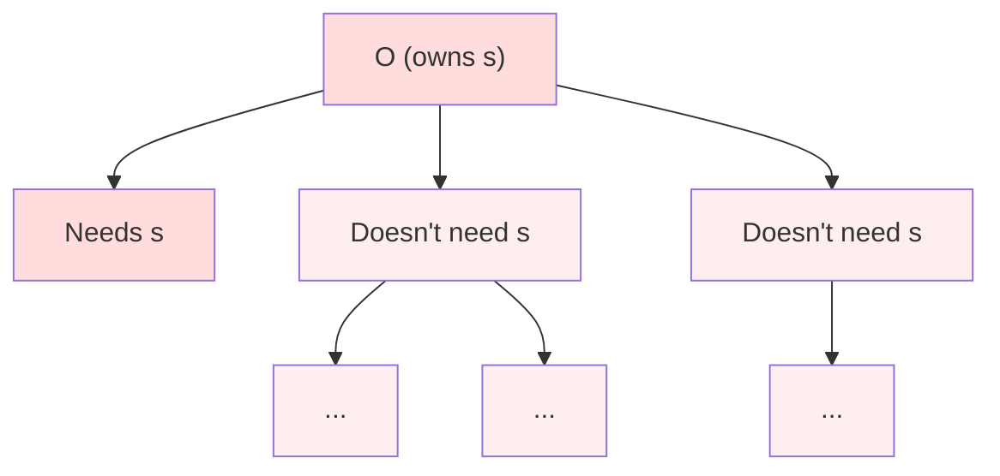
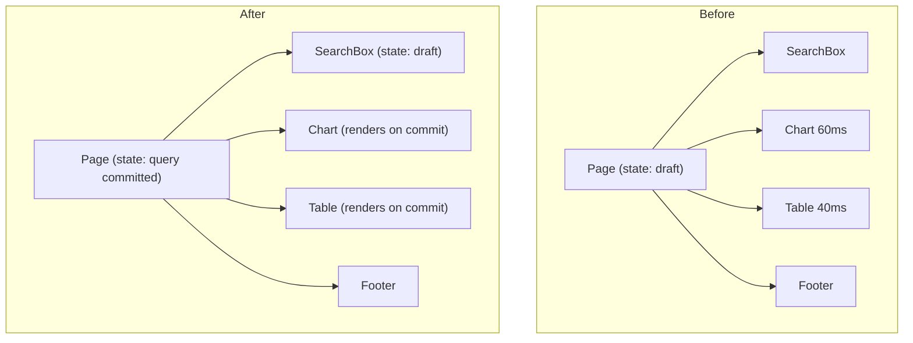
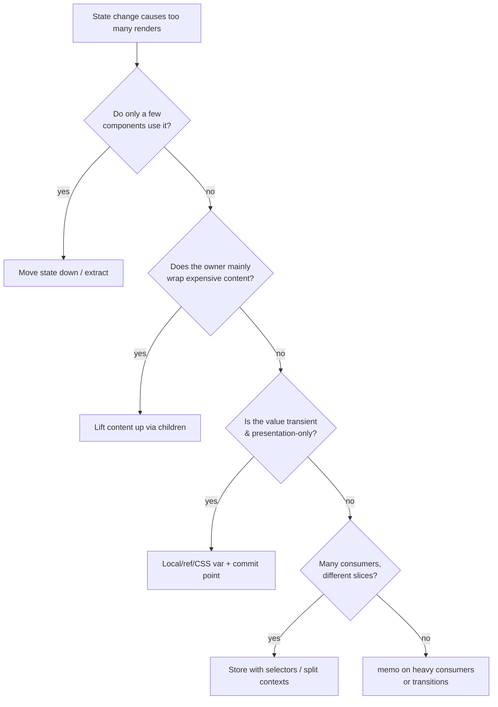

# 07 / 07 — State Colocation for Performance: Moving Updates Out of the Way

## 1. Lesson metadata

| | |
|---|---|
| **Level** | Intermediate |
| **Study time** | 4 hours (reading 1.25 h, experiments 1.5 h, exercises 1.25 h) |
| **Prerequisites** | [03 — Why components re-render](./03-why-components-rerender.md); [04 — Memoization trade-offs](./04-memoization-trade-offs.md); [06 — Context propagation cost](./06-context-propagation-cost.md); [03 / 18 — State colocation and lifting](../03-react-state-and-hooks/18-state-colocation-and-lifting.md) |
| **Next** | [08 — Rendering large collections](./08-rendering-large-collections.md) |
| **Related** | [04 / 15 — State ownership](../04-react-architecture/15-state-ownership.md), [03 / 17 — Derived state](../03-react-state-and-hooks/17-derived-state.md) |

**Learning objectives.** After this lesson you can:
1. Compute the *blast radius* of a state variable: which components render when it changes.
2. Reduce blast radius structurally with four techniques: move state down, lift content up, split components, and use refs/external sinks for transient values.
3. Distinguish transient (high-frequency, presentation-only) state from committed state and design commit points.
4. Measure the effect of colocation with commit/`actualDuration` comparisons and decide whether it is better than memoization for a given case.
5. Recognize when colocation is wrong (the state truly is shared) and what to do instead.

**Concepts covered:** blast radius, state ownership vs consumption, moving state down, lifting content up (`children`), component extraction, transient vs committed state, uncontrolled inputs, refs and CSS variables for high-frequency updates, commit-on-release, derived state, URL state as a boundary, state "too low" duplication risks.

---

## 2. Deep conceptual explanation

### 2.1 What problem is this lesson solving?

From lesson 03: when state changes, the owning component re-renders and so (by default) do all its descendants. **Where state lives determines how many components render when it changes.** The cheapest, most robust performance optimization in React is usually to put state where it affects the fewest components, because it removes work rather than caching it: no comparison on each render, no dependency array, no stale-closure risk.

Phase 3's [state colocation and lifting](../03-react-state-and-hooks/18-state-colocation-and-lifting.md) teaches this as a design principle (keep state close to where it's used; lift only when siblings need it). This lesson treats it as a *performance* tool: how to quantify the benefit, which transformations to apply, and the trade-offs.

### 2.2 Blast radius

Define **blast radius** of a state variable `s` owned by component `O`: the set of components that render when `s` changes. By default that's `O` plus all of `O`'s descendants in the tree rendered by `O` (minus those skipped by `memo` or same-element bail-outs), plus consumers of any context `O` provides whose value derives from `s`.



Only `A` needs `s`; `B`, `C` and their descendants render needlessly. The ideal ownership is the lowest common ancestor of the components that *use* `s`; moving `s` there shrinks the blast radius to the minimum possible *without changing behavior*.

### 2.3 The four moves

| # | Move | Applies when | Mechanism |
|---|---|---|---|
| 1 | **Move state down** | Only a subtree uses `s` | Extract that subtree into a component that owns `s` |
| 2 | **Lift content up** | `O` must own `s` (e.g., it renders a wrapper around expensive content) | Receive expensive content as `children`/props so its element identity is stable |
| 3 | **Split the component** | `O` mixes fast-changing and slow-changing concerns | Separate into components that each own one concern |
| 4 | **Avoid state for transient values** | `s` changes at high frequency and only affects presentation (position, scroll, hover) | Write to a ref, a CSS variable, or the DOM directly; commit React state at a meaningful point |

### 2.4 Transient vs committed state

Many performance problems come from putting transient interaction state into React state at a high level:

| | Transient | Committed |
|---|---|---|
| Examples | Pointer position during drag; slider thumb while dragging; text while typing in a search box; scroll offset | Selected filter, final slider value, submitted query, sort order |
| Frequency | 30–120 Hz or per keystroke | Per user decision |
| Who needs it | Often just the element being manipulated | The rest of the app |
| Where it should live | Local state, ref, CSS variable, or off-React | Shared owner (parent, store, URL) |
| Commit point | on release / debounce / transition | — |

The transformation: *keep the transient value local; publish a committed value at the right moment.* This is both a performance and an architecture win: the rest of the app sees a clean, meaningful event ("range changed") rather than a stream.

### 2.5 Misconceptions

| Misconception | Reality |
|---|---|
| "State should live in a high-level component so it's easy to access." | Convenience for access moves cost to every update. Prefer lowest common ancestor; use composition/hooks/stores to share without lifting everything. |
| "Colocation means every piece of state must be local." | Colocation means *as low as possible but no lower than its users*. Shared state is shared. |
| "Refs are a hack to avoid React." | For transient, presentation-only values that no other component needs to render from, refs/CSS variables are an appropriate tool, documented by React for values that don't affect rendering output. But refs can't drive rendering: changing a ref won't update the UI. |
| "Memoizing children is the same as colocation." | Memoization pays a comparison per render and requires stable props; colocation avoids the render entirely. They can be combined. |
| "Global stores solve this." | A store with selectors reduces blast radius for shared state, but ephemeral state doesn't need to be global at all. |

---

## 3. Internal mechanics

### 3.1 Why colocation works

- **Public guarantee.** A state update re-renders the component that owns it (and its descendants, subject to bail-outs). It doesn't re-render ancestors or siblings merely because of that update.
- **Teaching model.** State updates start at the owner. Anything not below the owner is not visited. So the cost of an update is a function of the subtree under the owner.
- **Implementation detail.** React tracks pending work through the tree; an update marks the path from the owner up to the root as having work, but only the owner and descendants *render*. Ancestors on the path are *visited* to find the work but not re-rendered unless they have their own pending work. Exact bookkeeping varies by version.

### 3.2 Lifting content up: element identity

If component `Shell` owns state and receives `children`, then `children` elements were created by `Shell`'s parent. When `Shell` re-renders for its own state, `props.children` is the same object. React bails out for that child (no pending work, same element). So expensive content renders only when *its* creator renders. That's why "lift content up" often replaces `memo` entirely ([03 §3.2](./03-why-components-rerender.md#32-the-children-as-props-bail-out-explained)).

Caveat: content created by the *same* component that owns the state is not stable; moving the content creation out is the entire technique.

### 3.3 Refs and DOM writes for transient state

Updating a ref doesn't schedule a render. If you update a DOM style or CSS variable directly (`el.style.setProperty("--x", ...)`), you bypass React. This is supported for values React doesn't manage; React will not overwrite properties it doesn't know about unless your component re-renders and sets the same property through `style`. Rules of thumb:

- Don't set the same style property both via React props and imperative writes.
- Keep writes inside event handlers or effects, never during render.
- Provide a committed value to React at the end of the interaction if other components need it.

### 3.4 Interaction with concurrency

Transitions and deferred values ([12](./12-usetransition-in-practice.md), [13](./13-usedeferredvalue-in-practice.md)) are *scheduling* tools for work that must happen; colocation *removes* work that doesn't. Prefer removal first, then scheduling for what remains.

---

## 4. Step-by-step execution walkthrough: typing in a search box on a heavy page

Initial code: `Page` owns `query` and renders `SearchBox`, `ResultsChart` (60 ms), `ResultsTable` (40 ms), and `Footer`.

**Before.** User types "s":
1. `onChange` → `setQuery("s")` in `Page`.
2. Render: `Page` renders; `SearchBox`, `ResultsChart`, `ResultsTable`, `Footer` render (children of `Page`, not memoized): ~100 ms + overhead.
3. Commit: input value updated; chart/table DOM identical except where `query` affects them (they do, since results are filtered).
4. Keystroke-to-paint ≈ 110 ms (illustrative). Each keystroke repeats.

**Observation.** Chart and table do need the *committed* query, but not each character: users pause between words. Footer doesn't need it at all.

**After (moves 1, 3, 4):**
- `SearchBox` owns `draft` state (transient). On each keystroke only `SearchBox` renders (~0.3 ms).
- `SearchBox` calls `onCommit(draft)` debounced by 200 ms (or on Enter). `Page` stores `query` (committed). `Footer` is passed as `children` or is memoized/lifted so it never renders for query.
- Typing: ~0.3 ms per keystroke. After pausing: one commit of chart+table (~100 ms) *not blocking input events* if combined with a transition ([12](./12-usetransition-in-practice.md)).

**Predict:** does debounce alone (without moving `draft` down) fix input lag? *Answer:* No. If `draft` lives in `Page`, every keystroke still re-renders `Page` and its children. Debounce reduces *committed* updates only if the drafted value is separate state; keep `draft` in `SearchBox`.

---

## 5. Code examples

### 5.1 Minimal example — move state down

Before:

```tsx
function Page() {
  const [color, setColor] = useState("#336699");
  return (
    <div>
      <input type="color" value={color} onChange={(e) => setColor(e.target.value)} />
      <p style={{ color }}>Preview text</p>
      <ExpensiveTree />
    </div>
  );
}
```

After:

```tsx
function ColorDemo() {
  const [color, setColor] = useState("#336699");
  return (
    <>
      <input type="color" value={color} onChange={(e) => setColor(e.target.value)} />
      <p style={{ color }}>Preview text</p>
    </>
  );
}

function Page() {
  return (
    <div>
      <ColorDemo />
      <ExpensiveTree />
    </div>
  );
}
```

`color` is needed only by the input and preview. `Page` has no state and never re-renders for it; `ExpensiveTree` isn't a descendant of the state owner, so it never renders on color changes. **Predict:** does `ExpensiveTree` re-render when `color` changes? *No*, because `Page` isn't re-rendered and `ColorDemo` doesn't render it.

### 5.2 Practical example — lift content up with `children`

```tsx
import { useState, type ReactNode } from "react";

function Collapsible({ title, children }: { title: string; children: ReactNode }) {
  const [open, setOpen] = useState(false);
  return (
    <section>
      <button aria-expanded={open} onClick={() => setOpen((o) => !o)}>{title}</button>
      {open && <div>{children}</div>}
    </section>
  );
}

function ReportPage({ data }: { data: Row[] }) {
  return (
    <Collapsible title="Details">
      <HeavyReportTable rows={data} />
    </Collapsible>
  );
}
```

Behavior: when `open` toggles, `Collapsible` renders; `children` is the same element created by `ReportPage` (which doesn't re-render) → on *close→open* React mounts the table (new subtree), but on any subsequent re-render of `Collapsible` for its own state while open, `HeavyReportTable` is not re-rendered. (Note: toggling `open` to true does mount it; unmounting on close discards state. If preserving state matters, hide with CSS/`hidden`, or use `<Activity>`, stable since React 19.2: hidden Activity trees keep state but defer their updates; see react.dev/reference/react/Activity.)

The pattern generalizes: `Modal`, `Tabs`, `Resizable`, `Draggable`, `Tooltip`, `ErrorBoundary`-like wrappers should accept `children` and own their transient state.

### 5.3 Incorrect example — lifting state "just in case", and the premature global store

```tsx
// ❌ Everything in one page-level reducer "so any component can read anything"
function Page() {
  const [state, dispatch] = useReducer(pageReducer, initialPageState); // modal open, tooltip, hover id, drafts, filters...
  return (
    <PageContext value={{ state, dispatch }}>   {/* new object every render, too */}
      <Header /><Filters /><Grid /><Footer />
    </PageContext>
  );
}
```

Effects: hovering a card (hover id in state) re-renders every consumer of `PageContext`. Tooltip open/close re-renders the grid. The "convenience" has made each micro-interaction page-global. Also, every field now has an implicit dependency graph.

### 5.4 Corrected implementation

```tsx
// Hover and tooltip are local to the card.
function Card({ product, onAdd }: { product: Product; onAdd: (id: string) => void }) {
  const [hovered, setHovered] = useState(false);
  return (
    <article
      onPointerEnter={() => setHovered(true)}
      onPointerLeave={() => setHovered(false)}
    >
      <h3>{product.name}</h3>
      {hovered && <QuickActions productId={product.id} onAdd={onAdd} />}
    </article>
  );
}
```

Page-level state is limited to what is truly shared: `filters` (used by `Filters` and `Grid`), maybe `cart` (store). Hover state costs one component per hover. Modal-open state belongs to the modal's trigger component or a modal manager that renders at the root.

### 5.5 Advanced example — transient drag state with refs/CSS variables and commit-on-release

```tsx
import { useCallback, useRef, useState } from "react";

interface RangeSliderProps {
  min: number;
  max: number;
  value: number;                 // committed value (from parent)
  onCommit: (v: number) => void; // called on release
}

export function RangeSlider({ min, max, value, onCommit }: RangeSliderProps) {
  const trackRef = useRef<HTMLDivElement>(null);
  const valueRef = useRef(value);          // transient value (not state)
  const [committed, setCommitted] = useState(value); // only for a11y text, updated on release

  const setVisual = useCallback((v: number) => {
    valueRef.current = v;
    const pct = ((v - min) / (max - min)) * 100;
    trackRef.current?.style.setProperty("--pct", `${pct}%`); // no React render
  }, [min, max]);

  const onPointerDown = (e: React.PointerEvent<HTMLDivElement>) => {
    const el = e.currentTarget;
    el.setPointerCapture(e.pointerId);
    const rect = el.getBoundingClientRect();
    const toValue = (clientX: number) =>
      Math.round(min + Math.min(1, Math.max(0, (clientX - rect.left) / rect.width)) * (max - min));

    setVisual(toValue(e.clientX));

    const move = (ev: PointerEvent) => setVisual(toValue(ev.clientX));
    const up = () => {
      el.removeEventListener("pointermove", move);
      el.removeEventListener("pointerup", up);
      setCommitted(valueRef.current);   // one React update
      onCommit(valueRef.current);       // one update for the rest of the app
    };
    el.addEventListener("pointermove", move);
    el.addEventListener("pointerup", up);
  };

  return (
    <div
      ref={trackRef}
      role="slider"
      tabIndex={0}
      aria-valuemin={min}
      aria-valuemax={max}
      aria-valuenow={committed}
      style={{ "--pct": `${((value - min) / (max - min)) * 100}%` } as React.CSSProperties}
      onPointerDown={onPointerDown}
      className="slider"
    />
  );
}
```

Line notes and caveats:
- During a drag, `setVisual` mutates a CSS variable and a ref: **zero React renders** for pointer moves (60+ per second); CSS uses `var(--pct)` for the thumb/fill position.
- On release, one `onCommit` informs the parent, which may then update filters.
- Accessibility: `aria-valuenow` lags during drag (only updates on release); keyboard handlers (arrow keys) should use normal state/commit paths and are omitted for brevity. A production slider needs keyboard support, `aria-valuetext`, and cancel handling (`pointercancel`). Compare using a native `<input type="range">` (an uncontrolled input with `onChange`/`onInput`), which handles a11y and may be sufficient.
- The inline `style` with a CSS variable is re-applied by React on re-render from `value`; if the parent re-renders with a stale `value` mid-drag, the thumb could jump. Here the parent only changes `value` on commit; check this in your own design.
- Trade-off: imperative code is harder to test and reason about. Use only after measurement shows state-per-pointer-move is the bottleneck (for a small slider on a light page, `useState` is fine).

---

## 6. Visual explanations

### 6.1 Move state down: before and after



Per keystroke: Before renders everything (~100+ ms). After renders `SearchBox` only (~0.3 ms) until commit.

### 6.2 Where each technique sits in the decision



---

## 7. Alternative approaches and trade-offs

| Approach | Runtime cost | Code cost | Risk | Best when |
|---|---|---|---|---|
| **Move state down** | Zero | Small refactor | Low | One subtree consumes the state |
| **Lift content up (`children`)** | Zero | Composition style | Low | Wrapper owns state, content is heavy |
| **Split component by concern** | Zero | Medium | Low | Component mixes unrelated update rates |
| **Refs/CSS variables for transient values** | Minimal | Imperative code | Hard to test, a11y pitfalls, drift from React state | High-frequency presentation-only updates |
| **Debounce/commit on release** | Fewer commits | Small | Stale UI during interim | Heavy downstream work on committed value |
| **`memo` heavy consumers** | Compare per render | Prop stability work | Stale props, unstable identity | State must stay high; consumers heavy |
| **Store + selectors** | Per-slice subscription | Library + selectors | Selector bugs | Shared state across distant components |
| **Transition/deferred value** | Scheduling overhead | Small | UX staleness | Heavy work is required but can lag input |
| **URL state** | Router-driven updates | Router integration | Navigation/history semantics | State should be shareable/bookmarkable (not for high-frequency) |

**Scenario where colocation is *not* the best approach:** two distant components need the same value and updates are moderately frequent (e.g., a selected-row id used by a table and a details drawer). Lifting to their common ancestor is required; the blast radius is then at least that ancestor's subtree; mitigate with `children` composition, memoization, or a store.

**Scenario where it's harmful:** colocating state in each of 30 field components and then synchronizing with effects (`useEffect(() => onChange(local))`) creates duplicated state and extra commits. The better design is derived state or a single owner with uncontrolled inputs read on submit.

---

## 8. Best practices and anti-patterns

### 8.1 Best practices
1. **Put state in the lowest common ancestor of its readers** (and writers).
2. **Separate transient and committed state**; define the commit moment (blur, release, debounce, submit).
3. **Make wrapper components accept `children`** so they can own state cheaply.
4. **Name state ownership in review**: "who needs `s`?" is a standard question.
5. **Prefer composition over memoization** when you can restructure cheaply.
6. **Measure blast radius**: in the Profiler, count components rendered per update before and after.
7. **Prefer native elements and uncontrolled inputs** for simple fields; they need no per-keystroke React state.

### 8.2 Beginner mistakes
- Storing form drafts at the page level.
- Holding `isHovered`/`isOpen` in a parent for many children.
- Copying props to state (`useState(props.x)`) "to colocate", creating derived-state bugs ([03 / 17](../03-react-state-and-hooks/17-derived-state.md)).

### 8.3 Experienced-developer mistakes
- Colocating too aggressively so that sibling coordination needs effects and callbacks (accidental synchronization code).
- Using refs for state that *does* affect rendering, creating stale UI.
- Debouncing at the wrong level: debouncing the *committed* value while the draft still lives high in the tree.
- Leaving "temporary" global state (`modalOpen`) in a global store that causes broad re-renders when toggled.

### 8.4 Smells
- A top-level component with many `useState`s and many children passed down.
- Props named `isOpen`, `hoveredId`, `draft` threaded through 3+ levels.
- A component with `useEffect(() => { parentSetter(localState) }, [localState])`.
- Typing latency that scales with page size.

### 8.5 Justified exceptions
- State must be global for product reasons (e.g., undo/redo across the whole editor, persisted session state).
- Server-rendered pages where simplicity and predictable hydration matter more than micro-optimizing renders.
- Prototyping: keep state high until requirements stabilize, then colocate.

---

## 9. Real-world application

**E-commerce search/typeahead.** Draft text local to the input; suggestions fetched on debounced value; page-level query state only on submit. Constraint: analytics wants each query logged; log on commit. Accessibility: the suggestion list must update with the draft; keep the list adjacent to the input (same owner).

**Dashboards.** Chart brush/zoom is transient local state (ref/CSS/transform) while the committed range updates other widgets on release. Constraint: product wants "live" linked charts during drag; then use throttled commits (rAF) plus `useDeferredValue` for heavy widgets, accepting measured cost.

**Finance forms.** Per-field local state with validation on blur; submit collects values (uncontrolled inputs/`FormData`). Constraint: cross-field validation ("end date after start date") needs access to both values: lift only the minimal cross-field state, or validate on submit/blur at the form level.

**Realtime/maps.** Cursor positions of other users update at 10 Hz; each cursor component subscribes to its own source; the map container never re-renders. Constraint: map libraries own their imperative state; React state should hold only app-level concerns.

**Multi-team shells.** Shared layout components (sidebar collapse, modal root) own their state and accept `children`; remote apps' content is passed as `children` and is not re-rendered by shell state.

---

## 10. Debugging and troubleshooting

### Symptom: "Typing in an input is slow on a complex page."
1. Profile one keystroke. Which component owns the input's state? Which components rendered?
2. If many unrelated components render: move the state down or lift content up.
3. If the input must stay controlled at a high level, debounce downstream commits and use `useDeferredValue` for heavy consumers.
4. Re-measure (lesson 01 protocol).

### Symptom: "After colocating, a sibling shows stale data."
- The sibling still needs the value but is no longer a descendant of the owner. Reintroduce the shared owner at the lowest common ancestor, or publish committed values upward via callback (single direction) or a store.

### Symptom: "Colocated state resets unexpectedly."
- The component is remounted (key/type change) or conditionally rendered; state is lost when unmounted. Check parent structure and keys; if preserved state is needed, lift state or keep the component mounted.

### Symptom: "Imperative CSS variable updates sometimes get overwritten."
- React re-rendered the element and re-applied `style` from props. Keep one source of truth for each style property; prefer CSS variables set only imperatively.

### Symptom: "Colocation worked but the page is still slow."
- The remaining cost is not re-render cost (commit/layout/paint, large DOM, third-party). Use the Performance panel ([02](./02-profiler-workflows.md)).

### Validating a fix
Profiler commit count and rendered-component count per interaction both fell; keystroke-to-paint median/p95 improved under the lesson-01 protocol; behavior tests (cross-component consistency) pass.

---

## 11. Exercises

### Level A — Knowledge
A1. Define "blast radius" of a state variable and how to reduce it.
A2. Why does passing content as `children` prevent its re-render when the wrapper's state changes?
A3. Distinguish transient and committed state with two examples each.
A4. When is lifting state up the correct choice?

### Level B — Code comprehension
B1. In the code below, which components render on each keystroke? Explain.
```tsx
function Form() {
  const [name, setName] = useState("");
  return (
    <>
      <input value={name} onChange={(e) => setName(e.target.value)} />
      <Preview name={name} />
      <HeavyAside />
    </>
  );
}
```
B2. Does wrapping `<HeavyAside />` in `children` of a component that owns `name` change the answer? How?
B3. In §5.5, why doesn't the thumb movement cause React renders, and what drawback does this create?

### Level C — Implementation
C1. Refactor the `Form` in B1 so that only `input` and `Preview` render per keystroke, with two different structures.
C2. Implement a `useCommittedValue<T>(initial: T, delayMs: number)` hook returning `[draft, setDraft, committed]` where `committed` updates after the draft is idle for `delayMs`, with proper cleanup.

### Level D — Debugging
D1. After you moved a filter's state into the `FilterBar` component, the results table no longer updates. Why, and what are two fixes?
D2. A drag handle uses `style={{ transform: \`translateX(${x}px)\` }}` with `x` in `useState` at the page level; dragging is janky. Profile findings: 40 components render per pointermove. Propose three fixes ordered by complexity.

### Level E — Architecture and engineering decisions
E1. Your app has a global `uiStore` with `{ sidebarOpen, modalOpen, hoveredRowId, tooltip, draftComment }`. Decide which should stay global and which should be local; justify with blast radius and product requirements.
E2. When should you choose URL state over local state for a filter, given performance and product implications?

### Level F — Expert challenge
F1. Design a measurement experiment comparing four implementations of a live-filtered table (state at page level, state colocated + commit on debounce, `useDeferredValue`, store with selectors) under 5,000 rows. Define metrics, workload, and decision criteria.

---

## 12. Detailed answers and explanations

> Attempt the exercises first.

**A1.** The set of components that render when the state changes: the owner and its (non-bailed-out) descendants, plus context consumers that depend on it. Reduce by moving state to the lowest common ancestor of its users, extracting subtrees that own the state, lifting content up as `children`, or using local/ref state for transient values. Wrong answer: "memoize everything under the owner" (that reduces cost but pays a comparison and retains the blast radius conceptually).

**A2.** `children` elements are created by the wrapper's parent. When the wrapper re-renders from its own state, the parent hasn't re-rendered, so `props.children` is the same element reference; React finds no reason to re-render that subtree (unless it has its own pending work or consumes a changed context).

**A3.** Transient: pointer coordinates during drag; the text in a search box before the user pauses; scroll offset; hover. Committed: selected filter value; submitted search query; chosen date range; sort order. Wrong answer: classifying a final selection as transient (it must be shared and durable).

**A4.** When two or more components, not in a parent-child chain that already owns it, need to read or write the state (siblings), or when the parent's logic depends on it. Lift to their lowest common ancestor. Also when state must survive unmounting of the child. Wrong answer: "always lift."

**B1.** On each keystroke: `Form` (owner), `Preview` (parent rendered, props changed), `HeavyAside` (parent rendered; no memo → renders despite not using `name`). So three components render, including the heavy one.

**B2.** Yes. If `Form` is `FormShell({children})` and `<HeavyAside />` is created by the grandparent, then `Form`'s state change doesn't re-render `HeavyAside`. Only `FormShell` and `Preview` render (and `Preview` only if it is created inside `FormShell`).

**B3.** Pointer moves update a ref and a CSS variable via DOM API, not state, so React never schedules a render. Drawbacks: UI state is outside React's model: `aria-valuenow` and other React-rendered output may be stale until commit; imperative code is harder to test; risk of conflict with React-managed styles. Keyboard and assistive tech must be handled separately.

**C1.** 
Structure 1 (extract):
```tsx
function NameField() {
  const [name, setName] = useState("");
  return (
    <>
      <input value={name} onChange={(e) => setName(e.target.value)} />
      <Preview name={name} />
    </>
  );
}
function Form() {
  return (<><NameField /><HeavyAside /></>);
}
```
Structure 2 (children):
```tsx
function NameShell({ children }: { children: React.ReactNode }) {
  const [name, setName] = useState("");
  return (<><input value={name} onChange={(e) => setName(e.target.value)} /><Preview name={name} />{children}</>);
}
function Form() { return <NameShell><HeavyAside /></NameShell>; }
```
Verify with Profiler that `HeavyAside` is grey on keystrokes. Trade-offs: structure 1 is simpler; structure 2 keeps `Form` as the layout owner. Edge: if `Form` itself needs `name` on submit, expose via ref/callback or use `FormData`.

**C2.**
```tsx
import { useEffect, useState } from "react";

export function useCommittedValue<T>(initial: T, delayMs: number) {
  const [draft, setDraft] = useState(initial);
  const [committed, setCommitted] = useState(initial);

  useEffect(() => {
    const id = setTimeout(() => setCommitted(draft), delayMs);
    return () => clearTimeout(id);
  }, [draft, delayMs]);

  return [draft, setDraft, committed] as const;
}
```
Notes: cleanup cancels pending timers on change/unmount; `setCommitted` with the same value bails out. Drawback: the commit adds a render (of the hook's owner) after the draft render, so the owner renders twice per burst; use this hook in a *small component* (the search box) and pass `committed` upward through a callback or lift appropriately, not in the page component, or the page-level problem returns. A refinement: call `onCommit` from the timeout instead of tracking `committed` state locally. Alternative: `useDeferredValue(draft)` if you want React to schedule instead of fixed delay.

**D1.** The table is not a descendant of `FilterBar`, so it can't read the state; it must receive the committed filter. Fix 1: lift `filters` to the lowest common ancestor of `FilterBar` and the table (the page), keeping transient draft inside `FilterBar` and calling `onChange(filters)` on commit. Fix 2: move filters into the URL or a store; both components read it. Wrong fix: duplicating state in both and syncing with effects (drift, double commits).

**D2.** (1) Cheapest: move `x` state into the handle component and keep the page above as `children`/stable, so the pointer moves render one component. (2) Use a ref + `requestAnimationFrame` and write `style.transform` imperatively; commit on release. (3) Use CSS `transform` via CSS variable and the Pointer Events API; or a library that handles drag (e.g., a drag-and-drop library) — evaluate its a11y. Evaluate by renders per pointermove (target 1 or 0) and frame times in the Performance panel. Mention `will-change`/compositor-friendly transforms rather than `left`.

**E1.** Evaluation criteria: classify by consumers and frequency. Local: `hoveredRowId`, `tooltip`, `draftComment` (transient, one component). Possibly local to a layout shell: `sidebarOpen` unless persisted or controlled globally (keyboard shortcut, deep link). `modalOpen`: local to the trigger or a modal manager at the root rendering via portal; global only if multiple distant triggers coordinate. Justify with blast radius: global store with selectors reduces cost, but local state eliminates it. Mention persistence/analytics needs.

**E2.** Choose URL state for filters that should be shareable/bookmarkable/back-button-navigable (search facets, sort, pagination). Performance: URL updates go through the router and may re-render route-level components; avoid putting high-frequency or transient values (slider mid-drag, per-keystroke text) in the URL; commit on release/debounce. Product: privacy of values in the URL, URL length, analytics. Often combine: local draft, URL committed.

**F1.** Evaluation criteria: fixed dataset (5,000 rows), the same interaction script (type "shoe"), production build, 4× throttle; metrics: keystroke-to-paint median/p95, commits per keystroke, `actualDuration` per commit, input delay (INP-like), rows rendered, memory; conditions: interleaved runs, ≥ 20 samples, warm-up; decision criteria: meets p95 budget with least complexity; compare complexity (lines, concepts) and risks. Expectation: page-level state worst; colocated + debounce best for input latency but delays results; `useDeferredValue` keeps input responsive with results lag but still does the same total work; store with selectors helps only if many components subscribe to different slices; combos likely best (colocation + transition + memo rows). Threats: JIT, GC, dev vs prod, dataset realism, timer approximations.

---

## 13. Senior engineer interview questions

**Q1. "How do you stop an expensive subtree from re-rendering on unrelated state changes?"**
First restructure: move the state to the component that uses it or pass the expensive subtree as `children`. If that's not possible, `memo` with stable props. Reason: removing the update path is cheaper than checking props each time.

**Q2. "Is it OK to keep form state at the top of the page?"**
Only if many parts of the page need it or you can bound the blast radius; otherwise keep field state local and commit on blur/submit. Reason: top-level state makes every keystroke a page render.

**Q3. "Why not use refs for all state?"**
Refs don't trigger renders, so the UI wouldn't update; use them for values that don't need to be rendered by React (transient presentation values, instance variables), with an explicit commit when other components need to react. Reason: refs bypass React's reactive model.

**Q4. "Colocation vs memoization: how do you choose?"**
Prefer colocation: no comparison, no deps, no stale closures. Use memoization when state must be shared high up and the consumer is heavy and its props are stable. Reason: cost and complexity profile.

**Q5. "Where do you draw the line between local and global state?"**
Local unless multiple distant components need it, it must persist across navigation/unmount, or it drives app-level behavior. Reason: widening scope widens blast radius and coupling.

**Q6. "What are the risks of lifting content up via `children`?"**
Unusual composition for newcomers, content cannot depend on wrapper state without render props, and the wrapper API shape must accommodate it. Reason: composition constraints trade against flexibility.

---

## 14. Further learning resources

| Resource | URL | Covers / why | Level | Study |
|---|---|---|---|---|
| React docs — Choosing the State Structure | <https://react.dev/learn/choosing-the-state-structure> | Avoiding redundant/duplicated state | Intermediate | "Principles for structuring state" |
| React docs — Sharing State Between Components | <https://react.dev/learn/sharing-state-between-components> | Lifting state up | Beginner | Whole page |
| React docs — Preserving and Resetting State | <https://react.dev/learn/preserving-and-resetting-state> | State identity and position | Intermediate | Whole page |
| React docs — Referencing Values with Refs | <https://react.dev/learn/referencing-values-with-refs> | When to use refs for non-rendered values | Beginner | Whole page |
| React docs — Manipulating the DOM with Refs | <https://react.dev/learn/manipulating-the-dom-with-refs> | Imperative DOM and its caveats | Intermediate | "Best practices for DOM manipulation with refs" |
| React docs — `useDeferredValue` | <https://react.dev/reference/react/useDeferredValue> | Deferral as a complement | Intermediate | "Usage" |
| MDN — CSS custom properties | <https://developer.mozilla.org/en-US/docs/Web/CSS/Using_CSS_custom_properties> | Variables for imperative style updates | Beginner | Whole page |
| MDN — Pointer events | <https://developer.mozilla.org/en-US/docs/Web/API/Pointer_events> | Drag handling, pointer capture | Intermediate | Whole page |

Links marked were not fetched in this session; if one has moved, search the site for the quoted title.

---

## 15. Knowledge checkpoint

**You should now understand**
- Blast radius as the unit of cost for state changes and the four moves that shrink it.
- The transient/committed distinction and why commit points are good architecture as well as performance.
- When colocation is wrong (genuinely shared state) and what to do then.

**You should be able to explain without notes**
- Why `children` composition prevents re-renders.
- Why debouncing alone doesn't fix a page-level draft.
- The risks of imperative transient updates.

**You should be able to implement**
- Extracted state owners, wrapper components with `children`, a commit-on-idle hook, and a ref/CSS-variable drag.

**You should be able to debug**
- Typing lag by finding the owner and counting rendered components per keystroke.

**Before moving on:** read [08 — Rendering large collections](./08-rendering-large-collections.md), where colocation, memoization, and structural identity combine to make lists of thousands scale.
