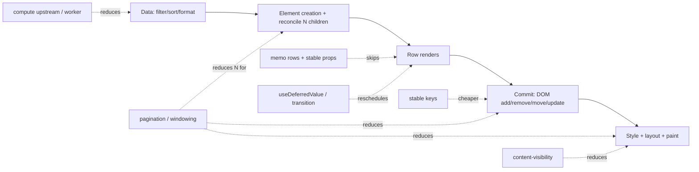
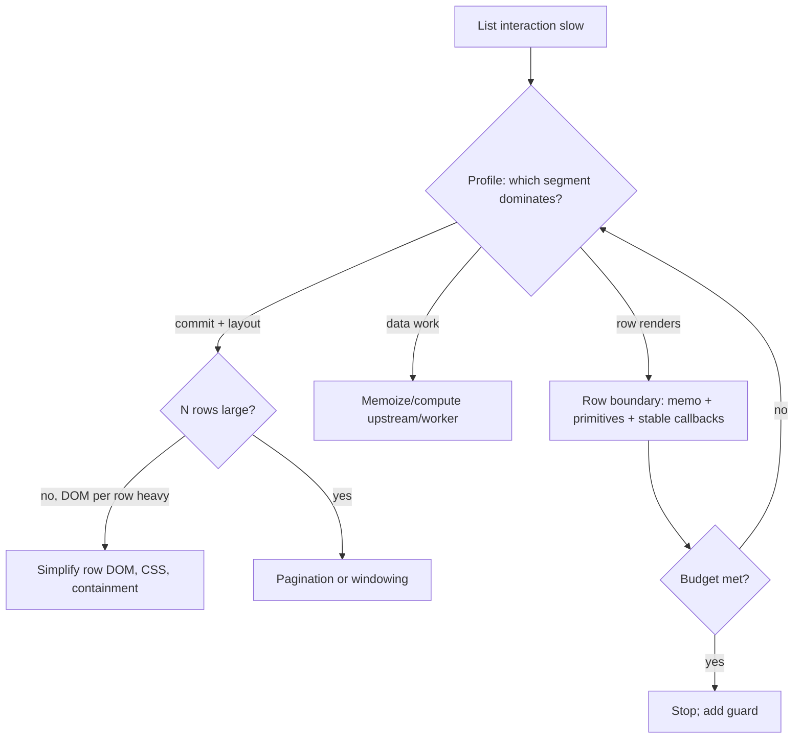

# 07 / 08 — Rendering Large Collections: Keys, Row Boundaries, DOM Cost, and Knowing When to Stop

## 1. Lesson metadata

| | |
|---|---|
| **Level** | Advanced |
| **Study time** | 5–6 hours (reading 1.75 h, experiments 2.25 h, exercises 1.5 h) |
| **Prerequisites** | [04 — Memoization trade-offs](./04-memoization-trade-offs.md); [05 — Referential equality](./05-referential-equality.md); [07 — State colocation for performance](./07-state-colocation-for-perf.md); [02 / 07 — Identity, keys, and reconciliation](../02-react-rendering-and-internals/07-identity-keys-and-reconciliation.md); [00 / 03 — Browser rendering pipeline](../00-web-and-javascript-foundations/03-browser-rendering-pipeline.md) |
| **Next** | [09 — Windowing and virtualization](./09-windowing-and-virtualization.md) |
| **Related** | [10 — Expensive computations](./10-expensive-computations.md), [12 — useTransition in practice](./12-usetransition-in-practice.md), [23 — Counterproductive optimizations](./23-counterproductive-optimizations.md) |

**Learning objectives.** After this lesson you can:
1. Decompose the cost of a large list into render cost, reconciliation cost, DOM/commit cost, and browser layout/paint cost, and measure each.
2. Choose correct keys and explain what incorrect keys cost (performance and correctness).
3. Build a memoized row boundary that actually hits, including selection, editing, and sorting scenarios.
4. Apply the sequence "reduce work → reduce nodes → reduce updates → reschedule", and know where each technique stops helping.
5. Decide among memoized rows, pagination, CSS `content-visibility`, transitions, and virtualization using measurements at your data sizes.
6. Identify counterproductive "optimizations" specific to lists.

**Concepts covered:** list cost model (N × per-row cost), keys and reorders, row components, primitive row props, selection as `Set` with boolean projection, event delegation vs per-row handlers, normalized data (`byId`/`ids`), update granularity, DOM node count and layout cost, `content-visibility: auto`, pagination, deferred filtering, preliminary virtualization decision.

---

## 2. Deep conceptual explanation

### 2.1 What problem is this lesson solving?

A list of 20 items is never a performance problem. A list of 5,000 rows in a data grid, with selection, inline editing, sorting, filtering, and live updates, often is. The difficulty is that *several different costs* scale with N, and techniques that attack one cost do nothing for the others. The common failure is to apply `memo` to the row component (render cost) while the real bottleneck is DOM node count (commit and layout cost), or to virtualize before fixing a row component that re-renders everything on selection.

This lesson provides a systematic approach: *identify which cost dominates for which interaction, apply the cheapest effective fix, and stop when the budget is met.*

### 2.2 The cost model

For a list with N rows, one interaction can incur:

| Cost | Scales with | Occurs when | Reduced by |
|---|---|---|---|
| **R — Render** | (rows re-rendered) × (per-row render cost) | Parent renders; rows lack effective `memo` | Memoized rows with stable props; colocating state; fewer rows rendered |
| **E — Element creation + reconciliation** | N (even if rows are skipped) | Parent re-renders and builds N elements, React compares N children by key | Don't re-render the list parent on unrelated updates; fewer rows; virtualization |
| **C — Commit/DOM mutation** | Number of changed/added/removed DOM nodes | Filter/sort/page changes; mount | Stable keys (move not recreate); fewer nodes per row; windowing |
| **L — Layout/style/paint** | Total DOM nodes affected, CSS complexity | After large commits or changes affecting layout | Fewer nodes; simpler CSS; containment/`content-visibility`; windowing |
| **M — Mount-time/Memory** | N × (component + DOM + closures) | Initial render; route changes | Pagination; windowing; lazy rows |
| **D — Data processing** | N (or N log N for sort) | Filtering/sorting/formatting each render | Memoize/compute upstream; worker; server-side |

Per-interaction costs differ:

| Interaction | Dominant cost typically |
|---|---|
| Select one row | R + E (if the whole list re-renders) |
| Type in a filter box | D, R, then C/L (rows added/removed) |
| Sort by column | C (reorder) + R + L |
| Initial load / page switch | M, C, L |
| Live row update (one row's price changes) | R + E if the whole list re-renders; else tiny |
| Scroll | L/paint, and compositing; React not involved unless handlers update state |

### 2.3 Keys: identity, performance, correctness

Keys let React match children across renders ([02 / 07](../02-react-rendering-and-internals/07-identity-keys-and-reconciliation.md)). For lists:

| Key choice | Behavior on reorder/insert/delete | Cost | Correctness |
|---|---|---|---|
| **Stable unique id from data** (`item.id`) | React moves existing component instances and DOM | Minimal DOM work (moves), preserves row state | Correct |
| **Array index** | React treats position as identity; content shifts through instances | Many props updates; row-local state/DOM (inputs, focus) stays at position, not with the item | Bugs for stateful rows when list is reordered/filtered/inserted-into |
| **Random/new key per render** (`Math.random()`) | Every row is unmounted and remounted every render | Maximal: destroys and recreates DOM, state, effects | Resets state each render |
| **Non-unique keys** | Warnings; unpredictable matching | Undefined | Bugs |

Index keys are *acceptable* when the list is static (never reordered, filtered, or inserted into) and rows have no local state; they're not a performance disaster per se, but they become a correctness hazard as soon as the list changes. For dynamic lists, use stable ids.

### 2.4 The row boundary

A **row component** is the unit at which you can skip work. For a row boundary to be effective:

1. The row is a **module-scope component** wrapped in `memo` (or the compiler handles it).
2. Its props are **primitives or stable references**: ids, strings, numbers, booleans; entity objects that keep identity when unchanged.
3. Per-row derived flags (`selected`, `expanded`, `editing`) are computed in the *parent* from shared collections and passed as booleans, so a change to one item changes one row's props.
4. Callbacks are **stable** and take the row's id as an argument, or are replaced by event delegation.
5. The row does not read broad contexts that change often.

When these hold, an update to one row costs: parent render + N element creations + N shallow prop comparisons + 1 row render. That is O(N) in element creation and comparison, but with tiny constants. At N = 2,000 this is typically cheap; at N = 50,000 it isn't, and you need to reduce N itself (windowing, pagination).

### 2.5 Misconceptions

| Misconception | Reality |
|---|---|
| "`memo(Row)` makes lists scale." | It skips row render work but not element creation, comparison, DOM size, or mount cost. |
| "Index keys are always bad." | They're only problematic for dynamic lists or stateful rows; for static display lists they're fine. |
| "Virtualization is the first thing to reach for." | It adds complexity (a11y, find-in-page, dynamic heights, SSR). Memoization/pagination may suffice for hundreds to low thousands of rows. Measure. |
| "The browser is fast at DOM; React is the bottleneck." | At thousands of nodes, style/layout/paint and memory typically dominate once React work is trimmed. |
| "More wrapper `div`s are harmless." | Each DOM node costs memory and style/layout work. A row with 15 nodes at 5,000 rows is 75,000 nodes. |
| "`useCallback` for each row's handler." | Creating one stable callback that takes an id is better than N closures; or delegate events at the container. |

---

## 3. Internal mechanics

### 3.1 What React does for a list update

- **Public guarantee.** Children arrays are reconciled using keys: elements with the same key and type in the same parent are treated as the same instance; elements with new keys are mounted; missing keys are unmounted ([react.dev: "Rendering Lists"](https://react.dev/learn/rendering-lists); [Preserving and Resetting State](https://react.dev/learn/preserving-and-resetting-state)).
- **Teaching model.** React walks the new children array, matches each element to an old child by key (falling back to index when keys are absent, with a warning), decides per child whether to bail out, update, or mount; then records DOM placement operations (moves) for reordered children.
- **Implementation detail.** The matching algorithm uses a single pass with a map fallback on mismatch; moves are computed relative to the last placed sibling. Exact algorithm details are version-specific; don't depend on them beyond the documented key semantics.

**Consequence:** even if all rows bail out, React still iterates N children for the keyed matching. That's the O(N) floor for any non-virtualized list whose parent renders.

### 3.2 DOM cost model

Browsers batch style/layout, but cost grows with the number of nodes affected. Ways to see it in the Performance panel: "Recalculate Style" and "Layout" entries show *elements affected* counts; large numbers after a filter keystroke mean DOM size is the problem, independent of React render time. See [00 / 03](../00-web-and-javascript-foundations/03-browser-rendering-pipeline.md).

### 3.3 `content-visibility: auto`

A CSS property that lets the browser skip rendering work (style, layout, paint) for off-screen subtrees until they are near the viewport. It needs `contain-intrinsic-size` (or `contain-intrinsic-block-size`) so that skipped elements reserve approximate space; otherwise scrollbar size and scroll position jump as content becomes rendered. Support (MDN compat data, 2026-10-22): `content-visibility` Chrome 85, Firefox 125, Safari 18; `contain-intrinsic-size` Chrome 83, Firefox 107, Safari 17. It is now broadly available, but still treat it as progressive enhancement. Effects on accessibility tree and find-in-page have evolved; test with your target browsers and assistive tech.

It reduces **L** (and some of C's downstream cost) but not **R/E/M** from React: React still creates all components and DOM nodes. It pairs well with memoized rows, as a cheap alternative before virtualization.

### 3.4 Event delegation vs per-row handlers

React already delegates events at the root; a handler prop on each row is a closure *per row per render* (allocation) and a prop whose identity affects memoization. The two stable alternatives:

1. One stable `onSelect(id)` callback passed to all rows; the row calls `onSelect(id)` in its own handler.
2. A single handler on the list container that reads `data-id` from `event.target.closest("[data-id]")`.

Option 1 is idiomatic and type-safe; option 2 reduces per-row props and closures further but requires careful DOM structure and a11y (keyboard events, focus).

---

## 4. Step-by-step execution walkthrough: selecting a row in a 2,000-row table

Initial code (typical):

```tsx
function Table({ rows }: { rows: Row[] }) {
  const [selected, setSelected] = useState<string[]>([]);
  return (
    <table><tbody>
      {rows.map((r) => (
        <TableRow key={r.id} row={r} selected={selected.includes(r.id)} onSelect={() => setSelected([...selected, r.id])} />
      ))}
    </tbody></table>
  );
}
```

**Timeline, click on row 17:**
1. `onSelect` closure for row 17 runs → `setSelected([...selected, "17"])`.
2. **Render:** `Table` renders. It executes `rows.map` building 2,000 elements. For each, `selected.includes(r.id)` is O(|selected|); `onSelect` is a new closure per row.
3. **Reconcile:** React matches 2,000 children by key. `TableRow` isn't memoized → all 2,000 render (R ≈ 2,000 × 0.04 ms = 80 ms, illustrative).
4. **Commit:** only row 17's `className` changes: one DOM attribute update (C tiny).
5. **Browser:** style recalc for one row (L small).
6. Total ≈ 90 ms → perceptible lag on a 4× throttled device (≈ 300 ms+).

**After fix** (memoized row; `Set`; boolean projection; stable callback):
1. Click → `onSelect("17")` (stable) → functional update creates a new `Set`.
2. `Table` renders; builds 2,000 elements (E ≈ 2,000 × 0.003 ms ≈ 6 ms, illustrative); computing `selected.has(id)` is O(1) each.
3. Reconciliation: React compares 2,000 memo elements' props: all equal except row 17 (`selected` flipped) → 1 row renders.
4. Commit: same single DOM change.
5. Total ≈ 8–12 ms (illustrative).

**Predict:** for 50,000 rows, does the fixed version remain fast? *Answer:* No: E and the comparison cost scale linearly (≈ 150 ms, illustrative) and mount is huge; you need to reduce N (windowing/pagination) or avoid re-rendering the list parent (a store with per-row subscriptions).

---

## 5. Code examples

### 5.1 Minimal example — keys

```tsx
// ✅ stable data identity
{todos.map((t) => <TodoItem key={t.id} todo={t} />)}

// caution: index key: fine only for static display lists
{labels.map((l, i) => <li key={i}>{l}</li>)}

// ❌ remounts every row on every render
{todos.map((t) => <TodoItem key={Math.random()} todo={t} />)}
```

**Predict:** with rows containing `<input defaultValue=…/>`, what happens when you sort ascending/descending by name using index keys? *Answer:* the inputs stay at their positions; text typed into row 3's input remains in the third DOM row though the item moved elsewhere: row-local DOM/state keyed by position, not by item. With `key={t.id}` the input moves with its item.

### 5.2 Practical example — a scalable selectable table

```tsx
import { memo, useCallback, useMemo, useState } from "react";

interface Order {
  readonly id: string;
  readonly customer: string;
  readonly totalCents: number;
  readonly status: "open" | "shipped" | "cancelled";
}

const Money = new Intl.NumberFormat("en-US", { style: "currency", currency: "USD" });

interface RowProps {
  id: string;
  customer: string;
  totalCents: number;
  status: Order["status"];
  selected: boolean;
  onToggle: (id: string) => void;
}

const OrderRow = memo(function OrderRow({ id, customer, totalCents, status, selected, onToggle }: RowProps) {
  return (
    <tr aria-selected={selected} className={selected ? "row selected" : "row"}>
      <td>
        <input type="checkbox" checked={selected} onChange={() => onToggle(id)} aria-label={`Select order ${id}`} />
      </td>
      <td>{customer}</td>
      <td>{Money.format(totalCents / 100)}</td>
      <td>{status}</td>
    </tr>
  );
});

export function OrderTable({ orders }: { orders: readonly Order[] }) {
  const [selected, setSelected] = useState<ReadonlySet<string>>(() => new Set());

  const onToggle = useCallback((id: string) => {
    setSelected((prev) => {
      const next = new Set(prev);
      if (!next.delete(id)) next.add(id);
      return next;
    });
  }, []);

  const selectedCount = selected.size;
  const total = useMemo(
    () => orders.reduce((sum, o) => (selected.has(o.id) ? sum + o.totalCents : sum), 0),
    [orders, selected],
  );

  return (
    <>
      <p>{selectedCount} selected — {Money.format(total / 100)}</p>
      <table>
        <tbody>
          {orders.map((o) => (
            <OrderRow
              key={o.id}
              id={o.id}
              customer={o.customer}
              totalCents={o.totalCents}
              status={o.status}
              selected={selected.has(o.id)}
              onToggle={onToggle}
            />
          ))}
        </tbody>
      </table>
    </>
  );
}
```

Line notes:
- The `Intl.NumberFormat` is hoisted: constructing formatters is comparatively expensive; creating one per row per render is a classic hidden cost. (Measure; the cost is real in hot paths.)
- Row props are all primitives plus a stable callback. `selected={selected.has(o.id)}` projects shared state to a per-row boolean.
- `next.delete(id)` returns `true` if the item existed; `!true` → false, skip `add`. If absent, `delete` returns `false` → add. Correct toggle.
- `total` recomputes on each selection (O(N)): at 2,000 rows that's microseconds-to-sub-ms; at 200k it's not. Maintain it incrementally in the reducer if it ever matters ([10](./10-expensive-computations.md)).
- Passing individual fields rather than `order` avoids dependence on object identity; the trade-off is more props. Passing `order` is fine if the data layer preserves identity for unchanged entities ([05](./05-referential-equality.md)).
- **Predict:** selecting one row → renders: `OrderTable` + 1 `OrderRow`. Verify with the Profiler (production/profiling build).

### 5.3 Incorrect example — list "optimizations" that backfire

```tsx
// ❌ A. memo with an inline object prop: zero hits, extra compare
{orders.map((o) => <OrderRow key={o.id} order={o} style={{ padding: 4 }} onToggle={(id) => toggle(id)} />)}

// ❌ B. virtualize 60 rows
<VirtualList height={600} itemCount={60} itemSize={40}>{Row}</VirtualList>

// ❌ C. index keys on a sortable, editable table
{sorted.map((o, i) => <EditableRow key={i} order={o} />)}

// ❌ D. deep comparator on a big row object
const Row = memo(RowImpl, (a, b) => JSON.stringify(a) === JSON.stringify(b));

// ❌ E. useCallback per row inside the map (hooks in loops — not even legal)
{orders.map((o) => { const cb = useCallback(() => toggle(o.id), [o.id]); return <Row key={o.id} onToggle={cb} />; })}
```

**Explain each.**
- A: new `style` and `onToggle` each render → memo never hits; you pay comparison + element creation + render for every row. Slower than no `memo`. Fix: hoist style or use a class; pass a stable `onToggle(id)`.
- B: 60 rows render in a few ms without virtualization; the library adds measurement, absolute positioning, scroll listeners, accessibility and find-in-page trade-offs and extra code for no measurable benefit. Fix: remove; revisit at thousands of rows.
- C: sorting reuses component instances by position; row-local state (edit mode, input drafts, focus) sticks to the wrong items. Correctness bug; also forces prop updates on every row. Fix: `key={o.id}`.
- D: `JSON.stringify` of both props on every parent render is O(size) per row, slower than rendering for small rows; it also ignores functions and breaks on `undefined`. Fix: rely on identity from a data layer with structural sharing, or compare a cheap `version` field.
- E: Hooks must not be called in loops/callbacks (Rules of Hooks); this code is invalid and would throw or misbehave when row counts change. Fix: one `useCallback` outside the loop taking `id`.

### 5.4 Corrected implementation — filtering with deferral and a measured fallback

Filtering 5,000 rows per keystroke has costs in D (filter), R/E (rows), C (DOM adds/removes), and L. Combining colocation (draft in the input component), memoized rows, and `useDeferredValue` keeps typing responsive:

```tsx
import { memo, useDeferredValue, useMemo, useState } from "react";

interface Product { readonly id: string; readonly name: string; readonly priceCents: number }

const ProductItem = memo(function ProductItem({ name, priceCents }: { name: string; priceCents: number }) {
  return <li>{name} — {(priceCents / 100).toFixed(2)}</li>;
});

const ProductResults = memo(function ProductResults({ products, query }: { products: readonly Product[]; query: string }) {
  const q = query.trim().toLowerCase();
  const visible = useMemo(
    () => (q === "" ? products : products.filter((p) => p.name.toLowerCase().includes(q))),
    [products, q],
  );
  return (
    <ul>
      {visible.map((p) => <ProductItem key={p.id} name={p.name} priceCents={p.priceCents} />)}
    </ul>
  );
});

export function ProductSearch({ products }: { products: readonly Product[] }) {
  const [query, setQuery] = useState("");
  const deferredQuery = useDeferredValue(query);
  const stale = deferredQuery !== query;

  return (
    <>
      <input value={query} onChange={(e) => setQuery(e.target.value)} aria-label="Filter products" />
      <div style={{ opacity: stale ? 0.6 : 1 }} aria-busy={stale}>
        <ProductResults products={products} query={deferredQuery} />
      </div>
    </>
  );
}
```

How it behaves:
- On each keystroke React first renders with `query` updated (input reflects immediately) while `deferredQuery` retains the old value; `ProductResults` is `memo` and its props are unchanged, so that first render is cheap.
- Then React renders again in the background with the new `deferredQuery`; this render is interruptible: a new keystroke can abandon it and restart ([02 / 23](../02-react-rendering-and-internals/23-transitions-and-deferred-rendering.md)).
- The total work is *not reduced*: deferral reorders it. If each filtered render takes 150 ms, the UI stays responsive but results lag. If the work is still too large per commit, combine with fewer rows (pagination/windowing).
- `ProductItem` receives primitives so unchanged items skip (keyed by id, items persisting across keystrokes are retained and skipped).

Concurrent features' exact scheduling behavior is an implementation detail; verify responsiveness with measurements. See [13 — useDeferredValue in practice](./13-usedeferredvalue-in-practice.md).

### 5.5 Advanced example — `content-visibility` and per-row subscriptions for live updates

CSS (progressive enhancement; supported in current Chrome, Firefox 125+, Safari 18+):

```css
.row {
  content-visibility: auto;
  contain-intrinsic-size: auto 44px; /* approximate row height; the `auto` keyword remembers the last rendered size where supported */
}
```

Live updates (one row's price changes frequently): avoid re-rendering the list parent by subscribing per row:

```tsx
import { memo, useSyncExternalStore } from "react";

type Listener = () => void;

class PriceStore {
  private prices = new Map<string, number>();
  private listeners = new Map<string, Set<Listener>>();

  get = (id: string): number | undefined => this.prices.get(id);

  set(id: string, price: number): void {
    if (this.prices.get(id) === price) return;
    this.prices.set(id, price);
    this.listeners.get(id)?.forEach((l) => l());
  }

  subscribe = (id: string) => (listener: Listener) => {
    let set = this.listeners.get(id);
    if (!set) this.listeners.set(id, (set = new Set()));
    set.add(listener);
    return () => {
      set!.delete(listener);
      if (set!.size === 0) this.listeners.delete(id);
    };
  };
}

export const priceStore = new PriceStore();

function usePrice(id: string): number | undefined {
  // NOTE: subscribe(id) returns a new function each render; React resubscribes when the
  // subscribe function identity changes, so memoize per id in real code.
  return useSyncExternalStore(priceStore.subscribe(id), () => priceStore.get(id));
}

export const PriceCell = memo(function PriceCell({ id }: { id: string }) {
  const price = usePrice(id);
  return <td>{price?.toFixed(2) ?? "—"}</td>;
});
```

Important caveats:
- As written, `priceStore.subscribe(id)` creates a new subscribe function per render, so `useSyncExternalStore` unsubscribes/resubscribes on every render of the cell. It works but wastes effort; memoize with `useCallback((l) => priceStore.subscribe(id)(l), [id])` or `useMemo`. This is a good example of identity discipline ([05](./05-referential-equality.md)).
- Updating one price notifies only that id's listeners → one `PriceCell` renders; the list parent never re-renders. Rows are stable `memo` components keyed by id.
- In production use a library (Zustand, Redux Toolkit entity adapter + selectors, Jotai atoms) rather than a hand-written store, unless you have specific needs; the point is the architecture: *subscription granularity = row*.
- Batch incoming network messages and flush at most once per animation frame to cap work ([20 — long tasks](./20-long-tasks-and-main-thread.md)).

---

## 6. Visual explanations

### 6.1 Where each technique acts in the pipeline



### 6.2 Escalation ladder



---

## 7. Alternative approaches and trade-offs

| Technique | Reduces | Complexity | UX/Accessibility impact | Best when |
|---|---|---|---|---|
| **Memoized rows (primitives + stable callbacks)** | R | Low–Medium | None | Hundreds to low thousands of rows; interaction re-renders parent |
| **Colocate row state** (hover, edit) | R, E | Low | None | Row-local interactions |
| **Stable keys** | C | Trivial | Preserves row state | Always for dynamic lists |
| **Normalized state + per-row subscription** | R, E for live updates | Medium–High | None | Streaming updates, many rows |
| **Pagination** | N (all costs) | Low–Medium | Users page; search/scroll behavior changes | Server-backed lists; users accept paging |
| **"Load more" / progressive reveal** | Initial M, C, L | Low | Eventually large DOM | Feeds |
| **`content-visibility: auto`** | L (off-screen) | Low (CSS) | Support and a11y caveats; scroll jumps if size estimate is off | Long pages of similar sections |
| **Windowing / virtualization** | N rendered (R, E, C, L, M) | High | Find-in-page, a11y semantics, dynamic height complexity, SSR | Thousands to millions of rows |
| **`useDeferredValue`/transition for filters** | Perceived input lag | Low | Stale-results UI | Heavy filter renders; responsiveness matters |
| **Server-side filtering/sorting** | D, N | Backend work | Latency | Datasets too large for client |
| **Web Worker for data transforms** | D | Medium | Async complexity | Heavy sort/aggregate (≥ tens of ms) |
| **Canvas/WebGL grid** | Everything DOM | Very high | A11y burden | Extreme data grids; specialized libraries |

**Scenario where memoized rows are *not* the best approach:** a feed with 100 items where each item re-renders only when its data changes (rarely) and the parent only re-renders on fetch: memoization adds no measurable gain. Or a table with 100,000 rows: even perfect memoization leaves you with 100,000 DOM rows; you need windowing, server-side pagination, or a canvas grid.

**Scenario where virtualization is *not* the best approach:** a printable report, content that must be indexable/searchable by the browser (find-in-page), or accessibility requirements that depend on all rows being in the DOM; prefer pagination or `content-visibility`, and evaluate carefully.

---

## 8. Best practices and anti-patterns

### 8.1 Best practices
1. **Fix the structure first**: keep list-parent state minimal; colocate row-local state in rows.
2. **Use stable ids as keys**; never random.
3. **Pass primitives to rows**; project shared state to per-row booleans.
4. **Use one stable callback taking an id**, or event delegation.
5. **Hoist expensive constructors** (`Intl.*` formatters, `RegExp`, date formatters) out of row render.
6. **Reduce DOM per row**; flatten wrappers; prefer CSS grid/table semantics over nested containers.
7. **Measure at realistic N** (and 10× N) with throttling; decide ladder step by data.
8. **Keep an eye on mount** separately from update; they respond to different techniques.
9. **Batch live updates** (per frame) and update by id.
10. **Provide accessible semantics** (`role="grid"`/table semantics, `aria-rowcount` when windowing).

### 8.2 Beginner mistakes
- Index keys on dynamic lists.
- Anonymous row components defined inside the list component.
- Creating arrays/Sets per row render for membership checks (`selected.includes`, O(N×M)).
- Doing sorting/filtering inside the row.

### 8.3 Experienced-developer mistakes
- Virtualizing prematurely, or virtualizing without verifying a11y/find-in-page requirements.
- Memoizing rows but passing whole shared collections (`selectedIds`) as props.
- Using deep equality to "fix" unstable identity.
- Ignoring DOM size: shaving React renders while each row has 20 nested nodes.
- Putting per-row context consumers (`useContext(BigContext)`) in rows, making every update re-render all rows ([06](./06-context-propagation-cost.md)).
- Optimizing by feel, with N = 50 in dev.

### 8.4 Smells
- `selected.includes(id)` in render for each row.
- Passing `onClick={() => handler(row)}` into memoized rows.
- Profiler shows N rows rendered for a single-row change.
- DOM node count scales with N × ≥ 15.

### 8.5 Justified exceptions
- Index keys for static lists, or lists that only append and never reorder, when rows have no local state.
- Not memoizing rows when N is small (< a few hundred) and measurements pass budgets.
- Using inline arrow handlers inside non-memoized, cheap rows for readability.

---

## 9. Real-world application

**E-commerce catalog (2,000 SKUs, filters, sort).** Server returns pages of 48; client keeps a "load more" with memoized cards, image lazy loading, and stable keys. Constraints: SEO (SSR first page), filter changes are server-driven (new query), skeletons to avoid layout shift. Measure the 5th "load more" (≈ 250 cards): often where DOM cost begins to hurt on low-end devices; escalate to windowing only if measurements say so.

**Finance blotter (10,000 rows, 20 Hz updates).** Normalized store keyed by row id, per-row subscriptions (or per-cell), update batching per frame, fixed row height, windowing for N ≥ ~1,000 visible-data rows, number formatting hoisted, flashing animations done in CSS. Constraints: accessibility (`role="grid"`, keyboard navigation), column pinning, selection across non-rendered rows (store selection by id, not by DOM).

**Admin data grid (inline editing).** Rows own edit-mode state (colocated); committing writes to a store; sorting reorders by stable key without losing in-progress edits; validation per row on blur. Constraint: copy/paste across rows with virtualization requires data-layer-based handling.

**Social feed (infinite scroll).** Append-only list; keys by post id; `content-visibility: auto` for off-screen posts, image decoding hints, "new posts" banner rather than live prepend; windowing may be needed after hundreds of posts, with scroll restoration constraints.

**Multi-team design-system table.** One shared `DataTable` must serve 20-row and 20,000-row screens; expose `rowKey`, memoized row rendering with primitive cell props, and opt-in virtualization; document identity requirements for `columns` and `data` (memoized) so consumers don't silently defeat optimizations.

---

## 10. Debugging and troubleshooting

### Symptom: "Selecting one row re-renders all rows."
1. Profiler with why-rendered: rows show "Props changed: onSelect/selected/style…" or "parent rendered" (no memo).
2. Fix: memoize `Row`; project `selected` to boolean; stabilize callback; remove inline objects.
3. Re-record; confirm only one row (and the list parent) rendered.

### Symptom: "Filtering is laggy; React Profiler shows low render time."
- Performance panel: "Recalculate Style" / "Layout" large, affecting thousands of elements. DOM size is the bottleneck. Reduce nodes (pagination, windowing, simpler row DOM), consider `content-visibility`.

### Symptom: "Typing in an input inside a row loses its text when I sort."
- Index keys (or key from index/sorted position). Use stable ids.

### Symptom: "Rows flash/remount on every update."
- Keys unstable (random, derived from changing values); or the row component is defined inside the parent; or the list is wrapped in a component whose type changes. Check "mount" phase in Profiler for each update.

### Symptom: "Initial load takes seconds with 10,000 rows."
- Mount cost: N × (component + DOM). Use pagination/windowing; avoid heavy per-row hooks; avoid per-row effects (e.g., fetch per row), measure mount `actualDuration`.

### Symptom: "Memory grows with scrolling."
- Retained DOM and closures for all rows (non-windowed), image decoding, event listeners; profile with the Memory panel ([19 — memory leaks](./19-memory-leaks.md)).

### Validating a fix
Compare p95 interaction time at N, 5N, and 10N under the lesson-01 protocol; ensure the *slope* improved (cost per additional row), not just a single number. Add a guard test: toggling one row renders ≤ 1 row.

---

## 11. Exercises

### Level A — Knowledge
A1. List the six cost categories (R, E, C, L, M, D) and one technique for each.
A2. Why are index keys harmful for sortable lists with local state?
A3. Why does `memo(Row)` not make a 50,000-row list fast?
A4. When is `content-visibility: auto` a good first step, and what must accompany it?

### Level B — Code comprehension
B1. In §5.2, how many components render when row 17 is toggled (production)? Which costs remain O(N)?
B2. Predict what happens if `onToggle` in §5.2 is replaced by `(id) => dispatch(...)` inline in the parent (new function per render).
B3. In §5.4, why does the first render after a keystroke not re-filter, and when does it?

### Level C — Implementation
C1. Convert this to an effective memoized list and add a test asserting a single row render on toggle:
```tsx
function Todos({ todos }: { todos: Todo[] }) {
  const [done, setDone] = useState<string[]>([]);
  return <ul>{todos.map((t) => (
    <li key={t.id} onClick={() => setDone([...done, t.id])}>{t.title}{done.includes(t.id) ? " ✓" : ""}</li>
  ))}</ul>;
}
```
C2. Implement `useBatchedUpdates<T>(flush: (items: T[]) => void)` that collects updates and flushes at most once per animation frame.

### Level D — Debugging
D1. A table with 3,000 rows is "slow to sort". React Profiler shows 25 ms render; the Performance panel shows 400 ms task with 330 ms in layout. Diagnose and propose three fixes in order of cost.
D2. After switching keys from `id` to `index` "to fix a warning," edit state sticks to wrong rows when filtering. Explain and fix; what was the original warning likely about?

### Level E — Architecture and engineering decisions
E1. Choose between pagination, infinite scroll with memoized rows, and virtualization for (a) a 300-row admin table, (b) a 5,000-row trade blotter, (c) a public product catalog with SEO needs. Justify with criteria.
E2. Define the performance contract (props, identity, row height assumptions, accessibility) for a shared `DataTable` used by 20 teams.

### Level F — Expert challenge
F1. Design a benchmark harness and experiment to find, for your app, the crossover N at which memoized rows alone stop meeting a 100 ms interaction budget under 4× throttle, and at which windowing becomes cheaper in total cost (including complexity). Specify workloads, metrics, controls, and how to present results.

---

## 12. Detailed answers and explanations

> Attempt the exercises first.

**A1.** R (render): memoized rows/colocation. E (element creation + reconcile): avoid re-rendering the parent, reduce N. C (commit/DOM): stable keys, fewer nodes, windowing. L (layout/paint): fewer/lighter nodes, containment/`content-visibility`. M (mount/memory): pagination/windowing/lazy rows. D (data work): memoize, compute upstream, worker, server-side.

**A2.** With index keys, identity is position. When the list reorders, React reuses the component instance and DOM at each position and just changes props; row-local state (typed text, edit mode, focus, `defaultValue` inputs) stays at the position, so it appears attached to the wrong item. It also forces prop updates through all rows. Stable ids make instances move with their items.

**A3.** `memo` skips row renders but the parent still creates 50,000 elements, React still iterates and compares 50,000 children/props, mount creates 50,000 components and thousands more DOM nodes, and layout/memory scale with DOM size. The O(N) floor remains; only reducing N (windowing/pagination) or avoiding parent re-renders (per-row subscriptions) changes the slope.

**A4.** When layout/style/paint of off-screen content dominates and rows/sections have predictable size, as a CSS-only low-complexity step before virtualization. Must accompany it: `contain-intrinsic-size` (so scroll height doesn't jump), testing across target browsers and assistive tech, and measurement; it doesn't reduce React work or memory. Supported in current Chrome, Firefox and Safari (see 3.3) but still use it as progressive enhancement.

**B1.** `OrderTable` (state change) + one `OrderRow` (the toggled row's `selected` boolean changed) = 2 components. (Plus `p` and DOM-level elements, which are not components.) O(N) remains: building N elements and comparing N rows' props; the `total` recomputation (a `reduce` over N) when selection changes; keyed child reconciliation. Wrong answer: "N rows render."

**B2.** A new function per parent render → every row's `onToggle` prop changes → all N memoized rows miss and re-render on each toggle, plus comparison overhead → worse than no memo. Fix: stable `useCallback`/dispatch directly (`dispatch` is stable).

**B3.** `useDeferredValue(query)` returns the old value during the urgent render triggered by the keystroke (so the input updates quickly and `ProductResults` receives the same `query` prop → `memo` skips it). React then schedules a background render with the new deferred value, which can be interrupted by further input. So filtering occurs in the second, lower-priority render. Implementation details vary; confirm with the Profiler (two renders per keystroke, the second concurrent).

**C1.**
```tsx
import { memo, useCallback, useState } from "react";

interface Todo { id: string; title: string }

const TodoItem = memo(function TodoItem({ id, title, done, onToggle }: { id: string; title: string; done: boolean; onToggle: (id: string) => void }) {
  return <li onClick={() => onToggle(id)}>{title}{done ? " ✓" : ""}</li>;
});

export function Todos({ todos }: { todos: readonly Todo[] }) {
  const [done, setDone] = useState<ReadonlySet<string>>(new Set());
  const onToggle = useCallback((id: string) => {
    setDone((prev) => {
      const next = new Set(prev);
      if (!next.delete(id)) next.add(id);
      return next;
    });
  }, []);
  return <ul>{todos.map((t) => <TodoItem key={t.id} id={t.id} title={t.title} done={done.has(t.id)} onToggle={onToggle} />)}</ul>;
}
```
Test: count `TodoItem` renders by wrapping the implementation with a spy (`const spy = vi.fn()` called in the component body), render 100 todos, `spy.mockClear()`, click one item, assert `toHaveBeenCalledTimes(1)`. The original also had a bug: repeated clicks appended duplicates (it never removed); the Set fixes toggle semantics. Also correct the stale-closure risk of `[...done, t.id]` under batching by using the functional updater.

**C2.**
```ts
import { useCallback, useEffect, useRef } from "react";

export function useBatchedUpdates<T>(flush: (items: T[]) => void): (item: T) => void {
  const buffer = useRef<T[]>([]);
  const frame = useRef<number | null>(null);
  const flushRef = useRef(flush);
  useEffect(() => { flushRef.current = flush; });

  useEffect(() => () => {
    if (frame.current !== null) cancelAnimationFrame(frame.current);
  }, []);

  return useCallback((item: T) => {
    buffer.current.push(item);
    if (frame.current !== null) return;
    frame.current = requestAnimationFrame(() => {
      frame.current = null;
      const items = buffer.current;
      buffer.current = [];
      flushRef.current(items);
    });
  }, []);
}
```
Notes: the returned function is stable; the latest `flush` is read via a ref (no stale closure); unmount cancels pending frames (pending items are dropped; decide if that's acceptable). Edge: background tabs pause `requestAnimationFrame`, so buffers grow while hidden; cap buffer size or flush by timer when `document.hidden`.

**D1.** React render is 25 ms; the long task is dominated by layout (330 ms): reordering 3,000 rows (moves) and recomputing layout of a large table is the bottleneck. Fixes in cost order: (1) simplify layout—avoid `table-layout: auto` over 3,000 rows (use `table-layout: fixed`), fix column widths, remove layout-affecting effects/measurements; (2) `content-visibility: auto` on rows or `contain: strict` on the scroll container; (3) pagination or windowing to reduce N; (4) server-side sorting. Verify with "Layout" entries' affected-element counts. Memoization wouldn't help.

**D2.** With index keys, positions map to instances; after filtering, the instance at position 2 now represents a different item; its local edit state stays → "sticks to wrong rows". The original warning was probably "Each child in a list should have a unique key" (missing keys) or duplicate-key warnings from non-unique ids. Fix: use a truly unique stable id (add one at data ingestion if needed, e.g., generated once when the item is created, not during render) and fix duplicates in data.

**E1.** (a) 300-row admin table: no virtualization; memoized rows and simple DOM; maybe pagination if server-side. (b) 5,000-row blotter with live updates: windowing + normalized store + per-row subscriptions + batching; accessibility via grid semantics. (c) Public catalog with SEO: server-rendered pages with pagination or "load more" with progressive enhancement; avoid windowing for content that must be crawlable; consider `content-visibility`. Criteria: N, update pattern, a11y/SEO requirements, team cost, measured p95 at 4× throttle. Flip conditions: if (a) grows to 5,000 rows or (c) becomes app-like with filters.

**E2.** Evaluation criteria: stable `rowKey` function required; `columns` definition must be memoized/hoisted; cells receive primitive props or stable entities; selection API by ids; documented row height policy (fixed or measured) for windowing; accessibility contract (grid roles, keyboard, `aria-rowcount`, `aria-rowindex`), perf contract ("update of one row must render ≤ 1 row component; tested in CI via render-count tests"), escape hatches (custom cell renderers must be pure/memoizable), telemetry hooks for INP, migration/version policy. Example answer includes a "slow path" detector in development that warns if `columns` or `data` identity changes every render.

**F1.** Evaluation criteria: parameterize N ∈ {200, 1k, 2k, 5k, 10k, 20k} and row DOM weight {light (4 nodes), heavy (20 nodes)}; interactions {select, filter keystroke, sort, live update}; implementations {baseline, memoized rows, memoized + content-visibility, pagination, windowing}; metrics: Profiler `actualDuration`, Performance-panel total task time and long-task count, p95 over ≥ 20 runs, mount time, memory, INP in lab/prototype; controls: production build, 4× throttle, fixed machine, interleaved runs, warm-up; presenting results: plots of interaction time vs N per implementation with budget line; crossover point where each exceeds budget; complexity cost table (code size, a11y issues, dependencies); recommendation with flip conditions. Pitfalls: synthetic rows unrepresentative, overlooking layout cost, ignoring a11y/feature loss in windowing, extrapolating from one device.

---

## 13. Senior engineer interview questions

**Q1. "A 5,000-row table lags on selection. What do you check?"**
Profile one selection: how many rows render and why. Typically the parent re-renders and rows aren't memoized or props are unstable. Fix the row boundary (primitive props, boolean `selected`, stable callback). Then check commit/layout. Reason: R and E dominate selection; C/L dominate filter/sort.

**Q2. "Why not always virtualize?"**
Complexity and trade-offs: accessibility, find-in-page, dynamic row heights, SSR, scroll restoration, and testing. For hundreds to low thousands of rows, memoization/pagination often suffices. Reason: use the least complex technique that meets the budget.

**Q3. "What happens with index keys on a sortable list?"**
React matches by position, so instances/DOM/state stay in place while props shift; local state attaches to the wrong item, and prop updates cascade. Reason: key is identity.

**Q4. "How do you handle live updates for many rows?"**
Normalize by id; per-row (or per-cell) subscriptions; batch updates per frame; avoid re-rendering the list parent. Reason: change subscription granularity to match update granularity.

**Q5. "How would you decide between pagination and windowing?"**
Based on product constraints (search/SEO, a11y, find-in-page), data source (server-side paging), and measured cost at expected N. Windowing for continuous scrolling of large local datasets; pagination for server-backed or SEO-critical lists. Reason: constraints beyond raw speed.

**Q6. "What is a cheap way to cut layout cost on long lists?"**
`content-visibility: auto` with intrinsic size hints, simpler row DOM, fixed table layout; check the support table above. Reason: layout/paint work for off-screen content is skipped.

---

## 14. Further learning resources

| Resource | URL | Covers / why | Level | Study |
|---|---|---|---|---|
| React docs — Rendering Lists | <https://react.dev/learn/rendering-lists> | Keys, rules for keys | Beginner | "Keeping list items in order with key" |
| React docs — Preserving and Resetting State | <https://react.dev/learn/preserving-and-resetting-state> | Position/identity semantics | Intermediate | Whole page |
| React docs — `memo` | <https://react.dev/reference/react/memo> | Row memoization | Intermediate | "Usage" |
| React docs — `useDeferredValue` | <https://react.dev/reference/react/useDeferredValue> | Deferring list updates | Intermediate | "Usage" |
| React docs — `useSyncExternalStore` | <https://react.dev/reference/react/useSyncExternalStore> | Per-row subscriptions | Advanced | "Usage" |
| MDN — `content-visibility` | <https://developer.mozilla.org/en-US/docs/Web/CSS/content-visibility> | Skipping off-screen rendering; support notes | Intermediate | Whole page |
| MDN — `contain-intrinsic-size` | <https://developer.mozilla.org/en-US/docs/Web/CSS/contain-intrinsic-size> | Placeholder sizes | Intermediate | Whole page |
| web.dev — `content-visibility` article | <https://web.dev/articles/content-visibility> | Practical rendering performance case study | Intermediate | Whole page |
| TanStack Virtual | <https://tanstack.com/virtual> | Headless virtualization (preview for lesson 09) | Advanced | Docs overview |
| WAI-ARIA Authoring Practices — Grid pattern | <https://www.w3.org/WAI/ARIA/apg/patterns/grid/> | Accessible grids | Advanced | Whole page |

Links marked were not fetched in this session; if one has moved, search the site for the quoted title.

---

## 15. Knowledge checkpoint

**You should now understand**
- The six cost categories for lists and which technique attacks which.
- Key semantics and the correctness/performance cost of wrong keys.
- Why a memoized row is necessary but not sufficient, and where the O(N) floor lies.

**You should be able to explain without notes**
- Why selection should be projected to per-row booleans.
- Why DOM node count can dominate once React work is trimmed.
- When virtualization, pagination, and `content-visibility` are each appropriate.

**You should be able to implement**
- A memoized, selectable table with stable callbacks; filtered lists with `useDeferredValue`; per-row subscription; frame-batched updates.

**You should be able to debug**
- "One click, N renders" and "React is fast but the page is slow" cases, using the Profiler and Performance panel together.

**Before moving on:** read [09 — Windowing and virtualization](./09-windowing-and-virtualization.md) for the technique that changes the slope for very large N, and keep [23 — Counterproductive optimizations](./23-counterproductive-optimizations.md) in mind: every technique above has a size at which it stops paying.
