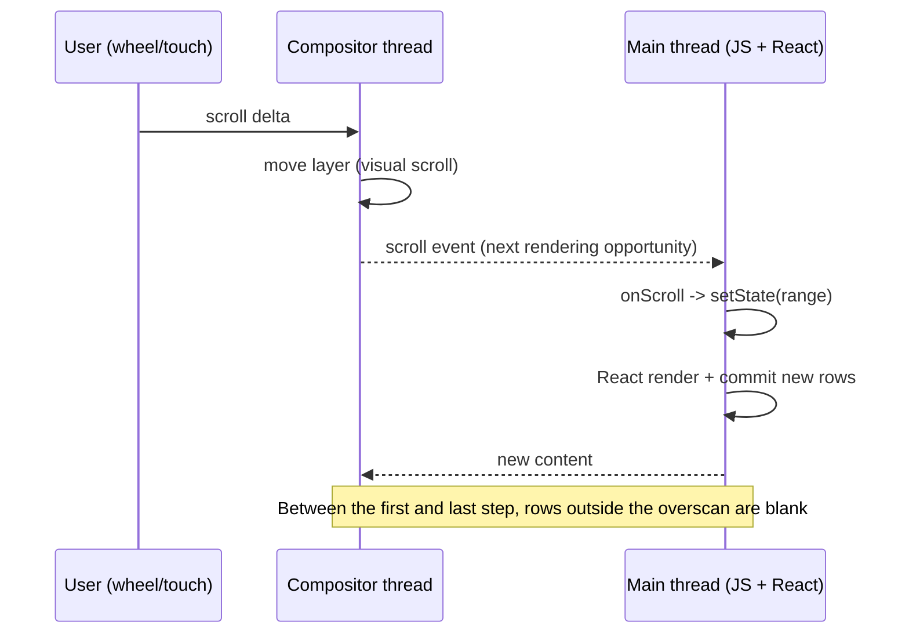
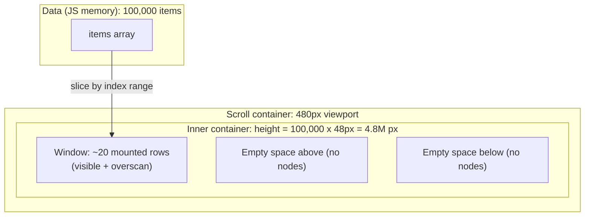
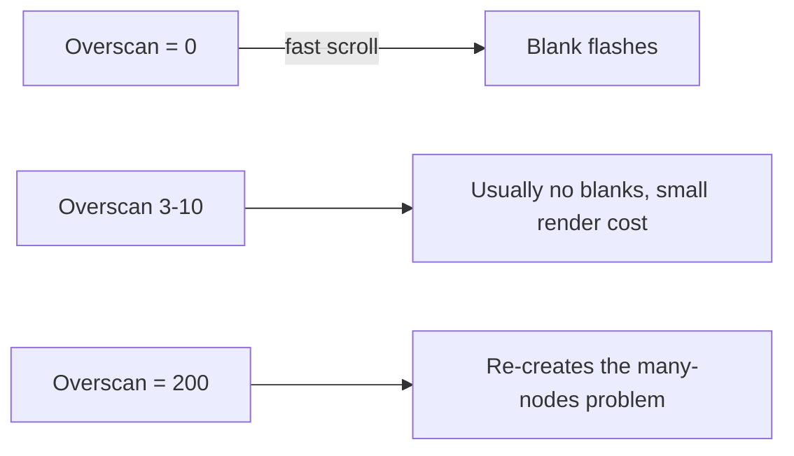

# 07 / 09 — Windowing and Virtualization

## 1. Lesson metadata

| | |
|---|---|
| **Level** | Advanced |
| **Study time** | 5–6 hours (reading 2 h, experiments 2 h, exercises 1.5–2 h) |
| **Prerequisites** | [01 — Measure before optimizing](./01-measure-before-optimizing.md), [02 — Profiler workflows](./02-profiler-workflows.md), [08 — Rendering large collections](./08-rendering-large-collections.md), [Phase 1 — Lists, keys and identity](../01-react-fundamentals/09-lists-keys-and-identity.md), [Phase 0 — DOM structure and mutation](../00-web-and-javascript-foundations/04-dom-structure-and-mutation.md), [Phase 0 — Rendering pipeline](../00-web-and-javascript-foundations/03-browser-rendering-pipeline.md) |
| **Next** | [10 — Expensive computations](./10-expensive-computations.md) |
| **Related** | [23 — Counterproductive optimizations](./23-counterproductive-optimizations.md), [Project 5 — Data-heavy interface](../projects/) |

**Learning objectives.** After this lesson you can:
1. Explain what windowing does and which costs it removes (React render, DOM nodes, style/layout/paint, memory) and which it does *not* remove (data fetching, sorting, filtering).
2. Implement fixed-height windowing from scratch and explain every arithmetic step.
3. Choose between a hand-rolled window, a library (TanStack Virtual, react-window), pagination, infinite loading, and CSS `content-visibility`.
4. Handle variable row heights, overscan, scroll restoration, keyboard focus, and accessibility semantics.
5. Measure before/after with the Profiler and the Performance panel, and recognize when virtualization is counterproductive.

**Concepts covered:** DOM node count as a cost driver, viewport window, overscan, spacer/total-size container, absolute positioning vs padding spacers, fixed vs measured vs estimated row size, scroll anchoring, `aria-rowcount`/`aria-rowindex`, find-in-page loss, `content-visibility: auto`, browser maximum element height, windowing + `memo`.

---

## 2. Deep conceptual explanation

### 2.1 What problem is this lesson solving?

[Lesson 08](./08-rendering-large-collections.md) showed that rendering a large collection has several separate costs:

| Cost | Scales with | Where it shows up |
|---|---|---|
| React render (calling row components, creating elements) | rows rendered | Profiler "Render duration" |
| Reconciliation / commit (creating or updating DOM nodes) | rows rendered or changed | Profiler "Commit", Performance panel "Scripting" |
| Style recalculation, layout, paint | DOM nodes and their styles | Performance panel "Rendering", "Painting" |
| Memory | DOM nodes + fibers + props | Memory panel, heap snapshots |
| Initial network + parse of data | data size | Network panel |

Memoization ([04 — Memoization trade-offs](./04-memoization-trade-offs.md)) can reduce the first one for *updates*, but it does nothing for the **initial mount** of 20,000 rows, nor for the DOM nodes that exist while the user is looking at only 25 of them.

**Windowing** (also called **virtualization**) attacks the root: *only render the rows the user can currently see (plus a small buffer)*. The scroll container still *behaves* as if all rows exist — the scrollbar has the right length and the right position — but the DOM contains a few dozen children instead of tens of thousands.

### 2.2 First principles: what does a scrolling list really need?

A scrollable list needs three things:

1. A **scroll container** with a fixed viewport height (`overflow: auto`).
2. An **inner content height** equal to the total height of all rows, so the browser draws a scrollbar of the right size.
3. The **visible rows positioned at the right offset** inside that content.

The browser does (1) and (2) natively for any content with the right height. Windowing's insight is that (2) does not require the rows to *exist*; a single empty element with `height: totalHeight` produces the same scrollbar. Then we only need to compute which rows intersect `[scrollTop, scrollTop + viewportHeight]` and absolutely position just those.

For fixed row height `h`, viewport `V`, scroll offset `s`, total rows `n`:

```
firstVisible = floor(s / h)
lastVisible  = ceil((s + V) / h) - 1       // inclusive
startIndex   = max(0, firstVisible - overscan)
endIndex     = min(n - 1, lastVisible + overscan)
totalHeight  = n * h
rowTop(i)    = i * h
```

Everything else in this lesson is a refinement of those formulas for harder cases: unknown heights, grids, sticky headers, dynamic data, and accessibility.

### 2.3 What windowing is *not*

- It is **not** a React feature. React has no built-in virtualization. It is a pattern implemented with ordinary state, refs and layout.
- It does **not** reduce the amount of data in memory. If you hold 200,000 objects in an array, they stay in memory. (Pagination or server-side windowing addresses that.)
- It does **not** make sorting, filtering or grouping cheaper. Those operate on the full array ([10 — Expensive computations](./10-expensive-computations.md)).
- It does **not** make each *visible* row cheaper. A 40 ms row will still cost 40 ms times the visible count.
- It does **not** come free. You lose native find-in-page (Ctrl/Cmd+F) for off-screen rows, simple tab order, simple screen-reader semantics, CSS-only layouts, and some copy/select behaviors.

### 2.4 Related techniques, so the choice is deliberate

| Technique | Idea | Cuts DOM nodes? | Keeps find-in-page? |
|---|---|---|---|
| Pagination | Server/client splits into pages of N | Yes | Per page only |
| "Load more" / infinite scroll (append-only) | Append pages as user scrolls | No — DOM grows forever | Yes (loaded part) |
| Windowing | Render only the viewport slice | Yes | No (off-screen rows absent) |
| Windowing + infinite loading | Fetch pages on demand and window the result | Yes | No |
| `content-visibility: auto` | Browser skips rendering (style/layout/paint) of off-screen subtrees | **No** (nodes exist; React still renders them) | Mostly yes (browser keeps content searchable) |
| Collapsing groups | Hide detail until expanded | Yes, if unmounted | Depends |

*Browser notes:* `content-visibility` ships in Chrome 85+, Firefox 125+, Safari 18+ (MDN compat data, 2026-10-22). The exact behavior of find-in-page against skipped content still varies by browser; test it.

### 2.5 Misconceptions

| Misconception | Reality |
|---|---|
| "Virtualize every long list." | Virtualization has a fixed engineering and UX cost. For a few hundred simple rows, plain rendering is usually fine. Measure. |
| "Windowing makes scrolling smooth by itself." | It reduces DOM size, but if your visible rows are expensive, or you update React state on every scroll event with heavy work, scrolling can get *worse*. |
| "More overscan is safer." | Overscan trades blank-flash risk against rendering more rows per scroll step. Too much overscan re-creates the original problem. |
| "Keys don't matter in virtualized lists." | Keys must be *stable item identity* (not the window index), or rows will remount/reuse incorrectly and lose state while scrolling. |
| "The library handles accessibility." | Libraries position rows; you supply semantics (`role`, `aria-rowindex`, focus management). |
| "`memo` on rows is what makes it fast." | Windowing alone does most of the work. `memo` helps when the parent re-renders per scroll tick. |

---

## 3. Internal mechanics

### 3.1 Scroll events, rendering opportunities and React

A scroll gesture updates `scrollTop` on the scroll container. Browsers usually fire `scroll` events at most once per frame (aligned with the rendering update), so a handler runs about 60–120 times per second during active scrolling.

*Public guarantee:* the HTML standard fires scroll events as part of "update the rendering", so they are coalesced per frame. *Implementation detail:* for some scroll types (e.g., touch/trackpad fling on the compositor), the visual scroll may be applied by the **compositor thread before** your JS handler runs. This is why fast scrolling can show **blank space** for a frame or two: pixels moved, your React render for the new window has not yet committed. Overscan is the mitigation.



### 3.2 State shape: store the range, not the pixel offset

A naive implementation does `setScrollTop(e.currentTarget.scrollTop)`. That re-renders the list component on **every** scroll event even when the visible *set of rows* is unchanged (scrolling 3 px within a 40 px row). The refinement:

- Keep the **start index** (or `[start, end]`) in state.
- In the handler compute the new index; call `setState` with the same primitive value when nothing changed. React bails out when `Object.is` says the state is equal, so no re-render happens ([Phase 3 — useState internals](../03-react-state-and-hooks/01-usestate-internals-and-update-semantics.md)).

The eager bail-out path is an optimization React may or may not take. Executed in the sandbox (React 19.3): the first `setState(0)` on state already `0` caused no render, but calling `setState(1)` again right after a state change to `1` did call the component function once more (without committing children).  Treat "same value does not re-render children" as the guarantee and "does not call the component function again" as an implementation detail.

### 3.3 Absolute positioning vs spacer elements

Two layouts are common:

| Layout | How | Pros | Cons |
|---|---|---|---|
| **Absolute** | Inner container `position: relative; height: total`; each row `position: absolute; top: offset` (or `transform: translateY`) | Rows independent; easy variable heights with measured offsets | Rows are out of flow (CSS table/flex/grid inheritance lost); each row needs explicit width |
| **Spacer** | A top spacer `div` with height `startOffset`, then rows in normal flow, then a bottom spacer | Rows remain in normal flow (natural width, native table semantics possible) | Changing row heights shifts everything; sticky behavior trickier |

TanStack Virtual's documentation examples use absolute positioning with a translate; many table implementations use padding/spacer rows. Both are valid.

`transform: translateY()` positions can be composited cheaply, but promote layers; thousands of promoted layers can hurt memory. Windowing keeps the count small, which is part of why they pair.

### 3.4 Variable row heights

With unknown heights, you cannot compute `floor(s / h)`. Three strategies:

1. **Estimate + measure.** Start with an estimated size per row; after rows mount, measure real heights (`ResizeObserver` or `getBoundingClientRect`), store them in a map, and recompute offsets using a prefix-sum (cumulative offsets). Lookup of the first visible row uses binary search over the offsets.
2. **Pre-compute.** If you can compute height from data (e.g., known text lines at a fixed width/font), do it. Fragile with fonts and responsive widths.
3. **Constrain.** Design rows with fixed or bucketed heights (e.g., two sizes).

The hard part is **scroll jump**: when a row above the viewport is measured and found taller than its estimate, everything below shifts. Libraries compensate by adjusting `scrollTop` by the delta. If you hand-roll this you must do it in a layout effect so no frame paints in-between ([Phase 3 — useLayoutEffect](../03-react-state-and-hooks/08-uselayouteffect.md)).

### 3.5 Maximum element height

Browsers cap the height of an element. The exact limit differs by engine and version (on the order of tens of millions of CSS pixels in Chromium-based browsers and lower in some others — *measure on your target browsers*). At 40 px per row, a few hundred thousand rows would approach it. Libraries and bespoke implementations handle this by scaling the scroll range (scrolling in a virtual coordinate space) — one more reason to prefer server-side windowing at that scale.

### 3.6 Identity, keys, and state in rows

When the window moves, rows leaving the range **unmount** (state lost, effects cleaned up) and rows entering **mount**. Consequences:

- Uncontrolled input state inside a row vanishes on scroll away. Lift it ([Phase 3 — State colocation and lifting](../03-react-state-and-hooks/18-state-colocation-and-lifting.md)) or store it keyed by item id.
- Use `key={item.id}` rather than `key={index}` or `key={virtualRow.index}` when rows can be inserted, removed or reordered. With index keys, row *content* can change while the component instance stays, leaking state across items. Keys are covered in [Phase 1 — Lists, keys and identity](../01-react-fundamentals/09-lists-keys-and-identity.md).
- Do expensive per-row setup (subscriptions, fetches) knowing it may repeat each time the row re-enters the window.

---

## 4. Step-by-step execution walkthrough

Scenario: a 10,000-row fixed-height (40 px) list in a 400 px viewport, overscan 3, and the user scrolls from `scrollTop = 0` to `scrollTop = 1000`.

1. **Initial render.** `start = 0`. `end = ceil((0 + 400)/40) + 3 = 13` (exclusive end). React renders 13 rows. DOM children: 13. Inner container height = `10,000 × 40 = 400,000 px`, giving a proportionally tiny scrollbar thumb.
2. **User scrolls 1 px.** `scrollTop = 1`. Handler computes `start = max(0, floor(1/40) − 3) = 0` — unchanged. `setStart(0)` bails out. No render. The browser has already moved the pixels.
3. **User reaches `scrollTop = 160`.** `floor(160/40) = 4`, `start = max(0, 4 − 3) = 1`. State changes → React schedules a render.
4. **Render.** Rows 1–16 (`end = ceil(560/40)+3 = 17`, exclusive). Row 0 is removed, row 14, 15, 16 are added. Rows 1–13 retain their keys → React **updates** them (often no-ops, or skipped with `memo`) rather than remounting. Only 1 unmount and 3 mounts.
5. **Commit.** DOM: remove one node, append three. Each new row has `top = index × 40`. Style/layout touches only a few nodes because absolute positioning confines layout effects to the inner container.
6. **Fast fling to `scrollTop = 200,000`.** The compositor may scroll the pixels before React renders. The window jumps from rows 1–16 to rows 4997–5012: all rows unmount and all mount — it is the "teleport" case, costing roughly one 13-row mount, which is still small. During the frame(s) before commit, the user may see a blank region.
7. **Cleanup.** Each unmounted row's effects clean up. If rows registered scroll or resize observers, they must unobserve — otherwise listeners accumulate ([19 — Memory leaks](./19-memory-leaks.md)).

---

## 5. Code examples

### 5.1 Minimal example — fixed-height window from scratch

```tsx
import { useState, type ReactNode } from "react";

type FixedWindowProps<T> = {
  items: readonly T[];
  rowHeight: number;           // px, every row identical
  height: number;              // viewport height in px
  overscan?: number;           // extra rows above and below
  getKey: (item: T) => string | number;
  renderRow: (item: T, index: number) => ReactNode;
};

export function FixedWindow<T>({
  items,
  rowHeight,
  height,
  overscan = 3,
  getKey,
  renderRow,
}: FixedWindowProps<T>) {
  const [scrollTop, setScrollTop] = useState(0);

  const first = Math.floor(scrollTop / rowHeight);
  const last = Math.ceil((scrollTop + height) / rowHeight); // exclusive
  const start = Math.max(0, first - overscan);
  const end = Math.min(items.length, last + overscan);

  const rows: ReactNode[] = [];
  for (let i = start; i < end; i++) {
    const item = items[i];
    rows.push(
      <div
        key={getKey(item)}
        style={{
          position: "absolute",
          top: i * rowHeight,
          left: 0,
          right: 0,
          height: rowHeight,
        }}
      >
        {renderRow(item, i)}
      </div>,
    );
  }

  return (
    <div
      style={{ height, overflow: "auto" }}
      onScroll={(e) => setScrollTop(e.currentTarget.scrollTop)}
    >
      <div style={{ height: items.length * rowHeight, position: "relative" }}>
        {rows}
      </div>
    </div>
  );
}
```

**Line notes**

- `last` is exclusive: `ceil((scrollTop + height) / rowHeight)` is the index just past the last partially visible row. `end = min(items.length, last + overscan)` keeps the loop within bounds.
- The inner `div` is what gives the scrollbar its size. It has no children that contribute to its height because they are absolutely positioned, which is why we set `height` explicitly.
- `key={getKey(item)}` uses item identity. Not `i`.
- `onScroll` stores `scrollTop` in state. Simple but renders on every scroll event (fixed in 5.5).

**Predict:** with `rowHeight = 40`, `height = 400`, `overscan = 3`, `items.length = 10_000`, and `scrollTop = 0`, how many row elements are in the DOM? *Answer:* `first = 0`, `last = ceil(400/40) = 10`, `start = 0`, `end = min(10000, 13) = 13` → **13 rows**, not 10, because overscan applies only at the bottom when at the top (nothing above to render).

### 5.2 Practical example — TanStack Virtual with a real data shape

*Library API note:* the following uses `@tanstack/react-virtual` v3 (`useVirtualizer`; checked with 3.14.x, the snippet typechecks under strict TypeScript). Majors have renamed APIs before, so check <https://tanstack.com/virtual> if you install a different major.

```tsx
import { useRef } from "react";
import { useVirtualizer } from "@tanstack/react-virtual";

type Transaction = { id: string; merchant: string; amountMinor: number; currency: string };

export function TransactionList({ items }: { items: readonly Transaction[] }) {
  const parentRef = useRef<HTMLDivElement>(null);

  const virtualizer = useVirtualizer({
    count: items.length,
    getScrollElement: () => parentRef.current,
    estimateSize: () => 48,
    overscan: 8,
    getItemKey: (index) => items[index].id,
  });

  return (
    <div
      ref={parentRef}
      role="table"
      aria-label="Transactions"
      aria-rowcount={items.length}
      style={{ height: 480, overflow: "auto" }}
    >
      <div style={{ height: virtualizer.getTotalSize(), position: "relative" }}>
        {virtualizer.getVirtualItems().map((vi) => {
          const tx = items[vi.index];
          return (
            <div
              key={vi.key}
              role="row"
              aria-rowindex={vi.index + 1}
              style={{
                position: "absolute",
                top: 0,
                left: 0,
                width: "100%",
                height: vi.size,
                transform: `translateY(${vi.start}px)`,
              }}
            >
              <span role="cell">{tx.merchant}</span>
              <span role="cell">{formatMoney(tx.amountMinor, tx.currency)}</span>
            </div>
          );
        })}
      </div>
    </div>
  );
}

function formatMoney(minor: number, currency: string): string {
  return new Intl.NumberFormat(undefined, { style: "currency", currency }).format(minor / 100);
}
```

Notes:

- `getItemKey` makes the library key by identity so measurement caches follow the item, not the index.
- `aria-rowcount` + `aria-rowindex` tell assistive technology the true size even though only ~20 rows are in the DOM. A real ARIA table also needs `role="rowgroup"` / header rows; see the [WAI-ARIA Authoring Practices](https://www.w3.org/WAI/ARIA/apg/) for table and grid patterns. For an interactive data grid (keyboard navigation), the Grid pattern applies and is substantially more work.
- `estimateSize` returning a constant means fixed rows; for variable rows see 5.5.
- `useVirtualizer` returns an object with methods; its identity semantics matter for the React Compiler and memoization. The React Compiler's built-in module type provider marks `useVirtualizer` and `useWindowVirtualizer` as known-incompatible ("returns functions that cannot be memoized safely"), so components using them are not compiled (react repo, `DefaultModuleTypeProvider.ts`, checked 2026-10-22). See [08 — React Compiler](../09-advanced-rendering-and-ecosystem/08-react-compiler.md).

### 5.3 Incorrect example — windowing that makes things worse

```tsx
function BadList({ items }: { items: Item[] }) {
  const [scrollTop, setScrollTop] = useState(0);
  const start = Math.floor(scrollTop / 40);
  const visible = items.slice(start, start + 20);

  return (
    <div
      style={{ height: 800, overflow: "auto" }}
      onScroll={(e) => setScrollTop(e.currentTarget.scrollTop)}
    >
      {visible.map((item, i) => (
        <Row key={i} item={item} />      // (1)
      ))}
    </div>
  );
}
```

**Predict what happens when the user scrolls.** Before reading: there are at least four defects.

1. **No inner element with total height.** The container's content height is only 20 rows; the scrollbar covers 20 rows' worth, so the user hits the end after 800 px and `scrollTop` can never exceed that. The list is effectively 20 rows.
2. **No offset.** Even if scrolling were possible, rows are not positioned at `start × 40`; they stay at the top, so the content would visually scroll away and be replaced by itself.
3. **`key={i}`** (index inside the slice). When `start` changes by 1 every row's *content* changes while instance identity stays: rows that hold local state (an expanded toggle, an input) display state for the wrong item.
4. **No overscan** → blank flashes during fast scrolling; **window is 20 rows but the viewport is 800 px / 40 px = 20 rows exactly**; any row taller than 40 px shows a gap at the bottom.

### 5.4 Corrected implementation

```tsx
function GoodList({ items }: { items: readonly Item[] }) {
  return (
    <FixedWindow
      items={items}
      rowHeight={40}
      height={800}
      overscan={5}
      getKey={(item) => item.id}
      renderRow={(item) => <Row item={item} />}
    />
  );
}
```

It uses the component from 5.1: total-height inner element, absolute offset per row, identity keys, overscan.

### 5.5 Advanced example — range state and measured heights

Two refinements: (a) re-render only when the row *range* changes; (b) measure rows with `ResizeObserver`-driven sizes.

```tsx
import { useCallback, useLayoutEffect, useMemo, useRef, useState } from "react";

type Range = { start: number; end: number };

function sameRange(a: Range, b: Range) {
  return a.start === b.start && a.end === b.end;
}

export function useFixedRange(opts: {
  count: number;
  rowHeight: number;
  overscan: number;
  getViewportHeight: () => number;
}) {
  const { count, rowHeight, overscan, getViewportHeight } = opts;
  const [range, setRange] = useState<Range>({ start: 0, end: 0 });

  const update = useCallback(
    (scrollTop: number) => {
      const vh = getViewportHeight();
      const first = Math.floor(scrollTop / rowHeight);
      const last = Math.ceil((scrollTop + vh) / rowHeight);
      const next = {
        start: Math.max(0, first - overscan),
        end: Math.min(count, last + overscan),
      };
      // Return the previous object when equal: React bails out of the update.
      setRange((prev) => (sameRange(prev, next) ? prev : next));
    },
    [count, rowHeight, overscan, getViewportHeight],
  );

  return { range, update };
}
```

The updater form returns the **same object reference** when nothing changed, so React sees `Object.is(prev, next)` and skips re-rendering the consumer (guarantee), avoiding work for in-row scrolling.

For variable heights, a small prefix-sum with binary search:

```ts
export function buildOffsets(sizes: readonly number[]): number[] {
  const offsets = new Array<number>(sizes.length + 1);
  offsets[0] = 0;
  for (let i = 0; i < sizes.length; i++) offsets[i + 1] = offsets[i] + sizes[i];
  return offsets; // offsets[i] = top of row i, offsets[n] = total height
}

/** Largest i such that offsets[i] <= y (clamped to [0, n-1]). */
export function findIndexAt(offsets: readonly number[], y: number): number {
  let lo = 0;
  let hi = offsets.length - 2;
  while (lo < hi) {
    const mid = (lo + hi + 1) >>> 1;
    if (offsets[mid] <= y) lo = mid;
    else hi = mid - 1;
  }
  return lo;
}
```

Complexity: building offsets is O(n) per size change (libraries use cleverer incremental structures); lookup is O(log n). When a measured row's size changes, offsets after it shift; if that row is **above** the current viewport, adjust `scrollTop` by the delta inside the same layout effect to avoid visible jumps. In production use a library for this; getting scroll anchoring right across browsers is an exercise in edge cases (see Exercise F1).

---

## 6. Visual explanations

### What exists where



### Cost comparison (illustrative shape, not measurements)

```text
Mounted rows        Initial render      Update on parent re-render
Plain, 10,000       O(10,000)           O(10,000) unless row memo + stable props
Windowed, 10,000    O(~25)              O(~25) + scroll-driven mounts
```

### Overscan trade-off



---

## 7. Alternative approaches and trade-offs

| Approach | DOM size | Complexity | Find-in-page | A11y | Variable heights | Best when |
|---|---|---|---|---|---|---|
| Plain render | O(n) | None | Native | Native | Native | n small (hundreds), simple rows |
| Pagination | O(page) | Low (server cooperation) | Per page | Native | Native | Users navigate by page; data is huge |
| Infinite append | O(loaded) grows | Low | Native | OK, can trap focus | Native | Feed-style, bounded session length |
| Hand-rolled fixed window | O(window) | Medium | Lost | You build | Hard | Fixed rows, no new dependency desired |
| TanStack Virtual (headless) | O(window) | Medium | Lost | You build | Supported (measure) | Custom layouts, grids, tables |
| react-window / similar component libs | O(window) | Low–Medium | Lost | You build | Supported (API varies by version) | Standard lists/grids |
| `content-visibility: auto` | O(n) nodes, skipped render | Low | Mostly kept | Native | Native with intrinsic size | Moderate n (hundreds to a few thousand), React render cost not dominant |
| Server-side windowing (cursor/offset API) | O(window) data too | High | Server search | Native/manual | Native | Millions of rows, memory matters |

**When the recommended approach (windowing) is *not* best:**

- *A 300-row list of simple text rows.* Mounting 300 cheap rows takes a few milliseconds (typical, machine-dependent; measure). Virtualizing adds code, an ARIA burden, and breaks Ctrl+F. Fix the real bottleneck instead (probably something else).
- *Users must find text with browser search* (documentation, legal text, logs they `Ctrl+F`). Provide an in-app search that scrolls to match, or use pagination, or `content-visibility`.
- *The cost is the data, not the DOM.* A 5 MB JSON parse blocks the main thread regardless of what you render.
- *Rows with complex, content-dependent heights (images with unknown aspect ratio, rich text)* may cause jumps that cost more UX than the performance gains.

---

## 8. Best practices and anti-patterns

**Beginner mistakes**

- Using `key={index}` (see 5.3).
- Forgetting the total-height container, producing a broken scrollbar.
- Rendering the list inside a parent with no fixed height (the scroll container must have a bounded height — `height`, `max-height`, or a flex/grid parent that constrains it, with `min-height: 0` on flex children).
- Putting the heavy virtualized list inside a *non-scrolling* page and listening to `window` scroll without handling the container offset.

**Experienced-developer mistakes**

- Virtualizing before measuring ([01](./01-measure-before-optimizing.md)): the slow thing was a per-row context subscription or a synchronous `sort` in render.
- Triggering `setState` for all scroll events with large derived state.
- Row components that call hooks fetching data per row without caching, so scrolling issues hundreds of requests. Dedupe with a data layer ([Phase 6](../06-data-fetching-and-state-ecosystems/)) and cancel/ignore stale results.
- Measuring row heights by reading `offsetHeight` in each row's layout effect, causing forced synchronous layout per row ("layout thrashing", see [Phase 0 — Rendering pipeline](../00-web-and-javascript-foundations/03-browser-rendering-pipeline.md)). Batch with one `ResizeObserver`.
- Ignoring keyboard: when focused row scrolls out of range it unmounts and focus is lost to `<body>`.

**Smells**

- A `Math.random()` or `Date.now()` in keys.
- "Jumpy" scroll when images load (heights unknown until loaded; reserve space via `aspect-ratio` or fixed thumbnails).
- A virtualized list nested inside another scroll container with different scroll parents.

**Justified exceptions**

- Hand-rolling is reasonable for 30 lines of fixed-height windowing in a constrained internal tool; adopt a library once variable height, horizontal windowing, or sticky headers appear.
- Virtualizing a 500-row list is justified if each row is genuinely heavy (charts, editors) *and* you measured.

**Accessibility essentials**

- Expose total counts: `aria-rowcount` on the table/grid, `aria-rowindex` on rows (1-based); for lists, `aria-setsize` and `aria-posinset` on items.
- Keep the focused element mounted: remember `focusedIndex` and force it into the rendered range ("pinned" row) — most libraries expose an option like `rangeExtractor` for this (TanStack Virtual: `rangeExtractor`, confirmed in its type definitions).
- Provide non-scroll navigation (search, "go to row", Home/End) for large sets.

---

## 9. Real-world application

**Finance — transaction ledger (100k+ rows).** Constraints: audit-quality sorting, running balances, copy/export. Approach: server-side sort/filter + cursor-paginated fetch, client-side windowing of fetched pages, export through a server endpoint (not "copy the DOM"). Selection state held as `Set<id>`, not row component state, because rows unmount.

**Dashboard — log viewer.** Appends new log lines at 50/s. Pitfall: auto-scroll "stick to bottom" logic fighting the user's manual scroll. Pattern: track `isAtBottom` via a scroll listener with a small tolerance; only auto-scroll when true; cap buffer size (ring buffer) to bound memory.

**E-commerce — product grid.** Responsive columns change with viewport width, so *row* count and row height depend on layout. Virtualize **rows of cards** (each virtual row contains N cards, with N from a `ResizeObserver`/container query). Images lazy-load natively (`loading="lazy"`) in addition to windowing; reserve image space with `aspect-ratio` to prevent jumps. SEO-sensitive listings should render the first page on the server ([Phase 9](../09-advanced-rendering-and-ecosystem/01-spa-ssr-ssg-streaming.md)); windowing is a client concern.

**Multi-team design system.** A shared `<VirtualList>` should standardize: item key contract, ARIA role contract, estimated size API, scroll-restoration hook, and a documented "when not to use" note, so product teams stop virtualizing five-item lists.

**Engineering constraints to state up front:** target devices (low-end Android?), maximum dataset size, whether find-in-page is required, a11y conformance level, and whether rows have stateful editors.

---

## 10. Debugging and troubleshooting

| Symptom | Likely root cause | Investigation | Fix |
|---|---|---|---|
| Blank gaps during fast scroll | Overscan too low; row render too slow | Performance panel: long "Render" after scroll event; React Profiler commit time per scroll step | Raise overscan modestly; make rows cheaper; avoid state updates on each scroll tick |
| Scroll jumps when scrolling up | Estimated vs measured height mismatch for rows above viewport | Log measured vs estimated sizes; observe `scrollTop` adjustments | Better estimates; scroll anchoring compensation; reserve image dimensions |
| Row state resets while scrolling | Row unmounts out of window | Add `useEffect(() => { console.log("mount", id); return () => console.log("unmount", id) }, [id])` | Lift state to list-level store keyed by id |
| Wrong data in a row after scroll | `key={index}`/slice index key | Inspect keys in React DevTools Components tab | Key by item identity |
| Scrollbar shows wrong length / list ends early | Inner total-size element missing or computed from stale count | DevTools Elements: inspect inner `height` | Recompute from `count`/measured sizes |
| List does not scroll at all | Container has no bounded height | Elements panel computed height; flex ancestors lacking `min-height: 0` | Constrain height |
| Frame drops while scrolling although only 20 rows | Visible rows expensive (images decoding, shadows, big CSS) or main-thread work in scroll handler | Performance panel: look for Paint/Layout/"Decode image" in frames; Layers panel | Simplify row CSS, `will-change` sparingly, smaller images |
| Ctrl+F doesn't find text | Expected: rows not in DOM | n/a | Provide in-app search |

**Validate a fix** with the methodology in §11's Level D and the measurement protocol in [01](./01-measure-before-optimizing.md): fix the dataset, device throttling (CPU 4x/6x slowdown in DevTools), run at least 5 recordings of the same scripted interaction, compare median Profiler commit time, scripting time and long-task count before/after. Report **median and spread**, not the best run.

### Measurement methodology for this lesson

1. **Baseline** the unvirtualized list: Profiler record of initial mount (Render + commit time), Performance panel for a scripted 3-second scroll (total Scripting, Rendering, Painting ms; dropped frames in the Frames track), `document.querySelectorAll('*').length` for DOM size.
2. **Single change**: introduce windowing only.
3. **Re-measure** the same metrics with the same CPU throttling and the production build. Development builds inflate React costs.
4. **Look for regressions**: scrolling smoothness (frame rate), INP for interactions inside rows, memory after a long scroll, behavior on resize.
5. **Decision rule**: keep the change only if it moves a user-visible metric (INP of a row click, frame drops, mount time) on a representative device, by an amount that matters.

---

## 11. Exercises

### Level A — Knowledge
A1. List the three elements/pieces of information required to make a windowed list's scrollbar behave like a full list.
A2. What does overscan protect against, and what does it cost?
A3. Name two things windowing does *not* reduce.
A4. Why is `key={index}` wrong for windowed rows?
A5. Which ARIA attributes communicate the true size and position of a virtualized table row?

### Level B — Code comprehension
B1. With `rowHeight = 50`, `height = 300`, `overscan = 2`, `items.length = 100`, and `scrollTop = 1000`, compute `start` and `end` using the formulas in 5.1.
B2. In 5.5's `findIndexAt`, `offsets = [0, 30, 70, 100, 150]` (4 rows). What index does `findIndexAt(offsets, 70)` return? What about `y = 149`?
B3. A parent re-renders every 100 ms because of a clock and passes a new inline `renderRow` closure each time to `FixedWindow`. If `Row` is wrapped in `memo`, will rows skip rendering? Explain what *does* re-run.

### Level C — Implementation
C1. Add `scrollToIndex(i)` to `FixedWindow` (imperative handle via a ref prop; React 19 passes `ref` as a regular prop for function components).
C2. Extend 5.5's `useFixedRange` into a horizontal + vertical grid window (fixed cell size).
C3. Write a hook `useStickToBottom(ref)` for a log viewer.

### Level D — Debugging
D1. A virtualized list shows each row's checkbox state correctly until the user scrolls away and back; then checked boxes are unchecked. Fix it without disabling virtualization.
D2. After adding TanStack Virtual to a product list, Lighthouse INP got *worse* on an interaction that opens a row's details panel. List three hypotheses and the measurement for each.
D3. The list scrolls fine in Chrome but rows are blank for a long time in Safari on iOS. List what you would investigate.

### Level E — Architecture and engineering decisions
E1. A back-office table has 3,000 rows, 12 columns, inline editing, and users rely on Ctrl+F. Choose among plain render, windowing, pagination, `content-visibility`. Justify using explicit criteria.
E2. Design the contract of a shared `<VirtualList>` for a 6-team org.

### Level F — Expert challenge
F1. Implement scroll anchoring for variable-height windowing: when a measured row **above** the viewport changes height, `scrollTop` must be adjusted so visible content does not move. Specify what runs in which phase (render, layout effect, ResizeObserver callback) and how you avoid feedback loops.
F2. A product has 2 M rows. Propose an end-to-end architecture (API, caching, client windowing, selection, export) and the metrics you'd put in the performance budget ([21](./21-web-vitals-and-budgets.md)).

---

## 12. Detailed answers and explanations

> Attempt the exercises first.

**A1.** (1) A scroll container with bounded height and `overflow: auto`; (2) an inner element whose height equals total content height (`count × size`, or sum of measured/estimated sizes); (3) per-row offsets (absolute `top`/`translateY`, or top spacer) so visible rows sit at the correct position. Wrong answers: "just render fewer rows" — without (2) the scrollbar is wrong.

**A2.** It protects against blank areas when scrolling outpaces React's render/commit (compositor scroll vs main-thread update, §3.1). It costs rendering/mounting extra rows each time the window moves and increases DOM size. Too much overscan negates the gains.

**A3.** Any two of: data memory, fetch/parse time, sort/filter cost, per-row cost of visible rows, JS bundle size of the virtualization library, event listeners elsewhere.

**A4.** When the window moves, the item at slice position *k* changes but an index-keyed component instance at *k* is reused, so local state and DOM state (focus, input text, scroll in nested containers) are carried to a different item. Keys must be stable item identities. (Index keys are acceptable only for static lists that never reorder, filter or prepend; windowing changes the slice, which acts like reordering.)

**A5.** `aria-rowcount` on the table/grid and `aria-rowindex` on each rendered row (1-based). For simple lists: `aria-setsize` and `aria-posinset`.

**B1.** `first = floor(1000/50) = 20`; `last = ceil((1000+300)/50) = 26`; `start = 20 − 2 = 18`; `end = min(100, 26 + 2) = 28` (exclusive). Rows 18–27 → 10 rows. Trap: using 1-based indexes or inclusive end.

**B2.** `offsets[2] = 70 <= 70`, so index 2 (the row starting at 70). For `y = 149`: largest `i` with `offsets[i] <= 149` among `i ≤ hi = 3`: `offsets[3] = 100 ≤ 149` → 3. Note `hi = offsets.length − 2 = 3` clamps to the last row, so `y = 150` (the end) also returns 3, never the sentinel.

**B3.** `memo` compares props shallowly. `Row` receives `item` (stable reference) — *if* `renderRow` is called inside `FixedWindow` and returns `<Row item={item} />`, the `Row` element's props are `{ item }`, equal to last time → `Row` skips. What re-runs: `FixedWindow` itself (its parent re-rendered with a new prop), the loop creating ~13 wrapper `div` elements and `renderRow` calls, and reconciliation of those elements. That's cheap (O(window)). The wrapper `div` style objects are new each time but only produce a trivial DOM style diff. Had `Row` received the closure as a prop, memo would be defeated ([05 — Referential equality](./05-referential-equality.md)).

**C1.** Sample: give `FixedWindow` an optional `handleRef` prop (in React 19 `ref`-like props on function components are ordinary props) and attach an internal scroller ref.

```tsx
import { useImperativeHandle, useRef, useState, type ReactNode, type Ref } from "react";

export type WindowHandle = { scrollToIndex: (i: number) => void };

type Props<T> = {
  items: readonly T[];
  rowHeight: number;
  height: number;
  overscan?: number;
  getKey: (item: T) => string | number;
  renderRow: (item: T, index: number) => ReactNode;
  handleRef?: Ref<WindowHandle>;
};

export function ScrollableWindow<T>({
  items, rowHeight, height, overscan = 3, getKey, renderRow, handleRef,
}: Props<T>) {
  const scrollerRef = useRef<HTMLDivElement>(null);
  const [scrollTop, setScrollTop] = useState(0);

  useImperativeHandle(handleRef, () => ({
    scrollToIndex(i) {
      const el = scrollerRef.current;
      if (!el || items.length === 0) return;
      const clamped = Math.max(0, Math.min(i, items.length - 1));
      el.scrollTop = clamped * rowHeight; // fires a scroll event -> range updates
    },
  }), [items.length, rowHeight]);

  const start = Math.max(0, Math.floor(scrollTop / rowHeight) - overscan);
  const end = Math.min(items.length, Math.ceil((scrollTop + height) / rowHeight) + overscan);
  const rows: ReactNode[] = [];
  for (let i = start; i < end; i++) {
    rows.push(
      <div key={getKey(items[i])} style={{ position: "absolute", top: i * rowHeight, left: 0, right: 0, height: rowHeight }}>
        {renderRow(items[i], i)}
      </div>,
    );
  }
  return (
    <div ref={scrollerRef} style={{ height, overflow: "auto" }} onScroll={(e) => setScrollTop(e.currentTarget.scrollTop)}>
      <div style={{ height: items.length * rowHeight, position: "relative" }}>{rows}</div>
    </div>
  );
}
```

Evaluation criteria: sets `scrollTop` on the container (the resulting scroll event updates the range, so no duplicate state); clamps the index; `ref` handled as a prop, not `forwardRef` (legacy). Edge cases: called before mount (ref null), empty list, list shorter than the viewport (the browser clamps `scrollTop`), fractional device pixel ratios.

**C2.** Criteria: horizontal `startCol/endCol` computed with `floor(scrollLeft / cellWidth)`; state holds one range object with four numbers and the same bail-out trick; cell positioned with `top = r*h`, `left = c*w`; inner size `rows*h × cols*w`; keys `${rowId}:${colId}`. Edge: sticky first column requires separate layering.

**C3.** Core: `const stick = useRef(true)`; in `onScroll` set `stick.current = el.scrollHeight - el.scrollTop - el.clientHeight < 8`; in a `useLayoutEffect` that runs after new lines render, if `stick.current` set `el.scrollTop = el.scrollHeight`. Why layout effect: avoid a painted frame at the old scroll position. Edge: when user scrolls up, stop sticking; when content shrinks (buffer trim) clamp.

**D1.** Root cause: checkbox state is local to the row (`useState`) → unmount loses it. Fix: store `selectedIds: Set<string>` (or `Record<string, boolean>`) in the list's parent (or a store) and make rows controlled: `checked={selected.has(item.id)}`. Update immutably: copy the set. Validate: scroll away and back; DevTools shows row mount count rising while selection persists. Wrong fix: increase overscan (hides the symptom for a few pixels), or `display: none` rows (defeats the purpose).

**D2.** Hypotheses: (1) the details panel is rendered inside the virtual row and triggers re-measure for all rows (layout) → measure with Performance "Recalculate Style/Layout" counts and `ResizeObserver` callbacks; (2) opening the panel changes `count`/`estimateSize` identity so the virtualizer recomputes everything → log `getVirtualItems()` recomputation, Profiler "why did this render"; (3) panel opens while a scroll anchoring/resize adjustment runs → Performance panel timeline overlapping long task. Also (4) visible rows are heavier than before due to added wrappers/ARIA. Method: record the interaction 5× before/after at 4x CPU throttle, compare input delay, processing time, presentation delay components of the INP interaction ([21](./21-web-vitals-and-budgets.md)).

**D3.** Investigate: Safari's momentum scrolling behavior (scroll events may fire less frequently during momentum — behavior has varied across versions, verify on device), CPU of the device, the rows' layout cost, images decoding, using `transform` vs `top`, overscan too small for iOS momentum speed, `-webkit-overflow-scrolling` legacy hacks. Use Safari Web Inspector on a real device; don't assume desktop Chrome throttling represents it.

**E1.** Criteria: dataset size (3,000 is modest), editing state (rows with inline editors lose state when unmounted unless lifted), search requirement (Ctrl+F explicit), cost per row (12 columns × 3,000 = 36k cells ≈ 36k+ DOM nodes → noticeable), a11y (grid semantics). Example well-reasoned answer: *first* measure. If initial mount > ~200 ms on target hardware or interactions exceed the INP budget, prefer pagination (server-side or client page size 100–200) because it preserves Ctrl+F per page, simple a11y, and editing state per page; add `content-visibility: auto` with `contain-intrinsic-size` on rows if scrolling cost is the issue and browser support is acceptable; use windowing only if users need continuous scroll over all rows, and then add an in-app search and lift edit state. A non-best-here trap: reaching for windowing first because "3,000 > 1,000".

**E2.** Criteria: explicit API (`items`, `getItemKey` required, `estimateSize`, `overscan` default), mandatory a11y props, documented focus-pinning, `scrollToIndex`, controlled selection (state lives outside rows), loading placeholder rows for infinite data, SSR behavior (render the first N), dev-only warning when `count < 50` ("probably do not need virtualization"), measurement hooks (emit render counts to analytics), a test harness, docs listing alternatives. A good answer addresses ownership, versioning of a third-party dependency behind the design-system boundary, and migration path.

**F1.** Sketch: keep `sizes: Map<id, number>` in a ref (not state) plus a version counter in state. A single `ResizeObserver` observes mounted rows. In its callback (runs after layout, before paint, in the same frame's "update the rendering" steps per the HTML spec), compute `delta = newSize − oldSize`; if the row's offset is **less than** the current `scrollTop`, accumulate `pendingScrollAdjust += delta`. Bump version (setState) so React re-renders with new offsets. In a `useLayoutEffect` after commit, if `pendingScrollAdjust ≠ 0`, set `scroller.scrollTop += pendingScrollAdjust`, then reset it. Avoid feedback loops: only act when `|delta| ≥ 1`, ignore adjustments caused by our own `scrollTop` writes (flag), and don't observe row wrapper height if it depends on the absolute `top`. Evaluate with: no visible shift on slow image load, no infinite scroll-event ping-pong. Many browsers also implement CSS scroll anchoring (`overflow-anchor`); it can fight manual adjustments, so decide explicitly (typically `overflow-anchor: none` on the scroller when you do it yourself).

**F2.** Criteria and example: keyset (cursor) pagination API with stable sort keys; server-side filter/sort; window of ~3 pages cached client-side (LRU), placeholder rows while loading; total count from a cheap approximate endpoint; selection as "all matching filter" + exclusions rather than a set of 2 M ids; export via async job; scrollbar mapping via virtual coordinates to dodge the element height cap; budgets: p75 INP < 200 ms for row interactions, scripting per scroll frame < 8 ms on a mid-range device, memory growth bounded after 10 minutes of scrolling. Failure modes: stale pages, count drift, rapid scrubbing flooding the API (debounce/cancel — see [14](./14-debounce-and-throttle.md)).

---

## 13. Senior engineer interview questions

**Q1. "Our 5,000-row table is slow. Do you virtualize?"**
*Strong answer:* Not first. Profile to find which cost dominates: render/commit, layout, paint, or data work. If initial mount and DOM size dominate and users scroll continuously, windowing is plausible; if a context update re-renders every row, fix propagation ([06](./06-context-propagation-cost.md)). Causal chain: windowing reduces cost proportional to mounted rows; if cost is per-update-per-row, memoization or state colocation may be cheaper and keep Ctrl+F.

**Q2. "What can go wrong with virtualized lists in production?"**
Blank flashes under fast scroll (compositor vs main thread), scroll jumps from measured-height changes, lost row state on unmount, focus loss, a11y gaps, missing find-in-page, request storms from per-row fetches, element height limits at very large sizes, memory leaks from unremoved observers.

**Q3. "Why do we update a range in state rather than `scrollTop`?"**
`scrollTop` changes on nearly every scroll event, but the visible slice changes only when crossing row boundaries. Same range → same state → React bails out → no render. It also lets `memo`/pure children avoid work.

**Q4. "How do you keep keyboard focus in a virtualized list?"**
Track the active index in state (not DOM), always include it in the rendered range (pinned), use roving tabindex or `aria-activedescendant` per the ARIA pattern, and scroll it into view when keys change it.

**Q5. "`content-visibility: auto` vs windowing?"**
`content-visibility` skips style/layout/paint for off-screen subtrees but React still renders and creates every node: it saves rendering pipeline work, not React work or memory, and keeps native search. Windowing saves all of them but loses native features. Choose by which cost dominates.

**Q6. "How would you prove a virtualization PR was worth merging?"**
Before/after on a fixed dataset with CPU throttling, production build, repeated runs, median and variance of: mount time (Profiler), scripting+rendering per scroll second, long-task count, INP of an interaction, DOM node count, memory; plus a UX checklist (find, focus, a11y, scroll restoration).

---

## 14. Further learning resources

| Resource | URL | Covers / why | Level | Section to study |
|---|---|---|---|---|
| React docs — Rendering lists | <https://react.dev/learn/rendering-lists> | Keys and list identity | Beginner | Keeping list items in order with `key` |
| React docs — `memo` | <https://react.dev/reference/react/memo> | Skipping re-renders with stable props | Intermediate | Usage, caveats |
| TanStack Virtual | <https://tanstack.com/virtual> | Headless virtualization API, examples (fixed, dynamic, grid, infinite) | Intermediate | Introduction, API for `useVirtualizer`, examples |
| react-window (GitHub) | <https://github.com/bvaughn/react-window> | Component-style lists/grids; v2 replaced `FixedSizeList`/`VariableSizeList` with `List`/`Grid` taking `rowComponent`, `rowCount`, `rowHeight`, `rowProps` | Intermediate | README for the version you install |
| MDN — `content-visibility` | <https://developer.mozilla.org/en-US/docs/Web/CSS/content-visibility> | Skipping off-screen rendering work | Intermediate | Syntax, accessibility notes |
| MDN — `ResizeObserver` | <https://developer.mozilla.org/en-US/docs/Web/API/ResizeObserver> | Measuring row sizes | Intermediate | Usage notes, observation errors |
| MDN — ARIA `aria-rowcount` | <https://developer.mozilla.org/en-US/docs/Web/Accessibility/ARIA/Attributes/aria-rowcount> | Virtualized table semantics | Advanced | Description |
| WAI-ARIA Authoring Practices Guide | <https://www.w3.org/WAI/ARIA/apg/> | Grid/table/listbox patterns | Advanced | Grid pattern |
| Chrome DevTools Performance panel | <https://developer.chrome.com/docs/devtools/performance> | Recording and reading scroll performance | Intermediate | Analyze runtime performance |

Links marked were not fetched in this session.

---

## 15. Knowledge checkpoint

**You should now understand**
- Why windowing works (scrollbar height decoupled from DOM nodes) and what it does not reduce.
- Fixed-height math, overscan, range state and bail-out, variable height strategies.
- Costs: lost state, find-in-page, a11y, focus, scroll jumps.

**You should be able to explain without notes**
- Why blank flashes occur, and why index keys are wrong.
- When `content-visibility` or pagination beats windowing.

**You should be able to implement**
- A fixed-height window; a TanStack Virtual list with ARIA row counts; selection state outside rows.

**You should be able to debug**
- Scroll jumps, state loss, blank gaps, wrong-data rows, with a before/after measurement protocol.

**Before moving on:** read [10 — Expensive computations](./10-expensive-computations.md), where the "work is in the data, not the DOM" case is handled.
