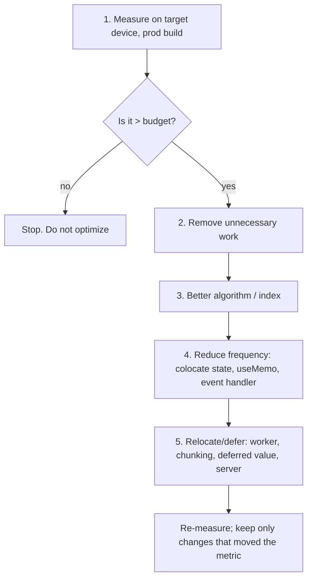

# 07 / 10 — Expensive Computations

## 1. Lesson metadata

| | |
|---|---|
| **Level** | Advanced |
| **Study time** | 5–6 hours (reading 2 h, experiments 2 h, exercises 1.5–2 h) |
| **Prerequisites** | [01 — Measure before optimizing](./01-measure-before-optimizing.md), [04 — Memoization trade-offs](./04-memoization-trade-offs.md), [05 — Referential equality](./05-referential-equality.md), [Phase 3 — useMemo and useCallback](../03-react-state-and-hooks/11-usememo-and-usecallback.md), [Phase 3 — Derived state](../03-react-state-and-hooks/17-derived-state.md), [Phase 0 — Event loop](../00-web-and-javascript-foundations/11-event-loop-tasks-microtasks.md), [Phase 0 — JS performance fundamentals](../00-web-and-javascript-foundations/17-javascript-performance-fundamentals.md) |
| **Next** | [11 — Scheduling and perceived responsiveness](./11-scheduling-and-perceived-responsiveness.md) |
| **Related** | [09 — Windowing](./09-windowing-and-virtualization.md), [20 — Long tasks and the main thread](./20-long-tasks-and-main-thread.md), [23 — Counterproductive optimizations](./23-counterproductive-optimizations.md) |

**Learning objectives.** After this lesson you can:
1. Decide whether a computation in a component is *actually* expensive, with a measurement, not a feeling.
2. Apply the optimization ladder in the right order: remove the work, make it algorithmically cheaper, do it less often, do it elsewhere, then defer it.
3. Use `useMemo` correctly, including its dependency semantics and its limits as a *performance hint*, not a semantic guarantee.
4. Move work out of render (event handlers, module-level caches, indexes, Web Workers) and know the costs of each move.
5. Identify counterproductive "optimizations" that add overhead, stale data bugs, or complexity for no measured gain.

**Concepts covered:** render-phase purity and cost, complexity classes (O(n²) → O(n)), derived data vs state, `useMemo` semantics, memoizing outside React, indexing, incremental computation, Web Workers and structured clone/transfer costs, chunked work, StrictMode double invocation, development vs production measurement.

---

## 2. Deep conceptual explanation

### 2.1 What problem is this lesson solving?

Every React render calls your component functions on the **main thread**. Anything you compute during render — filtering, sorting, grouping, formatting, parsing, diffing — blocks input handling and painting until the render (and commit) finish ([Phase 0 — How the browser works](../00-web-and-javascript-foundations/01-how-the-browser-works.md)). A computation that takes 2 ms is invisible; one that takes 200 ms every keystroke makes a text field feel broken, regardless of how clever React's reconciliation is.

React cannot make your own functions cheaper. It can only decide *when* your component functions run and, with concurrent features, *whether the result is shown* ([12](./12-usetransition-in-practice.md), [13](./13-usedeferredvalue-in-practice.md)). So expensive-computation work is mostly **ordinary engineering**: reduce the work, run it less often, run it somewhere else.

### 2.2 First principles: cost = (cost per call) × (calls per interaction)

Two levers:

| Lever | Techniques |
|---|---|
| **Cost per call** | Better algorithm/data structure, less data, early exit, avoid allocation, precomputed index, lazy evaluation |
| **Calls per interaction** | Memoize (skip when inputs unchanged), move to event handler (only on the event), cache across components, debounce ([14](./14-debounce-and-throttle.md)), compute on demand |

Plus a third lever that changes *where/when* rather than how much:

| Lever | Techniques |
|---|---|
| **Where / when** | Web Worker (off main thread), chunking with yielding, deferred rendering (`useDeferredValue`, transitions), server computation |

The correct order is usually: **(1) measure → (2) delete unnecessary work → (3) improve algorithm → (4) reduce frequency → (5) relocate/defer**. People often jump to (4) with `useMemo` because it is a one-line change, and then discover the first-render cost remains.

### 2.3 Computation in render: what is allowed and when it runs

Render must be pure ([Phase 2 — Why rendering must be pure](../02-react-rendering-and-internals/12-why-rendering-must-be-pure.md)). Derived values computed in render are *correct by construction*: they cannot go stale because they are recomputed from current props and state. That is why the React docs advise deriving rather than syncing with effects. The cost of that safety is recomputation on each render. The performance question is therefore: *"Is recomputation on every render of this component too slow, given how often it renders?"*

How often is a function of the component's position in the tree and what state lives above it, covered in [03](./03-why-components-rerender.md) and [07](./07-state-colocation-for-perf.md). Before memoizing a computation, ask whether the **component should render this often at all**. Colocating state or splitting the component often removes the repeated calls with no `useMemo`.

### 2.4 Is it expensive? A concrete threshold approach

The React documentation's guidance on `useMemo` suggests timing the calculation (e.g., with `console.time`/`console.timeEnd`) and treating it as worth memoizing if the logged time adds up to a significant amount (roughly 1 ms or more in total per interaction in its example), while cautioning that dev-mode timings differ from production and that you should test on a slower device or with CPU throttling. Treat the exact number as a heuristic; the underlying rule is: **compare the cost with the frame budget and with your interaction budget (INP).**

Rule-of-thumb table (illustrative, not universal):

| Time per computation (target device) | Interpretation |
|---|---|
| < 1 ms | Almost never worth optimizing |
| 1–5 ms | Worth optimizing only if executed many times per interaction (per row, per keystroke) |
| 5–16 ms | Competes with the frame budget; likely to cause dropped frames if it runs during animation or typing |
| 16–50 ms | Perceptible lag in typing/hover; optimize |
| 50–200+ ms | Long task: users will see freezes; optimize or move off the main thread |

*Long tasks* are defined by browsers as main-thread tasks of 50 ms or more ([20](./20-long-tasks-and-main-thread.md)).

### 2.5 Misconceptions

| Misconception | Reality |
|---|---|
| "`useMemo` makes expensive code fast." | It makes it **run less often**. The first computation (mount) and each dependency change still pay the full cost. |
| "`useMemo` guarantees the value is never recomputed." | React documents it as a performance optimization; it may discard cached values (for example, in future features that need to free memory or when a component suspends/remounts). Your code must be correct without it. |
| "Move it into `useEffect` so it doesn't block render." | The effect still runs on the main thread, and now you have an extra render with stale data, plus a flash. See [Phase 3 — You might not need an effect](../03-react-state-and-hooks/07-you-might-not-need-an-effect.md). |
| "Async functions run in the background." | `async` only defers continuation; synchronous work inside still blocks. Only workers (or the network/OS) provide parallelism. |
| "A web worker is always faster." | Data crossing the boundary is copied (structured clone) unless transferred; for small jobs, messaging cost dominates. |
| "Memoize everything cheaply; it's free." | Memoization has memory, comparison, and cognitive cost, and each memo is a potential stale-closure or wrong-dependency bug ([04](./04-memoization-trade-offs.md)). |

---

## 3. Internal mechanics

### 3.1 What `useMemo` does (and doesn't)

*Public guarantee (React docs):* `useMemo(calculate, deps)` calls `calculate` during the initial render, and on re-render returns the cached value if every dependency is `Object.is`-equal to its previous value; otherwise it calls `calculate` again. React may, in some situations, throw away the cache; do not rely on it for correctness.

*Teaching model:* each `useMemo` call occupies a slot in the component's hook state, storing `[value, deps]`. During render React compares `deps` arrays element by element. ([Phase 2 — Hooks and Fiber state](../02-react-rendering-and-internals/17-hooks-and-fiber-state.md).)

*Implementation detail:* the comparison is O(deps length); the memory retains the previous value and deps arrays until the component unmounts or is recomputed.

**StrictMode in development** intentionally calls your `calculate` function twice (and component bodies twice) to surface impurities ([Phase 2 — Strict Mode](../02-react-rendering-and-internals/28-strict-mode-behavior.md)). So a timing `console.log` inside `useMemo` prints twice per mount in dev and that is expected; also **dev timings are inflated**, so never benchmark computations in dev mode.

### 3.2 Dependencies: why identity matters

```ts
const visible = useMemo(() => filterAndSort(items, query), [items, query]);
```

If `items` is a *new array every render* (e.g., `const items = rawItems.map(...)` in the parent, or `props.items ?? []` creating a fresh `[]`), the memo recomputes every time and you pay the comparison **plus** the computation. This is the most common reason a "memoized" computation shows no improvement ([05 — Referential equality](./05-referential-equality.md)).

### 3.3 The React Compiler and manual memoization

*Volatile, last checked against react.dev 2026-10-22 (the compiler is documented as stable).* The React Compiler (opt-in build step, see [Phase 9 — React Compiler](../09-advanced-rendering-and-ecosystem/08-react-compiler.md)) can automatically memoize values and functions in components and hooks that follow the Rules of React. It does not change algorithmic cost, does not move work off the main thread, and it memoizes at render granularity (it cannot know that sorting 100,000 rows is "expensive" — it memoizes based on dependency tracking). Consequences for this lesson: algorithmic fixes, indexes, and workers matter regardless of the compiler, while the number of manual `useMemo` calls you need may shrink in compiled code. Existing `useMemo` calls are kept compatible; consult the docs for guidance on removing them.

### 3.4 Where JavaScript cost hides

| Hidden cost | Example | Mitigation |
|---|---|---|
| Quadratic nested scans | `orders.map(o => customers.find(c => c.id === o.customerId))` — O(n·m) | Build a `Map` once: O(n + m) |
| Repeated sorting | Sort in render then again in child | Sort once at the data boundary |
| Allocation churn | Creating millions of small objects/arrays → GC pauses | Reuse, typed arrays, avoid spreading in loops |
| Intl/Date constructors | `new Intl.NumberFormat()` per cell | Create once at module scope/memoize by locale |
| Regex backtracking | Catastrophic patterns on user input | Safer regex, input length caps |
| JSON parse/stringify | Deep clone via `JSON.parse(JSON.stringify(x))` on large state | Immutable updates structurally shared ([Phase 0 — Immutability](../00-web-and-javascript-foundations/08-objects-references-immutability.md)) |
| Layout reads in loops | Reading `offsetHeight` while writing styles | Batch reads/writes ([Phase 0 — Rendering pipeline](../00-web-and-javascript-foundations/03-browser-rendering-pipeline.md)) |

### 3.5 Web Workers: what crosses the boundary

A dedicated worker runs JavaScript on another thread with no DOM access. Communication is via `postMessage`. Data is copied with the **structured clone algorithm** (cost proportional to size, supports many built-in types but not functions or DOM nodes). `ArrayBuffer`s can be **transferred** (zero-copy, the sender loses access). `SharedArrayBuffer` shares memory but requires cross-origin isolation headers and careful synchronization. Cross-origin isolation (COOP/COEP headers) is required for `SharedArrayBuffer`; see MDN.

Consequence: workers shine for **CPU-heavy work on data that can live in the worker** (parse a big CSV once, keep the index in the worker, send only queries and small results). They are poor for tiny, frequent jobs on large inputs that must be re-sent each time.

---

## 4. Step-by-step execution walkthrough

Scenario: a search box filters and sorts 50,000 products. The component is:

```tsx
function Products({ products }: { products: Product[] }) {
  const [query, setQuery] = useState("");
  const visible = filterAndSort(products, query); // ~120 ms
  return (<>
    <input value={query} onChange={(e) => setQuery(e.target.value)} />
    <ProductTable rows={visible.slice(0, 100)} />
  </>);
}
```

1. User presses a key. The browser queues an `input` task; the main thread runs the React event handler.
2. `setQuery("a")` schedules an update (discrete event priority — processed urgently, [Phase 2 — Scheduler and priorities](../02-react-rendering-and-internals/13-scheduler-and-priorities.md)).
3. React renders `Products`: `filterAndSort` runs synchronously — **120 ms**. Nothing else can run.
4. The commit updates the controlled input value and the table. Only now can the browser paint. Input delay for the *next* keystroke includes any remaining render time.
5. Type three characters quickly: three renders ≈ 360 ms of main-thread work; keystrokes queue; characters appear in bursts: the "laggy input" symptom.

Fix ladder applied in order:

1. *Measure:* confirm 120 ms is `filterAndSort`, not rendering 100 rows (Profiler + `performance.measure` around the function).
2. *Delete work:* the table shows 100 rows but we sort all 50,000. Use partial selection (top-K) rather than full sort when only the first K are needed: O(n log K) or O(n) with a heap/quickselect.
3. *Algorithm:* precompute a lowercase searchable string per product once (at load), so filtering does not lowercase on every keystroke.
4. *Frequency:* `useMemo` on `[products, query]` avoids recompute on unrelated re-renders (e.g., a parent clock).
5. *Defer:* apply `useDeferredValue(query)` so typing stays responsive while the list catches up ([13](./13-usedeferredvalue-in-practice.md)).
6. *Relocate:* if still > 50 ms, run the search in a worker holding the index.

---

## 5. Code examples

### 5.1 Minimal example — measure first

```tsx
import { useMemo } from "react";

type Product = { id: string; name: string; price: number };

function useTimedMemo<T>(label: string, compute: () => T, deps: React.DependencyList): T {
  // eslint-disable-next-line react-hooks/exhaustive-deps
  return useMemo(() => {
    const t0 = performance.now();
    const value = compute();
    const t1 = performance.now();
    if (import.meta.env.DEV) console.log(`${label}: ${(t1 - t0).toFixed(2)}ms`);
    return value;
  }, deps);
}
```

For rigorous measurement prefer the User Timing API, which shows up in the Performance panel's Timings track:

```ts
export function measure<T>(name: string, fn: () => T): T {
  performance.mark(`${name}:start`);
  try {
    return fn();
  } finally {
    performance.mark(`${name}:end`);
    performance.measure(name, `${name}:start`, `${name}:end`);
  }
}
```

**Line notes.** The `try/finally` guarantees the `end` mark even on exceptions. `performance.measure` entries appear in DevTools; they also appear in RUM via `PerformanceObserver` (`entryTypes: ["measure"]`). The hook above deliberately defeats the exhaustive-deps lint rule — that is a smell: it forwards a dependency array that the linter cannot see. Use it temporarily for diagnostics, not in shipped code.

### 5.2 Practical example — index instead of repeated `find`

```tsx
type Customer = { id: string; name: string };
type Order = { id: string; customerId: string; totalMinor: number };

// Before: O(orders × customers)
function OrdersSlow({ orders, customers }: { orders: Order[]; customers: Customer[] }) {
  return (
    <ul>
      {orders.map((o) => {
        const c = customers.find((x) => x.id === o.customerId);
        return <li key={o.id}>{c?.name ?? "Unknown"}: {o.totalMinor}</li>;
      })}
    </ul>
  );
}

// After: O(orders + customers)
function OrdersFast({ orders, customers }: { orders: Order[]; customers: Customer[] }) {
  const byId = useMemo(() => new Map(customers.map((c) => [c.id, c])), [customers]);
  return (
    <ul>
      {orders.map((o) => (
        <li key={o.id}>{byId.get(o.customerId)?.name ?? "Unknown"}: {o.totalMinor}</li>
      ))}
    </ul>
  );
}
```

**Predict:** with 5,000 orders and 5,000 customers, roughly how many comparisons does the slow version perform worst-case? *Answer:* up to 25 million `x.id === o.customerId` checks (average about half of that when ids are found at random positions). The fast version does ~10,000 map operations. `useMemo` here is secondary: the *algorithmic fix* is what produces the order-of-magnitude gain; `useMemo` just ensures the map is not rebuilt on unrelated renders.

Numbers like "x ms" depend on hardware and engine optimizations; measure instead of citing speedups.

### 5.3 Incorrect example — memoization that does nothing

```tsx
function Report({ rows, filter }: { rows: Row[]; filter: Filter }) {
  // 1: new object each render => deps always change
  const options = { sortBy: "date", dir: "desc" as const };

  // 2: "expensive" call memoized with unstable deps
  const processed = useMemo(
    () => heavyProcess(rows, options),
    [rows, options],
  );

  // 3: memoizing a trivial calculation
  const label = useMemo(() => `${rows.length} rows`, [rows.length]);

  return <Table data={processed} caption={label} />;
}
```

**Predict:** How many times does `heavyProcess` run if the parent re-renders `Report` 10 times with the same `rows` and `filter`? *Answer:* **10** — `options` is a fresh object each render, so `[rows, options]` always differs. (1) is the bug. (3) is overhead with no benefit: the template string costs less than the hook bookkeeping, and the memo adds a deps comparison. There is a further bug: `filter` is a prop that `heavyProcess` presumably should depend on; here it is unused, which suggests a stale-data bug waiting to appear once someone starts using it inside the callback.

### 5.4 Corrected implementation

```tsx
const SORT_OPTIONS = { sortBy: "date", dir: "desc" } as const; // module-level constant

function Report({ rows, filter }: { rows: Row[]; filter: Filter }) {
  const processed = useMemo(
    () => heavyProcess(rows, filter, SORT_OPTIONS),
    [rows, filter],
  );
  return <Table data={processed} caption={`${rows.length} rows`} />;
}
```

Constants that do not depend on props or state are hoisted out of the component. They are stable by construction and need no dependency. `filter` must itself be a stable reference from the parent (state or memoized); otherwise the memo is defeated again.

### 5.5 Advanced example — worker with a persistent index

```ts
// search.worker.ts
type Doc = { id: string; text: string };
type Msg =
  | { type: "load"; docs: Doc[] }
  | { type: "query"; requestId: number; q: string; limit: number };
type Res = { type: "result"; requestId: number; ids: string[] };

let docs: Doc[] = [];
let lowered: string[] = [];

self.onmessage = (e: MessageEvent<Msg>) => {
  const msg = e.data;
  if (msg.type === "load") {
    docs = msg.docs;
    lowered = docs.map((d) => d.text.toLowerCase());
    return;
  }
  const q = msg.q.toLowerCase();
  const ids: string[] = [];
  for (let i = 0; i < docs.length && ids.length < msg.limit; i++) {
    if (lowered[i].includes(q)) ids.push(docs[i].id);
  }
  const res: Res = { type: "result", requestId: msg.requestId, ids };
  (self as unknown as Worker).postMessage(res);
};
```

```tsx
// useWorkerSearch.ts
import { useEffect, useRef, useState } from "react";

export function useWorkerSearch(docs: { id: string; text: string }[], q: string, limit = 100) {
  const workerRef = useRef<Worker | null>(null);
  const reqRef = useRef(0);
  const [ids, setIds] = useState<string[]>([]);

  useEffect(() => {
    const w = new Worker(new URL("./search.worker.ts", import.meta.url), { type: "module" });
    workerRef.current = w;
    w.onmessage = (e: MessageEvent<{ type: "result"; requestId: number; ids: string[] }>) => {
      if (e.data.requestId === reqRef.current) setIds(e.data.ids); // ignore stale replies
    };
    return () => { w.terminate(); workerRef.current = null; };
  }, []);

  useEffect(() => {
    workerRef.current?.postMessage({ type: "load", docs }); // one-time clone per docs identity
  }, [docs]);

  useEffect(() => {
    const id = ++reqRef.current;
    workerRef.current?.postMessage({ type: "query", requestId: id, q, limit });
  }, [q, limit, docs]);

  return ids;
}
```

**Key lines.**
- The `requestId` guard discards replies that arrive after a newer query was posted (races between asynchronous results; same idea as ignoring stale fetches).
- Documents are cloned **once** when `docs` changes; each query sends only a short string and returns ≤100 ids.
- `new Worker(new URL(..., import.meta.url), { type: "module" })` is the pattern Vite and webpack 5 document (Vite docs confirm it, plus a `?worker` import suffix; checked 2026-10-22); other bundlers differ.
- In StrictMode dev, effects mount → cleanup → mount: the worker is created, terminated, and recreated. The cleanup makes that safe.
- The sort order between `load` and `query` messages is preserved because messages to one worker are processed in order, so the query effect (declared after) sees the loaded docs.

**Trade-off:** results are asynchronous, so the UI must show a "searching" state or keep previous results (`useDeferredValue`-like feel) to avoid flicker. Errors in the worker (`onerror`) must be handled. Libraries such as Comlink offer an RPC-style wrapper; they do not change the cost model.

### 5.6 Event-handler computation (do it only when needed)

```tsx
function ExportButton({ rows }: { rows: Row[] }) {
  // Do NOT compute CSV in render; only the click needs it.
  const onClick = () => {
    const csv = toCsv(rows);                 // may take 300 ms; user expects some delay
    downloadBlob(new Blob([csv], { type: "text/csv" }), "export.csv");
  };
  return <button onClick={onClick}>Export CSV</button>;
}
```

Computing derived output *only in the handler that needs it* beats memoizing it for every render. If the work is long, show progress and chunk or use a worker.

---

## 6. Visual explanations

### The optimization ladder



### Main thread with and without a worker

```mermaid
gantt
  title Typing "abc" with a 120ms search
  dateFormat  X
  axisFormat %L
  section Main thread (sync)
  render1 120ms :0, 120
  render2 120ms :120, 240
  render3 120ms :240, 360
  section Main thread (worker)
  tiny render :0, 4
  tiny render :40, 44
  tiny render :80, 84
  section Worker
  search1 :4, 124
  search2 :44, 164
  search3 :84, 204
```



(Schematic. In the worker case, stale searches should be cancelled or ignored; the main thread stays free for input.)

---

## 7. Alternative approaches and trade-offs

| Approach | Reduces per-call cost | Reduces call frequency | Keeps UI responsive during first computation | Complexity | Risk |
|---|---|---|---|---|---|
| Better algorithm/index | Yes | No | Partly | Low–Med | Low |
| `useMemo` | No | Yes (for unrelated re-renders) | No | Low | Wrong deps → stale/never-hit cache |
| Module-level cache (`Map` keyed by input) | No | Yes (across components/mounts) | No | Med | Unbounded memory; key design |
| Move to event handler | n/a | Yes (only on event) | Partly | Low | Must keep display state consistent |
| `useDeferredValue` / transition | No | Sort of (skips intermediate results) | **Yes** (input stays urgent) | Low | Still blocks during the deferred render's slices unless interruptible |
| Chunking + yielding | No | No | Yes | Med–High | Complexity, partial results |
| Web Worker | Offloads | n/a | **Yes** | High | Clone cost, async flow, bundling |
| Server/DB computation | Offloads | n/a | Yes | High | Latency, API design |
| Precompute at build/ingest | Removes | n/a | Yes | Med | Staleness |

**When `useMemo` is *not* the best choice:** the problem is a first render that takes 400 ms (memoization can't help), or the deps change on every keystroke (you recompute anyway), or the real fix is an index. Another: a cheap computation inside a component that re-renders 60×/s due to animation — consider fixing the render frequency by moving state down.

**When a worker is *not* the best choice:** a 20 ms computation on a 2 MB array that changes every time (clone cost ≈ compute cost); a team that cannot maintain async cancellation; SSR-rendered content that must exist before JS.

---

## 8. Best practices and anti-patterns

**Beginner mistakes**
- Wrapping everything in `useMemo`/`useCallback` "to be safe."
- Leaving derived data in state and syncing with effects (duplicate source of truth and an extra render).
- Optimizing in development mode.

**Experienced-developer mistakes**
- `useMemo` with deps that change every render (5.3).
- Memoizing a computation whose output is immediately mutated (`.sort()` on the memoized array mutates cached data!). Use `[...arr].sort()` or `toSorted` (ES2023; Chrome 110, Firefox 115, Safari 16; check your target browsers/polyfills).
- Computing in render something that depends on `Date.now()`/`Math.random()` (impure; flickers and breaks StrictMode checks).
- Putting a large object into worker `postMessage` per keystroke.
- Treating `useMemo` as a cache with guaranteed lifetime for side-effect-like work (e.g., creating a subscription).

**Smells**
- `useMemo(() => x, [x])` or memoizing primitives.
- Memo dependencies silenced with `eslint-disable`.
- "Performance" PRs without before/after numbers.

**Justified exceptions**
- Memoizing a cheap value so a child wrapped in `memo` receives a stable prop (referential, not computational, reasons — [05](./05-referential-equality.md)).
- Module-level memoization of `Intl.*` formatters because constructing them is comparatively costly.

**Practical rules**
1. Prefer fixing the data structure over memoizing the bad one.
2. Memoize at the **data boundary** (selector/derived-data hook), not scattered through JSX.
3. Keep computations pure and testable (plain functions with unit tests and a benchmark harness).
4. Put a budget on each interaction (e.g., input-to-paint < 100 ms on a mid-range device) and verify it in CI or monitoring where possible.

---

## 9. Real-world application

**Finance — portfolio valuation.** 20,000 positions revalued on each price tick. Doing the full revaluation in render at 10 ticks/s is hopeless. Pattern: maintain aggregates incrementally (update only the changed position and its group totals), throttle UI updates to e.g. 4 Hz ([14](./14-debounce-and-throttle.md)), and render only visible rows ([09](./09-windowing-and-virtualization.md)). Constraint: audit consistency — displayed totals must equal the sum of displayed rows at all times, so incremental updates must apply atomically in one state transition.

**E-commerce — faceted search.** Counting facets over 50,000 products per keystroke. Pre-index facets at load (inverted index in a worker or server-side), debounce the query, show previous results while the new ones compute.

**Dashboards — large time series.** Downsample (e.g., largest-triangle-three-buckets *(a published downsampling algorithm; use a vetted implementation)*) on the server or in a worker before charting; chart libraries choke on 500k SVG points.

**Forms — schema validation.** Validating a 300-field form on every keystroke: validate the changed field synchronously, defer cross-field/whole-form validation to blur/submit or a deferred value.

**Multi-team context.** A shared selector library should publish complexity expectations and benchmarks; teams should not each re-implement grouping with O(n²) loops.

---

## 10. Debugging and troubleshooting

**Symptom: typing lags in an input next to a big list.**
1. Repro with production build, 4× CPU throttling.
2. Performance panel: record typing "abcdef". Look for long tasks after each `keydown/input`. Expand the flame chart under "Event: input" → React render → your component → your function.
3. Add `performance.measure` around suspects to see ms in the Timings track.
4. React Profiler: confirm which components re-render and the render duration. Use "Highlight updates" for scale.
5. Root-cause classes: (a) heavy function (fix algorithm), (b) heavy function called too often (colocate state/memo), (c) heavy rendering of many elements (windowing), (d) layout/paint after commit (Rendering tracks).

**Symptom: `useMemo` seems to have no effect.**
- Log inside the memo callback; watch which dependency changes with a debug hook (`usePrevious` and `Object.is` comparisons).
- Check dependencies from props created inline by a parent.
- Profiler "Why did this render?" (enable *Record why each component rendered* in Profiler settings).

**Symptom: stale data after "optimizing".**
- Root cause: missing dependency or mutated input. Re-enable the lint rule; look for `.sort()`/`.push()` on props.
- Validate: write a test that changes each input and asserts the output.

**Symptom: worker version is slower.**
- Measure `postMessage` payload size; time `structuredClone(data)` on the main thread as a proxy for clone cost; move data once and keep it there; transfer buffers.

**Validating a fix:** same dataset, same device profile, ≥ 5 runs; compare p50/p95 of the interaction (use `performance.measure` or INP in RUM) and check that no memory growth appears (module caches, worker memory).

### Measurement methodology (summary)

| Step | Tool | Pitfall |
|---|---|---|
| Isolate the function | `performance.now()` loop in a script, or a micro-benchmark with warm-up | JIT warm-up: first runs are slower; run warm-up iterations then measure many; avoid dead-code elimination by using the result |
| Measure in context | Performance panel + User Timing | Dev build inflates React; extensions skew results (use incognito) |
| Slow device simulation | CPU throttling 4×/6× | Throttling is approximate; confirm on a real device |
| Compare | Median and p95 of repeated runs | Don't report best-of-N |
| Field data | RUM INP, long-animation-frame (Chromium-only: Chrome 123+) | Lab ≠ field |

---

## 11. Exercises

### Level A — Knowledge
A1. State the React docs' position on whether `useMemo` can be relied on for correctness.
A2. Why does a timing log inside `useMemo` print twice on mount in development?
A3. List the five rungs of the optimization ladder in order.
A4. What is the cost model of `postMessage` to a worker for a 10 MB array of objects? For a 10 MB `ArrayBuffer` transferred?
A5. What makes a task a "long task" in browser terminology?

### Level B — Code comprehension
B1. How many times does `expensive` run?
```tsx
function C({ list }: { list: number[] }) {
  const [n, setN] = useState(0);
  const total = useMemo(() => expensive(list), [list]);
  return <button onClick={() => setN(n + 1)}>{n}: {total}</button>;
}
// Parent: <C list={[1,2,3]} /> inside a component that re-renders every second.
```
B2. Spot the bug:
```tsx
const sorted = useMemo(() => items.sort((a, b) => a.price - b.price), [items]);
```
B3. What is wrong with this "fix" for slow render?
```tsx
const [visible, setVisible] = useState<Item[]>([]);
useEffect(() => { setVisible(filterAndSort(items, query)); }, [items, query]);
```

### Level C — Implementation
C1. Implement `groupBy<T, K extends string | number>(items: readonly T[], key: (t: T) => K): Map<K, T[]>` in O(n), and use it inside a component with a correct `useMemo`.
C2. Write `useDebouncedMemo`-free alternative: a `useDeferredValue` + `useMemo` combination for a search box that keeps typing urgent.
C3. Write a memoization helper `memoizeLast<A extends unknown[], R>(fn)` that caches only the most recent call (shallow arg equality) for use outside React (selectors).

### Level D — Debugging
D1. A teammate memoized a 150 ms computation. In the Profiler the component still takes 150 ms on every render. Provide a debugging plan and three likely causes.
D2. After moving filtering into a worker, users report that sometimes results from an older query appear. Find and fix the race.
D3. A memoized value includes `new Date()` computed inside and it never "refreshes" on screen as time passes. Explain, and give two correct designs.

### Level E — Architecture and engineering decisions
E1. A table has 100k rows and users apply 4 filters and a sort. Compare (a) main-thread `useMemo`, (b) worker with a persistent index, (c) server-side query. Choose with criteria.
E2. Your team proposes "wrap every derived value in `useMemo`" as a lint rule. Write the counter-proposal.

### Level F — Expert challenge
F1. Design incremental computation for a leaderboard with 200k players where scores update at 500 events/second and the UI shows the top 50 and the current user's rank. Include data structures, update batching into React, and measurement plan.

---

## 12. Detailed answers and explanations

> Attempt the exercises first.

**A1.** React documents `useMemo` as a performance optimization; React may throw away cached values, so your code must still be correct when recomputation occurs. Wrong answer: "it's a semantic guarantee like `const`." If you need guaranteed identity/lifetime, use `useRef`/state or an external store.

**A2.** StrictMode (dev only) double-invokes component bodies and `useMemo` calculation functions to reveal impure code. It does not happen in production. Consequence: dev timings are not representative.

**A3.** (1) Measure; (2) remove unnecessary work; (3) improve algorithm/data structure; (4) reduce frequency (colocate, memoize, event handler, debounce); (5) relocate/defer (worker, chunking, deferred rendering, server).

**A4.** Structured clone copies and walks the object graph: roughly proportional to size and object count; 10 MB of many small objects can cost tens of ms or more (measure; engine-dependent). A transferred `ArrayBuffer` is moved without copying — near-constant cost — but the sender can no longer use it.

**A5.** A main-thread task of 50 ms or longer (per the Long Tasks API definition). Time over 50 ms counts as "blocking time".

**B1.** **Once** on mount (for the initial `list` identity) plus once *per distinct* `list` identity. The parent re-renders every second and creates `[1,2,3]` inline, so a new array each time → `expensive` runs every second. `setN` re-renders (n changes) do *not* recompute because `list` is unchanged between those. Trap: assuming equal contents imply equal identity.

**B2.** `Array.prototype.sort` mutates the array in place; `items` is a prop/state — mutating it violates immutability and can break other consumers and `memo` bail-outs. Fix: `[...items].sort(...)` or `items.toSorted(...)` (ES2023; Chrome 110, Firefox 115, Safari 16). Memoizing mutation gives a result that *looks* fine but corrupts shared data.

**B3.** It renders once with stale/empty `visible`, then the effect runs *after commit and paint*, computes on the main thread anyway, then triggers another render. The user sees an intermediate wrong state and total work increases (two renders), with no responsiveness gain. Use `const visible = useMemo(() => filterAndSort(items, query), [items, query])` or compute directly.

**C1.**
```ts
export function groupBy<T, K extends string | number>(
  items: readonly T[],
  key: (t: T) => K,
): Map<K, T[]> {
  const out = new Map<K, T[]>();
  for (const item of items) {
    const k = key(item);
    const bucket = out.get(k);
    if (bucket) bucket.push(item);
    else out.set(k, [item]);
  }
  return out;
}

function ByCategory({ products }: { products: readonly Product[] }) {
  const groups = useMemo(() => groupBy(products, (p) => p.category), [products]);
  return <>{[...groups].map(([cat, ps]) => <Section key={cat} title={cat} items={ps} />)}</>;
}
```
The `key` lambda is not in deps: it is created inline but its behavior is fixed; the linter will ask for it only if it closes over reactive values. If it did (e.g., `p.category + suffix`), `suffix` must be a dependency. Edge cases: empty list, `NaN` keys (Map treats NaN as equal to NaN).

**C2.**
```tsx
function Search({ items }: { items: readonly Item[] }) {
  const [query, setQuery] = useState("");
  const deferred = useDeferredValue(query);
  const results = useMemo(() => search(items, deferred), [items, deferred]);
  const stale = deferred !== query;
  return (<>
    <input value={query} onChange={(e) => setQuery(e.target.value)} />
    <div style={{ opacity: stale ? 0.6 : 1 }}><ResultList items={results} /></div>
  </>);
}
```
`ResultList` should be `memo`'d so the urgent render (query changed, deferred unchanged) skips it. See [13](./13-usedeferredvalue-in-practice.md).

**C3.**
```ts
export function memoizeLast<A extends unknown[], R>(fn: (...args: A) => R): (...args: A) => R {
  let lastArgs: A | undefined;
  let lastResult: R;
  return (...args: A) => {
    if (lastArgs && args.length === lastArgs.length && args.every((a, i) => Object.is(a, lastArgs![i]))) {
      return lastResult;
    }
    lastResult = fn(...args);
    lastArgs = args;
    return lastResult;
  };
}
```
Trade-offs: one entry only (shared across components → thrash if used with different args); retains references (memory). It's the same strategy as reselect-style selectors.

**D1.** Plan: log inside the memo callback to count executions; add a dependency-change tracer (`useRef` storing previous deps, log which index changed with `Object.is`); inspect parent for inline object/array creation; check that the Profiler time is the first render rather than updates (memo cannot help first render); confirm production build. Likely causes: (1) unstable deps; (2) the cost is in render of the output (many rows), not the computation; (3) `key` changes remount the component so the memo cache resets; (4) the computation actually happens in a child. Validate by counting executions and Profiler durations before/after.

**D2.** Race: responses return out of order or are applied without comparing to the latest request. Fix: monotonically increasing `requestId`, ignore replies with older id (5.5). Alternatives: terminate/recreate the worker per query (expensive), or abort cooperative loops by checking a shared "latest id" (requires `SharedArrayBuffer` or chunked loops with message polling). Test: post two queries with the first deliberately slower; assert UI shows the second.

**D3.** `useMemo` caches the value until deps change; `Date` inside is evaluated once, so display never updates, and it's impure. Design 1: keep `now` in state updated by an interval/`useSyncExternalStore` subscription to a clock store, and derive display from it. Design 2: render timestamps with a relative-time component that subscribes to a shared ticking store at the needed granularity (per-minute), so only those components re-render. Don't compute time in render and memoize it.

**E1.** Criteria: data size and growth, interactivity latency target (e.g., < 100 ms filter-to-paint), memory limit on low-end devices, network cost of shipping 100k rows, security (row-level permissions — often forces server-side), complexity budget, offline needs. Example answer: if all 100k rows must already reach the client for other reasons and filters are cheap boolean predicates over precomputed columns, main-thread typed-column filtering at ~1–5 ms may suffice (measure); otherwise worker with persistent columnar index; server-side if data is permissioned or exceeds device memory. The "recommended" worker is not best when the dataset is small or row-level security requires server filtering. A strong answer states what measurement would flip the decision.

**E2.** Evaluation criteria: acknowledges memoization cost/stale risk, proposes (a) a measurement requirement in PR templates for performance changes, (b) lint for known smells (inline object deps, mutation of memoized values), (c) guidance on when memo is mandated (referentially sensitive props to `memo` children, effect dependencies, genuinely expensive computations), (d) planned adoption of the compiler as an automatic baseline *(verify current status)*, and (e) review guidance. Wrong direction: banning memoization entirely.

**F1.** Sketch: maintain scores in a `Map<playerId, score>` plus an ordered structure for rank (balanced tree/skip list/Fenwick tree over score buckets) giving O(log n) update and rank query; keep the top-50 as a small heap/ordered array updated per event. Ingest events in a batch queue (e.g., `requestAnimationFrame` or fixed 100–250 ms tick) and commit **one** React state update per tick (React batches, but batching events yourself avoids extra work and lets you coalesce multiple updates to one player). Use `useSyncExternalStore` over the store with a stable snapshot per tick ([Phase 3 — useSyncExternalStore](../03-react-state-and-hooks/20-usesyncexternalstore-and-external-stores.md)). Measurement: events/s sustained, per-tick processing time (User Timing), React commit time per tick, long tasks, memory after 30 minutes. Evaluate: correctness under bursts, consistency between rank and top-50 view, behavior on tab visibility change (catch-up by replaying aggregated state rather than every event).

---

## 13. Senior engineer interview questions

**Q1. "When would you not use `useMemo` on an expensive function?"**
When dependencies change on virtually every render (no hits), when the cost is in the first computation (memo doesn't reduce), when the right fix is a better algorithm or moving state down so the component renders less. Also when the value must be correct independent of caching. Memoization is one lever (frequency) among several.

**Q2. "Why isn't `useEffect` + `setState` a good way to move work out of render?"**
The effect still runs on the main thread, after paint; it introduces an extra render with intermediate stale UI and doesn't reduce total CPU. Truly moving work out means a worker, a server, or splitting into chunks/deferred renders.

**Q3. "How do you benchmark a pure function that you suspect is slow?"**
Isolate with realistic data, warm up the JIT, run many iterations with `performance.now`, use outputs to prevent dead-code elimination, compare medians, and then confirm in the real app via User Timing and the Profiler because GC, layout, and rendering interact in the real context.

**Q4. "What are the failure modes of a worker-based search?"**
Clone cost for large inputs, out-of-order replies, worker lifecycle with StrictMode/HMR, bundler configuration, error handling, memory duplication (data in both threads), no SSR, and added testing complexity.

**Q5. "Does the React Compiler make this lesson obsolete?"**
No: it removes much hand-written memoization for pure components that follow the rules (the compiler is documented as stable on react.dev), but it cannot make an O(n²) loop O(n), cannot offload work, and memoizes based on dependency identity. Measurement and algorithm choice remain.

**Q6. "A PR adds `useMemo` around 12 values and claims 'perf improvements'. How do you review it?"**
Ask for the measured baseline and result, check dependency correctness and mutation, check whether any value is cheap, ask whether state could be colocated instead, and consider the maintenance cost. Approve only changes with evidence or referential-stability justification.

---

## 14. Further learning resources

| Resource | URL | Covers / why | Level | Section to study |
|---|---|---|---|---|
| React docs — `useMemo` | <https://react.dev/reference/react/useMemo> | Official semantics, "how to tell if a calculation is expensive", caveats | Intermediate | Usage; Troubleshooting |
| React docs — You Might Not Need an Effect | <https://react.dev/learn/you-might-not-need-an-effect> | Derived data without effects; caching expensive calculations | Intermediate | "Caching expensive calculations" |
| React docs — `useDeferredValue` | <https://react.dev/reference/react/useDeferredValue> | Deferring expensive renders | Intermediate | Usage |
| React docs — React Compiler | <https://react.dev/learn/react-compiler> *(checked 2026-10-22; also at /learn/react-compiler/introduction)* | Automatic memoization overview | Intermediate | Introduction |
| MDN — Web Workers API | <https://developer.mozilla.org/en-US/docs/Web/API/Web_Workers_API> | Dedicated workers, messaging, structured clone, transfer | Intermediate | Using Web Workers |
| MDN — Structured clone algorithm | <https://developer.mozilla.org/en-US/docs/Web/API/Web_Workers_API/Structured_clone_algorithm> | What can be cloned/transferred | Advanced | Whole page |
| MDN — Performance API / User Timing | <https://developer.mozilla.org/en-US/docs/Web/API/Performance_API/User_timing> | `performance.mark`/`measure` | Intermediate | Whole page |
| MDN — Long tasks | <https://developer.mozilla.org/en-US/docs/Web/API/PerformanceLongTaskTiming> | Definition of long tasks | Intermediate | Overview |
| web.dev — Optimize long tasks | <https://web.dev/articles/optimize-long-tasks> | Yielding strategies | Intermediate | Whole article |
| Chrome DevTools — Performance | <https://developer.chrome.com/docs/devtools/performance> | Flame chart, Timings track | Beginner | Whole |

Links marked were not fetched in this session.

---

## 15. Knowledge checkpoint

**You should now understand**
- Cost = per-call cost × calls per interaction, and the ladder: measure → delete → algorithm → frequency → relocate/defer.
- `useMemo` semantics, its limits, and why unstable dependencies defeat it.
- Worker trade-offs (clone/transfer, async races) and event-handler computation.

**You should be able to explain without notes**
- Why moving work into an effect is not an optimization.
- Why `useMemo` doesn't help first render.
- When the React Compiler does and doesn't help.

**You should be able to implement**
- A measured memoized derived-data hook, an index replacing nested scans, a worker search with stale-reply protection, a last-call memoizer.

**You should be able to debug**
- "Memo not hitting," stale data after memoization, mutation of memoized arrays, worker races.

**Before moving on:** read [11 — Scheduling and perceived responsiveness](./11-scheduling-and-perceived-responsiveness.md), which handles the case where the computation cannot be made cheaper and the goal becomes keeping the UI responsive while it runs.
