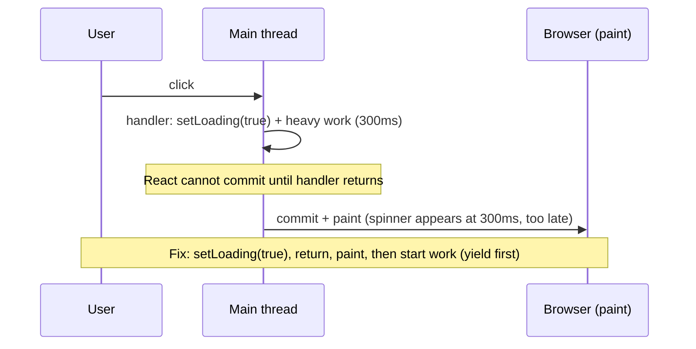
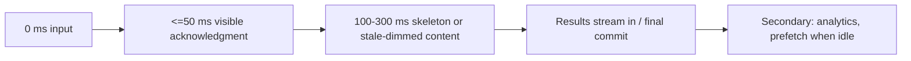
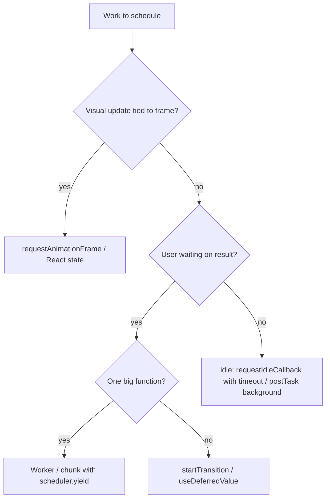

# 07 / 11 — Scheduling and Perceived Responsiveness

## 1. Lesson metadata

| | |
|---|---|
| **Level** | Advanced |
| **Study time** | 5–6 hours (reading 2 h, experiments 2 h, exercises 1.5–2 h) |
| **Prerequisites** | [10 — Expensive computations](./10-expensive-computations.md), [Phase 0 — How the browser works](../00-web-and-javascript-foundations/01-how-the-browser-works.md), [Phase 0 — Event loop](../00-web-and-javascript-foundations/11-event-loop-tasks-microtasks.md), [Phase 0 — JS performance fundamentals](../00-web-and-javascript-foundations/17-javascript-performance-fundamentals.md), [Phase 2 — Scheduler and priorities](../02-react-rendering-and-internals/13-scheduler-and-priorities.md), [Phase 2 — Transitions and deferred rendering](../02-react-rendering-and-internals/23-transitions-and-deferred-rendering.md) |
| **Next** | [12 — useTransition in practice](./12-usetransition-in-practice.md) |
| **Related** | [20 — Long tasks and the main thread](./20-long-tasks-and-main-thread.md), [21 — Web Vitals and budgets](./21-web-vitals-and-budgets.md) |

**Learning objectives.** After this lesson you can:
1. Distinguish *actual* speed from *perceived* responsiveness, and explain which user-visible metrics (INP, input delay, time to first feedback) capture each.
2. Explain the browser's scheduling primitives (tasks, microtasks, rendering opportunities, timers, `MessageChannel`, `requestAnimationFrame`, `requestIdleCallback`, `scheduler.postTask`/`scheduler.yield`) and what each is good for.
3. Classify work as urgent (feedback to input) or deferrable, and design interactions so urgent work is painted first.
4. Apply feedback patterns: immediate acknowledgment, optimistic UI, skeletons vs spinners, pending indicators, progressive reveal, with appropriate timing thresholds.
5. Recognize counterproductive scheduling: over-yielding, idle callbacks starving work, artificial delays, flashing loaders.

**Concepts covered:** input delay / processing time / presentation delay, INP, long tasks, yielding strategies, cooperative scheduling, priority inversion, React's scheduler as an *application* of these primitives, optimistic updates, loading-state design, layout stability, measuring perceived performance.

---

## 2. Deep conceptual explanation

### 2.1 What problem is this lesson solving?

Users do not experience milliseconds of CPU. They experience **"I did something, and the interface answered."** Two apps with identical total work can feel completely different:

- App A does 300 ms of work, then updates everything at once. The click feels dead for 300 ms.
- App B shows a pressed state and a spinner within 50 ms, streams the first results at 150 ms, and finishes at 300 ms. It feels responsive even though it did the same work.

Performance engineering therefore has two jobs:

1. **Reduce work** (previous lessons).
2. **Order and schedule work** so the user sees feedback quickly and the main thread is never blocked long enough to drop input.

This lesson is about the second job: *scheduling* and *perception*.

### 2.2 The three phases of an interaction

Browsers (and the Interaction to Next Paint metric) decompose an interaction into:

| Phase | What happens | Typical causes of slowness |
|---|---|---|
| **Input delay** | From the user's input until the event handler *starts* | Main thread busy with another task (long task, timers, React rendering from earlier update) |
| **Processing time** | Event handlers run (including synchronous React work flushed within them) | Heavy handlers, synchronous state updates triggering big renders |
| **Presentation delay** | From handlers finishing until the next frame is presented | Style/layout/paint cost, large DOM, effects (layout effects run before paint) |

INP reports (roughly) the worst or near-worst interaction latency for a page visit: the full duration from input to the next frame paint. The thresholds Google publishes for "good" are ≤ 200 ms at the 75th percentile of page loads, "needs improvement" up to 500 ms, "poor" above. Thresholds confirmed on <https://web.dev/articles/inp> (2026-10-22); they are maintained by the Chrome/web.dev teams and can change.

*Key insight:* each phase is attacked by a different technique.

| Phase | Techniques |
|---|---|
| Input delay | Break up long tasks; avoid doing heavy work in timers/effects that might overlap with input; reduce background rendering |
| Processing time | Do less in the handler; defer non-urgent updates (`startTransition`, `useDeferredValue`); move work to worker |
| Presentation delay | Smaller DOM, cheaper CSS, windowing ([09](./09-windowing-and-virtualization.md)), `content-visibility`, avoid layout thrash |

### 2.3 Perception thresholds (heuristics, not laws)

Human-computer-interaction literature gives rough numbers that engineers use as targets:

| Latency | Perception (commonly cited) |
|---|---|
| ≤ ~100 ms | Feels instantaneous for direct manipulation like clicks/taps |
| ~100–300 ms | Noticeable delay; user still feels in control if feedback appears |
| ~300 ms – 1 s | Feels like the system is "working"; need a clear in-progress indication |
| > ~1 s | Attention may drift; show progress and let the user continue if possible |
| > ~10 s | User likely abandons; need background processing, notifications |

These are heuristics (e.g., popularized by Nielsen and by Google's RAIL model, which has since been superseded by metrics-based guidance such as Core Web Vitals). Use them as *design budgets* validated against your own field data, not as universal facts. Frame budget matters too: continuous interactions (scroll, drag, typing with echoing) need frames in ≈ 16 ms at 60 Hz.

### 2.4 First principles: one thread, cooperative scheduling

JavaScript on the main thread cannot be preempted. The only way to remain responsive during a lot of work is **cooperative scheduling**: the work divides itself into small pieces and returns control to the event loop between pieces so the browser can process input and render ([Phase 0 — Event loop](../00-web-and-javascript-foundations/11-event-loop-tasks-microtasks.md)).

React's concurrent rendering is exactly that, implemented in the renderer: the work loop checks whether it has used up its time slice and, if so, yields back to the browser via a task scheduled with host primitives. *Public guarantee:* transitions and deferred values are interruptible; urgent updates preempt them. *Implementation detail:* time-slice length, the specific host primitive used to schedule continuation (React's scheduler package has historically preferred `MessageChannel` where available, falling back to timers), and the lane model ([Phase 2 — Lanes](../02-react-rendering-and-internals/14-lanes.md)) are internal and version-sensitive; read the source if you need exact behavior ([Phase 2 — Reading React source](../02-react-rendering-and-internals/31-reading-react-source.md)).

What React *cannot* do: slice **your** synchronous code. If a single event handler calls a 400 ms function, or a single component's render calls it, no yielding can occur inside it. React can only interrupt *between* component renders (units of work), not inside one function.

### 2.5 Urgent vs deferrable work

Classify every update in an interaction:

| Class | Examples | Deadline |
|---|---|---|
| **Direct feedback** | Pressed button state, caret movement, checkbox toggle, hover highlight, drag position | Next frame (≈16 ms) and certainly < 100 ms |
| **Primary result** | Search result list, navigation to next view, filtered table | Soon (hundreds of ms) with an indication of progress |
| **Secondary** | Analytics, prefetch, logging, cache warm-up, below-the-fold content | When idle |

The scheduling rule: **paint class 1 first, then do class 2, then class 3.** React's `startTransition`/`useDeferredValue` express class 1 vs 2 inside React ([12](./12-usetransition-in-practice.md), [13](./13-usedeferredvalue-in-practice.md)). Class 3 uses idle-time primitives.

### 2.6 Perceived performance patterns

| Pattern | What it does | Risks |
|---|---|---|
| **Immediate acknowledgment** | Toggle button state / show pending immediately | Pending state that never resolves on error |
| **Optimistic UI** | Show the expected result before the server confirms (`useOptimistic` in React 19; Phase 3 [modern hooks](../03-react-state-and-hooks/22-modern-hooks-and-apis.md)) | Rollback UX; conflicting updates; money/irreversible actions |
| **Skeleton screens** | Placeholder layout shaped like content | Flash if load is fast; mismatched sizes → layout shift |
| **Spinners** | Generic in-progress | No structure; flicker; accessibility needs `role="status"`/`aria-busy` semantics |
| **Progressive reveal / streaming** | Show partial results early | Layout shifts; partial inconsistency |
| **Keep previous content** | Dim stale results instead of blanking | Users may act on stale data; show it's stale |
| **Delayed loader** | Show spinner only after ~150–300 ms | If always delayed, slow interactions seem frozen |
| **Prefetch on intent** | Hover/focus/viewport entry triggers load | Wasted bandwidth; data-saver considerations |
| **Reserve space** | Fixed dimensions for async content | Over/under-sized placeholders |

### 2.7 Misconceptions

| Misconception | Reality |
|---|---|
| "If total CPU time is the same, perceived speed is the same." | Ordering matters: feedback-first and non-blocking work feel faster. |
| "Concurrent React makes everything responsive automatically." | It only helps work that is split into many components/renders and marked non-urgent. A single heavy function still blocks. |
| "`setTimeout(fn, 0)` runs immediately after." | It queues a task; browsers may clamp nested timers (≥ ~4 ms after nesting depth 5 per the HTML spec) and other tasks can precede it. |
| "`requestIdleCallback` is for deferring anything." | It runs only when idle and may be delayed indefinitely on busy pages (use `timeout`). Safari has historically not shipped it (MDN compat data, 2026-10-22: Chrome 47, Firefox 55, Safari only behind a flag/preview), so feature-detect and fall back to `setTimeout`. |
| "Spinners improve perceived performance." | They communicate waiting. If shown for brief waits they *add* flash and distraction. |
| "Debouncing makes input faster." | It delays work; it reduces total work. Echoing the typed character must stay immediate ([14](./14-debounce-and-throttle.md)). |

---

## 3. Internal mechanics

### 3.1 Scheduling primitives compared

| Primitive | Queue / timing | Use | Caveats |
|---|---|---|---|
| Promise `.then` / `queueMicrotask` | Microtask: runs before the browser can render | Ordering within a task | **Does not yield** to rendering or input; a long microtask chain still blocks |
| `setTimeout(fn, 0)` | Timer task, ≥ ~1–4 ms in practice, throttled in background tabs | Simple yield | Nested clamping; imprecise; other tasks may go first |
| `MessageChannel` `postMessage` | Task with minimal delay | Low-latency yield (used by schedulers) | Not for general app code unless wrapped |
| `requestAnimationFrame` | Runs just before the next render ("update the rendering") | Visual updates synchronized to frames | Paused in background tabs; not for non-visual work |
| `requestIdleCallback` | Runs when the browser is idle, with deadline | Low-priority background work | May not run when busy; not in stable Safari (flag/preview only); deadlines ≤ 50 ms |
| `scheduler.postTask(fn, {priority})` | Prioritized task queue (`user-blocking`, `user-visible`, `background`) | Prioritized scheduling | Chrome 94+, Firefox 142+; not in Safari (MDN, 2026-10-22); feature-detect |
| `scheduler.yield()` | Yields and continues at high priority after other tasks | Breaking up long tasks | Chrome 129+, Firefox 142+; not in Safari (MDN, 2026-10-22); feature-detect and fall back to `setTimeout` |
| `navigator.scheduling.isInputPending()` | Reports whether input is waiting | Yield only when needed | Chromium-only (Chrome 87+; Firefox/Safari no), flagged experimental on MDN; do not depend on it |
| Web Worker | Separate thread | CPU-heavy work | Messaging/clone costs ([10](./10-expensive-computations.md)) |

*Public guarantee:* microtasks run to completion before the next task and before rendering (HTML spec). *Teaching model:* "yield = end my task, let the browser do its thing, continue in a new task." *Implementation detail:* the precise ordering between timers, message tasks, input, and rendering is up to the user agent and its internal task queue priorities (browsers generally prioritize input).

### 3.2 A portable `yieldToMain`

```ts
export function yieldToMain(): Promise<void> {
  const s = (globalThis as { scheduler?: { yield?: () => Promise<void> } }).scheduler;
  if (s?.yield) return s.yield();               // continuation keeps priority
  return new Promise((resolve) => setTimeout(resolve, 0)); // portable fallback
}
```

`scheduler.yield()` is designed so that the continuation is placed ahead of other queued tasks of the same priority, reducing the penalty of yielding. The `setTimeout` fallback goes to the back of the timer queue and may be delayed by other tasks — one reason over-yielding with timers can make the *total* time much longer.

### 3.3 Time-sliced loops

```ts
export async function processInSlices<T>(
  items: readonly T[],
  work: (item: T, index: number) => void,
  { budgetMs = 8, signal }: { budgetMs?: number; signal?: AbortSignal } = {},
): Promise<void> {
  let sliceStart = performance.now();
  for (let i = 0; i < items.length; i++) {
    if (signal?.aborted) return;
    work(items[i], i);
    if (performance.now() - sliceStart >= budgetMs) {
      await yieldToMain();
      sliceStart = performance.now();
    }
  }
}
```

Why check time rather than count: item costs vary; a time budget adapts to slow devices. Why 8 ms (not 50): leaves room for the browser's own frame work inside a 16 ms frame; during pure background work, longer slices (≈ 30–50 ms) reduce overhead. The best number is workload-dependent; measure.

### 3.4 Paint-before-work: how to ensure feedback is shown

A common problem: user clicks "Run report"; you set `loading = true` and immediately run a 300 ms synchronous function in the same handler. React batches the state update; the render and commit happen after the handler returns, and the browser paints after that, so the spinner appears *after* the heavy work finished. The user never sees it.

Options:

1. Make the heavy work happen **after** the next paint: schedule it (e.g., in an effect that runs after commit, still before paint for layout effects but after paint for passive effects in most cases passive effects can be flushed before paint for discrete events, see [Phase 2 — Effects and timing](../02-react-rendering-and-internals/18-effects-and-their-timing.md)), then `await yieldToMain()` before starting.
2. `requestAnimationFrame(() => setTimeout(work))` — the double-hop pattern: rAF runs before the next paint; the timeout task runs after that paint. This is a portable way to say "after the next frame has been presented" without relying on effect timing. It is a hack: it assumes the browser renders between those tasks (it usually does).
3. Better: make the work non-blocking (worker, chunking) so there is no need to cheat.



### 3.5 How React fits in

Within React:
- Updates inside discrete events (click, keydown) are processed at high priority and flushed synchronously at the end of the event (conceptually; details in [Phase 2 — Automatic batching](../02-react-rendering-and-internals/22-automatic-batching.md)).
- Updates in `startTransition` are low priority, rendered in time slices, interruptible by urgent updates ([Phase 2 — Transitions](../02-react-rendering-and-internals/23-transitions-and-deferred-rendering.md), [Scenario D](../02-react-rendering-and-internals/35-scenario-d-transition-vs-urgent.md)).
- Layout effects run synchronously in commit before paint; passive effects run later (or earlier for discrete events). Heavy layout effects extend presentation delay.
- Suspense boundaries can throttle reveal of fallbacks/content to avoid flashing heuristics are implementation-defined and version-sensitive ([Phase 2 — Suspense internals](../02-react-rendering-and-internals/24-suspense-conceptual-internals.md)).

---

## 4. Step-by-step execution walkthrough

Scenario: "Apply filter" button over a dashboard of 8 widgets. Naive version versus responsive version.

**Naive (all work in one blocking update)**

1. `t=0` pointerdown → browser dispatches event; main thread idle, input delay ≈ 0.
2. `t=1` click handler: `setFilter(f)`. No pending state shown.
3. `t=2` React renders at high priority: all 8 widgets recompute (total 380 ms).
4. `t=382` commit; layout/paint 20 ms.
5. `t=402` frame presented. **INP for this interaction ≈ 400 ms.** The button never showed a pressed/pending state; user clicks again at `t=250` (impatient). That second click is queued as input delay and triggers *another* 380 ms render when processed. Worst-case INP ≈ 800 ms.

**Responsive version**

1. `t=0` pointerdown.
2. `t=1` click handler: `setPendingFilter(f)` (urgent: updates button label/selected chip) and `startTransition(() => setFilter(f))`.
3. `t=2` React renders urgent update: only button/chip area (≈ 3 ms). Commit.
4. `t=8` frame presented with chip selected and `isPending` indicator: **first feedback at ~8 ms**.
5. `t=9…` React begins rendering the transition in slices of a few ms, yielding to the browser between components. Browser processes input events within each yield window. If the user clicks another filter, the in-progress render is abandoned and restarted with the new value ([Phase 2 — Interruptible rendering](../02-react-rendering-and-internals/15-interruptible-restartable-abandoned-rendering.md)).
6. `t≈400` transition commit; widgets update. Total work is slightly *higher* (slicing overhead, possible wasted work if interrupted) but **INP ≈ 8–16 ms for the click** and the page never freezes.

Note what did *not* happen: the 380 ms was not reduced. We changed ordering and interruptibility. If a single widget internally takes 380 ms in one render, the transition still blocks for 380 ms inside that widget; slicing only happens between components.

---

## 5. Code examples

### 5.1 Minimal example — acknowledging input immediately

```tsx
import { useState, useTransition } from "react";

export function FilterBar({ onApply }: { onApply: (f: string) => void }) {
  const [selected, setSelected] = useState("all");
  const [isPending, startTransition] = useTransition();

  return (
    <div role="group" aria-label="Filters" aria-busy={isPending}>
      {["all", "open", "closed"].map((f) => (
        <button
          key={f}
          aria-pressed={selected === f}
          data-pending={isPending && selected === f}
          onClick={() => {
            setSelected(f);                          // urgent: immediate feedback
            startTransition(() => onApply(f));       // non-urgent: heavy tree update
          }}
        >
          {f}
        </button>
      ))}
    </div>
  );
}
```

**Line notes.** `setSelected` is outside the transition so the pressed state paints on the next frame. `onApply` triggers the expensive parent state change inside the transition. `isPending` is true from the time the transition is scheduled until it commits, so it can drive a subtle indicator. `aria-busy` conveys loading to assistive tech; screen reader support is uneven, so pair with visible text where critical.

**Predict:** if `onApply` throws synchronously inside `startTransition`, what happens? *Answer:* the error propagates as in any function call inside the callback body (the callback runs synchronously); state updates scheduled before the throw still count as part of the transition. Error handling for async actions is covered in [12](./12-usetransition-in-practice.md).

### 5.2 Practical example — measuring interaction latency in the field

```ts
// vitals.ts — uses the web-vitals library (npm: web-vitals)
import { onINP, type INPMetricWithAttribution } from "web-vitals/attribution";

export function reportINP(send: (body: Record<string, unknown>) => void) {
  onINP((m: INPMetricWithAttribution) => {
    send({
      name: m.name,
      value: m.value,                      // ms
      rating: m.rating,                    // "good" | "needs-improvement" | "poor"
      target: m.attribution.interactionTarget,
      inputDelay: m.attribution.inputDelay,
      processingDuration: m.attribution.processingDuration,
      presentationDelay: m.attribution.presentationDelay,
    });
  });
}
```

Field names above (`interactionTarget`, `inputDelay`, `processingDuration`, `presentationDelay`) typecheck against `web-vitals` 6.2.x and match its README (checked 2026-10-22); they were renamed between majors, so re-check if you pin an older version. The point: **field-attributed phase breakdown tells you which technique to apply** (see §2.2 table). For lab diagnosis, use the Performance panel's interactions track plus the Event Timing API:

```ts
new PerformanceObserver((list) => {
  for (const e of list.getEntries() as PerformanceEventTiming[]) {
    if (e.duration >= 100) {
      console.log(e.name, {
        inputDelay: e.processingStart - e.startTime,
        processing: e.processingEnd - e.processingStart,
        total: e.duration,
      });
    }
  }
}).observe({ type: "event", durationThreshold: 40, buffered: true });
```

`durationThreshold` is rounded to 8 ms granularity per the spec; the minimum meaningful value is 16 ms (Event Timing spec; default is 104 ms).

### 5.3 Incorrect example — the invisible spinner and the over-yielding loop

```tsx
function Report() {
  const [loading, setLoading] = useState(false);
  const [rows, setRows] = useState<Row[]>([]);

  const run = () => {
    setLoading(true);                  // (1) never painted before work finishes
    const result = buildReport();      // (2) 300 ms synchronous
    setRows(result);
    setLoading(false);                 // (3) batched with (1): loading is never true at commit
  };
  return (<>
    <button onClick={run}>Run</button>
    {loading ? <Spinner /> : <Table rows={rows} />}
  </>);
}

async function slowLoop(items: number[]) {
  for (const item of items) {
    process(item);
    await new Promise((r) => setTimeout(r, 0)); // (4) yields after EVERY item
  }
}
```

**Predict.** Does the spinner ever appear? *No.* `setLoading(true)` and `setLoading(false)` happen in the same handler; React batches them, so the committed state has `loading = false` with the new rows. Even without the second `setLoading`, the render would not occur until after the 300 ms function. (4) yields after every item: with 100,000 items and a ≥ 1–4 ms timer minimum per yield, the loop may take many seconds more than needed (timer clamping and queue delays) even though each item takes microseconds.

### 5.4 Corrected implementation

```tsx
import { useState, useTransition } from "react";

function Report() {
  const [rows, setRows] = useState<Row[]>([]);
  const [isPending, startTransition] = useTransition();

  const run = () => {
    // Heavy work must be inside the transition's render, or in a worker.
    startTransition(() => {
      setRows(buildReport()); // still 300 ms sync if buildReport is one function! see note
    });
  };
  /* ... */
}
```

**Careful.** This version looks right but is only partly right: `buildReport()` runs synchronously inside the `startTransition` callback (the callback is invoked immediately), so the 300 ms blocks anyway, before React even schedules the transition render. A transition defers *rendering* of state updates; it does not defer the callback body. Correct designs:

```tsx
// Option A: do the heavy work in render (derived), let the transition defer that render.
function Report({ source }: { source: Source }) {
  const [params, setParams] = useState<Params>(defaultParams);
  const [isPending, startTransition] = useTransition();
  const rows = useMemo(() => buildReport(source, params), [source, params]); // runs inside the transition's render
  return (<>
    <button onClick={() => startTransition(() => setParams(nextParams))}>Run</button>
    {isPending && <Spinner />}
    <Table rows={rows} />
  </>);
}
```
Here `buildReport` still executes as one chunk (during the transition render), but it no longer blocks urgent updates *that arrive before it starts*; React can abandon a transition render only between components, so once `buildReport` begins it runs to completion. Therefore:

```tsx
// Option B: chunked, abortable work with explicit pending state.
async function runReport(signal: AbortSignal, onDone: (rows: Row[]) => void) {
  const acc: Row[] = [];
  await processInSlices(source, (item) => acc.push(compute(item)), { signal });
  if (!signal.aborted) onDone(acc);
}
```

```tsx
// Option C: worker (see lesson 10, §5.5).
```

**Takeaway:** pick the technique by *where the milliseconds are*: many small components (transition works well), one big function (chunk/worker).

### 5.5 Advanced example — a priority-aware task queue for non-urgent work

```ts
type Priority = "user-visible" | "background";

type Task = { run: () => void; priority: Priority };

const queue: Task[] = [];
let scheduled = false;

export function enqueue(run: () => void, priority: Priority = "background") {
  queue.push({ run, priority });
  schedule();
}

function schedule() {
  if (scheduled) return;
  scheduled = true;
  const g = globalThis as {
    scheduler?: { postTask?: (cb: () => void, o?: { priority?: string }) => Promise<void> };
    requestIdleCallback?: (cb: (d: IdleDeadline) => void, o?: { timeout: number }) => number;
  };
  const flush = (hasTime: () => boolean) => {
    while (queue.length && hasTime()) queue.shift()!.run();
    scheduled = false;
    if (queue.length) schedule();
  };
  if (g.requestIdleCallback) {
    g.requestIdleCallback((d) => flush(() => d.timeRemaining() > 2), { timeout: 2000 });
  } else {
    setTimeout(() => {
      const end = performance.now() + 8;
      flush(() => performance.now() < end);
    }, 0);
  }
}
```

Notes: the `timeout: 2000` guarantees eventual execution even if the page is never idle (otherwise `requestIdleCallback` can starve). The sample ignores `user-visible` vs `background` ordering, which a real queue would implement (sort by priority or use two queues); using native `scheduler.postTask` is cleaner where available. Use this for analytics batching, prefetching, and cache warming, never for work the user is waiting on.

Tasks in the idle queue still run on the main thread; each task must itself be short (< ~10 ms), or you reintroduce long tasks.

### 5.6 Delayed loader to avoid flash

```tsx
import { useEffect, useState } from "react";

export function useDelayedFlag(active: boolean, delayMs = 200, minVisibleMs = 400) {
  const [show, setShow] = useState(false);

  useEffect(() => {
    let t: ReturnType<typeof setTimeout> | undefined;
    if (active) {
      t = setTimeout(() => setShow(true), delayMs);   // don't show for fast operations
    } else if (show) {
      t = setTimeout(() => setShow(false), minVisibleMs); // once shown, keep briefly to avoid flicker
    }
    return () => clearTimeout(t);
  }, [active, show, delayMs, minVisibleMs]);

  return show;
}
```

**Review:** the effect depends on `show`, so toggling `show` re-runs it; the cleanup clears pending timers, so rapid active changes cannot leak. Trade-off: `minVisibleMs` *intentionally delays* UI that could be removed immediately; this is a deliberate UX choice to avoid flash, and it should not be used where the delay hides finished content from the user. A simpler measured alternative: show nothing for < 150 ms and a skeleton afterwards; keep previous content visible via transitions/deferred values. The numbers (200/400) are starting points to tune with user testing, not standards.

---

## 6. Visual explanations

### One long task vs yielded slices

```mermaid
gantt
  title Main thread timeline (ms)
  dateFormat X
  axisFormat %L
  section Blocking
  Handler+render (one task) :a1, 0, 400
  Input waits (delay) :crit, 100, 400
  section Sliced
  slice :0, 8
  browser (input, paint) :8, 12
  slice :12, 20
  browser (input, paint) :20, 24
  slice :24, 32
```



### Perceived timeline: feedback first



### What decides which primitive



---

## 7. Alternative approaches and trade-offs

| Approach | Responsiveness during work | Total time | Complexity | Works on one big function? | Notes |
|---|---|---|---|---|---|
| Do nothing (sync) | Poor | Lowest | None | n/a | Fine below ~50 ms |
| Reduce the work ([10](./10-expensive-computations.md)) | Best | Lowest | Varies | Yes | Always try first |
| `startTransition` / `useDeferredValue` | Good (between components) | Slightly higher | Low | **No** | Needs many small units |
| Manual chunking + yield | Good | Higher (yield overhead) | Medium | Yes (if loop-able) | Must handle cancellation, partial state |
| Web Worker | Best | ≈ same + messaging | High | Yes | Clone cost; async |
| Debounce/throttle ([14](./14-debounce-and-throttle.md)) | Fewer jobs | Lower | Low | Yes (fewer calls) | Adds latency to the result |
| Skeleton/spinner only | Unchanged blocking | Unchanged | Low | n/a | Cosmetic; useless if main thread blocked (can't paint) |
| Server-side computation | Best (UI) | + network | High | Yes | Latency and infrastructure |

**Scenario where the recommended pattern (transition + pending) is NOT best:** a *single* synchronous 500 ms parse of a big JSON string. The transition cannot slice inside `JSON.parse`; a worker or server-side processing is the right tool. Another: very short operations (< 30 ms). The overhead and the extra pending-state UI churn exceed the benefit.

Another scenario: payments/irreversible operations. Optimistic UI is *not* best — show an honest pending state and confirm only after the server responds.

---

## 8. Best practices and anti-patterns

**Beginner mistakes**
- Showing a spinner but blocking the main thread so it never paints (5.3).
- Using `setTimeout(fn, 0)` everywhere "to make it async."
- Equating `async` functions with background execution.

**Experienced-developer mistakes**
- Slicing too finely (over-yielding) and making the task take 10× longer.
- Using `requestIdleCallback` for work the user is waiting on, or without `timeout`.
- Optimizing the lab while field INP is dominated by long tasks from third-party scripts (tag managers, chat widgets). Measure attribution.
- Hiding slow code behind a transition without checking whether `buildReport()` runs *inside the callback*.
- Using optimistic UI for operations that frequently fail without an error/rollback design.

**Smells**
- Fixed `setTimeout` delays used to "wait for React" (races on slow devices).
- `isPending` never rendered (the app doesn't use the information).
- Skeletons whose dimensions differ from final content (layout shift).
- Arbitrary 300 ms artificial delays "to feel premium."

**Justified exceptions**
- A deliberate minimum display time for a success confirmation (so users can read it).
- Over-yielding in background hydration or prefetch to protect the foreground, accepting longer completion.

**Accessibility notes.** Loading states should be exposed (`aria-busy`, `role="status"`/live regions with polite announcements; do not announce every state flicker). Respect `prefers-reduced-motion` for skeleton shimmer and transitions.

---

## 9. Real-world application

**E-commerce — search-as-you-type.** Typing echoes immediately (urgent). Suggestions: debounce network calls (~150–250 ms *starting point*), cancel stale requests via `AbortController`, keep previous suggestions visible while loading, reserve dropdown height to avoid shifting. Constraint: mobile networks; slow devices benefit from fewer in-flight renders. Metrics: INP of keypress, time-to-first-suggestion.

**Dashboards — filters across many widgets.** Filter selection updates urgent chrome; widgets update in a transition; each widget is a `memo`'d component fed by a derived selector; show a dimmed state for stale widgets plus per-widget skeletons only when first loading. Constraint: executives open the dashboard on large screens with many widgets visible; measure with a realistic widget count.

**Finance — order entry.** Typing price/quantity is a controlled input echoing immediately; validations and preview of fees may be deferred. Submission uses an honest pending state (no optimism) and clear confirmation. Constraint: correctness over perceived speed; any optimistic display is labelled "pending".

**Realtime — chat.** Optimistic send with "sending/failed/retry" states; incoming message bursts batched on a short tick; "scroll to bottom" logic must not fight user scroll ([09](./09-windowing-and-virtualization.md)).

**Multi-team shells.** Micro-frontends loading widgets at different times: define shared loading-state conventions (delay thresholds, skeleton components, error boundaries) so the shell does not flicker as ten teams' loaders fire independently ([Phase 11 — Microfrontends](../11-senior-and-architect-mastery/12-microfrontends.md)).

---

## 10. Debugging and troubleshooting

**Symptom: clicking feels dead for ~300 ms, then everything changes.**
1. Performance panel → record the click; open the *Interactions* track; see input delay / processing / presentation segments.
2. If *processing* dominates: expand the event handler. Is React render inside it (`performConcurrentWorkOnRoot`/ `flushSync`-like synchronous work appears in the stack — names are implementation details)? Is a heavy function called in the handler?
3. If *input delay* dominates: look for the preceding long task (another timer, effect, network callback, third-party script).
4. If *presentation delay* dominates: look at Recalculate Style/Layout/Paint durations and layer counts; check DOM size.
5. Fix by phase (§2.2 table); re-record.

**Symptom: spinner never shows / shows too late.** Cause: main thread blocked before commit (5.3). Validate by seeing in the Performance panel that the commit with `loading=true` occurs after the heavy function. Fix by yielding or deferring the work.

**Symptom: spinner flashes briefly on fast loads.** Use delay/min-visible logic (5.6) or keep previous content (transition) instead of fallbacks; or Suspense with transitions so already-revealed content isn't replaced by a fallback ([Phase 9 — Suspense architecture](../09-advanced-rendering-and-ecosystem/05-suspense-architecture.md)).

**Symptom: after adding yielding the task takes much longer.** Count yields; replace per-item yield with time-budgeted slices; prefer `scheduler.yield()` when available; check timer clamping.

**Symptom: INP good in lab, poor in field.** Differences: low-end devices, third-party scripts, large real-world data, extensions, long sessions (memory/GC), interaction types (keyboard vs pointer). Segment field data by device class and attribution target.

**Validation protocol:** per-interaction table of before/after: input delay, processing, presentation, total (median and p95 over ≥ 10 recordings at fixed throttle) + long-task count + a user-visible check (time to first feedback ≤ 100 ms).

### Measurement methodology

| Question | Measure | Tool |
|---|---|---|
| How quickly does the UI acknowledge? | Time from `pointerdown` to first frame with changed pixels | Performance panel (Frames + Interactions), screen recording at 60 fps+ |
| Is the main thread blocked? | Long tasks count/total blocking time | Performance panel; `PerformanceObserver({type: "longtask"})` |
| Where in the interaction? | Input delay / processing / presentation | Event Timing API, `web-vitals/attribution` |
| Did slicing hurt total time? | Wall time from start to final commit | `performance.measure` start → commit marker (mark in `useEffect`/ref callback) |
| Does it hold in the field? | p75 INP by segment | RUM |

---

## 11. Exercises

### Level A — Knowledge
A1. Name INP's three phases and one technique to reduce each.
A2. Why doesn't a microtask-based yield allow the browser to paint?
A3. What does React's `startTransition` do and *not* do to the callback passed to it?
A4. State two risks of `requestIdleCallback`.
A5. When is an optimistic UI inappropriate?

### Level B — Code comprehension
B1. In 5.3's `run`, if you remove `setLoading(false)` and add `setLoading(false)` to a `finally` block of an async version after `await buildReportAsync()`, will the spinner appear? Explain.
B2. Predict whether the spinner is visible and when:
```tsx
const onClick = () => {
  setLoading(true);
  requestAnimationFrame(() => {
    setTimeout(() => { heavySync(); setLoading(false); }, 0);
  });
};
```
B3. A page's INP attribution shows input delay 280 ms, processing 12 ms, presentation 20 ms. What does this tell you about where to look?

### Level C — Implementation
C1. Implement `useDelayedLoading(isLoading, {delay, minDuration})` returning a boolean, with timers cleaned up properly. Provide tests described in prose.
C2. Implement `runChunked(items, fn, {budgetMs, signal, onProgress})` returning a promise and reporting progress as a fraction.
C3. Implement an optimistic "like" button using `useOptimistic` with rollback on failure (React 19). Show state and error UI.

### Level D — Debugging
D1. After adding `await new Promise(r => setTimeout(r, 0))` per item to a 50,000-item loop, the total time went from 2 s to 90 s on a Firefox/Windows laptop. Explain and fix.
D2. A button shows a spinner on click only when the user clicks it a *second* time. Find plausible causes.
D3. Skeletons make the page "jump" when content arrives. Diagnose using DevTools and fix.

### Level E — Architecture and engineering decisions
E1. Define a loading-state policy for a multi-team product (thresholds, components, accessibility, measurement).
E2. Choose between transition, chunking, worker, and server for four given workloads (JSON.parse 5 MB; filter 5,000 rows in 10 components; image resize; fuzzy search over 100k strings).

### Level F — Expert challenge
F1. Design a *measurement harness* that reports time-to-first-feedback and INP for key interactions in a Playwright test against a throttled CPU and fails CI on regressions. Specify noise handling.

---

## 12. Detailed answers and explanations

> Attempt the exercises first.

**A1.** Input delay (break up long tasks, avoid overlapping work), processing time (do less in handlers, defer non-urgent updates, workers), presentation delay (reduce DOM/layout/paint work, windowing). Wrong: "INP is just handler time" — it ends at the next frame presentation.

**A2.** Microtasks run before the browser returns to the event loop's "update the rendering" step; the microtask checkpoint drains fully, including newly queued microtasks, so a chain of promise continuations cannot let rendering or input processing happen. Use a task (timer/message/`scheduler.yield`).

**A3.** It marks state updates scheduled *inside the callback* as non-urgent (transition priority). The callback itself runs **synchronously and immediately**; any heavy code in the callback body blocks. It does not delay or time-slice the callback's own computation, and it does not make async continuations automatically part of the transition (React 19 supports async functions in transitions, but updates after an `await` must be wrapped in another `startTransition` to be marked as transitions; see [12](./12-usetransition-in-practice.md)).

**A4.** (1) It may not run for a long time when the main thread is continuously busy (starvation) unless `timeout` is set. (2) Work inside a callback is still main-thread and can cause long tasks if not bounded by `timeRemaining()`. Also (3) not in stable Safari.

**A5.** Irreversible or high-stakes actions (payments, deletions without undo), operations with a high failure rate, or when displayed state could mislead (e.g., claiming a booking is confirmed when it isn't). Use honest pending states instead.

**B1.** Not necessarily. If `buildReportAsync` genuinely yields (worker/chunked), the earlier `setLoading(true)` update commits before the await resumes, so the spinner appears; `finally` then hides it. But if `buildReportAsync` is an `async` function whose body is synchronous heavy work, the function body runs to completion before returning the promise; the `setLoading(true)` still hasn't had a chance to render because the thread is blocked. `async` does not mean non-blocking.

**B2.** The spinner becomes visible after the next frame is presented. `setLoading(true)` is processed at the end of the click handler; rAF callback runs before the next paint (possibly in the same frame the loading state commits depending on timing); the timeout task runs after that frame. Typically the spinner is painted for the duration of `heavySync` — but because the spinner is on the main thread (if it is a CSS animation of transform/opacity it can continue on the compositor; a JS-driven spinner will freeze). Edge: in background tabs rAF is paused; browsers may not render if the page is hidden. So the pattern is a pragmatic hack, not a guarantee.

**B3.** The main thread was busy when the input arrived: a preceding long task (timer, effect, network response processing, third-party script, hydration, or an earlier render still running). Your handler and rendering are not the issue. Investigate with a Performance recording at the time of the interaction or LoAF (Long Animation Frames) attribution (Chromium-only: Chrome 123+; not in Firefox/Safari per MDN, 2026-10-22).

**C1.**
```ts
import { useEffect, useRef, useState } from "react";

export function useDelayedLoading(
  isLoading: boolean,
  { delay = 200, minDuration = 400 }: { delay?: number; minDuration?: number } = {},
) {
  const [visible, setVisible] = useState(false);
  const shownAt = useRef<number | null>(null);

  useEffect(() => {
    if (isLoading && !visible) {
      const t = setTimeout(() => { shownAt.current = performance.now(); setVisible(true); }, delay);
      return () => clearTimeout(t);
    }
    if (!isLoading && visible) {
      const elapsed = performance.now() - (shownAt.current ?? 0);
      const t = setTimeout(() => setVisible(false), Math.max(0, minDuration - elapsed));
      return () => clearTimeout(t);
    }
  }, [isLoading, visible, delay, minDuration]);

  return visible;
}
```
Tests: load finishing in 100 ms never shows; load of 250 ms shows at 200 ms and stays until 600 ms (`minDuration` from the show time); toggling loading true→false→true rapidly does not leak timers; unmount clears timers.
Trade-off: `minDuration` post-delays content; make it optional.

**C2.**
```ts
export async function runChunked<T>(
  items: readonly T[],
  fn: (item: T, i: number) => void,
  { budgetMs = 8, signal, onProgress }: {
    budgetMs?: number; signal?: AbortSignal; onProgress?: (fraction: number) => void;
  } = {},
): Promise<"done" | "aborted"> {
  let sliceStart = performance.now();
  for (let i = 0; i < items.length; i++) {
    if (signal?.aborted) return "aborted";
    fn(items[i], i);
    if (performance.now() - sliceStart >= budgetMs) {
      onProgress?.((i + 1) / items.length);
      await yieldToMain();
      sliceStart = performance.now();
    }
  }
  onProgress?.(1);
  return "done";
}
```
Edge cases: empty list resolves `done`; progress callbacks should not set React state every slice if it causes renders you don't need (throttle to ~10 Hz); items that throw — decide whether to abort.

**C3.**
```tsx
import { useOptimistic, useState, useTransition } from "react";

type Like = { liked: boolean; count: number };

export function LikeButton({ initial, save }: { initial: Like; save: (liked: boolean) => Promise<Like> }) {
  const [server, setServer] = useState(initial);
  const [optimistic, setOptimistic] = useOptimistic(server, (cur, liked: boolean): Like => ({
    liked,
    count: cur.count + (liked ? 1 : -1),
  }));
  const [error, setError] = useState<string | null>(null);
  const [isPending, startTransition] = useTransition();

  const toggle = () => {
    const next = !optimistic.liked;
    setError(null);
    startTransition(async () => {
      setOptimistic(next);
      try {
        const saved = await save(next);
        // Updates after an await are not transition updates: wrap them so they commit
        // together with the optimistic revert (otherwise a frame shows the optimistic
        // delta applied on top of the already-updated server value, e.g. count 12).
        startTransition(() => setServer(saved));
      } catch {
        startTransition(() => setError("Could not save. Reverted.")); // optimistic state reverts when the transition ends
      }
    });
  };

  return (
    <>
      <button aria-pressed={optimistic.liked} onClick={toggle}>
        {optimistic.liked ? "Liked" : "Like"} ({optimistic.count})
      </button>
      {error && <span role="alert">{error}</span>}
    </>
  );
}
```
Reasoning: `useOptimistic` shows the optimistic value only while the surrounding action/transition is pending, then reverts to the underlying state (`server`). On success we set `server` to the authoritative response; on failure we do not, so the UI reverts, and we show an error. Executed in the sandbox (React 19.3): with a bare `setServer(await save())` the success path rendered an intermediate frame with count 12 (optimistic delta stacked on the new server value) before settling at 11; wrapping the post-`await` updates in `startTransition` removed it. Edge: rapid double clicks (both toggles queued: derive from the latest optimistic state, as above); disabled during pending can be used if toggling must serialize.

**D1.** Timers have a minimum delay (the HTML spec clamps nested timers at ≥ 4 ms after nesting level 5; browsers differ and may clamp more aggressively in some conditions, e.g., background tabs or power-saving), so 50,000 yields × a few ms ≈ minutes if each yield costs 1.8 ms. Fix: yield by time budget (e.g., every 8–16 ms), use `scheduler.yield()` where supported, or a `MessageChannel`-based yield, or a worker. Validate by counting yields and measuring wall time.

**D2.** Plausible causes: (1) loading state only set from a handler that's not attached before first interaction (hydration not complete — the first click is lost; Phase 9), (2) state initialization depends on a ref/derived value that exists only after first render, (3) main thread busy during first click (lazy chunk loading) so the first click's feedback is delayed, (4) a memoized component with stale props on first interaction. Investigate using the Interactions track and the React Profiler for the first click; check for hydration in SSR contexts.

**D3.** Use the Performance panel's *Layout Shifts* track (or Web Vitals overlay) to see shifted nodes; compare skeleton and content dimensions. Fix: give skeletons the same dimensions via `min-height`/`aspect-ratio`/fixed row counts; reserve space for images with width/height; avoid inserting banners above content; measure CLS before/after.

**E1.** Evaluation criteria: policy has thresholds (e.g., no indicator < 150–200 ms; skeleton for initial loads, dim stale content for refresh; spinner/progress for > 1 s; determinate progress for > 10 s), shared components (`<Skeleton>`, `<Pending>`), accessibility semantics (live region, reduced motion), error and retry states, instrumentation (time-to-first-feedback event), and an exception process. Example answer includes rationale and a review checklist and acknowledges that numbers are tuned by research.

**E2.**
- *JSON.parse 5 MB:* worker (or streaming parse/server) — a transition can't slice it.
- *Filter 5,000 rows in 10 components:* transition/deferred value — work spread across many components; make rows `memo`'d.
- *Image resize:* worker/OffscreenCanvas (Chrome 69, Firefox 105, Safari 16.4) — or server.
- *Fuzzy search over 100k strings:* worker with persistent index, cancellation by request id, debounce; or server.
Criteria: granularity of work (many units vs one), data transfer cost, cancellation, progress reporting, device constraints.

**F1.** Sketch: Playwright with Chromium's CDP `Emulation.setCPUThrottlingRate` (4×–6×), production build served locally, warm-up run, N=10–20 iterations per interaction; instrument page with `PerformanceObserver` for `event` entries and long tasks; compute time-to-first-feedback via a `MutationObserver`/rAF probe that timestamps the first DOM change after `pointerdown` (or use trace events). Handle noise by using median and a tolerance based on baseline variance (e.g., fail if median regresses > max(15%, 2 × MAD) *— thresholds illustrative*), pinned hardware or relative comparison against a baseline build run on the same machine in the same job. Store results as artifacts; track trends. Pitfalls: headless vs headed differences, CI neighbor noise, throttling not matching real devices, flaky selectors.

---

## 13. Senior engineer interview questions

**Q1. "Why can a spinner fail to appear even though you set loading state before the work?"**
React batches the update and cannot commit until the handler returns; the browser cannot paint until the main thread is free. If heavy synchronous work follows in the same task, the spinner is only painted after it ends. Fix by yielding/deferring/offloading so a commit and paint can occur first.

**Q2. "What does React's concurrent rendering do for responsiveness, and what are its limits?"**
It lets non-urgent renders be time-sliced and abandoned in favor of urgent updates. Limits: slicing happens between components (units of work), not inside your functions; extra work when updates restart; it does not reduce total CPU; effects/commit are synchronous.

**Q3. "Compare `setTimeout`, `MessageChannel`, `requestIdleCallback` and `scheduler.yield()` for breaking long tasks."**
Timers are portable but clamped/low priority in the queue; `MessageChannel` is low latency but needs wrapping; idle callbacks are for background work and can starve; `scheduler.yield()` preserves priority/continuation but needs feature detection. Choose by whether the user waits for the work and by browser support.

**Q4. "How do you decide whether to show a skeleton, a spinner, or stale content?"**
Initial load with known structure → skeleton shaped like content; refresh of existing content → keep stale content dimmed with an indicator; unknown-structure/short wait → delayed spinner; long operations → determinate progress. Always guard against flash (delay thresholds) and layout shift, and test with assistive tech.

**Q5. "Your team improved lab INP from 400 ms to 120 ms but field INP didn't change. What next?"**
Check field segmentation (device, geography), attribution (which interaction targets), third-party scripts, different data volumes, long sessions, and whether lab throttling matched actual devices. Use RUM attribution to reproduce the worst interactions.

**Q6. "Is `async/await` a way to avoid blocking the UI?"**
No; it sequences continuations. Blocking is determined by synchronous work on the main thread. Only yielding to the event loop (with tasks) or offloading (workers/network) frees the thread.

---

## 14. Further learning resources

| Resource | URL | Covers / why | Level | Section to study |
|---|---|---|---|---|
| web.dev — Interaction to Next Paint | <https://web.dev/articles/inp> | Metric definition, thresholds | Intermediate | Definition; thresholds |
| web.dev — Optimize INP | <https://web.dev/articles/optimize-inp> | Phase-by-phase techniques | Intermediate | Whole article |
| web.dev — Optimize long tasks | <https://web.dev/articles/optimize-long-tasks> | Yielding strategies, `scheduler.yield` | Intermediate | Whole article |
| MDN — Scheduler API | <https://developer.mozilla.org/en-US/docs/Web/API/Scheduler> | `postTask`, `yield`; support tables | Advanced | Reference |
| MDN — `requestIdleCallback` | <https://developer.mozilla.org/en-US/docs/Web/API/Window/requestIdleCallback> | Idle scheduling, `timeout` | Intermediate | Description; notes |
| MDN — Event Timing API | <https://developer.mozilla.org/en-US/docs/Web/API/PerformanceEventTiming> | Measuring input delay/processing | Advanced | Properties |
| HTML Standard — Event loops | <https://html.spec.whatwg.org/multipage/webappapis.html#event-loops> | Normative processing model, timer clamping | Advanced | Event loop, Timers |
| React docs — `useTransition` | <https://react.dev/reference/react/useTransition> | Transitions, pending state | Intermediate | Usage; Troubleshooting |
| React docs — `useOptimistic` | <https://react.dev/reference/react/useOptimistic> | Optimistic updates | Intermediate | Usage |
| `web-vitals` library | <https://github.com/GoogleChrome/web-vitals> | `onINP` and attribution builds | Intermediate | README |

Links marked were not fetched in this session.

---

## 15. Knowledge checkpoint

**You should now understand**
- Input delay vs processing vs presentation delay and which techniques map to each.
- Cooperative scheduling: why yields need tasks, not microtasks.
- What React's concurrency can and can't slice.
- Perception patterns and their failure modes (flash, shift, optimistic mismatch).

**You should be able to explain without notes**
- Why a spinner can be invisible, and why `startTransition` doesn't defer its callback body.
- Why over-yielding is counterproductive.

**You should be able to implement**
- A time-budgeted chunk runner, a delayed loader hook, an optimistic action with rollback, a field INP reporter.

**You should be able to debug**
- Dead-feeling clicks by phase, long-task attribution, spinner timing, yield overhead.

**Before moving on:** read [12 — useTransition in practice](./12-usetransition-in-practice.md), where the transition API is applied to concrete UI patterns.
