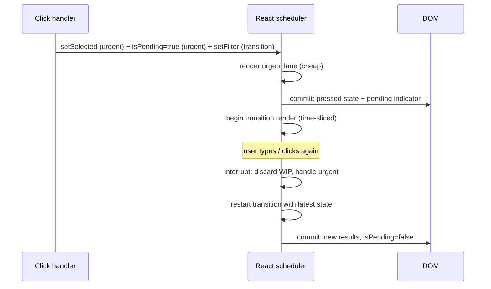
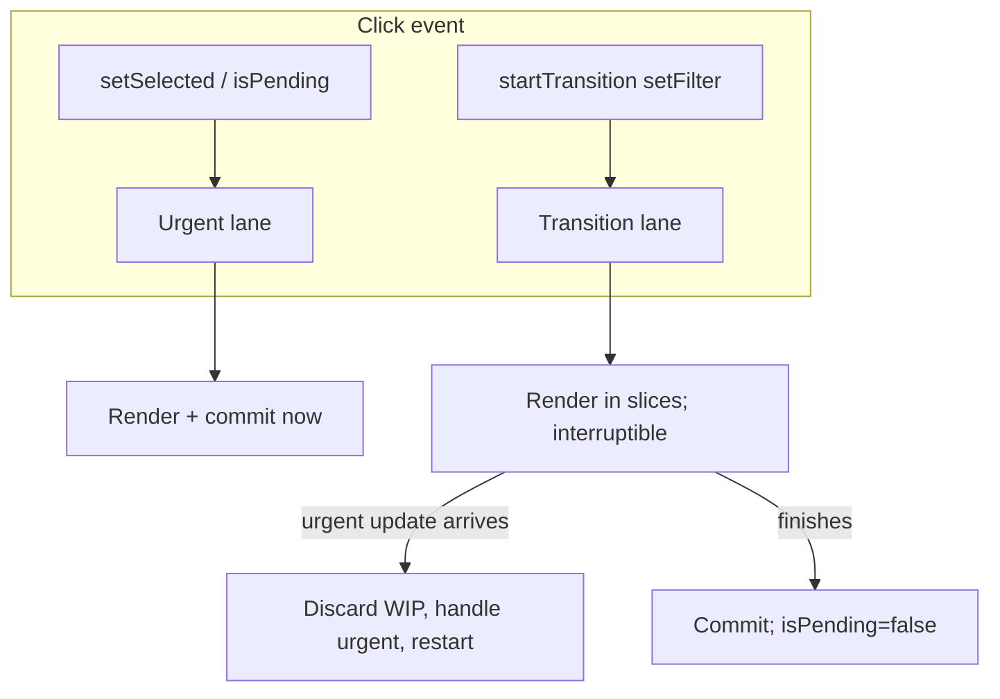
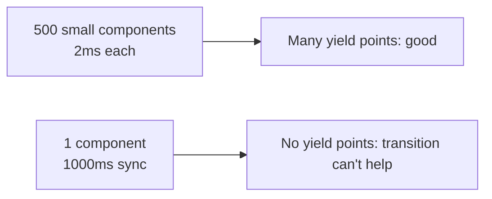

# 07 / 12 — `useTransition` in Practice

## 1. Lesson metadata

| | |
|---|---|
| **Level** | Advanced |
| **Study time** | 5–6 hours (reading 2 h, experiments 2 h, exercises 1.5–2 h) |
| **Prerequisites** | [11 — Scheduling and perceived responsiveness](./11-scheduling-and-perceived-responsiveness.md), [Phase 2 — Transitions and deferred rendering](../02-react-rendering-and-internals/23-transitions-and-deferred-rendering.md), [Phase 2 — Scenario D: transition vs urgent](../02-react-rendering-and-internals/35-scenario-d-transition-vs-urgent.md), [Phase 2 — Interruptible rendering](../02-react-rendering-and-internals/15-interruptible-restartable-abandoned-rendering.md), [Phase 3 — Modern hooks and APIs](../03-react-state-and-hooks/22-modern-hooks-and-apis.md) |
| **Next** | [13 — useDeferredValue in practice](./13-usedeferredvalue-in-practice.md) |
| **Related** | [Phase 9 — Concurrent rendering in practice](../09-advanced-rendering-and-ecosystem/06-concurrent-rendering-in-practice.md), [Phase 9 — Suspense architecture](../09-advanced-rendering-and-ecosystem/05-suspense-architecture.md) |

**Learning objectives.** After this lesson you can:
1. State exactly what `useTransition` / `startTransition` changes (update priority and Suspense behavior) and what it does not change (the callback's execution, total CPU, network).
2. Pick suitable use cases (tab switches, heavy filtered views, navigation, search results) and reject unsuitable ones (controlled text input, single monolithic computation, cheap updates).
3. Use `isPending` for UX without causing flicker or layout shift.
4. Use async transitions (Actions) in React 19 correctly, including the "updates after `await`" caveat.
5. Measure the effect of a transition with the Profiler/Performance panel and the INP phase breakdown, and detect when it is counterproductive.

**Concepts covered:** urgent vs transition updates, `startTransition` (standalone) vs `useTransition`, `isPending`, interruptible renders, Suspense without fallback flashes, error handling in transitions, async functions in transitions, batching of transitions, `memo` interplay, router navigations.

---

## 2. Deep conceptual explanation

### 2.1 What problem is this lesson solving?

Some state updates are *direct manipulation* (typing, toggling a checkbox, selecting a tab). Others are consequences that can take longer (rendering a big tab panel, a filtered table, a results page). If both are handled at the same priority, a slow consequence delays the direct feedback. Before React 18 you had to emulate priorities with debouncing, timers, or manual deferral. `useTransition` makes the priority explicit:

> *"This state update is not urgent. If something urgent arrives, interrupt this and handle the urgent one first. Don't hide content that's already on screen because of this update."*

### 2.2 The API

```ts
const [isPending, startTransition] = useTransition();
startTransition(() => {
  setTab("posts"); // updates scheduled in here are transition updates
});
```

- `isPending: boolean` — true while a transition scheduled by this hook is in progress (from scheduling until it has been committed).
- `startTransition(fn)` — calls `fn` **synchronously and immediately**, marking state updates it schedules as transition updates.
- A standalone `startTransition` import from `"react"` has the same priority semantics but gives no `isPending`; use it outside components (e.g., in a router or store subscriber) or when you don't need pending UI.

*Public guarantees (React docs):*
- Updates inside a transition are interruptible by urgent updates.
- A transition does not show Suspense fallbacks for content that has already been revealed; React keeps the old UI until the new one is ready (it may show fallbacks for *new* boundaries that mount, depending on the situation).
- `isPending` lets you render pending UI.
- Transitions can't be used to control text inputs.

*Teaching model:* "two queues": urgent and transition. React renders the urgent queue first and works on the transition in the background, throwing away partial work if urgent work arrives.

*Implementation detail:* lanes ([Phase 2 — Lanes](../02-react-rendering-and-internals/14-lanes.md)) represent priorities internally; time-slice sizes and entanglement of transitions are internal and change between versions.

### 2.3 What it is *not*

| Statement | Reality |
|---|---|
| "It runs my code in the background." | The callback runs synchronously. Only the *React render* triggered by the updates is scheduled at low priority. |
| "It makes the slow component fast." | Total render work is the same (or slightly more when interrupted and restarted). It improves *responsiveness* for urgent work. |
| "It debounces." | Every transition update is eventually rendered (the latest wins), no timer delay. Intermediate transition states may be skipped when superseded. It does not reduce network requests. |
| "It cancels fetches/effects." | It doesn't cancel anything outside React rendering. |
| "It splits a single huge component's render into chunks." | React can pause only between components/units of work, not mid-function. |
| "Everything inside is async." | Updates after an `await` inside an async callback lose the transition marking unless re-wrapped (§3.4). |

### 2.4 Misconceptions about pending state

`isPending` is true **during** the transition, *not* while "data is loading from your own fetch library" unless that loading is tied to Suspense and the state update is inside the transition. With a non-suspending `useEffect` fetch there is nothing for the transition to wait on: React renders the new tree (with its own loading UI) immediately and `isPending` flips back to false.

---

## 3. Internal mechanics

### 3.1 Two renders for one interaction

When a click calls `setSelected(f)` (urgent) and `startTransition(() => setFilter(f))`:

1. React processes the urgent lane: renders components that depend on `selected`, commits.
2. React then starts a *transition render* with both updates applied; `filter` is the new value; `selected` already reflects the urgent update.
3. If the transition render finishes, it commits. If another urgent update arrives mid-way, React discards the work-in-progress transition tree (it is unobservable because render is pure) and restarts the transition after handling the urgent update, rebasing on top of the new state.
4. `isPending` becomes true in the urgent render (so the UI can show it) and false in the transition's commit.



### 3.2 Suspense interaction

Without a transition, an update that makes a component suspend (read an unresolved promise via `use` or a suspense-enabled library) causes the nearest Suspense boundary to show its fallback, *replacing already-visible content*. Inside a transition, React keeps the previous UI on screen until the suspended tree is ready (or an error is thrown), and `isPending` stays true meanwhile. This is the basis for "navigation without flashing a spinner over the page."

Details differ for *newly mounted* boundaries (a boundary that did not exist yet may show its fallback), and React docs describe nuances (e.g., reveal throttling heuristics). Already-revealed boundaries keep the old UI (confirmed in the sandbox with React 19.3); for newly mounted boundaries, check the exact outcome with a test page.

### 3.3 Error behavior

Errors thrown during the transition render are handled by the nearest error boundary, just like any render error. In React 19, an error thrown inside the `startTransition` callback, whether a synchronous throw or a rejected promise from an async action, is also routed to the nearest error boundary rather than propagating to your event handler (react.dev `useTransition`, "Displaying an error to users with an error boundary"; executed in the sandbox: a `try/catch` around `startTransition(() => { throw ... })` caught nothing and the boundary rendered its fallback). Handle expected failures with `try/catch` inside the callback.

### 3.4 Async transitions (React 19 Actions)

React 19 lets you pass an async function:

```ts
startTransition(async () => {
  await saveName(name);          // network
  startTransition(() => {        // required for updates after await
    setName("");
  });
});
```

*Public behavior (docs):* `isPending` remains true until the async function settles and any updates scheduled inside have rendered. State updates that happen **after** an `await` are not automatically marked as transitions because React loses the async context; wrap them in another `startTransition`. The react.dev `useTransition` reference (checked 2026-10-22, React 19.x) still describes this as a known limitation that "we will fix in the future". See also `useActionState` and `<form action>` for the higher-level approach ([Phase 9 — Forms, actions and mutations](../09-advanced-rendering-and-ecosystem/13-forms-actions-and-mutations.md)).

### 3.5 Batching of transitions

Multiple transitions started close together may be processed together; docs describe that React batches async transitions in some cases so that, for example, two pending requests from different components end together. Don't depend on whether two separate `startTransition` calls produce one commit or two; if you need atomic combined updates, put the related `setState` calls in the same `startTransition` callback.

### 3.6 Why the input can't be a transition

A controlled `<input value={v} onChange={...}>` must reflect each keystroke **synchronously** in the DOM value. If `setValue` were deferred, React would render the old value back into the input and the caret/typed characters would be lost or reverted. The documented pattern is: keep a separate urgent state for the input and a transition state (or deferred value) for the expensive consumer.

---

## 4. Step-by-step execution walkthrough

Scenario: a Tabs component. Tabs: "About" (cheap), "Posts" (500 slow items, ≈ 2 ms each ⇒ ≈ 1 s per full render), "Contact" (cheap). Wrapped in `startTransition`.

Component:

```tsx
function Tabs() {
  const [tab, setTab] = useState<"about" | "posts" | "contact">("about");
  const [isPending, startTransition] = useTransition();
  const select = (t: typeof tab) => startTransition(() => setTab(t));
  /* ... */
}
```

Timeline when the user clicks "Posts" then, 300 ms later, "Contact":

1. `t=0` click "Posts". `startTransition(() => setTab("posts"))` runs. `isPending` is set true as an urgent update.
2. `t≈2` urgent render: `Tabs` re-renders with `isPending = true` (tab still "about"). Commit. The user sees the old tab with a pending indicator.
3. `t≈3` React starts the transition render with `tab = "posts"`. Slow items render in slices of work; between components it yields so the browser can handle input.
4. `t=300` user clicks "Contact". The click handler (an urgent discrete event) can run because React yielded; handler calls `startTransition(() => setTab("contact"))`.
5. React sees a new update. The in-progress "posts" render is **abandoned**. `tab` becomes `"contact"` in the new transition render (cheap). ~1–5 ms. Commit. `isPending = false`.
6. The user never waited for the 1 s "posts" render; ~200–300 ms of wasted render work occurred in the background.

If instead the 500 posts were rendered in one `PostsTab` function whose single render takes 1 s (e.g., one monolithic function), at step 4 the click handler cannot start until that function returns: *input delay ≈ 700 ms*. The difference is purely *granularity of units of work*, not use of `startTransition`.

Without the transition: at step 1 React renders "posts" at urgent priority immediately; the page freezes ~1 s; the click on "Contact" waits.

---

## 5. Code examples

### 5.1 Minimal example — tabs with `isPending`

```tsx
import { memo, useState, useTransition } from "react";

type TabId = "about" | "posts" | "contact";

export function TabbedPage() {
  const [tab, setTab] = useState<TabId>("about");
  const [isPending, startTransition] = useTransition();

  function select(next: TabId) {
    startTransition(() => {
      setTab(next);
    });
  }

  return (
    <div>
      <nav role="tablist" aria-busy={isPending}>
        {(["about", "posts", "contact"] as const).map((id) => (
          <button
            key={id}
            role="tab"
            aria-selected={tab === id}
            onClick={() => select(id)}
          >
            {id}
          </button>
        ))}
      </nav>
      <div style={{ opacity: isPending ? 0.6 : 1, transition: "opacity 150ms" }}>
        {tab === "about" && <About />}
        {tab === "posts" && <PostsTab />}
        {tab === "contact" && <Contact />}
      </div>
    </div>
  );
}

export const PostsTab = memo(function PostsTab() {
  const items: number[] = Array.from({ length: 500 }, (_, i) => i);
  return <ul>{items.map((i) => <SlowPost key={i} index={i} />)}</ul>;
});

function SlowPost({ index }: { index: number }) {
  const start = performance.now();
  while (performance.now() - start < 1) { /* artificial 1ms work for the demo */ }
  return <li>Post #{index + 1}</li>;
}
```

**Line notes.**
- The tab highlight (`aria-selected`) reads the *transition state* `tab`, so it only changes once the tab content commits. If you want the selected tab to highlight immediately, track a separate urgent `selectedTab` state and a transition `renderedTab`—or use `isPending` to style the intended tab. Choosing between those is a UX decision (immediate highlight with dimmed content vs highlight only when ready).
- `memo` on `PostsTab` stops it from re-rendering when `isPending` toggles (urgent render of the parent): without `memo`, the parent's urgent render would re-render the Posts tab (if `tab === "posts"` already), doing the slow work at urgent priority.
- The artificial busy loop is **only** to simulate cost; never ship such code.

**Predict:** user is on "about" and clicks "posts". How many `SlowPost` renders occur *before the first commit that shows isPending=true*? *Answer:* 0. The urgent render only re-renders `TabbedPage` (the tab is still "about"); the posts tree is rendered in the transition render afterwards.

### 5.2 Practical example — filtering a heavy list without freezing typing

```tsx
import { memo, useMemo, useState, useTransition } from "react";

type Row = { id: string; name: string; sku: string };

export function CatalogSearch({ rows }: { rows: readonly Row[] }) {
  const [input, setInput] = useState("");        // urgent: mirrors the text field
  const [query, setQuery] = useState("");        // transition: drives filtering
  const [isPending, startTransition] = useTransition();

  const results = useMemo(() => {
    const q = query.trim().toLowerCase();
    if (!q) return rows;
    return rows.filter((r) => r.name.toLowerCase().includes(q) || r.sku.toLowerCase().includes(q));
  }, [rows, query]);

  return (
    <>
      <label>
        Search
        <input
          value={input}
          onChange={(e) => {
            const v = e.target.value;
            setInput(v);                              // 1. echo immediately
            startTransition(() => setQuery(v));       // 2. heavy part may lag
          }}
        />
      </label>
      {isPending && <span role="status">Updating…</span>}
      <ResultTable rows={results} dimmed={isPending} />
    </>
  );
}

const ResultTable = memo(function ResultTable({ rows, dimmed }: { rows: readonly Row[]; dimmed: boolean }) {
  return (
    <table style={{ opacity: dimmed ? 0.6 : 1 }}>
      <tbody>
        {rows.slice(0, 200).map((r) => (
          <tr key={r.id}><td>{r.name}</td><td>{r.sku}</td></tr>
        ))}
      </tbody>
    </table>
  );
});
```

**Critical analysis.** The `useMemo` filter runs *inside the transition render* because it depends on `query`; fine as long as filtering is short relative to the render slice granularity. If filtering is one 300 ms synchronous pass over 200k rows, the transition cannot interrupt it: input delay for the next keystroke would still be up to 300 ms. Rendering only 200 rows keeps commit cost low. When filtering cost dominates, use a worker ([10](./10-expensive-computations.md)) or debounce ([14](./14-debounce-and-throttle.md)). `dimmed` is a prop change on a `memo` component, so the table does re-render once for the pending UI; if that is expensive, apply the dimming through a wrapper element's style rather than a prop on the heavy child.

**Compare with** `useDeferredValue` ([13](./13-usedeferredvalue-in-practice.md)): a deferred value is more convenient when you don't own the setter (value arrives via props); a transition is better when you own the event and want `isPending`.

### 5.3 Incorrect example — wrapping the input itself, and async without re-wrap

```tsx
function Bad() {
  const [text, setText] = useState("");
  const [isPending, startTransition] = useTransition();
  const [saved, setSaved] = useState<string[]>([]);

  return (
    <>
      <input
        value={text}
        onChange={(e) => startTransition(() => setText(e.target.value))}   // (1)
      />
      <button
        onClick={() =>
          startTransition(async () => {
            await api.save(text);
            setSaved((s) => [...s, text]);                                  // (2)
            setText("");                                                    // (3)
          })
        }
      >
        Save
      </button>
    </>
  );
}
```

**Predict.**
(1) Controlled input updates inside a transition: while a transition is pending React may render the *old* `text` value back into the input (urgent renders don't include the transition update). Typed characters can appear to be dropped or flicker, and the caret may jump; React documents that transitions can't control text inputs. If the page also has other urgent work, the problem worsens.
(2),(3) After `await`, the updates are **not** automatically transition updates (current React 19 behavior; react.dev documents it as a known limitation). They are processed as ordinary updates (likely default priority), which may display an intermediate state: `saved` updates and then `text` is cleared in separate renders if they are not batched together—in practice they are batched into one render when they occur in the same task. Executed in the sandbox (React 19.3, RTL): the renders were `isPending=true, saved=1, text=""` (one batched render, still pending) followed by `isPending=false`; so `isPending` did not flip early here. The post-`await` updates are simply not marked as transition updates, which matters when they would suspend or are expensive.

### 5.4 Corrected implementation

```tsx
function Good() {
  const [text, setText] = useState("");                // urgent, mirrors the input
  const [saved, setSaved] = useState<string[]>([]);
  const [isPending, startTransition] = useTransition();

  const onSave = () => {
    const value = text;
    startTransition(async () => {
      await api.save(value);
      startTransition(() => {                          // re-wrap updates after await
        setSaved((s) => [...s, value]);
        setText("");
      });
    });
  };

  return (
    <>
      <input value={text} onChange={(e) => setText(e.target.value)} />
      <button onClick={onSave} disabled={isPending}>{isPending ? "Saving…" : "Save"}</button>
      <ul>{saved.map((s, i) => <li key={i}>{s}</li>)}</ul>
    </>
  );
}
```

- The input is urgent.
- `value` is captured before the `await` (a snapshot; avoids reading `text` after the user continues typing).
- The inner `startTransition` groups both updates into one transition.
- If your code base uses forms, `useActionState` + `<form action>` is the higher-level pattern and handles pending state, errors, and sequential actions; see [Phase 9](../09-advanced-rendering-and-ecosystem/13-forms-actions-and-mutations.md). The `key={i}` here is acceptable only because the list is append-only and never reordered ([Phase 1 — Keys](../01-react-fundamentals/09-lists-keys-and-identity.md)).

### 5.5 Advanced example — router-style navigation with Suspense

```tsx
import { Suspense, startTransition, use, useState, useTransition } from "react";

type Route = { path: string };

const cache = new Map<string, Promise<string>>();
function loadPage(path: string): Promise<string> {
  let p = cache.get(path);
  if (!p) {
    p = fetch(`/api/page?path=${encodeURIComponent(path)}`).then((r) => {
      if (!r.ok) throw new Error(`HTTP ${r.status}`);
      return r.text();
    });
    cache.set(path, p);
  }
  return p;
}

function Page({ route }: { route: Route }) {
  const html = use(loadPage(route.path)); // suspends until resolved
  return <article dangerouslySetInnerHTML={{ __html: html }} />;
}

export function Shell() {
  const [route, setRoute] = useState<Route>({ path: "/" });
  const [isPending, startTransition] = useTransition();

  const navigate = (path: string) => startTransition(() => setRoute({ path }));

  return (
    <>
      <header>
        <button onClick={() => navigate("/")}>Home</button>
        <button onClick={() => navigate("/reports")}>Reports</button>
        {isPending && <progress aria-label="Loading page" />}
      </header>
      <Suspense fallback={<p>Loading…</p>}>
        <Page route={route} />
      </Suspense>
    </>
  );
}
```

**What to notice.**
- Navigating from Home to Reports inside a transition: `Page` with the new route suspends; because it's a transition, React **keeps Home visible** (and `isPending = true`) rather than replacing it by `Loading…`. The *initial* mount (first render of the app) has nothing to keep, so the fallback shows.
- The cache stores *promises* keyed by input so repeated renders read the same promise. In real apps, use a data library with Suspense support (TanStack Query, framework loaders, Relay) rather than hand-rolled caches; React docs caution that `use` with promises created during render in client components is unsupported (create them outside render or via a cache).
- `dangerouslySetInnerHTML` appears only to keep the example short; **never** inject untrusted HTML ([Phase 10 — Security](../10-production-engineering/06-security-xss-csrf-csp.md)).
- Failed fetches reject; the rejected promise stays cached forever here: a real cache needs invalidation/retry logic, and an error boundary should surround `Page`.

### 5.6 Measuring a transition's effect

Using User Timing to compare with/without transition:

```tsx
function mark(name: string) { performance.mark(name); }

function onClickTab(next: TabId) {
  mark("tab:click");
  startTransition(() => setTab(next));
}

// In PostsTab (after commit):
useEffect(() => {
  performance.mark("tab:content-visible");
  performance.measure("tab:click→content", "tab:click", "tab:content-visible");
}, []);
```

Two things should be measured, and they move in *opposite* directions:
- **Responsiveness metric** (input delay + time to first feedback, INP of the interaction): should improve.
- **Completion metric** (click → content committed): usually *stays the same or gets slightly worse* (time-slicing and potential restarts add overhead).

If you report only completion time you will conclude the transition is "slower"; if you report only INP you may miss that results take longer. Report both.

---

## 6. Visual explanations

### Urgent vs transition lanes (conceptual)



### With vs without transition (main thread)

```text
No transition:   |click|=========render 1000ms=========|paint|   <-- input blocked
Transition:      |click|r|paint|..slice..|input|..slice..|input|..slice..|commit|paint|
                         ^ pending UI at ~10ms
```

### Where granularity matters



---

## 7. Alternative approaches and trade-offs

| Approach | Input stays responsive | Result latency | Network savings | Complexity | Notes |
|---|---|---|---|---|---|
| `startTransition` / `useTransition` | Yes (if work is sliceable) | ≈ same, slightly higher | None | Low | Own the setter; gives `isPending` |
| `useDeferredValue` | Yes (same) | ≈ same | None | Low | Good for prop-driven values ([13](./13-usedeferredvalue-in-practice.md)) |
| Debounce ([14](./14-debounce-and-throttle.md)) | Yes | + delay | Yes (fewer calls) | Low | Doesn't help if each render is slow; may feel laggy |
| Throttle | Yes | bounded | Yes | Low | For continuous events |
| Web Worker | Yes (always) | ≈ same | None | High | For one big function |
| Windowing ([09](./09-windowing-and-virtualization.md)) | Yes | Better | None | Medium | Reduces total work |
| Reduce work / memoize | Yes | Better | None | Varies | Always preferred first |
| Manual `setTimeout` deferral | Partly | + delay | None | Low | Not interruptible; legacy pattern |

**When `useTransition` is *not* the best choice:**
1. The update is cheap (< ~10 ms render): adds code and `isPending` flicker for no benefit.
2. The expensive part is a single synchronous function (use worker/chunking/algorithm fix).
3. You need to reduce *network* calls (debounce/cancel).
4. The consequence must be *atomic with* the urgent update (e.g., a controlled input and its validation message must update in the same frame): do not split them.
5. Accessibility-critical immediate state changes such as dialog open/close focus management—deferring these can break focus order; keep the state urgent and defer only the heavy content inside.

---

## 8. Best practices and anti-patterns

**Beginner mistakes**
- Wrapping *every* `setState` in `startTransition` ("just in case").
- Wrapping controlled-input updates (5.3 (1)).
- Not rendering `isPending` and then wondering why "nothing happens" for a second.
- Expecting `startTransition` to move a computation off the main thread.

**Experienced-developer mistakes**
- Forgetting `memo`/stable props so urgent renders re-render the heavy subtree anyway (the "pending" render becomes expensive).
- Reading state after `await` inside an async transition (stale closures; re-wrap updates).
- Showing both a Suspense fallback and an `isPending` spinner for the same wait (duplicate indicators).
- Using transitions to hide slow *effects* or layout work that run in commit (commit is synchronous and not time-sliced).
- Assuming a second `startTransition` call cancels the first's side effects (network, timers); only the React render is superseded.

**Smells**
- `isPending` driving a modal spinner that blocks the UI — defeats the purpose.
- A transition around an update that triggers `flushSync` or layout effects measuring DOM synchronously.
- Layout shift when `isPending` text appears/disappears (reserve space).

**Justified exceptions**
- Wrapping an update in a transition purely to prevent Suspense fallbacks from replacing visible content, even when render is fast (navigation, tab changes to data-fetching panels).

**Guidelines**
1. Urgent = reflects the user's input directly; Transition = result of that input.
2. Keep transition-affected subtrees `memo`'d and make props stable.
3. Show pending state only when it conveys useful information, with a small delay if flicker occurs ([11](./11-scheduling-and-perceived-responsiveness.md) §5.6).
4. Combine with error boundaries and retry UX around Suspense.

---

## 9. Real-world application

**Dashboards.** Date-range or segment selectors update the control immediately (urgent) and re-render ten widgets in a transition. Each widget is memoized by its `(data, filters)` props; each shows a lightweight stale overlay when `isPending`. Constraint: charts that are expensive to *commit* (canvas drawing in layout effects) are not time-sliced, so transitions mostly help the render phase. Measure commit separately.

**E-commerce category pages.** Facet toggles are urgent (checkbox state); product grid update is transition. Prefetch the next page's data on hover; navigation uses transitions to avoid replacing the grid with a skeleton. Constraint: SEO and SSR (the first load isn't a transition).

**Forms with live preview.** Typing in a field is urgent; the PDF/markdown preview updates in a transition. Heavy preview renders (markdown → React tree of thousands of nodes) benefit if the tree is componentized; if the preview is one `dangerouslySetInnerHTML` string, there's one big DOM operation in commit that no transition can slice.

**Admin routers.** `navigate()` wrapped with `startTransition` (some routers do this internally, and the Next.js App Router navigates inside a transition; check your router's docs, e.g., React Router, TanStack Router) so pages keep previous content during data loads; `useTransition` is used for `isPending` bars.

**Realtime.** Incoming update bursts could be applied as transitions to avoid starving input, but transitions can be *starved or restarted* under continuous urgent updates (a rapid stream of urgent updates can postpone a transition indefinitely; React has internal mechanisms to eventually finish them, an implementation detail). Prefer batching updates on a tick.

---

## 10. Debugging and troubleshooting

| Symptom | Likely cause | Investigation | Fix |
|---|---|---|---|
| Input still laggy with transition | Work isn't sliceable (single heavy function or heavy commit) | Performance panel: one long block under a single component; no gaps | Reduce/offload work; split components; `memo`; worker |
| `isPending` never true | Update not inside transition; or the update doesn't change anything; or the work completes before the paint | Console-log inside callback; check you call the hook's `startTransition` (not an unrelated import), React DevTools | Move setter inside; verify state actually changes |
| `isPending` stuck true | Async transition never settles (promise never resolves); an error thrown; Suspense never resolved | Add logging; catch errors; check network | Resolve/reject; add timeouts/abort |
| Typed characters vanish | Input state in transition | See 5.3 | Separate urgent state |
| Suspense fallback shows anyway | Update not in a transition; or new boundary mounted; or update after `await` unwrapped | Check where `setState` runs; inspect boundary placement | Wrap; place boundaries so existing content stays mounted |
| Heavy subtree re-renders on `isPending` toggle | Parent urgent render re-renders children | Profiler "why did this render"; highlight updates | `memo`, move pending UI to a sibling, composition |
| Transition seems to "never finish" under constant input | Starvation by urgent updates or restart each keystroke | Profiler: repeated aborted renders | Debounce transition source; reduce render cost |
| Stale data after async transition | Closure captured old state | Review code after `await` | Snapshot values before `await`; functional updates |

**Reading evidence.** The React DevTools Profiler records commits; transition renders appear as normal commits when they finish, aborted renders do not produce commits. React 19.2 added React Performance Tracks to the Chrome Performance panel (scheduler and component tracks, including transition lanes; see the React 19.2 blog post); availability depends on using a development or profiling build. In the Chrome Performance panel, a time-sliced transition render appears as many short tasks separated by gaps; a non-sliced one as a single long task.

### Measurement methodology

1. **Pick the interaction** (e.g., "select Posts tab" or "type 4 characters in search").
2. **Baseline** (production build, 4× CPU throttle, 10 runs): record INP-style total, input delay of the *second* interaction (the one that arrives during the first's render), commit time, time to content.
3. **Apply transition only.** Re-run exactly.
4. **Evaluate**: INP ↓ expected; time-to-content ≈ or ↑; total scripting ≈ or ↑; wasted renders (aborted) ↑. Accept if the user-visible responsiveness improved and completion time is acceptable.
5. **Check regressions:** layout shift from `isPending` UI; a11y announcements; stale content acting on stale data.

---

## 11. Exercises

### Level A — Knowledge
A1. When does the callback passed to `startTransition` execute?
A2. What does `isPending` represent?
A3. Why can't a controlled text input's `setState` be in a transition?
A4. What happens to an in-progress transition render when an urgent update arrives?
A5. How does a transition change Suspense behavior for already-visible content?

### Level B — Code comprehension
B1. For 5.1, if `PostsTab` were not wrapped in `memo` and the user is *already on* "posts" when `isPending` toggles (e.g., clicking "contact" starts a transition), what renders at urgent priority?
B2. Given:
```tsx
startTransition(async () => {
  setA(1);
  await delay(100);
  setB(2);
});
```
Which updates are transition updates in current React 19 (updates after an `await` are not, per react.dev)? What would you change?
B3. Predict the number of renders of `Child` (memo'd, props `{x: number}`) in a parent that does `setCount(c => c + 1)` urgently and `startTransition(() => setX(x + 1))` in the same click.

### Level C — Implementation
C1. Implement a `usePendingTabs` hook that returns `{ selectedTab, renderedTab, select, isPending }` where the tab highlight updates immediately but content updates in a transition.
C2. Convert 5.2 to use `useDeferredValue` instead; list what you gain and lose.
C3. Add an error boundary and retry button around the Suspense navigation in 5.5, ensuring a failed route does not remain cached forever.

### Level D — Debugging
D1. "We wrapped our filter in a transition but the input still lags." The filter is `rows.filter(...)` on 300k rows within `useMemo`, and the table renders 100 rows. Diagnose and propose three fixes with trade-offs.
D2. `isPending` is true for a long time after a request finished. Provide hypotheses and an investigation plan.
D3. After wrapping navigation in a transition, the old page remains clickable during pending and users double-submit a form. Explain and fix.

### Level E — Architecture and engineering decisions
E1. Define a team guideline "when to use transitions" with decision criteria and examples. Include "when not to".
E2. A design system provides `<Tabs>`. Should the component itself wrap `onChange` in `startTransition`? Discuss API ownership, controlled/uncontrolled, and pitfalls.

### Level F — Expert challenge
F1. Design an experiment (including instrumentation and statistics) to determine whether wrapping a particular interaction in a transition improved real-user INP. Address confounders and rollout.

---

## 12. Detailed answers and explanations

> Attempt the exercises first.

**A1.** Immediately and synchronously during the call to `startTransition`. Only the React updates scheduled inside it are low-priority. Wrong: "after the next render"/"in the background."

**A2.** True while the transition started via this hook is pending: from scheduling until the transition's render (and any async function passed) completes and commits. It is a React concept, not a network-status flag.

**A3.** A controlled input needs its value updated in the same render as the event so the DOM value matches what the user typed. A transition update is lower priority, so an urgent render in between would render the old state back into the input, reverting/jumping text. Use urgent state for the input and a transition/deferred value for the expensive consumer.

**A4.** React abandons the work-in-progress tree (render is pure and side-effect-free, so discarding is safe), handles the urgent update, then restarts the transition on top of the updated state. Partial render work is wasted.

**A5.** If the transition's update causes components to suspend, React keeps showing the previous committed UI rather than falling back to an already-revealed Suspense boundary's fallback, and `isPending` is true. New boundaries mounting for the first time may still show fallbacks. Verified in the sandbox: when `setTab` inside a transition suspends an already-revealed boundary, the old UI stays and `isPending` is true until the promise resolves.

**B1.** `TabbedPage` re-renders (urgent: `isPending=true`) with `tab` still `"posts"`, so `PostsTab` (if not memoized) re-renders at urgent priority: 500 slow items ⇒ the pending indicator itself costs ≈ 1 s and the UI freezes — the transition didn't help. With `memo`, `PostsTab` props unchanged ⇒ skipped.

**B2.** `setA(1)` (before the `await`) is a transition update. `setB(2)` (after `await`) is **not** automatically a transition update (React docs state you need to wrap updates after `await` in another `startTransition`). Change to `startTransition(() => setB(2))` after the await. Edge: if `delay` rejects, neither update after it runs; handle errors.

**B3.** `Child` receives `x` changed in the transition render only. The urgent render (count change) renders the parent with old `x`, so `Child` (memo) props unchanged ⇒ skipped. The transition render renders `Child` once with new `x` (if not interrupted) — **1 render of Child**; if interrupted and restarted, `Child` may start rendering more than once but commit once (render attempts ≠ commits). Strict Mode in dev double-invokes render functions, so dev logs show 2 per attempt.

**C1.**
```tsx
import { useState, useTransition } from "react";

export function usePendingTabs<T extends string>(initial: T) {
  const [selectedTab, setSelectedTab] = useState<T>(initial);  // urgent
  const [renderedTab, setRenderedTab] = useState<T>(initial);  // transition
  const [isPending, startTransition] = useTransition();

  const select = (next: T) => {
    setSelectedTab(next);
    startTransition(() => setRenderedTab(next));
  };
  return { selectedTab, renderedTab, select, isPending };
}
```
Note `isPending` can be derived as `selectedTab !== renderedTab`, which avoids relying on the hook's flag if multiple sources toggle it. Edge: clicking tab B then A quickly: `selectedTab=A`, `renderedTab` transitions to B then A; final state consistent because the latest transition wins. Trap: using `selectedTab` for content.

**C2.**
```tsx
const [input, setInput] = useState("");
const deferred = useDeferredValue(input);
const results = useMemo(() => filter(rows, deferred), [rows, deferred]);
const stale = input !== deferred;
```
Gain: simpler code, no second state, works for values from props. Lose: no direct `isPending`; derive `stale` by comparison; no ability to wrap non-React updates (e.g., router navigation). Same limitation: unsliceable filter blocks.

**C3.** Key points: wrap `<Page>` in an error boundary (class component or library like `react-error-boundary`; error boundaries still require class components or a library such as `react-error-boundary`); on failure delete the cache entry in a `catch` handler: `p.catch(() => cache.delete(path))` so retry triggers a new fetch; the retry button resets the boundary and calls `navigate(path)` inside a transition. Check that a rejected promise doesn't cause an unhandled rejection log (attach handlers carefully since `use` handles it).

**D1.** The `useMemo` filter on 300k rows is ~one synchronous function inside the transition render. A transition cannot interrupt inside a function. After the first keystroke starts the transition render, the filter runs to completion (say 150 ms) before React can yield; the next keystroke waits up to 150 ms. Fixes: (1) speed up (precomputed lowercase fields, prefix index, typed arrays) — lowest risk, best; (2) worker with persistent index — keeps input free, adds async complexity; (3) debounce the query source (e.g., 150 ms) so fewer filters run — reduces wasted work but adds latency; (4) chunk the filter manually into incremental results. Validate by long-task length in the Performance panel.

**D2.** Hypotheses: an async transition callback never resolves (awaiting a promise that never settles or a request with no timeout); Suspense resource never resolves; an error in an effect preventing commit; transitions starved by continuous urgent updates; `isPending` from a different `useTransition` instance than expected. Plan: log start/end of the async function; check Network panel for pending requests; wrap with `try/finally` logging; inspect with React DevTools whether a boundary is stuck suspended; reproduce with a stub that resolves instantly.

**D3.** Transition keeps old UI interactive because it's still the committed tree. Users can click submit again. Fix: derive disabled state from `isPending` (or a separate `submitting` ref), use idempotency keys server-side, and use `<form action>`/`useActionState` which serialize actions. Validate by double-click test (Playwright `dblclick`) and network log count.

**E1.** Criteria: update is a *consequence* not the input; render cost measurable > ~16–50 ms on target hardware; work spread across many components; need to keep previous UI during Suspense; pending UI feasible. Not: controlled inputs, cheap updates, single heavy function, atomic UI updates, accessibility-critical state, anything needing cancellation of network. Examples and counterexamples must be given, along with a requirement to attach a before/after measurement in the PR. A strong answer also covers `memo`/props hygiene and the pending UX policy ([11](./11-scheduling-and-perceived-responsiveness.md)).

**E2.** Usually no: the design-system component should expose controlled `value`/`onChange` and let the *consumer* decide priority, because only the consumer knows whether the consequence is heavy and which updates are urgent; wrapping inside the component would also wrap the consumer's state updates opaquely. Provide docs showing how to combine with `useTransition`. If the component owns uncontrolled state with expensive children, it can offer an opt-in `deferContent` prop. Pitfall: wrapping `onChange` of text-like controls (see A3). Evaluate API-surface cost vs developer convenience.

**F1.** Outline: feature-flag the transition (randomized by user/session, stratified by device class), instrument INP attribution for the specific interaction target (`web-vitals` attribution + custom `performance.measure` for completion time), collect p75 and distribution per arm for ≥ N sessions with power analysis, guard against confounders (release timing, device mix, third-party scripts), analyze with non-parametric tests/bootstrapped confidence intervals for p75 differences, secondary metrics (error rate, abandonment, time to content), and plan rollback. Also consider novelty effects, long-session state, and that interactions are not independent within a session.

---

## 13. Senior engineer interview questions

**Q1. "Explain what `startTransition` does under the hood, without lying."**
Marks updates scheduled during its synchronous callback as transition-priority; React renders urgent updates first and renders transition updates in interruptible slices, discarding and restarting if superseded. It doesn't run code in the background, and exact lane/time-slice mechanics are internal and version-dependent.

**Q2. "Why might wrapping a filter in a transition not fix typing lag?"**
Because slicing happens between components; if filtering or rendering is one monolithic synchronous unit, there is no yield point. Also if urgent renders re-render the heavy subtree, the "urgent" part is expensive.

**Q3. "Transition vs debounce — when each?"**
Transitions keep the UI responsive during renders but do not reduce the number of renders or requests (superseded renders are abandoned, though). Debounce reduces work and network calls but adds latency. Use transitions for render cost, debounce for request cost; combine when both matter.

**Q4. "What's the downside of transitions?"**
Wasted renders on interruption, extra complexity (two states for urgent vs deferred), pending UI design needs, subtle async caveats (updates after `await`), and a UI that can show stale content while pending, which can mislead users if actions act on stale data.

**Q5. "How do transitions help navigation?"**
Suspense fallbacks don't replace already-visible content; the old page remains until the new one is ready, and `isPending` supports progress UI. Details around new boundaries and heuristic reveal timing are version-sensitive and should be tested.

**Q6. "How would you prove a transition improved a production interaction?"**
A/B with feature flag, INP attribution per interaction target, p75 comparison with confidence intervals, secondary completion-time metric, device stratification, and rollout monitoring.

---

## 14. Further learning resources

| Resource | URL | Covers / why | Level | Section to study |
|---|---|---|---|---|
| React docs — `useTransition` | <https://react.dev/reference/react/useTransition> | API, caveats, async transitions, troubleshooting | Intermediate | Reference + Troubleshooting |
| React docs — `startTransition` | <https://react.dev/reference/react/startTransition> | Standalone API | Intermediate | Reference |
| React docs — Suspense | <https://react.dev/reference/react/Suspense> | Fallback behavior, "preventing already revealed content from hiding" | Intermediate | Usage sections on transitions |
| React docs — `use` | <https://react.dev/reference/react/use> | Reading promises/context; caveats on promise creation | Intermediate | Usage; Caveats |
| React docs — `memo` | <https://react.dev/reference/react/memo> | Skipping re-renders to make urgent renders cheap | Intermediate | Usage |
| React blog — React 19 | <https://react.dev/blog/2024/12/05/react-19> | Actions, async transitions, `useOptimistic` | Intermediate | Actions section |
| React 18 working group discussion on transitions | <https://github.com/reactwg/react-18/discussions> | Design rationale | Advanced | Discussions about `startTransition` |
| web.dev — Optimize INP | <https://web.dev/articles/optimize-inp> | INP phases | Intermediate | Whole article |

Links marked were not fetched in this session.

---

## 15. Knowledge checkpoint

**You should now understand**
- That `startTransition` changes update priority and Suspense behavior, not where code runs.
- Why granularity of work determines whether transitions help.
- The rules: inputs urgent, consequences deferred; re-wrap updates after `await`.

**You should be able to explain without notes**
- The timeline of an interrupted transition.
- Why `memo` and stable props are part of using transitions well.

**You should be able to implement**
- Tab switching, filtered lists, and Suspense navigation with `isPending` UX; an async action with a re-wrapped update.

**You should be able to debug**
- Laggy input despite transitions, stuck `isPending`, fallback flashes, stale closures after `await`.

**Before moving on:** read [13 — useDeferredValue in practice](./13-usedeferredvalue-in-practice.md) and compare when each tool fits.
