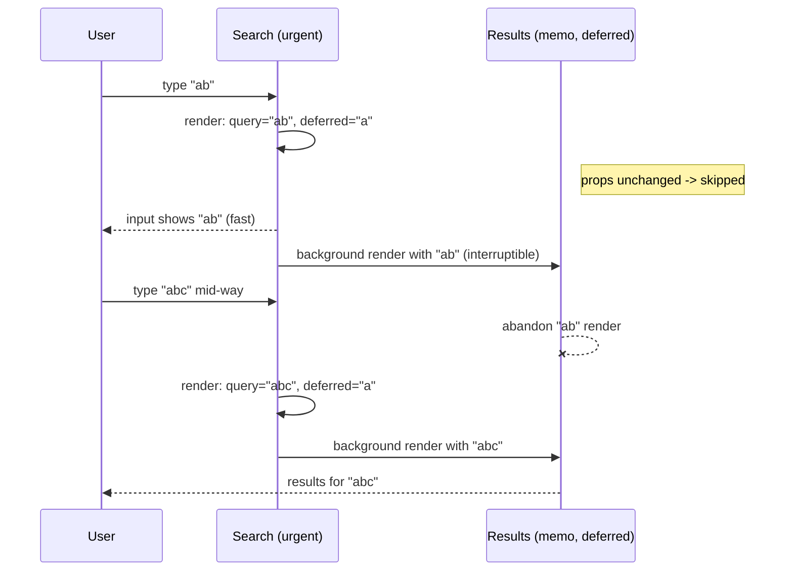
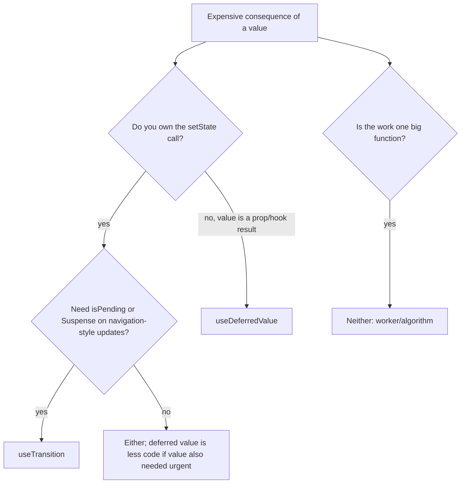

# 07 / 13 — `useDeferredValue` in Practice

## 1. Lesson metadata

| | |
|---|---|
| **Level** | Advanced |
| **Study time** | 4–5 hours (reading 1.5 h, experiments 1.5 h, exercises 1.5 h) |
| **Prerequisites** | [12 — useTransition in practice](./12-usetransition-in-practice.md), [11 — Scheduling and perceived responsiveness](./11-scheduling-and-perceived-responsiveness.md), [Phase 2 — Transitions and deferred rendering](../02-react-rendering-and-internals/23-transitions-and-deferred-rendering.md), [Phase 3 — React.memo](../03-react-state-and-hooks/12-react-memo.md), [05 — Referential equality](./05-referential-equality.md) |
| **Next** | [14 — Debounce and throttle](./14-debounce-and-throttle.md) |
| **Related** | [Phase 9 — Concurrent rendering in practice](../09-advanced-rendering-and-ecosystem/06-concurrent-rendering-in-practice.md) |

**Learning objectives.** After this lesson you can:
1. Explain the two-pass behavior of `useDeferredValue` (render with the old value, then re-render in the background with the new one) and why `memo` is usually required to benefit.
2. Choose between `useDeferredValue`, `useTransition`, debouncing, and algorithmic fixes for a given symptom.
3. Detect "stale" state and render appropriate UI, including with Suspense, without misleading users.
4. Avoid the main pitfalls: unstable object values, un-memoized consumers, deferring cheap work, deferring the input itself.
5. Measure whether deferring improved responsiveness and quantify its costs (extra renders, latency of final result).

**Concepts covered:** deferred value semantics, background re-render, interruption, `initialValue` (React 19), comparison with transitions, stale indicators, deferring props from parents, deferring with Suspense, interplay with `useMemo`/`memo`, fallbacks and flicker control.

---

## 2. Deep conceptual explanation

### 2.1 What problem is this lesson solving?

`useTransition` ([12](./12-usetransition-in-practice.md)) needs access to the **setter** that triggers an expensive update. Often you don't have it: the value arrives as a prop from a parent or a library hook (a router's search params, a form library's field value). You still want: *"keep the text field responsive while the expensive thing that depends on this value catches up."*

`useDeferredValue(value)` returns a copy of `value` that may **lag behind** during urgent updates. Components that read the deferred copy re-render in the background at transition-like priority, can be interrupted, and are skipped entirely if they are `memo`'d and their other props haven't changed.

### 2.2 The API and the two-pass behavior

```ts
const deferredQuery = useDeferredValue(query);
```

When `query` changes from `"a"` to `"ab"`:

1. **Urgent pass.** React re-renders with `query = "ab"` and `deferredQuery = "a"` (the *previous* value). Everything that reads `query` (the input) is current; everything that reads `deferredQuery` sees the old value and, if memoized, skips.
2. **Background pass.** React then schedules another render with `deferredQuery = "ab"`. This render is interruptible: if `query` changes again to `"abc"` while it's in progress, React abandons it, does the urgent pass (`query="abc"`, `deferred` still `"a"`), and restarts the background pass with `"abc"`.

*Public guarantees (docs):* the deferred value is the same as `value` when nothing is changing; during updates it lags; the background re-render is interruptible and doesn't block input; there is **no fixed delay** (unlike debounce) — the deferred render starts as soon as the urgent work is done; since React 19 an optional second argument `initialValue` is supported (§3.3).

*Teaching model:* "A transition you didn't have to write."

*Implementation detail:* the mechanism is implemented using the same priority machinery as transitions; do not rely on the number of passes or exact scheduling beyond what docs state. Verified against react.dev (React 19.3 docs) and an executed RTL test (2026-10-22): urgent pass renders `q="ab", deferred="a"`, then a background pass renders `deferred="ab"`. Two docs details worth knowing: an update that is already inside a Transition makes `useDeferredValue` return the new value immediately (no extra deferred render), and Effects do not fire for a background render until it commits.

### 2.3 Why `memo` is (almost always) necessary

If the slow component is **not** memoized, the urgent pass re-renders the parent, which re-renders the slow child (because the parent rendered). The child may receive the *old* deferred value, but it still *runs* — you paid the full cost at urgent priority, and then the background pass pays it again. Result: slower and still laggy. To benefit, the slow child must **skip** the urgent pass:

```tsx
const SlowResults = memo(function SlowResults({ query }: { query: string }) { /* ... */ });
// <SlowResults query={deferredQuery} />
```

During the urgent pass, `SlowResults` receives `deferredQuery="a"` — same as last time — so `memo` skips it. In the background pass it receives `"ab"` and renders.

### 2.4 Debounce vs deferred value

| | Debounce | `useDeferredValue` |
|---|---|---|
| Delay | Fixed timer (e.g., 200 ms) | None; adapts to device speed |
| Wasted work if user types fast | Avoided (fewer renders) | Some renders abandoned |
| Network calls | Reduced | **Not** reduced by itself (value still changes; the effect/query key changes only for the deferred value though — see 5.5) |
| Fast device | Always waits the delay | Almost immediate |
| Slow device | Same delay; render can still block when it fires | Interrupts to keep input responsive |
| Needs `memo`? | No | Yes, in practice |

They address different bottlenecks: debounce limits *how many times* work starts; deferral limits *how badly work blocks* once started. They can be combined ([14](./14-debounce-and-throttle.md)).

### 2.5 Misconceptions

| Misconception | Reality |
|---|---|
| "It delays the value by N ms." | No timer; it lags only as long as urgent work needs. |
| "It makes the slow render fast." | Same render cost, just interruptible and lower priority. |
| "It memoizes the value." | It doesn't cache computations. Use `useMemo`/`memo`. |
| "I can defer an object freely." | Pass primitives or objects with stable identity; a new object each render means a perpetual difference ([§3.2](#32-identity-matters)). |
| "It reduces network requests." | Only if requests are keyed off the deferred value *and* the intermediate values are skipped (they often are not). |
| "Always use it with search." | Only when the downstream render is expensive and sliceable. |

---

## 3. Internal mechanics

### 3.1 State machine view

Conceptually the hook keeps an internal "deferred" copy:

```text
if value is the same as the committed deferred value → return it
else if this render is urgent → return the old deferred value and schedule a deferred (transition) render with the new value
else if this render is the deferred render → return the new value
```

That is a *teaching model*; React implements this with lanes and hook state. The effect for you: consumers of the returned value see updates on a lower-priority schedule.

### 3.2 Identity matters

The docs state: values passed to `useDeferredValue` should be primitives (strings, numbers) or objects created **outside rendering**. If you do this:

```tsx
const deferredFilters = useDeferredValue({ q, sort });  // new object every render
```

then on each render `value !== previous`, so React keeps scheduling background renders trying to catch up, even though nothing changed semantically. Fix by deferring primitives separately (`useDeferredValue(q)`), or memoizing the object (`useMemo(() => ({ q, sort }), [q, sort])`) before deferring.

### 3.3 `initialValue` (React 19)

```ts
const deferred = useDeferredValue(value, "");
```

On the **initial** render the hook returns `initialValue` (`""` here) and schedules a background render with `value`. Use cases: avoid blocking the first paint with an expensive derived tree (render a cheap placeholder first, then the real content), or avoid flashing fallback by rendering something stable first. Added in React 19 (verified on react.dev; `useDeferredValue(value, initialValue?)`; an executed test logs `d=""` then `d="real"`). If `initialValue` is omitted, there is no deferral on the initial render (the value equals `value`). Test SSR/hydration behavior in your framework.

### 3.4 With Suspense

If the deferred render suspends (e.g., results component reads a promise keyed by `deferredQuery`), React keeps showing the **previous UI** (rendered with the old deferred value) rather than the fallback, because the suspended update is a deferred/transition-like update; the Suspense fallback is not triggered for already-revealed content. You can detect staleness with `query !== deferredQuery` to dim content. The docs present this as the canonical "search results" example.

The first time a boundary mounts (no previous content), its fallback shows, as with transitions (react.dev: the docs example only shows stale content after the first load).

### 3.5 What if the deferred render is very cheap?

Overhead exists: an extra render pass for components using the value and potential flicker of intermediate states (stale UI for a frame). If the downstream render takes ~2 ms, deferring gives no benefit; you've added a second render and stale/updated UI mismatch in the same frame sequence.

---

## 4. Step-by-step execution walkthrough

Component:

```tsx
function Search() {
  const [query, setQuery] = useState("");
  const deferredQuery = useDeferredValue(query);
  return (<>
    <input value={query} onChange={(e) => setQuery(e.target.value)} />
    <SlowResults query={deferredQuery} />   {/* memo'd; ~300 ms render */}
  </>);
}
```

User types "a", then 100 ms later "b". Timeline (illustrative; ms from first keystroke):

1. `t=0` keydown/input event: `setQuery("a")`. Discrete event ⇒ urgent.
2. `t=1–3` **Urgent render #1**: `query="a"`, `deferredQuery=""`. `Search` re-renders; `<input>` value updates; `SlowResults` receives `query=""` (unchanged) ⇒ memo skip. Commit. Frame presented ≈ `t=10`: the character "a" is visible.
3. `t=10` React schedules the **deferred render #1** with `deferredQuery="a"`. `SlowResults` begins rendering with `query="a"` (needs ~300 ms across, say, 300 small row components: yields between slices).
4. `t=100` second keystroke: input event handler can run because React yielded. `setQuery("ab")` (urgent).
5. React abandons deferred render #1 (≈ 90 ms of work discarded). **Urgent render #2**: `query="ab"`, `deferredQuery=""` (the committed deferred is still `""`). Commit; "ab" visible at ≈ `t=110`.
6. **Deferred render #2** with `deferredQuery="ab"`: runs ≈ 300 ms, no more input ⇒ completes at ≈ `t=420`. Commit. `SlowResults` shows results for "ab".

The user saw "a" at ~10 ms and "ab" at ~110 ms; results for "ab" appeared at ~420 ms; the result for "a" never appeared. Total wasted render ≈ 90 ms. Without deferral: input "a" frozen for 300 ms, "b" queued during that time, appearing at ≈ 600 ms.

If `SlowResults` were not `memo`'d: step 2's urgent render would call `SlowResults` with `query=""` again (300 ms at urgent priority, blocking), then again in the deferred render. Worse than no deferral.

---

## 5. Code examples

### 5.1 Minimal example

```tsx
import { memo, useDeferredValue, useState } from "react";

export function Search() {
  const [query, setQuery] = useState("");
  const deferredQuery = useDeferredValue(query);
  const isStale = query !== deferredQuery;

  return (
    <>
      <input
        value={query}
        onChange={(e) => setQuery(e.target.value)}
        aria-label="Search products"
      />
      <div style={{ opacity: isStale ? 0.6 : 1, transition: "opacity 120ms" }}>
        <Results query={deferredQuery} />
      </div>
    </>
  );
}

const Results = memo(function Results({ query }: { query: string }) {
  const items = filterProducts(query); // pure and expensive-ish
  return <ul>{items.map((p) => <li key={p.id}>{p.name}</li>)}</ul>;
});
```

**Line notes.** `isStale` is a derived boolean; no state needed. The wrapper `div` is cheap and re-renders in the urgent pass (changing opacity) without touching `Results`. `Results` is memoized: key to benefit. Input uses *urgent* `query`; deferring the input's value would cause the text field to lag.

**Predict:** typing "abc" very fast on a slow device. How many times does `Results` *commit*? *Answer:* possibly just 1–2 commits (for the last or an intermediate value), depending on how quickly React completes deferred renders between keystrokes; intermediate values are skipped if superseded before completing. How many times does it *start rendering*? Potentially 3. Don't assert exact counts in tests; they're timing-dependent.

### 5.2 Practical example — deferring a prop you don't own

```tsx
import { memo, useDeferredValue } from "react";

type ChartProps = { range: { from: string; to: string }; series: readonly number[] };

export function DashboardChart({ range, series }: ChartProps) {
  // `range` comes from a router/search-params hook as a stable object per URL state.
  const deferredRange = useDeferredValue(range);
  const stale = deferredRange !== range;
  return (
    <section aria-busy={stale}>
      <Header range={range} />                       {/* urgent: shows the chosen range */}
      <ExpensiveChart range={deferredRange} series={series} dimmed={stale} />
    </section>
  );
}

const ExpensiveChart = memo(function ExpensiveChart({ range, series, dimmed }: ChartProps & { dimmed: boolean }) {
  /* heavy SVG / canvas */
  return <svg className={dimmed ? "dim" : undefined}>{/* ... */}</svg>;
});
```

**Critical points.**
- The parent controls `range`; the chart component handles its own deferral. No setter access needed.
- `range` must be a **stable** object (e.g., from `useMemo` keyed on URL params). If `useSearchParams()` returns a new object every render and you build `range` inline, you've hit §3.2.
- `dimmed` is passed to `ExpensiveChart` — changing it re-renders the heavy component in the urgent pass! Better: apply dimming on a wrapper (CSS class on `<section>`) and keep `ExpensiveChart` props equal to the deferred ones only. Corrected line: `<ExpensiveChart range={deferredRange} series={series} />` with `className={stale ? "dim" : undefined}` on the `<section>`.
- Canvas drawing in a layout effect is commit work and cannot be time-sliced; deferral helps only the render phase.

### 5.3 Incorrect example — four common failures

```tsx
function Bad({ items }: { items: Item[] }) {
  const [q, setQ] = useState("");
  const [sort, setSort] = useState<"asc" | "desc">("asc");

  const deferredQ = useDeferredValue(q);
  const deferredOpts = useDeferredValue({ q, sort });         // (1)

  return (
    <>
      <input value={deferredQ} onChange={(e) => setQ(e.target.value)} />   {/* (2) */}
      <HeavyList items={items} q={deferredQ} />                            {/* (3) */}
      <Total value={useDeferredValue(items.length)} />                      {/* (4) */}
    </>
  );
}

function HeavyList({ items, q }: { items: Item[]; q: string }) { /* slow, not memo'd */ }
```

**Predict the problems.**
1. New object each render ⇒ never equal to the committed deferred value ⇒ React keeps trying to catch up; wasted renders. Also *calling a hook in JSX (4)* breaks rule-of-hooks style/readability (it technically runs each render in the same order, but it is an anti-pattern and lints may flag it).
2. The input shows the **deferred** value ⇒ the field lags behind typing; characters appear late; with controlled input semantics React may revert typed characters.
3. `HeavyList` is not memoized ⇒ the urgent pass re-renders it anyway.
4. Deferring `items.length` (a cheap number that rarely changes) adds a render pass for nothing.

### 5.4 Corrected implementation

```tsx
function Good({ items }: { items: readonly Item[] }) {
  const [q, setQ] = useState("");
  const [sort, setSort] = useState<"asc" | "desc">("asc");

  const deferredQ = useDeferredValue(q);          // primitive: safe
  const isStale = q !== deferredQ;

  return (
    <>
      <input value={q} onChange={(e) => setQ(e.target.value)} aria-label="Filter" />
      <button onClick={() => setSort((s) => (s === "asc" ? "desc" : "asc"))}>Sort: {sort}</button>
      <div style={{ opacity: isStale ? 0.6 : 1 }}>
        <HeavyList items={items} q={deferredQ} sort={sort} />
      </div>
      <Total value={items.length} />
    </>
  );
}

const HeavyList = memo(function HeavyList({ items, q, sort }: { items: readonly Item[]; q: string; sort: "asc" | "desc" }) {
  /* slow */
  return null;
});
```

Sorting here is *not* deferred: it is a click (discrete) and an urgent update, so the sorted list will render at urgent priority, blocking if heavy. If sort toggling is also slow, either defer `sort` (`useDeferredValue(sort)` — a primitive) or wrap the click in `startTransition` with a pending indicator ([12](./12-usetransition-in-practice.md)). Decide *per interaction* — a choice, not a rule.

### 5.5 Advanced example — deferred query + Suspense data + stale UI

```tsx
import { Suspense, memo, use, useDeferredValue, useState } from "react";

type Hit = { id: string; title: string };
const searchCache = new Map<string, Promise<Hit[]>>();

function search(q: string): Promise<Hit[]> {
  let p = searchCache.get(q);
  if (!p) {
    p = fetch(`/api/search?q=${encodeURIComponent(q)}`).then((r) => {
      if (!r.ok) throw new Error(String(r.status));
      return r.json() as Promise<Hit[]>;
    });
    searchCache.set(q, p);
  }
  return p;
}

export function SearchPage() {
  const [query, setQuery] = useState("");
  const deferredQuery = useDeferredValue(query);
  const stale = query !== deferredQuery;

  return (
    <>
      <input value={query} onChange={(e) => setQuery(e.target.value)} aria-label="Search" />
      <Suspense fallback={<p>Loading…</p>}>
        <div style={{ opacity: stale ? 0.5 : 1 }}>
          <HitList query={deferredQuery} />
        </div>
      </Suspense>
    </>
  );
}

const HitList = memo(function HitList({ query }: { query: string }) {
  const hits = use(search(query));
  return <ul>{hits.map((h) => <li key={h.id}>{h.title}</li>)}</ul>;
});
```

**Behavior walkthrough.**
- First load: no previous UI, so the fallback `Loading…` shows (initial mount).
- User types: `query` updates immediately; the deferred pass renders `HitList` with the new query; it suspends (network). React keeps the old list visible (dimmed via `stale`) instead of replacing it with `Loading…`.
- When the promise resolves, React commits the new list and `stale` becomes false.
- **Network note:** a request is issued for each *deferred* value that React actually attempts to render. During fast typing, some intermediate values are skipped (never rendered), so possibly fewer requests than keystrokes — but react.dev's own example notes there is *still a request per keystroke* ("what's being deferred is displaying results, not the network requests themselves"; `useDeferredValue` does not by itself prevent extra requests), so do not count on it and do not treat it as a substitute for debouncing + `AbortController` when requests are costly. Also: the cache keeps every promise forever (memory), and failed promises remain cached (clear on failure). Promise-creation-in-render caveats for `use` apply (see the `use` reference); a framework/data library is the production answer.
- Race conditions: Suspense with keyed promises avoids "last response wins" races because each render reads the promise for *its* query value.

### 5.6 `initialValue` to avoid heavy first paint (React 19+)

```tsx
function Page({ filters }: { filters: string }) {
  const deferred = useDeferredValue(filters, ""); // first render shows cheap shell
  return <Report filters={deferred} />;           // Report must handle "" cheaply
}
```

Meaning: first render passes `""` (render a lightweight view), then React re-renders in the background with the real `filters`. Use sparingly: you've introduced a visible two-stage load; test SSR/hydration and layout shift in your setup.

---

## 6. Visual explanations

### Two passes per change



### Decision: transition or deferred value?



---

## 7. Alternative approaches and trade-offs

| Approach | Responsive input | Fewer renders | Fewer requests | Needs `memo` | Code | Best for |
|---|---|---|---|---|---|---|
| `useDeferredValue` | Yes | No (extra pass) | Maybe (not guaranteed) | Yes | Very small | Prop/hook-supplied value, expensive consumer |
| `useTransition` | Yes | No | No | Yes (to skip urgent renders) | Small | You own the setter; need `isPending`; navigation |
| Debounce | Yes | Yes | Yes | No | Small | Network-bound or heavy sync work you can delay |
| Throttle | Yes | Yes | Yes | No | Small | Continuous events (scroll, resize, drag) |
| Split state + `memo` only | Yes | Yes | n/a | Yes | Small | When the heavy part doesn't depend on the changing value |
| Worker | Yes | n/a | n/a | n/a | Large | Giant synchronous work |
| Virtualize | Yes | Yes | n/a | Maybe | Medium | Huge lists |

**When `useDeferredValue` is *not* best:**
1. The consequence is a network request per value and the backend is expensive: debounce + abort.
2. The consumer is cheap (< ~10 ms).
3. The slow consumer can't skip urgent re-renders (e.g., it consumes frequently changing context or you cannot add `memo` because it takes unstable props from a third-party parent).
4. You must prevent *any* intermediate rendering for correctness (e.g., financial preview that must reflect exactly the submitted form values) — stale UI may confuse users. Render an explicit "calculating…" state instead or use a transition around submission.
5. The cost is in commit/layout/paint rather than render (not sliceable).

---

## 8. Best practices and anti-patterns

**Beginner mistakes**
- Deferring the input value (5.3 (2)).
- Forgetting `memo` (§2.3).
- Expecting a delay or fewer network requests.
- Passing inline objects (§3.2).

**Experienced-developer mistakes**
- Deferring too many values (each adds a render pass and a stale/fresh mismatch risk: UI shows `query` fresh and `results` stale, then flips).
- Not communicating staleness; users act on out-of-date results (e.g., "Add to cart" on a product shown for the previous query). Disable actions when `stale`, or key actions by ids not by displayed index.
- Combining deferred value with debounce without understanding the stacked latency.
- Using deferral to hide an O(n²) algorithm.
- Testing with timing-sensitive assertions (flaky): assert eventual state with `findBy…`/`waitFor` instead of exact render counts.

**Smells**
- `useDeferredValue` + no `memo` anywhere in the file.
- Intermediate UI flicker (text for old results with new header) — consider coordinated deferral, i.e., defer once at the top and pass the deferred value to *all* dependents that must stay in sync.
- Dimming implemented by changing props of the heavy child.

**Justified exceptions**
- Deferring cheap values to coordinate staleness across components (a single source of "lagging" query used consistently), when the deferred pass is the right place to group several consumers.

**Accessibility.** Stale visuals should have a programmatic counterpart when meaningful: `aria-busy` on the results container, a polite live region announcing "N results" *after* the deferred pass commits rather than on each keystroke. Avoid announcing intermediate stale states.

---

## 9. Real-world application

**E-commerce search/typeahead.** Input updates urgent; suggestion panel deferred and memoized; stale dimming; "Add to cart" buttons in the panel keyed by product id and disabled while stale. Constraints: low-end Android; sponsored/personalized results costing 100–300 ms render. Combine with debounced request (150 ms) and `AbortController`; use deferral to keep rendering of the response non-blocking.

**Finance — screeners.** Sliders for ranges (P/E, market cap) drive a 5,000-row table. Slider thumb is urgent; table uses deferred values. Because drags emit many events, prefer `useDeferredValue` (adaptive) over a fixed debounce so the table tracks the thumb on fast devices and degrades gracefully on slow ones. Add a "stale" tint; announcements via live region on commit.

**Dashboards.** Charts receiving `range` props from a global store: wrap in `useDeferredValue` at the *chart boundary* so the shared header stays snappy. Constraint: canvas/WebGL redraw cost in effects isn't deferred — measure commit separately.

**Forms with large conditional trees.** Typing in one field triggers visibility rules re-rendering a 200-field form. Prefer fixing the dependency graph (colocate, subscribe narrowly) first; use deferral on the *rules output* if computing it is costly.

**Multi-team.** A shared `<SearchResults query>` component can internally call `useDeferredValue(query)` so consumers get the benefit automatically, at the cost of hidden latency/stale state. Document it, and expose `onStaleChange` or a `data-stale` attribute for consistent UX.

---

## 10. Debugging and troubleshooting

| Symptom | Likely cause | Check | Fix |
|---|---|---|---|
| No improvement in typing | Consumer not memoized, or slow part is the input's own render, or work is unsliceable | Profiler: does the heavy component render in the *urgent* commit? Look for it in the commit triggered by the keystroke | `memo`; split; algorithmic fix; worker |
| Heavy component renders twice per keystroke | Urgent pass (no memo) + deferred pass | Profiler commits list | Memoize and make props stable |
| Constant background renders / never settles | Deferring a fresh object each render | Log inside the consumer: it re-renders without user input | Defer primitives or memoized object |
| Input characters lag | Input bound to deferred value | Code review | Bind to urgent state |
| Fallback flashes instead of stale UI | Boundary is new, or the update isn't deferred (value not routed through `useDeferredValue` at the Suspense-reading component) | Check which value `use()` receives | Pass deferred value to the suspending component |
| Wrong result shown with new header | Mixed fresh/stale values | Check which components receive which value | Pass the same deferred value to all dependents |
| Tests flaky | Timing-dependent assertions | n/a | Use async queries and `act`; assert final state |
| Many network requests | Requests tied to each attempted deferred render | Network panel count | Debounce + abort; keyed cache |

**Investigation recipe.**
1. Reproduce with 4× CPU throttle in a production build.
2. React DevTools Profiler (record while typing 5 characters). Use "Record why each component rendered." For each commit identify: (a) urgent commit: should include `Search`, input; **should not** include `Results`; (b) deferred commit: includes `Results`.
3. Performance panel: the keystroke handler plus urgent render should be short (< ~16 ms); deferred render appears as multiple shorter tasks.
4. If the urgent commit includes `Results`, see props: compare previous/new props with the Profiler "why did this render?".

**Validate the fix** by comparing: INP (or input delay of the 2nd–5th keystroke), long-task count, number of commits for `Results`, time until final results visible.

### Measurement methodology

| Metric | Expect with deferral | Report |
|---|---|---|
| Input latency per keystroke (event → next paint) | ↓ strongly | median/p95 of 20 keystrokes |
| Time to final results (last keystroke → results committed) | ≈ same or slightly ↑ | median |
| Wasted renders (started but not committed) | ↑ | count via `console.count` in dev, or Profiler's absence of commit |
| Total scripting ms for the typing session | ≈ same or ↑ | Performance panel summary |
| Perceived quality | Stale indicator OK? | usability test |

Tip: instrument with a render counter component (`useRef` increments in render are impure but acceptable as *temporary diagnostics*; remove afterward, and expect doubled counts in StrictMode dev).

---

## 11. Exercises

### Level A — Knowledge
A1. What does `useDeferredValue(v)` return during an urgent update after `v` changed?
A2. Why is `memo` usually required on the slow consumer?
A3. Does `useDeferredValue` delay by a fixed time? Explain.
A4. Which kinds of values are safe to pass in (identity)?
A5. What does `initialValue` do (React 19)?

### Level B — Code comprehension
B1. Count how many times `Expensive` *renders* (not commits) in one keystroke, on a fast device where nothing interrupts, for each variant: (a) `memo`'d, receives `deferred`; (b) not memo'd, receives `deferred`; (c) memo'd, receives `query`.
B2. What's wrong?
```tsx
const [filters, setFilters] = useState({ q: "", tag: "all" });
const deferred = useDeferredValue({ ...filters });
return <List filters={deferred} />;
```
B3. A product detail panel uses `deferredId`. User clicks "Buy" while the panel is stale. What bug can occur and how do you prevent it?

### Level C — Implementation
C1. Build `useStaleValue<T>(value: T)` returning `{ deferred, isStale }` and use it in a component.
C2. Implement a typeahead with debounced network requests *and* deferred rendering of results, with `AbortController` cancellation. Explain why both are present.
C3. Write a React Testing Library test strategy for the 5.1 component that doesn't depend on exact render counts.

### Level D — Debugging
D1. A teammate added `useDeferredValue` but the Profiler shows `Results` in every urgent commit. List three possible reasons and how to find the right one quickly.
D2. A deferred value in a Suspense list shows a flash of `Loading…` each time the user types. Why, and how to fix?
D3. The page re-renders continuously in the background when idle after adding `useDeferredValue(someArray.filter(...))`. Explain.

### Level E — Architecture and engineering decisions
E1. For a design-system `<DataGrid>` that receives `filter` props, decide whether it should use `useDeferredValue` internally. Discuss API and UX consequences.
E2. Choose among transition, deferred value, debounce, and worker for: (a) typeahead hitting a paid API, (b) live Markdown preview of a long document, (c) dragging a range slider that re-renders 3 charts, (d) global command palette filtering 50k commands.

### Level F — Expert challenge
F1. Design a "stale-safe actions" pattern so that any action triggered from UI derived from deferred state uses the *current* user intent, not the displayed (stale) data, including accessibility and testing considerations.

---

## 12. Detailed answers and explanations

> Attempt the exercises first.

**A1.** The previous (old) value. The new value is returned only in the subsequent background render (or when no urgent update is in progress).

**A2.** In the urgent pass the parent re-renders; without `memo` its children re-render regardless of props, so the slow work runs at urgent priority with the old deferred value, then again in the background pass. `memo` lets the slow child skip the urgent pass because its props (the old deferred value) did not change.

**A3.** No. There's no timer; React starts the background render as soon as urgent work finishes and keeps it interruptible. The "delay" is simply how long the render takes plus any interruptions. Contrast with debounce, which always waits.

**A4.** Primitives (string/number/boolean) or objects created outside render with stable identity (module constants, memoized values, values from state). Not inline object/array literals or results of `.filter/.map` in render.

**A5.** React 19: the hook returns `initialValue` on the initial render and then schedules a background render with the real value. Use for cheap first paint (verified on react.dev and in a sandbox test).

**B1.** (a) 1 — urgent pass skipped (props unchanged), deferred pass renders once. (b) 2 — urgent pass (old deferred value) + deferred pass. (c) 1 — memo'd but receives `query`, so it re-renders in the urgent pass (value changed) and there's nothing deferred (deferral isn't used for it): renders once but **at urgent priority**, blocking. Trap: render counts alone don't capture priority.

**B2.** `{ ...filters }` creates a new object every render ⇒ the deferred value never equals the current; React schedules background renders constantly, and `List` re-renders more than needed (it also isn't memo'd). Fix: `useDeferredValue(filters)` (state objects are stable between updates) and `memo(List)`.

**B3.** The panel displays product A (stale) while the current selection is B; clicking "Buy" calls `buy(deferredId)` or uses data from the panel's props, buying the wrong product (or the right product but with outdated price). Prevention: actions should operate on ids bound at render time of the *clicked element*, with server-side validation of price/version; disable the button while `isStale`; or have the action read the authoritative current state and compare versions.

**C1.**
```tsx
import { useDeferredValue } from "react";

export function useStaleValue<T>(value: T) {
  const deferred = useDeferredValue(value);
  return { deferred, isStale: !Object.is(deferred, value) };
}
```
Usage: `const { deferred: q, isStale } = useStaleValue(query);`. Note `Object.is` matches React's comparison semantics. Caveat: for object `T`, ensure stability.

**C2.** Sketch:
```tsx
function useDebounced<T>(value: T, ms: number) {
  const [v, setV] = useState(value);
  useEffect(() => { const t = setTimeout(() => setV(value), ms); return () => clearTimeout(t); }, [value, ms]);
  return v;
}

function Typeahead() {
  const [input, setInput] = useState("");
  const debounced = useDebounced(input, 150);     // limits network starts
  const [hits, setHits] = useState<Hit[]>([]);

  useEffect(() => {
    if (!debounced) { setHits([]); return; }
    const ac = new AbortController();
    fetch(`/api/search?q=${encodeURIComponent(debounced)}`, { signal: ac.signal })
      .then((r) => r.json() as Promise<Hit[]>)
      .then(setHits)
      .catch((e: unknown) => { if (!(e instanceof DOMException && e.name === "AbortError")) console.error(e); });
    return () => ac.abort();                       // cancels stale requests
  }, [debounced]);

  const deferredHits = useDeferredValue(hits);     // render big result lists non-blockingly
  return (<>
    <input value={input} onChange={(e) => setInput(e.target.value)} />
    <HitList hits={deferredHits} />                {/* memo'd */}
  </>);
}
```
Why both: debounce bounds *requests*; deferral bounds *render blocking* when the response arrives with many items. Honest alternative: if responses are small, deferral is unnecessary. Edge cases: empty query; error UI; setState after unmount avoided by abort.

**C3.** Strategy: render, type "abc" with `userEvent.type`, assert the input has value "abc" immediately (urgent); then `await screen.findByText(/expected result/)` for the final results; assert stale styling via `waitFor` where relevant; do not assert intermediate result lists or counts. For render-count regressions, use a deterministic unit test on the memo boundary (props stable) rather than timing.

**D1.** Reasons: (1) not memoized or props include unstable values (new callbacks/objects), (2) the component reads something that changes urgently (context, a store) so memo can't skip, (3) the deferred value isn't what's passed down (typo: passes `query`), (4) the heavy component is a *parent* of the deferred piece. Quick check: Profiler "why did this render" for `Results` in the urgent commit; then inspect props with DevTools.

**D2.** The Suspense boundary is being re-mounted or the suspending component receives the urgent value instead of the deferred one; or the boundary is *inside* the keyed subtree whose key changes with the query so it's a "new" boundary each time. Fix: route `deferredQuery` to the component that suspends, keep the boundary stable above it, avoid changing `key` per query.

**D3.** `someArray.filter(...)` returns a new array each render ⇒ unstable value ⇒ React keeps scheduling background renders to catch up. Memoize (`useMemo`) the filtered array first, or defer the primitive inputs used by the filter and compute the array from the deferred inputs.

**E1.** Evaluation criteria: library components shouldn't surprise consumers with hidden staleness; an internal deferral changes timing semantics (tests, analytics, selection correctness). Preferred: no internal deferral by default; provide `deferFilter?: boolean` or document the pattern, and ensure memoized row components/stable props internally. If included, surface `data-stale`/render prop, and ensure actions use authoritative data. A well-reasoned alternative: yes by default for filters because the grid's cost is internal and known — but expose an opt-out and test with assistive tech.

**E2.** (a) Debounce + abort (cost is network/money); deferral for rendering the response if heavy. (b) Deferred value of the markdown source (preview render is a big tree of components; needs memo); if it's one big HTML string via a parser, parsing cost is a single function → worker or incremental parsing. (c) Slider thumb urgent, charts via deferred values (adaptive), maybe throttle if charts are canvas-bound. (d) Worker with persistent index (50k strings × fuzzy scoring), request ids; deferral for result rendering; debounce optional. Criteria: where the cost lives (network/CPU/render), sliceability, device range, need for cancellation.

**F1.** Pattern: actions must bind to the **identity of the data they act on**, not the current UI position or the latest state: render handlers with ids captured at render (`onClick={() => addToCart(item.id, item.version)}`) and verify versions server-side; show stale state visually and via `aria-busy`, disable destructive actions while stale (`disabled` + explanation), and place a polite live region announcement after commit. For testing: write tests that simulate staleness by rendering with a controlled deferred value (mock the hook or use a suspended resource) and assert the action is blocked or uses the displayed item's id. Mention race conditions with server state and optimistic UI ([11](./11-scheduling-and-perceived-responsiveness.md)).

---

## 13. Senior engineer interview questions

**Q1. "Explain `useDeferredValue` to someone who knows debounce."**
Debounce waits a fixed time before using a value; `useDeferredValue` renders with the old value immediately and then re-renders with the new value in the background at lower priority, interruptibly, with no fixed delay. Debounce reduces work; deferral reduces blocking.

**Q2. "Why might `useDeferredValue` make things worse?"**
Without `memo` the slow component renders in both the urgent and deferred passes; with cheap consumers you pay extra passes; unstable object values cause perpetual background renders; stale UI can mislead users.

**Q3. "How does `useDeferredValue` interact with Suspense?"**
When the deferred render suspends, React keeps showing the previous UI instead of a fallback (for already-revealed content), so you can show a stale indication. First mount still shows the fallback. Behavior should be verified in your React version.

**Q4. "When would you choose `useTransition` over `useDeferredValue`?"**
When you own the state update and need `isPending`, when the update is navigation-like or involves multiple setStates, or when you want to scope the low-priority work explicitly. `useDeferredValue` fits prop-supplied values and avoids restructuring.

**Q5. "How do you test components using deferred values?"**
Assert on final state with async queries and avoid asserting intermediate renders; test the memo boundary with stable props; verify actions use correct ids when stale.

**Q6. "Does it reduce API calls?"**
Not reliably. It may skip intermediate values that React never attempts to render, but each attempted render with a distinct value can trigger a request. For cost control use debounce, caching, and cancellation.

---

## 14. Further learning resources

| Resource | URL | Covers / why | Level | Section to study |
|---|---|---|---|---|
| React docs — `useDeferredValue` | <https://react.dev/reference/react/useDeferredValue> | Official semantics, Suspense, stale indicators, `initialValue`, caveats | Intermediate | Reference; Usage; Troubleshooting |
| React docs — `memo` | <https://react.dev/reference/react/memo> | Required companion technique | Intermediate | Usage |
| React docs — `useTransition` | <https://react.dev/reference/react/useTransition> | Alternative priority tool | Intermediate | Usage |
| React docs — Suspense | <https://react.dev/reference/react/Suspense> | Showing stale content while loading | Intermediate | "Showing stale content while fresh content is loading" |
| React blog — React 18 | <https://react.dev/blog/2022/03/29/react-v18> | Introduction of concurrent features (historical) | Intermediate | Concurrent features |
| React blog — React 19 | <https://react.dev/blog/2024/12/05/react-19> | `useDeferredValue` initial value, Actions | Intermediate | New features list |
| MDN — `AbortController` | <https://developer.mozilla.org/en-US/docs/Web/API/AbortController> | Cancelling fetches in combined patterns | Intermediate | Usage |
| Testing Library — async utilities | <https://testing-library.com/docs/dom-testing-library/api-async/> | `findBy`, `waitFor` for timing-independent tests | Intermediate | `waitFor`, `findBy` |

---

## 15. Knowledge checkpoint

**You should now understand**
- Two-pass semantics of `useDeferredValue` and why `memo` is the other half.
- How it differs from debounce and transitions, and its limits (no network savings guarantee; unsliceable work).
- Identity pitfalls and stale-state UX responsibilities.

**You should be able to explain without notes**
- A keystroke timeline with abandoned background renders.
- Why binding the input to the deferred value is wrong.

**You should be able to implement**
- A deferred search with stale dimming; a deferred prop at a component boundary; Suspense + deferral; a stale-safe action.

**You should be able to debug**
- Heavy components in urgent commits, perpetual background renders, fallback flashes, stale actions.

**Before moving on:** read [14 — Debounce and throttle](./14-debounce-and-throttle.md), the "limit how often work starts" counterpart.
