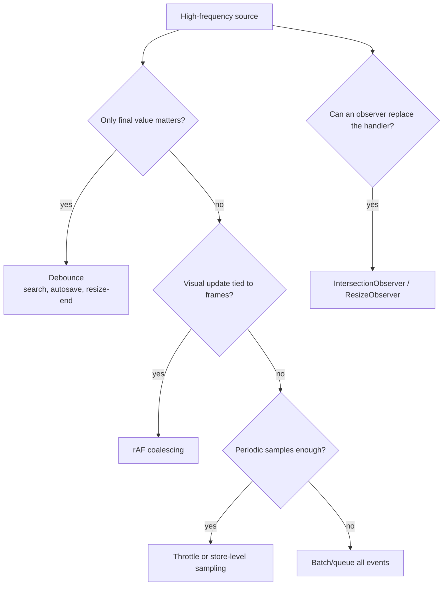

# 07 / 14 — Debounce and Throttle

## 1. Lesson metadata

| | |
|---|---|
| **Level** | Intermediate–Advanced |
| **Study time** | 4–5 hours (reading 1.5 h, experiments 1.5 h, exercises 1.5 h) |
| **Prerequisites** | [11 — Scheduling and perceived responsiveness](./11-scheduling-and-perceived-responsiveness.md), [13 — useDeferredValue in practice](./13-usedeferredvalue-in-practice.md), [Phase 0 — Closures](../00-web-and-javascript-foundations/06-lexical-scope-and-closures.md), [Phase 0 — Event loop](../00-web-and-javascript-foundations/11-event-loop-tasks-microtasks.md), [Phase 3 — Effect cleanup](../03-react-state-and-hooks/06-effect-cleanup.md), [Phase 3 — useRef](../03-react-state-and-hooks/10-useref-and-mutable-references.md) |
| **Next** | [15 — Code splitting and lazy loading](./15-code-splitting-and-lazy-loading.md) |
| **Related** | [Phase 0 — Browser events](../00-web-and-javascript-foundations/13-browser-events-and-propagation.md), [Phase 0 — Web APIs and network requests](../00-web-and-javascript-foundations/14-web-apis-and-network-requests.md) |

**Learning objectives.** After this lesson you can:
1. Define debounce and throttle precisely (leading/trailing edges, `maxWait`) and implement both correctly in TypeScript, including `cancel` and `flush`.
2. Use them correctly in React: stable instances across renders, fresh closures, cleanup on unmount, and StrictMode safety.
3. Choose between debounce, throttle, `requestAnimationFrame` coalescing, observers (`IntersectionObserver`, `ResizeObserver`), `useDeferredValue`, and cancellation (`AbortController`).
4. Recognize and fix common failures: debouncing a controlled input's value, new debounced function every render, lost last event, double submit, stale closures, over-long delays.
5. Measure the benefit (calls avoided, requests saved, INP impact) and the cost (added latency).

**Concepts covered:** rate limiting vs coalescing, leading/trailing edge, `maxWait`, idempotency, flush on blur/unload, rAF throttling, passive listeners, observers as replacements, request cancellation, fake-timer testing.

---

## 2. Deep conceptual explanation

### 2.1 What problem is this lesson solving?

Many events arrive faster than you can (or should) react to them:

| Source | Rate | Typical bad reaction |
|---|---|---|
| Keystrokes | 5–15/s while typing | One network request per keystroke |
| `scroll`, `pointermove`, `touchmove` | up to once per frame (60–120/s) | Layout reads + `setState` per event |
| `resize` | dozens/s while dragging a window edge | Recompute layout per event |
| Form edits (autosave) | bursty | Save every change |
| WebSocket/stream messages | 10–1000/s | `setState` per message |

Each reaction costs CPU, network, battery, or server money. Rate limiting reduces *how many times work starts*; it is complementary to making each run cheaper ([10](./10-expensive-computations.md)) or non-blocking ([12](./12-usetransition-in-practice.md), [13](./13-usedeferredvalue-in-practice.md)).

### 2.2 Definitions

- **Debounce(wait):** delay running `fn` until `wait` ms have passed **since the last call**. A burst of calls collapses to one call (typically the last). Used when only the *final* value of a burst matters: search text, autosave, window-resize-end.
- **Throttle(wait):** ensure `fn` runs **at most once per `wait` ms**, even during continuous calls. Used when you need *periodic* updates during a continuous stream: scroll position tracking, drag progress, telemetry sampling.
- **Leading edge:** run at the start of a burst (immediately on the first call).
- **Trailing edge:** run at the end of a burst (after the quiet period for debounce; at the end of the window for throttle) with the latest arguments.
- **`maxWait` (debounce):** upper bound on how long a continuous burst can postpone execution. A throttle is a debounce with `maxWait = wait` and `leading: true`.
- **Coalescing:** merging multiple pending requests into one (e.g., a single `requestAnimationFrame` callback per frame applying only the latest pointer position).

```text
calls:        x x x x x . . . . . . x x . . . . . .
debounce(3):  . . . . . . . . x . . . . . . . . x .      (fires 3 ticks after last call)
throttle(3):  x . . x . . x . . x . . x . . x . . x      (fires every 3 ticks while busy)
```

### 2.3 Cost/benefit model

| Benefit | Cost |
|---|---|
| Fewer function runs (CPU/battery) | Added latency to the result (debounce: `wait`; throttle: up to `wait`) |
| Fewer network requests / lower server load | Stale UI until the delayed run |
| Smoother scroll/drag handlers | Choppiness if `wait` too large |
| Fewer wasted renders | More code and edge cases: cancel/flush, tests, unmount |

A rule: the delay must be *shorter than the user's patience for that feedback* and *long enough to coalesce bursts*. Typing bursts: inter-key intervals are typically < 200 ms in fluent typing, so 150–300 ms are common debounce starting points for search; these numbers are conventions, not standards, so tune with measurement.

### 2.4 What not to rate-limit

- **Echoing direct input.** Keep the text field's own state immediate; debounce *consequences* (network, filtering).
- **Discrete critical actions** (submit, pay, delete): debouncing click handlers can swallow or delay intended actions. Prevent duplicates with *disabled/pending state and idempotency keys*, not with delays.
- **Frame-synchronized visual updates:** use `requestAnimationFrame` coalescing, not timers.

### 2.5 Alternatives that often beat timers

| Need | Better tool |
|---|---|
| "Is this element visible?" on scroll | `IntersectionObserver` — no scroll handler at all |
| "Did the element's size change?" | `ResizeObserver` |
| "Run once per frame with latest pointer" | `requestAnimationFrame` coalescing |
| "Cancel stale requests" | `AbortController`; ignore out-of-date responses |
| "Keep input responsive while list renders" | `useDeferredValue` / transitions |
| "Smooth scroll-linked visuals" | CSS scroll-driven animations (newer; browser support has been uneven, so check MDN compat data before relying on it); or compositor-only transforms |
| "Reduce server load for repeated queries" | Caching (HTTP cache, request deduplication in a data library) |

### 2.6 Misconceptions

| Misconception | Reality |
|---|---|
| "Debounce and throttle are the same." | Debounce waits for quiet; throttle guarantees periodic execution during activity. |
| "Debounce makes the app faster." | It reduces work and adds latency. The UI can feel *slower* if the delay is perceptible. |
| "I can create the debounced function inside the component." | A new instance per render has separate timers, so nothing is coalesced (§3.1). |
| "Throttling handlers fixes scroll jank." | Jank is mostly *what* the handler does (layout reads, `setState` with big renders), and non-passive listeners can block scrolling. Fix the work and the listener first. |
| "`useDeferredValue` replaces debounce." | Different bottlenecks ([13 §2.4](./13-usedeferredvalue-in-practice.md)). |
| "The last call is always delivered." | Only with a trailing edge, and only if not cancelled on unmount. |

---

## 3. Internal mechanics

### 3.1 Why React makes this tricky

A component function re-runs on every render. Closures and timers behave as follows:

```tsx
function Search() {
  const [q, setQ] = useState("");
  // WRONG: a brand-new debounced function (with its own timer) each render
  const send = debounce((v: string) => fetchResults(v), 300);
  return <input value={q} onChange={(e) => { setQ(e.target.value); send(e.target.value); }} />;
}
```

Every keystroke triggers a render; each render creates a new `send`; the `onChange` that runs was created by the *previous* render, so it calls the previous `send` — and each keystroke uses a different instance... Precisely: keystroke 1 runs `onChange` from render 0 (instance A) → timer A starts; render 1 creates instance B; keystroke 2 runs `onChange` from render 1 (B) → timer B starts; timer A is **not** cancelled. Result: 2 trailing calls instead of 1. No debouncing at all.

Requirements for a correct React debounce:
1. **One stable instance** per component instance (and per `wait`): `useMemo`/`useRef`/`useState` initializer or module-level for singletons.
2. **Fresh callback inside**: the stable instance must call the *latest* `fn` (state/props captured at the latest render), via a ref.
3. **Cleanup**: cancel (or flush) on unmount; otherwise a trailing call runs after the component is gone (state set on unmounted component is a no-op in modern React, but side effects — network, analytics — still fire).
4. **StrictMode**: dev double-mounts effects; cleanup/re-setup must be idempotent.

`useMemo` is documented as a performance hint, not a semantic guarantee (react.dev); React may discard memoized values. For correctness-critical instances prefer `useRef` with lazy initialization or `useState(() => debounce(...))`. For `wait` changes, recreate deliberately.

### 3.2 Implementation of debounce with leading/trailing/maxWait

```ts
export type DebounceOptions = { leading?: boolean; trailing?: boolean; maxWait?: number };

export type Debounced<A extends unknown[]> = ((...args: A) => void) & {
  cancel(): void;
  flush(): void;
  pending(): boolean;
};

export function debounce<A extends unknown[]>(
  fn: (...args: A) => void,
  wait: number,
  { leading = false, trailing = true, maxWait }: DebounceOptions = {},
): Debounced<A> {
  let timer: ReturnType<typeof setTimeout> | undefined;
  let maxTimer: ReturnType<typeof setTimeout> | undefined;
  let lastArgs: A | undefined; // pending args for the trailing edge

  const clearTimers = () => {
    if (timer !== undefined) clearTimeout(timer);
    if (maxTimer !== undefined) clearTimeout(maxTimer);
    timer = maxTimer = undefined;
  };

  const end = () => {
    clearTimers();
    const args = lastArgs;
    lastArgs = undefined;
    if (trailing && args) fn(...args);
  };

  const debounced = ((...args: A) => {
    const startingBurst = timer === undefined;
    if (startingBurst && leading) {
      fn(...args);            // leading edge: run now; nothing pending yet
      lastArgs = undefined;
    } else {
      lastArgs = args;        // remember latest for the trailing edge
    }
    if (timer !== undefined) clearTimeout(timer);
    timer = setTimeout(end, wait);
    if (maxWait !== undefined && maxTimer === undefined) {
      maxTimer = setTimeout(end, maxWait);
    }
  }) as Debounced<A>;

  debounced.cancel = () => { clearTimers(); lastArgs = undefined; };
  debounced.flush = () => { if (timer !== undefined) end(); };
  debounced.pending = () => timer !== undefined;
  return debounced;
}

export function throttle<A extends unknown[]>(fn: (...args: A) => void, wait: number) {
  return debounce(fn, wait, { leading: true, trailing: true, maxWait: wait });
}
```

**Walkthrough.** With `leading: false, trailing: true` (default): each call replaces `lastArgs` and restarts `timer`. When `wait` ms pass without a call, `end` runs `fn(lastArgs)`. `cancel` discards pending work. `flush` runs the pending trailing call immediately (useful on blur or unload). With `leading: true` and a single isolated call, `fn` runs once on the leading edge; `lastArgs` stays undefined so no duplicate trailing call. `maxWait` ensures a continuous stream still produces periodic executions: `end` fires at `maxWait` even if calls continue; the next call starts a new burst.

**Edge cases and design choices.**
- `end` clears both timers, so a call right after the max-wait flush begins a new burst (and with `leading: true` fires immediately again) — the same family of semantics as lodash's `debounce`/`throttle`, though not byte-for-byte identical; compare with the library's docs if you need exact semantics.
- Exceptions thrown by `fn` propagate from timer callbacks as uncaught errors. Wrap `fn` if you need reporting.
- Timers in background tabs are throttled by browsers; do not rely on precise timing.

### 3.3 `requestAnimationFrame` coalescing (frame-synchronized throttle)

```ts
export function rafThrottle<A extends unknown[]>(fn: (...args: A) => void) {
  let frame: number | undefined;
  let latest: A | undefined;
  const wrapped = (...args: A) => {
    latest = args;
    if (frame !== undefined) return;
    frame = requestAnimationFrame(() => {
      frame = undefined;
      const a = latest!;
      latest = undefined;
      fn(...a);
    });
  };
  wrapped.cancel = () => {
    if (frame !== undefined) cancelAnimationFrame(frame);
    frame = undefined;
    latest = undefined;
  };
  return wrapped;
}
```

Guarantees at most one call per frame with the *latest* args, aligned to rendering (the callback runs just before the next paint). It adapts to 60/120 Hz displays, unlike a fixed 16 ms timer. It does not run in background tabs, which is usually desirable for visual work and wrong for logic that must continue.

### 3.4 Browser event delivery context

- `scroll`, `resize`, `pointermove`/`mousemove`/`touchmove` events are generally delivered once per frame at the "update the rendering" step (HTML standard) — though `pointermove` can be coalesced (`getCoalescedEvents()` provides the skipped points). So a handler already runs ≤ once per frame; additional throttling at 16 ms is redundant; throttling at 100–200 ms is useful only when each handler run is heavy or triggers network/state work.
- **Passive listeners.** `touchstart`/`touchmove`/`wheel` listeners that might call `preventDefault()` can force the browser to wait for the handler before scrolling. Registering with `{ passive: true }` (and not calling `preventDefault`) lets scrolling proceed on the compositor. Several browsers (Chrome, Firefox, Safari) default `touchstart`/`touchmove`/`wheel` listeners to passive when registered on window, document or body, so `preventDefault()` is silently ignored there; pass `{ passive: false }` explicitly if you need it (see MDN `addEventListener` → `passive`). React attaches many event listeners at the root; React's `onScroll`, `onWheel` etc. have their own details — if you need non-passive control, attach listeners manually via a ref and `addEventListener`.
- Heavy work after throttling still blocks if each run is long; throttling limits frequency, not duration.

### 3.5 Debounced value vs debounced callback

| Pattern | Code shape | Use |
|---|---|---|
| **Debounced value** | `const q = useDebouncedValue(input, 250)` then an effect/query keyed by `q` | Search, filters: UI derives from the debounced value |
| **Debounced callback** | `const save = useDebouncedCallback(persist, 800)`; call it from handlers | Autosave, analytics batching, imperative side effects |

The value form fits React's declarative flow (effects keyed to a value; automatically cleaned). The callback form fits imperative operations that shouldn't be a function of state (fire-and-forget saves).

---

## 4. Step-by-step execution walkthrough

Scenario: search box with a 250 ms debounced value and an effect-based fetch with `AbortController`. User types "react" at ~120 ms intervals, then pauses.

1. `t=0` "r": `onChange` → `setInput("r")` (urgent, immediate echo). Render. `useDebouncedValue` effect schedules `setTimeout(250)` to set `debounced = "r"`.
2. `t=120` "e": new render; effect cleanup clears the previous timer; new timer at `t=370`.
3. `t=240` "a": cleanup/re-schedule: timer at `t=490`.
4. `t=360` "c": timer at `t=610`.
5. `t=480` "t": timer at `t=730`.
6. `t=730` timer fires: `setDebounced("react")` → render → the fetch effect keyed by `debounced` runs: `fetch("/api/search?q=react", { signal })`. **One** request for five keystrokes.
7. `t=800` user types "s" → input echo immediately; debounce timer restarts; if the "react" request is still in flight it continues until `debounced` changes at `t≈1050`; then the effect cleanup aborts it (if not yet complete) and a new request starts. Stale responses are ignored because the aborted fetch rejects with `AbortError`.
8. Result latency from last keystroke = 250 ms + network + render. A 250 ms floor on every search is the price.

Throttle for scroll tracking with leading+trailing at 100 ms: events at t=0, 16, 32, …: the leading call at `t=0`; the next execution at `t=100` with the latest args; continues every 100 ms during scrolling; a final trailing call fires after scroll stops with the last position (if any events occurred since the last execution).

---

## 5. Code examples

### 5.1 Minimal example — debounced value hook

```tsx
import { useEffect, useState } from "react";

export function useDebouncedValue<T>(value: T, delayMs: number): T {
  const [debounced, setDebounced] = useState(value);

  useEffect(() => {
    const id = setTimeout(() => setDebounced(value), delayMs);
    return () => clearTimeout(id);       // each change cancels the previous timer
  }, [value, delayMs]);

  return debounced;
}
```

```tsx
function Search() {
  const [input, setInput] = useState("");
  const q = useDebouncedValue(input, 250);
  const { data } = useSearch(q); // any data hook keyed by q
  return (<>
    <input value={input} onChange={(e) => setInput(e.target.value)} />
    <Results data={data} />
  </>);
}
```

**Line notes.** Input state is immediate. The hook's timer is reset on every `value` change by effect cleanup. Initial `debounced = value` so the first render doesn't incur a delay. Edge: if `value` is an object recreated each render the effect re-runs every render and the debounced value updates 250 ms after *every* render, causing a perpetual update loop; pass primitives or stable objects.

**Predict:** the user types one character and quickly navigates away (unmount) at 100 ms. Does `setDebounced` run? *No:* effect cleanup on unmount cleared the timer.

### 5.2 Practical example — autosave with flush on blur and page hide

```tsx
import { useEffect, useMemo, useRef, useState } from "react";
import { debounce } from "./debounce"; // §3.2

type Draft = { id: string; title: string; body: string; version: number };

export function DraftEditor({ initial }: { initial: Draft }) {
  const [draft, setDraft] = useState(initial);
  const [status, setStatus] = useState<"saved" | "dirty" | "saving" | "error">("saved");
  const latest = useRef(draft);
  latest.current = draft; // writing a ref during render is discouraged; see note below

  const save = useMemo(
    () =>
      debounce(async () => {
        const d = latest.current;
        setStatus("saving");
        try {
          const res = await fetch(`/api/drafts/${d.id}`, {
            method: "PUT",
            headers: { "Content-Type": "application/json", "If-Match": String(d.version) },
            body: JSON.stringify({ title: d.title, body: d.body }),
          });
          if (!res.ok) throw new Error(String(res.status));
          setStatus(latest.current === d ? "saved" : "dirty"); // newer edits arrived meanwhile
        } catch {
          setStatus("error");
        }
      }, 800, { trailing: true, maxWait: 5000 }),
    [],
  );

  useEffect(() => {
    const onHide = () => { if (document.visibilityState === "hidden") save.flush(); };
    document.addEventListener("visibilitychange", onHide);
    return () => {
      document.removeEventListener("visibilitychange", onHide);
      save.flush();        // persist pending edits on unmount instead of dropping them
    };
  }, [save]);

  function update(patch: Partial<Draft>) {
    setDraft((d) => ({ ...d, ...patch }));
    setStatus("dirty");
    save();
  }

  return (
    <form onSubmit={(e) => { e.preventDefault(); save.flush(); }}>
      <input value={draft.title} onChange={(e) => update({ title: e.target.value })} onBlur={() => save.flush()} />
      <textarea value={draft.body} onChange={(e) => update({ body: e.target.value })} onBlur={() => save.flush()} />
      <output>{status}</output>
    </form>
  );
}
```

**Review points.**
- The debounced function takes **no args** and reads `latest.current` at execution time — avoiding stale closures. Note: assigning `latest.current = draft` during render is something the React docs advise against (render should be pure); the preferred pattern is updating the ref in an effect/layout effect. It is shown inline to keep the example short; in production use `useLayoutEffect(() => { latest.current = draft; })` or `useEffectEvent` (stable since React 19.2 per react.dev; note Effect Events may only be called from inside Effects, so it does not fit callbacks invoked by arbitrary event handlers).
- `maxWait: 5000` guarantees a save at least every 5 s of continuous typing.
- Flush on blur, on `visibilitychange → hidden`, on unmount, and on submit prevents lost edits. For tab close/unload, `fetch` can be sent with `keepalive: true` (or `navigator.sendBeacon`) because ordinary async requests may be cancelled by the browser as the page unloads; `keepalive` requests share a small in-flight body quota (64 KiB per the Fetch spec) and `sendBeacon` sends POST only (MDN).
- Concurrency: overlapping saves (a flush while an earlier request is in flight) can complete out of order. The `If-Match`/version header gives the server a chance to reject stale writes; a real client must update `version` from the response and serialize saves (queue or `AbortController`).
- `useMemo(..., [])` is acceptable here but see §3.1 for the caveat about memo being a hint; `useState(() => debounce(...))` is stricter.
- The unmount flush triggers `setStatus` after unmount; React tolerates it but code should guard if side effects matter.

### 5.3 Incorrect example — four classic bugs

```tsx
function Bad() {
  const [q, setQ] = useState("");
  const [results, setResults] = useState<Hit[]>([]);

  // (1) new debounced function every render
  const search = debounce(async (v: string) => setResults(await api.search(v)), 300);

  return (
    <>
      <input
        value={q}
        onChange={(e) => {
          setQ(e.target.value);
          search(e.target.value);
        }}
      />
      {/* (2) debouncing the visible value of a controlled input */}
      <input value={useDebouncedValue(q, 300)} readOnly />
      <button onClick={debounce(() => api.submit(q), 500)}>Submit</button>   {/* (3) */}
      <div onScroll={throttle(() => track(), 200)} />                         {/* (4) */}
    </>
  );
}
```

**Predict the consequences.**
1. Per-render instances ⇒ no coalescing; N keystrokes ⇒ N delayed requests. Responses can arrive out of order ⇒ results for an older query may overwrite newer ones (race).
2. If an `<input>` that users type into is bound to a debounced value, typing appears to lag/revert. (Here it's `readOnly` mirroring; if you made it editable it'd break.) Also a hook called inline in JSX.
3. A new debounced function is created each render and invoked once per click — the debounce wrapper is created and immediately called; it effectively `setTimeout(…, 500)` the submit. Clicking twice creates two independent timers ⇒ **double submission**, plus a 500 ms delay after a *discrete* action. Debouncing submit is wrong; use pending state/idempotency.
4. `throttle(...)` is re-created every render, so each scroll event after a re-render uses a different throttle instance; and `throttle` of a handler in `onScroll` re-created per render breaks throttling when renders happen between events. Also, `track()` ignoring event args may be fine, but the instance issue stands.

### 5.4 Corrected implementation

```tsx
function Good() {
  const [q, setQ] = useState("");
  const debouncedQ = useDebouncedValue(q, 250);
  const [results, setResults] = useState<Hit[]>([]);
  const [pending, setPending] = useState(false);

  useEffect(() => {
    if (!debouncedQ) { setResults([]); return; }
    const ac = new AbortController();
    api.search(debouncedQ, { signal: ac.signal })
      .then(setResults)
      .catch((e: unknown) => { if (!(e instanceof DOMException && e.name === "AbortError")) throw e; });
    return () => ac.abort();                        // stale requests cannot overwrite newer results
  }, [debouncedQ]);

  const submit = async () => {
    if (pending) return;                             // dedupe by state, not by timer
    setPending(true);
    try { await api.submit(q, { idempotencyKey: crypto.randomUUID() }); }
    finally { setPending(false); }
  };

  return (
    <>
      <input value={q} onChange={(e) => setQ(e.target.value)} />
      <Results items={results} />
      <button onClick={submit} disabled={pending}>Submit</button>
    </>
  );
}
```

And the scroll tracker with a stable, cleaned-up throttle:

```tsx
function useScrollTracker(ref: React.RefObject<HTMLElement | null>, onProgress: (ratio: number) => void) {
  const cb = useRef(onProgress);
  useEffect(() => { cb.current = onProgress; });   // keep the latest callback

  useEffect(() => {
    const el = ref.current;
    if (!el) return;
    const handler = rafThrottle(() => {
      cb.current(el.scrollTop / Math.max(1, el.scrollHeight - el.clientHeight));
    });
    el.addEventListener("scroll", handler, { passive: true });
    return () => { el.removeEventListener("scroll", handler); handler.cancel(); };
  }, [ref]);
}
```

Reading `scrollTop`/`scrollHeight` forces layout if styles are dirty; doing it once per frame in the rAF callback avoids repeated forced layouts ([Phase 0 — Rendering pipeline](../00-web-and-javascript-foundations/03-browser-rendering-pipeline.md)).

### 5.5 Advanced example — leading + trailing throttle for realtime streams

```tsx
import { useEffect, useRef, useSyncExternalStore } from "react";

type Tick = { symbol: string; price: number; ts: number };

class TickStore {
  private data = new Map<string, Tick>();
  private snapshot: ReadonlyMap<string, Tick> = new Map();
  private listeners = new Set<() => void>();
  private dirty = false;
  private timer: ReturnType<typeof setInterval> | undefined;

  ingest(t: Tick) { this.data.set(t.symbol, t); this.dirty = true; }        // up to 1000s/s, cheap

  start(intervalMs = 100) {
    this.timer = setInterval(() => {
      if (!this.dirty) return;
      this.dirty = false;
      this.snapshot = new Map(this.data);                                     // new identity per publish
      this.listeners.forEach((l) => l());                                     // UI sees <= 10 updates/s
    }, intervalMs);
  }
  stop() { if (this.timer) clearInterval(this.timer); }

  subscribe = (l: () => void) => { this.listeners.add(l); return () => { this.listeners.delete(l); }; };
  getSnapshot = () => this.snapshot;
}

export function useTicks(store: TickStore) {
  return useSyncExternalStore(store.subscribe, store.getSnapshot);
}
```

This is a **sampling throttle** at the store boundary: messages are absorbed at full rate (cheap `Map.set`), but React is told at ≤ 10 Hz with a stable snapshot object between publishes. It coalesces instead of delaying individual updates, which is correct for "latest price per symbol". It would be *wrong* for event-log semantics where every message matters (use batching/queues instead). See [Phase 3 — useSyncExternalStore](../03-react-state-and-hooks/20-usesyncexternalstore-and-external-stores.md). Lifecycle: create the store outside components or in an effect; `start/stop` in effect with cleanup; StrictMode double-invocation must not leave two intervals (guarantee by cleanup).

---

## 6. Visual explanations

### Debounce vs throttle timelines

```mermaid
gantt
  title 10 events during 1s burst (ticks = events)
  dateFormat X
  axisFormat %L
  section Events
  e1 :0, 10
  e2 :100, 10
  e3 :200, 10
  e4 :300, 10
  e5 :400, 10
  e6 :500, 10
  e7 :600, 10
  e8 :700, 10
  e9 :800, 10
  e10 :900, 10
  section Debounce 300ms (trailing)
  fn runs once at 1200 :crit, 1200, 10
  section Throttle 300ms (leading+trailing)
  run :0, 10
  run :300, 10
  run :600, 10
  run :900, 10
  run trailing :1200, 10
```



(Schematic; exact trailing execution depends on the implementation.)

### Choosing a tool



### React lifetime of a correct debounced callback

```text
mount ──> create instance (stable) ──> render N times (same instance, latest fn via ref)
      └─ events ──> instance.timer ──> trailing call ──> fn.current(...)
unmount ──> flush() or cancel()   (explicit decision!)
```

---

## 7. Alternative approaches and trade-offs

| Approach | Reduces calls | Added latency | Complexity | Good for | Pitfalls |
|---|---|---|---|---|---|
| Debounce (trailing) | Strongly | `wait` always | Low–Med | Search, autosave, resize-end | Lost last call on unmount; delay always paid |
| Debounce leading | Moderately | None for first | Low–Med | Button-like triggers where first matters | Later calls in burst ignored |
| Throttle | Bounded rate | ≤ `wait` | Low–Med | Scroll/drag/telemetry | Dropped intermediate values |
| rAF coalescing | ≤ 1/frame | ≤ 1 frame | Low | Pointer-driven visuals | Not in background tabs |
| Store-level sampling | Bounded UI updates | ≤ interval | Medium | Realtime feeds | Not for every-message semantics |
| `useDeferredValue`/transition | No | None | Low | Render-bound work | Doesn't cut requests |
| Observers (IO/RO) | Eliminates handlers | None | Low–Med | Visibility/size | Support/behavior nuances |
| `AbortController` + ignore stale | No (requests start) | None | Medium | Correctness under races | Server still did work |
| Server-side rate limiting | n/a | n/a | Backend | Protecting APIs | Not UX-friendly alone |
| HTTP caching/dedupe | Avoids repeats | None | Library | Repeated queries | Cache invalidation |

**When debounce is *not* best:**
- The user expects immediate feedback per keystroke (e.g., local filtering of 200 items): do it directly; debounce adds pure lag.
- Server cost is the issue and queries repeat: caching + request dedupe beats timers.
- Rendering is the bottleneck (not requests): use deferral/virtualization.
- Critical commands (submit/pay): use idempotency and pending state.
- You need every event (audit log): batch and send, don't drop.

---

## 8. Best practices and anti-patterns

**Beginner mistakes**
- Creating the debounced function inside the render body (§3.1).
- Debouncing `onChange` such that the controlled value doesn't update immediately.
- Not cleaning up timers (leaks, post-unmount side effects).
- Using debounce on submit.

**Experienced-developer mistakes**
- Stale closures in the debounced callback (captured old state): read through a ref or pass arguments.
- Pairing debounce with unhandled out-of-order responses: also cancel/ignore stale requests.
- Choosing delays by habit (300 ms) without measuring typing cadence and perceived latency.
- Throttling a handler that still does layout reads per call.
- Importing a whole utility library for one function and bloating the bundle ([15](./15-code-splitting-and-lazy-loading.md), [16](./16-bundle-analysis.md)); a 25-line implementation or a per-function import is enough; confirm tree-shaking with a bundle analysis ([16](./16-bundle-analysis.md)).
- Throttling React state updates where batching + `memo` is enough.

**Smells**
- `useCallback(debounce(...), [deps])` with changing deps: recreates the instance and loses pending calls. Prefer a stable instance + ref'd callback.
- Delay constants scattered in components. Centralize (`timings.ts`) with comments on rationale.
- Debounced handler calling `event.preventDefault()` (the event is gone by then; React 17+ no longer pools events, but `preventDefault` after dispatch has no effect).

**Justified exceptions**
- Debouncing a *leading-edge* click on analytics-only buttons to avoid duplicate events.
- Very long debounces (1–2 s) for expensive autosave with explicit status UI and flush-on-blur.

**Testing**
- Use fake timers (`vi.useFakeTimers()` / Jest equivalents), advance time with `vi.advanceTimersByTime`, assert call counts and arguments, and test `flush` and unmount cancellation. Don't use real sleeps.

---

## 9. Real-world application

**E-commerce typeahead.** Debounce 150–250 ms (tune via analytics of typing cadence); cancel in-flight; cache by normalized query; ignore queries under 2 characters; prefetch top result details on hover/focus. Constraint: mobile networks and server cost/query; measure p95 time-to-suggestion and requests/session.

**Finance — price tickers.** Store-level sampling (§5.5) at 100–250 ms, per-symbol latest-wins, highlight flashes via CSS animations (compositor) rather than React state per tick. Constraint: regulatory requirements to display timestamps and not hide stale data; show "last updated" per row and a global connection-state indicator.

**Forms — autosave.** Debounce + `maxWait` + flush on blur/hide, optimistic version checks, visible status ("Saving… / Saved / Failed—retry"). Constraint: conflict resolution when two tabs edit.

**Dashboards — resize.** Charts recompute on container resize: use `ResizeObserver` plus rAF coalescing; avoid window `resize` + timer unless supporting legacy needs.

**Auth/security.** Don't use debounce as a security control (rate limiting must be server-side); debounce on "check username availability" is a UX affordance only.

**Multi-team.** Provide `useDebouncedValue`, `useDebouncedCallback`, `useRafThrottle` in the shared utilities with tested semantics (unmount, StrictMode, flush) and a lint rule or review guideline against ad-hoc `setTimeout`-based debouncing.

---

## 10. Debugging and troubleshooting

| Symptom | Likely cause | Investigation | Fix |
|---|---|---|---|
| Requests fire once per keystroke despite debounce | New debounced fn per render; or debounce applied to the wrong function | Log creation of the debounced function (`useEffect(() => console.log("created"), [fn])`); Network panel | Stable instance via `useRef`/`useState` initializer |
| Last character missing in saved data | Trailing call cancelled on unmount or never flushed; stale closure | Add logging on flush/cancel; check unload path | Flush on unmount/blur/visibilitychange; read latest via ref |
| Results flicker or older results appear | Out-of-order responses | Network waterfall; log request ids | `AbortController`, ignore stale |
| Typing lags after adding debounce | Debounced the input's own value | Code review; `value` prop source | Echo immediately; debounce downstream |
| Scroll handler still janky despite throttle | Work per call is heavy (layout thrash), or listener non-passive | Performance panel: forced reflow warnings; check `passive` | rAF coalescing, passive listeners, batch reads/writes, observers |
| Double submission | Debounce used instead of state guard; or leading+trailing both fire | Network log; inspect options | Disable + idempotency key |
| Flaky tests | Real timers | N/A | Fake timers; flush microtasks with `await` |
| Debounce "never fires" while typing | `maxWait` absent and user continuously types, or timer recreated each render | Add `maxWait`; verify instance stability | `maxWait` + stable instance |

**Investigation recipe.** (1) Count executions: wrap `fn` with a counter; (2) log timestamps to see inter-call intervals; (3) verify instance identity across renders (`useRef` comparing previous instance); (4) in the Network panel check request count per typing session; (5) Performance panel for scroll handlers: look for "Forced reflow" markers and long handler time.

### Measurement methodology

| Question | Metric | How |
|---|---|---|
| Did we reduce work? | Calls to `fn` / requests per interaction session | Counters; Network panel; server logs |
| What did it cost? | Added latency: last event → result visible | `performance.mark` at last input; `measure` at result commit; RUM custom timing |
| Is the UI still responsive? | INP of the typing interaction; input delay | `web-vitals`, Performance panel |
| Are we right-sized? | Distribution of inter-keystroke gaps in the field | Log gaps (sampled, privacy-reviewed) — choose `wait` around the 75–90th percentile of intra-word gaps (a heuristic) |
| Server impact | QPS and cache hit rate | Backend metrics |
| Correctness | No lost/duplicate saves | Integration tests with fake timers + e2e |

Report **before/after pairs** with the same traffic or the same scripted typing (e.g., Playwright typing "react hooks" at 100 ms/char with network throttling): requests: 11 → 1–2; time-to-results: +250 ms; INP: unchanged or better. Numbers shown here are the shape of expected results; yours must be measured.

---

## 11. Exercises

### Level A — Knowledge
A1. Define debounce and throttle in one sentence each, including which edge(s) typically run.
A2. Why must a debounced function be a stable instance in React?
A3. What is `maxWait` and when is it essential?
A4. Name three scenarios where debounce is the wrong tool.
A5. What does `flush()` do and where should it be called in an autosave editor?

### Level B — Code comprehension
B1. How many requests are sent, and when, for the sequence of calls at t = 0, 100, 200, 600, 650 ms with `debounce(fn, 300)` (trailing only)?
B2. Same sequence with `throttle(fn, 300)` (leading + trailing).
B3. Explain the bug:
```tsx
const handler = useCallback(debounce((v: string) => search(v), 300), []);
```
B4. In 5.2, what happens if the user types, then immediately closes the tab? What would you add?

### Level C — Implementation
C1. Implement `useDebouncedCallback<A extends unknown[]>(fn, wait, opts)` with latest-callback semantics, unmount flush/cancel option, and StrictMode safety.
C2. Implement `useThrottledValue(value, interval)` that returns the latest value at most once per `interval` with a trailing update.
C3. Write fake-timer tests (describe them or write Vitest code) for `debounce` covering: trailing, leading, `maxWait`, `cancel`, `flush`.

### Level D — Debugging
D1. The search sends a request per keystroke even though `useDebouncedValue` is used. List four possible causes.
D2. After adding throttle to a scroll handler, the "scroll to top" button sometimes appears late and disappears early after fast scrolling. Why? Fix.
D3. A form's "Save" button sometimes saves old data. The save function is debounced and passed to `useEffect` deps. Diagnose.

### Level E — Architecture and engineering decisions
E1. Design a shared package of timing utilities for a 15-team organization. What APIs, defaults, lint rules, and documentation?
E2. For an order-entry grid with live prices at 500 msgs/s, decide between per-message `setState`, debounce, throttle, sampling store, or batching with a queue. Justify.

### Level F — Expert challenge
F1. Design an experiment to choose the optimal debounce delay for search suggestions, using production telemetry. Include metrics, guardrails, and analysis.

---

## 12. Detailed answers and explanations

> Attempt the exercises first.

**A1.** Debounce: run once after a quiet period of `wait` ms following the last call (usually trailing edge, optionally leading). Throttle: run at most once per `wait` ms during continuous calls (typically leading and trailing).

**A2.** Because the timer and pending-arguments state live in the closure of the debounced function. A new instance each render has fresh state; previous timers aren't cancelled; so calls are not coalesced (§3.1).

**A3.** `maxWait` bounds how long a continuous stream can delay execution; essential for autosave and long bursts so that work happens periodically even if the user never pauses. Without it, a user typing nonstop would never trigger a save.

**A4.** (1) Direct feedback to input (echo), (2) discrete critical actions (submit/pay): use pending state/idempotency, (3) frame-synchronized visuals: rAF, (4) cheap local filtering where latency matters more than call counts, (5) security controls. Any three with reasons.

**A5.** `flush()` immediately runs the pending trailing call (if any) and clears timers. In autosave: on blur, on `visibilitychange → hidden`, before navigation/route change, on unmount, and on explicit "Save"/submit.

**B1.** Calls: 0, 100, 200 (gaps < 300) → timer fires at `200 + 300 = 500` ⇒ **1 request at t=500** (with args from t=200). Calls at 600, 650 → timer fires at `650 + 300 = 950` ⇒ **1 request at t=950**. Total 2. Trap: counting a request at t=300 (timer restarted by each call).

**B2.** Leading+trailing with `maxWait = 300` (my implementation): t=0 leading run; calls at 100, 200 update pending args; the max timer fires at t=300 ⇒ trailing run with args from t=200 (since `end` runs `lastArgs`); at t=600 a new burst: leading run (timer is undefined after the previous end) — runs immediately with t=600's args; call at 650 pending; the `wait` timer (300) restarts at 650 → fires at 950 with args from t=650, but `maxTimer` set at t=600 fires at 900 ⇒ **trailing run at t=900** (args from 650). Total runs: t=0, 300, 600, 900 = **4**. (Executed against the §3.2 implementation with Vitest fake timers on 2026-10-22: B1 -> [500, 950]; B2 -> [0, 300, 600, 900].) Other libraries differ in precise edge semantics (e.g., lodash would behave similarly but verify with its docs); a hand-traced answer should state its assumptions.

**B3.** `useCallback(debounce(...), [])` — the `debounce(...)` expression is evaluated **on every render** (arguments are evaluated before `useCallback`), creating and discarding a new debounced function each render; only the first is retained by `useCallback`, so it works by accident, but it leaks work and, with deps, recreates instances. Also the `search` closure is from the first render (stale). Proper: `useMemo`/`useState(() => debounce(...))` with a latest-callback ref, or a custom hook.

**B4.** If the user closes the tab, the debounce timer is destroyed with the page; the pending save is lost unless `visibilitychange`/`pagehide` handlers flush it. The `visibilitychange` hidden flush triggers `fetch`; during unload normal `fetch` may be cancelled, so use `keepalive: true` or `navigator.sendBeacon` for the final flush; also consider a `beforeunload` prompt when dirty (use sparingly; UX cost).

**C1.**
```tsx
import { useEffect, useLayoutEffect, useRef, useState } from "react";
import { debounce, type DebounceOptions, type Debounced } from "./debounce";

export function useDebouncedCallback<A extends unknown[]>(
  fn: (...args: A) => void,
  wait: number,
  opts: DebounceOptions & { flushOnUnmount?: boolean } = {},
): Debounced<A> {
  const { flushOnUnmount = false, ...dopts } = opts;
  const fnRef = useRef(fn);
  useLayoutEffect(() => { fnRef.current = fn; });

  const [debounced] = useState(() =>
    debounce((...args: A) => fnRef.current(...args), wait, dopts),
  ); // NOTE: `wait`/options changes are ignored after mount; recreate via key if needed

  useEffect(
    () => () => { flushOnUnmount ? debounced.flush() : debounced.cancel(); },
    [debounced, flushOnUnmount],
  );
  return debounced;
}
```
StrictMode: dev mount → cleanup (flush/cancel with nothing pending) → mount: harmless because the instance persists in state. If `wait` must be dynamic, recreate with `useMemo` keyed on `wait` and cancel the previous instance in cleanup. Edge: the layout-effect assignment ensures the latest `fn` before any event after commit.

**C2.**
```tsx
export function useThrottledValue<T>(value: T, intervalMs: number): T {
  const [v, setV] = useState(value);
  const last = useRef(0);
  const timer = useRef<ReturnType<typeof setTimeout> | undefined>(undefined);

  useEffect(() => {
    const now = Date.now();
    const remaining = intervalMs - (now - last.current);
    if (remaining <= 0) {
      last.current = now;
      setV(value);
    } else {
      timer.current = setTimeout(() => { last.current = Date.now(); setV(value); }, remaining);
    }
    return () => clearTimeout(timer.current);
  }, [value, intervalMs]);

  return v;
}
```
Notes: cleanup cancels the pending trailing update when `value` changes, then the effect schedules a new one with the latest value ⇒ trailing semantics; `Date.now` is not monotonic; `performance.now()` is better. In tests use fake timers.

**C3.** (Vitest, abbreviated)
```ts
import { describe, it, expect, vi, beforeEach, afterEach } from "vitest";
import { debounce } from "./debounce";

beforeEach(() => vi.useFakeTimers());
afterEach(() => vi.useRealTimers());

it("trailing only: coalesces to last args", () => {
  const fn = vi.fn(); const d = debounce(fn, 300);
  d(1); vi.advanceTimersByTime(100); d(2); vi.advanceTimersByTime(299);
  expect(fn).not.toHaveBeenCalled();
  vi.advanceTimersByTime(1);
  expect(fn).toHaveBeenCalledTimes(1); expect(fn).toHaveBeenCalledWith(2);
});
it("leading: first call immediate, no duplicate trailing for single call", () => {
  const fn = vi.fn(); const d = debounce(fn, 300, { leading: true });
  d("a"); expect(fn).toHaveBeenCalledTimes(1);
  vi.advanceTimersByTime(1000); expect(fn).toHaveBeenCalledTimes(1);
});
it("maxWait forces execution during a continuous burst", () => {
  const fn = vi.fn(); const d = debounce(fn, 300, { maxWait: 500 });
  for (let t = 0; t < 600; t += 100) { d(t); vi.advanceTimersByTime(100); }
  expect(fn).toHaveBeenCalled();
});
it("cancel drops pending call; flush runs it now", () => {
  const fn = vi.fn(); const d = debounce(fn, 300);
  d(1); d.cancel(); vi.advanceTimersByTime(1000); expect(fn).not.toHaveBeenCalled();
  d(2); d.flush(); expect(fn).toHaveBeenCalledWith(2);
});
```
Additional cases: `pending()` state transitions; exceptions in `fn`; reentrancy.

**D1.** (1) The debounced value is derived but the effect/query keyed by the *non-debounced* value; (2) value is an object recreated each render so the hook's effect re-runs each render and the debounced value updates after each render; (3) component remounts per keystroke (key changes, parent unmounting) resetting hook state; (4) multiple components use the hook independently, each firing requests; (5) the query library refetches on window focus/mount/deps independent of debounce. Check each by logging effect runs and instance identity.

**D2.** Throttle with trailing disabled or poor semantics drops the last event after the burst, so the final scroll position isn't processed ("button visibility" computed from a stale position); or the throttle interval is long relative to fast flings. Fix: include trailing call; compute visibility from `IntersectionObserver` on a sentinel at the top (no handler); or use rAF coalescing.

**D3.** The debounced function was recreated whenever its deps changed (e.g., `useCallback(debounce(save, 800), [draft])`): each new instance has its own timer, and the effect cleanup/dep change drops or duplicates pending calls; the saved data corresponds to a stale closure (`draft` at creation). Fix: stable instance + latest-ref, explicit flush on blur/unmount (C1), and compute payload at execution time.

**E1.** Evaluation criteria: tested semantics (leading/trailing/maxWait/flush/cancel), React hooks with latest-callback and StrictMode safety, `rafThrottle`, observer helpers, default delays (documented as starting points), lint rule against `setTimeout`-based custom debouncing and against creating debounced functions in render (custom ESLint rule or review checklist), bundle size budget (no heavy dependency), TypeScript types, telemetry hooks (count calls/flush), migration docs, ownership and versioning. A good answer includes a "do not debounce" section and test utilities.

**E2.** Per-message `setState` at 500/s cannot be sustained (render ≥ 500/s); debounce starves updates under continuous flow (never fires without `maxWait`); throttle at ~10 Hz loses intermediate ticks, acceptable if only the latest per symbol matters; **sampling store + `useSyncExternalStore`** (5.5) is the best default: absorbs at full rate, publishes ≤ 10 Hz, per-row subscriptions via selectors to re-render only changed rows. If audit/ordered event semantics matter (order-book events) batch with a queue and process in slices. Criteria: semantics (latest vs all events), UI rate, per-row cost, memory, visible latency tolerance (e.g., 100–250 ms is acceptable for display but not for order confirmation).

**F1.** Outline: randomize delay arms (e.g., 100/200/300/400 ms) by user; metrics: primary = suggestion click-through or successful search completion rate and time-to-first-useful-suggestion; secondary = requests/session, server cost, INP, abandonment; guardrails = error rate, p95 latency, a11y complaints. Collect inter-keystroke gap distribution to understand bursts. Analyze with sequential testing or fixed-horizon A/B with multiple-comparison correction; check heterogeneity by device/network/typing speed; consider adaptive delay (shorter on fast typers/fast networks). Decide on a Pareto trade-off between latency and server cost; roll out gradually with kill switch. Pitfalls: novelty effects, caching confounds, interaction between debounce and request cache.

---

## 13. Senior engineer interview questions

**Q1. "Implement debounce and explain how you'd use it safely in React."**
Closure with a timer and last args; clear/reset on each call; trailing invocation with latest args; provide `cancel`/`flush`. In React: stable instance (ref/state initializer), latest callback via ref, cleanup/flush on unmount, StrictMode-safe, avoid debouncing controlled input state, and handle stale responses with cancellation.

**Q2. "Debounce vs throttle vs rAF: choose for resize, scroll progress, search, and drag."**
Resize-end: debounce (or `ResizeObserver` + rAF); scroll progress: rAF coalescing/throttle (or observer if just visibility); search: debounce + abort; drag: rAF with latest pointer position (`pointermove` coalescing). Reason from "final value vs periodic vs frame-aligned".

**Q3. "Why not debounce a submit button?"**
It delays an explicit user action, can drop or reorder it, creates ambiguity about whether it happened, and doesn't protect against double submits across instances. Use a pending guard and idempotency keys.

**Q4. "A teammate says throttling the scroll handler will fix jank. Respond."**
Jank is caused by long work per frame, not event count. Browsers already deliver scroll events once per frame. Profile: forced reflows, `setState` with large renders, non-passive listeners. Use observers, passive listeners, rAF batching, and reduce per-call cost.

**Q5. "How do debounce and `useDeferredValue` combine?"**
Debounce limits *request starts* (network); deferral keeps *rendering* of the response non-blocking. They address different bottlenecks; stack them only when both are measured problems because latencies add.

**Q6. "How do you test debounced behavior?"**
Fake timers, assertions on call counts/arguments at specific virtual times, tests for cancel/flush/unmount, and an e2e test verifying request counts under scripted typing.

---

## 14. Further learning resources

| Resource | URL | Covers / why | Level | Section to study |
|---|---|---|---|---|
| MDN — `setTimeout` | <https://developer.mozilla.org/en-US/docs/Web/API/Window/setTimeout> | Timer semantics, clamping, background throttling | Beginner | "Reasons for delays longer than specified" |
| MDN — `requestAnimationFrame` | <https://developer.mozilla.org/en-US/docs/Web/API/Window/requestAnimationFrame> | Frame-aligned callbacks | Beginner | Description; notes |
| MDN — `IntersectionObserver` | <https://developer.mozilla.org/en-US/docs/Web/API/Intersection_Observer_API> | Visibility without scroll handlers | Intermediate | Overview |
| MDN — `ResizeObserver` | <https://developer.mozilla.org/en-US/docs/Web/API/ResizeObserver> | Size changes without resize handlers | Intermediate | Usage notes |
| MDN — `AbortController` | <https://developer.mozilla.org/en-US/docs/Web/API/AbortController> | Cancelling fetches | Intermediate | Usage |
| MDN — `addEventListener` (passive) | <https://developer.mozilla.org/en-US/docs/Web/API/EventTarget/addEventListener> | `passive` option, scroll performance | Intermediate | Options → passive |
| MDN — `navigator.sendBeacon` | <https://developer.mozilla.org/en-US/docs/Web/API/Navigator/sendBeacon> | Reliable unload requests | Intermediate | Description |
| React docs — You Might Not Need an Effect | <https://react.dev/learn/you-might-not-need-an-effect> | Alternatives to effect-based syncing | Intermediate | Fetching data, race conditions |
| React docs — `useSyncExternalStore` | <https://react.dev/reference/react/useSyncExternalStore> | External stores for sampled feeds | Advanced | Usage |
| Lodash docs — `debounce`, `throttle` | <https://lodash.com/docs> | Reference semantics (leading/trailing/maxWait) | Intermediate | `_.debounce`, `_.throttle` |
| Vitest — Mocking timers | <https://vitest.dev/guide/mocking/timers> | Fake timers for tests | Intermediate | Timers |


---

## 15. Knowledge checkpoint

**You should now understand**
- Debounce/throttle semantics, edges and `maxWait`; why frame-aligned work uses rAF; when observers replace handlers.
- Why debounced functions must be stable in React and read the latest callback; flush/cancel decisions on unmount.
- Which problems rate limiting doesn't solve (render cost, correctness races, duplicate submits).

**You should be able to explain without notes**
- The B1/B2 timelines for given call patterns.
- Why debouncing the visible input value is wrong.

**You should be able to implement**
- `debounce` with `cancel/flush/maxWait`, `useDebouncedValue`, `useDebouncedCallback`, `rafThrottle`, a sampled external store.

**You should be able to debug**
- Per-keystroke requests despite debounce, lost last edits, out-of-order responses, double submissions, throttle-induced stale UI.

**Before moving on:** read [15 — Code splitting and lazy loading](./15-code-splitting-and-lazy-loading.md); the focus shifts from runtime work to the cost of *delivering* code.
