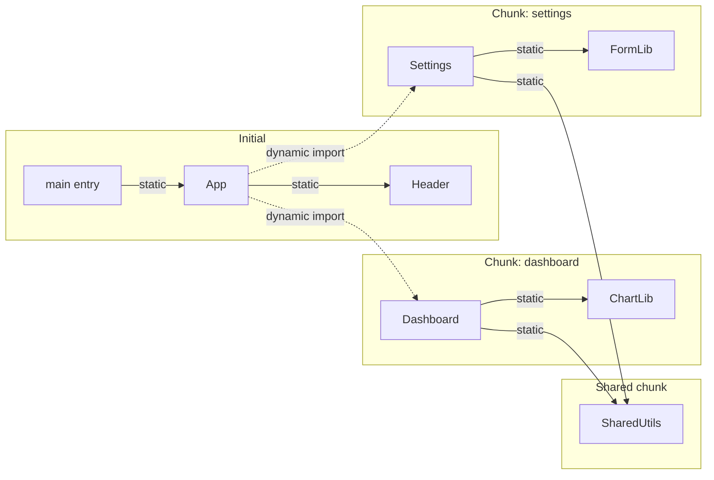
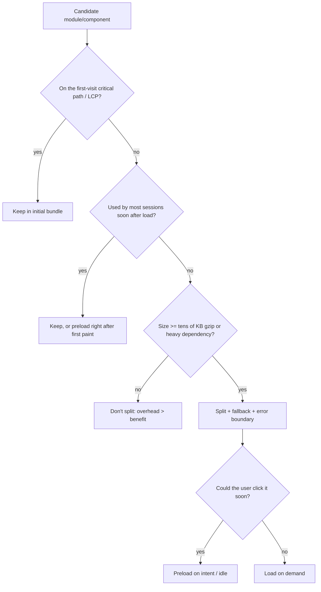

# 07 / 15 — Code Splitting and Lazy Loading

## 1. Lesson metadata

| | |
|---|---|
| **Level** | Advanced |
| **Study time** | 5–6 hours (reading 2 h, experiments 2 h, exercises 1.5–2 h) |
| **Prerequisites** | [Phase 0 — Modules and dependency graphs](../00-web-and-javascript-foundations/10-modules-and-dependency-graphs.md), [Phase 0 — Tooling, transpilation and bundling](../00-web-and-javascript-foundations/20-tooling-transpilation-and-bundling.md), [Phase 0 — HTTP, caching and navigation](../00-web-and-javascript-foundations/15-http-caching-and-navigation.md), [12 — useTransition in practice](./12-usetransition-in-practice.md), [Phase 2 — Suspense conceptual internals](../02-react-rendering-and-internals/24-suspense-conceptual-internals.md), [01 — Measure before optimizing](./01-measure-before-optimizing.md) |
| **Next** | [16 — Bundle analysis](./16-bundle-analysis.md) |
| **Related** | [17 — Network waterfalls](./17-network-waterfalls.md), [21 — Web Vitals and budgets](./21-web-vitals-and-budgets.md), [Phase 9 — Suspense architecture](../09-advanced-rendering-and-ecosystem/05-suspense-architecture.md) |

**Learning objectives.** After this lesson you can:
1. Explain what code splitting changes (what is downloaded/parsed/executed *when*) and what it does not change (total code, correctness).
2. Use dynamic `import()` and `React.lazy` + `Suspense` correctly, including named exports, error boundaries, preloading, and transitions.
3. Choose split points by evidence (route, heavy dependency, rarely used feature) and reject harmful splits (above-the-fold, tiny modules, chains).
4. Handle production failure modes: chunk load errors after deployments, retries, cache invalidation, SSR/hydration.
5. Measure with bundle output, Network waterfalls, Coverage, and Web Vitals; recognize counterproductive splitting.

**Concepts covered:** static vs dynamic imports, chunks, entry points, shared chunks, `React.lazy`, Suspense fallbacks, preloading/prefetching, intent-based loading, route-based splitting, component-level splitting, vendor splitting, chunk waterfalls, deploy skew, error recovery, SSR considerations.

---

## 2. Deep conceptual explanation

### 2.1 What problem is this lesson solving?

A single-page app built naively produces one large JavaScript bundle. Before the first meaningful interaction, the browser must **download** it (network), **parse/compile** it (CPU), and **execute** it (CPU, including React's initial render). On a fast desktop on fiber this may be unnoticeable; on a mid-range phone on a congested network it can be seconds. Costs scale with bytes *of JavaScript*, which are more expensive per byte than images because JS must be parsed and executed, not merely decoded.

Most users do not need most code at first: the admin screens, the rich-text editor, the charting library, the PDF exporter, the settings modal, the locale data for other languages. Code splitting divides the application into **chunks** that load on demand.

*Public principle:* the module system (ECMAScript modules) defines static `import` (resolved before execution) and dynamic `import()` (returns a promise, resolved at runtime). Bundlers (Vite/Rollup, webpack, esbuild, Rspack…) treat `import()` as a split point and emit a separate chunk. React's `lazy` wraps a function returning such a promise so a component can suspend until its code arrives.

### 2.2 What splitting changes — and what it does not

| Changes | Does not change |
|---|---|
| Bytes in the *initial* load | Total bytes downloaded across a full session (may increase slightly from per-chunk overhead) |
| Time to first render/interaction on first visit | Runtime cost of the code once loaded |
| Cache granularity (unchanged chunks stay cached across deploys) | The correctness of your code |
| Number of requests (more) | Server-side rendered HTML (SSR still needs code on the client to hydrate; see §3.6) |
| Moments when latency is paid (on navigation/interaction instead of first load) | Total user wait *if* you didn't preload |

The core trade-off: **you move latency from startup to later interactions.** If you move it carelessly, users feel it at the worst time (a click that stalls on a network request for a chunk).

### 2.3 First principles: where bundles come from

A bundler starts at **entry points**, follows static `import`s to build a module graph, and emits chunks. A dynamic `import("./Chart")` creates a new *async boundary*: the module and everything reachable from it that isn't already in a loaded chunk becomes a new chunk (or several). Modules used by multiple chunks are typically extracted into **shared chunks** (bundler heuristics decide; configurable).



Dotted edges are the split points. Note: importing `ChartLib` **statically anywhere in the initial graph** pulls it into the initial chunk; one stray static import defeats the split. That is the most common reason splits "don't work" ([16 — Bundle analysis](./16-bundle-analysis.md)).

### 2.4 Candidates for splitting (by expected payoff)

| Candidate | Why it's good | Typical gotcha |
|---|---|---|
| **Routes** (pages) | Users visit a subset; natural boundary; natural loading UI | Waterfall: route chunk → data fetch → nested lazy components |
| **Heavy libraries** (charts, maps, rich-text/code editors, PDF/Excel, markdown+syntax highlighting, date-time with locales) | Large, used on few screens | Static import elsewhere leaks them into the initial bundle |
| **Rarely-used UI** (modals, drawers, settings, onboarding, admin tools) | Opened on demand | Latency on first open → preload on intent |
| **Feature flags / role-gated features** | Most users never see them | Combined with flags evaluated at runtime, ensure the code isn't statically imported |
| **Locale and data tables** | Per-user | Dynamic import by locale key |
| **Polyfills** | Needed only by some browsers | Feature-detect before importing |

**Poor candidates:** above-the-fold content that determines LCP; small components (< a few KB gzipped); components rendered on virtually every page; things used by the next click on the critical path unless preloaded.

### 2.5 Misconceptions

| Misconception | Reality |
|---|---|
| "Lazy-load everything for a smaller bundle." | Each chunk adds request overhead, a loading state, a possible waterfall, and loses cross-module compression. Over-splitting often hurts. |
| "`React.lazy` makes my component load faster." | It makes the *initial* load lighter by deferring; the component loads later, slower if not preloaded. |
| "With HTTP/2, many small files are free." | Multiplexing removes head-of-line blocking at the HTTP layer but each request still has latency, scheduling, priority, caching and parse costs; compression across modules suffers. Measure. |
| "Tree shaking is the same as code splitting." | Tree shaking removes unused exports; splitting defers used-but-not-now code. They are complementary ([Phase 0 — Modules](../00-web-and-javascript-foundations/10-modules-and-dependency-graphs.md)). |
| "Lazy components don't affect SEO/SSR." | Without SSR support or with client-only loading, lazy content may be absent from server HTML. Frameworks handle SSR + lazy; verify behavior. |
| "Once split, always faster." | Splitting may cause worse LCP if the LCP element sits in a lazy chunk. |
| "A fallback is optional UX polish." | Without a Suspense boundary above, a lazy component with no ancestor Suspense throws an error. |

---

## 3. Internal mechanics

### 3.1 `React.lazy` semantics

```ts
const Chart = lazy(() => import("./Chart")); // module must have a default export that is a component
```

*Public guarantees (React docs):*
- `lazy(load)` returns a component. `load` is called the first time the component is rendered (not at module evaluation time). It must return a promise (or thenable) that resolves to a module object with a `default` export that is a valid React component.
- While the promise is pending, the lazy component **suspends**: the nearest `<Suspense>` ancestor shows its fallback. If no Suspense ancestor exists, React throws.
- Once resolved, React caches the result: subsequent renders don't call `load` again.
- If the promise rejects, the error is thrown during render and handled by the nearest **error boundary**.
- **Declare `lazy` at module top level, not inside components.** Calling `lazy()` inside a component creates a *new* component type each render, which causes remounts and loss of state (and re-suspension).

*Teaching model:* `lazy` = "a component whose type is resolved asynchronously; render throws a promise until it's ready; React retries rendering later."

*Implementation detail:* React's internal representation of the lazy payload (status/result), how/when it retries, and how it integrates with transitions are internals; behavior you can rely on is documented above. Documented contract verified on react.dev/reference/react/lazy (2026-10-22): `load` is not called until the first render attempt, may return any thenable, and must resolve to an object with a `.default` component. An executed RTL test confirmed that the factory is called once, on first render, and that inside a transition the previous UI stays visible (no fallback) until the chunk resolves.

### 3.2 Dynamic `import()` at the platform level

`import(specifier)` is evaluated at runtime, returns a promise for the module namespace object. The browser fetches the module, its static dependencies, evaluates them once, and caches the module record by URL in the **module map** for the document. Calling `import()` again for the same URL resolves to the same namespace (no re-execution) — that's why `lazyWithPreload` (§5.3) can safely call the factory twice.

**Failed fetches.** Per the HTML standard, a module that fails to fetch results in a failed module map entry; browsers differ on whether a later `import()` of the same URL retries the network. Retry behavior is browser-dependent and has changed; do not assume a simple retry works (a cache-busting query on the retried `import()` is a common workaround). A full reload is the most reliable recovery (§3.5). Vite also emits a `vite:preloadError` event on `window` when a dynamic import or its preload fails; it is the documented hook for a "new version deployed, reload" handler.

### 3.3 Chunk naming, hashing, and caching

Production builds emit files with content hashes in their names (e.g., `chart-3f9a1c.js`). Entry chunks reference chunk file names (via a manifest or inlined map). Because the filename changes when content changes, you can serve with long-lived immutable caching (`Cache-Control: max-age=31536000, immutable`; see [Phase 0 — HTTP caching](../00-web-and-javascript-foundations/15-http-caching-and-navigation.md)), while the HTML (not hashed) is short-lived.

Splitting improves cache efficiency: a change in `Settings` invalidates only the Settings chunk (and any chunk whose hashed dependency names changed), not the entire app bundle. But watch for **hash cascade**: if a shared chunk changes, all chunks that import it by name get new contents/hashes as well.

### 3.4 Preload vs prefetch vs eager import

| Technique | What happens | When | Priority |
|---|---|---|---|
| `import("./X")` (on intent: hover/focus/visible) | Fetch + execute module now | Before the user commits | Normal (script/module priority) |
| `<link rel="modulepreload" href="…">` | Fetch & parse module early without executing it; for the current navigation's critical path | Known to be needed very soon | High |
| `<link rel="prefetch" href="…">` | Low-priority fetch for a *future* navigation, during idle | Likely next page | Lowest |
| webpack magic comments `/* webpackPrefetch: true */`, `/* webpackPreload: true */` | Bundler injects the corresponding link tags when the parent chunk loads | Build-time declaration | As above |
| Bundler-provided preload (e.g., Vite adds `modulepreload` for an entry's *static* dependency chunks and a preload helper around dynamic imports) | Reduces waterfalls of chunk dependencies | Automatic | Vite: see `build.modulePreload` (incl. `resolveDependencies`) in the Vite build options; option names are bundler/version specific |

*Public guarantee:* these are hints; browsers may ignore them (data saver, low priority, cache policy). *Implementation detail:* actual priority and caching interplay (e.g., prefetch resources and the HTTP cache partitioning) vary by browser.

### 3.5 Failure modes: network errors and deploy skew

**Network flakiness.** A chunk request can fail (offline, captive portal, transient 5xx). The lazy promise rejects ⇒ error boundary. You decide: retry a few times with backoff; show a retry button; on the third failure suggest reload.

**Deploy skew.** A user has the old app loaded (old entry chunk with a map of old chunk hashes). You deploy; old hashed files are removed from the server/CDN (or never uploaded again). The user navigates to a lazy route → requests `settings-old123.js` → 404 (or an HTML 404/SPA fallback page served as `text/html`, producing a MIME-type error for module scripts). Symptoms: "Failed to fetch dynamically imported module", "Loading chunk X failed" (webpack `ChunkLoadError`), "Importing a module script failed".

Mitigations (combine):
1. **Keep old assets available** for a window after deploys (e.g., retain the previous N releases' hashed files on the CDN). This is the most robust fix.
2. Catch chunk-load errors and **reload the page once** (guard against loops with `sessionStorage` flag).
3. Serve proper 404 for missing assets (not the SPA index.html) so the failure is explicit.
4. Version check/poll (`/version.json`) to prompt "New version available — refresh".
5. Service worker strategies add their own complexity.

### 3.6 SSR, streaming and hydration

- With streaming SSR, `lazy` components can render on the server and Suspense boundaries stream; the client must load the matching chunk to hydrate. Frameworks coordinate this by emitting preload tags for the chunks used by the rendered page. If the client hasn't loaded a lazy chunk when hydrating, hydration of that boundary suspends and React may keep the server HTML visible while code loads (selective hydration) ([Phase 2 — Hydration](../02-react-rendering-and-internals/25-hydration-and-selective-hydration.md), [Phase 9 — Hydration internals](../09-advanced-rendering-and-ecosystem/02-hydration-internals-deep-dive.md)).
- With **React Server Components**, the server/client module boundary (`"use client"`) is itself a code-splitting boundary: server components' code never ships. Frameworks implement client chunk loading for client components (bundler/framework integration varies, so follow your framework's docs; see [Phase 9 — Server components in depth](../09-advanced-rendering-and-ecosystem/03-server-components-in-depth.md)).
- Don't rely on `React.lazy` alone for SSR in custom setups; verify support in your server rendering API and bundler plugin.

### 3.7 Transitions and Suspense

Triggering a navigation that renders a not-yet-loaded lazy route inside `startTransition` keeps the old page visible (no fallback flash) while the chunk loads, and `isPending` can drive a progress bar ([12](./12-usetransition-in-practice.md)). Without a transition, the nearest Suspense boundary's fallback replaces already-visible content — acceptable for first load, jarring on navigation.

---

## 4. Step-by-step execution walkthrough

Scenario: SPA with routes `/` (Home), `/reports` (Reports, imports a 220 KB charting library), `/settings`. The app uses `React.lazy` for Reports and Settings; Home is static.

**Cold load of `/`**
1. Browser requests HTML (tiny shell) → discovers `<script type="module" src="/assets/index-AAA.js">`.
2. Downloads `index-AAA.js` (e.g., 150 KB gz: React, router, Home, shared UI) — parse, compile, execute.
3. React renders the app: Home is in the initial chunk ⇒ no suspension. Done. The Reports chunk (+ chart lib) was **never downloaded**.

**Navigate to `/reports`, without preloading**
4. User clicks "Reports". Router state change inside `startTransition` (good).
5. React renders Reports route element → `lazy` calls `import("./Reports")` ⇒ network request for `reports-BBB.js` (+ its static dependency chunk `chart-CCC.js`; the bundler may emit `modulepreload`s or the browser discovers `chart-CCC.js` only after parsing `reports-BBB.js` ⇒ **a two-step waterfall**).
6. While pending: old page visible, `isPending=true` (progress bar). 200–800 ms later (network dependent) both chunks arrive; React retries rendering; Reports data fetch begins *only now* if it's triggered from the component (another waterfall step: code → data).
7. After data: content. Total: HTML → entry → (click) → route chunk → lib chunk → data → paint.

**With intent-based preload**
8. User hovers/focuses "Reports": `Reports.preload()` triggers `import()`; chunks download while the user moves the pointer (≈ 100–300 ms of hover time before clicks is typical, but varies; keyboard and touch users give less lead time).
9. Click: module already in the module map ⇒ lazy resolves immediately (still async microtask). Data fetch can start in parallel with route transition via a route-level loader/prefetch ([17 — Network waterfalls](./17-network-waterfalls.md)).

**After a deploy (skew)**
10. User still on old tab; clicks "Settings" ⇒ request `settings-OLD.js` ⇒ 404 ⇒ dynamic import rejects ⇒ error boundary ⇒ recovery (retry/reload as per §3.5).

---

## 5. Code examples

### 5.1 Minimal example — route-level lazy loading

```tsx
import { lazy, Suspense, useState, useTransition } from "react";

const Reports = lazy(() => import("./pages/Reports"));
const Settings = lazy(() => import("./pages/Settings"));

type Route = "home" | "reports" | "settings";

export function App() {
  const [route, setRoute] = useState<Route>("home");
  const [isPending, startTransition] = useTransition();
  const go = (r: Route) => startTransition(() => setRoute(r));

  return (
    <>
      <nav aria-busy={isPending}>
        <button onClick={() => go("home")}>Home</button>
        <button onClick={() => go("reports")}>Reports</button>
        <button onClick={() => go("settings")}>Settings</button>
      </nav>
      <Suspense fallback={<PageSkeleton />}>
        {route === "home" && <Home />}
        {route === "reports" && <Reports />}
        {route === "settings" && <Settings />}
      </Suspense>
    </>
  );
}
```

`pages/Reports.tsx` must `export default function Reports() { … }`.

**Line notes.** `lazy` calls are at module scope. The factory is only invoked when `<Reports />` is first rendered. The transition keeps the current page visible during the first load of a lazy route; the **first load of the app** (nothing visible yet) would show `PageSkeleton`. In a real router, routes are matched by URL; see your router's lazy-route API (e.g., React Router's route `lazy` property, TanStack Router's code-splitting options; check the current docs of your router version).

**Predict:** user clicks "Reports" twice quickly. How many network requests for the chunk? *Answer:* one — the module map and React's lazy payload dedupe; the second click re-renders with the same pending lazy component.

### 5.2 Practical example — named exports and heavy-library isolation

```tsx
// Chart.tsx imports a heavy library statically — fine, because Chart is itself lazy.
import { Line } from "react-chartjs-2"; // example heavy dependency
export function RevenueChart({ points }: { points: readonly number[] }) {
  const data = { labels: points.map((_, i) => String(i + 1)), datasets: [{ label: "Revenue", data: [...points] }] };
  return <Line data={data} />;
}

// Parent:
import { lazy, Suspense } from "react";

const RevenueChart = lazy(() =>
  import("./Chart").then((m) => ({ default: m.RevenueChart })), // adapt named export
);

export function Overview({ points }: { points: readonly number[] }) {
  return (
    <section aria-labelledby="rev">
      <h2 id="rev">Revenue</h2>
      <div style={{ minHeight: 320 }}>           {/* reserve space: avoid layout shift */}
        <Suspense fallback={<ChartSkeleton height={320} />}>
          <RevenueChart points={points} />
        </Suspense>
      </div>
    </section>
  );
}
```

**Notes.**
- `React.lazy` requires a default export: adapt named exports with `.then(m => ({ default: m.X }))`. Bundlers can still tree-shake the rest of the module when exports are known statically (verify via bundle analysis); unusual patterns can defeat it.
- The static `import { Line } from "react-chartjs-2"` is *inside* the lazy module, so the library lands in the lazy chunk. **A single static import of `Chart.tsx` elsewhere in the initial graph defeats the split** — e.g., a barrel file `components/index.ts` that re-exports `Chart` and is imported by `App`. Verify with the analyzer ([16](./16-bundle-analysis.md)).
- Reserve the chart's space (`minHeight`) so the skeleton and chart don't shift layout (CLS).
- Library names here are examples; not an endorsement.

### 5.3 Advanced example — preloadable lazy, intent-based prefetch, retry

```tsx
import {
  lazy,
  type ComponentType,
  type LazyExoticComponent,
} from "react";

export type Preloadable<T extends ComponentType<any>> = LazyExoticComponent<T> & {
  preload: () => Promise<unknown>;
};

export function lazyWithPreload<T extends ComponentType<any>>(
  factory: () => Promise<{ default: T }>,
): Preloadable<T> {
  const load = () => retry(factory);               // wrap with retry (see below)
  const Component = lazy(load) as Preloadable<T>;
  Component.preload = () => load().catch(() => {}); // swallow: preloading is best-effort
  return Component;
}

async function retry<T>(fn: () => Promise<T>, attempts = 3, delayMs = 400): Promise<T> {
  let lastError: unknown;
  for (let i = 0; i < attempts; i++) {
    try {
      return await fn();
    } catch (e) {
      lastError = e;
      await new Promise((r) => setTimeout(r, delayMs * 2 ** i)); // exponential backoff
    }
  }
  throw lastError;
}
```

Usage with intent signals:

```tsx
const Settings = lazyWithPreload(() => import("./pages/Settings"));

function NavLink({ to, label, preload }: { to: string; label: string; preload: () => Promise<unknown> }) {
  return (
    <a
      href={to}
      onPointerEnter={() => void preload()}
      onFocus={() => void preload()}
      onTouchStart={() => void preload()}
    >
      {label}
    </a>
  );
}

// Idle-time prefetch of likely next routes (best effort):
export function prefetchWhenIdle(...preloaders: Array<() => Promise<unknown>>) {
  const conn = (navigator as Navigator & { connection?: { saveData?: boolean } }).connection;
  if (conn?.saveData) return;                       // respect data-saver where exposed; Network Information API is not Baseline (Chromium-only in practice), so feature-detect
  const run = () => preloaders.forEach((p) => void p());
  if ("requestIdleCallback" in window) window.requestIdleCallback(run, { timeout: 5000 });
  else setTimeout(run, 3000);
}
```

**Critical analysis.**
- `lazyWithPreload` calls `factory` possibly twice (once by preload, once by React); the module system dedupes the actual fetch/execution (§3.2).
- Retrying a failed dynamic import may not actually refetch in all browsers (§3.2). The retry helps for transient failures when the failed request wasn't cached as a failed module; if it fails identically, escalate to the error boundary/reload.
- Preloading on `pointerenter` can fire accidentally (mouse passes over); chunk is cached, cost is bandwidth. Don't preload multi-megabyte chunks on hover for mobile/data-saver.
- `any` in generic constraints mirrors React's own `lazy` signature; you may narrow with project-specific props.

### 5.4 Error boundary with chunk-load recovery

```tsx
import { Component, type ErrorInfo, type ReactNode } from "react";

function isChunkError(e: unknown): boolean {
  const msg = e instanceof Error ? e.message : String(e);
  return (
    /Failed to fetch dynamically imported module/i.test(msg) || // Chromium/Vite message
    /Importing a module script failed/i.test(msg) ||            // Safari
    /error loading dynamically imported module/i.test(msg) ||   // Firefox
    /Loading chunk [\w-]+ failed/i.test(msg) ||                 // webpack
    (e instanceof Error && e.name === "ChunkLoadError")
  );
}

type State = { error: unknown | null };

export class LazyBoundary extends Component<{ children: ReactNode }, State> {
  state: State = { error: null };

  static getDerivedStateFromError(error: unknown): State {
    return { error };
  }

  componentDidCatch(error: unknown, info: ErrorInfo) {
    if (isChunkError(error)) {
      const key = "chunk-reload-at";
      const last = Number(sessionStorage.getItem(key) ?? 0);
      if (Date.now() - last > 10_000) {                // loop guard
        sessionStorage.setItem(key, String(Date.now()));
        window.location.reload();                       // new HTML => new chunk map
        return;
      }
    }
    reportError(error, info.componentStack);            // your telemetry
  }

  render() {
    if (this.state.error) {
      return (
        <div role="alert">
          <p>Something went wrong loading this section.</p>
          <button onClick={() => this.setState({ error: null })}>Try again</button>
          <button onClick={() => window.location.reload()}>Reload page</button>
        </div>
      );
    }
    return this.props.children;
  }
}
declare function reportError(e: unknown, componentStack?: string | null): void;
```

**Notes.**
- Error boundaries must be class components (or provided by a library such as `react-error-boundary`; verify) — one of the legitimate remaining uses of classes in modern React ([Phase 1 history note](../01-react-fundamentals/01-what-is-react.md)).
- Error-message patterns are browser/bundler specific and may change — treat `isChunkError` as best-effort and test in the browsers you support.
- `sessionStorage` access can throw in restricted contexts; wrap in try/catch in production.
- A blind auto-reload can lose unsaved user input; prefer a prompt when forms are dirty.
- Place the boundary **above** the Suspense boundary so rejected chunks are caught.

### 5.5 Incorrect example — five classic mistakes

```tsx
// (1) lazy inside the component: new component type per render
function Page() {
  const Chart = lazy(() => import("./Chart"));
  return <Suspense fallback="…"><Chart /></Suspense>;
}

// (2) no Suspense boundary above a lazy component
const Admin = lazy(() => import("./Admin"));
function Root() { return <Admin />; }

// (3) lazy-loading the LCP hero component on the landing page
const Hero = lazy(() => import("./Hero"));

// (4) barrel import defeats the split
// components/index.ts:  export * from "./Chart"; export * from "./Button";
import { Button } from "./components";   // pulls Chart's heavy dependency into the initial bundle

// (5) a lazy chain
const A = lazy(() => import("./A"));      // A renders <B/> which is also lazy, which renders <C/> lazy...
```

**Predict the consequences.**
1. Each render of `Page` creates a different `Chart` type ⇒ React unmounts/remounts the old one, loses state, and re-suspends: it may never settle visibly or flash repeatedly. (React docs explicitly say to declare `lazy` at module top level.)
2. `Root` has no Suspense ancestor ⇒ React throws when `Admin` suspends ("A component suspended while responding to synchronous input" family of errors; wording varies).
3. The Hero (and likely the Largest Contentful Paint element) arrives after the entry chunk + hero chunk + render: LCP is delayed by an extra request round trip and render; LCP may regress.
4. Barrel (`index.ts`) re-exports are evaluated; bundlers can tree-shake ESM re-exports when modules are side-effect free (`"sideEffects": false` in package.json) — but if not, or if the heavy library has side effects at import time, it's retained. The analyzer shows it. The result depends on the bundler and package metadata.
5. A chain of lazy components produces a sequential **waterfall**: A's chunk → render → request B → render → request C; total latency = sum of round trips rather than max.

### 5.6 Corrected implementation (and a measurement)

```tsx
// (1) top level lazy
const Chart = lazy(() => import("./Chart"));
function Page() { return <Suspense fallback={<ChartSkeleton />}><Chart /></Suspense>; }

// (2) boundary at the root, error boundary above it
function Root() {
  return (
    <LazyBoundary>
      <Suspense fallback={<AppSkeleton />}><Admin /></Suspense>
    </LazyBoundary>
  );
}

// (3) Hero statically imported (critical path); lazy only below-the-fold sections
import { Hero } from "./Hero";
const Testimonials = lazy(() => import("./Testimonials"));

// (4) import from the file, not a barrel, for heavy modules:
import { Button } from "./components/Button";

// (5) preload downstream chunks together at the first lazy boundary:
const A = lazyWithPreload(() => import("./A"));
// inside A's module (side effect on load): void B.preload(); void C.preload();
```

**Measurement of the effect (template).**

| Metric | Before | After | Tool |
|---|---|---|---|
| Initial JS (gz/br) | measure | measure | Build output / bundle analyzer |
| Requests on first load | measure | measure | Network panel |
| LCP (p75, lab 4× CPU, Slow 4G profile) | measure | measure | Lighthouse/Performance panel |
| INP of first navigation click | measure | measure | Performance panel / web-vitals |
| Time click → route content | measure | measure | `performance.measure` |
| Unused JS on first load | measure | measure | DevTools Coverage |

Fill with your own numbers. Do not copy "typical" improvements.

---

## 6. Visual explanations

### Load timelines

```mermaid
gantt
  title Navigation to /reports (illustrative)
  dateFormat X
  axisFormat %L
  section No preload
  route chunk :a1, 0, 300
  chart lib chunk :a2, 300, 300
  data fetch :a3, 600, 250
  render :a4, 850, 80
  section Intent preload + parallel data
  route+chart chunks (during hover) :b1, 0, 300
  data fetch :b2, 100, 250
  render :b3, 350, 80
```



### Split decision tree



### Where the single static import hides

```text
App.tsx ──static──> components/index.ts ──> Chart.tsx ──> chartjs (400 KB)
   |                         |
   └── lazy(() => import("./pages/Reports")) ──> Chart.tsx  (already in initial chunk! no savings)
```

---

## 7. Alternative approaches and trade-offs

| Approach | Initial size | Latency on use | Complexity | Cache efficiency | Notes |
|---|---|---|---|---|---|
| Single bundle | Largest | None | Lowest | Poor (any change invalidates) | Fine for small apps (< ~100–200 KB gz; budgets vary) |
| Route-level splitting | Small | Navigation | Low | Good | Default recommendation |
| Component-level (heavy widgets) | Smaller | First render of widget | Medium | Good | Needs skeletons, error handling |
| Vendor/manual chunks | Same total | None | Medium | Good for stable libs | Helps long-term cache hits, not first load |
| Preload/prefetch + split | Small | Near zero if hit | Medium | Good | Wastes bandwidth when wrong |
| Server Components / framework splitting | Smallest client JS | Server round trip | High (architecture) | Framework-managed | See Phase 9 |
| Replace the heavy lib (lighter alternative) | Smaller everywhere | None | Migration cost | n/a | Often the best win ([16](./16-bundle-analysis.md)) |
| Load lib from CDN script tag | Smaller bundle | Extra origin | Medium | Shared cache is partitioned per top-level site in current browsers, so the cross-site cache benefit is gone | Trade-offs: privacy/security/SRI, availability |
| Import maps / module federation | Varies | Varies | High | Cross-team | Multi-team shells ([Phase 11 — Microfrontends](../11-senior-and-architect-mastery/12-microfrontends.md)) |

**When splitting is *not* the best answer:**
- The bundle is already small (say 90 KB gz) and users are on fast networks: you'll add waterfalls for nothing.
- The payoff would come from **removing** code (replace moment/lodash-wide imports, drop duplicate libraries, avoid giant icon sets): see [16](./16-bundle-analysis.md).
- The main cost is hydration/render, not download (check the Performance panel; JS parse vs React render).
- The route is almost always visited (e.g., after login every user lands on the dashboard): lazy-loading it merely adds a round trip. Better: split the *login* page vs the app, or preload the dashboard while the login form is shown.
- Latency-critical interactions (drag handles, keyboard shortcuts) where the first use would stall.

---

## 8. Best practices and anti-patterns

**Beginner mistakes**
- `lazy` inside components; missing Suspense; missing error boundary.
- Lazy-loading tiny components.
- Forgetting default export adaptation.
- Leaving a static import elsewhere.

**Experienced-developer mistakes**
- Splitting without measuring; trusting file size in dev (dev builds are unminified and unsplit differently).
- Fallbacks that cause layout shift or flash; no minimum-height placeholders.
- Preloading too aggressively (wasting mobile data) or not at all.
- Chunk waterfalls through nested lazy and data-after-code patterns.
- Ignoring deploy skew until production incidents.
- Using `React.lazy` for data (it's for code only).
- Misconfigured manual chunking (`manualChunks` in Rollup/Vite up to 7) producing circular chunk dependencies or oversized "vendor" chunks that defeat caching on any dependency change. Version note: Vite 8 (Rolldown-based) deprecates the function form of `output.manualChunks`, removes the object form, and points to Rolldown's `codeSplitting`; `build.rollupOptions` is a deprecated alias of `build.rolldownOptions` (Vite migration guide).

**Smells**
- Many chunks under ~5 KB gz.
- A "vendor" chunk > 500 KB gz loaded on every route.
- Barrel files in the dependency path of the entry.
- Every route lazy and each preloaded at startup (net result: no initial savings, extra complexity).

**Justified exceptions**
- Lazy-loading small-but-expensive-to-evaluate modules (e.g., one that runs heavy initialization).
- Splitting a critical-path component to *defer its heavy dependency*, rendering a lightweight static placeholder first (progressive enhancement, e.g., interactive map after an image).

**Accessibility.** Fallbacks need accessible semantics (`role="status"`, `aria-busy`), focus must not be lost when content swaps (restore/set focus after route load), and loading indicators should not trap screen-reader users in announcements.

**Security.** Dynamic imports with **user-controlled specifiers** are a code-injection risk and are poorly supported by bundlers; keep specifiers static or map-based (`const loaders = { a: () => import("./a") }`).

---

## 9. Real-world application

**E-commerce.** Product listing and product detail pages are the money path: keep them in the main/route chunk, optimize LCP (hero image preloaded); lazy-load cart drawer, reviews widget (below fold), recommendation carousels (on visibility with `IntersectionObserver`), 3D viewer/AR (on interaction). Checkout: preload payment SDK chunk when the cart opens; third-party payment scripts have their own loading rules (do not self-host without the vendor's permission).

**Dashboards.** Route-level splitting per module; charts library isolated per dashboard chunk; heavy exports (Excel/PDF) via `import()` on click with a "Preparing export…" state; columns/units locale data loaded per user locale.

**Finance/back-office.** Role-gated features: admin tools in separate chunks that regular users never download; but **never rely on code splitting for security** — the server must authorize; shipped chunks can be fetched by anyone who knows the URL.

**Auth.** Login page minimal and fast (tiny chunk); app shell loaded after authentication begins (preload during login submit).

**Multi-team.** Each team owns route-level chunks; a shared design system chunk needs versioning discipline (hash cascade); introduce bundle-size budgets per route in CI ([16](./16-bundle-analysis.md), [21](./21-web-vitals-and-budgets.md)).

**Engineering constraints to state:** supported browsers (dynamic import support is universal in modern browsers; legacy requires transforms), CDN retention policy for old assets, SSR vs CSR, offline requirements, analytics for chunk errors.

---

## 10. Debugging and troubleshooting

| Symptom | Likely cause | Investigation | Fix |
|---|---|---|---|
| Split has no effect on initial size | Static import elsewhere; barrel file; shared module pulled to entry | Bundle analyzer: find module in entry chunk; trace importers | Remove static import; deep import; adjust `sideEffects`; verify |
| Blank flash on navigation | No transition; fallback replaces content | Reproduce with network throttling | Wrap navigation in transition; stable skeleton |
| "A component suspended…" error | No Suspense above | Stack/Component tree | Add boundary |
| Component state resets repeatedly | `lazy` created inside render; key changes | Search for `lazy(` inside components | Hoist |
| Intermittent "Failed to fetch dynamically imported module" | Deploy skew or flaky network | Network panel: 404/HTML response for chunk; correlate with deploy times | Retain old assets, reload strategy, version prompt |
| Route slow even after splitting | Waterfall: chunk → data → nested lazy | Network waterfall (Initiator column), Performance panel | Preload chunk+data; parallelize; loaders |
| LCP worsened | LCP element in lazy chunk | Lighthouse LCP element; Performance "LCP" marker | Un-split critical component; preload |
| Too many tiny requests | Over-splitting | Network panel count; chunk sizes in build output | Merge chunks (`manualChunks`/`codeSplitting` grouping) |
| Cache never hits | Non-hashed names or `no-store` headers | Response headers | Hashed filenames + immutable caching |
| SSR mismatch/flicker with lazy | Chunk not loaded at hydration | Console hydration warnings | Framework-supported SSR lazy; preload tags |

**Network panel recipe.** Disable cache, throttle (Slow 4G + CPU 4×), reload, check request count, total transferred JS, and the *order and initiators* of chunk requests; use "Initiator" and "Waterfall" columns to find sequential chains. Use Chrome's **Coverage** tool (DevTools → More tools → Coverage; the UI may change between versions) to see unused bytes per script during the initial load — large unused portions in the entry chunk are candidates to split.

### Measurement methodology

1. **Establish budgets and targets** (e.g., initial JS compressed size, LCP/INP targets) from product needs ([21](./21-web-vitals-and-budgets.md)).
2. **Baseline** with a production build: record bundle report (per chunk raw/gz/br), Lighthouse (several runs; take median), Network waterfall under throttling, and DevTools Performance for main-thread parse/execute time (Bottom-Up → "Evaluate Script"/"Compile Code").
3. **Change one thing** (split X). Rebuild. Compare chunk reports first (did X leave the entry chunk?). Then compare field-like lab metrics.
4. **Test the cost side**: first-time navigation latency to X on throttled network, with and without preload. If the added latency is larger than what the initial savings buy, reconsider.
5. **Check regressions**: LCP element placement, CLS from fallbacks, error rate for chunk loads, cache hit ratio after deploys.
6. **Field validation**: RUM comparison of LCP/INP/TTFB and chunk-error rate before/after rollout.

Lighthouse scores vary between runs and environments; compare medians of ≥ 5 runs and rely on lab traces and field data rather than a single score.

---

## 11. Exercises

### Level A — Knowledge
A1. What does `React.lazy` require from the promise it receives?
A2. What happens if a lazy component renders without a Suspense ancestor?
A3. Why must `lazy()` be called at module scope?
A4. Distinguish `modulepreload`, `prefetch`, and an intent-based `import()`.
A5. Give two reasons the first lazy navigation can be slower than a non-split app and two ways to mitigate.

### Level B — Code comprehension
B1. Given the files below, will `Chart`'s library be in the initial bundle? Explain.
```ts
// utils/index.ts
export { formatDate } from "./date";
export { drawChart } from "./chart";          // imports heavy "d3"
// App.tsx
import { formatDate } from "./utils";
const Reports = lazy(() => import("./Reports")); // Reports imports drawChart from "./utils"
```
B2. Predict the waterfall for: `A` (lazy) renders `<B />` (lazy) which fetches data in `useEffect`. List sequential steps.
B3. A user reports an error right after you deployed. The console shows "Failed to fetch dynamically imported module: https://app/assets/settings-9fa2.js". Explain two plausible causes and how to tell them apart.

### Level C — Implementation
C1. Implement `lazyWithPreload` and a `<PreloadLink>` component that preloads on `pointerenter`, `focus`, and idle fallback.
C2. Implement a loop-safe chunk-error recovery using `sessionStorage` with a version check against `/version.json`.
C3. Write a script (Node) that parses a Vite/Rollup `stats` or build manifest and fails CI if any entry chunk exceeds a budget.

### Level D — Debugging
D1. After lazy-loading the dashboard, LCP got 400 ms worse. Diagnose and fix.
D2. In production, 2% of sessions log chunk load errors, all within one hour after each deploy. What is happening and what is the robust fix?
D3. A modal's lazy content shows its skeleton every time it opens (state in the lazy component resets). Find plausible causes.

### Level E — Architecture and engineering decisions
E1. A 40-route admin app has a 1.8 MB (gz) single bundle. Plan a splitting strategy with prioritization, risks, and verification.
E2. Compare route-based lazy loading in a client-rendered SPA to RSC-based architecture for reducing client JS. When would you not migrate?

### Level F — Expert challenge
F1. Design a deployment strategy that eliminates chunk-load errors for users on stale tabs, including CDN retention, version signaling, graceful degradation, and monitoring.

---

## 12. Detailed answers and explanations

> Attempt the exercises first.

**A1.** A function returning a promise (or thenable) resolving to an object with a `default` export that is a valid React component. A module with only named exports must be adapted via `.then(m => ({ default: m.Name }))`.

**A2.** React throws an error because the lazy component suspends and there's no boundary to show a fallback. Provide a `<Suspense>` ancestor (commonly at the app/route level).

**A3.** Calling it inside a component creates a new component type on each render. React treats a different type as a different component: it unmounts the old subtree (state lost) and mounts the new one, which suspends again — causing repeated flashing or loops. Top-level creation keeps a stable identity and shares the loaded result across renders/mounts.

**A4.** `modulepreload` (a `<link>`) fetches and compiles a module for the current page's near-term need (high priority); `prefetch` fetches at low priority for a likely future navigation; intent-based `import()` triggers a real load on user signals (hover/focus), executing the module and warming the module map. The first two are hints; the last is code.

**A5.** Reasons: the chunk's network round trip occurs at click time; waterfalls (chunk → dependency chunk → data). Mitigations: preload on intent/idle; start data fetches in parallel; use transition + progress; bundle co-dependent modules together; route-level loaders ([17](./17-network-waterfalls.md)).

**B1.** Yes — likely it **is** in the initial bundle if the bundler cannot tree-shake `drawChart` out of `./utils` re-exports: `App.tsx` statically imports `./utils` (barrel), which statically imports `./chart` and `d3` (unless the barrel module's exports are side-effect-free and the bundler drops unused re-exports; this depends on `sideEffects` metadata and bundler behavior — verify with the analyzer). Even if tree shaking works in production builds, dev builds won't. Safe fix: `import { formatDate } from "./utils/date"` and import `drawChart` only from within `Reports`.

**B2.** (1) Entry loaded; navigate to A. (2) Request A chunk. (3) Render A → B lazy → request B chunk. (4) Render B → mount → `useEffect` → request data. (5) Data arrives → render content. Steps 2, 3, 4 are sequential round trips. Fix: preload B when A is requested (co-locate in the same chunk or `B.preload()` at module load of A), fetch data in a route loader/prefetch in parallel.

**B3.** (a) Deploy skew: old tab references a removed hashed asset → 404 (or HTML fallback with wrong MIME). Tell by checking the response status/content-type for that URL in Network panel/CDN logs and whether the URL's hash exists in the current release. (b) Network failure/ad blocker/extension blocking filename patterns (e.g., names containing "ads" or "analytics" patterns)... Tell by 0-status or blocked-by-client entries; reproduce in clean profile. Another: wrong `base`/CDN path configuration (all users fail, not just stale ones).

**C1.** See §5.3 for `lazyWithPreload`. `PreloadLink`:
```tsx
import { useEffect } from "react";

export function PreloadLink({
  to, preload, children,
}: { to: string; preload: () => Promise<unknown>; children: React.ReactNode }) {
  useEffect(() => {
    const idle = "requestIdleCallback" in window
      ? window.requestIdleCallback(() => void preload(), { timeout: 8000 })
      : window.setTimeout(() => void preload(), 4000);
    return () => {
      if (typeof idle === "number" && "cancelIdleCallback" in window) window.cancelIdleCallback(idle);
      else clearTimeout(idle as number);
    };
  }, [preload]);

  return (
    <a href={to} onPointerEnter={() => void preload()} onFocus={() => void preload()}>
      {children}
    </a>
  );
}
```
Criteria: handles keyboard focus; cleans up idle callbacks; best-effort errors swallowed; respects data saver if exposed; avoids preloading on every render. Edge: `to` navigation should use router `<Link>`; the idle preloading of all links might be wasteful — limit to top N.

**C2.** Outline: on chunk error, fetch `/version.json` (no-store). If the version differs from the build-time embedded version, reload (once per version; store `reloaded-for=<version>` in `sessionStorage`); if the same, it's a transient failure — show retry UI. Guard against loops: don't reload twice for the same target version. Edge cases: version endpoint down (show retry), sessionStorage unavailable (in-memory flag), unsaved forms (confirm).

**C3.** Sketch: run `vite build` with `build.manifest: true`; Node script reads `dist/.vite/manifest.json` (default path since Vite 5; `build.manifest` also accepts a string path; verified in Vite 8 docs), finds entry chunks (`isEntry: true`), computes gzip size with `zlib.gzipSync` of the emitted file, compares to budgets in a JSON config, prints a table and exits non-zero on violation; optionally also fails on new chunks above a threshold or on duplicates of a library. Verify manifest format for your Vite version; for webpack use `stats.json`/`bundlesize` alternatives.

**D1.** Likely the dashboard's main content (the LCP element) is now behind `import()` + Suspense, adding a round trip and render pass after the entry. Confirm in Lighthouse (LCP element) and the waterfall. Fixes: keep the above-the-fold dashboard shell and its first chart static or preload the chunk with `modulepreload` on the entry HTML (build plugin/framework support), SSR/prerender the shell, or split only below-the-fold widgets. Validate: LCP median over repeated lab runs plus field data.

**D2.** Deploy skew: the CDN removes previous hashed assets or the origin replaces them; stale tabs request old chunk names → 404. Robust fix: keep previous releases' assets for a retention window (days), serve immutable cache, add version polling with a refresh prompt, and a guarded one-time reload on chunk errors; ensure missing assets return 404 not index.html. Monitor chunk error rate by release with alerts.

**D3.** Causes: the lazy component is created inside the modal render (identity changes); the modal conditionally unmounts the Suspense boundary and content each time (state lost by design — lift state); `key` changes; or the Suspense boundary is placed *inside* a conditionally rendered parent so each open re-triggers fallback because the module is not yet resolved (preload on trigger hover). If the chunk is cached the skeleton flashes briefly — use a transition or preloaded module to avoid.

**E1.** Evaluation criteria: start with measurement (analyzer + Coverage) to find the heaviest 5 dependencies and the largest routes; plan (1) route-level split for all non-landing routes via the router's lazy support, (2) isolate heavy libs (editors/charts/PDF) behind dynamic imports, (3) remove/replace oversized dependencies and fix barrels/side effects, (4) set per-route budgets and CI checks, (5) preload strategy for common paths (e.g., post-login), (6) error handling/deploy-skew solution, (7) rollout gradually with RUM monitoring. Risks: waterfalls, regression in LCP, cache hash cascades, test coverage for lazy paths. Verification: before/after bundle reports and field metrics. A strong answer sequences "remove" before "split".

**E2.** RSC reduces client JS by not shipping server component code and keeping data-fetching/formatting dependencies on the server; benefits grow with content-heavy apps; costs: architectural change, server infrastructure, boundary serialization rules, ecosystem compatibility ([Phase 9 — Server components](../09-advanced-rendering-and-ecosystem/03-server-components-in-depth.md)). Don't migrate when the app is highly interactive/client-state-heavy (dashboards with realtime), when team/infrastructure can't support it, or when route-level splitting plus dependency cleanup achieves the budget. Compare with measurable criteria.

**F1.** Strategy: (1) immutable, content-hashed assets with long cache; (2) CDN retention of N previous releases (at least longer than the max plausible tab lifetime, e.g., 7–14 days) or deploy assets to versioned prefixes; (3) `index.html` and `version.json` with `no-cache`; (4) client polls version on focus/interval and shows a non-blocking "Update available" banner; (5) on chunk error: one guarded reload + telemetry; (6) feature flags for risky changes with server compatibility windows (API versioning) because stale clients still call old API shapes; (7) monitor chunk error rate per release with alerting; (8) tests: simulate old client vs new server in e2e. Trade-offs: storage cost, complexity, API backward compatibility ([Phase 10 — Backward compatibility](../10-production-engineering/12-backward-compatibility.md)).

---

## 13. Senior engineer interview questions

**Q1. "How would you decide what to code-split?"**
Measure first (bundle composition, Coverage, route usage analytics). Prioritize: heavy dependencies used on few paths, route-level splits for rarely visited routes, below-the-fold/on-demand UI. Avoid splitting the LCP path or tiny modules. Validate with Network waterfall and Web Vitals.

**Q2. "Why might code splitting make an app feel slower?"**
It defers cost to interaction time; adds chunk round trips; may create waterfalls (chunk → data → nested lazy); may delay LCP if the LCP element is lazy; adds request overhead. Mitigate with preloading, transitions, parallel data fetching, merging chunks.

**Q3. "What's deploy skew and how do you handle it?"**
Stale clients requesting removed hashed chunks → 404/MIME errors. Retain old assets, version signaling, guarded reload, correct 404 semantics, monitoring.

**Q4. "Explain `React.lazy` + Suspense at a mechanical level."**
`lazy` returns a component whose render reads its loader's state; if pending, it throws/suspends so React shows the nearest fallback and retries after resolution; resolved modules are cached; rejections surface to error boundaries; with transitions React can keep old UI during loading. (Describe as documented behavior, not internals.)

**Q5. "Barrel files and code splitting?"**
Barrels can cause static import edges that pull heavy modules into the initial chunk if tree shaking/side-effect metadata doesn't let the bundler prune them. Prefer direct imports for heavy modules; verify with the analyzer.

**Q6. "How would you gate security-sensitive features with code splitting?"**
You don't: splitting is not access control. Authorize on the server; splitting only avoids unnecessary downloads.

---

## 14. Further learning resources

| Resource | URL | Covers / why | Level | Section to study |
|---|---|---|---|---|
| React docs — `lazy` | <https://react.dev/reference/react/lazy> | API, requirements, top-level declaration, Suspense interplay | Intermediate | Reference; Troubleshooting |
| React docs — `Suspense` | <https://react.dev/reference/react/Suspense> | Fallbacks, transitions, error handling | Intermediate | Usage |
| MDN — Dynamic `import()` | <https://developer.mozilla.org/en-US/docs/Web/JavaScript/Reference/Operators/import> | Language-level dynamic import | Intermediate | Description; syntax |
| MDN — `rel="modulepreload"` | <https://developer.mozilla.org/en-US/docs/Web/HTML/Attributes/rel/modulepreload> | Preloading modules | Intermediate | Description |
| MDN — `rel="prefetch"` | <https://developer.mozilla.org/en-US/docs/Web/HTML/Attributes/rel/prefetch> | Low-priority prefetch | Intermediate | Description |
| Vite docs — Building for Production | <https://vite.dev/guide/build.html> | Chunking, `manualChunks`, preloading, `modulePreload` options (Vite 8 docs now describe Rolldown-based chunking: `build.rolldownOptions`, `codeSplitting`) | Intermediate | Build optimizations; Chunking strategy |
| webpack docs — Code Splitting | <https://webpack.js.org/guides/code-splitting/> | Entry points, SplitChunks, dynamic imports, magic comments | Intermediate | Dynamic imports; Prefetching/Preloading |
| web.dev — Code-split JavaScript | <https://web.dev/articles/reduce-javascript-payloads-with-code-splitting> | Why/when to split | Beginner–Int. | Whole article |
| web.dev — Prefetching resources | <https://web.dev/articles/link-prefetch> | Hints and trade-offs | Intermediate | Whole article |
| Chrome DevTools — Coverage | <https://developer.chrome.com/docs/devtools/coverage> | Finding unused code | Beginner | Whole page |
| React Router docs — lazy routes | <https://reactrouter.com/> *(landing; find "lazy")* | Router-integrated splitting; API varies by version | Intermediate | Route `lazy` |

URLs in this table were checked for HTTP 200 on 2026-10-22; any still marked *(unverified)* could not be checked automatically (blocked or unreachable). A 200 response does not guarantee the page content still matches the description; if a link has moved, search the site for the quoted title.

---

## 15. Knowledge checkpoint

**You should now understand**
- What splitting moves (cost from startup to later) and the mechanics: dynamic `import()`, module map, chunks, `lazy`, Suspense, error boundaries.
- Why one static import can defeat a split; why chains create waterfalls; why LCP content shouldn't be lazy.
- Deploy skew and recovery strategies.

**You should be able to explain without notes**
- The timeline of a first lazy navigation with and without preload.
- When splitting is not the right tool (remove code instead; small bundles; always-used routes).

**You should be able to implement**
- Route-level and component-level lazy loading with fallbacks and boundaries; a preloadable lazy wrapper; chunk-error recovery with loop protection.

**You should be able to debug**
- No-effect splits (static imports), waterfall latency, LCP regressions, chunk 404s after deploys, remount loops.

**Before moving on:** read [16 — Bundle analysis](./16-bundle-analysis.md), where you learn to *see* what's in your chunks and decide what to split, replace, or delete.
