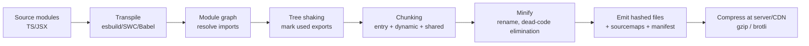
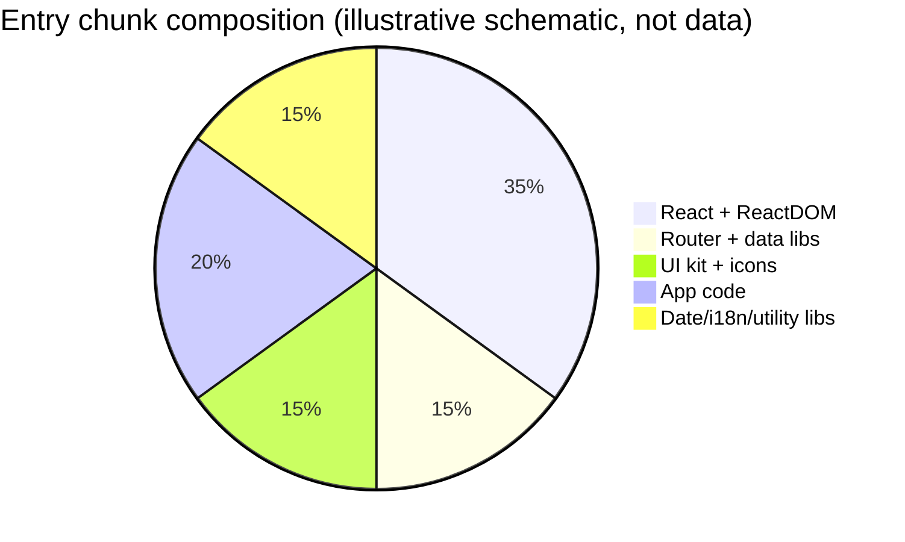
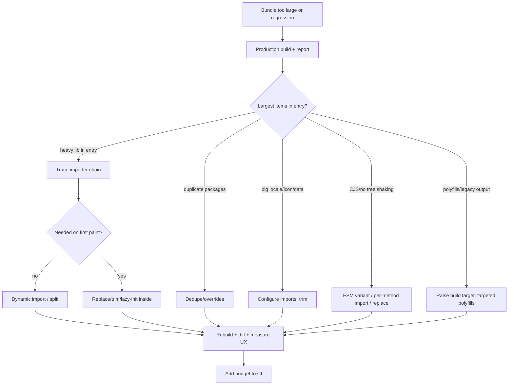

# 07 / 16 — Bundle Analysis

## 1. Lesson metadata

| | |
|---|---|
| **Level** | Advanced |
| **Study time** | 5–6 hours (reading 2 h, hands-on 2 h, exercises 1.5–2 h) |
| **Prerequisites** | [15 — Code splitting and lazy loading](./15-code-splitting-and-lazy-loading.md), [Phase 0 — Modules, dependency graphs and tree shaking](../00-web-and-javascript-foundations/10-modules-and-dependency-graphs.md), [Phase 0 — Tooling, transpilation and bundling](../00-web-and-javascript-foundations/20-tooling-transpilation-and-bundling.md), [Phase 0 — HTTP caching](../00-web-and-javascript-foundations/15-http-caching-and-navigation.md), [01 — Measure before optimizing](./01-measure-before-optimizing.md) |
| **Next** | [17 — Network waterfalls](./17-network-waterfalls.md) |
| **Related** | [21 — Web Vitals and budgets](./21-web-vitals-and-budgets.md), [23 — Counterproductive optimizations](./23-counterproductive-optimizations.md), [Phase 10 — Dependency security](../10-production-engineering/07-dependency-security.md) |

**Learning objectives.** After this lesson you can:
1. Distinguish source size, minified size, compressed (gzip/brotli) size, and parse/execute cost, and know which one matters for which question.
2. Produce and interpret bundle reports (treemap, module lists, chunk graphs) with at least two tools, and tie findings back to specific imports.
3. Diagnose the common causes of bloat: barrel files, non-tree-shakeable packages, duplicated dependencies, accidental static imports, oversized polyfills/locales/icons, development-only code in production, source maps and assets.
4. Choose the right remedy (remove, replace, deep-import, configure, dedupe, split, defer) and avoid counterproductive micro-optimizations.
5. Enforce budgets in CI and track bundle size over time with reproducible measurement.

**Concepts covered:** module graph, chunks, tree shaking prerequisites (`sideEffects`, ESM), minification and dead-code elimination, gzip/brotli, parsed vs transferred size, duplicate packages, barrel files, bundle diffing, size budgets, build targets, import cost.

---

## 2. Deep conceptual explanation

### 2.1 What problem is this lesson solving?

[Lesson 15](./15-code-splitting-and-lazy-loading.md) taught you *how* to split. This lesson teaches you *where to look and what to do* — because the most effective bundle optimization is frequently **not shipping the code at all** (remove, replace, or configure), and you cannot do that blindly. Bundle analysis converts "the app feels heavy" into "module X is 38% of the entry chunk and is imported by one admin screen".

### 2.2 Sizes: which number answers which question?

| Size | What it is | Answers |
|---|---|---|
| **Source/stat size** | Bytes of your files before transformation (webpack-bundle-analyzer's "stat") | "How much code did we write/import?" (rarely useful) |
| **Parsed/minified size** | Bytes after bundling + minification (webpack's "parsed") | **CPU cost**: parse, compile, memory; JS execution scales with this more than compressed bytes |
| **Compressed (gzip/brotli) size** | Bytes on the wire (what the network transfers) | **Network cost**: download time on slow links; budgets are commonly expressed in compressed bytes |
| **Decoded size over time** | Execution time, main-thread work | "What did the user actually pay in CPU?" Measure in the Performance panel |

Two bundles of equal compressed size can have very different parse costs (e.g., highly compressible repeated code vs dense code). Conversely, a large module that is never executed still costs download and parse (browsers may lazily compile function bodies, but you shouldn't count on it).

**Rule:** Use *compressed* size to reason about network and for budgets; use *parsed/minified* size and the Performance panel to reason about CPU.

### 2.3 What bundle analyzers show (and don't)

Analyzers visualize which **modules** (usually grouped by package) contribute to which **chunks** and how many bytes. They *don't* show:

- which code **executes** during the first interaction (use DevTools Coverage and Performance),
- the **cost of the data** you ship (JSON fixtures, icon SVGs, translations — they appear as modules but their meaning is in the product),
- the cost of **runtime allocations** or React render cost,
- dependency risk (security/license) — separate tools ([Phase 10 — Dependency security](../10-production-engineering/07-dependency-security.md)).

### 2.4 The six levers, in order of typical payoff

| Lever | Example | When |
|---|---|---|
| **Remove** | Dead feature flags, unused dependencies, duplicate utility libs | First: zero runtime cost |
| **Replace** | Smaller alternative library or native API (`Intl`, `fetch`, `structuredClone`, `URLSearchParams`, CSS) | A large dep is used for one function |
| **Configure** | Import only needed locales/icons, correct build target, production flags, tree-shaking metadata | Library offers modular entry points |
| **Dedupe** | One version of each package | Multiple versions present |
| **Split** | Dynamic import of heavy feature ([15](./15-code-splitting-and-lazy-loading.md)) | Needed but not on critical path |
| **Defer/server** | Move work to server, RSC, or load after interaction | Large compute/data libs |

Notice that *split* is lever five. People often split first because it feels architectural; removal and replacement usually have bigger, riskless payoffs.

### 2.5 Misconceptions

| Misconception | Reality |
|---|---|
| "Smaller bundle = faster app." | Only if bytes were the bottleneck. Execution, rendering and network waterfalls often dominate; verify with measurement. |
| "Tree shaking removes anything unused." | It removes unused **exports** from **ES modules** that the bundler can prove side-effect-free. CommonJS, dynamic property access, and side-effectful modules often defeat it. |
| "Bundlephobia numbers are my cost." | They estimate a package's cost in isolation; your cost depends on the exports you import, bundler config, and shared dependencies. Treat as a hint. |
| "Gzip/brotli makes size irrelevant." | Compression helps the wire; parse/compile/memory still pay the minified size. |
| "A bundle of 300 KB gz is always bad." | Depends on audience, devices, caching, and how much is on the critical path. Budgets are product decisions. |
| "Dev server bundle size reflects production." | Dev builds are unminified, unbundled/pre-bundled differently, include dev warnings. Analyze **production** builds. |

---

## 3. Internal mechanics

### 3.1 From imports to chunks



*Public guarantees:* ES modules have static import/export syntax enabling build-time analysis ([Phase 0 — Modules](../00-web-and-javascript-foundations/10-modules-and-dependency-graphs.md)). *Teaching model:* the bundler marks exports as "used" starting from entry points; unused exports and modules without side effects are dropped. *Implementation detail:* each bundler's algorithm and heuristics (scope hoisting/concatenation, side-effect analysis, chunk splitting rules) differ and change between versions; consult the docs for yours.

### 3.2 Tree shaking prerequisites

For a module to be eliminated when unused, the bundler must establish that removing it **doesn't change behavior**:

1. **ESM syntax** (`import`/`export`), not `require`/`module.exports`. CommonJS exports are dynamic objects; bundlers can rarely prune properties.
2. **No top-level side effects** — or the package declares `"sideEffects": false` (or an array listing files that *do* have side effects) in `package.json`; this is a bundler convention (webpack, and supported by Rollup/Vite/esbuild with nuances) rather than a language feature.
3. **Static usage** — `import { a } from "x"` is analyzable; `import * as ns from "x"; ns[someVar]` forces keeping everything the namespace may expose.
4. **No transpilation that destroys ESM** — e.g., Babel preset-env with `modules: "commonjs"` turns ESM into CJS before the bundler sees it. Modern setups keep ESM and let the bundler handle modules.
5. **Class/IIFE patterns** that are "pure" must be annotated (`/*#__PURE__*/`) for minifiers to drop unused instantiations; libraries compiled by modern toolchains often include these annotations.

Many "tree shaking doesn't work" cases are really: *the package ships CJS only*, *has side effects at import (e.g., registers globals/CSS)*, or *the code path is dynamically referenced*.

### 3.3 Barrel files

A **barrel** (`index.ts` that re-exports many modules) is harmless if the bundler can prune unused re-exports (ESM + side-effect-free modules). It becomes a problem when:
- one re-exported module has side effects (so the bundler must keep and execute it),
- the barrel is from a library built without `sideEffects` metadata,
- the barrel is in your own code and you import from it in a hot path (also slows dev servers and test runners which don't tree-shake and load every re-exported module).

Remedies: deep imports (`import { Button } from "./components/Button"`), library-provided per-module entry points, or tooling options (e.g., package-level import optimization features in some frameworks, e.g. Next.js `optimizePackageImports`; check your framework's docs), and `sideEffects: false` in your own packages when true.

### 3.4 Duplicated dependencies

If two dependencies require incompatible semver ranges of the same package, a package manager may install **multiple copies**. The bundle then includes each copy. Particularly dangerous for **React** (two copies of React/ReactDOM cause "Invalid hook call" and broken context) and for libraries with singletons (state stores, styling runtimes, i18n). Detect via analyzer (two entries for the same package), `npm ls <pkg>` / `pnpm why <pkg>` / `yarn why <pkg>`, and fix with `dedupe`, resolution overrides (`overrides`/`resolutions`/`pnpm.overrides`), or by aligning dependency versions. Treat overrides as a risk: forcing a version outside a dependency's supported range can break it.

### 3.5 Minification, build targets, and polyfills

- **Build target** (e.g., `es2020`, or browserslist-derived) decides which syntax is **downleveled**. Targeting very old browsers expands code (transpiled classes, async/await state machines) and adds helpers; targeting modern evergreen browsers keeps code smaller. Choose a target matching your supported browsers; verify against analytics.
- **Polyfills** (e.g., `core-js`) can be large. Use targeted polyfilling driven by the target list and feature-detection; avoid blanket imports.
- **Dead-code elimination of environment checks:** libraries guard dev-only warnings with `process.env.NODE_ENV !== "production"`; bundlers replace that expression at build time and minifiers drop the dead branch. If `NODE_ENV` isn't set to `"production"` in your build, React's development build ships — much larger and slower. Most modern toolchains (Vite `build`, Next) set this automatically for production builds, but confirm by searching the output for dev-only strings.
- **Source maps** are separate files and don't affect the runtime download unless you ship inline maps or expose them; they influence analysis tooling (e.g., source-map-explorer relies on them).

### 3.6 Compression and delivery

Static assets should be served compressed (brotli preferred where supported, gzip as fallback) with hashed filenames and long-term caching ([Phase 0 — HTTP caching](../00-web-and-javascript-foundations/15-http-caching-and-navigation.md)). Analyzer "gzip/brotli" numbers are computed locally per file/module; real transfer sizes depend on your CDN's compression settings and levels. Verify in the Network panel (the "Size" vs "Content" columns or the transferred bytes) rather than trusting assumptions.

---

## 4. Step-by-step execution walkthrough

**A bundle-analysis session, end to end.** Starting point: a Vite + React + TypeScript app, entry chunk reported as large by the build output.

1. **Reproduce a production build.** `npm run build` (ensure `NODE_ENV=production`). Record the build output table: chunk names with raw and gzip sizes. Save the baseline (commit it to a `perf/` folder or CI artifact).
2. **Generate a visual report.** Enable a treemap plugin (§5.1) and rebuild. Open `dist/stats.html`.
3. **Find the top contributors in the entry chunk.** In the treemap, look for the largest rectangles; group by package (`node_modules/<pkg>`). List the top 10 with sizes (parsed/gzip).
4. **Classify each.**
   - `react-dom`: expected, a fixed floor.
   - `moment` + locales: replace/limit locales.
   - `lodash` (CJS): switch to per-method imports or `lodash-es`, or native.
   - An icon library: ensure per-icon imports.
   - Chart library: should be in a lazy chunk — why is it in the entry? Trace importers (the analyzer's "importers" view or the bundler's `--why`/graph tooling).
   - Two versions of `date-fns`: dedupe.
5. **Trace the importer chain** of any surprising item: which static import path causes it to be in the entry chunk? (Often a barrel or a shared util that imports the heavy dep.)
6. **Pick one change; apply; rebuild; diff.** For example, remove the barrel import. Compare chunk table before/after (`git diff` of the saved report or a script).
7. **Measure user-visible impact** (not just bytes): Lighthouse/Performance on throttled CPU/network: LCP, TBT/INP proxies, main-thread parse/execute time of the entry script.
8. **Guard it.** Add a size budget to CI (§5.4) so regressions fail PRs.
9. **Repeat** until marginal gains no longer justify the effort — then stop.

---

## 5. Code examples

### 5.1 Minimal example — generating reports

**Vite with `rollup-plugin-visualizer`** (option names `filename`, `template`, `gzipSize`, `brotliSize`, `open`, `title`, `sourcemap`, `emitFile` checked against the v7.1.1 README on 2026-10-22; v7 supports Rollup 2-4 and Rolldown 1.x, so it works with Vite 8):

```ts
// vite.config.ts
import { defineConfig } from "vite";
import react from "@vitejs/plugin-react";
import { visualizer } from "rollup-plugin-visualizer";

export default defineConfig(({ mode }) => ({
  plugins: [
    react(),
    mode === "analyze" &&
      visualizer({
        filename: "dist/stats.html",
        template: "treemap",       // also: "sunburst", "treemap-3d", "network", "raw-data", "list", "markdown", "flamegraph"
        gzipSize: true,
        brotliSize: true,
        open: false,
      }),
  ],
  build: { sourcemap: true },       // enables source-map-explorer
}));
```

Run: `npx vite build --mode analyze`.

**webpack**

```js
// webpack.config.js (excerpt)
const { BundleAnalyzerPlugin } = require("webpack-bundle-analyzer");
module.exports = {
  plugins: [new BundleAnalyzerPlugin({ analyzerMode: "static", openAnalyzer: false })],
};
```
or: `webpack --profile --json > stats.json` then `npx webpack-bundle-analyzer stats.json`.

**Source-map based (bundler-agnostic):**
```bash
npx source-map-explorer "dist/assets/*.js"
```

**esbuild metafile:**
```bash
esbuild src/main.tsx --bundle --minify --metafile=meta.json --outdir=out
# Upload meta.json to the esbuild bundle analyzer (https://esbuild.github.io/analyze/) or process locally.
```

**Line notes.** The analyzer plugin is gated by a mode so normal builds are unaffected. Source maps must correspond to the exact build you measure. Don't deploy analysis artifacts publicly (`stats.html` can reveal source structure; exclude from deploy or restrict).

**Predict:** Your treemap shows `node_modules/moment` 290 KB parsed in the entry chunk and `moment/locale` taking 70% of it. What are two ways to cut it? *Answer:* limit locales at build time (bundler-specific ignore/ContextReplacement-like configuration) or replace Moment with a smaller/native-based library (`Intl.DateTimeFormat`, Temporal where supported (check browser support/polyfill size), `date-fns`, `dayjs`) depending on the API used. Always verify behavior parity, particularly time zones and parsing.

### 5.2 Practical example — a size report script (no extra dependencies)

```ts
// scripts/size-report.ts  (run with: node --experimental-strip-types or via tsx; or compile)
import { readdirSync, readFileSync, statSync } from "node:fs";
import { join } from "node:path";
import { brotliCompressSync, constants, gzipSync } from "node:zlib";

type Row = { file: string; raw: number; gzip: number; brotli: number };

function walk(dir: string): string[] {
  return readdirSync(dir).flatMap((name) => {
    const p = join(dir, name);
    return statSync(p).isDirectory() ? walk(p) : [p];
  });
}

const dist = process.argv[2] ?? "dist/assets";
const rows: Row[] = walk(dist)
  .filter((f) => f.endsWith(".js") || f.endsWith(".css"))
  .map((file) => {
    const buf = readFileSync(file);
    return {
      file,
      raw: buf.length,
      gzip: gzipSync(buf, { level: 9 }).length,
      brotli: brotliCompressSync(buf, {
        params: { [constants.BROTLI_PARAM_QUALITY]: 11 },
      }).length,
    };
  })
  .sort((a, b) => b.gzip - a.gzip);

const kb = (n: number) => (n / 1024).toFixed(1).padStart(8);
console.log("file".padEnd(60), "raw KB".padStart(8), "gz KB".padStart(8), "br KB".padStart(8));
for (const r of rows) console.log(r.file.padEnd(60), kb(r.raw), kb(r.gzip), kb(r.brotli));
console.log("TOTAL".padEnd(60),
  kb(rows.reduce((s, r) => s + r.raw, 0)),
  kb(rows.reduce((s, r) => s + r.gzip, 0)),
  kb(rows.reduce((s, r) => s + r.brotli, 0)));
```

**Notes.** Level-9 gzip and level-11 brotli produce the *best-case* compressed size; CDNs often use lower levels for dynamic compression, so real transfer may be larger. Use the same script/settings for before and after so the comparison is fair. TypeScript execution options (`tsx`, Node's type stripping, which is on by default in recent Node versions) vary; adapt to your toolchain.

### 5.3 Incorrect example — "optimizations" that backfire

```ts
// (1) Whole-library import for a single helper
import _ from "lodash";
const names = _.uniq(items.map((i) => i.name));

// (2) Barrel import of an icon pack
import { FaUser } from "some-icon-pack";        // pack's index re-exports thousands of icons

// (3) Namespace import with dynamic access
import * as utils from "./utils";
const fn = utils[opName as keyof typeof utils]; // keeps everything

// (4) "Optimization": hand-rolling date logic to drop a 6 KB library
function addMonths(d: Date, n: number) { const x = new Date(d); x.setMonth(x.getMonth() + n); return x; }
//     (ignores end-of-month overflow: Jan 31 + 1 month => Mar 3)

// (5) "Fix" by forcing a CDN script tag for React
// <script src="https://cdn.example/react.production.min.js"></script>
```

**Predict the consequences.**
1. `import _ from "lodash"` pulls the full CommonJS library in many setups (~hundreds of KB minified; exact size depends on version) and defeats tree shaking. Use `lodash-es` with named imports, per-method imports (`lodash/uniq`), or native: `[...new Set(items.map(i => i.name))]`.
2. Barrel imports from large packs are tree-shakeable *only if* the package is ESM and side-effect-free; otherwise the entire pack ships. Check the analyzer; use per-icon deep imports or an SVG sprite/CSS approach.
3. Dynamic access on a namespace import prevents the bundler from proving which exports are unused → keeps all.
4. Replacing a well-tested library with naive code saves 6 KB but introduces correctness bugs (month overflow); the *risk* is not worth the byte savings unless the function is trivial and thoroughly tested. Saving < 1% of the bundle is rarely worth a bug.
5. CDN React with a bundled app that also imports React will produce duplicates or mismatch unless properly aliased as externals; adds an extra origin (DNS/TLS), SRI/security considerations, loses long-lived first-party cache control, and in modern browsers shared caches are partitioned per site, so the "shared cache" benefit mostly disappeared (cache partitioning is implemented in current Chrome, Firefox and Safari).

### 5.4 Corrected implementation — budgets in CI

`package.json` using `size-limit` (install `size-limit` plus a plugin such as `@size-limit/file`; sizes are **brotli by default** per the README, so the "(gz)" labels below need `"gzip": true` on each entry or a rename):

```json
{
  "scripts": {
    "build": "vite build",
    "size": "size-limit"
  },
  "size-limit": [
    { "name": "entry (gz)", "path": "dist/assets/index-*.js", "gzip": true, "limit": "120 kB" },
    { "name": "reports route (gz)", "path": "dist/assets/Reports-*.js", "gzip": true, "limit": "60 kB" }
  ]
}
```

A dependency-free alternative using the script in 5.2:

```ts
// scripts/check-budget.ts
import { readdirSync, readFileSync } from "node:fs";
import { join } from "node:path";
import { gzipSync } from "node:zlib";

const budgets: Array<{ pattern: RegExp; maxGzipKB: number }> = [
  { pattern: /^index-.*\.js$/, maxGzipKB: 120 },
  { pattern: /^Reports-.*\.js$/, maxGzipKB: 60 },
];

const dir = "dist/assets";
let failed = false;
for (const name of readdirSync(dir)) {
  const rule = budgets.find((b) => b.pattern.test(name));
  if (!rule) continue;
  const gz = gzipSync(readFileSync(join(dir, name))).length / 1024;
  const ok = gz <= rule.maxGzipKB;
  console.log(`${ok ? "OK  " : "FAIL"} ${name}: ${gz.toFixed(1)} KB gz (limit ${rule.maxGzipKB})`);
  if (!ok) failed = true;
}
process.exit(failed ? 1 : 0);
```

**Budget design notes.** Budgets should be set from product requirements (target devices, networks, Web Vitals goals — [21](./21-web-vitals-and-budgets.md)), not arbitrary numbers; the 120/60 KB above are placeholders. Budgets per route/chunk are more actionable than a single total. Include a process for *raising* a budget (review, justification) so teams don't disable the check.

### 5.5 Advanced example — diffing two builds and finding the cause

Compare two esbuild metafiles to find which inputs grew:

```ts
// scripts/meta-diff.ts
import { readFileSync } from "node:fs";

type Meta = { inputs: Record<string, { bytes: number }> };

const load = (p: string) => JSON.parse(readFileSync(p, "utf8")) as Meta;
const a = load(process.argv[2]);
const b = load(process.argv[3]);

const pkgOf = (path: string) => {
  const m = path.match(/node_modules\/((?:@[^/]+\/)?[^/]+)/);
  return m ? m[1] : "(app)";
};
const sumByPkg = (m: Meta) => {
  const out = new Map<string, number>();
  for (const [p, v] of Object.entries(m.inputs)) {
    out.set(pkgOf(p), (out.get(pkgOf(p)) ?? 0) + v.bytes);
  }
  return out;
};

const A = sumByPkg(a), B = sumByPkg(b);
const rows = [...new Set([...A.keys(), ...B.keys()])]
  .map((k) => ({ pkg: k, before: A.get(k) ?? 0, after: B.get(k) ?? 0 }))
  .map((r) => ({ ...r, delta: r.after - r.before }))
  .filter((r) => r.delta !== 0)
  .sort((x, y) => y.delta - x.delta);

for (const r of rows.slice(0, 20)) {
  console.log(r.pkg.padEnd(40), String(r.delta).padStart(10), "bytes");
}
```

`inputs[...].bytes` is the **source** size of inputs (pre-minification) in esbuild's metafile; use the `outputs[...].inputs[...].bytesInOutput` field for post-tree-shaking contribution (executed with esbuild 0.28: `inputs[].bytes` was 168 for a file whose `outputs[].inputs[].bytesInOutput` was 33). The snippet above uses the source `bytes` and is a teaching baseline: switch to `bytesInOutput` before using it for decisions.

**Using it.** Check out the commit before a regression, build with a metafile, check out the commit after, build again, then diff to find "which package grew by 140 KB." Pair with `git bisect run` plus a script that fails when size exceeds a threshold to *find the offending commit automatically*.

### 5.6 A deep-import and `sideEffects` fix in your own package

```json
// packages/ui/package.json (excerpt)
{
  "name": "@acme/ui",
  "type": "module",
  "sideEffects": ["**/*.css"],
  "exports": {
    ".": "./dist/index.js",
    "./button": "./dist/button.js",
    "./modal": "./dist/modal.js"
  }
}
```

Declaring `"sideEffects"` tells bundlers that only CSS files have side effects; everything else can be dropped if its exports are unused. **Only declare this if true** — a module that registers globals at import time must be listed or removed. A wrong declaration produces missing behavior in production only (hard to debug). `exports` subpaths provide stable deep entry points. Verify interplay with your bundler and TypeScript `moduleResolution` settings.

---

## 6. Visual explanations

### Where bytes come from (typical SPA, schematic)



### Diagnosis flow



### Bytes vs cost

```text
Network:  compressed bytes  ──> download time (slow links)
CPU:      parsed/minified   ──> parse + compile + execute (slow devices)
React:    component count   ──> render time after execution
Order:    A 100KB gz bundle with heavy init code can be worse than a 200KB gz one that is inert.
```

---

## 7. Alternative approaches and trade-offs

| Tool/approach | Strength | Weakness | Best for |
|---|---|---|---|
| `rollup-plugin-visualizer` | Easy in Vite/Rollup; treemap, gzip/brotli | Per-bundler; relies on Rollup's module info | Vite projects |
| `webpack-bundle-analyzer` | Mature; shows stat/parsed/gzip | webpack-specific | webpack/Next (via `@next/bundle-analyzer`) |
| `source-map-explorer` | Works across bundlers via source maps; quick CLI | Accuracy depends on source maps; approximate per-module attribution | Quick ad hoc checks |
| esbuild metafile + analyzer | Fast; programmable | Only for esbuild builds | esbuild-based pipelines |
| Statoscope | Rich diffing/ reports | More setup | Large webpack apps |
| Bundlephobia / import-cost editor plugin | Pre-install estimate | Not your exact config | Dependency selection |
| `size-limit` / custom budgets | CI enforcement | Needs good thresholds | Governance |
| Lighthouse "unused JS" / DevTools Coverage | Runtime usage data | Single page/session snapshot; not exhaustive | Finding candidates for splitting |
| RUM bundle metrics (transfer size by route) | Reality | Needs instrumentation | Long-term monitoring |

**When bundle analysis is *not* the best use of time:**
- The app's LCP is dominated by server response time or image weight, not JS (check waterfalls first, [17](./17-network-waterfalls.md)).
- INP issues come from long tasks in React renders or handlers (use Profiler/Performance), not from download.
- The remaining candidates are each < 1–2% of the total.
- The bundle is already well within budgets and users are on fast devices — go fix the actual bottleneck.

**When replacing a large dependency is *not* wise:** when the lib encapsulates tricky correctness (dates/time zones, rich-text editing, cryptography, parsing), when migration cost exceeds benefit, when team knowledge is invested, or when the library is used widely across features (savings small after removal of one call site).

---

## 8. Best practices and anti-patterns

**Beginner mistakes**
- Analyzing a dev build.
- Reading only the total size.
- Treating the biggest rectangle as "bad" without checking whether it's needed.
- Deploying the analyzer output publicly.

**Experienced-developer mistakes**
- Forcing dependency overrides to dedupe, causing subtle runtime incompatibilities.
- Declaring `"sideEffects": false` inaccurately.
- Over-aggressive manual chunking that destroys cacheability (a monolithic "vendor" chunk invalidated by any dependency bump) or creates circular chunk imports (bundler-specific; in Vite 8 see the `codeSplitting` option, since function-form `manualChunks` is deprecated).
- Chasing 1 KB wins while ignoring a 150 KB static import.
- Not recording a baseline, so regressions can't be bisected.
- Lowering the build target to support browsers you no longer support (bloats output) — or raising it without checking analytics.
- Forgetting CSS: CSS-in-JS runtimes, global stylesheets, and unused CSS contribute; analyze CSS bundles too ([Phase 4 — Styling architecture](../04-react-architecture/)).

**Smells**
- Multiple versions of the same package in the report.
- `moment`, full `lodash`, `core-js` full, or an icon library in the entry chunk.
- Data files (JSON) bundled that could be fetched on demand.
- A shared "utils" module that imports heavy deps used by one function.
- Source maps referenced publicly in production when not intended.

**Justified exceptions**
- Shipping a larger bundle to avoid an extra round trip on the critical path (inlining).
- Keeping a heavy library in the entry because it's used on the landing page and splitting would worsen LCP.

**Governance**
- Per-route budgets, PR comments with diff tables (e.g., via CI bot), and a quarterly dependency review. Document how to evaluate adding a dependency: size, tree-shakeability, maintenance, security, alternatives, and who owns removal.

---

## 9. Real-world application

**E-commerce.** The landing/listing route is revenue-critical: strict budget (small, in compressed KB) enforced in CI; tracking and A/B testing scripts are the usual silent growers — audit third-party tags (they're outside your bundle but on the main thread) with the Network and Performance panels. Product media is a bigger bandwidth cost than JS: coordinate with image optimization.

**Dashboards.** Chart/Grid libraries are large; choose ones with modular imports; lazy-load per dashboard; consider server-side rendering of static charts. Analyze the *async* chunks too (the largest may be a 700 KB gz chunk loaded on first dashboard open — acceptable only with preload and skeletons).

**Finance.** Compliance and audit tooling (PDF export, Excel) should load on demand; cryptography/encoding libraries should be chosen for correctness first, size second.

**Multi-team platforms.** A shared shell with team-owned remote modules: duplicates of React or design-system packages across remotes are the major risk; enforce singleton sharing and version ranges; analyze the *composed* output, not each team's build alone ([Phase 11 — Microfrontends](../11-senior-and-architect-mastery/12-microfrontends.md)).

**Realtime apps.** WebSocket clients and protocol libraries can be large; measure parse time on mid-tier phones; defer connection setup of non-critical channels.

**Engineering constraints to state:** compressed-size budget per route, supported browsers/target, release cadence (cache invalidation), CDN compression levels, and reporting cadence (per PR vs nightly).

---

## 10. Debugging and troubleshooting

| Symptom | Likely cause | Investigation | Fix |
|---|---|---|---|
| Library appears in entry chunk though only used in a lazy route | Static import elsewhere (barrel/shared util/test helper imported by app) | Analyzer "importers"/graph; `rg "from \"lib\""`; esbuild `--analyze`; webpack `stats` reasons | Remove/redirect import; deep imports |
| Two versions of same package | Peer/semver conflicts | `npm ls pkg`, `pnpm why pkg` | Align versions; `dedupe`; cautious overrides |
| Tree shaking not working for a package | CJS entry, side effects, `import *` dynamic access | Check `package.json` (`module`, `exports`, `sideEffects`), inspect output | Use ESM entry, per-method imports, alternative lib |
| Huge `core-js`/helpers | Low target; blanket polyfill imports | Inspect `browserslist`/target and entry imports | Update targets; targeted polyfills |
| Dev build in production | `NODE_ENV` not set; wrong build mode | Look for dev-only strings (e.g., React dev warnings text) in output; check bundle size of React | Fix build config/env |
| Bundle grew after "no code change" | Dependency range bumped (lockfile change) | Compare lockfiles; metafile diff | Pin/investigate; report upstream |
| Analyzer says small but page still slow | Execution/render cost, third-party scripts, network waterfalls | Performance panel Bottom-Up, Network waterfall | Reduce work; defer third parties ([20](./20-long-tasks-and-main-thread.md)) |
| CSS larger than JS | Unused CSS, per-component CSS duplication, CSS-in-JS runtime | Coverage tool (CSS), analyzer for CSS assets | Purge/extract; reduce duplication |
| Size differs between CI and local | Different Node/bundler/lockfile/env flags | Compare versions; ensure `npm ci` | Reproducible builds |

**Reading a treemap well.** (1) Switch to the *parsed/minified* view for CPU, compressed for network. (2) Group by package, not file. (3) Look at **async** chunks separately from the entry. (4) Find *surprising* items, not just big ones. (5) For each suspicious item, trace *why* it is there before deciding what to do.

### Measurement methodology

| Step | What to record | Notes |
|---|---|---|
| Baseline | Chunk table (raw/gz/br), treemap screenshot/JSON, Lighthouse median of ≥ 5 runs, Performance panel: script evaluation time of entry on 4× CPU throttle | Same machine/Node/lockfile |
| Change | One change per commit | Enables bisecting |
| Diff | Chunk table delta and by-package delta | Script like §5.5 |
| Impact | LCP/INP/TBT deltas, cold-cache vs warm-cache load | Cold load shows download; warm shows parse/execute (cached bytes still must be compiled — modern browsers may cache compiled code; engine-specific implementation detail) |
| Field | RUM metrics by route before/after | The final judge |
| Guard | Budget check in CI | Fail on regression above tolerance |

**Reporting format** for a PR:
```text
Change: replace moment with Intl.DateTimeFormat in DateCell
Entry chunk: 412.3 KB -> 331.7 KB raw; 128.9 -> 104.2 KB gz (-24.7 KB gz)
Lab (Slow 4G, 4x CPU, median of 7): LCP 3.1s -> 2.8s; script eval (entry) 410ms -> 340ms
Risks: date formatting parity in 3 locales; tests added.
```
(Illustrative formatting — your numbers must come from your measurements.)

---

## 11. Exercises

### Level A — Knowledge
A1. Which size (raw, parsed/minified, gzip) best predicts parse/compile CPU cost? Which best predicts download time?
A2. List four conditions needed for tree shaking to eliminate an unused export.
A3. What does `"sideEffects": false` promise to the bundler?
A4. Why can two copies of React break an app at runtime?
A5. Name three levers to reduce bundle size that are not code splitting.

### Level B — Code comprehension
B1. Explain why this import may keep a heavy module in the entry chunk even if the exported function is tiny:
```ts
// helpers/index.ts
export { slugify } from "./slugify";
export { renderMarkdown } from "./markdown";   // imports a 150 KB parser; registers plugins at import time
// App.tsx
import { slugify } from "./helpers";
```
B2. Interpret this `npm ls react` output snippet and its impact:
```text
app
├── react@19.1.0
└─┬ legacy-widget@2.3.1
  └── react@18.3.1
```
B3. A report shows `core-js` at 90 KB gz in the entry. List three possible causes and checks.

### Level C — Implementation
C1. Write a script that takes two directories (`dist-before`, `dist-after`), computes gzip sizes per chunk by *logical name* (strip content hashes), and prints a delta table sorted by absolute change.
C2. Write a Rollup/Vite plugin sketch that fails the build when a module matching `/node_modules\/moment\//` appears in the entry chunk.
C3. Configure budgets for three route chunks and make a GitHub Actions job (YAML) that runs the build, checks budgets, and comments the table on the PR.

### Level D — Debugging
D1. After upgrading a UI library the entry chunk grew by 90 KB gz with no code changes. Provide a step-by-step plan to identify the cause and options to fix.
D2. The analyzer shows the `chart` chunk loaded on the landing page although the chart is only on `/reports`. Find the cause using the module graph and fix it.
D3. Production page loads React in development mode (large, warnings in console). List causes and verification steps.

### Level E — Architecture and engineering decisions
E1. Decide whether to replace `date-fns` + `moment` with a single library or native APIs for a global product with 14 locales and time-zone-sensitive scheduling. Define evaluation criteria and a migration plan.
E2. Design a governance process for adding npm dependencies across 10 teams: required checks, thresholds, review roles, and deprecation policy.

### Level F — Expert challenge
F1. Design a performance-regression detection system that attributes bundle growth to specific PRs and dependency updates, including baselines, noise handling (non-deterministic builds), alerting, and how it connects to field RUM.

---

## 12. Detailed answers and explanations

> Attempt the exercises first.

**A1.** Parsed/minified size predicts parse/compile/memory cost (roughly), compressed size predicts download time on constrained networks. Neither alone predicts *execution* time — that depends on what the code does at startup.

**A2.** (1) ES module syntax (not CJS) retained through transpilation; (2) module is side-effect-free or declared so (`sideEffects`/pure annotations); (3) usage analyzable statically (no dynamic namespace access); (4) the export isn't reachable from used code; (5) the minifier/bundler can prove pure initializers (annotations). Any four.

**A3.** That modules in the package can be omitted from the bundle if none of their exports are used, because importing them has no observable side effects (other than the listed files, if an array is given). If untrue, behavior (global registration, CSS injection, polyfills) is lost.

**A4.** React hooks, context, and some internals rely on a single shared module instance. A component using hooks from copy B while rendered by renderer copy A reads a different internal dispatcher → "Invalid hook call" errors or context mismatches. Libraries must treat `react` as a peer dependency, and bundles must resolve to one copy.

**A5.** Remove unused code/dependencies; replace large libraries with smaller/native APIs; configure imports (locales, icons, per-method); dedupe; adjust build target/polyfills; compress/serve optimally; move work to the server (RSC/SSR); eliminate dead flags; reduce assets inlined in bundles.

**B1.** The barrel `helpers/index.ts` re-exports `markdown`, which has top-level side effects (plugin registration). Even though `App.tsx` imports only `slugify`, a bundler may keep and evaluate `./markdown` (and its 150 KB parser) because it can't prove removing it is safe (unless `sideEffects: false` is declared accurately — and it's *not* accurate here since registering plugins is a side effect). Fix: import from `./helpers/slugify` directly; make `markdown` a lazy module that registers plugins on demand; avoid side effects at import time.

**B2.** Two React versions are installed: the app's React 19.1 and a nested React 18.3.1 required by `legacy-widget` (probably as a regular dependency instead of a peer). The bundle includes both; mixing them yields invalid hooks/context problems and doubles React's size. Fix: make `legacy-widget` use the app's React (peer dependency/upgrade), or alias/override with caution and test, or isolate it in an iframe/island/separate root with its own React if it cannot be upgraded ([Phase 11 — Microfrontends](../11-senior-and-architect-mastery/12-microfrontends.md)).

**B3.** Causes: (1) blanket `import "core-js"` or a preset using `useBuiltIns: "entry"` with a low browserslist target; (2) a dependency bundling its own copy of core-js; (3) legacy targets configured (IE11/old Safari) in `browserslist`. Checks: inspect the entry's import chain; read build config and `browserslist`; analyzer for `core-js` modules and who imports them; compare with a modern target build. Fix: raise targets if analytics support it; import only needed polyfills conditionally; remove redundant polyfills.

**C1.** Sketch:
```ts
import { readdirSync, readFileSync } from "node:fs";
import { join } from "node:path";
import { gzipSync } from "node:zlib";

const logical = (n: string) => n.replace(/-[A-Za-z0-9_-]{6,}(?=\.\w+$)/, ""); // strip hash segment (pattern depends on bundler)
function sizes(dir: string) {
  const m = new Map<string, number>();
  for (const f of readdirSync(dir)) {
    if (!/\.(js|css)$/.test(f)) continue;
    m.set(logical(f), gzipSync(readFileSync(join(dir, f))).length);
  }
  return m;
}
const [beforeDir, afterDir] = process.argv.slice(2);
const a = sizes(beforeDir), b = sizes(afterDir);
const names = new Set([...a.keys(), ...b.keys()]);
const rows = [...names].map((n) => ({ n, a: a.get(n) ?? 0, b: b.get(n) ?? 0 }))
  .map((r) => ({ ...r, d: r.b - r.a }))
  .sort((x, y) => Math.abs(y.d) - Math.abs(x.d));
for (const r of rows) console.log(r.n.padEnd(40), String(r.a).padStart(8), String(r.b).padStart(8), String(r.d).padStart(8));
```
Caveats: hash patterns differ (Vite `name-HASH.js`, webpack `[name].[contenthash].js`); anonymous chunks (numbers) shift names between builds, so prefer manifest-based mapping; compare gz of same compression level.

**C2.** Rollup `generateBundle` hook: iterate `bundle` entries where `chunk.type === "chunk" && chunk.isEntry`, check `Object.keys(chunk.modules)` for `/node_modules\/moment\//`, and call `this.error(...)` (or `this.warn` then fail) with the importer chain if available. For the importer chain use `this.getModuleInfo(id)?.importers`. Edge: `isEntry` vs dynamic entries; the plugin must also handle `chunk.imports` (static shared chunks loaded at startup): treat chunks in the entry's static import closure as "initial".

**C3.** Key elements: `actions/checkout`, `setup-node` with cache, `npm ci`, `npm run build`, `node scripts/check-budget.js`, upload `dist/stats.html` as an artifact (not publicly deployed), post a PR comment using the GitHub API (via `actions/github-script`) with a Markdown table (before from the base branch's artifact vs current). Concern: base-vs-head comparison requires building both or caching base artifacts; secrets and fork PR permissions (comments from forks need `pull_request_target` with care; security implications).

**D1.** Plan: (1) confirm via lockfile diff what changed, including transitives; (2) build before/after with metafile or analyzer; (3) by-package diff to see what grew; (4) check the library's changelog (new default entry points, dropped ESM, new dependencies, side effects); (5) check imports: did the library change barrel structure so named imports are no longer tree-shaken? (6) options: pin the previous version, switch to per-component deep imports, configure the library's modular import support, report upstream, replace. Validate via re-diff and budget.

**D2.** Use the analyzer's importer information (or Rollup's `moduleInfo.importers`/webpack stats `reasons`) for the `chart` module to find a static importer in the initial graph (e.g., `utils/formatters.ts` imports a chart helper; `components/index.ts` re-exports `ChartCard`). Break the static edge (deep import, move helper, convert to dynamic import). Rebuild; confirm the chart chunk is no longer in the entry's static import closure.

**D3.** Causes: wrong build command (dev server artifacts deployed), `NODE_ENV` set to `development` in CI/build env, a different bundler config for production missing the env replacement, or a duplicate dev React bundled via a nested dependency/CDN script. Verify by searching the output for dev-only strings, checking React's reported build mode in React DevTools (the icon/tooltip shows "development build"; UI may change), inspecting `process.env.NODE_ENV` replacement in output, and comparing React-DOM chunk size.

**E1.** Criteria: correctness with time zones and DST (IANA tz via `Intl` is solid for formatting; arithmetic and scheduling logic require a library or Temporal (support status varies; check current browser support and polyfill size)), locale coverage (Intl built-ins vs bundled locale data), bundle impact (`Intl` is free at bundle-time but behavior varies by engine/ICU data), API ergonomics, immutability, tree-shakeability, maintenance, team familiarity, test coverage. Migration plan: inventory usages; wrap behind an internal `dates` module with an interface; implement with the chosen backend; write parity tests across locales/time zones including DST edges; migrate incrementally; remove old libs; verify bundle diff and runtime behavior. The recommended path isn't "always native": if scheduling logic is complex, keep a well-tested library for arithmetic and use `Intl` for formatting.

**E2.** Criteria: dependency intake checklist (need, alternatives including native, license, maintenance activity, security posture, ESM/tree-shakeability, bundle cost via analyzer on a real import, transitive count, peer dependency compatibility with React), thresholds (e.g., > X KB gz requires approval/lazy-loading plan), review roles (platform/perf owner + security), automation (size diff bot, license check, audit), ownership (who removes it), deprecation policy (inventory, sunset dates, codemods), and exception process. A strong answer balances speed and control and includes metrics (dependency count, bundle trend).

**F1.** Outline: deterministic builds (lockfile, pinned Node/bundler, fixed env, no timestamps) so differences are signal; produce a normalized build report (per route/chunk gz/br + per-package contributions) on every main-branch commit and PR; store in an artifact DB/time series; PR checks compute delta vs merge-base with tolerance (e.g., ignore < 0.5 KB noise); label growth sources (dependency bump vs code); weekly trend reports; alerts on slope changes; link to RUM (LCP/INP by release) to confirm user impact; automate bisect with `git bisect run` using a size script for historical regressions; enforce budgets but allow justified overrides with an expiry. Handle non-determinism (chunk hash names, ordering) via logical names from manifest/entry names and by comparing structurally. Include dependency-update bot integration (Renovate/Dependabot) to show size deltas in update PRs.

---

## 13. Senior engineer interview questions

**Q1. "Our bundle is 1.2 MB gz. Walk me through what you'd do."**
Reproduce a production build, generate a treemap, split entry vs async, identify top contributors and surprising inclusions, trace importers, then apply the lever hierarchy (remove, replace, configure, dedupe, split, defer), verify each with diffs and user-centric metrics, and add budgets. Also confirm that bytes are the bottleneck (waterfalls, main thread).

**Q2. "Why doesn't tree shaking remove this unused import?"**
Check module format (CJS vs ESM), side-effect declarations, dynamic access patterns, barrel files, transpile settings destroying ESM, and whether the minifier can prove purity. Inspect the output and the package's `exports`/`module`/`sideEffects`.

**Q3. "What's the difference between parsed and gzip size, and why do both matter?"**
Gzip approximates network bytes; parsed size reflects what the engine must parse/compile/hold in memory. Network-bound users care about gzip; CPU-bound devices care about parsed. Budgets typically cite compressed size; performance analysis considers both.

**Q4. "A teammate wants to load React from a CDN to shrink our bundle. Response?"**
The savings are small relative to risk: added origin latency, SRI/availability concerns, mismatched versions, no first-party cache control, partitioned caches negate cross-site sharing, complexity with bundler externals. A better path: ensure single React copy, modern targets, code splitting, and removal of heavy dependencies.

**Q5. "How do you stop bundle regressions?"**
Budgets per route in CI, PR diff comments, dependency intake reviews, periodic analysis, and RUM monitoring; enable bisecting by saving reports per commit.

**Q6. "Is a smaller bundle always a win?"**
No: replacements may add bugs; over-aggressive splitting adds waterfalls; micro-savings cost engineering time; sometimes inlining/larger bundles reduce round trips. Evaluate with user-centric metrics and risk.

---

## 14. Further learning resources

| Resource | URL | Covers / why | Level | Section to study |
|---|---|---|---|---|
| Vite docs — Building for Production | <https://vite.dev/guide/build.html> | Build options, targets, chunking | Intermediate | Browser compatibility; Chunking strategy |
| webpack docs — Tree Shaking | <https://webpack.js.org/guides/tree-shaking/> | `sideEffects`, `usedExports`, pure annotations | Intermediate | Whole guide |
| Rollup docs — Tree-shaking | <https://rollupjs.org/introduction/#tree-shaking>  | ESM tree shaking in Rollup | Intermediate | Tree-shaking |
| esbuild — Bundle analyzer | <https://esbuild.github.io/analyze/> | Upload a metafile to visualize | Intermediate | Metafile usage |
| esbuild docs — API: metafile | <https://esbuild.github.io/api/#metafile> | Metafile schema | Advanced | Metafile |
| `webpack-bundle-analyzer` | <https://github.com/webpack-contrib/webpack-bundle-analyzer> | Treemap with stat/parsed/gzip sizes | Intermediate | README |
| `rollup-plugin-visualizer` | <https://github.com/btd/rollup-plugin-visualizer> | Treemap/sunburst for Rollup/Vite | Intermediate | README options |
| `source-map-explorer` | <https://github.com/danvk/source-map-explorer> | Source-map-based bundle explorer | Intermediate | README |
| `size-limit` | <https://github.com/ai/size-limit> | Budgets in CI | Intermediate | README |
| Bundlephobia | <https://bundlephobia.com/> | Pre-install package cost estimates | Beginner | Package search |
| web.dev — Performance budgets | <https://web.dev/articles/performance-budgets-101> | Budget concepts | Beginner | Whole article |
| MDN — package.json `exports` / Node docs | <https://nodejs.org/api/packages.html> | `exports`, `type`, conditional exports | Advanced | Package entry points |
| Chrome DevTools — Coverage | <https://developer.chrome.com/docs/devtools/coverage> | Unused code at runtime | Beginner | Whole page |


---

## 15. Knowledge checkpoint

**You should now understand**
- The difference between raw, parsed, compressed sizes, and runtime cost; what analyzers show and omit.
- Tree shaking prerequisites, barrel and side-effect pitfalls, duplication hazards, build targets/polyfills.
- The lever hierarchy: remove → replace → configure → dedupe → split → defer.

**You should be able to explain without notes**
- Why a lazy chunk can still end up in the entry bundle.
- Why replacing a library to save a few KB can be counterproductive.

**You should be able to implement**
- Analyzer setup (Vite/webpack/esbuild), a size report and budget check, a before/after diff, and a CI gate.

**You should be able to debug**
- Surprising entry-chunk inclusions, duplicate packages, non-shaking packages, dev builds in prod, and regressions via bisect.

**Before moving on:** read [17 — Network waterfalls](./17-network-waterfalls.md) to see how chunks, data and critical resources sequence on the wire, then return to [Phase 7's counterproductive optimizations](./23-counterproductive-optimizations.md) to consolidate what *not* to do.
