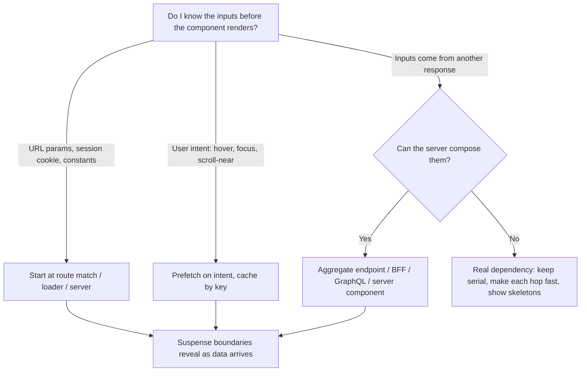
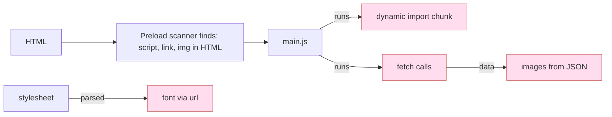

# 07 / 17 — Network Waterfalls

## 1. Lesson metadata

| | |
|---|---|
| **Level** | Advanced |
| **Study time** | 4–5 hours (reading 1.5 h, DevTools experiments 1.5 h, exercises 1.5 h) |
| **Prerequisites** | [Phase 0 — Web APIs and network requests](../00-web-and-javascript-foundations/14-web-apis-and-network-requests.md), [Phase 0 — HTTP, caching, navigation](../00-web-and-javascript-foundations/15-http-caching-and-navigation.md), [Phase 6 — The fetch lifecycle](../06-data-fetching-and-state-ecosystems/01-fetch-lifecycle.md), [Phase 6 — Cancellation and race conditions](../06-data-fetching-and-state-ecosystems/02-cancellation-and-race-conditions.md), [15 — Code splitting and lazy loading](./15-code-splitting-and-lazy-loading.md), [16 — Bundle analysis](./16-bundle-analysis.md) |
| **Next** | [18 — React vs browser bottlenecks](./18-react-vs-browser-bottlenecks.md) |
| **Related** | [Phase 6 — Suspense data loading](../06-data-fetching-and-state-ecosystems/13-suspense-data-loading.md), [Phase 6 — TanStack Query](../06-data-fetching-and-state-ecosystems/08-tanstack-query.md), [Phase 2 — Suspense conceptual internals](../02-react-rendering-and-internals/24-suspense-conceptual-internals.md), [Phase 9 — SPA, SSR, SSG, streaming](../09-advanced-rendering-and-ecosystem/01-spa-ssr-ssg-streaming.md) |

**Learning objectives.** After this lesson you can:
1. Read a DevTools Network waterfall and name each phase of a request (queueing, DNS, connect, TLS, request sent, waiting/TTFB, content download).
2. Explain why *dependencies between requests* — not bandwidth — usually dominate load time in React applications, and identify the three structural sources of waterfalls: **resource discovery chains**, **render-then-fetch chains**, and **code-then-data chains**.
3. Remove waterfalls with the right tool: parallel fetching, hoisting fetches above components, route-level data loading, preloading, `<link rel="preload">`/`modulepreload`, `fetchpriority`, server-side data composition, and backend aggregation.
4. Distinguish a *network-bound* symptom from a *CPU-bound* one (so you do not optimise React for a problem that lives in the wire).
5. Avoid over-correcting: speculative prefetching, over-fetching, and HTTP/2 push folklore.

**Concepts covered:** request lifecycle phases, critical path, connection setup cost, HTTP/2 multiplexing and head-of-line concerns, discovery by the preload scanner, render-blocking resources, fetch-on-render vs fetch-then-render vs render-as-you-fetch, `Promise.all`, request deduplication, preloading, priority hints, caching as waterfall removal, network throttling methodology.

---

## 2. Deep conceptual explanation

### 2.1 What problem is this lesson solving?

You deliver a React SPA. The bundle is 180 kB gzip. The API is fast (60 ms median). On a fibre connection in the office it feels instant. On a mid-range phone on 4G, users stare at a spinner for 6 seconds. You open the Profiler: nothing is slow. You open the Network panel and see the real problem: a **staircase**.

```
index.html      ████
main.js              ████████
/api/session                  ███
/api/user/42                     ███
/api/user/42/orders                 ████
/api/products?ids=…                     ███
product-card.js                             ██
product-images ×12                            ██████
```

Each step could not *start* until the previous step *finished*, because the information needed to issue it (a URL, a user id, a chunk name) only appeared after the previous step completed. The total time is the **sum of the latencies along the chain**, not the max. Adding bandwidth does nothing; every hop pays a round trip, and on mobile a round trip is 50–300 ms before the server has done any work.

That structure is a **network waterfall** in the sense this lesson uses the word: a *dependency chain* in the critical path. (The Network panel's "Waterfall" column is the visualisation; not every visual stagger is a problem, and not every problem looks like a stagger.)

### 2.2 Anatomy of a single request

For a request on a fresh connection to a new origin (the general model; real stacks vary):

| Phase | What happens | Typical cost driver |
|---|---|---|
| **Queueing / stalled** | Browser has not yet sent it: waiting for a free connection (HTTP/1.1 has ~6 per host), priority scheduling, a service worker, or disk cache lookup | Too many requests on HTTP/1.1; low priority |
| **DNS lookup** | Resolve hostname → IP | Resolver latency; cacheable |
| **Initial connection (TCP)** | 1 RTT handshake (QUIC/HTTP/3 merges this with TLS) | Distance (RTT) |
| **TLS** | 1 RTT for TLS 1.3 (more for 1.2) | RTT |
| **Request sent** | Headers/body upload | Usually negligible |
| **Waiting (TTFB)** | Server processing + one-way trips; "time to first byte" | Server work, backend calls, cold caches |
| **Content download** | Body transfer | Size ÷ bandwidth; congestion window growth |

*Public guarantee:* the Network panel shows timing for these phases (via the Resource Timing model: `PerformanceResourceTiming` exposes `domainLookupStart/End`, `connectStart/End`, `requestStart`, `responseStart`, `responseEnd` and so on — see MDN). Precise labels vary between browsers' DevTools.

*Why this matters for waterfalls:* connection setup is paid **once per origin per connection**, but a *chain* pays the *waiting* phase (≥ 1 RTT plus server time) on every hop. So the first-order model for a chain of *n* dependent requests on a warm connection is:

```
T_chain ≈ Σ ( RTT + server_time_i + transfer_i )
```

whereas for *n* independent requests on one multiplexed connection:

```
T_parallel ≈ RTT + max( server_time_i ) + Σ transfer_i / bandwidth   (roughly; shared bandwidth)
```

That is the whole game: **convert sums of round trips into a single round trip.**

### 2.3 Three structural sources of waterfalls in React apps

**1. Resource discovery chains (the document → asset chain).**
The HTML parser's *preload scanner* looks ahead in HTML for `<script src>`, `<link rel=stylesheet>`, `` and starts those fetches early. But resources referenced *only from inside other resources* are invisible until the referrer is downloaded and executed/parsed: CSS `@import`, `url()` for fonts inside a stylesheet, `import()` chunks named inside JS, images set by JS after data arrives. A typical Vite/webpack SPA: `index.html` → `main.js` (discovered by scanner) → dynamic `import()` of a route chunk (discovered only when `main.js` *runs*) → chunk's own static imports (discovered when the chunk is parsed). (Build tools often emit `modulepreload` hints for the static import graph of an entry; confirm in your build output; Vite emits `modulepreload` for an entry's static imports — see [16 — Bundle analysis](./16-bundle-analysis.md).)

**2. Render-then-fetch chains (fetch-on-render).**
A component renders, an effect fires, the effect fetches, data arrives, state updates, children render — and *those* children fetch their own data in their own effects. Each level starts its request only after the parent has rendered with *its* data. This is the classic React waterfall:

```tsx
function Profile({ id }: { id: string }) {
  const user = useUser(id);              // request 1 (in an effect/query)
  if (!user) return <Spinner />;
  return <Orders userId={user.id} />;    // mounts only after request 1
}
function Orders({ userId }: { userId: string }) {
  const orders = useOrders(userId);      // request 2 starts after Orders mounts
  if (!orders) return <Spinner />;
  return orders.map((o) => <OrderRow key={o.id} order={o} />); // each row fetches its product…
}
```

Note the subtle trap: `Orders` only needs `user.id`, and `id` was already available as a prop in `Profile`. The dependency is *artificial* — an artefact of where the fetch is placed in the component tree, not of the data.

**3. Code-then-data chains.**
The route's JS chunk must download and execute before the component can *start* fetching its data. With `React.lazy` the chunk fetch happens when React first renders the lazy component; the data request fires only after the chunk resolves and the component renders (if data is fetched in the component). Two serial network hops that could have been parallel.

### 2.4 Waterfalls versus parallel work: the fix principle

> A request should start at the **earliest moment its inputs are known** — not at the moment the component that displays it renders.

Inputs known at: *HTML parse time* (preload hints, inline JSON), *route match time* (URL params → route loaders), *user intent time* (hover/focus → prefetch), *server render time* (server fetches and ships data in the response). Wherever the input is known earlier than the rendering component, hoist the fetch there. This is the **render-as-you-fetch** idea from React's Suspense documentation and the motivation behind route-level loaders in routers and frameworks.

### 2.5 HTTP/2, HTTP/3, and why "just bundle everything" is not the answer

- **HTTP/1.1:** ~6 parallel connections per origin; many small requests queue. Historically drove bundling, sprites, domain sharding.
- **HTTP/2:** multiplexing over one connection; many requests in flight at once; header compression. Reduces queueing, makes "many small files" viable — but does **not** remove *dependency* chains. TCP-level head-of-line blocking still affects all streams when a packet is lost.
- **HTTP/3 (QUIC):** per-stream loss recovery avoids TCP-level head-of-line blocking; faster handshake. Still no help for dependency chains.
- **HTTP/2 Server Push** was removed or disabled in major browsers (Chrome removed it in Chrome 106, 2022) and is not a strategy to build on. Prefer `103 Early Hints` (supported by Chromium browsers, and by Safari and Firefox for preload hints per MDN compat data; also requires CDN/server support, so check your stack) and `<link rel="preload">`.

Protocol upgrades make *individual hops cheaper*; waterfalls are about *the number of serial hops*. They are orthogonal.

### 2.6 Misconceptions

| Misconception | Reality |
|---|---|
| "My API is fast, so the page is fast." | Per-hop cost includes RTT and queueing; a 40 ms API called 5 times serially from a 150 ms-RTT mobile connection costs ~1 s of pure latency. |
| "`Promise.all` solves waterfalls." | It parallelises requests you *already know about at the same time*. It cannot parallelise request B that needs A's response. |
| "Suspense removes waterfalls." | Suspense changes *how* you wait; if component B only renders (and starts fetching) after A resolves, you still have a waterfall. Suspense + render-as-you-fetch (start fetching before render) removes it. |
| "TanStack Query / SWR prevents waterfalls." | They give caching and dedup. Dependent queries (`enabled: !!user`) are still serial by construction. Use `prefetchQuery`, loaders, or combine endpoints. |
| "Bigger bundle = the problem." | Sometimes yes, but a 50 kB chunk discovered late can cost more than a 150 kB chunk discovered early. |
| "HTTP/2 makes request count irrelevant." | Concurrency is higher but still limited by server, CPU parsing, priority contention, and *dependency structure*. Hundreds of requests still hurt. |
| "Preload everything." | Preloading steals bandwidth and priority from what the browser would otherwise fetch; wrongly preloaded resources are wasted and can *delay* LCP. |

---

## 3. Internal mechanics

### 3.1 How the browser discovers and prioritises resources

*Teaching model:* The parser reads HTML on the main thread; a **preload scanner** runs ahead to find resource URLs without waiting for scripts to execute. Each fetch gets a **priority** (e.g. Highest/High/Medium/Low/Lowest in Chrome's DevTools column) derived from resource type, position in the document (e.g. above/below the fold images, `async`/`defer`/blocking scripts), and hints (`fetchpriority`, `rel=preload`).

*Public guarantees (specs/docs):* `<link rel="preload" as="…">` is a documented hint to fetch a resource early; `rel="modulepreload"` fetches and parses module scripts and dependencies; `fetchpriority="high|low|auto"` is a documented hint attribute; `rel="preconnect"` opens a connection (DNS+TCP+TLS) early; `rel="dns-prefetch"` resolves DNS only. These are *hints* — the browser may adjust.

*Implementation detail:* the exact priority table, the heuristics for image priority (e.g. LCP candidates), and how many requests Chrome allows in flight before "delayable" resources are held back are browser-specific and change between versions. Do not hard-code assumptions; use DevTools' Priority column and re-measure after browser upgrades.

### 3.2 Render-blocking and parser-blocking

- A synchronous `<script src>` blocks HTML parsing until fetched and executed.
- `defer` scripts execute after parsing, in order; `async` scripts execute when ready, unordered.
- `type="module"` scripts are deferred by default.
- Stylesheets in `<head>` are **render-blocking** (the browser will not paint until CSSOM construction can proceed) and can block script execution that follows them. See [Phase 0 — HTML parsing, DOM, CSSOM and the render tree](../00-web-and-javascript-foundations/02-html-parsing-dom-cssom-render-tree.md).

A CSS file that `@import`s another CSS file creates a **serial chain inside the render-blocking path**. Prefer flat `<link>`s or bundling CSS at build time.

### 3.3 Where React's data patterns sit on the timeline

Three canonical strategies (terms from React's own Suspense discussions):

| Strategy | When fetch starts | Waterfall risk |
|---|---|---|
| **Fetch-on-render** | After the component renders (usually in an effect or in a Suspense-enabled library when first read during render) | High: nested components serialise |
| **Fetch-then-render** | Before any rendering of the subtree; render waits for *all* data (`Promise.all`) | No nesting waterfall, but the slowest request gates everything; no incremental UI |
| **Render-as-you-fetch** | Fetch started *before/while* rendering begins (route loader, event handler, preload); components read the in-flight promise/cache; Suspense boundaries reveal pieces as they resolve | Lowest; needs a place to start fetching early |

How "read a promise during render" is exposed depends on the library and React version: React 19 provides the `use` API (reading a promise created *outside* render or provided from a cache/Server Component). Creating a new promise inside the component's render and passing it to `use` is explicitly discouraged: the `use` reference's pitfall says promises created during render are recreated on every render, causing the Suspense fallback to show repeatedly (React does not preserve state for renders that suspended before mounting). Pass a cached promise, or one from a Server Component.

### 3.4 Request dedup and cache as waterfall removal

A cache hit is a request that never happened. In React apps, three cache layers matter: the **HTTP cache** (see [Phase 0 — HTTP caching](../00-web-and-javascript-foundations/15-http-caching-and-navigation.md)), the **client query cache** (e.g. TanStack Query), and the **service worker/CDN edge**. Dedup (identical in-flight requests share one) is provided by query libraries by key; plain `fetch` in two components fires twice.

---

## 4. Step-by-step execution walkthrough

Scenario: `/orders/42` in a client-rendered React SPA with a lazy route, a session check, a user fetch, and per-row product fetches. Link/CDN RTT = 100 ms; each API call has 50 ms server time and negligible transfer; JS chunks transfer fast. Warm TLS connection after the first hop.

**Chronology (before optimisation).**

1. **t=0** Navigation. DNS+TCP+TLS+request ≈ 3 RTT = 300 ms to start; HTML TTFB arrives ~ 400 ms (one more RTT for the request/response; assume the HTML is served from a CDN edge with negligible server time, unlike the API calls below). HTML is tiny (shell + `<script type="module" src="/main.js">`).
2. **t≈400** Preload scanner finds `main.js` and CSS; both fetched in parallel (1 RTT + transfer ≈ 150 ms → t≈550). If your build emits `modulepreload` for the static import graph, the main chunks load in parallel; if not, nested static imports add hops.
3. **t≈550** `main.js` executes; React mounts; router matches `/orders/:id`. The route is `React.lazy`, so React starts the **chunk fetch** now. (1 RTT + 50 ms ≈ 150 ms → t≈700.)
4. **t≈700** `OrdersPage` renders. Its `useEffect` (or query hook) calls `/api/session`. (≈150 ms → t≈850.)
5. **t≈850** Session resolves; `OrdersPage` renders with `userId`. It mounts `<OrderList userId>`, whose hook calls `/api/users/42/orders`. (≈150 ms → t≈1000.)
6. **t≈1000** 12 `<OrderRow>`s render; each mounts `useProduct(order.productId)`. 12 parallel requests over HTTP/2 (≈150 ms + some queueing → t≈1200).
7. **t≈1200** Images discovered *now* (URLs came from product data) and fetched: another hop (≈ 200 ms → t≈1400).
8. **LCP ≈ 1.4 s** on an excellent connection. On 4G with 300 ms RTT, multiply the hops: ≈ 5 s.

Count the **serial hops after HTML**: scripts (1) → chunk (2) → session (3) → orders (4) → products (5) → images (6). Six.

**Chronology (after optimisation).**

- Route matching happens at navigation start from the URL: the route definition kicks off, **in parallel**: the lazy chunk import, `/api/session` (or session read from a cookie-based server render), and `/api/orders?user=me` (server resolves "me" from the cookie — so the orders call no longer depends on the session response).
- A new endpoint `/api/orders?include=product` (or a backend-for-frontend aggregate) returns products inline, removing the per-row hop.
- The LCP image URL for the first row is `<link rel="preload" as="image">`'d or the server includes it in the HTML.

Serial hops: scripts (1) → [chunk ∥ session ∥ orders+products] (2) → images (3). **Three hops instead of six**, and each of the remaining ones is on the critical path of something the user sees.

**Predict:** if you only add `Promise.all([session, orders])` inside `OrdersPage` and leave everything else, how many hops remain? *(Answer: scripts → chunk → [session ∥ orders] → products → images = 5; `Promise.all` removed one hop, the chunk-then-data and render-then-fetch chains for products remain.)*

---

## 5. Code examples

### 5.1 Minimal example — reading a waterfall from `PerformanceResourceTiming`

```ts
// Run in the console after load to see per-request phases (cross-origin entries
// hide most phases unless the server sends Timing-Allow-Origin).
const entries = performance.getEntriesByType("resource") as PerformanceResourceTiming[];
for (const e of entries) {
  const queueing = e.requestStart - e.fetchStart;        // includes DNS/connect/TLS/queue
  const ttfb = e.responseStart - e.requestStart;         // waiting
  const download = e.responseEnd - e.responseStart;
  console.log(
    e.name.split("/").slice(-2).join("/").padEnd(40),
    "start", e.startTime.toFixed(0).padStart(5),
    "queue+connect", queueing.toFixed(0).padStart(4),
    "wait", ttfb.toFixed(0).padStart(4),
    "dl", download.toFixed(0).padStart(4),
  );
}
```

Notes:
- `startTime` is relative to navigation start — sorting by it reproduces the waterfall; a request whose `startTime` ≈ another's `responseEnd` is **dependent** on it.
- For cross-origin requests without `Timing-Allow-Origin`, `requestStart`/`responseStart` etc. are 0 (reported as zero for privacy); don't misread zeros as "instant".
- *Predict:* what does a cached response show? `transferSize` is 0 for cache hits (and tiny for 304 revalidations), and `responseEnd - startTime` is small.

### 5.2 Practical example — removing a render-then-fetch chain (React Router-style loader, conceptual)

Before — fetch-on-render, nested:

```tsx
type User = { id: string; name: string };
type Order = { id: string; productId: string; total: number };

function OrdersPage({ userId }: { userId: string }) {
  const { data: user } = useQuery({ queryKey: ["user", userId], queryFn: () => getUser(userId) });
  if (!user) return <Spinner />;
  return <OrderList userId={user.id} />;               // ← depends on user only because of placement
}

function OrderList({ userId }: { userId: string }) {
  const { data: orders } = useQuery({ queryKey: ["orders", userId], queryFn: () => getOrders(userId) });
  if (!orders) return <Spinner />;
  return <ul>{orders.map((o) => <OrderRow key={o.id} order={o} />)}</ul>;
}
```

Why it's a waterfall: `getOrders` only needs `userId` (a prop of `OrdersPage`!). It sits behind `user` because `OrderList` only mounts after `user` resolves.

After — **hoist** and **parallelise** (no new library features required):

```tsx
function OrdersPage({ userId }: { userId: string }) {
  // Both start in the same render pass; neither blocks the other.
  const userQ = useQuery({ queryKey: ["user", userId], queryFn: () => getUser(userId) });
  const ordersQ = useQuery({ queryKey: ["orders", userId], queryFn: () => getOrders(userId) });

  return (
    <>
      <Header user={userQ.data} />                 {/* header handles undefined itself */}
      <OrderList orders={ordersQ.data} />
    </>
  );
}
```

Trade-off: the page component now knows about two data sources (see [Phase 4 — Data flow architecture](../04-react-architecture/17-data-flow-architecture.md)); child components become presentational about loading. Alternatively keep queries inside the children but **render the children together** (don't gate one on the other) — they then mount in the same commit and fetch in parallel, with the cache deduplicating.

### 5.3 Incorrect example — "parallel" code that is actually serial

```ts
async function loadDashboard(userId: string) {
  const user = await getUser(userId);        // waits…
  const orders = await getOrders(userId);    // …only starts after user returned
  const alerts = await getAlerts(userId);    // …only starts after orders returned
  return { user, orders, alerts };
}
```

Nothing here depends on previous results. Three round trips in sequence where one would do.

**Predict:** with 100 ms RTT and 50 ms server time each, total ≈ 450 ms. Parallel: ≈ 150 ms.

### 5.4 Corrected implementation

```ts
async function loadDashboard(userId: string, signal?: AbortSignal) {
  const [user, orders, alerts] = await Promise.all([
    getUser(userId, { signal }),
    getOrders(userId, { signal }),
    getAlerts(userId, { signal }),
  ]);
  return { user, orders, alerts };
}
```

Edge cases and trade-offs:
- `Promise.all` **rejects on the first rejection** while other requests continue (they are not cancelled automatically — pass the `signal` and abort on failure). Use `Promise.allSettled` if partial success is acceptable (e.g. alerts failing should not blank the dashboard).
- The slowest request gates the *resolution*. If `alerts` is slow and non-critical, don't await it: render with user+orders and let alerts arrive separately (own Suspense boundary).

### 5.5 Advanced example — render-as-you-fetch with a route preload and Suspense (React 19 `use`)

Conceptual structure; the cache/preload API shown is a minimal home-grown sketch — in production use your router's loaders or a data library. See the `use` reference for the cached-promise constraint.

```tsx
import { Suspense, use } from "react";

type OrdersResult = { orders: Order[] };
const cache = new Map<string, Promise<OrdersResult>>();

export function preloadOrders(userId: string): Promise<OrdersResult> {
  let p = cache.get(userId);
  if (!p) {
    p = fetch(`/api/users/${userId}/orders?include=product`).then((r) => {
      if (!r.ok) throw new Error(`HTTP ${r.status}`);
      return r.json() as Promise<OrdersResult>;
    });
    cache.set(userId, p);
  }
  return p;
}

// Called when intent or route is known — BEFORE the component renders.
export function onOrdersLinkIntent(userId: string) {
  void preloadOrders(userId);                       // hover/focus/route-match
}

function OrdersList({ userId }: { userId: string }) {
  const { orders } = use(preloadOrders(userId));    // same promise as preloaded: not a new one per render
  return <ul>{orders.map((o) => <li key={o.id}>{o.total}</li>)}</ul>;
}

export function OrdersRoute({ userId }: { userId: string }) {
  return (
    <Suspense fallback={<OrdersSkeleton />}>
      <OrdersList userId={userId} />
    </Suspense>
  );
}
```

Line notes:
- `preloadOrders` is **idempotent and cached by key** — calling it at link hover and again at render returns the *same* in-flight promise, so `use` receives a stable promise identity (the documented requirement for client-side `use`).
- The cache here never evicts or invalidates: a real implementation needs invalidation, error handling (a rejected cached promise stays rejected), and memory bounds. This is why you should normally use a library and not roll your own.
- The fetch begins at `onOrdersLinkIntent` — usually 100–300 ms before click → render, which is "free" waterfall removal.

### 5.6 Resource hints in HTML and the build output

```html
<head>
  <!-- Open the connection early to an API/CDN origin you WILL use immediately -->
  <link rel="preconnect" href="https://api.example.com" crossorigin />

  <!-- Fetch the LCP hero early; fetchpriority raises priority among images -->
  <link rel="preload" as="image" href="/hero.avif" fetchpriority="high" />

  <!-- Preload the route chunk you know the user lands on (name from your build manifest) -->
  <link rel="modulepreload" href="/assets/orders-3f9a1c.js" />
</head>
<body>
  
```

Notes:
- `crossorigin` on `preconnect` matters: connections for CORS fetches (e.g. `fetch` to another origin, fonts) are separate from non-credentialed/no-CORS connections; a mismatched `preconnect` is wasted. See MDN's `rel=preconnect` page.
- Preloaded resources must be *used* soon, otherwise the browser warns in the console that they were not used within a few seconds (Chrome).
- Hash-named chunks change on each build: generate these hints from the build manifest/plugin, never by hand.

---

## 6. Visual explanations

### Serial chain vs parallel fan-out

```mermaid
gantt
    title Same data, two structures (illustrative, 100 ms RTT)
    dateFormat  X
    axisFormat %L ms
    section Chain
    HTML          :0, 300
    main.js       :300, 450
    route chunk   :450, 600
    session       :600, 750
    orders        :750, 900
    products ×12  :900, 1050
    section Flattened
    HTML          :0, 300
    main.js       :300, 450
    chunk         :450, 600
    session+orders+products (parallel/aggregated) :450, 650
```



### Decision: where should this fetch start?



### Discovery layers



Everything in the "late" class is invisible to the preload scanner — candidates for preload hints, inline data, or server-side discovery.

---

## 7. Alternative approaches and trade-offs

| Approach | Removes | Costs / risks | Best when |
|---|---|---|---|
| `Promise.all` / parallel hooks in a parent | Artificial serial awaits | Parent knows more; slowest gates; error handling | Known independent requests |
| Route-level loaders (router/framework) | Code-then-data + fetch-on-render | Framework coupling; loader design | App with a router that supports it |
| Prefetch on hover/focus/visibility | Click-to-data latency | Wasted bandwidth/data for users who don't click; privacy/costs on metered networks | High-probability next navigation |
| `preload`/`modulepreload` hints | Late discovery | Wrong guesses steal priority | Known critical late-discovered resources |
| Backend aggregation (BFF, GraphQL, REST `include=`) | Data dependency chains | New backend surface; over-fetching; ownership | Many small dependent calls on the critical path |
| Server rendering / RSC | Client waterfalls to the server's internal network | Server load, complexity; waterfalls can still exist *server-side* (sequential awaits) | Content-heavy, SEO or slow-device audiences |
| Inline initial data in HTML | The data hop entirely | Larger HTML, cache invalidation, hydration mismatch risks | Stable first-view data |
| Caching (HTTP, SWR, service worker) | Repeat-visit hops | Staleness, invalidation complexity | Repeat visits, shared data |
| Bundling more code together | Chunk hops | Larger initial JS | Tiny apps; critical route chunk |

**Scenario where the recommended approach is *not* best.** An admin tool with a handful of internal users on a 1 Gbit LAN, 3 ms RTT. The "waterfall" of five serial 15 ms calls totals ~100 ms. Building a BFF aggregate endpoint costs a sprint and creates an extra contract to maintain. Here the waterfall is real but **not worth removing**; improve only if measurement shows user-visible delay. The same chain on mobile 4G in a consumer app would be urgent. The correct response depends on *measured* cost at the *target* network profile ([01 — Measure before optimizing](./01-measure-before-optimizing.md)).

---

## 8. Best practices and anti-patterns

**Beginner mistakes**
- Fetching in `useEffect` inside every component with no thought to nesting; each level adds a hop.
- Sequential `await`s for independent calls.
- Conditionally rendering a child only after the parent's data arrives when the child needs only a prop.
- Using `React.lazy` for the *main* route chunk on first load (adds a hop to the critical path); lazy-load what is not needed immediately.

**Experienced-developer mistakes**
- "Fixing" with prefetch-everything, doubling API load and burning user data.
- Adding `preload` hints for resources the browser would discover anyway, delaying more important resources.
- Aggregating into one mega-endpoint that makes the slowest backend call gate every first paint (replacing a client waterfall with a *server-side serial waterfall*, still visible as long TTFB). Aggregation endpoints must fan out in parallel internally.
- Measuring on a fast laptop and wired network only.
- Treating `useQuery({ enabled })` dependent chains as free.

**Smells**
- A staircase in the waterfall where each bar starts at the end of the previous.
- Many tiny identical spinners appearing one after another.
- `useEffect(() => { fetch(...) }, [propFromParentData])` where `propFromParentData` is derived from another fetch.
- Image `src` URLs known only after a JSON response — LCP image discovered last.

**Justified exceptions**
- Real data dependencies (you truly need `orderId` from the create response to fetch status): keep serial but optimise each hop (edge caching, smaller payloads, return the needed data in the mutation response).
- Deliberately deferred below-the-fold content (render later is the *goal*).
- Respecting `Save-Data`/metered conditions: skip prefetch.

---

## 9. Real-world application

**E-commerce product page.** Critical path: HTML → CSS/JS → product JSON → hero image. Techniques: server-render or inline the product JSON; `fetchpriority="high"` on the hero image with the URL in the initial HTML; recommendations and reviews behind Suspense boundaries fetched in parallel *after* the primary content (non-critical); prefetch the cart route chunk after first idle. Constraint: personalisation requires cookies → CDN cache keys must exclude unnecessary variation or edge caching is destroyed.

**Analytics dashboard.** 12 widgets, each fetching independently. If widgets live in a grid and each fetches in its own effect on mount, they run in parallel (good) but saturate the API with 12 simultaneous heavy queries (bad: server-side contention, TTFB inflation). Choose a concurrency limit, stagger below-the-fold widgets by visibility (`IntersectionObserver`), and consider one query-batch endpoint. The *waterfall* here is not client-side; it is shared-resource contention. Always read TTFB per request.

**Finance transaction list.** Account → transactions → merchant logos → category metadata. Merchant logos and categories can be returned inline or cached long-term (immutable URLs, `Cache-Control: immutable`). Constraint: freshness for balances forbids long caching of *those* responses; partition cacheability by resource.

**Auth boundary.** Auth refresh before every API call creates a hidden chain: expired token → refresh request → retry original. Pre-emptively refresh slightly before expiry, coalesce concurrent refreshes into one in-flight promise, and ensure the bootstrap path does not require a session round trip before any other request can start (read the session from a cookie-backed server render, or fire public-data requests without waiting).

**Real-time feeds.** Initial snapshot + WebSocket subscribe. Doing "connect socket, then fetch snapshot" serially delays the first view; open both in parallel and reconcile by sequence number. See [Phase 6 — Real-time, WebSockets, subscriptions](../06-data-fetching-and-state-ecosystems/17-real-time-websockets-subscriptions.md).

**Multi-team shells (micro-frontends).** A shell loads a remote manifest → remote entry → remote's own chunks → remote's data. Each layer is a hop. Preload remote manifests at shell boot; cache manifests with sensible TTL; enforce a "hops budget" per route (see [21 — Web Vitals and budgets](./21-web-vitals-and-budgets.md)).

---

## 10. Debugging and troubleshooting

**Symptom → investigation → cause → fix**

| Symptom | Investigate | Typical cause | Fix | Validate |
|---|---|---|---|---|
| Spinner for seconds on fast API, Profiler quiet | Network panel, throttled to "Fast 4G"/"Slow 4G" and CPU 4× slowdown | Serial request chain | Hoist/parallelise/aggregate | Waterfall hop count decreased; LCP/TTFB changes in trace |
| Huge gap before first API call | Performance panel: main thread busy? Network: when does the call start? | Code-then-data (script parse/execute or lazy chunk) | Start fetch at route match; preload chunk; reduce JS | Gap shrinks |
| Many requests "Stalled/Queueing" | Timing tab → "Queueing"; protocol column | HTTP/1.1 origin, priority contention, too many requests | HTTP/2/3, fewer requests, lower priority for non-critical | Queueing time drops |
| LCP image starts late | Network: image start vs HTML; Lighthouse "LCP request discovery" insight | Image URL arrives via JS/JSON; lazy-loaded LCP image | Put in HTML, `fetchpriority=high`, no `loading=lazy` on LCP | Image starts near the top of the waterfall |
| Waterfall is fine but TTFB for one call is 1.5 s | Timing tab "Waiting for server response"; server tracing | Backend slow, not a waterfall | Backend work ([Phase 10 — Observability](../10-production-engineering/04-observability-and-logging.md)) | Server timing |
| Duplicate identical requests | Network filter by URL; React StrictMode in dev? | Two components fetch same key without dedup; StrictMode double effects (dev only) | Shared cache/query key; check production build | One request per key |

**DevTools methodology**
1. **Fix the conditions.** Network panel: disable cache for the cold-load case, then re-test with cache for the warm case; throttle network (a preset such as "Fast 4G" or "Slow 4G", or a custom profile) and enable CPU throttling in the Performance panel. Record the exact settings with your result.
2. **Sort by start time; look at the left edge.** Each request's start time minus the previous request's end time reveals dependencies. Tools like "Initiator" (Network column) and the *Initiator chain* (hover/Timing) show who triggered the request.
3. **Check the Priority column** to see whether critical items are high priority and non-critical low.
4. **Lighthouse / Performance Insights panel** include network dependency tree and request-discovery diagnostics. DevTools panels and audits are renamed/reorganised often; look for "network dependency tree"/"LCP request discovery" equivalents in your version.
5. **In dev, don't trust request counts.** Strict Mode intentionally double-invokes effects in development ([Phase 2 — Strict Mode behavior](../02-react-rendering-and-internals/28-strict-mode-behavior.md)); validate on a production build.
6. **Validate with Resource Timing in the field.** Ship RUM that reports `navigation` and `resource` timings for key endpoints so you do not depend on lab conditions alone.

**Repro recipe.** Build, serve with `vite preview` or equivalent (production build), open an incognito window, DevTools → Network: *Disable cache*, throttle, hard reload. Screenshot the waterfall. Make one change; repeat three times; compare medians.

---

## 11. Exercises

### Level A — Knowledge
A1. List the phases of a request visible in the Network panel's Timing tab and say which is affected by server work.
A2. Why does `Promise.all` not help when request B needs a value from request A's response?
A3. Name the three structural sources of waterfalls in this lesson and give one fix for each.
A4. What is the difference between `preconnect` and `dns-prefetch`?
A5. Why might a `preload` hint make LCP *worse*?

### Level B — Code comprehension
B1. How many serial network hops after the HTML in this component tree? Assume each query fetches on mount and the chunk is lazy.
```tsx
// router config: const LazyPage = lazy(() => import("./Page"));   // route chunk
// ./Page.tsx:
export default function Page() {
  const { data: org } = useQuery(orgQuery);            // /api/org
  if (!org) return null;
  return <Teams orgId={org.id} />;
}
function Teams({ orgId }: { orgId: string }) {
  const { data: teams } = useQuery(teamsQuery(orgId)); // /api/org/:id/teams
  if (!teams) return null;
  return teams.map((t) => <TeamCard key={t.id} team={t} />);
}
function TeamCard({ team }: { team: Team }) {
  const { data } = useQuery(membersQuery(team.id));    // /api/teams/:id/members
  return <Members data={data} />;
}
```
B2. Why does this "parallelise" nothing?
```ts
const a = await fetchA();
const b = await fetchB();
await Promise.all([a, b]);
```
B3. Explain the bug in `use(fetch("/api/x").then(r => r.json()))` called directly in a Client Component's render body.

### Level C — Implementation
C1. Rewrite B1 so that `/api/org` and `/api/org/:id/teams` start together (assume the org id is in the URL) and all members are fetched in one request.
C2. Implement `usePrefetchOnIntent(queryKey, queryFn)` returning handlers for `onPointerEnter`/`onFocus` that prefetch once per key, with a 100 ms hover delay and cancellation on leave. State what you would not prefetch.
C3. Write a small script using `PerformanceObserver` (`type: "resource"`, `buffered: true`) that logs requests whose start time is within 20 ms after another request's end (candidate dependency edges).

### Level D — Debugging
D1. The waterfall shows `/api/user` ending at 800 ms, `/api/orders` starting at 805 ms, but the orders request does not use anything from the user response. Where do you look in the code, and what are the two most likely explanations?
D2. After adding a `preconnect` to your API origin, there is no improvement. List four reasons.
D3. Lighthouse reports the LCP image "discovered late" though it is an `` in your component. The page is client-rendered. Explain and fix.

### Level E — Architecture and engineering decisions
E1. Your product has 40 routes, each with 2–5 dependent calls. Propose a platform-level approach (conventions, tooling, lint, review rule) that prevents waterfalls structurally rather than ticket by ticket.
E2. Decide: aggregate endpoint (BFF), GraphQL, or client-side parallelism, for a mobile-heavy app where three independent teams own the backing services. Discuss ownership, failure isolation, caching, and observability.

### Level F — Expert challenge
F1. Design a *hop-budget* CI check: given a recorded HAR or Playwright trace for the critical user journeys, fail the build if the critical-path hop count increases. Specify how you compute the critical path from timestamps and `initiator` data, how you handle flakiness, and what you will *not* measure in CI.

---

## 12. Detailed answers and explanations

> Attempt the exercises first.

**A1.** Queueing/stalled, DNS lookup, initial connection, SSL/TLS, request sent, waiting for server response (TTFB), content download (names vary by browser). *Waiting (TTFB)* includes server processing and is where backend slowness shows. Download reflects response size and bandwidth. Queueing reflects browser-side scheduling and connection limits.

**A2.** `Promise.all` starts nothing; it awaits promises that already exist. B cannot even be *issued* until A's value exists, so B's promise is created after A resolves. Parallelism requires that both requests be started without waiting. Wrong answer "it fails": no, it works, it just doesn't change the order. Fix by removing the dependency (server can resolve it) or accept it.

**A3.** (1) Resource discovery chains — fix with preload/modulepreload, put URLs in the HTML, flat CSS; (2) render-then-fetch chains — hoist fetches to route/parent, parallel queries, loaders; (3) code-then-data chains — start the data fetch at route match concurrently with chunk loading, or preload the chunk on intent.

**A4.** `dns-prefetch` resolves the hostname only. `preconnect` does DNS + TCP + TLS (and hence costs more resources, should be limited to a few critical origins). Both are hints.

**A5.** Preload competes for bandwidth and connection priority with other resources. If you preload something not on the critical path (or with the wrong `as`, causing a double fetch), the LCP resource can be delayed. Also, a preload for a resource the page doesn't use within a few seconds wastes bandwidth and triggers a console warning.

**B1.** HTML → main.js (hop 1, preload-scanner-discovered) → route chunk (hop 2, discovered at render) → `/api/org` (hop 3) → `/api/org/:id/teams` (hop 4) → `/api/teams/:id/members` ×N in parallel (hop 5). So **after the HTML: 5 serial hops** (counting `main.js` as the first). If the question counts only hops after the app shell is running, it is 4 (chunk, org, teams, members). Accept either with the counting rule stated. Wrong answers: counting each `TeamCard` fetch as a separate serial hop (they're parallel siblings mounted in the same commit); forgetting the lazy chunk.

**B2.** The two awaits are sequential: `fetchB()` is not called until `fetchA()` resolves. By the time `Promise.all` runs, both are already values, so it adds nothing (awaiting non-promises). Fix: `const [a, b] = await Promise.all([fetchA(), fetchB()])`.

**B3.** Each render creates a *new* promise; `use` would see a different promise each time, treating it as new and suspending again — a loop of repeated requests. The documented guidance: promises passed to `use` should be created outside render or come from a cache/Server Component, so identity is stable across renders. (Verify current wording in the `use` reference.)

**C1.** Sample:
```tsx
function Page() {
  const { orgId } = useParams<{ orgId: string }>();
  const org = useQuery(orgQuery(orgId!));
  const teams = useQuery(teamsQuery(orgId!));          // starts in parallel with org
  const members = useQuery(orgMembersQuery(orgId!));   // single endpoint: /api/orgs/:id/members?groupBy=team
  return <TeamsView org={org.data} teams={teams.data} members={members.data} />;
}
```
Evaluation criteria: no query gated on another's `data`; member fetch is one request (or one per visible page, if payload is large); loading/empty states handled per widget; mention that the aggregate endpoint is a backend change with an ownership cost. Edge: if members endpoint is large, paginate or fetch lazily on expand.

**C2.** Sketch:
```tsx
function usePrefetchOnIntent<T>(queryKey: readonly unknown[], queryFn: () => Promise<T>) {
  const client = useQueryClient();
  const timer = useRef<number | undefined>(undefined);
  const start = () => {
    window.clearTimeout(timer.current);
    timer.current = window.setTimeout(() => {
      void client.prefetchQuery({ queryKey, queryFn, staleTime: 30_000 });
    }, 100);
  };
  const cancel = () => window.clearTimeout(timer.current);
  return { onPointerEnter: start, onFocus: start, onPointerLeave: cancel, onBlur: cancel };
}
```
`prefetchQuery` only fetches if the data is stale per `staleTime`, which gives "once per key" within the window. Do not prefetch: mutating or non-idempotent endpoints, expensive reports, anything when `navigator.connection?.saveData` is true, or on touch where hover does not exist (use viewport/intent heuristics). Note: a pending timer cleared on unmount — add an effect cleanup.

**C3.** Sketch:
```ts
const seen: PerformanceResourceTiming[] = [];
new PerformanceObserver((list) => {
  for (const e of list.getEntries() as PerformanceResourceTiming[]) {
    const parent = seen.find((p) => e.startTime >= p.responseEnd && e.startTime - p.responseEnd < 20);
    if (parent) console.log("possible dependency:", parent.name, "→", e.name);
    seen.push(e);
  }
}).observe({ type: "resource", buffered: true });
```
Caveats: heuristic — coincidences happen; use `initiatorType`; without `Timing-Allow-Origin` cross-origin data is partial; it only suggests where to look in the Initiator column.

**D1.** Look for the orders hook/component placement: (a) orders is rendered/enabled only after the user query has data (`enabled: !!user`, an early `return <Spinner/>`); (b) a shared "loading" gate or Suspense boundary that mounts the orders component after user resolves; also possible (c) a sequential `await` in a loader. The 5 ms gap suggests React reacted to resolution and committed — a render-then-fetch chain. Fix by hoisting or removing the gate.

**D2.** (1) The origin is not actually used soon; (2) `crossorigin` mismatch so the connection isn't reused; (3) connection already open from earlier requests; (4) HTTP/2 connection coalescing means the connection existed; (5) the bottleneck is TTFB/server time not setup; (6) the browser closed the idle preconnected socket before use; (7) the first request is to the same origin as the HTML (nothing to preconnect). Any four with reasoning.

**D3.** In a client-rendered app the `` doesn't exist in the HTML; the browser discovers it only after JS runs and React commits. Fix options: render/inline the hero in server HTML (SSR/SSG), add `<link rel="preload" as="image" … fetchpriority="high">` in the static HTML if the URL is known statically, remove `loading="lazy"` from the LCP image, and avoid hiding it behind data fetches. Validate: image request appears near the top of the waterfall, Lighthouse insight resolves.

**E1.** Criteria: a platform convention (route-level data requirements declared next to routes, so the platform starts them at match time); a shared data layer that dedups and exposes `prefetch`; lint/review rules discouraging `enabled: !!x` chains without a comment; a CI hop-budget (see F1); templates for BFF endpoints; training with a before/after case. Example well-reasoned answer picks loaders + query cache + hop budget, acknowledges that conventions beat heroics, and names a metric (critical-path hops per route, p75 LCP by route in RUM).

**E2.** Criteria: names ownership/failure isolation (one aggregate fails as a unit unless it degrades gracefully: partial responses with per-section errors), cache granularity (aggregate endpoints are harder to cache by resource), mobile benefit (fewer RTTs), operational cost (BFF per team?), GraphQL costs (query complexity limits, caching, N+1 on the server, tooling), observability (trace propagation to underlying services). Good answer: BFF/composition for the critical first-view only; parallel client fetches for secondary content; contract tests between BFF and services.

**F1.** Evaluation criteria: parse HAR/trace; build a graph with edges "request B starts ≥ A's `responseEnd` and `initiator` stack references code reachable from A's response" — HAR's `_initiator` is not standardised everywhere, so use Chrome DevTools Protocol `Network.requestWillBeSent` initiator for Chromium traces; compute longest path (by time) restricted to requests until LCP/first meaningful UI marker; assert on **hop count** (stable) and not milliseconds (flaky); run on a deterministic mock server with fixed latency; accept ±0 hops, warn on timing; do not use CI timing to enforce absolute LCP (noise) — use RUM for that.

---

## 13. Senior engineer interview questions

**Q1. "A page is slow but the Profiler and API dashboards look fine. What's your first move?"**
Check the Network waterfall under throttled conditions for dependency chains; the symptom (idle main thread, fast individual APIs, slow overall) is the signature of serial hops. Quantify hop count and per-hop RTT, then decide whether to hoist, preload, or aggregate.

**Q2. "How do you remove a render-then-fetch waterfall?"**
Move the fetch start earlier than the render of the component that needs it: route-level loaders or parent-level parallel queries; prefetch on intent; or server-composition. The principle is "start at the earliest moment inputs are known". Mention Suspense with render-as-you-fetch as a way to *display* progressively, not as the fix itself.

**Q3. "Does HTTP/2 make bundling unnecessary?"**
It reduces per-request overhead and queueing, but not dependency chains, per-module overhead (compression efficiency, parse/compile), or cache invalidation granularity trade-offs. Bundling decisions are about the whole graph, not just the protocol. Measure.

**Q4. "What are the risks of aggressive prefetching?"**
Wasted bandwidth, server load, battery and data cost for users, stale data, side-effects on non-idempotent endpoints, priority contention that delays the current page, analytics skew. Gate by intent signals, `Save-Data`, connection quality, and keep prefetches low priority.

**Q5. "Why can `Promise.all` make perceived performance worse?"**
It gates the UI on the slowest request. If one non-critical request is slow, the whole group waits. Prefer independent Suspense boundaries or `allSettled` with partial rendering for non-critical parts.

**Q6. "How would you prove a fix reduced the waterfall in production?"**
Instrument with Resource Timing / Navigation Timing and web-vitals-based RUM; compare p75 LCP and TTFB by route before/after a controlled rollout (feature flag/percentage), segmented by connection type; check for regressions in server load. Lab traces confirm mechanism; field data confirms impact.

**Q7. "An aggregate endpoint made TTFB worse. Why?"**
The server performs the underlying calls sequentially or waits for the slowest backend; you replaced client hops with server hops but lost parallelism or added the slowest dependency to the critical path. Fan out in parallel, add timeouts, return partial results, stream.

---

## 14. Further learning resources

| Resource | URL | Covers / why | Level | Section to study |
|---|---|---|---|---|
| web.dev — Optimize resource loading / LCP | <https://web.dev/articles/optimize-lcp> | LCP phases including resource load delay | Intermediate | Phase breakdown |
| web.dev — Preload critical assets | <https://web.dev/articles/preload-critical-assets> | Preload usage and pitfalls | Intermediate | Whole article |
| web.dev — Fetch Priority API | <https://web.dev/articles/fetch-priority> | `fetchpriority` semantics | Intermediate | Whole article |
| MDN — `rel=preload` | <https://developer.mozilla.org/en-US/docs/Web/HTML/Attributes/rel/preload> | Preload attribute reference | Intermediate | Usage, `as` values |
| MDN — `rel=preconnect` | <https://developer.mozilla.org/en-US/docs/Web/HTML/Attributes/rel/preconnect> | Connection hints | Intermediate | `crossorigin` section |
| MDN — Resource Timing API | <https://developer.mozilla.org/en-US/docs/Web/API/Performance_API/Resource_timing> | Phases and fields | Advanced | Timestamps diagram |
| MDN — `PerformanceResourceTiming` | <https://developer.mozilla.org/en-US/docs/Web/API/PerformanceResourceTiming> | Properties used in 5.1 | Advanced | Properties |
| React docs — `use` | <https://react.dev/reference/react/use> | Reading promises/context; promise identity | Intermediate | Caveats |
| React docs — `Suspense` | <https://react.dev/reference/react/Suspense> | Progressive reveal | Intermediate | Usage |
| TanStack Query — Prefetching | <https://tanstack.com/query/latest/docs/framework/react/guides/prefetching> | `prefetchQuery`, router integration | Intermediate | Prefetching & router integration |
| Chrome DevTools — Network reference | <https://developer.chrome.com/docs/devtools/network/reference> | Columns, throttling, timing | Intermediate | Timing breakdown |

---

## 15. Knowledge checkpoint

**You should now understand**
- A waterfall is a dependency chain on the critical path; total time is the sum of hops, not bandwidth.
- Three sources: late discovery, render-then-fetch, code-then-data.
- Fix principle: start work at the earliest point the inputs are known.

**You should be able to explain without notes**
- Why `Promise.all` and Suspense are not waterfall fixes by themselves.
- How HTTP/2/3 change per-hop cost but not hop count.

**You should be able to implement**
- Parallel fetching at route level; preload on intent; correct resource hints; a minimal in-flight promise cache.

**You should be able to debug**
- Staircase waterfalls, late LCP discovery, ineffective preconnect, duplicate requests, server-side serial aggregation.

**Before moving on:** read [18 — React vs browser bottlenecks](./18-react-vs-browser-bottlenecks.md), which teaches how to tell *which* resource (network, CPU in React, CPU in the browser pipeline) is the bottleneck before choosing a tool from this lesson or the earlier ones.
