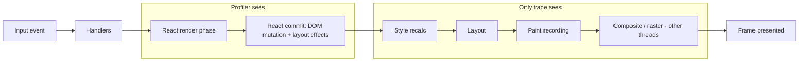
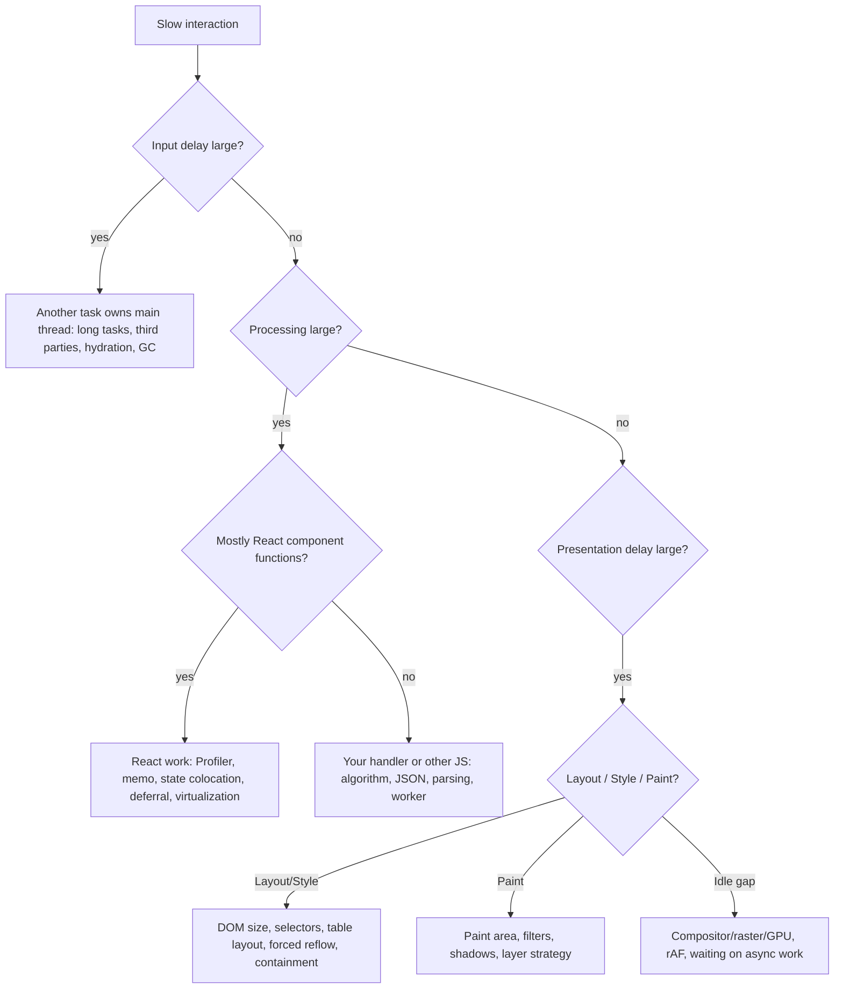

# 07 / 18 — React vs Browser Bottlenecks

## 1. Lesson metadata

| | |
|---|---|
| **Level** | Advanced |
| **Study time** | 4–5 hours (reading 1.5 h, profiling labs 1.5 h, exercises 1.5 h) |
| **Prerequisites** | [Phase 0 — Browser rendering pipeline](../00-web-and-javascript-foundations/03-browser-rendering-pipeline.md), [Phase 0 — Event loop, tasks, microtasks](../00-web-and-javascript-foundations/11-event-loop-tasks-microtasks.md), [Phase 0 — JavaScript performance fundamentals](../00-web-and-javascript-foundations/17-javascript-performance-fundamentals.md), [Phase 2 — Render, reconcile, commit, paint](../02-react-rendering-and-internals/02-render-reconcile-commit-paint.md), [Phase 2 — Browser paint and React updates](../02-react-rendering-and-internals/21-browser-paint-and-react-updates.md), [01 — Measure before optimizing](./01-measure-before-optimizing.md), [02 — Profiler workflows](./02-profiler-workflows.md), [17 — Network waterfalls](./17-network-waterfalls.md) |
| **Next** | [19 — Memory leaks](./19-memory-leaks.md) |
| **Related** | [04 — Memoization trade-offs](./04-memoization-trade-offs.md), [08 — Rendering large collections](./08-rendering-large-collections.md), [09 — Windowing and virtualization](./09-windowing-and-virtualization.md), [Phase 0 — DOM structure and mutation](../00-web-and-javascript-foundations/04-dom-structure-and-mutation.md) |

**Learning objectives.** After this lesson you can:
1. Partition a slow interaction into **network**, **JavaScript in React's render phase**, **JavaScript outside React**, **commit/DOM mutation**, **browser style/layout**, **paint**, **composite/GPU**, and **idle/scheduling delay**, using a trace.
2. Use the Chrome Performance panel and the React Profiler *together* and say which one answers which question.
3. Recognise the signatures of the main non-React bottlenecks: forced synchronous layout (layout thrashing), large DOM, expensive CSS (selectors, filters, shadows, large paint areas), third-party scripts, image decode, and main-thread contention from other tasks.
4. Choose the correct class of fix: reduce React work, reduce DOM size, change CSS/animation properties, move work off the main thread, or fix the network.
5. Avoid "React-only" thinking: do not wrap things in `memo` when the trace shows layout or paint.

**Concepts covered:** interaction timeline anatomy, Performance panel flame chart (Main track, Frames, Timings, Network), Profiler vs trace, scripting/rendering/painting categories, forced reflow, layout thrash, style recalculation scope, paint invalidation and layers, compositor-only properties, DOM size effects, third-party scripts, input delay/processing/presentation delay (INP phases), `performance.measure` and React's user-timing integration (dev).

---

## 2. Deep conceptual explanation

### 2.1 What problem is this lesson solving?

React developers are trained to look at the React DevTools Profiler. It answers one question: *which components rendered, and how long did their render functions take?* It is blind to everything the browser does *around* React: parsing and executing the JS bundle, applying DOM mutations, **recalculating style**, running **layout**, **painting**, and **compositing**. A typical complaint — "typing in the search box is laggy" — might be:

| Actual cause | Profiler shows | Fix class |
|---|---|---|
| 40 ms of rendering a result list | Big commit, `ResultsList` slow | React: structure, memo, deferral, virtualization |
| 3 ms React, 90 ms **layout** after commit due to a 25,000-node DOM | Tiny commit | DOM size: virtualization, `content-visibility`, simpler structure |
| A `scroll` handler reading `offsetHeight` after writing styles in a loop | No React render at all | Browser: batch reads/writes, avoid forced reflow |
| 60 ms analytics script running on `keydown` | Nothing | Third-party: defer, remove, off-main-thread |
| `box-shadow`/`filter: blur()` on a huge element repainting on every frame | Nothing | CSS: reduce paint area, promote to layer wisely, compositor-only animations |

Optimising React in rows 2–5 does nothing. This lesson teaches you to find out *before* you touch code, which is the point of [01 — Measure before optimizing](./01-measure-before-optimizing.md), applied to the question *whose time is it?*

### 2.2 The frame budget, concretely

From [Phase 0 — rendering pipeline](../00-web-and-javascript-foundations/03-browser-rendering-pipeline.md): the browser aims to produce a frame per display refresh (16.7 ms at 60 Hz, 8.3 ms at 120 Hz). Work needed for a visual update:

```
Input event → JS (handlers, React render+commit) → Style → Layout → Paint → Composite → Present
```

The main thread does everything up to and including most of paint recording (in Chromium, rasterisation and compositing proceed on other threads, but the *main-thread portions* are what block input). If the sum of main-thread work between input and the next frame exceeds the budget, the frame is late (jank) or the input has a long delay.

*Teaching model:* "The main thread has a stopwatch. Every millisecond is attributed to one of: Scripting (JS), Rendering (style + layout), Painting, System/other, Idle." The Performance panel's summary pie (Loading, Scripting, Rendering, Painting, System, Idle — names may vary by version) is exactly this attribution.

### 2.3 Where React fits in that pie

React's own work appears **inside "Scripting"**:

- **Render phase:** calling your components, diffing, hooks — pure JS.
- **Commit phase:** applying DOM mutations (`appendChild`, `textContent`, attribute sets) and running layout effects — JS calling DOM APIs. The *cost of the DOM API call itself* is usually small; the **consequence** (style invalidation, layout, paint) is deferred until the browser next needs to produce a frame — or forced earlier if JS *reads* layout-dependent values (`offsetHeight`, `getBoundingClientRect()`, `scrollTop`...).
- **Passive effects:** JS after paint (usually) — can still delay the next frame if heavy.

So a heavy React update may show: a long yellow (Scripting) block (render+commit), then a purple (Rendering: Recalculate Style, Layout) block, then green (Painting). The Profiler explains the yellow block's React-specific part; **only the trace explains the purple and green**.

### 2.4 The INP phases as a diagnostic skeleton

Interaction to Next Paint (INP, see [21 — Web Vitals and budgets](./21-web-vitals-and-budgets.md)) decomposes an interaction's latency into:

1. **Input delay** — time between the user's action and the event handler starting (main thread busy with something else).
2. **Processing time** — event handlers running (including React's synchronous render triggered by a discrete event — see [Phase 2 — Scheduler and priorities](../02-react-rendering-and-internals/13-scheduler-and-priorities.md)).
3. **Presentation delay** — from handlers finishing to the next frame being presented (style, layout, paint, composite, and any remaining tasks).

This is a perfect classification tool for *React vs browser*:
- Big **input delay** → *something else* occupying the main thread: long task from another script, hydration, a previous interaction's tail, GC. Not this interaction's React code. See [20 — Long tasks and the main thread](./20-long-tasks-and-main-thread.md).
- Big **processing time** → your handlers and React render/commit. Profiler territory.
- Big **presentation delay** → layout/paint/compositing, large DOM, expensive CSS, or React work scheduled after the event (e.g. a transition or effect chain still running).

### 2.5 The mental model: cost = (work you do) × (work the browser derives from it)

Changing React state → fewer or more *DOM mutations*. DOM mutations → *style invalidation scope* (how many elements may need recomputation), *layout invalidation scope* (does this change geometry for siblings/ancestors?), *paint invalidation scope* (which pixels change?). A single `className` change at the root of a 20,000-node DOM can trigger style recalculation for every descendant. A single `width` change on an element in normal flow can force layout of its siblings and ancestors. A colour change on a promoted layer might only need compositing.

Therefore the performance of a React update depends on **React's reconciliation work** *and* **the invalidation footprint of the resulting mutations**. Excellent memoisation that still mutates a root class on every keystroke can be expensive; sloppy rendering that produces minimal, local mutations may be cheap.

### 2.6 Misconceptions

| Misconception | Reality |
|---|---|
| "React re-rendering is what makes pages slow." | React render time is often a minority of interaction cost; layout/paint/other scripts frequently dominate. Measure. |
| "The Virtual DOM is faster than the DOM." | React diffs to *avoid unnecessary DOM work*; it does not make DOM operations faster. See [Phase 2 — Virtual DOM](../02-react-rendering-and-internals/04-virtual-dom-what-it-means.md). |
| "DOM writes are slow." | Writes are cheap to *issue*; the cost is realised when the browser recomputes style/layout/paint. Reads that force synchronous layout can be expensive. |
| "If the Profiler is green, the app is fast." | The Profiler doesn't see layout, paint, third-party scripts, or GC pauses. |
| "Animating with CSS is always smooth." | Only for compositor-friendly properties (`transform`, `opacity`) in most cases; animating `width/top/left/box-shadow` can trigger layout/paint per frame. Which properties are compositor-only varies by browser and situation; check in DevTools. |
| "Layers/`will-change` everywhere makes it faster." | Layers cost memory and compositing work; overuse harms. |
| "A big DOM only matters on load." | DOM size multiplies style/layout cost on every invalidation and memory cost permanently. |

---

## 3. Internal mechanics

### 3.1 The Performance panel — what you are looking at

*Teaching model* of the Chrome DevTools Performance panel (UI changes between versions; treat the names below as conceptual):

- **Frames / Screenshots track** — when frames were presented; long frames highlighted.
- **Interactions track** — user interactions (click, key) with duration; hovering shows input delay / processing / presentation delay.
- **Main track** — flame chart of the main thread, from **tasks** (top, with red corner marker for long tasks) down to function calls. Categories are colour-coded: Scripting (yellow), Rendering (purple: *Recalculate Style*, *Layout*), Painting (green: *Paint*, *Pre-paint*, *Layerize*...), System (grey).
- **Timings track** — user timing marks/measures, LCP/FCP markers. In development builds React emits user-timing measures for its scheduler (implementation detail; the "Scheduler" and React tracks that recent Chrome Performance panels can show are tooling-specific, so check your React and DevTools versions).
- **Network track** — the request waterfall aligned with the timeline.
- **Bottom-up / Call tree / Event log** tabs — aggregate time by function or by activity category. **Bottom-up** with grouping by "Activity" or "Domain" is the fastest way to find "who spent time."

The signature of each bottleneck, in the Main track:

| Signature | Interpretation |
|---|---|
| One long yellow block under a click task, containing your component names | React render/commit or your handler; use Profiler for detail |
| Yellow block, then purple *Recalculate Style* / *Layout* block of comparable or larger size | Heavy DOM/CSS effect of the commit |
| Alternating yellow / purple *inside* a single task: `Layout` events nested under JS function frames (with a warning "Forced reflow") | **Layout thrashing** / forced synchronous layout |
| Long task before your handler starts (visible as input delay on the interaction) | Another script owns the main thread |
| Green *Paint* large and repeated each frame during animation/scroll | Paint-heavy style; large invalidation areas |
| Many short tasks each ~1–5 ms in a row | Death by a thousand cuts: scheduling overhead, per-frame polling, `setInterval`s |
| Gaps (idle) with a late presented frame | Compositor/GPU/raster limited, or waiting on something else (network, rAF) |

### 3.2 Forced synchronous layout (layout thrashing)

*Public documented behavior:* Reading certain properties (e.g. `offsetWidth/Height`, `clientHeight`, `scrollTop`, `getBoundingClientRect()`, `getComputedStyle(...).someLayoutDependentProp`) requires up-to-date layout. If styles or the DOM have been modified since the last layout, the browser must run style recalculation and layout **synchronously** at the point of the read. A loop that alternates write → read → write → read forces layout each iteration.

```ts
// Layout thrash: N forced layouts
for (const el of items) {
  el.style.width = `${container.offsetWidth / 2}px`; // read (forces layout if dirty) then write (dirties)
}
```

Fix: read everything first, then write everything.

```ts
const w = container.offsetWidth;            // one read
for (const el of items) el.style.width = `${w / 2}px`; // writes batched; one layout later
```

In React, this commonly appears in:
- `useLayoutEffect` that measures (`getBoundingClientRect`) in *each* of many list items → N forced layouts in one commit ([Phase 3 — useLayoutEffect](../03-react-state-and-hooks/08-uselayouteffect.md)).
- Tooltip/popover libraries measuring on every render.
- Virtualisation/resizing code that reads `scrollHeight` after setting state.

Mitigation: measure many things with **one** read pass (read all rects in a single loop before any write), use `ResizeObserver`/`IntersectionObserver` (which deliver measurements as part of the rendering pipeline, without forcing layout at arbitrary points), or avoid measurement via CSS.

### 3.3 Style recalculation and layout cost drivers

*Teaching model; browsers differ and optimise heavily; treat as heuristics:*
- **Style recalculation** cost grows with the number of elements whose styles *may* be affected by a change (selectors that depend on ancestors/siblings, `:has()`, deep descendant selectors, attribute selectors on huge trees) and with the complexity of matching. Modern engines optimise invalidation; avoid folklore like "never use descendant selectors"; **measure** with the "Selector Stats" feature (a DevTools Performance setting in Chromium; availability depends on your version).
- **Layout** cost grows with the size of the *layout subtree* affected. Layout containment (`contain: layout`/`content`) and `content-visibility: auto` let the browser skip work for offscreen subtrees (documented in MDN/CSS Containment specs; support varies by browser/version — check compatibility tables).
- **Paint** cost grows with paint area and per-pixel complexity (`filter`, large `box-shadow`, `backdrop-filter`, big gradients, blend modes).
- **Compositing** is cheap for `transform`/`opacity` changes on promoted layers; layer count and layer sizes cost GPU memory.

### 3.4 Large DOM

The DOM tree size affects: memory footprint, initial style/layout cost, cost of every invalidation (scope), `querySelectorAll` time, accessibility tree size, and React's **commit** (more nodes created/removed). Lighthouse historically flags "excessive DOM size" at thresholds around ~1,400 nodes warning / ~800 target depending on version (these numbers have changed across Lighthouse versions, so treat them as soft). The practical test: does the *browser-side* time of an interaction scale with node count? If a trace shows *Layout* of 40 ms on a 20,000-node DOM and 4 ms at 2,000, you have your answer, and the fix is [09 — Windowing and virtualization](./09-windowing-and-virtualization.md) or `content-visibility`, not memo.

### 3.5 Third-party and other main-thread tenants

Analytics tags, A/B testing frameworks, chat widgets, ad scripts, and consent managers run on the **same main thread** as React (unless isolated in iframes of other origins or off-main-thread solutions). Signatures: long tasks attributed (in the trace's Bottom-up with "Group by domain/third party") to other origins; input delay on interactions regardless of which React component is involved. Fixes: remove; load after interaction/idle; `async`/`defer`; use facades for heavy widgets; run in a worker where supported; isolate in an iframe. Solutions like Partytown are third-party tools with trade-offs; evaluate maturity before adopting.

### 3.6 React's DevTools Profiler versus the Performance panel

| Question | Tool |
|---|---|
| Which components rendered and why? | React Profiler (record with "Record why each component rendered" if enabled) |
| How long did each component's render take (relative)? | React Profiler (dev build: inflated; use production profiling build for realism) |
| Did layout/paint dominate? | Performance panel |
| Was the main thread busy before my handler? | Performance panel (Interactions → input delay; long tasks) |
| What did the *browser* spend on style/layout after commit? | Performance panel |
| Which function (any JS) is hot? | Performance panel Bottom-up / Call tree |
| Which commit corresponds to which interaction? | Both: align timestamps; in the trace, look for React's markers in dev/profiling builds |

Profiling builds: React provides a profiling build (`react-dom/profiling`) for production-like profiling with the Profiler enabled; bundler aliasing is required — see [02 — Profiler workflows](./02-profiler-workflows.md) and the React docs.

---

## 4. Step-by-step execution walkthrough

Scenario: a data table with 3,000 rows. User types in a filter input. The table shows rows matching; each row has 8 cells (≈ 27,000 DOM nodes at most). The component is `memo`'d correctly; the filter result is derived with `useMemo`.

**Chronology of one keystroke (what the trace shows).**

1. **t=0** `keydown`/`keypress`/`input` events dispatched. If the main thread is idle, **input delay ≈ 0–2 ms**.
2. **t≈1** React's `onChange` handler runs: `setQuery(value)`. For a discrete event (typing), React renders **synchronously at the end of the event** (urgent update) — see [Phase 2 — Scheduler and priorities](../02-react-rendering-and-internals/13-scheduler-and-priorities.md).
3. **t≈2–12** *Render phase*: `App` renders; `useMemo` recomputes the filtered array (3,000 items × predicate: ~2 ms); `Table` renders with new `rows` prop; 3,000 `Row`s are *created as elements*; keys unchanged for survivors; `memo` skips rows whose props are unchanged (say 2,200 skip, 800 removed). ≈ 10 ms JS. **Profiler shows**: moderate, mostly in `Table`.
4. **t≈12–20** *Commit*: React removes 800 rows (≈ 6,400 cells + wrappers) from the DOM. `removeChild` calls: ~8 ms of JS, mostly DOM API call overhead.
5. **t≈20–28** The task ends. Browser reaches **rendering opportunity**. Style invalidation: 6,400 nodes removed → siblings' positions/`:nth-child` styles may need recomputation.
6. **t≈28–78** **Layout**: removing rows moves everything below; the table uses `table-layout: auto`, so column widths depend on content → the browser re-lays out the *entire* table. **50 ms.** This is the invisible cost — the Profiler shows nothing about it.
7. **t≈78–90** Paint (≈ 12 ms), then rasterise/composite off-thread; frame presented at ≈ 95 ms.
8. **INP-style breakdown:** input delay 1 ms, processing 28 ms (handler + render + commit), presentation delay ≈ 67 ms → ≈ 96 ms total. **Over 70% of the time is browser work after React finishes.**

**Predict:** you "optimise" React by splitting `Table` into smaller memoised pieces, saving 5 ms of render time. What happens to total latency? *(≈ 91 ms. The 50 ms layout is unchanged because the DOM and layout mode are unchanged.)*

**What actually helps here:** `table-layout: fixed` (documented CSS: avoids content-dependent column sizing so layout can be much cheaper); virtualise rows so the DOM contains ~40 rows, not 3,000 ([09](./09-windowing-and-virtualization.md)); `content-visibility: auto` on row groups with explicit `contain-intrinsic-size`; `div`+CSS grid instead of `<table>` for some designs (with accessibility semantics preserved via ARIA roles — see [Phase 9 — Accessibility and SEO](../09-advanced-rendering-and-ecosystem/14-accessibility-and-seo.md)).

---

## 5. Code examples

### 5.1 Minimal example — attribute time with `performance.mark/measure` and a rAF double-tick

React doesn't tell you when the browser has *painted*. A common approximation of "time until next paint" is `requestAnimationFrame` followed by a `setTimeout`/`MessageChannel` callback:

```ts
export function measureInteractionToPaint(label: string, action: () => void): void {
  const start = performance.now();
  action(); // e.g. synchronously triggers a state update via flushSync (for demo only) or a click
  requestAnimationFrame(() => {
    // Runs before the next paint: style/layout of this frame happen AFTER this callback.
    const channel = new MessageChannel();
    channel.port1.onmessage = () => {
      // Runs after the next frame's rendering work has been scheduled/completed (heuristic).
      const total = performance.now() - start;
      performance.measure(label, { start, end: start + total });
      console.log(label, total.toFixed(1), "ms (approx. to next paint)");
    };
    channel.port2.postMessage(undefined);
  });
}
```

Notes:
- **This is a heuristic.** The ordering of rAF callbacks, rendering, and subsequent tasks is defined in the HTML event loop processing model; a message task *typically* runs after the frame's rendering step but this is not an observable guarantee across browsers. For real measurement use the **Event Timing API** (`PerformanceObserver` with `type: "event"`, `durationThreshold`) — it gives `processingStart/End`, `startTime`, `duration` (to next paint, rounded to 8 ms).
- `performance.measure` with `{ start, end }` shows labelled spans in the Timings track.

### 5.2 Practical example — Event Timing observer to classify interactions in the field

```ts
// TypeScript 5.9's lib.dom lacks `interactionId` and `durationThreshold` (checked with tsc 2026-10-22),
// so declare the bits we use locally.
type EventTimingEntry = PerformanceEventTiming & { interactionId?: number };

type Slow = {
  name: string;
  inputDelay: number;
  processing: number;
  presentation: number;
  total: number;
  target: string;
};

export function observeSlowInteractions(report: (s: Slow) => void, threshold = 100): void {
  if (!("PerformanceEventTiming" in window)) return; // feature-detect
  const po = new PerformanceObserver((list) => {
    for (const e of list.getEntries() as EventTimingEntry[]) {
      if (e.interactionId === undefined || e.interactionId === 0) continue; // only discrete interactions
      const inputDelay = e.processingStart - e.startTime;
      const processing = e.processingEnd - e.processingStart;
      const presentation = e.startTime + e.duration - e.processingEnd;
      report({
        name: e.name,
        inputDelay,
        processing,
        presentation,
        total: e.duration,
        target: (e.target as Element | null)?.tagName.toLowerCase() ?? "unknown",
      });
    }
  });
  // durationThreshold: default 104 ms, rounded to 8 ms, minimum 16 ms (MDN); type is "event".
  po.observe({ type: "event", durationThreshold: threshold, buffered: true } as PerformanceObserverInit);
}
```

Line notes:
- `interactionId` is on `PerformanceEventTiming` in Chrome 96+, Firefox 144+ and Safari 26.2+ (MDN compat data, 2026-10-22; MDN marks it Baseline 2025, newly available), so older browsers still need the guard and the `undefined` check. TypeScript 5.9's `lib.dom` does not declare `interactionId` or `durationThreshold`, which is why the snippet declares `EventTimingEntry` and casts the observe options.
- `duration` is rounded (to 8 ms) for privacy/perf reasons; thresholds below ~16 ms aren't meaningful.
- `presentation = startTime + duration - processingEnd` is the delay from handler end to next paint — the **browser-side** portion. If this dominates, React optimisation isn't your lever.
- The `web-vitals` library implements INP computation for you; prefer it for production reporting ([21](./21-web-vitals-and-budgets.md)).

### 5.3 Incorrect example — "optimising React" for a layout problem

```tsx
// Symptoms: accordion list of 400 items. Opening one item janks (~150 ms).
// Dev adds memo/useCallback everywhere; Profiler says React took 6 ms. Jank persists.
const Item = memo(function Item({ item, open, onToggle }: ItemProps) {
  const ref = useRef<HTMLDivElement>(null);
  useLayoutEffect(() => {
    // Measure to animate height — for EVERY item on EVERY commit, no deps array
    const h = ref.current!.getBoundingClientRect().height;
    ref.current!.style.setProperty("--h", `${h}px`);
  });
  return (
    <div ref={ref} className={open ? "item open" : "item"}>
      <button onClick={() => onToggle(item.id)}>{item.title}</button>
      {open && <Details item={item} />}
    </div>
  );
});
```

**Predict** the trace. Opening one item re-renders only that `Item` (others skip via `memo`), **but** the layout effect has no dependency array: for the changed item it runs once, which is fine — however `onToggle` comes from the parent whose `open` state map changes; if `Item`s receive an `openMap` or an unstable callback they all re-render, each reading `getBoundingClientRect()` after the previous item wrote `--h` → **400 forced layouts** in a single commit. Even with `memo` working, one forced layout of a long list is costly; with the bug, a purple Layout bar appears *400 times* nested under `useLayoutEffect` frames with a "Forced reflow" annotation.

### 5.4 Corrected implementation

Remove measurement entirely when CSS can do it, or observe instead of forcing:

```tsx
// Option 1: pure CSS height animation using grid rows (documented technique; animating grid-template-rows
// is supported in Chrome 107+, Firefox 66+, Safari 16+ per MDN compat data)
// .item .body-wrap { display: grid; grid-template-rows: 0fr; transition: grid-template-rows .2s; }
// .item.open .body-wrap { grid-template-rows: 1fr; }
// .body-wrap > .body { overflow: hidden; }

const Item = memo(function Item({ item, open, onToggle }: ItemProps) {
  return (
    <div className={open ? "item open" : "item"}>
      <button aria-expanded={open} onClick={() => onToggle(item.id)}>{item.title}</button>
      <div className="body-wrap">
        <div className="body">{open ? <Details item={item} /> : null}</div>
      </div>
    </div>
  );
});
```

If you truly must measure, measure in one pass with a `ResizeObserver` and avoid reading layout in each item's commit:

```tsx
function useElementHeight<T extends HTMLElement>() {
  const ref = useRef<T>(null);
  const [h, setH] = useState(0);
  useEffect(() => {
    const el = ref.current;
    if (!el) return;
    const ro = new ResizeObserver(([entry]) => setH(entry.contentRect.height));
    ro.observe(el);
    return () => ro.disconnect();
  }, []);
  return [ref, h] as const;
}
```

Trade-offs: `ResizeObserver` results arrive after layout, so state updates cause another render pass (acceptable for non-critical visuals; if a visual flash is unacceptable, measure with `useLayoutEffect` *once*, not per item per commit).

### 5.5 Advanced example — batching reads/writes across many components

When many components must measure, aggregate:

```ts
type Job = { el: Element; apply: (rect: DOMRectReadOnly) => void };
const queue: Job[] = [];
let scheduled = false;

export function measureLater(el: Element, apply: (rect: DOMRectReadOnly) => void) {
  queue.push({ el, apply });
  if (scheduled) return;
  scheduled = true;
  requestAnimationFrame(() => {
    scheduled = false;
    const jobs = queue.splice(0);
    const rects = jobs.map((j) => j.el.getBoundingClientRect()); // ALL reads first (one layout)
    jobs.forEach((j, i) => j.apply(rects[i]));                     // THEN writes
  });
}
```

Line notes: reads happen before any write inside the rAF callback, so at most one forced layout occurs (if the DOM was dirty). `apply` must only *write* (set styles/state). If `apply` calls `setState`, React will schedule a render; do not read layout again in the same callback after React has flushed synchronously (e.g. via `flushSync`).

### 5.6 Compositor-friendly animation

```css
/* Animates layout properties: triggers layout + paint every frame */
.panel { transition: left .25s; }
.panel.open { left: 0; }

/* Preferable: transform animates on the compositor in most engines */
.panel { transform: translateX(-100%); transition: transform .25s; will-change: transform; }
.panel.open { transform: translateX(0); }
```

Notes: `will-change` should be applied to elements about to animate and removed afterwards in long-lived pages; permanent `will-change` on many elements consumes memory (MDN advises using it sparingly). Respect `prefers-reduced-motion`. Whether a given property is compositor-only is browser- and situation-specific (e.g. depends on whether the element is already on its own layer); verify in DevTools' "Layers"/Rendering tools.

---

## 6. Visual explanations

### The pipeline with React's footprint



### Triage: whose time is it?



### Forced reflow pattern in a flame chart (conceptual)

```
Task (click) ─────────────────────────────────────────────────────────────────┐
  Event: click                                                                │
    React commit                                                              │
      useLayoutEffect (Item 1)  ─ getBoundingClientRect ─ [Layout 4 ms]       │
      useLayoutEffect (Item 2)  ─ getBoundingClientRect ─ [Layout 4 ms]       │
      … ×400                                                                  │
```
Layout blocks *nested inside* JS frames (rather than after the task) are the tell.

---

## 7. Alternative approaches and trade-offs

| Bottleneck | Approach | Pros | Cons | Use when |
|---|---|---|---|---|
| React render too heavy | Memo/colocation/deferral | Targets root | Complexity; no help for browser cost | Profiler shows large render |
| Too many DOM nodes | Virtualise | Large wins | Find-in-page, a11y, anchor links, dynamic heights complexity | Lists/tables > ~hundreds of heavy rows |
| Too many DOM nodes (alt.) | `content-visibility: auto` | Minimal code; keeps DOM searchable | Support/behavior details; scroll jumps if intrinsic size is wrong | Long static documents/feeds |
| Layout cost on tables | `table-layout: fixed` | Cheap | Requires explicit widths | Known column widths |
| Layout thrash | Batch reads/writes; observers | Predictable | Refactoring | Measurement-heavy UI |
| Animation jank | Compositor-only props | GPU-friendly | Design constraints | Motion UI |
| Third-party cost | Defer/remove/iframe | Large | Business tradeoffs | Trace shows third-party tasks |
| Heavy pure JS | Web Worker | Frees main thread | Serialization, tooling, no DOM access | CPU-bound transforms |
| Large paint areas | Reduce effect, isolate layers | Cheap | Layer memory cost | Paint-bound scroll/animation |

**Scenario where React-level optimisation *is* the right first move even though layout is visible:** a commit that mounts and unmounts thousands of nodes on every keystroke because of unstable keys (`key={Math.random()}`) — the layout cost *is a consequence of React's reconciliation decision*. Fix the key, and layout shrinks too. Always ask whether the browser cost is caused by React's *choice of mutations*.

---

## 8. Best practices and anti-patterns

**Beginner mistakes**
- Using only the React Profiler.
- Profiling a development build with StrictMode and React DevTools open (double render, instrumentation overhead) and treating the numbers as truth. Dev numbers are for *relative* comparison and finding wasted renders.
- Reading layout in effects without understanding forced reflow.

**Experienced-developer mistakes**
- Treating layers (`will-change: transform` everywhere) as a free speed-up.
- Fixing the symptom in React (debounce) while the root cause is DOM size.
- Not controlling the profiling environment: unthrottled CPU, extensions installed, other tabs open. Use an incognito window with extensions disabled and CPU throttling.
- Trusting synthetic traces from a fast laptop for a target audience on mid-range Android.

**Smells**
- `getBoundingClientRect`/`offsetHeight` inside loops or in effects without deps.
- CSS transitions on `width/height/top/left/margin` for large elements.
- `position: sticky`/`fixed` large elements with heavy `backdrop-filter`.
- Thousands of DOM nodes mounted but invisible (`display: none` still costs memory; `visibility: hidden` still costs layout).
- Huge inline SVGs per list row.

**Justified exceptions**
- Forced layout can be acceptable *once* (e.g. measuring a popover before positioning) where correctness requires it; optimise only when repeated.
- `will-change` justified for an element about to animate, removed after.

---

## 9. Real-world application

**Trading dashboard (realtime grid).** Price ticks update hundreds of cells per second. React can handle updating, but the browser must lay out and paint changing text. Constraints: flashing cell backgrounds via CSS animations on `background-color` triggers paint; use `opacity`/`transform` overlays or restrict update frequency by batching ticks to animation frames (`requestAnimationFrame`) and updating only visible rows (virtualised). Use fixed column widths and `contain: strict`/`content` on rows (verify layout side effects: `contain: size` requires explicit sizes).

**E-commerce category page.** 60 product cards with images. Bottlenecks are rarely React: image decode (large JPEGs resized by CSS), layout shifts from unsized images (CLS), and third-party tags. Use correct `width/height`, `srcset`, `decoding="async"`, and `loading="lazy"` for below-the-fold images (not for the LCP image — see [17](./17-network-waterfalls.md)).

**Document editor.** Large content trees; selection and layout measurement per keystroke. The editor framework's own virtualisation and measurement scheduling dominate; React only hosts it. Choose battle-tested editor engines instead of measuring in components.

**Forms.** A 200-field form with `watch()`-all validation can re-render every field per keystroke (React problem) — but a single `box-shadow: inset` transition on focus for all inputs is a paint problem. Triage first.

**Multi-team product with third-party tag manager.** The marketing team's tag manager adds 400 ms of long tasks on every route change. React teams optimise their code and see no change. The remedy is organisational: a third-party budget and an owner ([21](./21-web-vitals-and-budgets.md)).

---

## 10. Debugging and troubleshooting

**Methodology: the three-recordings procedure**
1. **Performance panel recording** of the interaction on a production build, CPU throttled (e.g. 4× or 6×), cache enabled for the warm case. Zoom to the interaction. Read the **Interactions** track: input delay / processing / presentation. This decides which branch of the triage diagram you're on.
2. **If processing dominates:** record with the **React Profiler** (profiling build or dev build, with "Record why each component rendered") on the same action. Find the commits and expensive components. Go back to [02](./02-profiler-workflows.md) and [03](./03-why-components-rerender.md).
3. **If presentation dominates:** return to the trace; expand *Recalculate Style*/*Layout*/*Paint* events (hover shows the number of affected elements, e.g. "Recalculate Style: 14,000 elements affected", and "Layout root" information); use the **Rendering** drawer (paint flashing, layout shift regions, layer borders) to see what repaints; enable "Layers" views as needed.
4. **If input delay dominates:** find the long task preceding the interaction in the Main track; attribute using Bottom-up grouped by domain/URL.

**Concrete checks**
- *Forced reflow:* Performance panel flags "Forced reflow" in the event details (look for a warning marker on Layout events whose parent is JS). Click it to find the source line.
- *Layout cost vs DOM size:* in the Console, `document.querySelectorAll("*").length` for a node count; compare layout time at different counts (e.g. by changing page size).
- *Paint cost:* Rendering → Paint flashing; observe whether big areas flash on each keystroke.
- *Third-party:* Bottom-up → group by Domain; or Lighthouse "Reduce the impact of third-party code".
- *GC pauses:* "Memory" checkbox in Performance; a sawtooth with major GCs aligned with jank — see [19 — Memory leaks](./19-memory-leaks.md).

**Validate the fix.** Repeat the same recording five times before and after (same throttling, same data); compare median total interaction time *and* the specific phase you targeted. A fix that moves time from Layout to Scripting without reducing total hasn't helped.

**Common pitfalls in the method**
- Profiling with DevTools open as a dock-to-bottom panel which resizes the viewport and changes layout. Use a separate window or consistent docking.
- Forgetting that dev-mode React is substantially slower than production; never extrapolate absolute numbers.
- Chrome's CPU throttling slows main-thread JS but not network or GPU; combine with network throttling for a realistic profile.

---

## 11. Exercises

### Level A — Knowledge
A1. What three phases does an INP interaction decompose into, and which kinds of cause map to each?
A2. Name three DOM properties/methods whose *read* can force synchronous layout.
A3. Which part of a React update does the React Profiler not measure?
A4. Why is `transform` generally preferred over `left` for animation?
A5. What is the difference between `visibility: hidden`, `display: none`, and `content-visibility: auto` with respect to layout work? (State in terms of the box tree and layout.)

### Level B — Code comprehension
B1. How many forced layouts does each snippet cause (assume the DOM is dirty before the loop; `els` has 100 elements)?
```ts
// (a)
for (const el of els) { el.style.height = el.scrollHeight + "px"; }
// (b)
const hs = els.map((el) => el.scrollHeight);
els.forEach((el, i) => { el.style.height = hs[i] + "px"; });
// (c)
for (const el of els) { el.style.height = "auto"; }
const h = els[0].scrollHeight;
```
B2. A trace for a click shows: Event click 4 ms, React render 6 ms, commit 3 ms, Recalculate Style 35 ms (28,000 elements affected), Layout 12 ms, Paint 8 ms. Where would you look first and what would you try?
B3. Explain why this code can produce layout thrash even though it only calls `getBoundingClientRect` once per item.
```tsx
function Items({ items }: { items: Item[] }) {
  return items.map((i) => <Row key={i.id} item={i} />);
}
function Row({ item }: { item: Item }) {
  const ref = useRef<HTMLDivElement>(null);
  const [w, setW] = useState(0);
  useLayoutEffect(() => { setW(ref.current!.getBoundingClientRect().width); });
  return <div ref={ref} style={{ width: w || undefined }}>{item.name}</div>;
}
```

### Level C — Implementation
C1. Write a hook `useRafBatchedMeasure` that lets many components request a rect measurement and receive results after one read pass per frame.
C2. Convert an accordion from animating `height` via JS measurement to a CSS-only approach, preserving accessibility (`aria-expanded`, `hidden` semantics for collapsed content).
C3. Write a `PerformanceObserver` for `longtask` entries (where supported) that reports duration and attribution containers, and explain what it cannot tell you.

### Level D — Debugging
D1. After adding `memo` everywhere, a list's scroll still janks. The Performance panel shows green Paint blocks of ~14 ms every frame during scroll. List three candidate causes and how to test each in DevTools.
D2. A chat app has input delay of 200–400 ms on key presses when a particular sidebar is open. React Profiler shows nothing on keypress. How do you find the cause?
D3. A tooltip library causes "Forced reflow" warnings in every commit of a 500-row table. How do you confirm it's the library and mitigate without removing it?

### Level E — Architecture and engineering decisions
E1. You must show 10,000-row tables with variable-height rows, row selection, find-in-page, and accessibility. Compare virtualisation, pagination, `content-visibility`, and server-side filtering. Make a recommendation for an internal analytics tool vs a public documentation site.
E2. Design an organisation-level policy for third-party scripts that balances marketing needs and main-thread budgets.

### Level F — Expert challenge
F1. Build an experiment harness to determine, for your app, the marginal cost per 1,000 DOM nodes for style, layout and paint during a representative update. Describe the method, controls, statistics, and how you'd use the result to set a DOM-size budget.

---

## 12. Detailed answers and explanations

> Attempt the exercises first.

**A1.** Input delay (main thread busy before handlers: other tasks, third parties, previous work), processing time (handlers, synchronous React render and commit), presentation delay (style/layout/paint/composite and any remaining work until next frame). Common confusion: counting React's *deferred* background renders as processing — transition renders run after the event task and can *also* show up in presentation delay if they delay the next frame, but they're yielding by design.

**A2.** Any of `offsetWidth/offsetHeight/offsetTop/offsetLeft`, `clientWidth/clientHeight`, `scrollWidth/scrollHeight/scrollTop`, `getBoundingClientRect()`, `getClientRects()`, `getComputedStyle(el).width/height` (resolved layout values), `innerText` (depends on layout), `focus()` (may force layout). Accept any three correct ones.

**A3.** Style recalculation, layout, paint, compositing, raster, GPU work; also other JS (third-party scripts, non-React handlers), network time, and GC pauses (the Profiler only measures component render durations and commit metadata).

**A4.** `transform` (and `opacity`) changes can often be handled by the compositor without re-running layout or paint, so they avoid main-thread work per frame; `left/top/width/height/margin` change geometry and force layout (and usually paint) each frame. Caveat: browser/situation-specific; verify with DevTools.

**A5.** `display: none` removes the element from the box tree: no layout or paint (but style computation and DOM memory remain; toggling to visible triggers layout). `visibility: hidden` keeps the box: it takes part in layout (occupies space) and costs layout, but is not painted. `content-visibility: auto` keeps the element in the tree but lets the browser skip rendering (layout/paint) of its contents while off-screen, using `contain-intrinsic-size` as a placeholder size.

**B1.** (a) up to **100 forced layouts**: each iteration reads `scrollHeight` (forces layout if dirty) then writes `height` (dirties again). (b) **At most 1**: all reads first; writes batched; layout recalculated later in the frame. (c) **1**: 100 writes then one read — one forced layout at the read. Wrong answers: thinking (b) and (c) are as bad as (a); the problem is *interleaving*, not the number of reads.

**B2.** The browser-side **Recalculate Style at 35 ms** with 28,000 affected elements is the biggest item; React totals only 13 ms. Look at *what class/attribute/CSS variable change* caused style invalidation across so many elements (e.g. toggling a class on `<body>` or `:root`, a CSS variable updated on a high ancestor, global `:has()` selectors). Try: scope the change to a lower subtree, avoid updating inherited custom properties at the root, simplify selectors, reduce DOM size/virtualise, use `contain: style`/`content-visibility` where applicable. Expected result: style time drops proportionally to affected element count. Accept alternative well-reasoned hypotheses with tests.

**B3.** The `useLayoutEffect` has no dependency array, so it runs after every commit of every `Row`. It calls `getBoundingClientRect` (forced layout if dirty) and then `setW`, which schedules another synchronous re-render (layout effect state updates are flushed synchronously before paint). That commit repeats: each row's effect reads after earlier rows' writes (their `style.width` change) → N forced layouts per commit; if `w` changes, a second pass repeats. Fix: dependency array, measure once, or use CSS/`ResizeObserver`.

**C1.** Evaluation criteria: a module-level queue (as in 5.5) with a single rAF; `useLayoutEffect`/`useEffect` registers measurement and cleans up (removes from the queue on unmount); results delivered through state or a ref; no reads after writes in the same flush; handles unmounted components; has a test with a mocked `getBoundingClientRect` counting calls.

**C2.** Use the grid-rows technique (5.4) or `<details>`/`<summary>` semantic disclosure; use `aria-expanded` on the button and `aria-controls`; for collapsed content, either `hidden`/`inert` (so it's not focusable) after the transition or keep in tab order only when open. Edge: animating from `display: none` isn't possible without `transition-behavior: allow-discrete` (supported in Chrome 117+, Firefox 129+, Safari 17.4+ per MDN compat data). Respect `prefers-reduced-motion`.

**C3.**
```ts
if ("PerformanceObserver" in window && PerformanceObserver.supportedEntryTypes.includes("longtask")) {
  new PerformanceObserver((list) => {
    for (const e of list.getEntries()) {
      const attr = (e as PerformanceEntry & { attribution?: { containerType: string; containerSrc: string }[] }).attribution;
      console.log("longtask", e.duration.toFixed(0), "ms", attr?.map((a) => a.containerSrc || a.containerType));
    }
  }).observe({ type: "longtask", buffered: true });
}
```
It cannot tell *which function* ran (attribution is coarse: it mostly identifies the container/frame), nor what the user was doing, nor tasks under 50 ms. It is a Chromium-originated API (MDN compat: Chrome/Edge only); the Long Animation Frames API (also Chromium-only per MDN compat data, 2026-10-22: Chrome 123+, no Firefox/Safari) offers richer script attribution. Use traces for root cause.

**D1.** (a) Large paint area due to expensive effects: `box-shadow`/`filter`/`backdrop-filter` on many rows — test by disabling the style in DevTools and watching paint time; (b) a `position: fixed/sticky` overlay with `backdrop-filter` forcing repaint beneath on scroll — toggle it off; (c) scroll handlers (not passive) or JS-driven scroll effects that modify styles each frame — look at the scripting portion and "Event: scroll" handlers; (d) images decoding during scroll — check "Image Decode" tasks and use `decoding="async"` with right-sized images; (e) layer explosion. Candidates plus a DevTools test each.

**D2.** Input delay with no React work → another task. Record the performance trace while typing; find long tasks occurring when keys are pressed; use Bottom-up to group by file/domain; common culprits: a polling timer that parses large JSON, a MutationObserver that does heavy work on every DOM change, a third-party widget in that sidebar, a ResizeObserver loop, a synchronous layout from an unrelated component. Validate by disabling the sidebar.

**D3.** Click the Forced reflow warnings; the bottom-up/Call tree shows the library function calling `getBoundingClientRect` per row. Confirm with a minimal repro: render 500 rows with and without the tooltip wrapper. Mitigation: only mount tooltip logic on hover/focus (lazy tooltip), delegate to a single tooltip instance for the table, or configure the library to measure on open. If you cannot change it, wrap its mount behind interaction.

**E1.** Criteria: states requirements impact — find-in-page (virtualisation breaks it; `content-visibility` and pagination preserve it), a11y (virtualised grids need ARIA grid/row counts and focus management), variable heights (virtualisation needs measurement or estimates; `content-visibility` needs `contain-intrinsic-size`), selection across pages. Recommendation: internal analytics tool → virtualise with a proven library, ARIA grid semantics and server-side filtering to cap result sets; public documentation → `content-visibility: auto` or pagination to retain native find and SEO. The key insight is that the "best" depends on whether browser-native features (find, anchors, SEO) matter more than raw render cost.

**E2.** Criteria: inventory with owner and business justification; performance budget per script (e.g. maximum main-thread time/transfer size); load strategy (consent-gated, `async`/`defer`, after-interaction); review process; automatic monitoring (RUM attributing long tasks to scripts); removal/SLA for violations; use tag manager governance; legal considerations. A well-reasoned answer uses data (before/after INP and long task time) to negotiate trade-offs.

**F1.** Criteria: controlled synthetic harness (headless Chromium via Playwright/Puppeteer with tracing, fixed CPU throttling, fixed viewport), vary only node count (e.g. 1k–32k via identical row templates), perform an identical update (class toggle, row insert), collect trace events for UpdateLayoutTree/Layout/Paint durations (via the Chrome tracing categories — verify event names against your Chromium version), repeat ≥ 20 times, report medians and spread (IQR), fit a line to ms vs nodes and report the slope and any knee points. Use the slope to set a DOM-size budget where predicted interaction cost stays within the INP target on the target device class. Caveats: synthetic uniform nodes ≠ real pages; device variance; browser variance; repeat on real pages.

---

## 13. Senior engineer interview questions

**Q1. "Interaction is slow. Profiler shows 8 ms of React. What next?"**
Look at the trace: if the interaction's total is large, the time is outside React — input delay (other tasks), style/layout/paint (DOM size, CSS), third-party scripts, forced reflow. Use the Interactions track to see phases and the Main track to find who owns the time. Only then pick a fix class.

**Q2. "What is layout thrashing and how would React code cause it?"**
Interleaving layout reads and writes so the browser must recompute layout repeatedly. In React: `useLayoutEffect` or ref callbacks measuring in many components during one commit after earlier components wrote styles; measuring in render; libraries calling `getBoundingClientRect` per item. Fix by batching reads then writes, observers, or CSS.

**Q3. "Why can virtualisation fix problems that `memo` cannot?"**
`memo` only skips render work; the DOM still contains all nodes, so style/layout/paint/memory costs remain proportional to node count. Virtualisation reduces the number of nodes, shrinking all browser-side costs.

**Q4. "How do you decide between `content-visibility: auto` and virtualisation?"**
`content-visibility` is cheap and preserves native find/anchors/SEO, but the DOM and its memory still exist, and it only skips rendering of offscreen subtrees; virtualisation reduces DOM and memory but breaks native behaviors and needs more code/a11y work. Choose by DOM size, need for native features, row-height predictability, and audience devices.

**Q5. "Why is CPU throttling in DevTools only an approximation?"**
It scales main-thread work by a factor; it doesn't emulate memory pressure, thermal throttling, GPU limits, cache sizes, or different CPU microarchitecture. Use it for relative comparisons; confirm on real devices and in the field.

**Q6. "How do you attribute interaction latency in production?"**
Event Timing (via `web-vitals` attribution build) to capture input delay / processing / presentation delay and target selectors; Long Animation Frames (where supported) for script attribution; correlate with route and device class. Use lab traces for root cause once the field data points to a target.

---

## 14. Further learning resources

| Resource | URL | Covers / why | Level | Section to study |
|---|---|---|---|---|
| Chrome DevTools — Performance panel | <https://developer.chrome.com/docs/devtools/performance> | Recording, Interactions track, flame chart | Intermediate | Analyze runtime performance |
| web.dev — Optimize INP | <https://web.dev/articles/optimize-inp> | Input delay/processing/presentation | Intermediate | Phases and fixes |
| web.dev — Avoid large, complex layouts and layout thrashing | <https://web.dev/articles/avoid-large-complex-layouts-and-layout-thrashing> | Forced reflow patterns | Intermediate | Whole article |
| MDN — CSS `content-visibility` | <https://developer.mozilla.org/en-US/docs/Web/CSS/content-visibility> | Skipping offscreen rendering | Intermediate | Syntax, compat |
| MDN — CSS containment | <https://developer.mozilla.org/en-US/docs/Web/CSS/CSS_containment> | `contain` property family | Advanced | Introduction |
| MDN — `will-change` | <https://developer.mozilla.org/en-US/docs/Web/CSS/will-change> | Proper use and warnings | Intermediate | Usage notes |
| MDN — Event Timing API | <https://developer.mozilla.org/en-US/docs/Web/API/PerformanceEventTiming> | Fields used in 5.2 | Advanced | Properties |
| MDN — `ResizeObserver` | <https://developer.mozilla.org/en-US/docs/Web/API/ResizeObserver> | Measurement without forced layout | Intermediate | Usage |
| React docs — `Profiler` component | <https://react.dev/reference/react/Profiler> | Programmatic render timings | Intermediate | Usage |
| React docs — `useLayoutEffect` | <https://react.dev/reference/react/useLayoutEffect> | When layout measurement is safe/necessary | Intermediate | Caveats |
| GoogleChrome/web-vitals | <https://github.com/GoogleChrome/web-vitals> | Field measurement incl. attribution build | Intermediate | README: attribution |
| Paul Irish — "What forces layout/reflow" gist | <https://gist.github.com/paulirish/5d52fb081b3570c81e3a> | List of layout-forcing APIs | Intermediate | Whole list |

---

## 15. Knowledge checkpoint

**You should now understand**
- The Profiler sees React's render/commit; the trace sees everything else, and most slow interactions need both.
- Interaction latency decomposes into input delay, processing and presentation delay, each pointing at different fix classes.
- Layout, style, paint and DOM size are scaling costs that memoisation does not touch.

**You should be able to explain without notes**
- A forced reflow with a code example and its fix.
- Why transform/opacity animations are cheaper, and when that's not true.

**You should be able to implement**
- Batched read/write measurement; ResizeObserver-based sizing; Event Timing field reporting; a CSS-only accordion.

**You should be able to debug**
- Interaction triage from a trace; forced reflow; style-invalidation storms; third-party input delay.

**Before moving on:** read [19 — Memory leaks](./19-memory-leaks.md); GC pauses and heap growth are another non-render bottleneck that shows up in the same traces.
