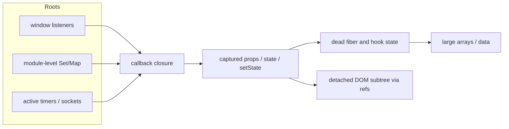
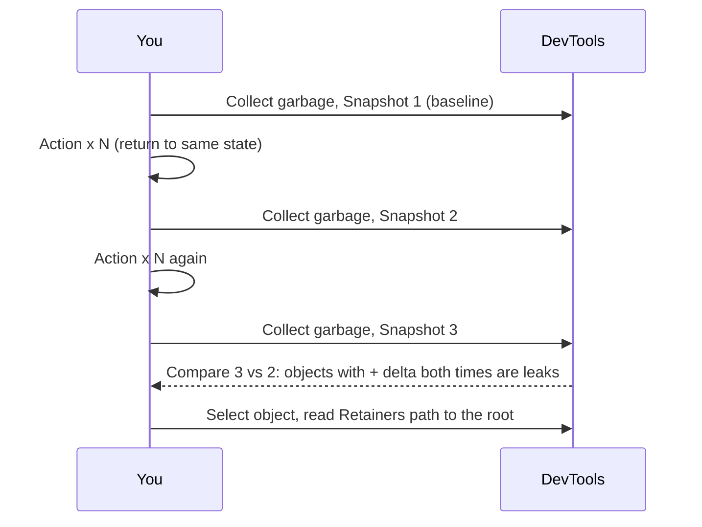
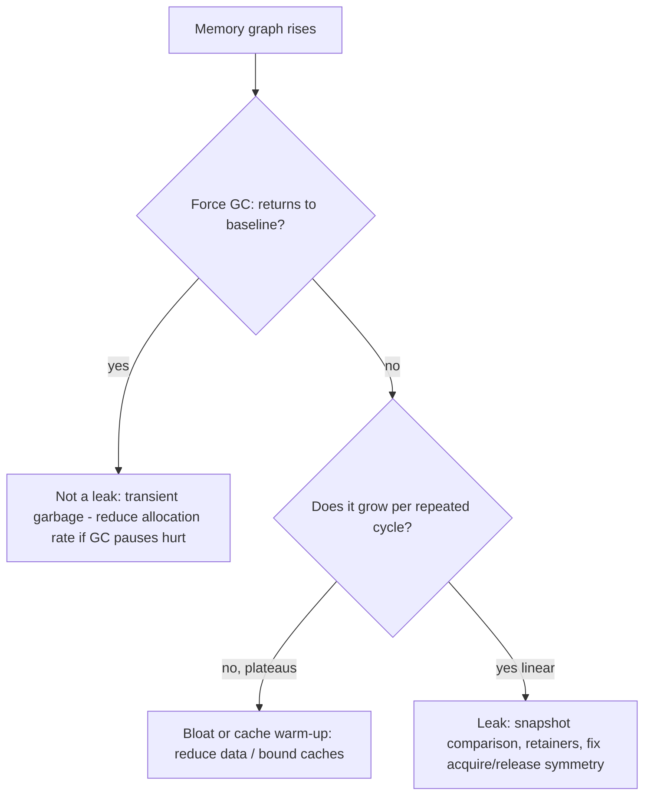

# 07 / 19 — Memory Leaks in React Applications

## 1. Lesson metadata

| | |
|---|---|
| **Level** | Advanced |
| **Study time** | 4–5 hours (reading 1.5 h, heap-snapshot labs 1.5 h, exercises 1.5 h) |
| **Prerequisites** | [Phase 0 — Memory management and GC](../00-web-and-javascript-foundations/16-memory-management-and-gc.md), [Phase 0 — Lexical scope and closures](../00-web-and-javascript-foundations/06-lexical-scope-and-closures.md), [Phase 0 — Objects, references, immutability](../00-web-and-javascript-foundations/08-objects-references-immutability.md), [Phase 3 — Effect cleanup](../03-react-state-and-hooks/06-effect-cleanup.md), [Phase 2 — Strict Mode behavior](../02-react-rendering-and-internals/28-strict-mode-behavior.md), [Phase 6 — Cancellation and race conditions](../06-data-fetching-and-state-ecosystems/02-cancellation-and-race-conditions.md), [18 — React vs browser bottlenecks](./18-react-vs-browser-bottlenecks.md) |
| **Next** | [20 — Long tasks and the main thread](./20-long-tasks-and-main-thread.md) |
| **Related** | [Phase 3 — useRef and mutable references](../03-react-state-and-hooks/10-useref-and-mutable-references.md), [Phase 3 — useSyncExternalStore](../03-react-state-and-hooks/20-usesyncexternalstore-and-external-stores.md), [Phase 6 — Real-time, WebSockets, subscriptions](../06-data-fetching-and-state-ecosystems/17-real-time-websockets-subscriptions.md), [09 — Windowing and virtualization](./09-windowing-and-virtualization.md) |

**Learning objectives.** After this lesson you can:
1. Define a JavaScript memory leak precisely (unintended *reachability*), distinguish it from high-but-stable memory use and from a growing cache that is "working as designed".
2. Enumerate the leak sources that actually occur in React applications: missing effect cleanup (subscriptions, timers, listeners, observers, sockets), module-level caches and singletons, closures capturing large objects, detached DOM nodes held by refs/handlers, unbounded state/log arrays, in-flight requests holding large closures, and third-party library registries.
3. Reproduce a leak, then **prove** it with Chrome DevTools: heap snapshots (3-snapshot technique), the Allocation instrumentation/timeline, the Performance monitor / Memory track, and "Detached" DOM filters.
4. Fix leaks with the correct structural tool: cleanup functions, `AbortController`, bounded caches (LRU/`WeakMap`/`WeakRef`), observers disconnected on unmount, and lifecycle-scoped singletons.
5. Avoid false positives: StrictMode double-mount in development, V8 retaining memory until GC runs, and measuring in dev builds.
6. Explain what the oft-quoted "can't perform a React state update on an unmounted component" warning was, why it was removed in React 18, and why it never identified a real leak.

**Concepts covered:** reachability and GC roots, generational GC at a conceptual level, retainer paths, detached DOM trees, closure retention, event-listener lifetimes, timers/intervals, `AbortController`, observers (`ResizeObserver`, `IntersectionObserver`, `MutationObserver`), WebSocket/`EventSource`, external stores, module-scope caches, `WeakMap`/`WeakRef`/`FinalizationRegistry` (use with caution), heap snapshot comparison, retained size vs shallow size, memory growth monitoring in production.

---

## 2. Deep conceptual explanation

### 2.1 What problem is this lesson solving?

JavaScript is garbage collected, so people say "JS can't leak". That is wrong in the one way that matters: the collector frees **unreachable** objects. If your code accidentally keeps an object reachable — from a global, a module-level `Map`, an event listener on `window`, a timer callback, a pending promise, a DOM node — it will never be freed, however unused it is to *you*. Over a long session (a trading dashboard open all day, a support console, a kiosk, an SPA a user leaves open for weeks) the heap grows, GC runs more often and for longer (major GC pauses show up as jank — see [18](./18-react-vs-browser-bottlenecks.md) and [20](./20-long-tasks-and-main-thread.md)), and eventually the tab slows, is throttled, or is killed by the OS/browser ("Aw, snap", out-of-memory).

For a React app the dominant pattern is: *something outside the React tree holds a reference to something inside it, and that reference outlives the component.*

```
GC root (window / module scope / active timer / open socket)
   └─► listener/callback (closure)
           └─► captured props/state/refs (including big arrays, DOM nodes)
                   └─► fiber / component instance / detached DOM subtree
```

Every unmounted screen that hangs on a chain like that stays in memory *with everything it references*.

### 2.2 Leak vs growth vs bloat

| Phenomenon | Definition | Test |
|---|---|---|
| **Leak** | Memory that is unreachable *in the program's intended model* but reachable in practice; grows with repeated actions | Repeat an action N times returning to the same logical state: retained memory still grows linearly after forced GC |
| **Cache growth** | Memory deliberately kept; bounded or not | Is there an eviction policy? If unbounded, it is a leak by design |
| **Bloat** | Too much memory for the job (huge arrays, duplicated data, 4K images decoded) but stable | Memory plateaus; reduce by data design |
| **Transient spikes** | Garbage generated faster than collected; reclaimed on GC | Sawtooth that returns to baseline |

The rigorous test of a leak is the **return-to-baseline experiment**: perform an action cycle (navigate to a page and back; open and close a modal) many times, force GC (Memory panel's trash can), and compare the heap. Anything that grows per cycle is retained.

### 2.3 Reachability, roots, and retainers

*Public/documented concepts (MDN and V8 docs):* GC reclaims memory for objects no longer reachable from **roots** (global object, active stack frames, and — conceptually — registered callbacks held by the browser: timers, event listeners on live targets, pending promise reactions, open network requests, observers). A **retainer path** is the chain from a root to an object; the DevTools heap snapshot's "Retainers" pane shows it. *Shallow size* is the object's own memory; *retained size* is the memory that would be freed if the object were collected (the object plus everything only it keeps alive).

*Implementation detail (do not rely on specifics):* V8 uses generational collection (young generation scavenges; old generation mark-sweep/compact with incremental and concurrent phases). Exactly when GC runs is not under your control; absence of a drop right after unmount proves nothing — force GC in DevTools before concluding.

### 2.4 React-specific retention mechanics

React itself does not leak by design: when a component unmounts, React detaches its fibers and (in the commit phase) clears references so that the tree can be collected, and runs effect cleanups. *Conceptually*, unmounting is "safe" for memory **iff your effects cleaned up after themselves**. The leaks you see are overwhelmingly in application code (and libraries), not React internals. Occasionally React has had real retention bugs in specific versions (e.g. with detached fibers retained by DevTools hooks or Suspense in particular releases); if an exhaustive investigation finds React internals on the retainer path with no user code, check the React issue tracker for your version and test in a production build without DevTools extensions.

The retention sources in React apps, classified by *who holds the reference*:

1. **Browser-held callbacks** (event listeners, timers, observers, sockets, `postMessage` handlers).
2. **Module-level state** (caches, registries, singleton stores, memoization tables, loggers keeping history).
3. **Long-lived promises** (a pending request whose `.then` closure captures a component's setter/props/state/refs).
4. **DOM-held references** (detached DOM nodes stored in refs/maps; elements kept alive by a third-party library's internal registry).
5. **Library-internal** (charting libs, map SDKs, rich-text editors, virtual scrollers that require explicit `destroy()`/`dispose()`).
6. **Unbounded application state** (event logs, message lists, time-series buffers that only append).

### 2.5 The "setState on an unmounted component" warning — history and misconception

Before React 18, calling `setState` after unmount logged a warning (*"Can't perform a React state update on an unmounted component… This is a no-op, but it indicates a memory leak in your application"*). The React team removed this warning in React 18 because it was **misleading**: (a) the `setState` call itself is a harmless no-op; (b) in many cases there was no leak (e.g. a single `fetch` that resolves later — the promise resolves, the closure is released) and (c) it nudged developers toward `isMounted` flags that don't fix anything and into sprinkling flags everywhere. A *real* leak occurs when a **long-lived subscription** is not removed: the callback (and everything it closes over) stays reachable, and it will keep firing. The lesson: **cancel or unsubscribe because the work is useless**, not because of a warning. Prefer `AbortController` to cancel fetches (see [Phase 6 — Cancellation and race conditions](../06-data-fetching-and-state-ecosystems/02-cancellation-and-race-conditions.md)) — it saves bandwidth and prevents stale updates — rather than boolean mounted flags.

### 2.6 Misconceptions

| Misconception | Reality |
|---|---|
| "Unmounting a component frees its memory." | Only if nothing else references it. Missing cleanup keeps closures — and what they capture — alive. |
| "React Strict Mode double effects show I'm leaking." | Strict Mode intentionally mounts → unmounts → remounts in dev to *expose* missing cleanup; duplicates in dev only are not a production leak. They do reveal cleanup bugs that would leak on real unmount. |
| "`useEffect` cleanup runs only on unmount." | It runs before every re-run of the effect (dependency change) and on unmount. A subscription effect that re-subscribes without cleanup leaks one subscription per change. |
| "`WeakMap` fixes leaks." | It prevents *keys* from being retained by the map; values may still reference keys (ephemerons are handled, but a value that is strongly reachable from elsewhere is the leak). It's a tool for a specific pattern, not a patch. |
| "Memory graph going up means a leak." | Memory rises between GCs; test with forced GC and return-to-baseline cycles. |
| "I need `WeakRef`/`FinalizationRegistry`." | Rarely. They are nondeterministic (callbacks may never run) and the TC39 proposal text itself recommends avoiding them where possible. Explicit lifecycle management is better. |
| "Memory leaks only matter for long sessions." | They also matter for repeated mount/unmount (tab switching, virtualised lists, modals) and for tests (Node/jsdom memory in CI). |

---

## 3. Internal mechanics

### 3.1 The most common leak: effect without cleanup

```tsx
useEffect(() => {
  window.addEventListener("resize", onResize);   // browser (a root) now references onResize
  // missing: return () => window.removeEventListener("resize", onResize);
}, []);
```

Mechanics: `window` is long-lived. The listener list references `onResize`; `onResize` closes over the component's props/state/refs of **the render in which the effect was created**. Unmount → React discards the fiber; but the closure keeps *its captured values* reachable (state objects, refs → DOM nodes, props → large data). The listener also keeps *running*, calling `setState` on an unmounted component (a no-op in React 18+, but your handler's other work continues).

Also: with a non-empty dependency array, every re-run adds another listener if cleanup is missing — **the number of leaked listeners grows with the number of re-runs**, not unmounts.

### 3.2 Timers and intervals

`setInterval` callbacks are held by the browser until cleared. A component polling every 5 s that forgets `clearInterval` keeps polling forever (network traffic, battery, CPU) *and* retains its closure.

Note on `setTimeout`: a one-shot timer holds its callback until it fires (or is cleared); a leak occurs only if a *chain* re-arms (`setTimeout` inside the callback) without a stop condition, or the delay is very long.

### 3.3 Observers and sockets

`ResizeObserver`, `IntersectionObserver`, `MutationObserver` keep their callbacks and *observed targets* reachable until `disconnect()`/`unobserve()`. (Observers don't strongly retain targets after the target is GC-eligible by spec design in many cases, but the callback closure is retained as long as the observer is reachable and the observer is reachable if you stored it globally or the target is alive. Never rely on implicit release; disconnect.) WebSockets/`EventSource` hold their handlers until closed; an open socket is itself a root.

### 3.4 Module-level caches and singletons

```ts
const cache = new Map<string, Product>();       // module scope: lives as long as the page
export function getProduct(id: string) { /* fills cache forever */ }
```

Every distinct id ever visited is retained. For ids with large payloads (images as blobs, big JSON), this alone exhausts memory in an all-day SPA. Fix: bounded caches (LRU with max entries/size), TTL eviction, or delegate to a data library with `gcTime`/`cacheTime` semantics (TanStack Query garbage-collects unused queries after a configurable time; v5 uses `gcTime`, named `cacheTime` in v4 and earlier).

### 3.5 Closures capturing more than you think

A closure created in a scope **may retain the entire scope's variable environment** (engine-dependent optimisation: V8 generally retains only variables actually referenced by *some* closure in that scope — but if *any* closure in the scope references a big variable, all closures in the scope keep it alive). *Public guarantee:* captured variables remain reachable. *Implementation detail:* which variables are actually captured depends on the engine's optimisation; do not rely on it. See [Phase 0 — closures](../00-web-and-javascript-foundations/06-lexical-scope-and-closures.md).

```tsx
function Report({ rows }: { rows: BigRow[] }) {   // rows: 200 MB
  useEffect(() => {
    const t = setInterval(() => console.log(rows.length), 60_000); // captures rows
    return () => clearInterval(t);                                  // cleaned: fine
  }, [rows]);
}
```
Fine when cleaned; a leak when not: *rows* from every previous render's closure is retained by its own never-cleared interval.

### 3.6 Detached DOM nodes

A **detached DOM node** is a node removed from the document but still referenced by JS. React normally removes DOM nodes on unmount and drops its references, but **your** references (a `Map<string, HTMLElement>`, a global `lastClicked` element, a charting library instance holding a canvas, a listener closure capturing `ref.current`) keep the node — and its entire detached subtree — alive. DevTools heap snapshot class filter: `Detached` (e.g. "Detached HTMLDivElement") shows these.

```tsx
const nodeRegistry = new Map<string, HTMLElement>();
function Item({ id }: { id: string }) {
  const ref = useCallback((el: HTMLElement | null) => {
    if (el) nodeRegistry.set(id, el);
    // BUG: missing else branch: when React calls the ref with null on unmount, we never delete
  }, [id]);
  return <div ref={ref} />;
}
```
React calls the ref callback with `null` when the element is detached (React 19 also supports a cleanup function returned from the ref callback, and when you return one React does *not* call the callback with `null` any more; the react.dev reference says the `null` call is kept for backwards compatibility and "will be removed in a future version" — see [Phase 3 — useRef](../03-react-state-and-hooks/10-useref-and-mutable-references.md)). Not deleting the entry leaks the node. (Verified in the sandbox on React 19.3: in `StrictMode` dev a ref callback sees `el, null, el`, so a registry that doesn't handle `null` also shows the bug early.)

### 3.7 Third-party libraries with explicit lifecycles

Maps (Mapbox/Leaflet), charts (many canvas libs), rich-text editors, video players, and WebGL scenes allocate memory outside the JS heap or hold registries. They require `.remove()`, `.destroy()`, `.dispose()` in cleanup. Missing teardown leaks GPU/native memory that heap snapshots **do not show** — look at the browser's Task Manager (Shift+Esc in Chrome) or `performance.measureUserAgentSpecificMemory()` (Chromium-only per MDN compat data, and gated by cross-origin isolation), and the Memory panel's "JS heap" vs total process memory.

### 3.8 Unbounded application state

```ts
const [events, setEvents] = useState<LogEvent[]>([]);
socket.onmessage = (m) => setEvents((prev) => [...prev, JSON.parse(m.data)]); // grows forever
```
A leak by design: nothing evicts. Realtime UIs need a **window** (last N events, ring buffer) and virtualisation for display.

### 3.9 What DevTools offers

*Teaching model of Chrome DevTools Memory panel; labels vary by version.*
- **Heap snapshot:** point-in-time dump of the JS heap: classes, instances, shallow/retained sizes, retainers. **Compare** two snapshots to see allocations between them.
- **Allocation instrumentation on timeline:** records allocations over time (blue bars = still alive; grey = collected) with stack traces — good for "what keeps being allocated and never freed."
- **Allocation sampling:** low-overhead sampling profile of allocation sites by function.
- **Performance monitor / Performance panel "Memory" checkbox:** JS heap size, DOM node count, event listeners count over time; the *Nodes* and *Listeners* counters directly reveal leaked DOM/listeners.
- **Detached elements** view (newer versions) and the `Detached` class filter.
- **Task Manager (Shift+Esc):** per-tab memory footprint including native/GPU memory.

---

## 4. Step-by-step execution walkthrough

Scenario: a dashboard with a "Live prices" panel. The user toggles between the Prices tab and the Settings tab. The Prices tab mounts `<PriceTicker />`, which opens a subscription to a shared `priceFeed` singleton.

```tsx
// price-feed.ts (module scope — a GC root)
type Listener = (tick: Tick) => void;
const listeners = new Set<Listener>();
export function subscribe(l: Listener) { listeners.add(l); }          // BUG: returns nothing
export function unsubscribe(l: Listener) { listeners.delete(l); }
```

```tsx
function PriceTicker({ symbol }: { symbol: string }) {
  const [history, setHistory] = useState<Tick[]>([]);
  useEffect(() => {
    const listener: Listener = (t) => { if (t.symbol === symbol) setHistory((h) => [...h, t]); };
    subscribe(listener);
    // no cleanup
  }, [symbol]);
  return <Chart data={history} />;
}
```

**Chronology of leak growth.**

1. **Cycle 1 (Prices tab opens).** Mount: render → commit → effect: `listener#1` (closing over `symbol`, `setHistory`) added to the module `Set`. The history array grows while the tab is visible: 50 KB.
2. **Switch to Settings.** `PriceTicker` unmounts. React discards its fiber. **No cleanup runs.** `listener#1` stays in `listeners`; it keeps calling `setHistory`, which React ignores for an unmounted component (no warning in React 18+). Whether the updater `[...h, t]` ever runs is an implementation detail; what matters is reachability: the closure `listener#1` holds `setHistory` → the dead fiber's hook queue → the last `history` array state. So that component's 50 KB state and fiber stay reachable, and every tick still invokes the listener (wasted CPU).
3. **Cycle 2 (back to Prices).** New `PriceTicker`: `listener#2` added. Now two listeners; the first is a zombie.
4. **Cycle N.** N listeners; N dead component states retained (N × up to 50 KB) and each tick runs N callbacks.
5. **Symptom after an hour of toggling:** memory 400 MB, tab CPU creeping up, the feed handler (`listeners.forEach`) now takes noticeable time → shows up as a long task in the Performance panel ([20](./20-long-tasks-and-main-thread.md)).

**Predict:** with `symbol` changing from "AAPL" to "MSFT" while the tab stays open, how many listeners exist? *(Two: the effect re-runs on `symbol` change and, with no cleanup, the old listener stays. Leaks scale with re-runs, not only unmounts.)*

**Diagnosis procedure (3-snapshot technique).**
1. Open the page in an incognito window (extensions off), production-like build.
2. Memory → *Collect garbage* → **Snapshot 1** (baseline: Prices tab never opened yet, or at steady state after one cycle to warm caches/lazy chunks).
3. Perform the action **N times** (e.g. toggle Prices ↔ Settings 10 times), ending in the same logical state as before.
4. *Collect garbage* → **Snapshot 2**.
5. Repeat the same N actions; *Collect garbage* → **Snapshot 3**.
6. In Snapshot 3 choose **Comparison** with Snapshot 2 (or "Objects allocated between Snapshot 1 and 2" filter). Sort by **Delta**. Objects whose counts grow by ~N×k in both intervals are leaks (a *single* step could be warm-up allocations; two equal steps prove linear growth).
7. Expand a leaked object (e.g. `(closure)` or `PriceTicker`'s hook state) → **Retainers** pane → follow the path to a root: `listeners` (Set) in `price-feed.ts`. That is the culprit.

**Fix and validation.**
```ts
export function subscribe(l: Listener): () => void {
  listeners.add(l);
  return () => { listeners.delete(l); };
}
```
```tsx
useEffect(() => {
  const listener: Listener = (t) => { if (t.symbol === symbol) setHistory((h) => h.length >= 500 ? [...h.slice(1), t] : [...h, t]); };
  return subscribe(listener);              // cleanup = unsubscribe, runs on unmount AND symbol change
}, [symbol]);
```
Repeat the 3-snapshot comparison: the delta for `listener` closures and `PriceTicker` objects should be 0 (± small noise). Also the in-component `history` is now bounded at 500 entries (ring-like), fixing the secondary "unbounded state" leak.

---

## 5. Code examples

### 5.1 Minimal example — the cleanup contract

```tsx
import { useEffect, useState } from "react";

export function useWindowWidth(): number {
  const [width, setWidth] = useState(() => window.innerWidth);
  useEffect(() => {
    const onResize = () => setWidth(window.innerWidth);
    window.addEventListener("resize", onResize);
    return () => window.removeEventListener("resize", onResize); // same function reference
  }, []);
  return width;
}
```

Notes: the function passed to `removeEventListener` must be the **same reference** (and same `capture` option) as in `addEventListener`; creating a new arrow in cleanup does nothing. Alternatively `addEventListener("resize", onResize, { signal })` with an `AbortController` (the `signal` option is supported by all modern browsers) removes the listener on `abort()`. For *external subscriptions that drive rendering* prefer `useSyncExternalStore` ([Phase 3 — lesson 20](../03-react-state-and-hooks/20-usesyncexternalstore-and-external-stores.md)), which manages subscribe/unsubscribe for you.

### 5.2 Practical example — one `AbortController` for a whole effect

```tsx
type Quote = { symbol: string; price: number };

export function useQuote(symbol: string) {
  const [quote, setQuote] = useState<Quote | null>(null);
  const [error, setError] = useState<Error | null>(null);

  useEffect(() => {
    const ac = new AbortController();

    // 1. fetch
    fetch(`/api/quotes/${encodeURIComponent(symbol)}`, { signal: ac.signal })
      .then((r) => (r.ok ? (r.json() as Promise<Quote>) : Promise.reject(new Error(`HTTP ${r.status}`))))
      .then(setQuote)
      .catch((e: unknown) => {
        if (e instanceof DOMException && e.name === "AbortError") return; // expected on cleanup
        setError(e instanceof Error ? e : new Error(String(e)));
      });

    // 2. listener bound to the same lifetime
    window.addEventListener("online", () => setError(null), { signal: ac.signal });

    return () => ac.abort(); // cancels request AND removes listener
  }, [symbol]);

  return { quote, error };
}
```

Line notes: `ac.abort()` runs on dependency change and on unmount (and, in dev Strict Mode, on the simulated unmount). The `AbortError` is *expected*; treat it as control flow, not an error. One controller scopes **all** resources of that effect instance, so adding a new resource later doesn't require remembering a new cleanup line. **Predict:** in dev with Strict Mode, how many `fetch` calls fire on mount? *(Two — mount, simulated unmount (aborted), remount; the first request is aborted. This is dev-only behavior.)*

### 5.3 Incorrect example — a catalogue of leaks

```tsx
const imageCache = new Map<string, HTMLImageElement>();           // (1) unbounded module cache

export function Gallery({ urls, onVisible }: { urls: string[]; onVisible: (u: string) => void }) {
  const [log, setLog] = useState<string[]>([]);                    // (2) unbounded state
  const nodes = useRef<HTMLElement[]>([]);                         // (3) grows: never cleared

  useEffect(() => {
    const io = new IntersectionObserver((entries) => {            // (4) never disconnected
      entries.forEach((e) => { if (e.isIntersecting) onVisible((e.target as HTMLElement).dataset.url!); });
    });
    nodes.current.forEach((n) => io.observe(n));
  });                                                              // (5) no deps: new observer EVERY render

  useEffect(() => {
    const id = setInterval(() => setLog((l) => [...l, new Date().toISOString()]), 1000); // (6) no clearInterval
  }, []);

  return (
    <div>
      {urls.map((u) => (
         { if (el) { nodes.current.push(el); imageCache.set(u, el); } }} src={u} />
        // (7) ref callback is a new function every render → React calls old(null), new(el): pushes duplicates;
        //     imageCache holds detached  after unmount
      ))}
    </div>
  );
}
```

Seven distinct leak sources. **Predict** which grows fastest: (5)+(7): each render creates a new `IntersectionObserver` observing all nodes (and `nodes.current` accumulates duplicates, so each re-render observes more elements than exist). A parent re-rendering once per second makes this *quadratic*.

### 5.4 Corrected implementation

```tsx
import { useEffect, useRef, useState, useCallback } from "react";

// (1) bounded LRU cache using Map insertion order
class LRU<K, V> {
  private m = new Map<K, V>();
  constructor(private max: number) {}
  get(k: K): V | undefined {
    const v = this.m.get(k);
    if (v !== undefined) { this.m.delete(k); this.m.set(k, v); }
    return v;
  }
  set(k: K, v: V): void {
    this.m.delete(k);
    this.m.set(k, v);
    if (this.m.size > this.max) this.m.delete(this.m.keys().next().value as K); // evict oldest
  }
}
const decoded = new LRU<string, true>(200); // store small metadata, not DOM nodes

export function Gallery({ urls, onVisible }: { urls: string[]; onVisible: (u: string) => void }) {
  const [log, setLog] = useState<string[]>([]);
  const nodes = useRef(new Set<HTMLImageElement>());
  const onVisibleRef = useRef(onVisible);
  useEffect(() => { onVisibleRef.current = onVisible; });               // latest callback without re-subscribing

  // (4,5) one observer per mount, disconnected on unmount
  const ioRef = useRef<IntersectionObserver | null>(null);
  useEffect(() => {
    const io = new IntersectionObserver((entries) => {
      for (const e of entries) {
        if (e.isIntersecting) onVisibleRef.current((e.target as HTMLElement).dataset.url!);
      }
    });
    ioRef.current = io;
    nodes.current.forEach((n) => io.observe(n));
    return () => { io.disconnect(); ioRef.current = null; };
  }, []);

  // (3,7) stable ref callback with symmetric add/remove
  const register = useCallback((el: HTMLImageElement | null, prev?: HTMLImageElement) => {
    if (el) { nodes.current.add(el); ioRef.current?.observe(el); }
    if (prev) { nodes.current.delete(prev); ioRef.current?.unobserve(prev); }
  }, []);

  // (6,2) interval cleared; log bounded
  useEffect(() => {
    const id = setInterval(() => setLog((l) => [...l.slice(-99), new Date().toISOString()]), 1000);
    return () => clearInterval(id);
  }, []);

  return (
    <div>
      {urls.map((u) => (
        <GalleryImage key={u} url={u} register={register} />
      ))}
    </div>
  );
}

function GalleryImage({ url, register }: { url: string; register: (el: HTMLImageElement | null, prev?: HTMLImageElement) => void }) {
  const elRef = useRef<HTMLImageElement | null>(null);
  const setRef = useCallback((el: HTMLImageElement | null) => {
    const prev = elRef.current ?? undefined;
    elRef.current = el;
    register(el, el ? undefined : prev);           // on detach (null) remove the previous node
  }, [register]);
  return ;
}
```

Why each fix works / trade-offs:
- **LRU** bounds memory; the trade-off is cache misses. Store *small* values (metadata), not DOM nodes. Use a battle-tested implementation in production.
- **Latest-ref pattern (`onVisibleRef`)** avoids re-creating the observer when `onVisible` identity changes; see [Phase 3 — stale closures](../03-react-state-and-hooks/05-effect-dependencies-and-stale-closures.md). `useEffectEvent` is the designed solution for this; it became stable in React 19.2 (react.dev/blog/2025/10/01/react-19-2). Call it only from inside Effects and don't put the returned function in dependency arrays.
- **Symmetric ref callbacks:** every registration has a matching removal. In React 19 you can alternatively return a cleanup function from a ref callback (react.dev `ref` reference; verified 2026-10-22).
- **Bounded log** (last 100) and a cleared interval.

Honest note: the registered-callback API above is more complex than needed; in a real gallery prefer `loading="lazy"` or a small `useInView` hook per image. The point is symmetry of acquire/release.

### 5.5 Advanced example — `WeakMap` for per-object metadata and a leak-detection test

```ts
// Metadata attached to objects without extending their lifetime
const measured = new WeakMap<HTMLElement, DOMRectReadOnly>();
export function rememberRect(el: HTMLElement) {
  measured.set(el, el.getBoundingClientRect());      // entry disappears when `el` is collectable
}
```
Rule: `WeakMap` keys must be objects; you cannot iterate or size it (by design — GC is non-deterministic). Use it when the data's **lifetime should equal the key's lifetime**.

A *regression test* for leaks, using the `FinalizationRegistry` is unreliable; use the Node/jsdom-side approach: count subscribers.

```ts
import { render } from "@testing-library/react";
import { listenerCount } from "./price-feed"; // test hook exported for testing only

it("unsubscribes on unmount", () => {
  const { unmount, rerender } = render(<PriceTicker symbol="AAPL" />);
  expect(listenerCount()).toBe(1);
  rerender(<PriceTicker symbol="MSFT" />);
  expect(listenerCount()).toBe(1);   // old listener removed when dependency changed
  unmount();
  expect(listenerCount()).toBe(0);
});
```
Testing *resources* (listeners, timers via fake timers, open sockets via a mock) is deterministic; testing "memory was freed" is not. Under StrictMode (wrap the render) the counts should still return to 0 after unmount.

### 5.6 Production monitoring (sketch)

```ts
// Chromium only; non-standard (`performance.memory`). Never rely on this for logic.
type PerfMemory = { usedJSHeapSize: number; totalJSHeapSize: number; jsHeapSizeLimit: number };
export function sampleHeap(report: (usedMB: number) => void, everyMs = 30_000): () => void {
  const p = performance as Performance & { memory?: PerfMemory };
  if (!p.memory) return () => {};
  const id = window.setInterval(() => report(p.memory!.usedJSHeapSize / 1_048_576), everyMs);
  return () => window.clearInterval(id);
}
```
Notes: `performance.memory` is a non-standard, coarse (bucketed/quantised for privacy) Chromium API. Use for *trend* detection (heap after long sessions at p95), not for precise accounting. Alert on "heap after N minutes of idle" growth; tie to route/version.

---

## 6. Visual explanations

### Retention chain of a leaked component



### Three-snapshot technique



### Leak or not?



---

## 7. Alternative approaches and trade-offs

| Need | Approach | Pros | Cons | Prefer when |
|---|---|---|---|---|
| Subscribe to external source | `useSyncExternalStore` | Built-in subscribe/unsubscribe; tearing-safe | Requires store API | Most external stores |
| Subscribe in effect | `useEffect` + cleanup | Flexible | Easy to forget cleanup | One-off integrations |
| Cancel fetch | `AbortController` | Stops network + prevents stale update | API-specific plumbing | Fetch-based code |
| Cancel fetch (flag) | `ignore` boolean | Simple, avoids stale update | Does *not* cancel the request | When you can't pass a signal |
| Server-state caching | Query library (`gcTime`) | Automatic eviction | Library dependency | Remote data |
| Hand-rolled cache | LRU / Map | Control | You own eviction | Special cases |
| Per-object metadata | `WeakMap` | Lifetime tied to key | No iteration; subtle | Instance annotations |
| Detect objects dying | `FinalizationRegistry` / `WeakRef` | Allows weak caches | Non-deterministic; may never run; hard to test | Rare library-level code |
| Isolate leaky third party | iframe / worker | Containment; teardown by destroying frame | Complexity | Untrusted/legacy widgets |

**Scenario where the recommended practice (clean up everything, bound caches) is not best:** a short-lived marketing page or a one-shot kiosk screen that reloads nightly. A leak of a few MB per navigation is irrelevant if the page is closed within minutes; spending a week bounding a cache is poor use of time. Conversely, a code library used by many apps must be strict because *you cannot know the host app's lifetime*. Decide by session length, device memory, and measured growth rate.

---

## 8. Best practices and anti-patterns

**Beginner mistakes**
- Effects that add listeners/timers/subscriptions with no cleanup.
- `ignore`/`isMounted` flags to silence the old warning rather than cancelling work.
- Appending to state forever.

**Experienced-developer mistakes**
- Treating the symptom: reloading the page periodically, or restarting a Node test runner.
- `useCallback` identity dance causing re-subscription churn *with* missing cleanup.
- Storing DOM nodes in module-level maps or in Redux/Zustand state (non-serialisable and retained).
- Caching `Promise`s forever, including rejected ones.
- Library `destroy()` forgotten for charts/maps; testing only in the JS heap view.
- Profiling leaks in dev mode with React DevTools open (DevTools keeps references to inspected fibers; also dev-only structures).

**Smells**
- `Set`/`Map`/array at module scope that only has `add`/`set`/`push`.
- `addEventListener` without a corresponding removal in the same scope.
- Effects without return statements that call `subscribe`, `on`, `observe`, `setInterval`, `new WebSocket`.
- Long-lived singletons holding callbacks (event bus) with no `off`.
- Heap grows by roughly the same amount per navigation.

**Justified exceptions**
- Intentional app-lifetime singletons (global event bus subscribed to once at boot).
- Caches that are bounded by domain (e.g. at most 50 locales).
- Not cleaning up a one-shot `setTimeout` that is short-lived and harmless.

---

## 9. Real-world application

**Trading/financial dashboard.** Always-on tabs, high-frequency updates, charts. Constraints: bounded time-series buffers (ring buffers), batching updates per animation frame, chart `dispose()` on unmount, a shared WebSocket with reference-counted subscriptions (increment on subscribe, close when last subscriber leaves). Monitoring: heap growth after 8 hours in soak tests.

**Support/CRM console.** Agents keep multiple customer tabs open; each tab is a React subtree with draft state. Leaks come from conversation-history arrays and attachments held as `Blob`/object URLs. `URL.createObjectURL` requires `URL.revokeObjectURL` — a classic leak.

```ts
useEffect(() => {
  const url = URL.createObjectURL(file);
  setPreview(url);
  return () => URL.revokeObjectURL(url);
}, [file]);
```

**E-commerce SPA.** Route changes between product pages; per-product image caches and zoom libraries; analytics SDKs that register DOM listeners per page view. A leak of 5 MB per product page becomes 500 MB after 100 product views — plausible for comparison shoppers.

**Realtime collaboration.** Presence subscriptions, cursors, and CRDT/OT documents; reference counting is mandatory; rooms must `leave()` on unmount; documents must be destroyed.

**Micro-frontends.** The host mounts/unmounts remote apps; if a remote doesn't expose and honour an `unmount()` hook (clearing its global listeners, timers, styles injected into `<head>`), every navigation leaks a complete app instance. Contract: every remote exports `mount`/`unmount` with a leak test in CI (mount/unmount 50 times, assert listener/timer/DOM node counts return to baseline). See [Phase 11 — Microfrontends](../11-senior-and-architect-mastery/12-microfrontends.md).

---

## 10. Debugging and troubleshooting

**Symptom → investigation**

| Symptom | First check | Likely cause |
|---|---|---|
| Tab memory grows with each navigation | 3-snapshot comparison; Performance monitor "DOM Nodes" and "JS event listeners" | Missing cleanup; detached DOM |
| Listener count rises on repeated actions | Performance monitor → "JS event listeners"; Elements → Event Listeners | Listener added without removal |
| Page gets slower the longer it's open, CPU creeping | Performance trace: repeated work per tick growing; count of timers | Zombie intervals/subscribers calling handlers |
| Heap fine, but tab memory huge | Chrome Task Manager; GPU memory | Canvas/WebGL/video/native resources; decoded images |
| Leak only in dev | Compare production build | Strict Mode dev behavior or dev-only retention |
| "Detached HTMLDivElement" in snapshot | Retainers pane → who holds it | Refs/maps/library registries |

**Procedure**
1. **Reproduce** with a cycle you can script (open/close modal ×20). Use incognito; no extensions; production build served locally.
2. **Confirm** with forced GC that retained memory grows per cycle.
3. **Snapshot comparison** to find the class of leaked objects; prefer sorting by *retained size* and *delta*.
4. **Retainers** to the root: read the path *from the bottom up* to the first thing **you own** (module variable, closure, listener).
5. **Fix** acquire/release symmetry; **bound** collections.
6. **Validate**: repeat the 3-snapshot test (delta ≈ 0); run a soak test (e.g. Playwright script cycling for 30 minutes, reading `performance.memory` or taking CDP heap usage samples) (tooling varies); add regression tests counting listeners/subscribers.

**Strict Mode and leak triage.** In dev Strict Mode, effects run mount → cleanup → mount once. If your effect is symmetric, nothing visible changes. If it isn't (e.g. adds a listener, no cleanup), you'll see *two* listeners after mount in dev. That's the bug's early warning, not a React artefact. See [Phase 2 — Strict Mode behavior](../02-react-rendering-and-internals/28-strict-mode-behavior.md).

**Common wrong conclusions**
- "It's React's fault" — check the retainer path ends in your code.
- "Used JS heap dropped after reload, so it was fine" — it always does; the question is growth during the session.
- "The snapshot shows `(string)` as the top class" — strings are usually the *payload* of leaked objects; follow retainers, don't optimise strings.

---

## 11. Exercises

### Level A — Knowledge
A1. Define "retained size" vs "shallow size" and say which one you sort by to find the most costly leak.
A2. Why did React remove the "can't perform a React state update on an unmounted component" warning in React 18?
A3. List four categories of resources that need explicit cleanup in an effect.
A4. Why is `FinalizationRegistry` a poor basis for leak *tests*?
A5. What does `URL.revokeObjectURL` prevent?

### Level B — Code comprehension
B1. How many listeners exist after mount, a prop change, and unmount (no Strict Mode)?
```tsx
useEffect(() => {
  const h = () => console.log(value);
  window.addEventListener("keydown", h);
  return () => window.removeEventListener("keydown", () => console.log(value));
}, [value]);
```
B2. Does this leak? Explain.
```tsx
useEffect(() => {
  const id = setTimeout(() => setOpen(false), 5000);
  return () => clearTimeout(id);
}, [open]);
```
B3. In which order do cleanup and setup run when `symbol` changes from `"A"` to `"B"`, and why does that matter for a subscription whose handler uses `symbol`?
```tsx
useEffect(() => { return subscribe(symbol, handler); }, [symbol]);
```

### Level C — Implementation
C1. Write `useEventListener(target, type, handler, options)` which attaches once per `(target, type)` but always calls the latest `handler`, cleans up correctly, and is type-safe for `window`/`document` events.
C2. Implement a reference-counted `getSocket(url)` / `releaseSocket(url)` pair so that components share a WebSocket and the last release closes it. Include a delayed close (e.g. 1 s) to avoid churn from navigation.
C3. Write a Playwright-style soak test outline (not full code) that detects growth in listeners/DOM nodes after 50 open/close cycles of a modal, using CDP `Memory.getDOMCounters` or equivalent. Specify assertions and tolerances.

### Level D — Debugging
D1. You take three snapshots after 10 modal open/close cycles each. The comparison shows +10 `ModalContent` closures and +10 `Detached HTMLDivElement` per interval. The retainers pane shows a path `window → (event listeners) → Array → function → context → ref`. What's the fix and how do you verify?
D2. The Performance monitor shows JS heap sawtooth returning to the same baseline, DOM nodes stable, but the tab's Task Manager memory keeps rising. What categories do you investigate?
D3. A chart library is initialised in `useEffect` with `new Chart(canvas, …)`; navigation repeatedly leaks ~8 MB. The heap snapshot shows little. Why, and what do you check?

### Level E — Architecture and engineering decisions
E1. Your team owns a design-system `Toast` provider with a global `toasts` array that is appended on every toast. Propose a bounded design and decide what policy applies when toasts exceed the limit.
E2. Propose a company-wide "leak hygiene" program: lint rules, code-review checklist, library wrappers, CI soak tests, and production telemetry. State which pieces you'd start with given limited time and why.

### Level F — Expert challenge
F1. Design a generic `useDisposable<T>(create, dispose, deps)` hook that guarantees `dispose` is called exactly once per created resource, including under Strict Mode's mount/cleanup/mount cycle and under dependency changes, without leaking when `create` throws. Discuss concurrency (render may be discarded) and why creation belongs in an effect rather than during render.

---

## 12. Detailed answers and explanations

> Attempt the exercises first.

**A1.** *Shallow size*: the object's own bytes. *Retained size*: bytes that would be freed if the object were removed (the object plus things only it keeps alive). Sort by retained size to find the leaked root objects that keep the most memory; shallow size often hides big graphs behind small container objects.

**A2.** It was misleading: `setState` on an unmounted component is a no-op and does not itself leak; the warning appeared in common benign cases (e.g. a single resolved fetch) and encouraged `isMounted` hacks. The real leaks come from long-lived subscriptions, which you detect via cleanup symmetry, not that warning. (React 18 removed the warning; see the React 18 changelog.)

**A3.** Event listeners (window/document/element), timers (`setInterval`, long `setTimeout`, `requestAnimationFrame` loops), observers (`Resize/Intersection/MutationObserver`), network connections (WebSocket, EventSource, in-flight fetch via AbortController), external-store subscriptions, third-party instances (charts, maps, editors, players), object URLs, `BroadcastChannel`/`MessagePort`s, and workers (`terminate()`).

**A4.** Its callback may never run, and when it runs is up to the engine's GC schedule; tests become flaky or vacuous. Test resource counts (listeners/timers/sockets) deterministically.

**A5.** It releases the browser's reference to the underlying blob data for the object URL; without it, the blob stays in memory until the document unloads.

**B1.** After mount: 1. After prop change: the cleanup attempts to remove a *different* function (a new arrow), so the original listener is **not** removed; effect then adds a new one → **2**. After unmount: 2 remain (cleanup again removes nothing). Fix: pass `h` to `removeEventListener`. Wrong answer "0 after unmount": cleanup ran but removed nothing.

**B2.** No. The timer is cleared on re-run and unmount; the callback is a one-shot. The only subtlety: when `open` becomes false the effect re-runs, creating another timer that sets `open` to false again (a no-op re-render bail-out); it's harmless. A cleaner version only creates the timer when `open` is true.

**B3.** On dependency change React runs the **previous** effect's cleanup (unsubscribing `"A"` with the old closure), then runs the **new** effect (subscribing `"B"`). The ordering ensures there's never a window where the old closure and the new coexist (barring concurrent updates). If cleanup were missing, handlers for both symbols would be live; if the subscription API keyed by symbol requires removal with the same handler identity, the closure created in the setup of that same effect instance is what must be unsubscribed — which `return subscribe(...)` guarantees.

**C1.** Sketch:
```ts
export function useEventListener<K extends keyof WindowEventMap>(
  target: Window, type: K, handler: (e: WindowEventMap[K]) => void, options?: AddEventListenerOptions
): void;
export function useEventListener<K extends keyof DocumentEventMap>(
  target: Document, type: K, handler: (e: DocumentEventMap[K]) => void, options?: AddEventListenerOptions
): void;
export function useEventListener(
  target: EventTarget, type: string, handler: (e: Event) => void, options?: AddEventListenerOptions
): void {
  const ref = useRef(handler);
  useEffect(() => { ref.current = handler; });
  useEffect(() => {
    const listener = (e: Event) => ref.current(e);
    target.addEventListener(type, listener, options);
    return () => target.removeEventListener(type, listener, options);
  }, [target, type, options?.capture, options?.passive, options?.once]); // options object identity avoided
}
```
Evaluation: attaches once per target/type; latest handler via ref; same `capture` flag in removal; no dependency on `options` object identity; typed overloads. Note: assigning `ref.current` during render is discouraged; doing it in an effect keeps it concurrency-safe (the lesson on refs explains why).

**C2.** Criteria: a `Map<string, { socket, refs, closeTimer }>`; `getSocket` increments refs and cancels a pending close timer; `releaseSocket` decrements and, at 0, schedules `setTimeout(close, 1000)` which re-checks `refs === 0`; the hook wraps `get`/`release` in `useEffect` with symmetrical cleanup; handle reconnect and errors; ensure Strict Mode double effect leaves refs at 1 after mount. Edge: HMR/module reloads.

**C3.** Criteria: open/close modal 50×; run `HeapProfiler.collectGarbage` via CDP between measurements; read `Memory.getDOMCounters` (`documents`, `nodes`, `jsEventListeners`) before and after; assert that `nodes` and `jsEventListeners` after cycles ≤ baseline + small tolerance (e.g. +5% or a fixed small constant) and do not increase between the 25th and 50th cycles; run against a production build in a headless Chromium; fail on monotonic growth; keep the harness separate from regular unit tests because of runtime. Caveat: counters detect DOM/listeners leaks, not closures holding data — add heap snapshot diff on demand.

**D1.** A listener on `window` (event listeners array) holds a function whose closure context references the modal's `ref` → the detached `div`. Fix: remove the listener in the effect cleanup (same reference), or use `AbortController` signal. Verify: repeat the three-snapshot test (delta 0), the Performance monitor's "JS event listeners" count returns to baseline after each close, and a test asserting `removeEventListener` is called/`window` listener count unchanged.

**D2.** Non-JS-heap memory: canvas/WebGL buffers, decoded images (large images in many ``, `createImageBitmap` not closed), video/audio buffers, Web Workers, `WebAssembly` memory, GPU textures, and browser caches. Check Task Manager's columns (Memory footprint, GPU memory), `chrome://memory-internals`/`about:memory` equivalents (tooling varies), and the library's disposal APIs (`bitmap.close()`, `worker.terminate()`, `chart.destroy()`).

**D3.** Chart libraries keep canvas contexts, offscreen buffers, and event handlers outside the JS heap or in native memory; omitted `destroy()` leaves them alive. Check: does the library document `destroy/dispose`? Is it called in cleanup? Also check `ResizeObserver` created by the lib; Task Manager; and whether the same canvas is reused by Strict Mode's double effect (two chart instances on one canvas).

**E1.** Criteria: a bounded queue (e.g. max visible = 5; others waiting in a bounded FIFO with a cap and drop policy), timeouts remove toasts (clear timers on removal), IDs unique, storage in a reducer within the provider (not module scope), an API that prevents unbounded growth (`dedupeKey`), a policy (drop oldest non-error, collapse duplicates, never drop errors silently — log them). A good answer discusses accessibility (`aria-live` announcements may need queue persistence) and testing.

**E2.** Criteria: prioritise highest-yield cheapest controls first — (1) a shared `useEventListener`/`useInterval`/`useSubscription` primitive library and ban raw `addEventListener`/`setInterval` in components (lint rule `no-restricted-syntax` or custom rule), (2) PR checklist items (acquire/release symmetry, bounded collections), (3) one automated soak/leak test on the top 3 long-lived routes, (4) production telemetry for heap growth in long sessions (coarse), (5) training with a postmortem. Justify ordering by risk (long-lived sessions) and ROI; note lint rules have false positives.

**F1.** Evaluation criteria: creating the resource inside `useEffect` (or `useState` initialiser avoided because render may run twice/be discarded and has no cleanup); store the resource in a local variable of that effect run; `return () => dispose(resource)`; wrap `create` in try/catch so a thrown error isn't swallowed but nothing leaks (nothing was created); Strict Mode runs create → dispose → create — each created resource is disposed exactly once; dependency changes run dispose of old then create of new; to expose the resource to render, set state (or use a ref/state combination) after creation; document that consumers must tolerate `null` during the first render. Explain why render-phase creation leaks: discarded concurrent renders create resources no cleanup will ever dispose.

---

## 13. Senior engineer interview questions

**Q1. "How do you know it's a leak and not just high memory?"**
Run a return-to-baseline experiment: repeat an action N times to the same logical state, force GC, and check whether retained memory grows linearly per cycle. Leaks scale with repetitions; bloat plateaus; garbage returns to baseline after GC.

**Q2. "Walk me through finding a leak with DevTools."**
Reproduce in a production build in incognito; take baseline snapshot after GC; do the cycle N times; snapshot; again; snapshot; compare deltas; open leaked objects' retainer paths; identify the first application-owned retainer (a listener, module Map, closure); fix symmetry; confirm delta ≈ 0.

**Q3. "Why does a missing effect cleanup retain a React component?"**
The browser-side registration (listener/timer/observer) is a GC root that references a closure; that closure references the component's props/state/setter/refs (and via them fiber/DOM). Unmounting removes React's references but not the root's, so everything in the closure stays reachable.

**Q4. "Does `isMounted` fix leaks?"**
No. It only prevents calling setState; the listener, closure, and captured memory remain. Cancel or unsubscribe.

**Q5. "When would you use `WeakRef`?"**
Almost never in app code. Possible for opt-in caches where entries can disappear any time, with explicit awareness that GC timing is non-deterministic and that callbacks may not run. Prefer explicit eviction (LRU/TTL) so behaviour is testable.

**Q6. "How do third-party widgets leak, and how do you contain them?"**
They register global listeners, inject nodes/styles, allocate native resources, and require `destroy()`. Contain by wrapping in a component with a strict lifecycle (create in effect, destroy in cleanup), verify with mount/unmount loops in tests, or isolate in iframes where destroying the frame tears everything down.

**Q7. "How does Strict Mode help with leaks?"**
In development it simulates unmount/remount of effects, exposing asymmetries (duplicate listeners, uncleaned resources) immediately, instead of after a customer navigates 200 times.

---

## 14. Further learning resources

| Resource | URL | Covers / why | Level | Section to study |
|---|---|---|---|---|
| MDN — Memory management | <https://developer.mozilla.org/en-US/docs/Web/JavaScript/Guide/Memory_management> | Reachability and GC basics | Intermediate | Garbage collection; common leaks |
| Chrome DevTools — Memory panel | <https://developer.chrome.com/docs/devtools/memory-problems> | Heap snapshots, allocation timeline | Intermediate | Fix memory problems |
| Chrome DevTools — Heap snapshot overview | <https://developer.chrome.com/docs/devtools/memory-problems/heap-snapshots> | Retainers, comparison view | Intermediate | Views and filters |
| React docs — Synchronizing with Effects | <https://react.dev/learn/synchronizing-with-effects> | Cleanup and Strict Mode | Intermediate | "Each Effect represents a separate process"; Strict Mode |
| React docs — `useEffect` reference | <https://react.dev/reference/react/useEffect> | Cleanup semantics | Intermediate | Reference; troubleshooting |
| React docs — `StrictMode` | <https://react.dev/reference/react/StrictMode> | Re-running effects to find missing cleanup | Intermediate | Fixing bugs found by re-running Effects |
| MDN — `AbortController` | <https://developer.mozilla.org/en-US/docs/Web/API/AbortController> | Cancellation and listener `signal` | Intermediate | Usage |
| MDN — `WeakMap` | <https://developer.mozilla.org/en-US/docs/Web/JavaScript/Reference/Global_Objects/WeakMap> | Weak keys semantics | Intermediate | Description |
| MDN — `WeakRef` | <https://developer.mozilla.org/en-US/docs/Web/JavaScript/Reference/Global_Objects/WeakRef> | Warnings about non-determinism | Advanced | "Avoid where possible" note |
| MDN — `URL.revokeObjectURL` | <https://developer.mozilla.org/en-US/docs/Web/API/URL/revokeObjectURL_static> | Releasing object URLs | Intermediate | Description |
| V8 blog — Trash talk (GC) | <https://v8.dev/blog/trash-talk> | Orinoco GC overview | Advanced | Whole article |

---

## 15. Knowledge checkpoint

**You should now understand**
- A leak is unintended reachability; browser-held callbacks, module state, closures and detached DOM are the usual retainers.
- Cleanup symmetry (acquire/release) and bounded collections are the structural fixes.
- Strict Mode's extra effect cycle is an ally for finding leaks, not a leak itself.

**You should be able to explain without notes**
- The three-snapshot technique and how to read a retainer path.
- Why `isMounted` flags don't address leaks and why React 18 removed the warning.

**You should be able to implement**
- Safe subscriptions with `AbortController`/cleanup; bounded caches; ref-counted shared resources; leak regression tests counting listeners.

**You should be able to debug**
- Growing heaps, listener/DOM counters, detached nodes, native-memory leaks from third-party widgets.

**Before moving on:** read [20 — Long tasks and the main thread](./20-long-tasks-and-main-thread.md); zombie callbacks and GC pauses are among the sources of the long tasks you'll learn to slice and attribute.
