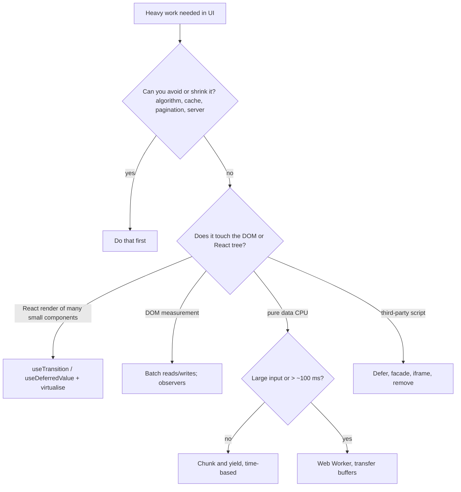
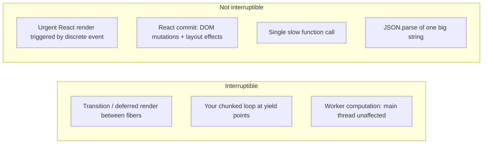

# 07 / 20 — Long Tasks and the Main Thread

## 1. Lesson metadata

| | |
|---|---|
| **Level** | Advanced |
| **Study time** | 4–5 hours (reading 1.5 h, labs 1.5 h, exercises 1.5 h) |
| **Prerequisites** | [Phase 0 — How the browser works](../00-web-and-javascript-foundations/01-how-the-browser-works.md), [Phase 0 — Event loop, tasks, microtasks](../00-web-and-javascript-foundations/11-event-loop-tasks-microtasks.md), [Phase 0 — JavaScript performance fundamentals](../00-web-and-javascript-foundations/17-javascript-performance-fundamentals.md), [Phase 2 — Scheduler and priorities](../02-react-rendering-and-internals/13-scheduler-and-priorities.md), [10 — Expensive computations](./10-expensive-computations.md), [11 — Scheduling and perceived responsiveness](./11-scheduling-and-perceived-responsiveness.md), [12 — useTransition in practice](./12-usetransition-in-practice.md), [18 — React vs browser bottlenecks](./18-react-vs-browser-bottlenecks.md) |
| **Next** | [21 — Web Vitals and budgets](./21-web-vitals-and-budgets.md) |
| **Related** | [14 — Debounce and throttle](./14-debounce-and-throttle.md), [15 — Code splitting and lazy loading](./15-code-splitting-and-lazy-loading.md), [Phase 2 — Interruptible, restartable, abandoned rendering](../02-react-rendering-and-internals/15-interruptible-restartable-abandoned-rendering.md), [Phase 2 — Hydration and selective hydration](../02-react-rendering-and-internals/25-hydration-and-selective-hydration.md) |

**Learning objectives.** After this lesson you can:
1. Define a **long task** (a task whose main-thread occupancy exceeds 50 ms, per the Long Tasks API) and explain why the 50 ms figure exists, what it does and does not measure, and how it relates to Total Blocking Time (TBT) and INP.
2. Explain the *single-threaded contention model*: input handling, JS, style/layout, paint recording, timers, promise jobs, React rendering, hydration, GC, and third-party scripts all queue on one thread.
3. Find the owner of a long task with the Performance panel, the Long Tasks API, and the Long Animation Frames (LoAF) API, and attribute it to React, app code, a library, a third party, GC, or hydration.
4. Break up work with the right technique: algorithmic improvement, **chunking and yielding** (`scheduler.yield`, `scheduler.postTask`, `MessageChannel`, `setTimeout(0)` fallbacks), React's own time slicing (transitions/deferral), idle scheduling, **Web Workers**, and moving work to the server or build time.
5. Know the costs and limits of each technique (worker serialisation, `requestIdleCallback` starvation, yielding overhead, `isInputPending` caveats) and when *not* to apply them.
6. Diagnose long tasks in a React app: heavy render/commit, hydration, big JSON parse, synchronous storage, layout thrash, and large third-party bundles at start-up.

**Concepts covered:** tasks, microtasks, rendering opportunities, long tasks, TBT, INP interplay, yielding, `scheduler.yield()`/`scheduler.postTask()` (Chrome and Firefox; not Safari), `MessageChannel`-based yielding, `requestIdleCallback`, `isInputPending` (Chromium-only, experimental), `IntersectionObserver`/`requestAnimationFrame` cadence, Web Workers, `postMessage` cost, structured clone, transferables, `OffscreenCanvas`, React time-slicing semantics, hydration cost, JSON parse/stringify cost, `localStorage` synchronous cost, Long Animation Frames.

---

## 2. Deep conceptual explanation

### 2.1 What problem is this lesson solving?

The browser has one **main thread** per document (more exactly, per same-origin agent cluster window; cross-origin iframes may have separate processes/threads in many browsers, see [Phase 0 — How the browser works](../00-web-and-javascript-foundations/01-how-the-browser-works.md)). Everything user-visible and interactive is serialised through it: parsing, event handlers, JS execution, style, layout, paint recording, timers, promise reactions, React's render and commit, and hydration. If a task occupies the thread for 300 ms, then for 300 ms **nothing else runs**: clicks are not dispatched, caret blinking and CSS animations on the main thread freeze, scrolling that depends on main-thread scroll handlers stutters, and the page cannot produce frames.

Users do not perceive "300 ms of JS". They perceive "I clicked and nothing happened" (input delay), "the animation froze" (jank) or "the page isn't ready yet" (poor interactivity after load). The aim of this lesson is **responsiveness engineering**: keep tasks short enough to leave gaps in which input can be handled and frames produced, *or* move the work elsewhere.

### 2.2 Tasks, long tasks, and the 50 ms rule

A **task** is a unit of work scheduled on the event loop (a click dispatch, a timer callback, a message event, parsing a chunk of HTML...). Microtasks (promise reactions, `queueMicrotask`) run to completion at the end of a task's JS execution and are therefore part of that task's duration. See [Phase 0 — Event loop](../00-web-and-javascript-foundations/11-event-loop-tasks-microtasks.md).

The **Long Tasks API** reports tasks that block the main thread for **50 ms or more** (the threshold is defined by the Long Tasks specification; only Chromium-based browsers implement the API per MDN compat data). The justification used in the RAIL model (Google's, now a legacy framing but still useful): to respond to input within ~100 ms, the main thread should not be blocked for more than ~50 ms at a time, because an input arriving at the *start* of a 50 ms task waits at most 50 ms, leaving ~50 ms for handling and presentation. The number is a **heuristic budget**, not a physical constant; high-refresh displays (120 Hz → 8.3 ms frames) and animation-heavy pages need much tighter tasks.

**TBT (Total Blocking Time)** is a lab metric: the sum, over long tasks between First Contentful Paint and Time to Interactive, of `duration − 50 ms` for each task. A 120 ms task contributes 70 ms. TBT is a lab proxy correlated with field responsiveness; INP is the field metric. See [21](./21-web-vitals-and-budgets.md). Lighthouse's scoring weights and thresholds for TBT change across versions, so check the current Lighthouse docs on developer.chrome.com before quoting numbers.

### 2.3 The contention model

```
time ──────────────────────────────────────────────────────────────►
main thread:  [ parse JS 80ms ][ hydrate 220ms ][ React render 40ms ][ GC 15ms ][ analytics 70ms ]
user input:                         ▲ click here → waits until 300ms mark … handled at ~310ms
```

Everything in that line counts against the interaction, **whoever owns it**. This is why a perfectly optimised component can still have a poor INP: its handler is queued behind someone else's work.

*Three sources of long tasks, by origin:*
1. **Your synchronous algorithmic work** — sorting/filtering large arrays, JSON parsing, markdown/syntax highlighting, diffing, layout computation, CSV export.
2. **React work** — large renders and commits, hydration of big trees, effects that do heavy work. React itself can yield between units of work in concurrent renders ([Phase 2 — Interruptible rendering](../02-react-rendering-and-internals/15-interruptible-restartable-abandoned-rendering.md)), but **only for work React controls and only when the render is a non-urgent (transition/deferred/Suspense retry) render**; urgent renders triggered by discrete events complete synchronously. Your code inside a component is never interrupted midway: React yields *between* components (fibers), not inside your function.
3. **Everyone else's work** — third-party scripts, extensions (in your profiling environment!), browser internal work (GC, style recalc, layout).

### 2.4 Techniques: a taxonomy

| Technique | What it does | Main thread free during work? | Cost |
|---|---|---|---|
| **Reduce the work** (algorithm, data structure, memoisation, caching, pagination) | Removes work | N/A | Engineering effort; always first ([10](./10-expensive-computations.md)) |
| **Defer the work** (do it later: idle, on demand, after first paint) | Moves out of the critical window | Partially | Work still happens; may collide later |
| **Chunk + yield** | Splits one big task into many small ones with gaps | Yes, between chunks | Total time increases (scheduling overhead), complexity |
| **React concurrency** (`startTransition`, `useDeferredValue`) | React yields between fibers for non-urgent renders | Yes, between fibers | Extra renders, stale UI; doesn't help non-React work |
| **Web Worker** | Runs JS on another thread | Yes entirely | Message serialisation, no DOM access, bundling/tooling, startup cost |
| **Server/build-time** | Does work once, elsewhere | Yes | Infra complexity, freshness |
| **Isolation** (iframe, `<script async>`, facades) | Shifts third-party work | Partly | Complexity, UX trade-offs |

### 2.5 Yielding: what it is and what it is not

*Yielding* means ending your task voluntarily so the event loop can handle other tasks (input, rendering) and then continuing in a *new* task. Classic ways:

```ts
await new Promise<void>((r) => setTimeout(r, 0));   // macrotask yield (clamped delay may be ≥ 1 ms, nested timers ≥ 4 ms in many browsers)
await new Promise<void>((r) => requestAnimationFrame(() => r())); // yields until next frame — waits for rendering
// message channel yield: no timer clamping
const { port1, port2 } = new MessageChannel();
```

Newer: `await scheduler.yield()` — supported in Chrome 129+ and Firefox 142+ but not Safari (MDN browser-compat-data, checked 2026-10-22), so keep a fallback to `setTimeout`/`MessageChannel`. Its distinguishing feature: the continuation is queued with **higher priority than other pending tasks of the same kind**, so yielding doesn't push your remainder behind unrelated timers (it resumes "at the front"). `scheduler.postTask(fn, { priority: "user-visible" | "user-blocking" | "background", signal })` has the same support picture (Chrome 94+, Firefox 142+, no Safari).

`await somePromise` does **not** yield to the event loop for rendering or input: promise continuations are microtasks and run before the browser can do anything else. A `for` loop with `await Promise.resolve()` inside is still one long task. This is the single most common yielding mistake.

**Predict:** what does the browser do between two iterations of `for (…) { await Promise.resolve(); heavy(); }`? *(Nothing: microtasks drain before the next task; no input or rendering opportunity occurs.)*

### 2.6 React's time slicing: what is promised

React's concurrent renderer (React 18+; default when using `createRoot`) can *pause* a render at fiber boundaries **if the render was scheduled as a non-blocking (transition/deferred/idle-ish) priority**. Public behavior (docs): updates marked as transitions are interruptible; urgent updates are not; React gives no promise about slice length (its scheduler yields on the order of a few ms — implementation detail, not documented as a guarantee). So:

- If one component's render takes 200 ms, **React cannot interrupt it**; a transition doesn't make a single slow function faster or slice it.
- A transition over a tree of 5,000 cheap components can be sliced into many small tasks; input remains responsive.
- **Commit is synchronous and uninterruptible**: committing 20,000 DOM mutations is one task.

See [12](./12-usetransition-in-practice.md) and [Phase 2 — Transitions and deferred rendering](../02-react-rendering-and-internals/23-transitions-and-deferred-rendering.md).

### 2.7 Misconceptions

| Misconception | Reality |
|---|---|
| "`async`/`await` makes code non-blocking." | It only defers continuation to microtasks/after I/O; CPU-bound code between awaits still blocks. |
| "`setTimeout(fn, 0)` makes heavy work free." | It moves the whole `fn` to a later task; still one long task. Chunking is what helps. |
| "`requestIdleCallback` is the right tool for all deferred work." | Idle callbacks may be delayed indefinitely on busy pages; not shipped in Safari (only behind a flag/preview per MDN compat data; Chrome 47+, Firefox 55+); deadlines are advisory. |
| "A Web Worker makes anything fast." | It moves CPU work off-thread; but data transfer (structured clone) can cost more than the compute for small jobs; no DOM access. |
| "React's concurrency removes the need to think about long tasks." | It only slices React render work for non-urgent updates. Your handlers, commits, effects, and non-React scripts are unaffected. |
| "50 ms is a hard rule." | It's a heuristic budget; INP thresholds are on end-to-end interaction latency; 120 Hz and animation-heavy apps need less. |
| "Long tasks are only a load-time problem." | They also happen after load: route changes, big list updates, JSON handling, GC, third-party scripts triggered by interaction. |

---

## 3. Internal mechanics

### 3.1 The rendering opportunity

The event loop (HTML spec's processing model): the browser picks a task, runs it to completion, drains microtasks, then *may* perform an update-the-rendering step (rAF callbacks, style, layout, paint) at a **rendering opportunity** (typically once per display refresh, if there is something to render and the page is visible). If your task runs 250 ms, rendering opportunities for 15 frames pass unused. Input events are queued as tasks; they dispatch when the main thread gets to them. Compositor-driven work (e.g. scrolling with passive/non-main-thread-dependent handlers, `transform`/`opacity` animations on promoted layers) can continue during main-thread blockage in many browsers — which is why a page can scroll smoothly yet ignore clicks. Behavior varies by browser and by whether scroll handlers are present.

### 3.2 How long tasks are reported

- **Long Tasks API** (`PerformanceObserver` type `"longtask"`; Chromium-only): entries with `duration ≥ 50 ms` and coarse `attribution` (container: self/same-origin/cross-origin iframe).
- **Long Animation Frames API (LoAF)** (`type: "long-animation-frame"`; Chromium-only, Chrome 123+, flagged experimental on MDN): reports frames that take longer than ~50 ms to render, with a breakdown of **scripts** (source URL, function name, invoker such as `event-listener`, `user-callback`, `resolve-promise`), `renderStart`, `styleAndLayoutStart`, and `blockingDuration`. It's designed to fix Long Tasks' attribution weakness and aligns better with INP. Details evolve; verify the current shape on MDN.
- **Event Timing** (INP): per-interaction decomposition (see [18](./18-react-vs-browser-bottlenecks.md)).
- DevTools Performance panel: tasks over 50 ms are marked with a red triangle/striped region on the Main track.

### 3.3 Hydration as a long task

Hydration ([Phase 2 — Hydration and selective hydration](../02-react-rendering-and-internals/25-hydration-and-selective-hydration.md)) is React running the component tree on the client to attach handlers and reconcile with server HTML. For large pages it is one of the largest start-up tasks: JS download, parse/compile, execute, then hydrate. React 18+ with `hydrateRoot` and Suspense boundaries can hydrate **selectively and incrementally** (slices between boundaries; prioritising the interacted region). How much yielding occurs depends on the boundaries you create and the React version, so confirm with a profile. Techniques: smaller bundles ([15](./15-code-splitting-and-lazy-loading.md), [16](./16-bundle-analysis.md)), Suspense boundaries around heavy below-the-fold sections, server components for non-interactive parts (Phase 9, *planned*), deferring non-critical widgets.

### 3.4 Costs hidden in "just data"

- **`JSON.parse` / `JSON.stringify`** of multi-MB payloads: tens to hundreds of ms on mid-range mobile, synchronous. Mitigation: smaller payloads, pagination, streaming parsers, parse in a worker, or avoid re-stringifying (e.g. deep equality via stringify).
- **`structuredClone`/`postMessage`**: cost proportional to size; transferables (`ArrayBuffer`) move without copy.
- **`localStorage`/`sessionStorage`**: synchronous; large values block; avoid in hot paths.
- **Regex catastrophic backtracking**: pathological inputs can freeze a tab.
- **Sorting/filtering/derivations** over 100k items per keystroke.
- **Date/Intl formatters** created in render (e.g. `new Intl.NumberFormat` per cell) — construction is notably more expensive than `format`; cache formatter instances.
- **GC**: a burst of allocations (mapping 100k objects per render) triggers GC pauses. See [19](./19-memory-leaks.md).

### 3.5 Web Workers — mechanics

A worker has its own event loop and JS heap; communication is via `postMessage` with the **structured clone algorithm** (copy; most plain data types; no functions or DOM nodes) or **transfer** (e.g. `ArrayBuffer`, `MessagePort`, `OffscreenCanvas`) or shared memory (`SharedArrayBuffer`, requires cross-origin isolation headers). Costs: worker startup (parse + execute; tens of ms), serialisation, extra memory, and tooling (the bundler must emit a worker chunk — Vite: `new Worker(new URL("./w.ts", import.meta.url), { type: "module" })`; verify for your bundler version). A worker **cannot touch the DOM**, so UI updates must come back via messages and React state.

### 3.6 Priority hints from the platform

`scheduler.postTask` priorities (`user-blocking`, `user-visible`, `background`) and `scheduler.yield()` provide *platform-level* prioritisation analogous to React's lanes ([Phase 2 — Lanes](../02-react-rendering-and-internals/14-lanes.md)). They are not integrated into React's own scheduler API for user code (React uses its own scheduler package internally, an implementation detail that may change). Application chunking code can use them independently of React.

---

## 4. Step-by-step execution walkthrough

Scenario: a "Export report" button parses a 6 MB JSON, computes aggregates for 150,000 rows (≈ 400 ms on a mid-range phone), then sets state with the result to render a summary. Meanwhile an animated spinner (CSS animation on `transform`) and a text input (user types a note) are on screen.

**Version 1 — synchronous.**

1. **t=0** click event task starts: handler runs `parse(json)` → 140 ms.
2. **t=140** `aggregate(rows)` → 260 ms. Total long task: 400 ms (350 ms over the budget → contributes 350 ms to TBT-like blocking if during load; to INP, the interaction's processing time is 400 ms).
3. **t=400** `setState(summary)` (batched; React renders synchronously at the end of the discrete event): render 8 ms + commit 4 ms.
4. **t=412** Task ends; browser performs rendering: first paint with the summary at ≈ 430 ms.
5. **During 0–400 ms:** keystrokes typed during this window are queued; they appear all at once at ~430 ms (input delay up to 400 ms). The `transform` spinner on its own compositor layer may keep spinning; a main-thread JS-driven progress indicator freezes.

**INP for this interaction ≈ 430 ms** (poor by common thresholds, see [21](./21-web-vitals-and-budgets.md)).

**Version 2 — chunk + yield.**

1. **t=0** click task: set `status = "working"` (render a spinner/progress state immediately) and **yield** before heavy work so the browser can paint that feedback. (~3 ms of handler + render; next paint at ≈ 16 ms.)
2. **t≈17** New task: parse (140 ms) — can't be chunked (single `JSON.parse` call is atomic). *Still a long task.* Fix options: move to a worker, or change the payload.
3. **t≈160+** aggregate in chunks of 5,000 rows (~9 ms each; 30 chunks), yielding between chunks. Between chunks: input handled, progress updated.
4. **t≈160–470** (total ≈ 310 ms + 30 × ~1–4 ms overhead ≈ 350 ms): all inputs processed within ≤ ~10 ms of arrival.
5. **End:** `setState(summary)`; render/commit/paint as before.

Total wall time is *longer* (≈ 500 ms vs 430), but the **responsiveness is better**: input delay ≤ 140 ms (the atomic parse) → ≤ 12 ms after moving parse to a worker.

**Version 3 — worker.** Worker parses and aggregates; main thread passes the `ArrayBuffer`/string (transfer if buffer) and receives the small `summary`. Main thread free throughout (cost: ~30–60 ms worker startup first time, transfer/clone of small summary ≈ 1 ms). Input delay ≈ 0.

**Predict:** if the source JSON arrives via `fetch(...).then(r => r.json())`, where does the parse cost land? *(In the main thread task that resolves the body promise — `Response.json()` parsing happens off the JS-visible code but is still performed on a thread; in practice, large `.json()` calls can show main-thread time. Verify in a trace for your browser; to be certain, fetch `arrayBuffer()` inside the worker and parse there.)*

---

## 5. Code examples

### 5.1 Minimal example — a yield helper with graceful fallback

```ts
type SchedulerLike = { yield?: () => Promise<void> };

export function yieldToMain(): Promise<void> {
  const s = (globalThis as { scheduler?: SchedulerLike }).scheduler;
  if (s?.yield) return s.yield();                         // Chrome 129+/Firefox 142+; resumes with priority
  return new Promise<void>((resolve) => {
    const { port1, port2 } = new MessageChannel();        // avoids setTimeout clamping
    port1.onmessage = () => { port1.close(); resolve(); };
    port2.postMessage(undefined);
  });
}
```

Notes: the `MessageChannel` fallback posts a task to the loop without nested-timer clamping (a common technique, also used internally by schedulers; implementation detail not guaranteed). TypeScript's `lib.dom` may or may not include `scheduler.yield` depending on version, so a narrow structural cast keeps this compiling.

### 5.2 Practical example — chunked processing with time-based yielding

```ts
export async function processInChunks<T, R>(
  items: readonly T[],
  fn: (item: T, index: number) => R,
  { budgetMs = 8, signal }: { budgetMs?: number; signal?: AbortSignal } = {},
): Promise<R[]> {
  const out: R[] = new Array(items.length);
  let sliceStart = performance.now();

  for (let i = 0; i < items.length; i++) {
    out[i] = fn(items[i], i);

    if (performance.now() - sliceStart >= budgetMs) {      // time-based, not count-based
      await yieldToMain();
      if (signal?.aborted) throw new DOMException("Aborted", "AbortError");
      sliceStart = performance.now();
    }
  }
  return out;
}
```

Line notes:
- **Time-based** slicing adapts to device speed; a fixed chunk of 5,000 items might be 3 ms on a laptop and 40 ms on a phone.
- Checking `performance.now()` per item adds overhead (microseconds); for very cheap `fn`, check every N items.
- `signal` allows cancelling when the user navigates away or changes the input; essential for avoiding stale results and wasted CPU. See [Phase 6 — Cancellation and race conditions](../06-data-fetching-and-state-ecosystems/02-cancellation-and-race-conditions.md).
- **Trade-off:** result arrives later and the code is async; you must model "working" state in the UI.

React usage:

```tsx
function ExportButton({ rows }: { rows: readonly Row[] }) {
  const [state, setState] = useState<{ status: "idle" } | { status: "working" } | { status: "done"; summary: Summary }>({ status: "idle" });
  const acRef = useRef<AbortController | null>(null);

  async function onClick() {
    acRef.current?.abort();
    const ac = new AbortController();
    acRef.current = ac;
    setState({ status: "working" });
    await yieldToMain();                                   // let React commit + browser paint the "working" state
    try {
      const metrics = await processInChunks(rows, computeRowMetric, { signal: ac.signal });
      if (!ac.signal.aborted) setState({ status: "done", summary: summarize(metrics) });
    } catch (e) {
      if (!(e instanceof DOMException && e.name === "AbortError")) throw e;
    }
  }

  useEffect(() => () => acRef.current?.abort(), []);        // cancel on unmount
  return <button onClick={onClick} disabled={state.status === "working"}>Export</button>;
}
```

`setState` + `await yieldToMain()`: the state update from a discrete event renders synchronously at the end of the handler's *synchronous* portion; the `await` yields so the browser can paint it. (If the handler awaited a microtask only, the paint would *not* happen first — see 2.5.) Checked in the sandbox (React 19.3, RTL/jsdom): the `"working"` render ran right after the handler's synchronous part, before any microtask queued in the handler. See [Phase 2 — Automatic batching](../02-react-rendering-and-internals/22-automatic-batching.md).

### 5.3 Incorrect example — fake yielding

```ts
async function heavyLoop(items: number[]) {
  for (const x of items) {
    await Promise.resolve();       // microtask: NOT a yield to rendering or input
    expensive(x);
  }
}

// and: "async" doesn't help
async function sortHuge(arr: number[]) {
  return arr.sort((a, b) => a - b);   // still synchronous CPU work inside an async function
}
```

**Predict:** will a click during `heavyLoop` be handled between iterations? *(No. The microtask queue drains completely before the next task; the click task stays queued until the entire loop ends.)*

### 5.4 Corrected implementation — React transition for an expensive *React* render, worker for expensive *non-React* compute

```tsx
// Part A: non-urgent React render, sliceable (many small components)
const [query, setQuery] = useState("");
const [isPending, startTransition] = useTransition();
const [filter, setFilter] = useState("");
function onChange(e: React.ChangeEvent<HTMLInputElement>) {
  setQuery(e.target.value);                            // urgent: input stays responsive
  startTransition(() => setFilter(e.target.value));    // non-urgent: large list render can be sliced
}
```

```ts
// Part B: non-React heavy compute in a module worker (Vite-style `new Worker(new URL(...), { type: "module" })`; webpack 5 supports the same pattern, other bundlers vary)
// stats.worker.ts
self.onmessage = (e: MessageEvent<{ id: number; buffer: ArrayBuffer }>) => {
  const text = new TextDecoder().decode(e.data.buffer);
  const rows = JSON.parse(text) as Row[];
  const summary = aggregate(rows);
  (self as unknown as Worker).postMessage({ id: e.data.id, summary });
};
```

```tsx
// useStatsWorker.ts
export function useStatsWorker() {
  const workerRef = useRef<Worker | null>(null);
  const pending = useRef(new Map<number, (s: Summary) => void>());
  const nextId = useRef(0);

  useEffect(() => {
    const w = new Worker(new URL("./stats.worker.ts", import.meta.url), { type: "module" });
    w.onmessage = (e: MessageEvent<{ id: number; summary: Summary }>) => {
      pending.current.get(e.data.id)?.(e.data.summary);
      pending.current.delete(e.data.id);
    };
    workerRef.current = w;
    return () => { w.terminate(); workerRef.current = null; pending.current.clear(); };
  }, []);

  return useCallback((buffer: ArrayBuffer) => new Promise<Summary>((resolve) => {
    const id = nextId.current++;
    pending.current.set(id, resolve);
    workerRef.current?.postMessage({ id, buffer }, [buffer]);   // transfer: zero-copy
  }), []);
}
```

Line notes and trade-offs:
- `[buffer]` as the second argument **transfers** the buffer; the sender's `buffer` becomes detached (length 0). Don't reuse it.
- The worker is created per hook consumer; for shared use, create one module-level worker or a pool, and design for reference counting ([19](./19-memory-leaks.md)).
- Errors: handle `worker.onerror`/`onmessageerror`; the `Promise` above never rejects; add rejection and timeouts in production.
- Under Strict Mode in dev the effect runs twice: the first worker is terminated by cleanup (fine). The `pending` map is cleared on cleanup — unresolved promises will never resolve; real code should reject them.
- Libraries (e.g. Comlink) wrap this RPC pattern; evaluate maturity and bundle size before adopting.

### 5.5 Advanced example — yield-aware React effect scheduling and LoAF reporting

```ts
// LoAF reporting (Chromium-only: Chrome 123+)
type ScriptTiming = {
  sourceURL: string; sourceFunctionName: string; invoker: string; duration: number;
};
type LoAF = PerformanceEntry & {
  blockingDuration: number; renderStart: number; styleAndLayoutStart: number; scripts: ScriptTiming[];
};

export function reportLongAnimationFrames(report: (e: LoAF) => void): void {
  if (!PerformanceObserver.supportedEntryTypes?.includes("long-animation-frame")) return;
  new PerformanceObserver((list) => {
    for (const entry of list.getEntries() as LoAF[]) {
      if (entry.blockingDuration > 0) report(entry);       // frames that blocked input
    }
  }).observe({ type: "long-animation-frame", buffered: true });
}
```

Usage: group `scripts` by `sourceURL` to find which bundle (yours, a vendor, a third party) dominates blocking, correlate with route and interaction type; sample (do not send every entry). Privacy: URLs of third-party scripts may be sensitive in some policies; follow your data-governance rules.

### 5.6 Avoiding `isInputPending` as a default

`navigator.scheduling.isInputPending()` (Chromium-only, Chrome 87+; flagged experimental on MDN, no Firefox/Safari support) lets code check whether input is waiting and yield only then. It is tempting but fragile (not available in all browsers, semantic caveats, may be removed). A time-based budget as in 5.2 is portable. If you use it, treat as optional progressive enhancement.

---

## 6. Visual explanations

### Timeline: one long task vs sliced work

```mermaid
gantt
    title Main thread, 600 ms window (illustrative)
    dateFormat  X
    axisFormat %L
    section One long task
    Heavy work (400 ms)         :0, 400
    Input (waits)               :crit, 100, 400
    Render + paint              :400, 430
    section Chunked
    Chunk 1                     :0, 9
    Input handled               :9, 12
    Chunk 2                     :12, 21
    Frame                       :21, 30
    Chunk 3..N                  :30, 450
```



### Where to run the work?



### Who can interrupt whom



---

## 7. Alternative approaches and trade-offs

| Approach | Responsiveness | Total time | Complexity | Compatibility | Notes |
|---|---|---|---|---|---|
| Leave synchronous | Poor if > 50 ms | Lowest | None | All | Fine for tiny work |
| `setTimeout(0)` whole job | None (still one task) | Same | Low | All | Only lets paint happen first |
| Chunk + `MessageChannel` yield | Good | +5–20% | Medium | All | Portable; manage cancellation |
| Chunk + `scheduler.yield()` | Good, better resumption | +small | Medium | Chrome + Firefox, not Safari | Use with fallback |
| `requestIdleCallback` | Good *if* idle exists | Unbounded delay | Medium | not Safari | Starves on busy pages; use `timeout` |
| `useTransition`/`useDeferredValue` | Good for React render | Slight overhead | Low | React 18+ | Doesn't slice non-React work or commits |
| Web Worker | Excellent | + serialisation | High | All modern | No DOM; tooling; startup |
| Server/build-time precompute | Excellent | N/A | Infra | All | Freshness and cost |
| Virtualise/paginate | Excellent for DOM-bound | Lower | Medium | All | Often *the* fix for commit-heavy renders |

**Scenario where chunking/yielding is *not* the best approach:** a 70 ms synchronous computation that runs once at page load behind a clear loading state, on desktop-class devices only (internal tool). The engineering cost of async-ifying, cancellation and UI states outweighs a one-time 20 ms over-budget task nobody notices. Leave it, and put a budget alert (TBT/INP) in place to detect when it grows. Conversely, an operation that runs *on every keystroke* must be sliced or deferred even at 40 ms because it will be invoked continuously.

---

## 8. Best practices and anti-patterns

**Beginner mistakes**
- Believing `await` yields to the browser.
- Debouncing a 400 ms computation instead of reducing/slicing it (debounce delays *when*, not *how long it blocks*; see [14](./14-debounce-and-throttle.md)).
- Doing work in render that belongs in a handler or worker.
- Parsing large JSON on the main thread without noticing.

**Experienced-developer mistakes**
- Chunking with a fixed count instead of time budget.
- Yielding too often (every item): overhead dominates; yielding too rarely: tasks stay long. A budget of ~5–10 ms is a common starting point; measure.
- Using a worker for tiny jobs where `postMessage` costs more than the work.
- Forgetting cancellation: chunked work continues after the user navigates away and writes stale results to state.
- Assuming `useTransition` solves slow *commit* or slow *single component*.
- Optimising only on a fast dev machine with all extensions disabled while users have 20 browser tabs and a mid-range phone.

**Smells**
- Red long-task markers during interaction in the Performance panel.
- `Array.prototype.map/filter/sort` chains over >10⁴–10⁵ items in render without memoisation.
- Synchronous `localStorage` writes on every keystroke.
- `JSON.parse(JSON.stringify(x))` deep clones of large state.
- "Loading" states that freeze (spinner implemented in JS stops during heavy work).

**Justified exceptions**
- Short synchronous tasks just above 50 ms that run rarely.
- Keeping deterministic ordering requirements (e.g. a reducer must apply updates atomically) where chunking would expose partial state.
- Prefer sync for correctness-critical flows (payment form validation) if fast enough, and make slower parts async.

---

## 9. Real-world application

**Analytics dashboard.** Filtering 100k rows client-side. Strategy: server-side aggregation for the default view; client-side filtering for small result sets in `useMemo`; for ad-hoc filters, compute in a worker with transferable typed arrays (columnar layout) and render summaries only. Constraints: time-to-first-chart; large payload parse; keep selection state responsive with `useDeferredValue` for chart re-render.

**Rich-text/Markdown editor.** Syntax highlighting or spellcheck on each keystroke. Use incremental parsing (editor frameworks already do), debounce expensive linting (not caret movement), run heavy analysis in a worker or after idle, and keep keystroke handling < 16 ms. Constraint: correctness of partial results (squiggles lagging is acceptable; characters lagging is not).

**E-commerce start-up.** The first 5 seconds after load decide TBT/INP: analytics and tag manager scripts, A/B frameworks, hydration. Remedies: load tags after `load`/idle, break up hydration with Suspense boundaries, avoid large synchronous client-only initialisation, use server-side rendering for above-the-fold content. See [15](./15-code-splitting-and-lazy-loading.md).

**Finance spreadsheet-like grid.** Formula recalculation graph; typed arrays; recalculation in a worker with change-set messages; virtualised rendering. The UX contract: cell edit acknowledges immediately (optimistic local value), results arrive in order; cancel stale recalculations.

**Realtime monitoring.** Bursts of messages: batch incoming messages in a buffer and flush once per animation frame (or every N ms) instead of calling `setState` per message; a burst of 500 messages should produce one render, not 500 (React batches within a task, but separate message events are separate tasks). See [Phase 6 — Real-time](../06-data-fetching-and-state-ecosystems/17-real-time-websockets-subscriptions.md).

```ts
// Flush-once-per-frame buffer
let buffer: Msg[] = [];
let scheduled = false;
socket.onmessage = (e) => {
  buffer.push(JSON.parse(e.data) as Msg);
  if (!scheduled) {
    scheduled = true;
    requestAnimationFrame(() => {
      const batch = buffer; buffer = []; scheduled = false;
      setMessages((prev) => prev.concat(batch).slice(-1000));  // bounded
    });
  }
};
```
(`requestAnimationFrame` doesn't run in background tabs — a hidden tab accumulates `buffer` without flushing; add a visibility fallback or cap the buffer.)

---

## 10. Debugging and troubleshooting

**Symptom → investigation → cause**

| Symptom | Investigate | Typical cause | Fix |
|---|---|---|---|
| Clicks ignored for ~300 ms right after load | Performance trace of load: long tasks between FCP and first interaction | Hydration + bundle execution + tag scripts | Reduce JS, Suspense boundaries, defer third parties |
| Typing lags on a specific page only | Record while typing; look at tasks per keystroke | Heavy render per keystroke / synchronous work in handler | `useDeferredValue`, move work off handler, slice |
| UI freezes periodically with no interaction | Trace idle page; long tasks at intervals | Timers, polling parse, GC, extension | Find the timer owner; batching; fix leaks |
| Spinner stops spinning | JS-driven animation | Main thread blocked | CSS animation on transform; shorten tasks |
| Chunking made it "slower" but UI is smooth | Compare total time and input delay | Expected trade-off | Accept; tune budget |
| Worker version slower for small input | Time `postMessage` roundtrip | Serialisation/startup overhead | Use threshold; keep worker warm; transfer buffers |

**Procedure**
1. **Reproduce** on throttled CPU (4–6×) and a production build.
2. **Trace**: Performance panel → record the interaction or load window. Identify tasks with the long-task marker. Click each → **Bottom-up** for self time by function; group by URL/domain/"Third party".
3. **Classify** the task: React render (component names, `performWork…`-style internals names vary), commit, hydration, JSON parse, GC (minor/major GC events), layout (purple), third party.
4. **Check interaction track** for input delay vs processing vs presentation ([18](./18-react-vs-browser-bottlenecks.md)).
5. **Apply the taxonomy**: reduce → defer → slice → worker → isolate. Make *one* change; re-record.
6. **Validate** with three metrics: max task duration, TBT (lab), and field INP segmented by route/device. A fix that lowers long-task count in the lab but not field INP means the lab scenario was wrong.

**Field instrumentation.** Use the `web-vitals` library's attribution build for INP, plus LoAF reporting where supported (5.5), tagged with route and release. Sample 1–10% to bound cost.

**Pitfalls.** DevTools' "Long task" markers are *relative to the throttled CPU*; always state your throttling. Profiling with the React DevTools extension open adds overhead. Lighthouse runs with simulated throttling and may differ from real-device traces.

---

## 11. Exercises

### Level A — Knowledge
A1. What is a long task according to the Long Tasks API and what is TBT?
A2. Why doesn't `await Promise.resolve()` let the browser handle input?
A3. What can React's concurrent rendering slice, and what can it not?
A4. Give two costs of using a Web Worker.
A5. Why can compositor-only animations continue while the main thread is blocked?

### Level B — Code comprehension
B1. A task takes 90 ms. Another takes 55 ms. A third 20 ms. What's the TBT contribution of each, and the total?
B2. What's wrong with this chunking function?
```ts
async function run(items: number[]) {
  for (let i = 0; i < items.length; i += 1000) {
    for (let j = i; j < i + 1000 && j < items.length; j++) work(items[j]);
    await Promise.resolve();
  }
}
```
B3. In this component, will the input remain responsive while `Results` renders 8,000 rows (each row ~0.05 ms)? Explain what changes if rows are 0.5 ms each.
```tsx
function Search() {
  const [q, setQ] = useState("");
  const deferred = useDeferredValue(q);
  return (<>
    <input value={q} onChange={(e) => setQ(e.target.value)} />
    <Results query={deferred} />   {/* Results is memo'd */}
  </>);
}
```

### Level C — Implementation
C1. Implement `runWithBudget<T>(generator: Generator<void, T>, budgetMs: number): Promise<T>` that drives a generator function, yielding to the main thread after each time budget, so that CPU work can be written as a generator with `yield` at safe points.
C2. Implement a `useStableWorker<TReq, TRes>(factory)` hook returning `call(req, signal?)` with request ids, cancellation (reject with `AbortError`), error propagation, and terminate on unmount.
C3. Write the rAF-flushed message buffer from §9 as a reusable hook `useFrameBatchedMessages` that handles hidden tabs (fallback to a timer) and caps buffer size.

### Level D — Debugging
D1. After adding a Web Worker for parsing, the page feels *slower* for typical (200 KB) payloads. Find at least three candidate reasons and how to test each.
D2. A trace shows a 180 ms task labelled "Run Microtasks" after a fetch resolves. What is likely happening and how to confirm?
D3. INP is poor only on a "Settings" page. Event Timing shows large *input delay*, small processing. What are the likely causes and the steps?

### Level E — Architecture and engineering decisions
E1. Choose between virtualisation, chunked rendering via transitions, and server-side pagination for a 50,000-row audit log with filters and export. Consider UX, a11y, and cost.
E2. Your company's marketing team wants six third-party tags on every page. Design the governance model and technical controls (loading strategy, budgets, monitoring).

### Level F — Expert challenge
F1. Design a small cooperative scheduler library for application work (not React renders): priorities, time-sliced execution, cancellation, starvation protection, and integration with `scheduler.yield`/`postTask` fallbacks. Specify the API, the algorithm for slice length, and how you'd test it deterministically.

---

## 12. Detailed answers and explanations

> Attempt the exercises first.

**A1.** A long task is a task that occupies the main thread for ≥ 50 ms (as defined by the Long Tasks API in Chromium). TBT = Σ(task duration − 50 ms) over long tasks between FCP and TTI (lab metric; definition per Lighthouse docs — verify current version). It estimates how much time input could have been blocked during load.

**A2.** Promise continuations are microtasks: the event loop drains the microtask queue after the current task before choosing the next task or performing rendering. So awaiting a resolved promise just continues in the same task's microtask checkpoint. Only macrotask-based yields (timers, `MessageChannel`, `scheduler.yield`, rAF) allow input or rendering in between.

**A3.** It can slice **render work** across fibers (between components) for non-urgent updates (transitions, deferred values, Suspense retries, hydration of Suspense boundaries). It cannot slice a single component's function, event handlers, effects, commit-phase DOM mutation, or non-React JS; and urgent updates from discrete events are rendered synchronously.

**A4.** Any two: startup cost of the worker; serialisation/copy of messages (structured clone); no DOM access; build tooling complexity; extra memory; debugging complexity; error handling; race conditions with ordering.

**A5.** Compositor animations of `transform`/`opacity` on their own layers are handled by the compositor/GPU process using already-rasterised layers; they don't need main-thread style/layout/paint each frame (in typical cases). Browser-specific; if properties or layer promotion aren't compositor-eligible, they fall back to the main thread.

**B1.** 90 → 40 ms; 55 → 5 ms; 20 → 0 (not a long task). Total TBT contribution = 45 ms. Wrong answers: summing durations (165 ms) or counting only whole tasks.

**B2.** `await Promise.resolve()` never yields to the event loop for input/rendering, so the whole loop is still one task. Fix: `await yieldToMain()` (macrotask), time-based slicing.

**B3.** At 0.05 ms/row → 8,000 rows ≈ 400 ms of render work, but in a deferred (non-urgent) render split across many fibers; React can yield between rows/fibers so input stays responsive, and `memo` ensures the urgent pass doesn't render `Results`. Commit afterwards creates up to 8,000 rows' DOM in one task (could be 100+ ms) — a long task *outside* React's ability to slice → consider virtualisation. If rows are 0.5 ms each (4 s total), still sliceable, but wall time to final result is huge and CPU stays pegged; the render could be repeatedly abandoned if the user keeps typing (starvation) — virtualise or reduce work. If a *single* row takes 80 ms, React can't slice inside it.

**C1.** Sketch:
```ts
export async function runWithBudget<T>(gen: Generator<void, T>, budgetMs = 8): Promise<T> {
  let start = performance.now();
  for (;;) {
    const r = gen.next();
    if (r.done) return r.value;
    if (performance.now() - start >= budgetMs) {
      await yieldToMain();
      start = performance.now();
    }
  }
}
```
Criteria: generator `yield` points mark safe preemption; time-based; supports cancellation by `gen.return()` when a signal aborts; error propagation via `gen.throw`/exceptions. Edge: performance.now() granularity; generators add per-step overhead.

**C2.** Criteria: single worker per hook instance created in `useEffect` (not render); `Map<id, {resolve,reject}>`; `call` posts `{id, req}`; on `AbortSignal` abort, reject with `AbortError` and optionally post `{cancel: id}` (the worker must check cooperative cancellation flags between slices); `onerror` rejects all pending; cleanup terminates and rejects pending; correct generic typing; handles Strict Mode double effect (creating/terminating worker twice).

**C3.** Criteria: buffer in a ref; schedule flush with rAF when visible, `setTimeout(…, 250)` fallback when `document.visibilityState === "hidden"` (rAF is paused in hidden tabs); flush with functional `setState` and slice to cap; cancel scheduled callbacks in cleanup; an escape hatch for ordering guarantees; tests with fake timers and a mocked rAF.

**D1.** (a) Worker startup cost (module parse/execute) incurred on each use because the worker is created per call; test: time `new Worker` → first message vs compute; keep the worker warm. (b) `postMessage` structured clone of a string or large object graph costs more than the 200 KB parse; test by timing `performance.now()` around post/receive; use transferables or send the raw `ArrayBuffer`. (c) The worker returns a huge result that the main thread clones; return the minimal summary. (d) Round-trip adds latency vs main thread parse of ~5 ms; adopt a size threshold. (e) Bundle bloat: the worker duplicates a large dependency.

**D2.** Likely a large synchronous promise-resolution chain: parsing JSON (`response.json()` continuation) or processing results (`.then(res => bigMap(res))`) done inside `then` callbacks, which run as microtasks and block rendering; or thousands of chained promises. Confirm via Bottom-up on that task: the self time is in your `.then` callback (e.g. `normalize`) or `JSON.parse`. Fix: move heavy processing off the microtask path via chunking/worker; shrink data.

**D3.** Input delay means the main thread was busy *before* the event handler — not React processing in the interaction. Check for: polling timers, `setInterval` handlers, a MutationObserver/ResizeObserver loop, third-party scripts on this page, ongoing hydration or lazy chunk execution, GC, background animations in JS. Steps: record while idle on Settings to see if long tasks occur without interaction; group by script; disable candidates (feature flags, blocklist domains in DevTools) to test; compare with another page. Fix the owner: stop the poller, defer the third party, slice.

**E1.** Criteria: states requirements (find-in-page across 50k? export? keyboard nav? screen reader), argues server-side pagination/filter as default (cost: backend support; benefit: predictable payload and DOM), virtualisation for scroll continuity with accessibility treatment (ARIA grid/rowcount, focus management), transitions as a complement (not a substitute) because commits of thousands of rows are not sliced; export done server-side or streamed/worker-based, not by building a 50k-row array in the UI. Recommends one primary path with reasons.

**E2.** Criteria: tag inventory with owners; performance budget per tag (transfer size, main-thread time); loading policy (async/defer, after consent, post-load/idle, route-scoped), tag manager governance (change review, versioning), technical controls (CSP, Subresource Integrity where possible, `<iframe>` sandbox for untrusted), monitoring (LoAF/Long Tasks RUM attribution by script URL; synthetic checks in CI that fail on added long tasks), escalation path with data. Acknowledge business value vs cost and set removal triggers.

**F1.** Evaluation criteria: API (`schedule(task, {priority, signal})`, tasks as async generators or functions returning continuation), priority queues with aging for starvation protection, slice budget adapts (e.g. 5 ms default, shorter when `isInputPending` available or when frames are late), `yield` abstraction picks `scheduler.yield` → `MessageChannel` fallback, deterministic testing with an injected clock and fake yield (a virtual event loop), cancellation tests, invariants (no starvation, bounded latency), and a note about not duplicating React's scheduler for render work.

---

## 13. Senior engineer interview questions

**Q1. "Explain why a long task hurts even when the user isn't doing anything."**
Tasks run to completion; anything arriving during one — input, timers, frames — waits. A long task during load or idle creates a window in which an interaction would experience delay, and it can drop frames for JS-driven animation. Users don't need to be interacting *at that moment*; the problem is the probability and size of the window.

**Q2. "What's the difference between debouncing and slicing?"**
Debounce changes *when* work starts (wait for quiet); slicing changes *how* it executes (in small tasks with gaps). A debounced 400 ms computation still blocks for 400 ms when it fires. Use both when it makes sense: debounce to avoid unnecessary runs, slice or worker to avoid blocking when it runs.

**Q3. "When does `useTransition` not help?"**
When the cost is in a single large component function, the commit/DOM mutation, an event handler, an effect, or non-React work. Also when the render is so expensive that continuous input starves it.

**Q4. "How would you decide between a worker and chunking?"**
Compare compute cost vs transfer cost and complexity: if the job is long (>100 ms), data can be transferred cheaply or processed from raw buffers, and needs no DOM, a worker gives full responsiveness. For moderate jobs in many places, chunking with a time budget is cheaper to integrate. Measure on target devices.

**Q5. "A third party script causes 200 ms tasks on interaction. What can you do?"**
Prove attribution via LoAF/Bottom-up; try deferring/lazy-loading on interaction, a facade, moving it into an iframe or worker-based solution, removing it, or negotiating a budget. Treat as governance as well as engineering.

**Q6. "What are the risks of `requestIdleCallback`?"**
No guaranteed execution time (starvation on busy pages), not universally supported, deadlines are hints, and work started in idle can still block input if it overruns its deadline. Use `timeout` and keep tasks small.

**Q7. "How does hydration relate to long tasks and what can you do?"**
Hydration executes a large amount of JS at start-up, often as a major long task that delays input readiness. Reduce shipped JS, split hydration with Suspense boundaries so React can hydrate in slices and prioritise interacted regions, server-render non-interactive parts as server components where available, and defer non-critical widgets. Verify gains with a trace and INP.

---

## 14. Further learning resources

| Resource | URL | Covers / why | Level | Section to study |
|---|---|---|---|---|
| MDN — Long Tasks API | <https://developer.mozilla.org/en-US/docs/Web/API/PerformanceLongTaskTiming> | Definition, attribution, 50 ms threshold | Intermediate | Description |
| MDN — Long Animation Frames API | <https://developer.mozilla.org/en-US/docs/Web/API/Performance_API/Long_animation_frame_timing> | Script attribution for slow frames | Advanced | Overview |
| web.dev — Optimize long tasks | <https://web.dev/articles/optimize-long-tasks> | Yielding strategies, `scheduler.yield` | Intermediate | Strategies |
| web.dev — Total Blocking Time | <https://web.dev/articles/tbt> | TBT definition and thresholds | Intermediate | Whole article |
| MDN — `Scheduler` / `scheduler.postTask` | <https://developer.mozilla.org/en-US/docs/Web/API/Prioritized_Task_Scheduling_API> | Prioritised task scheduling | Advanced | Concepts |
| MDN — Using Web Workers | <https://developer.mozilla.org/en-US/docs/Web/API/Web_Workers_API/Using_web_workers> | Worker basics, messaging, transfer | Intermediate | Whole article |
| MDN — Structured clone algorithm | <https://developer.mozilla.org/en-US/docs/Web/API/Web_Workers_API/Structured_clone_algorithm> | What can be posted | Intermediate | Supported types |
| MDN — Event loop | <https://developer.mozilla.org/en-US/docs/Web/JavaScript/Event_loop> | Tasks and microtasks | Intermediate | Whole article |
| HTML Standard — Event loops | <https://html.spec.whatwg.org/multipage/webappapis.html#event-loops> | Normative processing model | Advanced | "Processing model" |
| React docs — `useTransition` | <https://react.dev/reference/react/useTransition> | Interruptible updates | Intermediate | Usage |
| React docs — `hydrateRoot` | <https://react.dev/reference/react-dom/client/hydrateRoot> | Hydration APIs | Intermediate | Reference |

---

## 15. Knowledge checkpoint

**You should now understand**
- Long tasks as contention for the single main thread; TBT and INP as their lab and field consequences.
- The taxonomy: reduce, defer, slice, offload, isolate.
- What React can and cannot slice.

**You should be able to explain without notes**
- Why `await` of a resolved promise is not a yield.
- Why a worker can be slower for small jobs.

**You should be able to implement**
- A time-budgeted chunker with cancellation; a worker RPC hook; frame-batched message ingestion; LoAF reporting.

**You should be able to debug**
- Long tasks at load and on interaction, hydration blocking, microtask-chain freezes, third-party input delay.

**Before moving on:** read [21 — Web Vitals and budgets](./21-web-vitals-and-budgets.md), which turns these measurements into targets, field monitoring and enforcement.
