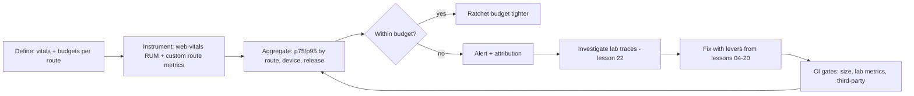
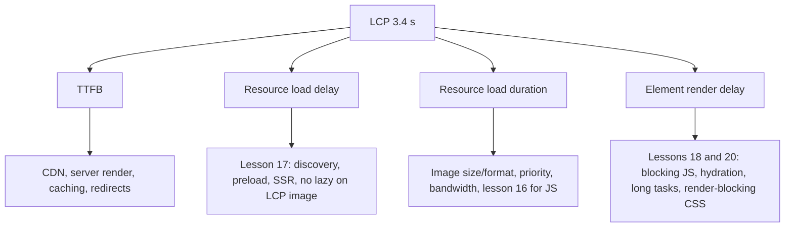
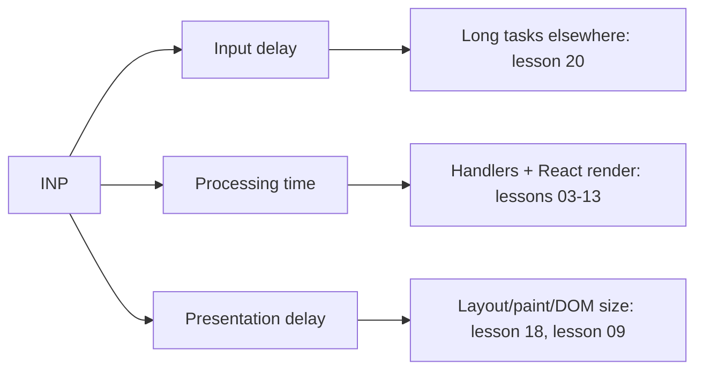

# 07 / 21 — Web Vitals and Performance Budgets

## 1. Lesson metadata

| | |
|---|---|
| **Level** | Advanced |
| **Study time** | 4–5 hours (reading 1.5 h, instrumentation labs 1.5 h, exercises 1.5 h) |
| **Prerequisites** | [01 — Measure before optimizing](./01-measure-before-optimizing.md), [16 — Bundle analysis](./16-bundle-analysis.md), [17 — Network waterfalls](./17-network-waterfalls.md), [18 — React vs browser bottlenecks](./18-react-vs-browser-bottlenecks.md), [20 — Long tasks and the main thread](./20-long-tasks-and-main-thread.md), [Phase 0 — Browser rendering pipeline](../00-web-and-javascript-foundations/03-browser-rendering-pipeline.md) |
| **Next** | [22 — Production performance investigations](./22-production-performance-investigations.md) |
| **Related** | [Phase 10 — Observability and logging](../10-production-engineering/04-observability-and-logging.md), [Phase 10 — Continuous delivery](../10-production-engineering/18-continuous-delivery.md), [Phase 11 — Performance budgets at scale](../11-senior-and-architect-mastery/09-performance-budgets-at-scale.md), [Phase 9 — SPA, SSR, SSG, streaming](../09-advanced-rendering-and-ecosystem/01-spa-ssr-ssg-streaming.md) |

> **Thresholds verified 2026-10-22** against the `web-vitals` README (`CLSThresholds` = [0.1, 0.25], `INPThresholds` = [200, 500], `LCPThresholds` = [2500, 4000]) and web.dev. The Core Web Vitals program is maintained by Google and evolves: metrics are replaced (FID was replaced by INP as a Core Web Vital in March 2024), thresholds and measurement details are refined, and tool UIs are renamed. Re-check the numbers on <https://web.dev/vitals/> before you put them into a contract, SLA, dashboard, or budget document. The *reasoning* in this lesson (how to measure, segment, and enforce) does not depend on the exact numbers.

**Learning objectives.** After this lesson you can:
1. Define LCP, INP, CLS (the Core Web Vitals), and the supporting metrics FCP, TTFB, TBT — what each measures, what user experience it approximates, and what React/app decisions move it.
2. Explain the difference between **lab data** (Lighthouse, DevTools traces, synthetic tests), **field data** (RUM, CrUX), and why they disagree; use the 75th percentile and segmentation correctly.
3. Instrument a React app with the `web-vitals` library, send beacons reliably, attribute poor values to elements, interactions, routes, and releases, and handle SPA specifics (soft navigations, bfcache, prerendering, visibility changes).
4. Translate vitals into engineering levers: LCP (TTFB, resource discovery, resource load, render delay), INP (input delay, processing, presentation delay), CLS (unsized media, late-injected content, font swaps, animations).
5. Design **performance budgets** (size, count, timing, metric budgets), enforce them in CI (bundle-size checks, Lighthouse CI, Playwright-based checks) without making the build flaky, and set alerting and ownership rules.
6. Avoid vanity metrics, Goodhart's-law gaming, and over-reliance on a single lab score.

**Concepts covered:** Core Web Vitals, 75th percentile rule, CrUX vs RUM, lab vs field, LCP sub-parts, INP phases, CLS session windows, TTFB/FCP/TBT, SPA soft navigations, back/forward cache, `web-vitals` attribution build, `PerformanceObserver`, `navigator.sendBeacon`/`fetch keepalive`, performance budgets (metric, resource, quantity, rule-based), Lighthouse CI, `size-limit`, budget ratchets, error-budget style policies.

---

## 2. Deep conceptual explanation

### 2.1 What problem is this lesson solving?

You have a toolbox from lessons 01–20: profilers, memoisation, virtualisation, scheduling, code splitting, waterfalls, long tasks. Without **targets and feedback loops** you will apply them randomly, regress silently, and be unable to answer "is the app fast enough?" or "did that release make things worse?". Web Vitals give a shared, user-centric vocabulary and public thresholds; budgets give a *contract* the team enforces automatically. The goal of this lesson is an engineering system: **define → measure in the field → attribute → budget → enforce → investigate** (the last step is the subject of [22](./22-production-performance-investigations.md)).

### 2.2 The Core Web Vitals (as of this writing)

> Thresholds match web.dev and the `web-vitals` library (checked 2026-10-22); see banner above.

| Metric | Measures | UX meaning | "Good" threshold* | "Poor" threshold* |
|---|---|---|---|---|
| **LCP** — Largest Contentful Paint | Time from navigation start until the largest image/text block in the viewport is rendered | "Main content appeared" | ≤ 2.5 s | > 4.0 s |
| **INP** — Interaction to Next Paint | Latency (input → next frame painted) of interactions across the page's lifetime, reported as (approximately) the worst, with outlier handling | "Responds promptly to clicks/taps/keys" | ≤ 200 ms | > 500 ms |
| **CLS** — Cumulative Layout Shift | Unitless score aggregating unexpected layout shifts (impact fraction × distance fraction), taking the worst **session window** | "Things don't jump around" | ≤ 0.1 | > 0.25 |

\* Values between are "needs improvement". Each metric is assessed at the **75th percentile** of page loads (segmented by mobile and desktop) for the "passes Core Web Vitals" status in Google's tooling.

Supporting metrics (not "Core" but diagnostically important):

| Metric | Measures | Typical "good" guidance* |
|---|---|---|
| **TTFB** — Time to First Byte | Navigation start → first byte of the HTML response (includes redirects, DNS, TLS, server time) | ≈ ≤ 0.8 s |
| **FCP** — First Contentful Paint | First text/image painted | ≈ ≤ 1.8 s |
| **TBT** — Total Blocking Time (lab) | Σ(long task duration − 50 ms) between FCP and TTI | lab-only; Lighthouse scoring curves change between versions |
| **FID** — First Input Delay (*legacy*, replaced by INP as a Core Web Vital) | Input delay of only the *first* interaction | historical |

\* TTFB "good" ≤ 0.8 s and FCP "good" ≤ 1.8 s are web.dev guidance (FCP confirmed on web.dev/articles/fcp; the TTFB figure is from memory of the same guidance, unresolved).

#### What each metric really tells a React engineer

**LCP** is dominated, in client-rendered SPAs, by the chain *HTML → JS → data → render → image*. It decomposes into four sub-parts (a model published on web.dev; the `web-vitals` attribution build exposes exactly these four as `timeToFirstByte`, `resourceLoadDelay`, `resourceLoadDuration`, `elementRenderDelay`): **TTFB**, **resource load delay** (time until the LCP resource *starts* loading — discovery and priority), **resource load duration** (download), and **element render delay** (time from resource ready to painted — main thread, hydration, render-blocking). This decomposition directly maps to earlier lessons: late discovery and waterfalls ([17](./17-network-waterfalls.md)), bundle size ([16](./16-bundle-analysis.md)), and main-thread contention ([20](./20-long-tasks-and-main-thread.md)). What *is* the LCP element? In many apps it is a hero image, a headline, or — in SPAs with skeletons — sometimes the *skeleton's* text block, which is a trap: your "LCP" may be a placeholder while the actual content arrives later (the metric reports the largest element *painted*; verify how placeholders are counted for your case with DevTools' LCP marker).

**INP** summarises how responsive *all* interactions are during the page's life (click, tap, key press — not scroll or hover). It's measured via the Event Timing API as **input delay + processing time + presentation delay** ([18](./18-react-vs-browser-bottlenecks.md)) and is reported as roughly the worst interaction (web.dev: for pages with many interactions, one highest interaction is ignored for every 50 interactions, then the 75th percentile across page views is taken). INP directly rewards: smaller handlers, urgent/non-urgent separation (`useTransition`, `useDeferredValue` — [12](./12-usetransition-in-practice.md), [13](./13-usedeferredvalue-in-practice.md)), avoiding long tasks, small DOM, and avoiding main-thread contention.

**CLS** punishes layout instability: images/iframes/ads without reserved space, banners injected above content after fetch, web font swap reflows, content that pushes down when async data arrives (a React-classic: `isLoading ? null : <Banner/>` inserting at the top), and client-side redirects of layout (A/B tests). Shifts within 500 ms of a user input don't count (they're "expected"). CLS in SPAs also accumulates after route changes (soft navigations are not covered by the standard Core Web Vitals definitions by default; the `web-vitals` README documents opt-in `reportSoftNavs: true`, which only takes effect in Chromium 151+).

### 2.3 Lab vs field

| | **Lab (synthetic)** | **Field (real users)** |
|---|---|---|
| Examples | Lighthouse, DevTools traces, WebPageTest, Playwright scripts | RUM via `web-vitals`, CrUX (Chrome User Experience Report), Search Console CWV report |
| Control | High: fixed device/network/cache | None: devices, networks, extensions, user behaviour vary |
| Reproducibility | High | Statistical |
| Good for | Root-cause analysis, CI regression checks, A/B of changes | Truth about users, prioritisation, SLOs |
| Weak at | Representativeness, long-session behaviour, interactions | Explaining *why*; needs attribution data |
| Metrics | LCP, CLS, TBT (proxy for INP), FCP, Speed Index | LCP, INP, CLS, TTFB, FCP |

*The classic disagreement:* Lighthouse says 95; CrUX says "needs improvement". Reasons: Lighthouse simulates one device/network profile with a cold cache and no interaction; users have slow devices, extensions, background tabs, long sessions, and interactions (INP is basically invisible to a load-only lab run — Lighthouse reports TBT as a proxy; Lighthouse's timespan and user-flow modes can measure interactions). **Rule:** lab for *diagnosis and regression gating*; field for *truth and prioritisation*.

### 2.4 Percentiles and segmentation

Averages hide pain: a page with a median LCP of 1.8 s may have a p95 of 9 s on mid-range Android over 3G. The 75th-percentile rule means "at least 75% of page views must be good" to pass — it deliberately keeps you honest about the slower quarter without being dominated by extreme outliers.

Always **segment** field data by:
- device class (mobile/desktop; better: memory/CPU buckets — `navigator.deviceMemory` is Chromium-only),
- connection type (`navigator.connection.effectiveType` ⚠ Chromium-only),
- route/template (not full URL — avoid cardinality explosion),
- release version / feature flag,
- country/region or CDN PoP,
- cache state (cold vs warm), navigation type (`navigate`, `reload`, `back_forward`, `prerender`).

A regression of +300 ms p75 LCP only on `/checkout` for Android Chrome in one region after release 2024.18 is *actionable*; "site LCP up 4%" is not.

### 2.5 Performance budgets

A **performance budget** is a quantified limit that the team agrees to stay within, checked automatically. Types:

| Budget type | Example | Checked | Strengths | Weaknesses |
|---|---|---|---|---|
| **Quantity-based** | Initial JS ≤ 170 kB gzip on route `/`; ≤ 60 requests; ≤ 1,500 DOM nodes | Build/CI | Deterministic, no flakiness; fast feedback | Proxy for UX; can be gamed (move code to lazy chunk that loads immediately) |
| **Milestone/timing** | LCP ≤ 2.5 s p75 field; lab LCP ≤ 2.0 s on reference profile | Lab CI + RUM | Closer to UX | Lab flaky; field is lagging |
| **Rule-based** | Lighthouse score ≥ X; "no render-blocking third-party scripts" | CI | Easy to explain | Composite scores obscure causes |
| **Interaction budgets** | p75 INP ≤ 200 ms on route `/search`; typing handler ≤ 16 ms (lab) | RUM / Playwright trace | Targets the responsiveness | Harder to automate |

Good budgets are **derived**, not guessed: from the target audience (device/network), competitor/baseline data, and the time-to-interactive target — e.g. the often-quoted guidance of keeping first-load JS in the low hundreds of kilobytes for mid-range mobile (the specific figure depends on device mix; derive with your own measurements, see exercise F1).

**Budget governance:**
- **Owner per budget** (a team or route owner), not "everyone".
- **Ratchet:** budgets can only tighten automatically (when you improve, lower the limit to lock in gains), and loosening requires a written justification (ADR — see [Phase 10 — Architecture decision records](../10-production-engineering/16-architecture-decision-records.md)).
- **Hard vs soft:** hard fails block merge (size limits, a11y smoke); soft warns (lab timing) to avoid flake-induced alert fatigue.
- **Budget for third parties explicitly.**

### 2.6 Misconceptions

| Misconception | Reality |
|---|---|
| "Lighthouse score = performance." | It is one lab run on a profile; a composite of weighted metrics. Useful for diagnosis; not the user-experience truth. |
| "Core Web Vitals are SEO only." | They are a ranking *signal* among many; their real value is as UX proxies and for business metrics (conversion, bounce). Don't overstate SEO effect. |
| "Improve the score by any means." | Goodhart's law: gaming (e.g. delaying content to shorten LCP, hiding layout shifts through `visibility`, or splitting work across frames to dodge INP) damages users. |
| "INP is FID with another name." | FID measured only the *delay* of the *first* input; INP covers all interactions and includes processing and presentation. |
| "SPA route changes are covered by CWV." | Standard CWV report hard navigations; SPA soft navigations are not fully captured by default. Instrument your own route-level metrics, or opt in to `reportSoftNavs` (Chromium 151+). |
| "If CrUX is green we're done." | CrUX covers Chrome users who opted in, at origin/URL level, with a 28-day rolling window: coarse and lagging. |
| "Budgets slow teams down." | Poorly designed budgets do; derived, ratcheted, owned budgets *remove* the "perf week" crunch by catching regressions at PR time. |

---

## 3. Internal mechanics

### 3.1 How the browser computes each metric (teaching model; verify details)

- **LCP:** The browser observes `largest-contentful-paint` entries as candidates (image, text block, video poster, background image via `url()`), each recomputed as larger elements paint. Observation stops at the first user input (tap, key, scroll) or page hidden. Elements removed from DOM may be ignored in newer definitions. The final reported LCP is the *last* candidate. Details (e.g. handling of removed elements, bfcache, background tabs) have been refined over time.
- **INP:** Event Timing entries for discrete interactions (pointer down/up/click, key down/up) with `interactionId`; each interaction's latency = time from event timestamp to next paint after handlers complete. The page's INP is selected from the sorted list: the worst interaction, except that one highest interaction is ignored for every 50 interactions (so roughly the 98th percentile for very interactive pages), per web.dev/articles/inp.
- **CLS:** The Layout Instability API emits `layout-shift` entries with a `value`; entries with `hadRecentInput` are excluded; shifts are grouped into **session windows** (gap < 1 s between shifts, maximum window 5 s); CLS is the maximum window's sum.
- **TTFB:** Navigation Timing `responseStart - startTime`; includes redirects (the definition varies across tools; web.dev's guidance includes redirect and connection time).

### 3.2 Why SPAs behave differently

In a client-rendered SPA the initial HTML is nearly empty; **FCP/LCP depend on JS execution**. Route changes after the first load are **soft navigations** — no new document load, so LCP/FCP/TTFB aren't re-reported by default, and CLS/INP continue accumulating across routes in one "page". Consequences:

1. Treat per-route metrics as **custom metrics**: mark route-change start (`performance.mark("route:start")`), then when the route's primary content is rendered (`performance.mark("route:ready")`, e.g. after the main data resolves and the primary component commits), `performance.measure(...)`. Report with route template names.
2. Keep INP attribution *by route* to find which screens are responsive.
3. `web-vitals` supports soft navigations behind `reportSoftNavs: true` (README: Chromium 151+; other browsers report as before), and `navigationType` becomes `"soft-navigation"`. Treat as new and Chromium-only.

### 3.3 Back/forward cache, prerendering, background tabs

- **bfcache**: restoring a page from the back/forward cache is instant; `web-vitals` reports metrics for restored pages with `navigationType: "back-forward-cache"`. Pages using `unload` handlers or certain APIs may be ineligible; check DevTools → Application → Back/forward cache. Eligibility rules change; use the DevTools panel as the source of truth.
- **Prerendering**: Chrome's speculation rules can prerender; metrics are measured from *activation* (verify). Reported entries may have start times before activation.
- **Hidden tabs**: pages loaded in background tabs get unrepresentative LCP/FCP values; `web-vitals` discards/flags them (`visibilityState`) — don't report them without filtering.

### 3.4 The `web-vitals` library (API checked against v6.2.3, the current release on 2026-10-22; `onFID` is no longer exported, so there is no FID callback)

```ts
import { onLCP, onINP, onCLS, onTTFB, onFCP, type Metric } from "web-vitals/attribution";
```

- Each `onX(callback, opts?)` registers a callback invoked when the metric should be reported (e.g. on page hide for LCP/CLS/INP, since their final value is only known then). `opts.reportAllChanges` reports every update (useful for debugging, noisy for production).
- The **attribution build** (`web-vitals/attribution`) adds `metric.attribution`: for LCP, the LCP element selector, resource URL, and the four sub-part times; for INP, the interaction target, event type, input delay, processing duration, presentation delay, and Long Animation Frame data (`longAnimationFrameEntries`, `longestScript`, `totalScriptDuration`, ...); for CLS, `largestShiftTarget`, `largestShiftValue`, `largestShiftSource`. Note `onCLS` only works in Chromium (README browser support).
- Metric objects have `name`, `value`, `rating` ("good" | "needs-improvement" | "poor", based on the library's thresholds, so keep the library updated), `delta`, `id` (unique per page load), `navigationType`, and `entries`.

### 3.5 Reliable reporting

Metrics finalise **at page hide**; the page may be gone before a normal `fetch` completes.

- `navigator.sendBeacon(url, data)` — queued by the browser for delivery even during unload; `POST` only; small payload; no response.
- `fetch(url, { method: "POST", keepalive: true, body })` — alternative with more control (headers); payload limit is 64 KiB of in-flight keepalive request bodies per the Fetch spec.
- Listen to `visibilitychange` (when `document.visibilityState === "hidden"`) and `pagehide`, **not** `unload`/`beforeunload` (unreliable on mobile; also disables bfcache).

---

## 4. Step-by-step execution walkthrough

Scenario: e-commerce SPA. You add RUM, set budgets, and observe a regression.

**Phase A — Instrument.**
1. App boots (`main.tsx`) → `initWebVitals({ release: __APP_VERSION__ })` dynamic-imported after first render (`requestIdleCallback`/`setTimeout`) so the telemetry code doesn't compete with LCP.
2. User loads `/product/123` on a mid-range Android over 4G. Browser emits entries: `largest-contentful-paint` (candidate: hero `` at 3.4 s), `layout-shift` (a cookie banner inserts at the top at 1.2 s: value 0.18), `event` entries for taps.
3. User taps "Add to cart" (INP candidate: 380 ms: input delay 40 ms, processing 120 ms, presentation delay 220 ms because the cart drawer mounts a 600-node list). User switches tab → `visibilitychange: hidden`.
4. `web-vitals` callbacks fire: LCP 3.4 s (poor-ish: > 2.5 s), CLS 0.18, INP 380 ms. Reporter builds a payload `{ name, value, rating, id, route: "/product/:id", release, nav: "navigate", attribution: {...} }` and `sendBeacon`s to `/rum`.

**Phase B — Aggregate.**
5. The RUM backend (or an observability vendor) groups by route × device class × release and computes p75, p95 per metric per day, plus counts. The dashboard shows `/product/:id` p75 LCP = 3.1 s on mobile.
6. Attribution aggregation shows for LCP: the median sub-part split TTFB 0.6 s, load delay **1.4 s**, load duration 0.5 s, render delay 0.6 s. Load delay dominates: the hero image is discovered late (client-rendered). Fix path: [17 — preload/SSR the hero URL](./17-network-waterfalls.md).

**Phase C — Budgets and CI.**
7. In the PR that fixes this, `size-limit` checks `dist/assets/index-*.js` ≤ 165 kB gzip (hard fail). A Playwright script loads `/product/123` under mobile emulation with CPU 4× throttling 5 times and asserts median lab LCP ≤ 2.5 s (soft: warns on regressions of > 10%). Lighthouse CI collects a median-of-5 run and compares with the main-branch baseline.
8. After the release (canary 5% → 100%), the dashboard release comparison shows p75 LCP 2.4 s on the new release. The budget is ratcheted (the size-limit stays; lab LCP budget is tightened to 2.2 s).

**Phase D — Regression.**
9. Two weeks later a PR adds a tag-manager snippet. CI doesn't catch it (it's loaded dynamically from the CMS). The field dashboard's *INP p75 on /checkout* climbs 180 → 260 ms for the new release 2024.27. An alert fires (p75 above threshold for 2 consecutive days with n ≥ 500 samples). Investigation (lesson 22) finds long animation frames attributed to a third-party script. The remedy: lazy-load the tag after idle and add a **third-party budget** (CI check with Playwright that fails if third-party main-thread time on `/checkout` > 100 ms).

**Predict:** why did CI not catch the tag-manager regression? *(Quantity-based checks only cover your build artefacts, and the lab scenario did not include the CMS-injected tag or an interaction. The field data did. This is why you need both.)*

---

## 5. Code examples

### 5.1 Minimal example — log vitals in the console during development

```ts
import { onCLS, onINP, onLCP } from "web-vitals";

export function logVitals(): void {
  const log = (m: { name: string; value: number; rating: string }) =>
    console.log(`[vitals] ${m.name}: ${m.value.toFixed(m.name === "CLS" ? 3 : 0)} (${m.rating})`);
  onLCP(log, { reportAllChanges: true });
  onINP(log, { reportAllChanges: true });
  onCLS(log, { reportAllChanges: true });
}
```

Notes: `reportAllChanges` is for development; in production report the final values only. `value` units: ms for LCP/INP, unitless for CLS. Use a dev-only gate (`if (import.meta.env.DEV)`).

### 5.2 Practical example — a production RUM reporter with attribution and route context

```ts
import { onCLS, onINP, onLCP, onTTFB, onFCP, type MetricWithAttribution } from "web-vitals/attribution";

type RumPayload = {
  name: string;
  value: number;
  rating: string;
  id: string;
  navType: string;
  route: string;       // route TEMPLATE, e.g. "/product/:id"
  release: string;
  device: { mem?: number; cores?: number; effectiveType?: string };
  attribution: Record<string, unknown>;
};

let currentRoute = "/";                                   // updated by the router integration
export const setRumRoute = (template: string) => { currentRoute = template; };

function deviceInfo(): RumPayload["device"] {
  const nav = navigator as Navigator & { deviceMemory?: number; connection?: { effectiveType?: string } };
  return { mem: nav.deviceMemory, cores: navigator.hardwareConcurrency, effectiveType: nav.connection?.effectiveType };
}

function slimAttribution(m: MetricWithAttribution): Record<string, unknown> {
  switch (m.name) {
    case "LCP": {
      const a = m.attribution;
      return {
        element: a.target, url: a.url,
        ttfb: a.timeToFirstByte, loadDelay: a.resourceLoadDelay,
        loadDuration: a.resourceLoadDuration, renderDelay: a.elementRenderDelay,
      };
    }
    case "INP": {
      const a = m.attribution;
      return {
        target: a.interactionTarget, type: a.interactionType,
        inputDelay: a.inputDelay, processing: a.processingDuration, presentation: a.presentationDelay,
      };
    }
    case "CLS": {
      const a = m.attribution;
      return { target: a.largestShiftTarget, value: a.largestShiftValue };
    }
    default:
      return {};
  }
}

function send(m: MetricWithAttribution): void {
  const body: RumPayload = {
    name: m.name, value: m.value, rating: m.rating, id: m.id, navType: m.navigationType,
    route: currentRoute, release: __APP_VERSION__, device: deviceInfo(), attribution: slimAttribution(m),
  };
  const json = JSON.stringify(body);
  if (!navigator.sendBeacon?.("/rum", new Blob([json], { type: "application/json" }))) {
    void fetch("/rum", { method: "POST", body: json, keepalive: true, headers: { "content-type": "application/json" } });
  }
}

export function initRum(): void {
  onLCP(send); onINP(send); onCLS(send); onTTFB(send); onFCP(send);
}

declare const __APP_VERSION__: string; // injected at build time (e.g. Vite `define`)
```

Line notes:
- Attribution property names (`target`, `resourceLoadDelay`, `interactionTarget`, `largestShiftTarget`, etc.) were checked against the v6.2.3 README attribution reference (2026-10-22). They have changed between majors (e.g. `interactionTarget` replaced `eventTarget`), so check the installed version's types.
- `route` is a **template**, not `location.pathname`, to avoid unbounded cardinality (and to avoid collecting IDs/PII from URLs).
- Selectors (`a.target`) can leak data-bearing class names or IDs: scrub or hash if your privacy policy requires it.
- Beacon fallback to `fetch(..., { keepalive: true })`; `sendBeacon` returns `false` if it couldn't queue.
- Sampling (not shown): `if (Math.random() > 0.2) return;` decided **once per page load** (not per metric) so metrics from the same session stay together.

### 5.3 Router integration for per-route custom metrics (SPA soft navigations)

```tsx
import { useEffect, useRef } from "react";
import { useLocation, matchRoutes } from "react-router";   // React Router v7 exports these from "react-router"; v6 used react-router-dom
import { routes } from "./routes";

export function useRouteTiming(): void {
  const location = useLocation();
  const first = useRef(true);

  useEffect(() => {
    const template = matchRoutes(routes, location)?.at(-1)?.route.path ?? "unknown";
    setRumRoute(template);
    if (first.current) { first.current = false; return; }  // initial load is covered by standard metrics
    performance.mark("route:start");                        // runs after commit: see note
  }, [location]);
}

// In a page's primary content component, after the main data is rendered:
export function useReportReady(label: string): void {
  useEffect(() => {
    performance.mark("route:ready");
    const m = performance.measure(`route:${label}`, "route:start", "route:ready");
    // send(m.duration) to RUM as a custom metric "ROUTE_READY"
  }, [label]);
}
```

Notes: the effect-based `route:start` mark is placed *after* the commit of the new location; true navigation start (the click) is earlier — for accuracy, mark at the navigation trigger (link click / `navigate()` call or router's navigation start event, e.g. a data router's `useNavigation().state === "loading"` transition) — verify the API in your router version. `performance.measure` throws if a named mark doesn't exist; guard it. **Production caveats:** "ready" is app-defined (skeleton shown vs real content); define it consistently and document it in the budget.

### 5.4 Incorrect example — vanity metrics and gaming

```tsx
// "Fix LCP": hide the real hero until JS finishes, show a tiny text node as the largest paint.
function Hero() {
  const [ready, setReady] = useState(false);
  useEffect(() => { setTimeout(() => setReady(true), 3000); }, []);
  return ready ?  : <h1 style={{ fontSize: 80 }}>Welcome</h1>;
}
```

This may "improve" LCP (a large `<h1>` paints early) while the actual hero arrives *later* — the user experience is worse. Similar gaming: setting `content-visibility: hidden` on shifting elements, rendering `opacity: 0` content (invisible elements aren't LCP candidates), or breaking one long task into artificial frames with `setTimeout(…, 0)` per tiny step to improve INP while making total latency longer. **Predict:** LCP drops, conversion unchanged or worse. The field metric reports the *rendered* element, so you must verify with the LCP element attribution *and* business KPIs.

### 5.5 Corrected: fix the underlying cause (reserve space, prioritise the image)

```tsx
function Hero({ src, width, height }: { src: string; width: number; height: number }) {
  return (
    
  );
}
```

And for the banner that caused CLS in the walkthrough:

```tsx
// Reserve space for late content instead of inserting above existing content
function Layout() {
  const consent = useConsent();             // may be null while loading
  return (
    <>
      <div style={{ minHeight: consent.status === "unknown" ? 64 : 0 }}>
        {consent.status === "unknown" && <CookieBanner />}
      </div>
      <Main />
    </>
  );
}
```
Better: render the banner as an overlay (fixed/sticky bottom) which does not shift content at all. Trade-off: reserved space leaves a gap when nothing shows; overlay may cover content (accessibility: ensure focus management/keyboard access).

### 5.6 Advanced example — budgets as code: `size-limit` + a Playwright lab check

`.size-limit.json` (config shape for the `size-limit` package; check its README for options such as `gzip`/`brotli` for your version and plugin preset):

```json
[
  { "name": "Initial JS (entry)", "path": "dist/assets/index-*.js", "limit": "170 kB", "gzip": true },
  { "name": "Checkout route chunk", "path": "dist/assets/checkout-*.js", "limit": "60 kB", "gzip": true }
]
```

Playwright metric check (soft budget; Chromium only because it uses CDP throttling):

```ts
import { test, expect, chromium } from "@playwright/test";

test("product page lab LCP under budget (median of 5)", async () => {
  const browser = await chromium.launch();
  const samples: number[] = [];
  for (let i = 0; i < 5; i++) {
    const ctx = await browser.newContext({ viewport: { width: 412, height: 915 }, deviceScaleFactor: 2.6 });
    const page = await ctx.newPage();
    const cdp = await ctx.newCDPSession(page);
    await cdp.send("Emulation.setCPUThrottlingRate", { rate: 4 });
    await cdp.send("Network.enable");
    await cdp.send("Network.emulateNetworkConditions", {
      offline: false, latency: 150, downloadThroughput: (1.6 * 1024 * 1024) / 8, uploadThroughput: (750 * 1024) / 8,
    });
    await page.addInitScript(() => {
      (window as unknown as { __lcp: number }).__lcp = 0;
      new PerformanceObserver((l) => {
        const e = l.getEntries().at(-1)!;
        (window as unknown as { __lcp: number }).__lcp = e.startTime;
      }).observe({ type: "largest-contentful-paint", buffered: true });
    });
    await page.goto("http://localhost:4173/product/123", { waitUntil: "load" });
    await page.waitForTimeout(1000);                       // allow late LCP candidates
    samples.push(await page.evaluate(() => (window as unknown as { __lcp: number }).__lcp));
    await ctx.close();
  }
  samples.sort((a, b) => a - b);
  const median = samples[2];
  expect(median, `samples: ${samples.join(", ")}`).toBeLessThan(2500);
  await browser.close();
});
```

Line notes and honesty:
- Throttling values here are illustrative (they mimic a "Slow 4G"-like profile); choose a profile from your audience data. DevTools preset definitions change.
- Median-of-5 reduces noise; CI runners are noisy — keep this as a *soft* budget with a tolerance (e.g. fail only if > 15% regressed vs main's baseline measured in the **same CI job**), or use a dedicated runner. Absolute thresholds on shared CI will flake.
- `waitForTimeout` is a smell in tests (fixed sleeps); here it approximates "after last candidate"; prefer waiting on network idle and a stable-LCP condition.
- This tests a **lab** proxy; keep the field metric as the source of truth.

---

## 6. Visual explanations

### The performance feedback system



### LCP decomposition → which lesson helps



### INP phases → lever



---

## 7. Alternative approaches and trade-offs

| Decision | Option A | Option B | When A | When B |
|---|---|---|---|---|
| Field data source | Vendor RUM (Datadog, Sentry, New Relic, SpeedCurve, etc.) | Self-hosted `web-vitals` → your analytics | Need dashboards, alerts, sessions now | Data governance, cost, custom joins |
| Aggregation | Public CrUX (BigQuery/PageSpeed Insights API) | Own RUM | No RUM yet; competitive benchmarking | Need route/release granularity and low latency |
| Enforcement | Hard CI gate on size | Soft lab timing + field alerts | Deterministic metrics | Noisy metrics |
| Budget scope | Global ("JS ≤ 300 kB") | Per route / per template | Small app | Multi-team, varied routes |
| Metric target | Pass CWV thresholds | Business-derived (e.g. checkout INP tied to conversion) | Baseline compliance | Mature org with data on conversion elasticity |
| Sampling | 100% | 5–20% | Low traffic | High traffic/cost/privacy |

**Scenario where chasing CWV thresholds is *not* the right goal:** an authenticated internal operations tool used on managed desktops with 1 Gbit connections; its CWV are already "good" while the real user pain is a 12-second report generation or a 600 ms table filter. CWV do not capture *task completion time* or domain-specific latencies. Define **custom user-timing metrics** for the key tasks ("report ready", "search results visible") and budget those; use CWV as hygiene. Likewise a public marketing page whose business metric is LCP vs conversion benefits from aggressive CWV optimisation but may not need strict INP budgets (few interactions).

---

## 8. Best practices and anti-patterns

**Beginner mistakes**
- Reporting only Lighthouse scores.
- Averages instead of percentiles.
- Reporting from background tabs; double-counting metrics (sending every `onX` change without dedup by `id`).
- Using full URLs (with IDs/PII) as route dimensions.

**Experienced-developer mistakes**
- Hard-failing CI on noisy lab timings, leading to ignored red builds ("alert fatigue").
- Setting budgets without audience data; budgets so loose they never trigger or so tight they get disabled.
- No ownership: a dashboard nobody watches.
- Measuring only the first page load in an SPA.
- Optimising LCP by deferring the real content (Goodhart).
- Letting third-party tags bypass the budget.
- Not versioning dashboards by **release** and **flag**, so regressions can't be attributed.

**Smells**
- "Perf sprint" every quarter to undo regressions.
- Scores green in CI, field red.
- Metrics only in a vendor UI nobody links in incident reviews.
- A budget exception in the config without an expiry date.

**Justified exceptions**
- Temporary budget relaxations for a launch with a dated, owned plan to recover.
- No RUM in privacy-restricted contexts: use opt-in sampling or synthetic monitoring with a documented gap.

---

## 9. Real-world application

**E-commerce.** Revenue sensitivity to LCP/INP on product, cart, checkout. Budgets per template: PLP (LCP ≤ 2.5 s, CLS ≤ 0.1), PDP, checkout (INP ≤ 200 ms hard priority). Constraint: marketing tags; A/B testing causing CLS (anti-flicker snippets delay LCP — measure trade-off); image CDN transformations and `srcset`. RUM segmented by campaign landing to see paid-traffic experience.

**Finance/banking portal.** Authenticated, long sessions → INP over a long lifetime and memory ([19](./19-memory-leaks.md)) matter more than LCP; regulatory constraints on third-party scripts and on what telemetry can be collected (no account numbers in selectors or URLs). Budget focus: INP on transaction forms; error budgets for page "ready" time on account overview.

**Content/news site (SSR/SSG).** LCP and CLS dominate (ads!). Reserve ad slots with fixed dimensions; lazy-load below the fold; budget third-party ad scripts by main-thread time; use `fetchpriority` on hero images.

**Dashboard SaaS.** Heavy client-side interactivity; INP and custom "time to first meaningful chart". Budgets per widget (render time p75 in field using `performance.measure`), bundle budgets per route with lazy-loaded chart libraries ([15](./15-code-splitting-and-lazy-loading.md)).

**Multi-team platform.** Shell + micro-frontends. Each team owns a route budget; the platform team owns the shell budget and publishes a dashboard per team. A **budget bot** comments on PRs with size deltas per entry (using the bundler's stats). See [Phase 11 — Performance budgets at scale](../11-senior-and-architect-mastery/09-performance-budgets-at-scale.md) and [Phase 11 — Multi-team](../11-senior-and-architect-mastery/16-supporting-multiple-teams.md).

---

## 10. Debugging and troubleshooting

| Symptom | Investigation | Likely cause | Fix |
|---|---|---|---|
| Lighthouse 95, CrUX "needs improvement" | Compare device/network assumptions; segment RUM | Slow-device users; interactions; third parties; long sessions | Add RUM, test on throttled/real devices, fix INP |
| RUM shows far more LCP samples than page views | Check dedup and `reportAllChanges` usage | Reporting every change | Report final values; dedupe by `id` |
| LCP in RUM is much larger than lab | Attribution: element and load delay | Hero discovered late in real conditions; cache state differences; slow TTFB for real users | Preload, SSR, CDN |
| CLS only appears in production | Attribution: shift target; compare with ad/consent scripts | Late-injected third-party content; fonts; A/B | Reserve space, font metrics override (`size-adjust`), overlay |
| INP poor on a route but traces look fine | Check attribution target, input delay vs processing | Input delay from timers/third parties; real devices slower | See [20](./20-long-tasks-and-main-thread.md) |
| CI budget flakes | Look at variance across runs | Shared runners, network | Use size budgets as hard gates; relative lab budgets; more samples; dedicated runner |
| Metrics drop to zero after deploy | Check beacon endpoint, CSP, ad blockers | `connect-src` CSP blocking, endpoint error | Allow endpoint, monitor beacon success rate |
| bfcache restores skew metrics | `navigationType` | bfcache restores report tiny LCP | Segment by `navigationType` |

**Procedure for a field regression**
1. Confirm statistical significance: sample counts, confidence interval, same traffic mix (compare same route/device/country).
2. Identify the **release/flag** boundary by plotting daily p75 per release.
3. Use attribution to name the sub-part (LCP sub-parts; INP phases; CLS shift target).
4. Reproduce in the lab with matching device/network profile; confirm with a trace ([22](./22-production-performance-investigations.md)).
5. Fix, canary, compare release cohorts, then update/ratchet budgets.

---

## 11. Exercises

### Level A — Knowledge
A1. Name the three Core Web Vitals and the user experience each represents. (Check thresholds against web.dev and write them down with the date.)
A2. Why is the 75th percentile used instead of the mean?
A3. What replaced FID, and why is FID considered insufficient?
A4. Why should vitals be reported on `visibilitychange`/`pagehide` and not `unload`?
A5. Name four dimensions to segment field data by.

### Level B — Code comprehension
B1. Given LCP sub-parts TTFB 0.5 s, load delay 1.6 s, load duration 0.4 s, render delay 0.3 s (total 2.8 s), which lever do you pull first and which earlier lesson applies?
B2. Event Timing shows an INP-candidate interaction: input delay 20 ms, processing 40 ms, presentation delay 310 ms. Where do you look first?
B3. What is wrong with this reporter?
```ts
onLCP((m) => fetch("/rum?lcp=" + m.value), { reportAllChanges: true });
onCLS((m) => fetch("/rum?cls=" + m.value), { reportAllChanges: true });
```
B4. Explain why this CLS fix is only partial:
```css
.banner { position: relative; top: 0; }  /* injected above content after 800ms */
```

### Level C — Implementation
C1. Implement a `useRouteReady(label)` hook and a `ROUTE_READY` custom metric reporter that handles navigation interrupted by another navigation (cancel the previous measurement), unmount before ready, and Strict Mode double effects.
C2. Write a CI script that compares `dist/` chunk sizes (gzip) to a baseline JSON on main and fails if any entry grows by more than 5% or exceeds a hard limit; output a markdown table for a PR comment.
C3. Implement client-side sampling that is consistent per session and per release (e.g. 10% sampling hashed from a session id), and explain how you'd adjust aggregated counts to estimate true volumes.

### Level D — Debugging
D1. Field p75 INP for `/search` rose from 190 ms to 270 ms after release 41. Lab traces on your laptop show 60 ms. List a debugging plan with at least five steps.
D2. A team "fixed" CLS to 0.02 in lab by adding `min-height` to a skeleton, but field CLS is still 0.19 on mobile. Give four plausible reasons.
D3. After enabling `loading="lazy"` on all images, LCP worsened. Why?

### Level E — Architecture and engineering decisions
E1. Design the performance budget system for a company with 12 product teams sharing a design system and a micro-frontend shell. Specify budget types, ownership, enforcement, exception process, and dashboards.
E2. Decide whether to adopt a vendor RUM tool or build on `web-vitals` + your analytics pipeline for a regulated finance product. Discuss privacy, cost, sampling, and incident usefulness.

### Level F — Expert challenge
F1. Derive a first-load JavaScript budget for a product whose p75 user is on a mid-range Android phone on 4G. Describe the measurements (download, parse/compile, execution), assumptions, and the sensitivity of your estimate; state which numbers you must verify empirically.

---

## 12. Detailed answers and explanations

> Attempt the exercises first.

**A1.** LCP — loading: when the main content has appeared. INP — responsiveness: how quickly the page reacts to interactions. CLS — visual stability: how much the layout unexpectedly shifts. Thresholds (verified 2026-10-22): LCP ≤ 2.5 s good / > 4 s poor; INP ≤ 200 ms / > 500 ms; CLS ≤ 0.1 / > 0.25, at p75. Recording the date matters because thresholds can change.

**A2.** The mean is dominated by outliers and conceals the experience of a significant fraction of users; the median hides the worse half; p75 requires that three-quarters of visits be good, which exposes problems affecting a large minority but is less sensitive to extreme outliers than p95/p99. (Use p95 for diagnosis of tails.)

**A3.** INP replaced FID as a Core Web Vital (March 2024). FID measured only the *input delay* of the *first* interaction, ignoring processing and presentation and all later interactions; many pages passed FID while later interactions were slow. INP covers all interactions across the page's lifetime and the full latency to next paint.

**A4.** `unload`/`beforeunload` are unreliable (not fired on mobile when the app is backgrounded/killed; `unload` also blocks bfcache eligibility). `visibilitychange` to hidden (and `pagehide`) are the reliable last chances to send. Combine with `sendBeacon`/`fetch keepalive`.

**A5.** Route template, device class/memory, connection type, country/region, release/feature flag, navigation type (cold/warm/bfcache/prerender), browser, new vs returning user.

**B1.** Resource load delay (1.6 s) dominates: the LCP resource started loading late. Apply [17 — Network waterfalls](./17-network-waterfalls.md): make the LCP image discoverable in the initial HTML (SSR/SSG or preload), set `fetchpriority="high"`, remove `loading="lazy"`, remove data-before-image chains. Fixing load duration (0.4 s) would barely help; TTFB 0.5 s is fine.

**B2.** Presentation delay (310 ms) dominates: style/layout/paint/composite, large DOM or expensive CSS, or React work scheduled after the event. Use the trace per [18](./18-react-vs-browser-bottlenecks.md): look at Recalculate Style/Layout/Paint after the handler; check DOM node count affected; consider virtualisation, `content-visibility`, simpler CSS.

**B3.** (1) `reportAllChanges: true` sends a request on every update (noisy, and wasteful); (2) `fetch` without `keepalive`/`sendBeacon` may be cancelled at page hide, losing the final values; (3) metrics sent as query strings (no id, route, release, rating, device, attribution) can't be deduped or segmented; (4) GET for telemetry may be cached/blocked; (5) no sampling. Fix as 5.2.

**B4.** The banner is injected above existing content *after* 800 ms, pushing everything down regardless of `position: relative` (it still takes layout space). The shift counts unless it occurs within 500 ms of a user input. Fix: reserve space in the initial layout, or use an overlay (`position: fixed`), or insert it below the fold/at the end; or render it server-side/at first paint.

**C1.** Criteria: marks created with unique names per navigation (`route:start:${navId}`) so concurrent navigations don't collide; cancel/ignore measurements if a new navigation starts before ready (track current `navId` in a ref/module variable); `useEffect` cleanup marks the measurement invalid on unmount; Strict Mode double-invokes effects in dev, so guard with the navId check so the same navigation reports once; report with route template, duration, release, and whether content was skeleton vs real. Sample code uses `performance.mark/measure` and a module-level `currentNavId`.

**C2.** Criteria: gzip each file with Node `zlib.gzipSync`; map hashed filenames to stable logical names (strip hash via regex or use manifest entries); compare with `baseline.json` from main (stored as an artifact or in the repo); fail on > 5% growth or > hard limit; output a markdown table (`| entry | base | new | Δ |`) written to `$GITHUB_STEP_SUMMARY` or posted by a bot; treat new entries explicitly; baseline updates only on main merges (ratchet).

**C3.** Criteria: compute `hash(sessionId) % 100 < pct` once at boot and store the decision in `sessionStorage`/memory for the session; include `sampleRate` in each payload so the backend can weight (`count / sampleRate`) when estimating volumes; don't sample per metric; consider always sampling poor values if you can handle bias (but then correct weighting). State the privacy implications of session ids (use random ids not tied to users).

**D1.** Plan: (1) verify significance and device/country mix (sample sizes, p75/p95); (2) segment by release, device class, and interaction type from attribution (`interactionTarget`, `inputDelay/processing/presentation`); (3) check LoAF/long-task attribution for the route's scripts; (4) diff release 41's changes (flags, dependencies, third-party tags); (5) reproduce in lab with CPU throttling 4–6× and real data volume (large result sets) — laptop-no-throttle hides it; (6) trace the interaction and classify per [18]; (7) fix and canary; (8) compare release cohorts. Evaluate on whether the plan separates "who owns the time" before fixing.

**D2.** (a) Real content (ads, images, embeds, consent banners) injects after the skeleton and exceeds its reserved height; (b) font swaps change line heights; (c) different viewport widths cause responsive heights to differ from the `min-height`; (d) late-loading images lacking width/height; (e) user-specific content (logged-in banners, personalisation) not present in lab; (f) shifts after route changes (SPA) in long sessions; (g) A/B tests. Use attribution `largestShiftTarget` to prove which.

**D3.** Lazy-loading the LCP image delays its discovery/fetch until layout (the browser must lay out to know it's in the viewport), adding load delay; the browser also may give it lower priority. Never lazy-load above-the-fold/LCP images; set `fetchpriority="high"` for the LCP image.

**E1.** Criteria: per-route/per-team budgets: hard size budgets per entry chunk enforced at PR time with bot comments; shell budget owned by platform; design-system budget (size per component entry, tree-shaking tests); soft lab metric budgets (median-of-N, relative to main); field SLOs per route (p75 INP/LCP/CLS) with alerting thresholds and minimum sample sizes; third-party budget; an exception process (ADR, owner, expiry date); a ratchet; dashboards per team with release markers; escalation policy; training. Mentions Goodhart risks and quarterly review.

**E2.** Criteria: privacy (PII scrubbing in selectors/URLs, data residency, consent), cost vs engineering time, sampling control, joins with business events/conversions, alerting maturity, incident usefulness (session replay vs minimal), vendor lock-in; reasonable answer for regulated finance: self-host or vendor with data-processing agreements, strict scrubbing, sampling, EU residency; start with `web-vitals` + existing observability pipeline ([Phase 10 — Observability](../10-production-engineering/04-observability-and-logging.md)) to keep control, consider vendors for dashboards.

**F1.** Evaluation criteria: states target time-to-interactive (e.g. ≤ 5 s on the p75 profile, an assumption to be justified), decomposes into download (bytes ÷ throughput + RTT), decompress, parse/compile (device-dependent; roughly proportional to bytes; use measured V8 numbers from a real device), execute (framework boot, hydration), and subtracts other costs (HTML, CSS, images); derives a kB budget; shows sensitivity (±30% device speed); identifies measurements to take (WebPageTest/real device lab traces; bundle execution cost per kB from your app) and explicitly verifies rather than quoting folklore numbers; notes that bytes aren't equal (execution cost per kB differs by library), so budget both size and main-thread time.

---

## 13. Senior engineer interview questions

**Q1. "How do you decide whether performance is 'good enough'?"**
Define user-centric targets per critical journey (Core Web Vitals at p75 by route/device as hygiene, plus custom task metrics tied to business outcomes), measure in the field, segment, and compare against budgets; "good enough" is when the target audience's p75 meets the targets *and* regression protections are in place.

**Q2. "Why might Lighthouse be green and users unhappy?"**
Lab runs use a fixed profile, cold cache, no interaction and no long-session behavior; field users have slower devices, third parties, extensions, and interactions. INP is largely invisible in a load-only lab run. Field data and attribution find what lab misses.

**Q3. "Walk me through reporting vitals for an SPA."**
Use `web-vitals` (attribution build), report at page hide via `sendBeacon`/keepalive, include route template, release, device/connection hints, navigation type; add custom route-ready metrics via `performance.mark/measure` for soft navigations; sample consistently; scrub PII; build dashboards of p75/p95 by route/release; alert with minimum sample sizes.

**Q4. "How do you set a performance budget?"**
Start from audience data and a target time-to-interactive; translate into resource budgets (JS bytes + main-thread time), request counts, and metric targets; assign owners; enforce deterministic budgets as hard CI gates and noisy timing as soft; ratchet when improved; require an expiring exception process for relaxation.

**Q5. "What does 'gaming' a vital look like, and how do you prevent it?"**
Delaying or hiding content to alter LCP candidates, hiding layout shifts, artificially splitting tasks without reducing latency. Prevent via attribution review, pairing metrics with business KPIs and visual checks, and measuring user-centric task timings.

**Q6. "How do bfcache and prerendering affect your metrics?"**
Restores/activations can report tiny or odd values, inflating "good" rates; segment by `navigationType` and handle each appropriately. Also avoid `unload` handlers so pages stay bfcache-eligible.

**Q7. "A release raised p75 LCP by 200 ms in one region only. Steps?"**
Verify significance and traffic mix; segment by sub-part (likely TTFB if only a region: CDN/edge/cache config), check release/flag changes (new redirect, geo-based personalisation), compare edge logs and synthetic tests from that region, fix and compare cohorts.

---

## 14. Further learning resources

| Resource | URL | Covers / why | Level | Section to study |
|---|---|---|---|---|
| web.dev — Web Vitals | <https://web.dev/vitals/> | Canonical definitions and **current thresholds** | Intermediate | Core Web Vitals; thresholds |
| web.dev — Optimize LCP | <https://web.dev/articles/optimize-lcp> | LCP sub-parts | Intermediate | Sub-parts |
| web.dev — Optimize INP | <https://web.dev/articles/optimize-inp> | INP diagnosis and fixes | Intermediate | Phases |
| web.dev — Optimize CLS | <https://web.dev/articles/optimize-cls> | CLS causes and fixes | Intermediate | Common causes |
| GitHub — GoogleChrome/web-vitals | <https://github.com/GoogleChrome/web-vitals> | Library API, attribution build, reporting guidance | Intermediate | README: usage, attribution, `reportAllChanges` |
| web.dev — Performance budgets 101 | <https://web.dev/articles/performance-budgets-101> | Budget concepts | Intermediate | Whole article |
| web.dev — Lighthouse CI | <https://github.com/GoogleChrome/lighthouse-ci> | CI integration for Lighthouse | Intermediate | Getting started; assertions |
| GitHub — ai/size-limit | <https://github.com/ai/size-limit> | Bundle size budgets in CI | Intermediate | README config |
| Chrome UX Report docs | <https://developer.chrome.com/docs/crux> | Public field dataset and API | Intermediate | Overview; API |
| MDN — Performance API | <https://developer.mozilla.org/en-US/docs/Web/API/Performance_API> | Marks/measures, observers | Intermediate | User timing |
| MDN — `Navigator.sendBeacon()` | <https://developer.mozilla.org/en-US/docs/Web/API/Navigator/sendBeacon> | Reliable reporting at unload | Intermediate | Usage and caveats |
| React docs — `Profiler` | <https://react.dev/reference/react/Profiler> | In-app render timing hooks | Intermediate | Usage |

---

## 15. Knowledge checkpoint

**You should now understand**
- What LCP, INP, CLS (and TTFB/FCP/TBT) measure, their sub-parts, and how each maps to levers from earlier lessons.
- Why field data and percentiles are the truth, lab data is for diagnosis and gating, and SPAs need custom route metrics.
- How budgets are derived, owned, enforced and ratcheted — and how they can be gamed.

**You should be able to explain without notes**
- LCP's four sub-parts and INP's three phases.
- Why Lighthouse and CrUX disagree.

**You should be able to implement**
- A RUM reporter using `web-vitals` with attribution, sampling and reliable delivery; route-ready custom metrics; size budgets in CI; a soft lab budget.

**You should be able to debug**
- Field regressions by release/segment; flaky budgets; skewed metrics from bfcache and hidden tabs; CLS from late content.

**Reminder:** re-check thresholds and library APIs against <https://web.dev/vitals/> and the `web-vitals` README before relying on them in production.

**Before moving on:** read [22 — Production performance investigations](./22-production-performance-investigations.md), which applies this measurement system to reproduce, isolate, and resolve real regressions.
