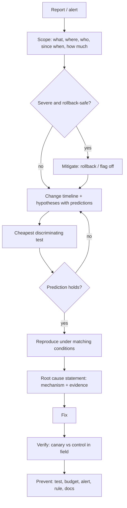
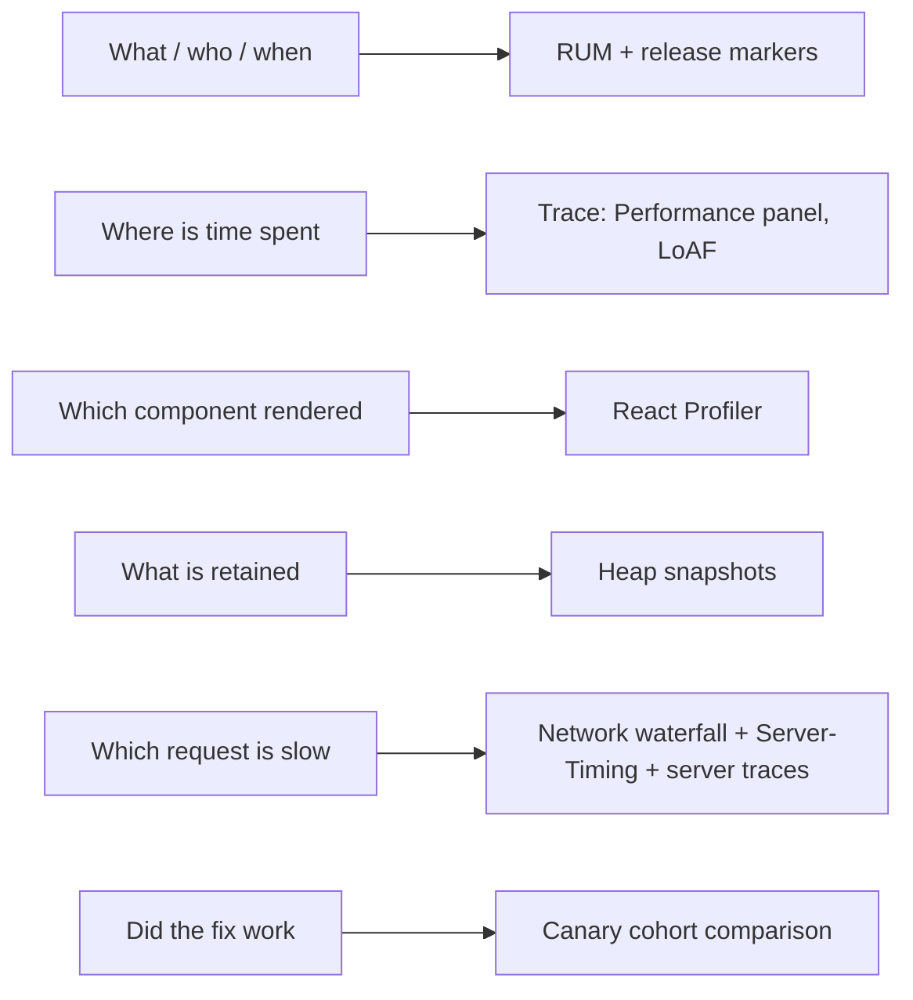
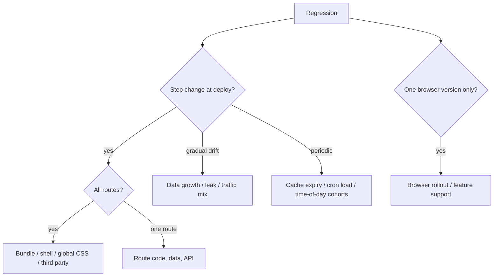

# 07 / 22 — Production Performance Investigations

## 1. Lesson metadata

| | |
|---|---|
| **Level** | Professional |
| **Study time** | 5–6 hours (reading 2 h, case-study reconstruction 2 h, exercises 1.5–2 h) |
| **Prerequisites** | [01 — Measure before optimizing](./01-measure-before-optimizing.md), [02 — Profiler workflows](./02-profiler-workflows.md), [17 — Network waterfalls](./17-network-waterfalls.md), [18 — React vs browser bottlenecks](./18-react-vs-browser-bottlenecks.md), [19 — Memory leaks](./19-memory-leaks.md), [20 — Long tasks and the main thread](./20-long-tasks-and-main-thread.md), [21 — Web Vitals and budgets](./21-web-vitals-and-budgets.md) |
| **Next** | [23 — Counterproductive optimizations](./23-counterproductive-optimizations.md) |
| **Related** | [Phase 10 — Incident debugging](../10-production-engineering/19-incident-debugging.md), [Phase 10 — Observability and logging](../10-production-engineering/04-observability-and-logging.md), [Phase 11 — Debugging with incomplete information](../11-senior-and-architect-mastery/19-debugging-with-incomplete-information.md) |

**Learning objectives.** After this lesson you can:
1. Run a performance investigation as a *disciplined, hypothesis-driven process*: triage, scope, reproduce, isolate, attribute, fix, verify, and prevent — instead of "try memo and see".
2. Use field data (RUM segments, release comparisons), lab traces, heap snapshots, network waterfalls, and server traces **together**, knowing which evidence answers which question.
3. Recognise the common root-cause families in React production regressions and their signatures: render storms, context fan-out, list/key churn, data waterfalls, bundle regression, third-party interference, memory growth, layout thrash, hydration cost, cache/CDN misconfiguration, and "it's the backend".
4. Handle the hard cases: problems that cannot be reproduced locally, intermittent regressions, interactions between multiple causes, and measurement artefacts.
5. Communicate findings: a clear investigation log, an evidence-backed root cause, a fix with a verification plan, and a prevention item (budget, test, lint rule, alert).
6. Know when to stop investigating, roll back, or mitigate first (feature-flag off, revert) and investigate after.

**Concepts covered:** incident vs regression vs chronic slowness, hypothesis tables, bisecting releases and flags, canary/cohort comparison, RUM segmentation, attribution data, trace correlation, synthetic reproduction under throttling, "differential diagnosis" (what changed?), Heisenbugs of profiling (observer effect), Simpson's paradox in aggregated metrics, rollback-first policy, post-investigation prevention.

---

## 2. Deep conceptual explanation

### 2.1 What problem is this lesson solving?

Lessons 01–21 gave you *tools*: profilers, patterns, metrics. Real production problems arrive as a sentence from a stakeholder: *"The checkout page feels slow since Tuesday."* There is no component name, no trace, no repro, and often conflicting beliefs. The skill that separates senior engineers from tool-knowers is a **process** that converts a vague report into a falsifiable claim about a mechanism — and the discipline to avoid the two classic failure modes:

1. **Fix-first:** apply a favourite optimisation (memoise, split, cache) before knowing what is slow. Sometimes harmless; often masks the problem, adds complexity, or makes things worse ([23](./23-counterproductive-optimizations.md)).
2. **Measure-everything:** collect dashboards and traces indefinitely without forming hypotheses. Evidence without a question is noise.

### 2.2 The investigation loop

```
Observe → Scope → Hypothesise → Predict → Test → (Refute | Confirm) → Fix → Verify → Prevent
```

A **hypothesis** must be falsifiable and carry a **prediction**: "If the regression is caused by the new analytics script, then (a) disabling it in DevTools Request Blocking restores p75-equivalent INP in the repro, and (b) LoAF entries in RUM for release 41 will show its script URL with high `blockingDuration`." If a prediction fails, the hypothesis dies — good. This is the scientific method applied to a system you cannot fully see.

### 2.3 Scope first: what exactly is slow, for whom, since when?

Use five questions (the "5W-lite" of performance):

| Question | Evidence | Example answer |
|---|---|---|
| **What** metric/behaviour? | RUM metric, user quote, trace | "INP on `/checkout`, specifically tap on 'Place order'" |
| **Where**? (route/component/flow) | Route-segmented RUM, attribution target | "Mobile web, EU region" |
| **Who**? (segments) | Device, browser, connection, cohort, flag | "Android Chrome, ≤ 4 GB RAM; not iOS" |
| **Since when**? | Time series with release markers | "Started with release 2024.27 deployed Tue 14:10 UTC" |
| **How much**? | p75/p95, sample size, confidence | "+80 ms p75, n = 12k; +250 ms p95" |

Scoping *eliminates* hypotheses cheaply: "iOS unaffected" argues against a server-side regression and for client CPU/Chromium-specific behaviour; "only authenticated users" suggests personalised data/third-party tags; "only first visit" suggests caching/cold start; "all routes" suggests shell/bundle/global CSS/third-party.

### 2.4 The "what changed?" principle

Most regressions follow a **change**: code release, dependency bump, feature flag, content/CMS change, third-party script update, infrastructure/CDN config, traffic mix (new campaign driving low-end devices), data growth (a user's list has 10× items), browser version rollout. Build a **change timeline** alongside the metric time series. A step change at a deployment boundary is a code or config change; a *gradual drift* suggests data growth, leaks, or traffic mix; a *periodic* pattern suggests caches, cron-triggered load, or time-of-day cohorts.

> **Simpson's paradox warning.** Aggregate metrics can worsen because traffic mix shifted (more mobile users after a campaign) even though every segment is flat or improved. Always compare *within* segments.

### 2.5 Mitigate first, then investigate

If a release significantly hurt users, **roll back or flag off first** if you can do so safely; it buys time to investigate calmly. Exceptions: rollback is unsafe (schema migrations), the regression is small and not harmful, or rollback loses a critical fix. Document the decision.

### 2.6 Evidence hierarchy

| Evidence | Strength | Caveats |
|---|---|---|
| Field data with attribution, cohort-compared (release A vs B) | High for "what/where/who/when" | Lagging; coarse; privacy limits |
| Controlled lab experiment isolating a single variable | High for "why" | May not reflect field |
| Trace from real user session (profiler samples, session replay with timings) | High, anecdotal | Few samples |
| Local profile on dev machine | Medium | Fast hardware; dev build; no third parties |
| Code inspection / reasoning | Low–medium | Confirmation bias; can't see runtime data |
| User reports | Signal, not proof | Perception differs from measurement |

### 2.7 Misconceptions

| Misconception | Reality |
|---|---|
| "If I can't reproduce it, it isn't real." | Field-only regressions are common (device mix, data size, extensions, third parties). Reproduce *conditions*, not just code. |
| "The Profiler shows the answer." | It shows React render costs; many production regressions are network, third party, layout, GC, or backend. |
| "Averages tell the story." | Tails and segments carry it. |
| "A fix that helps locally is verified." | Verification is in the field cohort comparison (canary vs control). |
| "Investigation ends at the fix." | It ends at prevention: a test, budget, alert, or lint rule so this class can't recur silently. |
| "Performance work is always about code." | Often CDN/cache headers, image formats, backend latency, data-model changes, or product decisions (e.g. paginating an unbounded list). |

---

## 3. Internal mechanics

### 3.1 Root-cause families and their signatures

Use this as a differential-diagnosis table. "Signature" is what you would see; always confirm with a direct measurement.

| Family | Typical signature (field) | Typical signature (lab) | First test |
|---|---|---|---|
| **Render storm** (state too high, unstable props, effect loops) | INP processing up; CPU-heavy pages; battery complaints | Profiler: many commits per interaction; hundreds of components rendered | Profiler "why did this render"; count commits per interaction ([03](./03-why-components-rerender.md)) |
| **Context fan-out** | INP regression on pages using a global context after a context value change | Profiler: all consumers rendered on unrelated updates | Inspect provider value identity and update frequency ([06](./06-context-propagation-cost.md)) |
| **List/key churn** | Scroll/typing jank on list pages; DOM node churn | Mount/unmount counts high in commit; Layout costs | Keys, windowing ([08](./08-rendering-large-collections.md), [09](./09-windowing-and-virtualization.md)) |
| **Data waterfall / API latency** | LCP/“ready” time up; TTFB up for API; INP unaffected | Network panel staircase; slow single request | [17](./17-network-waterfalls.md); server traces |
| **Bundle regression** | LCP/FCP/TBT up on all routes after release; JS transfer size up | Bundle analyzer diff; longer parse/execute | [16](./16-bundle-analysis.md); size budgets |
| **Third-party interference** | Input delay and TBT up; correlation with tag release or consent state | Long tasks attributed to other origins | Block domains; LoAF script attribution ([20](./20-long-tasks-and-main-thread.md)) |
| **Memory growth** | Performance degrades with session age; crashes on mobile | Heap/DOM-node/listener count grows per action | 3-snapshot technique ([19](./19-memory-leaks.md)) |
| **Layout/paint cost** | Presentation delay up; DOM size growth; CSS change | Large Layout/Style/Paint blocks | Trace; DOM count ([18](./18-react-vs-browser-bottlenecks.md)) |
| **Hydration cost** | Poor INP/TBT shortly after load; fine later | Large start-up task; hydration component stack | Profile load; Suspense boundaries ([20](./20-long-tasks-and-main-thread.md)) |
| **Cache/CDN misconfiguration** | TTFB/LCP regress for one region/PoP or after deploy; cache-hit ratio drops | `cache-control`/`vary` changed; revalidation each load | Inspect response headers across requests; CDN analytics ([Phase 0 — HTTP caching](../00-web-and-javascript-foundations/15-http-caching-and-navigation.md)) |
| **Data growth** | Slower for "power users" or large accounts only | Reproduces with a large dataset only | Segment by account size; generate fixtures |
| **Browser/OS rollout** | One browser version regresses with no release | Reproduces only in that version | Segment by UA version; check browser release notes/bug trackers |
| **Measurement artefact** | Metric shifts without UX change (instrumentation changed, bot traffic, bfcache) | N/A | Check instrumentation diff; segment by navigation type; bot filtering |

### 3.2 Bisection

When "what changed" is unclear: **bisect the change space** — release range, commits (git bisect with an automated perf test), flags (flip half), third-party tags (block half), data (reduce dataset size by half). Bisection converts a search over *n* candidates into *log₂ n* tests. Requirements: a reproducible, automatable measurement with a clear threshold, and noise lower than the effect (use medians over N runs; prefer deterministic metrics such as number of commits, bytes, or long-task counts to timings if possible).

### 3.3 The observer effect

Instrumentation changes performance: React DevTools and the Profiler add overhead; `console.log` in render is expensive; source maps; the dev build is much slower than production; session-replay tools add main-thread work; heap snapshots pause execution. Therefore:
- Compare like with like (before/after with the same tooling).
- Prefer **production builds with the profiling build alias** for React timing ([02](./02-profiler-workflows.md)).
- Use low-overhead sampling (Performance panel, LoAF in RUM) for field investigations.
- When a Heisenbug disappears under instrumentation, lean on counts and sampling, not tracing every call.

### 3.4 Statistical hygiene

- **Sample sizes:** decide minimum n per segment before declaring a regression (e.g. n ≥ 500 per cohort per metric); small segments produce noisy p75.
- **Confidence:** bootstrap or use vendor-provided confidence intervals; for a quick check, compare medians across several days and see whether the difference exceeds day-to-day variation.
- **Multiple comparisons:** if you slice 40 segments, some will look bad by chance; favour segments with a prior reason.
- **Time-of-day/week seasonality:** compare same weekday/hours, or use control routes unaffected by the change.
- **Difference-in-differences:** compare route A (changed) before/after to route B (unchanged) before/after to subtract global effects (e.g. a CDN incident).

---

## 4. Step-by-step execution walkthrough

A complete investigation, narrated as a log. (Fictional but realistic; times are illustrative.)

**Report (Tue 16:30).** Support: "Order history is very slow on phones since this morning."

**Step 1 — Scope (15 min).**
- RUM dashboard: route `/orders` (template). p75 INP unchanged (190 ms) but p75 **"ROUTE_READY"** (custom metric, [21](./21-web-vitals-and-budgets.md)) rose from 1.9 s to 3.6 s starting 09:40 UTC. LCP up similarly (+1.5 s).
- Segment: Android and iOS both affected; desktop slightly (+0.3 s); all countries; **authenticated users with > 50 orders** much worse (+4 s) than those with < 10 (+0.1 s).
- Change timeline: deploy `web-2024.31` at 09:35 UTC; backend `orders-api` deploy at 09:20 UTC; no flag changes; marketing campaign started 08:00 (mobile mix up 6%).

**Step 2 — Hypotheses with predictions (10 min).**

| # | Hypothesis | Prediction (if true) |
|---|---|---|
| H1 | Backend `GET /orders` became slower (new join) for large accounts | Server span duration p75 up for large accounts; TTFB for that request up; client trace shows long "waiting" |
| H2 | Client regression: orders list now renders all rows (pagination removed) | DOM node count up with order count; commit longer; Network unchanged |
| H3 | Mix shift (campaign) | Within-segment metrics flat; only aggregate worse |
| H4 | New N+1 client requests per row (waterfall) | Request count per page load up with orders count |
| H3 is eliminated early: metrics worsen *within* segment "mobile, > 50 orders" and the mix shift is only 6%. |

**Step 3 — Cheapest discriminating test (10 min).** RUM resource timings (a sampled custom metric) show `GET /api/orders?limit=…`: server `Server-Timing` header (`db;dur=…`) p75 unchanged at 120 ms ⇒ **H1 refuted** (backend fast). The number of `GET /api/orders/:id/summary` requests per load rose from 0 to *N* (the order count, up to 200) for the new release ⇒ **H4 supported**.

**Step 4 — Reproduce (30 min).** In a Chrome Incognito window against staging with a large-account fixture (120 orders), DevTools Network "Slow 4G", CPU 4×. The waterfall shows: `/api/orders` (200 ms) then **120 parallel** `/api/orders/:id/summary` requests, queued behind HTTP/2 stream limits and server rate-limits (429s retried). Rows show skeletons for 2–4 s. Performance panel: main thread mostly idle; many small tasks from React Query retries. Profiler: 120 row components rendering skeleton → data (≈ 3–4 commits per row due to staggered resolution, each re-rendering the whole list).

Look at `git log web-2024.30..web-2024.31 -- src/features/orders`: PR "Show order totals in list" added `useOrderSummary(order.id)` inside `OrderRow`, because the list API doesn't return totals.

**Step 5 — Root cause statement.**
> Release 2024.31 introduced per-row `useOrderSummary` fetches (N+1 on the client). For accounts with many orders it issues 100+ concurrent requests, saturating connection/server rate limits, causing retries and staggered commits that re-render the entire list; load time scales with order count.

Two mechanisms: (1) **network** (N+1 fan-out and rate limiting; [17](./17-network-waterfalls.md)); (2) **React** (list re-rendering per resolution; [03](./03-why-components-rerender.md), [05](./05-referential-equality.md)). H2 (no pagination) was partially true but secondary (limit was 200 before and after).

**Step 6 — Mitigate (Tue 18:00).** Feature-flag `orders.rowTotals` off (already behind a flag at 100%). RUM shows recovery within 30 min for new sessions (n large enough by 19:00).

**Step 7 — Fix (Wed).**
- Backend: add `total` to the list endpoint (`include=totals`), computed with the existing join (team agreed; contract updated).
- Frontend: remove per-row query; memoise `OrderRow` with stable props ([04](./04-memoization-trade-offs.md)); virtualise beyond 50 rows ([09](./09-windowing-and-virtualization.md)).
- Test: Playwright test with a mock server counting requests: `GET /orders/:id/summary` count = 0; asserts total requests ≤ 3 for the page.

**Step 8 — Verify (Thu).** Canary 10% of traffic on the fix: compare `ROUTE_READY` for canary vs control within segment "mobile, > 50 orders": p75 3.7 s → 1.7 s (n = 2.1k vs 2.0k). Roll to 100%; confirm over 3 days vs the pre-incident baseline.

**Step 9 — Prevent.** (a) CI check on request-count budget for critical routes; (b) lint/review rule: no `useQuery` in list item components unless batch/prefetch is configured, with an architecture note ([Phase 6 — API normalization](../06-data-fetching-and-state-ecosystems/04-api-normalization.md)); (c) RUM alert on `ROUTE_READY` p75 by account-size bucket; (d) post-incident note capturing the "large account" dimension in the performance test fixtures.

**Predict:** why did local testing and the PR preview miss this? *(Dev accounts had ≤ 5 orders; the performance test fixture didn't include a large account; the lab test measured one route, one account size. The field segment "> 50 orders" surfaced it.)*

---

## 5. Code examples

### 5.1 Minimal example — an investigation log template (as a typed object for tooling)

```ts
export type Hypothesis = {
  id: string;
  statement: string;
  prediction: string;          // observable result if TRUE
  test: string;                // cheapest discriminating test
  status: "open" | "supported" | "refuted";
  evidence?: string[];         // links to dashboards/traces/PRs
};

export type Investigation = {
  title: string;
  scope: { what: string; where: string; who: string; since: string; magnitude: string };
  changeTimeline: { at: string; what: string }[];
  hypotheses: Hypothesis[];
  rootCause?: string;
  mitigation?: { at: string; action: string };
  fix?: { pr: string; verification: string };
  prevention: string[];
};
```

Not a runtime artifact; a *discipline*. Writing hypotheses with predictions before testing prevents post-hoc rationalisation.

### 5.2 Practical example — field timing for individual requests (what made Step 3 possible)

```ts
// Sampled resource timing for key API calls; sent with the route template and release.
type ApiTiming = { path: string; status: number; wait: number; total: number; serverMs?: number; size: number };

export function observeApiTimings(report: (t: ApiTiming) => void): void {
  const po = new PerformanceObserver((list) => {
    for (const e of list.getEntries() as PerformanceResourceTiming[]) {
      if (!e.name.includes("/api/")) continue;
      const url = new URL(e.name);
      const server = e.serverTiming.find((s) => s.name === "db")?.duration;   // from Server-Timing header
      report({
        path: url.pathname.replace(/\/\d+(?=\/|$)/g, "/:id"),                  // normalise IDs
        status: e.responseStatus ?? 0,                                         // Chrome 109+, Firefox 129+; no Safari (MDN compat)
        wait: e.responseStart - e.requestStart,
        total: e.responseEnd - e.startTime,
        serverMs: server,
        size: e.encodedBodySize,
      });
    }
  });
  po.observe({ type: "resource", buffered: true });
}
```

Line notes:
- `serverTiming` is exposed on `PerformanceResourceTiming` when the server sends `Server-Timing` headers (same-origin or with `Timing-Allow-Origin`). `serverTiming` is Chrome 65+, Firefox 61+, Safari 16.4+ (MDN compat).
- `responseStatus` on resource timing is newer (Chrome 109+, Firefox 129+, not Safari); feature-detect and cope with `undefined` (TypeScript lib typings may lag).
- Normalising path IDs prevents unbounded cardinality and PII leakage.
- Count requests per route template per page load (aggregate downstream) to detect N+1 patterns in the field.

### 5.3 Incorrect example — "fix" applied without diagnosis

```tsx
// "Orders is slow, let's memoise everything"
const OrderRow = memo(function OrderRow({ order }: { order: Order }) {
  const summary = useOrderSummary(order.id);        // still fires N requests
  return <Row order={order} summary={summary.data} />;
});

export const OrdersPage = memo(function OrdersPage() {
  const orders = useOrders();
  const rows = useMemo(() => orders.data?.map((o) => <OrderRow key={o.id} order={o} />), [orders.data]);
  return <ul>{rows}</ul>;
});
```

This reduces some re-render work but leaves the **N+1 requests** (root cause) untouched. It adds `memo`/`useMemo` noise, and the `useMemo` of elements is a smell ([04](./04-memoization-trade-offs.md)). Measure: the p75 ROUTE_READY barely moves. **Predict:** improvement ≈ 5–10%; the waterfall and rate-limit retries remain.

### 5.4 Corrected implementation — fix the cause and add a guard

```tsx
type OrderListItem = { id: string; placedAt: string; status: string; total: number };   // total now in list payload

function OrdersPage() {
  const { data, isPending } = useQuery({
    queryKey: ["orders", { include: "totals" }],
    queryFn: () => fetchJson<{ items: OrderListItem[] }>("/api/orders?include=totals&limit=200"),
  });
  if (isPending) return <OrdersSkeleton />;
  return <OrderList items={data.items} />;
}

const OrderList = memo(function OrderList({ items }: { items: OrderListItem[] }) {
  return <VirtualList items={items} rowHeight={56} renderRow={(o) => <OrderRow key={o.id} order={o} />} />;
});
```

And the regression test:

```ts
test("orders page issues no per-row requests", async ({ page }) => {
  const calls: string[] = [];
  page.on("request", (r) => { if (r.url().includes("/api/")) calls.push(new URL(r.url()).pathname); });
  await page.goto("/orders");
  await page.getByRole("list").waitFor();
  expect(calls.filter((p) => /\/api\/orders\/[^/]+\/summary/.test(p))).toHaveLength(0);
  expect(calls.length).toBeLessThanOrEqual(3);
});
```

Trade-offs: the backend contract changed (a team dependency); the `VirtualList` brings accessibility work ([09](./09-windowing-and-virtualization.md)); the Playwright assertion on request count is **deterministic** (unlike timing) — a good pattern for N+1 prevention.

### 5.5 Advanced example — an automated bisection harness (conceptual)

```ts
// Run with: node bisect.mjs <goodSha> <badSha>
// Idea: a deterministic metric (request count + total JS bytes + long-task count) instead of timings.
import { execSync } from "node:child_process";

type Result = { requests: number; jsKB: number; longTasks: number };
async function measure(): Promise<Result> {
  // build, serve, run Playwright with CPU throttling, return deterministic counters (omitted)
  throw new Error("implement for your app");
}

function isBad(r: Result): boolean {
  return r.requests > 30 || r.jsKB > 350 || r.longTasks > 5;
}

async function bisect(good: string, bad: string) {
  const shas = execSync(`git rev-list --reverse ${good}..${bad}`).toString().trim().split("\n");
  let lo = 0, hi = shas.length - 1;          // invariant: shas[hi] is bad
  while (lo < hi) {
    const mid = Math.floor((lo + hi) / 2);
    execSync(`git checkout ${shas[mid]} && npm ci && npm run build`, { stdio: "inherit" });
    if (isBad(await measure())) hi = mid; else lo = mid + 1;
  }
  console.log("First bad commit:", shas[lo]);
}
```

Notes: (1) assumes monotonic behavior (once bad, always bad) — not true if a revert exists in range; (2) `git bisect run` can do this natively; (3) timing-based thresholds must use medians over multiple runs; (4) never leave your working tree on a random commit — run in a worktree/clean clone.

### 5.6 A reusable "differential" comparison from two RUM exports

```ts
type Row = { release: string; route: string; device: "mobile" | "desktop"; value: number };

function quantile(sorted: number[], q: number): number {
  if (sorted.length === 0) return NaN;
  const pos = (sorted.length - 1) * q;
  const lo = Math.floor(pos), hi = Math.ceil(pos);
  return sorted[lo] + (sorted[hi] - sorted[lo]) * (pos - lo);
}

export function compareReleases(rows: Row[], a: string, b: string, minN = 300) {
  const groups = new Map<string, { a: number[]; b: number[] }>();
  for (const r of rows) {
    if (r.release !== a && r.release !== b) continue;
    const key = `${r.route}|${r.device}`;
    const g = groups.get(key) ?? { a: [], b: [] };
    (r.release === a ? g.a : g.b).push(r.value);
    groups.set(key, g);
  }
  return [...groups].flatMap(([key, g]) => {
    if (g.a.length < minN || g.b.length < minN) return [];       // skip underpowered segments
    g.a.sort((x, y) => x - y); g.b.sort((x, y) => x - y);
    const p75a = quantile(g.a, 0.75), p75b = quantile(g.b, 0.75);
    return [{ key, nA: g.a.length, nB: g.b.length, p75a, p75b, delta: p75b - p75a }];
  }).sort((x, y) => y.delta - x.delta);
}
```

Line notes: segment-wise comparison avoids Simpson's paradox; `minN` guards noise; sorting by delta surfaces the worst segments. Add bootstrap CIs for rigor, and exclude bfcache/prerender navigation types.

---

## 6. Visual explanations

### The investigation loop



### Which evidence for which question



### Differential diagnosis by signature



---

## 7. Alternative approaches and trade-offs

| Decision | Option A | Option B | A when | B when |
|---|---|---|---|---|
| Response to a severe regression | Roll back / flag off | Fix forward | Rollback safe and cause unknown | Rollback unsafe, cause known and fix tiny |
| Reproduction | Local dev | Staging with prod-like data and throttling | Logic bugs | Performance (always prefer prod-like) |
| Evidence | RUM only | Lab only | Need truth | Need mechanism — usually use both |
| Bisect | Manual flag flipping | Automated commit bisect | Few candidates | Many commits, deterministic metric |
| Tooling | Vendor APM/RUM | Self-built | Speed, features | Control, cost, privacy |
| Fix scope | Targeted patch | Structural refactor | Urgent, contained | Class of problems recurring |

**Scenario where the disciplined process is *not* the best use of time:** a trivial, obviously safe, reversible change that is almost certainly responsible (e.g. a new 600 kB dependency imported on the entry chunk, visible immediately in a bundle diff). Spending an hour building hypotheses is waste; revert/lazy-load it, then verify. The process scales with *uncertainty and blast radius*: use the full loop when the cause is unclear or the fix is risky; shortcut when the evidence is direct and the change is cheap to undo.

---

## 8. Best practices and anti-patterns

**Beginner mistakes**
- Starting with the Profiler on a dev laptop.
- Trusting one run.
- Fixing before understanding; "shotgun" optimisations.
- Not recording what was tried (repeating dead ends).

**Experienced-developer mistakes**
- Confirmation bias: seeking evidence for the favourite hypothesis.
- Ignoring segments (device, account size, region).
- Not verifying in the field after the fix.
- Optimising the *p50* when the pain is in the *p95* tail.
- Declaring victory on a lab improvement while field is unchanged.
- Blaming "the backend" or "the frontend" without a trace across both.

**Smells**
- A performance ticket without a metric, route, segment, or baseline.
- "Fixed in dev" with no field verification plan.
- Post-incident actions of the form "be more careful".
- Dashboards without release markers.

**Justified exceptions**
- Fixing first when a regression is trivially attributable and reversible.
- Skipping reproduction when field attribution *fully* identifies the mechanism (e.g. a specific third-party script with 400 ms `blockingDuration` in LoAF) — but still verify after.

---

## 9. Real-world application

**Case A — The context that updated every second (dashboard).** *Symptom:* INP p75 +120 ms on `/dashboard` after adding a "last updated" clock to a shared `AppContext`. *Scope:* all users; only dashboard. *Evidence:* Profiler: every second a commit re-rendering ~900 components (all consumers of `AppContext`). *Root cause:* high-frequency value in a broad context ([06](./06-context-propagation-cost.md)). *Fix:* move the clock into a tiny leaf component with its own state (colocation, [07](./07-state-colocation-for-perf.md)); `useSyncExternalStore` for shared time if multiple consumers. *Verify:* commits per minute and INP by canary. *Prevention:* lint/review rule for context values updating at > 1 Hz.

**Case B — Third-party A/B tool (e-commerce).** *Symptom:* INP/TBT regress on PLP; no code release; started with a marketing config push. *Evidence:* LoAF attribution: script URL of the experimentation vendor with `blockingDuration` 180 ms on route changes; request blocking in the lab confirms. *Fix:* load async after interaction/consent, scope to relevant routes, ask vendor for lighter snippet, budget third-party time ([21](./21-web-vitals-and-budgets.md)). *Lesson:* config/CMS changes are releases too — they need change events in the timeline.

**Case C — Slow death by leak (customer-support console).** *Symptom:* agents report "the tool gets slower during the day; refresh fixes it". *Evidence:* RUM: INP p75 by session age grows from 150 ms (first hour) to 600 ms (after 6 hours); heap sampling trend up; 3-snapshot comparison finds listeners from a notification subscription not removed on conversation switch ([19](./19-memory-leaks.md)). *Fix:* cleanup, bounded message history, soak test. *Lesson:* segment by **session age**, a dimension many teams don't record.

**Case D — CDN header regression (media site).** *Symptom:* LCP p75 up 800 ms in Asia-Pacific only, on Monday, no deploy. *Evidence:* TTFB sub-part up; cache-hit ratio dropped at APAC PoPs; `vary: cookie` accidentally added by an edge rule. *Fix:* revert the edge change; add a synthetic check that asserts `cache-control`/`vary` on key URLs. *Lesson:* infra changes are in the change timeline too.

**Case E — Hydration cliff (SSR app).** *Symptom:* high TBT, INP poor in the first 5 s after load on low-end Android; fine after. *Evidence:* trace: one 900 ms hydration task; recent change moved a large `<Charts>` section above the fold and made it part of the main hydration. *Fix:* Suspense boundary + lazy hydration of charts; server-render summary without hydrating interactivity until visible ([Phase 2 — Hydration](../02-react-rendering-and-internals/25-hydration-and-selective-hydration.md)). *Verify:* long task count and INP in first 5 s.

**Case F — Data growth (finance reporting).** *Symptom:* "Report" page timeouts for three enterprise customers. *Evidence:* RUM segmented by tenant size; Playwright with large fixture reproduces; client groups 500k rows with nested `reduce`/spread (O(n²)) in a handler. *Fix:* algorithmic fix + worker + server-side aggregation ([10](./10-expensive-computations.md), [20](./20-long-tasks-and-main-thread.md)). *Lesson:* test fixtures must include large tenants.

---

## 10. Debugging and troubleshooting

**When you cannot reproduce**
1. Re-read the scope: find a segment where the effect is *strongest* and replicate its conditions (device class, data size, auth state, flags, region, cache state, extension-heavy profile, long session).
2. Use **field traces**: LoAF entries and attribution from RUM; session-replay timings if available (mind privacy); ask support for a HAR/trace from an affected user (with consent) or use a remote-debuggable real device.
3. Reduce the problem by **removal**: feature flags, third parties blocked via DevTools "Request blocking", data subsets.
4. Consider **timing/ordering**: race conditions that depend on network speed; test with throttling and artificial latency; use ordering fuzzing in test mocks.
5. Check **environment drift**: browser version (Chrome beta/stable), OS, enterprise policies, VPN/proxy, content blockers.

**When the metrics disagree with each other**
- LCP up but TTFB flat → client-side; check sub-parts.
- INP flat but "feels slow" → perception of loading (ROUTE_READY, skeleton quality) or animations (frame rate not captured by INP): measure frames (Long Animation Frames, dropped frames from the Performance panel's Frames track) and task completion times.
- Lab better than field → device/network/third parties/data; replicate field conditions.

**When multiple causes overlap**
Peel layers: fix the largest contributor using sub-part attribution; re-measure; the next largest becomes visible. Use *difference-in-differences* to separate overlapping effects (e.g. a CDN incident and a release on the same day).

**When the fix doesn't move the field metric**
- Check rollout: was the fix actually deployed to those users (version/cohort, CDN cache of old assets, service worker serving stale shells)?
- Check measurement: sample counts, segment changes, instrumentation change.
- Check that the fix targets the dominant sub-part.

**Validation checklist**
- [ ] Field metric improved in the affected segment vs a control cohort.
- [ ] No regression in other segments/routes.
- [ ] Lab repro confirms the *mechanism* changed (e.g. request count, long tasks, commits).
- [ ] Regression test/budget/alert added.
- [ ] Write-up filed with timeline, root cause, fix, and prevention.

---

## 11. Exercises

### Level A — Knowledge
A1. List the five scoping questions and one evidence source for each.
A2. What is Simpson's paradox in the context of performance metrics? Give an example.
A3. Why is "what changed?" the first differential question?
A4. When should you roll back before investigating?
A5. What is the observer effect in profiling and how do you mitigate it?

### Level B — Code comprehension
B1. A p75 LCP rises from 2.1 s to 3.0 s starting at 13:00. Between 12:00 and 14:00 a marketing push brings 40% extra traffic from low-end devices. In each device class (low/mid/high) p75 LCP is unchanged. What is going on and what do you report?
B2. RUM shows for release 52: `/search` INP p75 up 90 ms only on Android Chrome ≤ 4 GB devices; attribution `inputDelay` ~25 ms, `processing` ~190 ms (was 80 ms), `presentation` unchanged. What does it suggest, and what do you test first?
B3. Interpret: "Server-Timing db;dur=40ms; client `wait` (requestStart→responseStart) = 1,300 ms". List at least three explanations.

### Level C — Implementation
C1. Write a Playwright test that fails if a given route issues more than N API requests or if any API path appears more than K times (N+1 guard).
C2. Implement a small function `detectRegression(seriesA: number[], seriesB: number[])` using bootstrap resampling of the difference in p75; return the estimated delta and a 95% interval.
C3. Add a `Server-Timing` header to an Express/Fastify-style handler (sketch) and read it in the client RUM code to separate server time from network time.

### Level D — Debugging
D1. After a release, `/product/:id` LCP is worse, but only for returning visitors. Give three hypotheses with predictions and a first test for each.
D2. You deployed a fix and lab metrics improved a lot. Two days later field p75 is unchanged. List five reasons and the check for each.
D3. A teammate profiles with React DevTools open, dev build, no throttling, and reports "the list renders in 12 ms; not slow". What's wrong with the conclusion and how do you redo it?

### Level E — Architecture and engineering decisions
E1. Design the "performance on-call" process: alerts, ownership, runbooks, escalation, SLOs, post-incident review, and tooling. What is the minimum viable version for a team of eight?
E2. Decide how to structure RUM, tracing, and deploy markers so that cross-service investigations (frontend ↔ BFF ↔ services) are possible. Include sampling, correlation ids, and privacy.

### Level F — Expert challenge
F1. Given a hypothetical 12-segment RUM dataset with seasonality and a mix shift, design an analysis that attributes a +180 ms aggregate INP rise into (a) mix-shift effect, (b) within-segment degradation from release X, and (c) noise. Provide the decomposition formula, and explain how you would validate it.

---

## 12. Detailed answers and explanations

> Attempt the exercises first.

**A1.** What (metric/behaviour) — RUM metric, user report; Where (route/component) — attribution target, route-segmented RUM; Who (segment) — device, browser, region, account type from RUM dimensions; Since when — time series with release/flag markers; How much — p75/p95 and sample sizes with confidence intervals.

**A2.** A trend in aggregated data reverses or disappears within subgroups because group proportions changed. Example: overall p75 LCP worsens because mobile traffic share grew after a campaign, while within mobile and within desktop LCP are flat/improved. Always compare within segments or reweight to a fixed mix.

**A3.** Regressions are caused by changes (code, config, dependencies, third parties, infra, data, traffic mix, browser versions). Enumerating changes inside the regression window cheaply reduces the hypothesis space and suggests bisection candidates. Wrong approach: starting from code reading without a time boundary.

**A4.** When impact is significant (conversion/revenue/accessibility), cause is unknown or unclear, and rollback/flag-off is safe (no irreversible migrations, no loss of critical security fixes). Rolling back reduces harm and gives time for careful investigation.

**A5.** Measurement tools change the system (DevTools, profiling builds, dev mode, replay tools, heap snapshots). Mitigate by using production builds (profiling alias when needed), consistent tooling for before/after, low-overhead sampling traces, comparing relative changes and counts instead of absolute timings, and validating in the field with RUM.

**B1.** Mix shift (Simpson's paradox): the aggregate rose because the share of low-end devices increased while each device class is unchanged. Report: "No regression; traffic mix changed due to the campaign; consider whether paid-traffic experience needs a dedicated target (the new mix may be your new reality)". Recommend monitoring by segment and possibly improving the low-end experience since it now matters more.

**B2.** Increased `processing` on low-memory Android only suggests CPU/memory-bound JS work in handlers or React render that grew in release 52 (e.g. more computation per keystroke, bigger state, additional subscribers), amplified on slow devices. Presentation unchanged → not layout/paint. Test first: diff release 52 for `/search` handlers and rendering; reproduce with CPU throttling 6× and the Profiler; compare commits per keystroke and component render counts to release 51.

**B3.** Server DB time is 40 ms, but the client sees 1.3 s of waiting. Candidates: (a) time in the application tier outside the DB (serialization, downstream calls, queueing) not covered by the `db` metric; (b) request queueing before the server (load balancer, saturated worker pool); (c) network latency/TLS handshake/connection reuse (note `requestStart` is after connection setup in resource timing, so connection time is excluded — but long RTT affects the waiting phase: first byte requires a round trip); (d) edge/CDN cold cache or proxy buffering; (e) the server sends `Server-Timing` for one span only. Test with end-to-end tracing and logs; measure from multiple regions.

**C1.** Sketch:
```ts
import { test, expect } from "@playwright/test";

test("no N+1 on /orders", async ({ page }) => {
  const counts = new Map<string, number>();
  page.on("request", (req) => {
    const u = new URL(req.url());
    if (!u.pathname.startsWith("/api/")) return;
    const key = u.pathname.replace(/\/[0-9a-f-]{6,}(?=\/|$)/gi, "/:id");
    counts.set(key, (counts.get(key) ?? 0) + 1);
  });
  await page.goto("/orders");
  await page.waitForLoadState("networkidle");
  const total = [...counts.values()].reduce((a, b) => a + b, 0);
  expect(total, JSON.stringify([...counts])).toBeLessThanOrEqual(6);
  for (const [path, n] of counts) expect(n, path).toBeLessThanOrEqual(2);
});
```
Criteria: normalises ids; deterministic assertion; fixture with many orders; documents thresholds; avoids timing flakiness; `networkidle` has caveats (long-polling/sockets) — wait on a UI condition if needed.

**C2.** Criteria: bootstrap B = 2,000 resamples (with replacement) of each series, compute p75 of each, difference; return mean/median delta and 2.5/97.5 percentiles; handle unequal sample sizes; return "inconclusive" if CI includes 0; note limitations (independence assumption; autocorrelation within sessions).

**C3.** Criteria: server records timing with `performance.now()` or high-res timers around db/downstream calls; sets `Server-Timing: db;dur=40, app;dur=120` header (valid syntax: metric name with optional `dur` and `desc`); cross-origin requires `Timing-Allow-Origin` for the client to read it; client reads `entry.serverTiming` from Resource Timing and reports; separate network time as `total − serverTotal`. Mention security: do not leak sensitive internals in headers publicly (coarse names only).

**D1.** (H1) Stale/over-large cached assets or cache misses for returning visitors: prediction — larger transfer sizes/more revalidations; test: compare cache-hit state in Network across return visits; check `cache-control`/service worker. (H2) Personalised content for logged-in returning users fetched client-side after render, delaying the LCP element: prediction — LCP element's load delay and a client-side API call before image; test: waterfall as logged-in user. (H3) A service worker or persisted state (localStorage) causing heavy start-up work for returning users: prediction — long task on start for returning only; test: trace with populated storage vs incognito.

**D2.** (1) Fix not rolled out to those users (cohort/flag/CDN or service worker caching old bundles) — check release distribution in RUM; (2) fix addressed a lab-only issue (wrong bottleneck) — compare attribution sub-parts; (3) mix shift masks improvement — compare within segment; (4) measurement lag/sample size (CrUX 28-day window) — use RUM; (5) another regression offset it — check other segments/routes; (6) lab used different conditions than the field — align profiles. Each with the described check.

**D3.** React dev build with DevTools open is slower and distorted; no throttling hides CPU-bound issues; the Profiler measures React render only and is blind to layout/paint; a single run on a fast machine is not representative. Redo: production build (profiling alias), incognito without extensions, CPU throttle 4–6×, realistic data size, multiple runs, Performance panel trace to see layout/paint and input delay, and confirm in the field.

**E1.** Criteria: alerts on field SLOs (p75 by route with min sample size and duration), plus synthetic checks for critical journeys; ownership by route/feature teams with a rotating performance on-call; runbooks (scope checklist, bisect procedure, rollback criteria, dashboards links); escalation to platform/backend/infra; SLOs with error budget logic; blameless post-incident reviews with prevention items tracked; tooling: RUM, deploy markers, traces, flag system, canary. MVP for eight engineers: weekly review of the RUM dashboard with release markers, three alerts (LCP/INP/error rate on top 3 routes), a one-page runbook, canary deployments with automated comparison, and incident template.

**E2.** Criteria: propagate a trace/correlation id from the browser (`traceparent` header via instrumentation) to the BFF and services; sample consistently (head-based for cost, tail-based for outliers); expose `Server-Timing` for coarse breakdowns; include release/flag ids in all telemetry; stable route templates; privacy by design (no PII in URLs/selectors, retention limits, consent-aware); clock considerations (use durations not absolute timestamps across clients/servers); dashboards that join RUM and traces by release. Tooling choices are secondary to correlation and cardinality discipline.

**F1.** Evaluation criteria: Let segments *s* with weights *wₛ* (traffic share) and p75 metric *mₛ*. Aggregate A = Σ wₛ·mₛ (using a mean-of-segment-quantiles approximation, or compute true pooled p75 when needed). Period 0 → 1: ΔA = Σ (wₛ¹ − wₛ⁰)·mₛ⁰ **(mix effect)** + Σ wₛ¹·(mₛ¹ − mₛ⁰) **(within-segment effect)**. Further split within-segment by release exposure (cohort comparison within period 1) to attribute the portion due to release X versus background drift (using a control route/segment: difference-in-differences). Estimate noise by bootstrapping each segment and by comparing against historic week-over-week variation of the same decomposition terms. Validation: apply the decomposition to historical periods with no release (should yield ~0 for within-segment term), to synthetic injected shifts, and cross-check with a lab reproduction of release X's effect size. Caveat: quantiles are not linear, so pooled p75 ≠ weighted sum; for rigor, compute pooled quantiles via reweighted samples.

---

## 13. Senior engineer interview questions

**Q1. "Production is slow. Walk me through your first hour."**
Scope (what/where/who/since/how much) from RUM and alerts; build a change timeline; decide on mitigation (rollback/flag-off if severe and safe); write hypotheses with predictions; run the cheapest discriminating tests (segment comparisons, release cohorts, block a third party, check server timing); reproduce under matching conditions only after you know where to look.

**Q2. "You cannot reproduce an issue locally. What now?"**
Replicate conditions (device class, throttling, data size, auth, flags, cache state, region, session age); use field attribution (LoAF, resource timing) and, with consent, traces from affected users; reduce by elimination; check environment drift. Not reproducing locally usually means my environment differs, not that the issue isn't real.

**Q3. "How do you prove a fix worked?"**
Field cohort comparison (canary vs control, same segment, adequate n), plus mechanism evidence in the lab (request count, commits, long tasks), plus absence of regressions elsewhere; then lock in with a test/budget/alert.

**Q4. "What are common mistakes in performance incident response?"**
Fixing before diagnosing, ignoring segments, trusting lab-only evidence, confusing correlation with causation (e.g. coincident releases), lacking change markers, not rolling back when appropriate, and not closing the loop with prevention.

**Q5. "How do you handle two simultaneous regressions?"**
Decompose using segment and sub-part attribution; use control routes for difference-in-differences; fix the largest contributor first while verifying the others independently via flags/cohorts.

**Q6. "How do you avoid confirmation bias?"**
Write predictions in advance, design tests that could refute the favourite hypothesis, have a second engineer review the evidence, and track refuted hypotheses.

**Q7. "When is it appropriate to stop optimizing?"**
When the field metric meets the agreed target with margin and guardrails exist, or when the marginal user-impact per engineering week falls below other priorities; document remaining known costs.

---

## 14. Further learning resources

| Resource | URL | Covers / why | Level | Section to study |
|---|---|---|---|---|
| web.dev — Debug performance in the field | <https://web.dev/articles/debug-performance-in-the-field> | Attribution-driven field debugging | Advanced | Whole article |
| web.dev — Optimize INP / LCP / CLS | <https://web.dev/articles/optimize-inp> | Metric-specific investigations | Intermediate | Diagnosis sections |
| GitHub — GoogleChrome/web-vitals | <https://github.com/GoogleChrome/web-vitals> | Attribution build for field debugging | Intermediate | README: attribution |
| MDN — `PerformanceResourceTiming.serverTiming` | <https://developer.mozilla.org/en-US/docs/Web/API/PerformanceResourceTiming/serverTiming> | Reading Server-Timing in the client | Advanced | Description |
| MDN — Server-Timing header | <https://developer.mozilla.org/en-US/docs/Web/HTTP/Headers/Server-Timing> | Header syntax | Intermediate | Syntax |
| W3C — Trace Context | <https://www.w3.org/TR/trace-context/> | `traceparent` correlation across services | Advanced | Overview |
| Git docs — `git bisect` | <https://git-scm.com/docs/git-bisect> | Automated bisection | Intermediate | `git bisect run` |
| Playwright docs — Network events | <https://playwright.dev/docs/network> | Request interception and counting | Intermediate | Events |
| React docs — `Profiler` | <https://react.dev/reference/react/Profiler> | Programmatic render timing | Intermediate | Usage |
| Chrome DevTools — Performance features | <https://developer.chrome.com/docs/devtools/performance> | Tracing, CPU throttling | Intermediate | Reference |

---

## 15. Knowledge checkpoint

**You should now understand**
- Investigations are hypothesis-driven loops, scoped by segment and change timeline, with mitigation before diagnosis when impact is high.
- The root-cause families and their signatures, and which evidence answers which question.
- Verification means field cohort comparison, and the job ends with prevention.

**You should be able to explain without notes**
- Simpson's paradox for metrics; the observer effect; why "can't reproduce" means "conditions differ".

**You should be able to implement**
- Field API timing capture; release comparison by segment; deterministic N+1 tests; bisection harnesses; investigation logs.

**You should be able to debug**
- Regressions with and without code releases; third-party, CDN, data-growth, hydration, leak-driven slowdowns.

**Before moving on:** read [23 — Counterproductive optimizations](./23-counterproductive-optimizations.md) — the catalogue of fixes that make things worse, which a good investigation helps you avoid.
