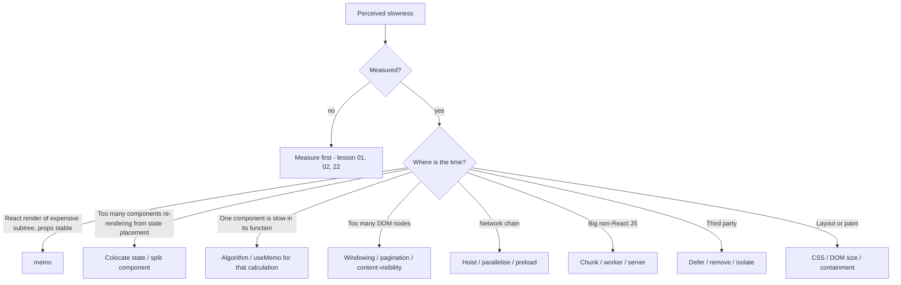
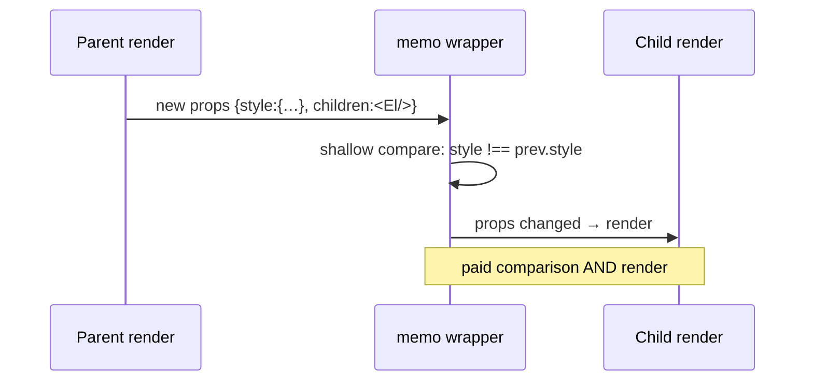

# 07 / 23 — Counterproductive Optimizations

## 1. Lesson metadata

| | |
|---|---|
| **Level** | Professional |
| **Study time** | 4–5 hours (reading 1.5 h, measuring the anti-patterns 1.5 h, exercises 1.5–2 h) |
| **Prerequisites** | [01 — Measure before optimizing](./01-measure-before-optimizing.md), [03 — Why components re-render](./03-why-components-rerender.md), [04 — Memoization trade-offs](./04-memoization-trade-offs.md), [05 — Referential equality](./05-referential-equality.md), [06 — Context propagation cost](./06-context-propagation-cost.md), [09 — Windowing and virtualization](./09-windowing-and-virtualization.md), [12 — useTransition in practice](./12-usetransition-in-practice.md), [14 — Debounce and throttle](./14-debounce-and-throttle.md), [15 — Code splitting and lazy loading](./15-code-splitting-and-lazy-loading.md), [17 — Network waterfalls](./17-network-waterfalls.md), [22 — Production performance investigations](./22-production-performance-investigations.md) |
| **Next** | [24 — Phase 7 assessment](./24-phase-assessment.md) |
| **Related** | [Phase 3 — useMemo and useCallback](../03-react-state-and-hooks/11-usememo-and-usecallback.md), [Phase 3 — React.memo](../03-react-state-and-hooks/12-react-memo.md), [Phase 9 — React Compiler](../09-advanced-rendering-and-ecosystem/08-react-compiler.md) |

**Learning objectives.** After this lesson you can:
1. Explain, with mechanisms and costs, why each of the following *commonly recommended* optimisations can make an application slower, larger, buggier, or harder to maintain: blanket memoisation, `useCallback` everywhere, memoising cheap work, unstable-prop `memo`, context over-splitting, premature virtualisation, debouncing as a cure-all, code-splitting everything, prefetching everything, transitions as a slowness band-aid, `will-change` everywhere, misused `useLayoutEffect`, manual DOM manipulation, global-store hoisting, and caching without invalidation.
2. Recognise the **structural reason** these failures happen: optimising a non-bottleneck (Amdahl's law), paying fixed overhead for variable benefit, moving work rather than removing it, trading one resource for another without measuring, or optimising a proxy metric.
3. Apply a **cost–benefit test** to any proposed optimisation: *What is the measured bottleneck? What does this change remove? What does it add (code, memory, CPU, risk, latency elsewhere)? How will we know it helped?*
4. Reverse harmful optimisations safely: measure before/after, remove with tests, and document why.
5. Distinguish *wrong optimisation* from *right optimisation applied in the wrong place* and from *justified exceptions*.
6. Reason about how the React Compiler (stable v1.0 since October 2025) changes the memoisation calculus without turning it into a cure-all.

**Concepts covered:** Amdahl's law for UI work, overhead of memoisation (dependency comparison, cache allocation, closure creation, retained memory), `memo` bail-out requirements, prop stability, context value stability and splitting, windowing overhead and a11y cost, debounce latency, chunking overhead and waterfalls, prefetch cost/benefit, transition semantics (non-urgent vs "make slow things fast"), layer promotion cost, forced layout, DOM escape hatches, store-hoisting re-render blast radius, cache invalidation, Goodhart's law, premature optimisation, "optimisation debt".

---

## 2. Deep conceptual explanation

### 2.1 What problem is this lesson solving?

Performance advice spreads as slogans: *"wrap it in `useCallback`"*, *"memo your components"*, *"code-split your routes"*, *"debounce the input"*, *"virtualise long lists"*, *"use `will-change`"*. Each slogan is correct **in a specific situation**. Stripped of its precondition it becomes folklore that adds complexity and sometimes harm. Lessons 01–22 taught you to find the bottleneck; this lesson is the *negative space*: the failures that look like diligence.

> **Law of the instrument.** Optimisation applied without a measured bottleneck is a hypothesis you have decided not to test.

### 2.2 Four structural failure modes

1. **Optimising a non-bottleneck (Amdahl's law).** If a component accounts for 2% of interaction time, perfect optimisation yields ≤ 2% improvement. If it accounts for 2% but costs 5% more elsewhere (complexity, memory, bundle), net negative.
2. **Fixed overhead for variable benefit.** Memoisation, workers, chunking, virtualisation, and code splitting all have **fixed costs** (comparison work, message passing, extra requests, layout bookkeeping). They pay off only above a threshold of work or reuse. Below it, you've added cost.
3. **Moving work instead of removing it.** Debouncing delays work; transitions defer it; prefetching shifts it earlier; workers shift it to another thread; caching shifts it to memory. These can be great — or just relocate the problem (bandwidth, CPU on another core, battery, memory pressure, stale data).
4. **Optimising a proxy.** Reducing re-render counts doesn't equal faster interactions; a higher Lighthouse score doesn't equal a happier user ([21](./21-web-vitals-and-budgets.md)). Goodhart's law: *when a measure becomes a target, it ceases to be a good measure.*

### 2.3 The cost–benefit test

Before applying any optimisation, write the answer to five questions:

| # | Question | Pass condition |
|---|---|---|
| 1 | **Bottleneck evidence:** what trace/profile/metric shows this is the cost? | Concrete measurement (Profiler flame, trace segment, field metric) |
| 2 | **Mechanism:** *how* does this change remove or hide that cost? | Causal story consistent with the evidence |
| 3 | **Overheads and side effects:** what does it add? | Enumerated: code, memory, CPU, bytes, latency, risk, a11y |
| 4 | **Expected benefit vs threshold:** is the effect above noise and above the user-perceptible threshold? | Predicted quantified gain |
| 5 | **Verification & reversal:** how will we confirm and undo it? | Metric + test + rollback plan |

If you can't answer 1, you're guessing; don't ship the optimisation (or ship it behind a flag with measurement).

### 2.4 The catalogue (summary)

| # | Optimisation (as folklore) | Why it can backfire | Precondition for it to help |
|---|---|---|---|
| 1 | `memo` on every component | Comparison cost per render; bails out rarely if props unstable; hides design problems | Expensive subtree, stable props, frequent parent renders |
| 2 | `useCallback` on every function | Allocates closure *and* dependency array each render anyway; adds noise; no benefit unless consumer is memoised/dep-sensitive | Function passed to memoised child or used in deps of effects/memos |
| 3 | `useMemo` on cheap computations | Cache bookkeeping > compute; stale-dependency bugs | Work that is measurably expensive, or identity matters |
| 4 | `memo` + inline objects/children | Never bails out; pure overhead | Stable props or custom comparator |
| 5 | Over-splitting context | Provider pyramid, boilerplate, still re-renders consumers on every change | Distinct update frequencies; measured fan-out cost |
| 6 | Virtualising short lists | Complexity, a11y regressions, find-in-page loss, layout jump, blank flashes | Hundreds+ of heavy rows |
| 7 | Debounce to "fix" slow renders | Adds fixed latency; slow work remains | Network/cost control or spammy events |
| 8 | Code-split everything | Request waterfalls, loading flashes, more round trips | Large, rarely-used, non-critical code |
| 9 | Prefetch everything | Bandwidth/server cost; evicts useful cache; steals priority | High-probability next action |
| 10 | Wrap everything in transitions | Stale UI, extra renders, no help for commit/non-React work | Sliceable non-urgent React render |
| 11 | `will-change`/layers everywhere | GPU/memory cost; slower compositing | Elements about to animate |
| 12 | `useLayoutEffect` to "avoid flicker" | Blocks paint; forced layouts; SSR warnings | DOM measurement before paint |
| 13 | Manual DOM manipulation "for speed" | Breaks React's model; bugs; no measurable gain | Rare integration with imperative libs |
| 14 | Hoisting all state to a global store | Wide re-render fan-out; selectors misuse | Truly shared state with selectors |
| 15 | Caching without invalidation | Stale data; memory growth | Bounded caches with keys and TTL |
| 16 | Web Worker for tiny tasks | Startup and serialisation dominate | Heavy CPU work |
| 17 | Premature SSR/RSC for interactive apps | Server cost, hydration tax, complexity | Content/SEO/first-load-critical pages |
| 18 | Micro-optimising JS (loops, `for` vs `map`) | Negligible; readability loss | Hot loops proven by profile |

---

## 3. Internal mechanics

### 3.1 What `memo`, `useMemo`, and `useCallback` actually cost

*Public guarantees (React docs):* `memo(Component)` skips re-rendering when props are shallow-equal (`Object.is` per prop) to the previous render's props; `useMemo(fn, deps)` caches the result of `fn` and recomputes only when `deps` change; `useCallback(fn, deps)` caches the *function identity*. React may discard caches in the future (docs say not to rely on memoisation for semantic correctness).

*Costs per render (conceptual):*
- **`memo`:** a props comparison for each render of the parent that renders this child: O(number of props). Plus the memo wrapper (an extra fiber type/indirection). If the comparison fails (props changed), you paid the comparison *and* the render.
- **`useMemo`:** storing and comparing a dependency array each render (O(deps)); the factory function closure is still created each render (the call expression `useMemo(() => …, deps)` allocates the arrow function whether or not it's called). Retains the previous deps and value (memory) while mounted.
- **`useCallback`:** same as `useMemo` for a function: the new function is still *created* each render (to pass as the first argument); React just chooses whether to return the old or new one. It does **not** avoid allocation; it only stabilises identity.

Magnitudes (illustrative — measure on your target): comparison of a few props is in the sub-microsecond to low-microsecond range. In a typical component tree, these costs are negligible *individually* — the harm of blanket memoisation is mostly **not** CPU but (a) the false sense of security, (b) code noise and stale-closure/dependency bugs, (c) when scaled to thousands of components, the cumulative comparison cost on renders that were not wasteful, and (d) memory retention.

### 3.2 When `memo` bails out — the checklist

For `memo(Child)` to skip, **every** prop must be `Object.is`-equal to last render's:
- Primitives: yes if the same value.
- Objects/arrays/functions created in the parent's render: **no** — new identity each time ([05](./05-referential-equality.md)).
- `children`: JSX is a new element object each render → defeats `memo` unless `children` is the same reference (e.g. passed through from a higher parent that didn't re-render).
- Props that are stable but **context** consumed inside the child: context changes bypass `memo` (consumers re-render when the context value changes).

```tsx
const Child = memo(function Child({ style, onClick }: { style: React.CSSProperties; onClick: () => void }) { /* … */ });
function Parent() {
  return <Child style={{ color: "red" }} onClick={() => console.log("x")} />; // new identities → memo always re-renders
}
```
Result: `memo` costs a comparison per parent render and never saves a render. **Predict:** the Profiler's "Why did this render?" says "Props changed: style, onClick". (Correct.)

### 3.3 The "memoise everything" illusion

If **all** components are `memo`'d but the *state is too high* (one `useState` at the root controls everything), a state change at the root still runs the root and re-renders any child whose props changed — which, because data flows from the root, is many. You've treated a *state placement* problem with *comparison* tools. State colocation ([07](./07-state-colocation-for-perf.md)) removes renders without any comparison.

### 3.4 Context splitting arithmetic

Suppose a context value `{ user, theme, cart, notifications }` updates `notifications` once per second. All consumers re-render each second regardless of which field they read (context consumers re-render when the provider's value identity changes — [06](./06-context-propagation-cost.md)). Splitting into four contexts means only `notifications` consumers re-render. This *is* a valid optimisation **if** fan-out is measured as costly. But splitting a context whose value changes once per login across 40 contexts gives: 40 providers (nesting), 40 `useXContext` hooks, 40 places to forget a provider in tests — and **zero** runtime benefit. The test: *how often does it change × how many consumers × how expensive is each consumer's render?*

### 3.5 Windowing's fixed costs

Virtualisation ([09](./09-windowing-and-virtualization.md)) replaces "render N rows" with "render a window of rows + maintain scroll geometry". Costs: scroll listeners/observers, measuring row heights (variable heights are expensive), absolute positioning, blank flashes on fast scroll, loss of browser find-in-page (rows not in DOM), anchor links/`scrollIntoView` complexities, and accessibility work (ARIA row counts, focus retention when rows unmount, reading order). For 100 simple rows, the DOM is cheap; windowing adds more cost than it removes.

### 3.6 Debounce is latency

Debounce(250 ms) adds ≥ 250 ms after the last event to *every* result (the user waits for the quiet period). It reduces the *number of runs*, not the *cost per run*. Used to hide a 300 ms render, it leaves the thread blocked for 300 ms each time it fires, with extra delay before it. For render slowness, `useDeferredValue`/transitions/algorithmic changes are different tools; for network spam, debounce + cancellation is right ([14](./14-debounce-and-throttle.md)).

### 3.7 Code-splitting overhead

Each chunk adds an HTTP request (or a cache lookup), per-chunk module wrapper overhead, and — when discovered at runtime — a serial network hop ([17](./17-network-waterfalls.md)). Splitting a 4 kB component into its own lazy chunk typically costs more (request latency 100+ ms on mobile) than including it in the bundle (a few ms of parse). Split by **size × rarity × not-on-critical-path**.

### 3.8 Prefetch trade-offs

Prefetching spends bandwidth, CPU (parsing preloaded modules), and server capacity *speculatively*. With low hit probability it is net waste; with metered data and `Save-Data`, it's hostile. Aggressive prefetch of many chunks on load competes with critical resources and can *delay* LCP/INP.

### 3.9 React Compiler and the memoisation calculus

**Status checked 2026-10-22:** React Compiler reached its first stable release (v1.0) on 2025-10-07 (react.dev/blog/2025/10/07/react-compiler-1; npm `babel-plugin-react-compiler` is at 1.0.0), is compatible with React 17+ (React < 19 needs `react-compiler-runtime` and a minimum-target config), and the React team says `useMemo`/`useCallback` remain available when you need control (e.g. effect dependencies). The React Compiler (a build-time tool that automatically memoises components and hooks according to the Rules of React) is still evolving (see [Phase 9 — React Compiler](../09-advanced-rendering-and-ecosystem/08-react-compiler.md) and <https://react.dev/learn/react-compiler>). The conceptual shift: where the compiler is enabled and your code follows the Rules of React, **manual `useMemo`/`useCallback`/`memo` for pure render-stability reasons become largely unnecessary**, and blanket manual memoisation becomes pure noise. It does *not* remove: algorithmic costs, state placement problems, network waterfalls, DOM size, long tasks, or the need to *measure*. Manual memoisation remains useful as an escape hatch (e.g. effect dependency stability, expensive calculations you want to guarantee). The docs describe the supported versions and constraints; check them before relying on it.

---

## 4. Step-by-step execution walkthrough

**Experiment: does blanket memoisation help?** Setup: a parent with a `count` state button and a list of 200 `ListItem`s that render a label and a badge (≈ 0.02 ms each, so ≈ 4 ms total). Three variants, production build, CPU throttle 4×, Profiler recordings of clicking the counter 50 times.

**Variant 1 — Baseline.** Parent holds `count` and renders `<ListItem>` ×200 inline. Click → parent re-renders → 200 children render. Render ≈ 4 ms × 4 (throttle) ≈ 16 ms. Commit: React compares and updates only the `count` text; children DOM mutations: none (same output). Interaction ≈ 25 ms total including paint.

**Variant 2 — Blanket `memo` + `useCallback`/`useMemo`, but props unstable.**

```tsx
const ListItem = memo(function ListItem({ item, onSelect, style }: Props) { /* … */ });

function Parent({ items }: { items: Item[] }) {
  const [count, setCount] = useState(0);
  const onSelect = useCallback((id: string) => select(id), []);          // stable
  return (
    <>
      <button onClick={() => setCount((c) => c + 1)}>{count}</button>
      {items.map((item) => (
        <ListItem key={item.id} item={item} onSelect={onSelect} style={{ padding: 4 }} /> // new object each render
      ))}
    </>
  );
}
```
Click → Parent renders → 200 `memo` comparisons: `item` same, `onSelect` same, `style` **new** → comparison fails → child renders. Net: 200 comparisons **plus** 200 renders = slightly *slower* than baseline (maybe +1–2 ms at 4× throttle). Profiler "why": `style` changed. No improvement; added code.

**Variant 3 — Fix the cause.** Remove the `style` object (use a class) or hoist `const rowStyle = { padding: 4 }` to module scope. Now all 200 `memo` comparisons succeed; children skip. Render ≈ 1 ms (comparisons) + parent. Interaction ≈ 10 ms. A real improvement — **but** note: before variant 3, the whole list took ~16 ms throttled, well under any user-visible threshold. If the list were 10 items, the "win" would be microseconds and not worth the complexity.

**Lesson.** The same tools gave: +3% slower (V2), −55% (V3), and negligible-in-absolute-terms for tiny lists. What mattered: *prop stability* and *whether the work was significant in the first place*.

**Predict:** if `ListItem` renders 3 ms each (heavy), what's the absolute gain of V3 vs V1? *(≈ 600 ms × throttle factor → hundreds of ms saved; the same code change now matters. Cost-benefit depends on the work being skipped.)*

---

## 5. Code examples

### 5.1 Minimal example — `useMemo` for a cheap computation

```tsx
// Counterproductive: cheap work, memo overhead and an extra dependency to keep correct
function Price({ amount, currency }: { amount: number; currency: string }) {
  const label = useMemo(() => `${currency} ${amount.toFixed(2)}`, [amount, currency]);
  return <span>{label}</span>;
}

// Better: compute directly
function PriceOk({ amount, currency }: { amount: number; currency: string }) {
  return <span>{`${currency} ${amount.toFixed(2)}`}</span>;
}
```

String formatting of a small value costs less than the bookkeeping. **Exception:** `Intl.NumberFormat` *construction* is comparatively expensive; memoising or caching the **formatter** (module-level `Map` keyed by locale/currency) is worthwhile in large tables, not the string result.

### 5.2 Practical example — measuring to decide (a micro-benchmark harness for components)

```tsx
import { Profiler, type ProfilerOnRenderCallback } from "react";

export function BenchProfiler({ id, children, sink }: { id: string; children: React.ReactNode; sink: number[] }) {
  const onRender: ProfilerOnRenderCallback = (_id, phase, actualDuration) => {
    if (phase === "update") sink.push(actualDuration);
  };
  return <Profiler id={id} onRender={onRender}>{children}</Profiler>;
}

export function summarize(samples: number[]) {
  const s = [...samples].sort((a, b) => a - b);
  const q = (p: number) => s[Math.min(s.length - 1, Math.floor(p * s.length))];
  return { n: s.length, p50: q(0.5), p90: q(0.9), mean: s.reduce((a, b) => a + b, 0) / s.length };
}
```

Use: wrap the same subtree with and without the "optimisation", trigger the same updates N times, compare `p50/p90` in a production build (the Profiler component requires profiling-enabled builds for timings in production — verified on react.dev: `<Profiler>` is disabled in the production build by default and needs a special profiling-enabled production build, see [02](./02-profiler-workflows.md)). The Profiler measures **React render time only**; also check a trace for layout/paint.

### 5.3 Incorrect example — a gallery of counterproductive patterns

```tsx
// (A) memo with inline children: never skips
const Card = memo(function Card({ children }: { children: React.ReactNode }) {
  return <div className="card">{children}</div>;
});
function Page() {
  return <Card><Heavy /></Card>;       // new <Heavy/> element each Page render → Card re-renders
}

// (B) useCallback with changing deps → new function anyway; and the child isn't memoised
function List({ items, filter }: { items: Item[]; filter: string }) {
  const onClick = useCallback((id: string) => { track(filter, id); }, [filter]);   // changes whenever filter changes
  return items.map((i) => <Row key={i.id} item={i} onClick={onClick} />);          // Row not memo'd: pointless
}

// (C) debounce to hide a slow render
const [q, setQ] = useState("");
const debounced = useDebounced(q, 300);
const results = useMemo(() => expensiveFilter(allItems, debounced), [debounced]);    // still 400 ms block when it fires

// (D) lazy-load a tiny component
const Badge = lazy(() => import("./Badge"));            // 600 bytes → extra request + Suspense flash

// (E) context split for no reason
<ThemeContext.Provider value={theme}>
  <LocaleContext.Provider value={locale}>
    <FeatureFlagsContext.Provider value={flags}>
      <UserContext.Provider value={user}>…</UserContext.Provider>
    </FeatureFlagsContext.Provider>
  </LocaleContext.Provider>
</ThemeContext.Provider>
// (all change at most once per session; one context or a single store would be simpler)

// (F) layout effect for non-layout work
useLayoutEffect(() => { analytics.track("viewed"); }, []);   // blocks paint for no reason; also SSR warning in older React

// (G) manual DOM "optimisation"
useEffect(() => { document.getElementById("count")!.textContent = String(count); }, [count]); // fights React's ownership of the DOM
```

**Predict:** for each, what does the Profiler/trace show? (A) Card "Props changed: children"; (B) no memo'd consumers: zero benefit; (C) a 400 ms task after 300 ms of quiet; (D) a network request + fallback flash; (E) no measurable difference; (F) the paint is delayed by the effect's duration; (G) React may overwrite or the text diverges from state (e.g. hydration mismatch or double ownership).

### 5.4 Corrected implementation

```tsx
// (A) Pass stable children, or don't memo a wrapper whose children are always new.
function Page() {
  return <Card><Heavy /></Card>;     // Card is not memo'd; it's a cheap wrapper
}
// If Heavy is expensive, memo(Heavy) with stable props — memoise the expensive node, not the wrapper.

// (B) Remove useCallback unless the child is memo'd or the function is in an effect/memo dep.
function List({ items, filter }: { items: Item[]; filter: string }) {
  return items.map((i) => <Row key={i.id} item={i} onClick={() => track(filter, i.id)} />);
}

// (C) Make the *work* cheaper and non-blocking
const deferred = useDeferredValue(q);
const results = useMemo(() => buildIndex(allItems).search(deferred), [deferred]);  // index built once elsewhere; search is fast
// Keep a small debounce only for network calls.

// (D) Include small components in the main chunk; split large, rare ones.
import { Badge } from "./Badge";

// (E) One context (or one external store with selectors) when update frequency is low and consumers are few.
const AppSettingsContext = createContext<AppSettings | null>(null);

// (F) Use useEffect for analytics.
useEffect(() => { analytics.track("viewed"); }, []);

// (G) Let React own the DOM.
return <span id="count">{count}</span>;
```

Trade-offs:
- (B) Removing `useCallback` makes the code simpler and no slower unless a memoised consumer exists. If later a memoised consumer is introduced, add `useCallback` *then*, with measurement.
- (E) A single context mixing values with different update rates is fine only while those rates are low; if one field becomes high-frequency, split *that* one.
- (C) `useDeferredValue` doesn't reduce the work; it prevents the work from blocking input. If the work itself is the problem (O(n²)), fix the algorithm first ([10](./10-expensive-computations.md)).

### 5.5 Advanced example — the "memo tax" of a deep tree vs a state-colocation fix

```tsx
// Before: state at root; everything memoised; props flow through 5 levels
function App() {
  const [selectedId, setSelectedId] = useState<string | null>(null);
  const onSelect = useCallback((id: string) => setSelectedId(id), []);
  return <Layout><Sidebar items={items} onSelect={onSelect} /><Detail id={selectedId} /></Layout>;
}
// Sidebar (memo) is stable; Detail re-renders on selection — fine.
// But a teammate adds `hoveredId` state at App for a tooltip; every mouse move re-renders App,
// re-creating children elements; memo saves the Sidebar rows, but still pays comparisons for hundreds of nodes
// and re-runs Layout (not memo'd) etc.

// After: colocate hover state where it's used
function Row({ item }: { item: Item }) {
  const [hovered, setHovered] = useState(false);       // only Row re-renders on hover
  return (
    <li onPointerEnter={() => setHovered(true)} onPointerLeave={() => setHovered(false)}>
      {item.name}{hovered && <Tooltip item={item} />}
    </li>
  );
}
```

Why it's better: the optimisation is **structural** — fewer components are involved at all — instead of **defensive** (comparisons to avoid work). Structural fixes have no per-render overhead and don't rot when props change.

### 5.6 A lint-style "optimisation review" checklist for PRs (as code)

```ts
type OptimisationPr = {
  claim: string;                 // "reduces INP on /search by removing 40 ms render"
  evidence: { before: string; after: string };   // links to traces/profiler exports/RUM
  mechanism: string;             // why it works
  costs: string[];               // code, bytes, memory, complexity
  verification: string;          // how we confirm in the field
  rollback: string;
};

export function reviewOptimisation(pr: OptimisationPr): string[] {
  const issues: string[] = [];
  if (!pr.evidence.before) issues.push("No baseline measurement.");
  if (!pr.evidence.after) issues.push("No post-change measurement.");
  if (pr.costs.length === 0) issues.push("Costs not enumerated (there are always costs).");
  if (!/p75|p95|median|n=|runs/i.test(pr.evidence.before + pr.evidence.after)) issues.push("Evidence lacks statistics.");
  return issues;
}
```

Not a tool you must run — a template for PR descriptions: forcing the five questions ahead of merging.

---

## 6. Visual explanations

### Cost–benefit curve (fixed overhead vs savings)

```text
net benefit (ms)
  +40 |                                          *
      |                                  *
  +15 |                         *
      |                *
    0 |--------------+---------------------------------  size of affected work
   -1 |   *      *   ^ break-even
      |  tiny  small  medium   large   huge
```

Below the break-even point (between "small" and "medium" here) the optimisation is a net loss; the exact crossing depends on the technique and device — measure.

### Decision: which tool for which problem?



### Why `memo` fails silently



---

## 7. Alternative approaches and trade-offs

| Symptom | Tempting "optimisation" | Often better | Why |
|---|---|---|---|
| Many components re-render on typing | `memo` everywhere | State colocation; move input state down; `useDeferredValue` on the slow consumer | Removes renders structurally |
| Slow list filtering | Debounce | Index/algorithm; `useDeferredValue`; windowing | Debounce adds latency, doesn't reduce cost |
| Slow initial load | Split every component | Analyse bundle; split large rare routes; fix waterfalls | Splitting adds hops |
| Janky animation | `will-change` on all | Animate `transform/opacity`; reduce paint; profile layers | Layers cost memory |
| Flicker on measure | `useLayoutEffect` for everything | CSS for layout; `useLayoutEffect` only to measure | Blocking paint costs |
| Slow context consumers | Split into N contexts | External store with selectors (`useSyncExternalStore`) or colocation | Targets the fan-out where it exists |
| API too slow | Cache everything client-side | Fix API/pagination; cache with keys + TTL + invalidation | Stale data & memory |
| Heavy compute | Worker for everything | Fix algorithm; worker only for heavy | Overhead |
| Fear of re-renders | `useCallback` all handlers | Only when passed to memoised children or deps | No benefit otherwise |

**Scenario where "the counterproductive option" is actually right:** a design-system library component rendered thousands of times in customers' apps, where you don't control the parent's re-render behavior. There, `memo` with careful prop design, stable defaults, and `useCallback`ed internal handlers is a **defensive** library decision: the library can't know the host's state structure, and the cost per component is small relative to unknown worst cases. Likewise, a rendering-heavy chart component wrapped in `memo` even when benefits are currently small is justified if its props contract is documented as stable. The rule: *application code optimises measured paths; library code defends against unknown ones* — but still validates with benchmarks.

---

## 8. Best practices and anti-patterns

**Do**
- Write the five-question justification for every optimisation PR.
- Prefer structural fixes (state placement, composition, algorithms, data shape) to defensive ones (comparison, caching).
- Optimise the *measured* worst segment (p95 on low-end devices), not the demo on your laptop.
- Keep optimisation code **local and removable** (a single `memo` with a comment explaining which profile justified it).
- Re-measure after dependency/React upgrades; remove optimisations that no longer help (e.g. after enabling the compiler).

**Don't**
- Don't memoise "just in case".
- Don't use `useMemo` to guarantee semantic behaviour (React may discard cache).
- Don't hide slow code behind debounce.
- Don't add a worker/chunk/virtualiser before measuring the baseline.
- Don't optimise by removing accessibility (e.g. virtualisation without ARIA/focus handling).

**Beginner mistakes:** blanket memo/useCallback; `useMemo` for strings; optimising dev-build numbers; ignoring prop identity.
**Experienced-developer mistakes:** architecture-level premature optimisation (global store hoisting, micro-frontends for performance), clever caches without invalidation, optimising away readability, chasing score metrics.
**Smells:** `useCallback` with an empty/unstable dependency array and no memoised consumer; `memo` components receiving `{}` literals; `useMemo` returning JSX; effects that exist solely to "stabilise" values; ten providers with static values; `will-change: transform` in a global stylesheet; comments like "// perf" with no link to a measurement.
**Justified exceptions:** library defaults; effect dependencies requiring stable identities; hot paths proven by profile; deliberately budgeted prefetch for a high-confidence next step.

---

## 9. Real-world application

**Case 1 — "We memoised everything and INP got worse" (dashboard).** A team wrapped 400 components in `memo` and 800 handlers in `useCallback` after a perf scare. Bundle grew ~2% (extra hook calls), and INP p75 changed from 220 → 230 ms (noise). Trace showed the real cost: a 160 ms `Layout` after a table re-sort due to `table-layout: auto` ([18](./18-react-vs-browser-bottlenecks.md)). Fix: `table-layout: fixed` + virtualised rows; remove 600 of the `useCallback`s over time with a codemod-assisted review; INP p75 → 150 ms.

**Case 2 — Everything lazy (e-commerce).** A route had 14 `lazy()` components, each 2–8 kB, nested; the page showed three sequential fallbacks and LCP rose +900 ms on mobile. Merging small ones into the route chunk and preloading the two heavy ones cut hops from 5 to 2 ([17](./17-network-waterfalls.md)).

**Case 3 — Over-eager prefetch (media app).** Prefetching all 20 article links on listing page load added 4 MB of traffic on mobile, delayed LCP images, and raised CDN costs 18%. Replacing it with intent-based prefetch (hover/touch-start, top 2 viewport-visible links, respects `Save-Data`) maintained the navigation speed-up with 90% fewer prefetches.

**Case 4 — Caching without invalidation (fintech).** A client-side cache of account balances with 10-minute TTL "to speed up the page" produced user-visible stale balances after transfers → support tickets. The right optimisation: cache the *expensive static* data (categories, merchant logos) with long TTL; keep balances fresh with `stale-while-revalidate` semantics and explicit invalidation on mutation ([Phase 6 — TanStack Query](../06-data-fetching-and-state-ecosystems/08-tanstack-query.md)).

**Case 5 — Worker for 3 ms of work (CRM).** Moving a 3 ms formatter to a worker added 25 ms of `postMessage` round-trip latency and complex cancellation. Reverted; used memoised formatter instances.

**Case 6 — Global store hoisting (SaaS).** Moving every form field into a global store to "avoid prop drilling" caused whole-page re-renders on each keystroke because components subscribed to the whole slice. Fix: local form state + submit to the store; fine-grained selectors where needed ([Phase 6 — Context vs external stores](../06-data-fetching-and-state-ecosystems/11-context-vs-external-stores.md)).

---

## 10. Debugging and troubleshooting

**How do I know an existing optimisation is counterproductive?**

| Check | Method | Verdict |
|---|---|---|
| Does `memo` ever skip? | Profiler: "Did not render"/greyed components during updates; React DevTools "Highlight updates"; count renders with and without | If it never skips → remove or fix props |
| Does `useCallback`'s consumer care? | Search consumers: memoised? in deps array? | No → remove |
| Is the `useMemo` computation expensive? | Time it: `performance.now()` around the factory; Profiler component duration | < ~0.1 ms and no identity need → remove |
| Is the chunk worth its request? | Network panel: chunk size vs request time; waterfall hops | Tiny & on critical path → merge |
| Is virtualisation helping? | Compare DOM nodes and interaction times with/without | Few rows → remove |
| Is `will-change` creating layers? | DevTools Layers panel / Rendering → layer borders; GPU memory | Many layers → remove |
| Is prefetch used? | Network → "prefetch" requests vs navigation hits; analytics | Hit rate < ~30–50% (the threshold depends on cost) → restrict |

**Removing an optimisation safely**
1. Add/confirm a **benchmark or interaction test** capturing the metric (Profiler samples, Playwright with CPU throttling, field metric).
2. Remove the optimisation behind a flag or in a branch; compare in lab.
3. Canary in production if the area is critical; compare cohorts ([22](./22-production-performance-investigations.md)).
4. Record the decision in the PR or an ADR ([Phase 10 — ADRs](../10-production-engineering/16-architecture-decision-records.md)): "Removed `useCallback`s in `OrderTable`; no memoised consumers; no change in interaction p75 (n=…)".

**Behaviour changes to watch for when removing memoisation:** effects that depended on stable identities will now re-run (infinite loops are the extreme case); `useMemo` used to preserve object identity for context values or external library inputs; children relying on a stable callback for unsubscribe/subscribe churn. Check dependency arrays and run tests under StrictMode.

---

## 11. Exercises

### Level A — Knowledge
A1. State Amdahl's law informally and apply it to a component that accounts for 5% of an interaction's time.
A2. What does `useCallback` *not* avoid doing on each render?
A3. List three conditions that must hold for `memo` to skip a render.
A4. Why is debouncing a poor fix for a slow render?
A5. Give two reasons small components should usually not be lazy-loaded.

### Level B — Code comprehension
B1. Does `memo` help here? Count `Item` renders when `Parent` re-renders because `count` changed.
```tsx
const Item = memo(({ label, opts }: { label: string; opts: { bold: boolean } }) => <b>{label}</b>);
function Parent({ labels }: { labels: string[] }) {
  const [count, setCount] = useState(0);
  return <>{labels.map((l) => <Item key={l} label={l} opts={{ bold: true }} />)}</>;
}
```
B2. Which of these `useCallback`s is justified? Why?
```tsx
const a = useCallback(() => setOpen(true), []);                       // passed to <button onClick={a}>
const b = useCallback((id: string) => select(id), [select]);          // passed to memo(Row)
const c = useCallback(() => fetchData(q), [q]);                       // used in useEffect(() => { c() }, [c])
```
B3. What is the production-quality fix for this code, and which "optimisation" should be removed?
```tsx
const filtered = useMemo(() => items.filter((i) => i.name.includes(query)), [items, query]);
const debounced = useDebounced(filtered, 300);
return <VirtualList items={debounced} />;   // 40 items
```

### Level C — Implementation
C1. Write a Vitest + React Testing Library test (or a Playwright check) that fails if a component re-renders more than K times for a given interaction — and explain why this is a better regression guard than "memo exists".
C2. Create a micro-benchmark that compares `memo` vs no-`memo` for 500 items with (a) stable props, (b) one unstable prop. Report p50/p90 of Profiler `actualDuration` over 100 updates. State the environment controls.
C3. Refactor a component tree with a root-level `hoveredId` state so that hover state is colocated, and describe the measured effect you'd verify.

### Level D — Debugging
D1. After enabling the React Compiler in a project (set up per the react.dev compiler installation docs), your effect that depended on a `useCallback` identity now fires more/less often. Explain possible causes and how to debug.
D2. A list with `key={index}` was "optimised" with `memo` rows; reordering causes wrong inputs' values to stay. Explain.
D3. Your prefetch-on-load strategy has improved navigation speed in lab, but field LCP got worse. Give three plausible explanations.

### Level E — Architecture and engineering decisions
E1. Draft a team policy on memoisation ("when we `memo`, `useMemo`, `useCallback`") compatible with both manual and compiler-based approaches. Include evidence requirements and exceptions.
E2. Evaluate "split every context by domain" as a platform standard. Provide decision criteria and a migration plan from a mega-context.

### Level F — Expert challenge
F1. Design a methodology (instrumentation + analysis) to estimate the *net* benefit of a codebase-wide change such as "remove all `useCallback`s that don't feed memoised consumers or dependency arrays" — including how to avoid behavioural regressions, how to quantify performance and memory impact, and how to roll it out in a large monorepo.

---

## 12. Detailed answers and explanations

> Attempt the exercises first.

**A1.** The overall speed-up from improving a part is limited by the fraction of total time that part represents: if a component is 5% of time, even making it infinitely fast yields at most a ~5% reduction (speedup ≤ 1/(1−0.05) ≈ 1.05×). If the optimisation adds 3% of overhead elsewhere, net gain is ~2%, likely invisible and not worth complexity.

**A2.** It does not avoid *creating* the function expression each render (the arrow function passed as the first argument is allocated every time), nor evaluating the dependency array. It only returns the previously created function if deps are unchanged. The benefit is identity stability — relevant only if some consumer cares.

**A3.** (1) The component is wrapped in `memo` (or has a comparator); (2) all props are `Object.is`-equal to the previous render's (stable identities for objects/arrays/functions/children); (3) it does not consume a context whose value changed, and no internal state/hook update triggered the render (state changes re-render regardless). Also: the parent must have re-rendered for comparison to occur at all.

**A4.** Debounce delays execution until activity pauses, adding fixed latency; when it fires, the same slow render runs and blocks the thread for the same duration. It reduces how *often* work runs, not its cost or blocking. Better: reduce cost, or make it non-blocking (`useDeferredValue`, transitions, workers).

**A5.** Each lazy chunk adds a network request/round trip and a Suspense fallback; for small components the request latency dominates the bytes saved; also nested lazy components create waterfalls and flashes. A few kB parse cost is smaller than a network hop on mobile.

**B1.** `Item` renders **every time** `Parent` renders: `opts={{ bold: true }}` creates a new object per render, so `memo`'s shallow comparison fails for every item. (Note also that `count`/`setCount` are unused in the JSX, but the question as posed asks for render counts when `Parent` re-renders; with N labels, N renders plus N comparisons.) Fix: hoist `const OPTS = { bold: true }` or pass a primitive (`bold`). Wrong answer: "memo skips because label is the same" — it ignores `opts`.

**B2.** (a) Not justified: passed to a DOM element; no memoised consumer. (b) Justified *only if* `Row` is `memo`'d and `select` is stable — then identity matters; verify with the Profiler. (c) Justified for the effect: `c` is a dependency of `useEffect`; stable identity prevents re-running the effect on unrelated renders — although you could also inline the function in the effect with `[q]` as the dependency, which is usually simpler ([Phase 3 — Effect dependencies and stale closures](../03-react-state-and-hooks/05-effect-dependencies-and-stale-closures.md)). Accept (c) as justified-but-improvable.

**B3.** For 40 items, the filter is microseconds: the `useMemo` and the debounce and the virtualised list are all unnecessary; debouncing a derived (not source) value adds 300 ms latency to results. Fix: compute `items.filter(...)` directly in render, render a plain list. If the list grows to thousands and filtering shows up in a profile, then consider `useMemo` and `useDeferredValue`; virtualise when DOM size justifies it.

**C1.** Sketch (RTL + Profiler):
```tsx
import { Profiler } from "react";
import { render, screen } from "@testing-library/react";
import userEvent from "@testing-library/user-event";

test("typing in the search box re-renders ResultsList at most 2 times per keystroke", async () => {
  let commits = 0;
  render(
    <Profiler id="results" onRender={() => { commits++; }}>
      <SearchPage />
    </Profiler>,
  );
  const input = screen.getByRole("textbox");
  commits = 0;
  await userEvent.type(input, "a");
  expect(commits).toBeLessThanOrEqual(2);   // urgent + deferred commit, per design
});
```
Why better: it tests the *behaviour* (render budget) that users care about, not the *presence* of `memo`. Caveats: the Profiler in tests measures commits for the subtree; absolute counts depend on React version and StrictMode (disable for the count or account for double renders); keep thresholds loose enough to avoid brittleness ([Phase 8 — Avoiding brittle tests](../08-testing-and-quality/16-avoiding-brittle-tests.md)).

**C2.** Criteria: production build with the profiling alias (or dev build with caveat), same data, 100 updates, `performance.now()` or Profiler samples, report p50/p90; control CPU throttling and close other tabs; (a) stable props: expect large savings for `memo`; (b) one unstable prop: expect parity or slightly worse; discuss measurement noise and that absolute numbers depend on the item cost; include a variant with item cost 0.5 ms to show the threshold effect.

**C3.** Move `hovered` into `Row` (as in 5.5) or into a tiny `HoverTooltip` leaf; verify with the Profiler: on hover, only `Row` (or the leaf) re-renders (commits touch 1 component) vs. the full tree; INP/frame times for pointer movement improve in a trace; check no tooltip behaviour regression (focus, a11y: tooltip must be accessible via keyboard focus too).

**D1.** With the compiler, functions may be memoised automatically so identities may be *more* stable than before (effect fires less) — or if a component bailed out of compilation (violating Rules of React/using unsupported patterns), behavior may match the old. Effects whose dependencies were *accidentally unstable* may now run less often, exposing bugs that relied on re-running (e.g. reading mutable external state in the effect without dependencies). Debug: use `eslint-plugin-react-hooks` (and the compiler's lint/diagnostics) to find rule violations; React DevTools shows compiled components with a badge (a "Memo ✨" badge per react.dev); check for mutation in render; compare with the compiler disabled for that file (opt-out directive `"use no memo"`). Treat effect-dependency correctness as the contract, not identity luck.

**D2.** `key={index}` ties component identity to position. When the array reorders, React preserves state (inputs' values) with the *position*, not the item → wrong values appear on different items; `memo` doesn't change identity semantics, it merely skips re-renders, and may even hide the bug partially because props compare equal at each index. Fix: stable unique keys ([Phase 1 — Lists, keys and identity](../01-react-fundamentals/09-lists-keys-and-identity.md)), and the "optimisation" is irrelevant.

**D3.** (1) Prefetch competes with LCP resources for bandwidth/priority (lab with fast network hides it); (2) low-end CPUs spend main-thread time parsing/compiling prefetched modules; (3) cache eviction or `Cache-Control` prevents reuse so prefetches are wasted; (4) prefetching executes data requests that slow the backend; (5) field has `Save-Data` or slower networks. Verify with the waterfall under throttling and by segmenting field LCP by connection type.

**E1.** Criteria: default to *not* memoising manually in application code; require evidence (profile link) for `memo`/`useMemo`/`useCallback` PRs except in documented cases (effect deps requiring stable identity; library public components; very expensive calculation > X ms measured); lint rules (`react-hooks/exhaustive-deps`; the compiler's lint rules, which ship in `eslint-plugin-react-hooks`' recommended preset); keep optimisations local with comments; if the compiler is adopted (stable v1.0; supports React 17+), remove existing manual memoisation gradually where tests/benchmarks show parity; exceptions process; review checklist from §5.6. A good answer notes that policy must be revisited when upgrading React.

**E2.** Criteria: decision based on *update frequency × consumer count × consumer cost*; split only high-frequency or large-fan-out values; prefer external store with selectors for fine-grained subscription ([Phase 3 — useSyncExternalStore](../03-react-state-and-hooks/20-usesyncexternalstore-and-external-stores.md)); migration plan: (1) measure which context causes re-render fan-out via Profiler; (2) split that value only; (3) provide a compatibility hook preserving the old API; (4) deprecate; (5) verify; anti-goals: making 20 providers. Note DX cost (testing wrappers) and ownership clarity as non-performance benefits of splitting.

**F1.** Evaluation criteria: classify each `useCallback` by consumer type with an AST analysis (codemod: consumer is a DOM element / non-memo component / memo component / dependency array); only remove the "DOM element or non-memo child" class automatically; run the existing test suite under StrictMode; add render-count tests for critical components; benchmark: Playwright interaction scripts on top routes with CPU throttling, collect Profiler commits and trace durations before/after; heap snapshot comparisons for memory (retained closures); roll out per-package with feature-owner review; monitor field INP/CPU by release; explicitly define "no regression" using confidence intervals; maintain a revert plan. Honest expectation: performance effect near zero; benefit is code simplification — state that as the success criterion so you don't oversell.

---

## 13. Senior engineer interview questions

**Q1. "When would you *not* use `useMemo`?"**
When the computation is cheap compared to the bookkeeping, when identity doesn't matter to a consumer, or when correctness would depend on the cache (React may discard it). Use it for measurably expensive work or for stable identities consumed by memoised children/effect dependencies.

**Q2. "A teammate added `memo` to 60 components. How do you evaluate?"**
Ask for the profile that justified it; check whether props are stable; use the Profiler to see if renders were skipped; measure before/after; look for structural alternatives (state colocation). If it never skips, remove it.

**Q3. "Is code-splitting always good?"**
No. It reduces initial bytes at the cost of extra requests and potential waterfalls/flashes. Split large, rarely-used, non-critical code; merge tiny chunks; preload predictable ones; verify with the waterfall and bundle analysis.

**Q4. "Why is debouncing not a performance fix for slow rendering?"**
It adds latency and reduces run frequency but not per-run cost or main-thread blocking. For rendering, reduce work or make it interruptible; use debounce for network/cost control.

**Q5. "What changes with the React Compiler?"**
Where it's enabled and rules are followed, automatic memoisation covers most render-stability cases, making manual `memo`/`useMemo`/`useCallback` largely redundant — but algorithmic costs, state placement, network, DOM size, and long tasks remain. (Verify current status/constraints in the docs.)

**Q6. "How do you push back on a 'just optimise it' request without a metric?"**
Ask what user-visible problem we're solving and how we'll know; propose a time-boxed measurement to establish a baseline; list candidate fixes with costs; agree on a success metric; ship behind a flag if needed.

**Q7. "Describe an optimisation you removed."**
Use a concrete story: what it was, why it was added, evidence it wasn't helping (never skipped, extra complexity), how you verified the removal was safe (tests, canary), and the outcome.

---

## 14. Further learning resources

| Resource | URL | Covers / why | Level | Section to study |
|---|---|---|---|---|
| React docs — `memo` | <https://react.dev/reference/react/memo> | Official semantics and when to use | Intermediate | Usage; Troubleshooting ("my component re-renders when a prop is an object") |
| React docs — `useMemo` | <https://react.dev/reference/react/useMemo> | Caching semantics; "should you add useMemo everywhere?" | Intermediate | Usage; "How to tell if a calculation is expensive" |
| React docs — `useCallback` | <https://react.dev/reference/react/useCallback> | Identity stability | Intermediate | Usage; Troubleshooting |
| React docs — React Compiler | <https://react.dev/learn/react-compiler> | Compiler concepts and adoption (stable v1.0) | Advanced | Introduction; incremental adoption |
| React docs — Keeping components pure | <https://react.dev/learn/keeping-components-pure> | Rules the compiler and memoisation rely on | Intermediate | Whole page |
| React docs — Choosing the state structure | <https://react.dev/learn/choosing-the-state-structure> | State placement alternatives to memo | Intermediate | Principles |
| MDN — `will-change` | <https://developer.mozilla.org/en-US/docs/Web/CSS/will-change> | Warnings about overuse | Intermediate | Usage notes |
| web.dev — Prefetch / `Save-Data` guidance | <https://web.dev/articles/link-prefetch> | Prefetch trade-offs | Intermediate | Whole article |
| Wikipedia — Amdahl's law | <https://en.wikipedia.org/wiki/Amdahl%27s_law> | The mathematical bound | Intermediate | Statement |
| Wikipedia — Goodhart's law | <https://en.wikipedia.org/wiki/Goodhart%27s_law> | Metrics as targets | Intermediate | Overview |

---

## 15. Knowledge checkpoint

**You should now understand**
- Optimisations have fixed costs and only pay above a threshold; they can also move work rather than remove it.
- Why `memo`, `useCallback`, and `useMemo` frequently do nothing (unstable props) or less than believed, and how structural fixes beat defensive ones.
- The failure modes of debounce, over-splitting, over-prefetching, over-virtualising and layer promotion.

**You should be able to explain without notes**
- The five-question cost–benefit test and Amdahl's law applied to UI.
- Why library code and application code have different memoisation policies.

**You should be able to implement**
- Evidence-based removal of harmful optimisations; render-budget tests; micro-benchmarks; state colocation as an alternative to memoisation.

**You should be able to debug**
- `memo` that never skips; stale/unstable dependencies after removing or adding memoisation; prefetch/chunking regressions; cache staleness.

**Before moving on:** take the [Phase 7 assessment](./24-phase-assessment.md). It covers lessons 01–23 and decides whether you are ready for [Phase 8 — Testing and quality](../08-testing-and-quality/01-test-strategy-and-pyramid.md).
