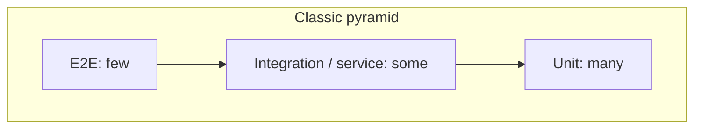
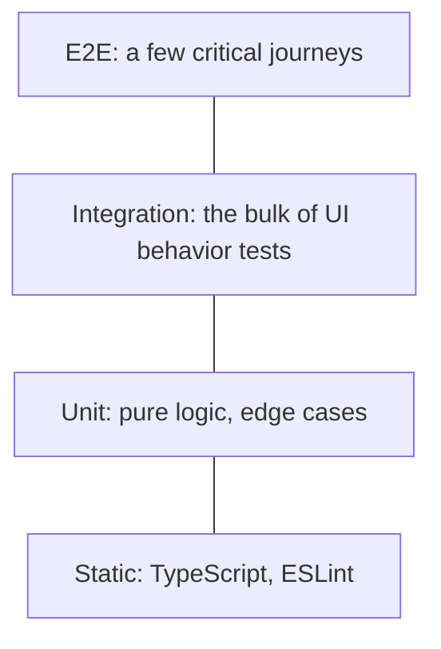
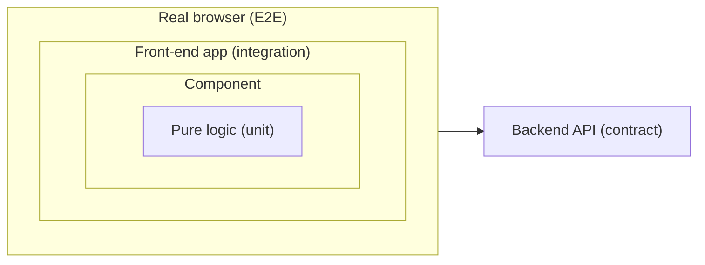
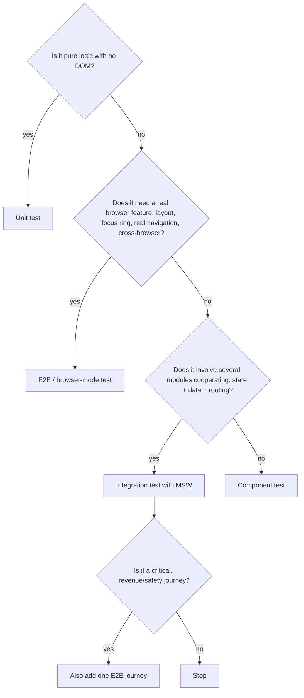

# 08 / 01 — Test Strategy and the Test Pyramid: What to Test, at Which Level, and Why

## 1. Lesson metadata

| | |
|---|---|
| **Level** | Intermediate |
| **Study time** | 3–4 hours (reading 1.5 h, experiments 1 h, exercises 1–1.5 h) |
| **Prerequisites** | [01 / 10 — Event handling](../01-react-fundamentals/10-event-handling.md), [01 / 12 — Component purity](../01-react-fundamentals/12-component-purity.md), [01 / 19 — Project setup with Vite and TypeScript](../01-react-fundamentals/19-project-setup-vite-typescript.md), [04 / 02 — Separation of concerns](../04-react-architecture/02-separation-of-concerns.md) |
| **Next** | [02 — Unit testing with Vitest](./02-unit-testing-with-vitest.md) |
| **Related later** | [03 — React Testing Library](./03-react-testing-library.md), [08 — Integration testing](./08-integration-testing.md), [09 — E2E with Playwright](./09-e2e-with-playwright.md), [16 — Avoiding brittle tests](./16-avoiding-brittle-tests.md), [15 — CI checks](./15-ci-checks.md) |

**Learning objectives.** After this lesson you can:
1. Explain what an automated test is *for* (confidence per unit of cost), not merely what it executes.
2. Describe the test pyramid, the testing trophy, and the "honeycomb", and say which assumptions each one encodes.
3. Classify a given test as unit, component, integration, contract, or end-to-end, using *what is real vs. what is faked* as the criterion rather than the tool used.
4. Decide, for a given feature, which behaviors belong at which layer and which should not be tested at all.
5. Recognize the properties of a healthy test suite (fast, deterministic, behavior-focused, diagnosable) and the properties of a harmful one (flaky, implementation-coupled, slow, redundant).
6. Interpret code coverage correctly and explain why it is a poor target.

**Concepts covered:** confidence, feedback speed, cost of a test, test pyramid, testing trophy, honeycomb, test doubles (dummy, stub, spy, mock, fake), determinism, flakiness, behavior vs. implementation, risk-based testing, coverage, mutation testing (concept), test ownership, testability as a design property.

---

## 2. Deep conceptual explanation

### 2.1 What problem is this lesson solving?

Most teams do not suffer from "too few tests" or "too many tests". They suffer from **the wrong tests in the wrong places**: a 40-minute CI pipeline whose failures nobody trusts, snapshot files that are approved without reading, mocks that make every test pass while production is broken, and critical flows (checkout, login, payment) covered only by a manual checklist.

A test strategy answers one question: *given a finite budget of time, CI minutes and attention, which checks give the most confidence that the product works, at the lowest cost to run and to maintain?*

Every test has costs and benefits:

| | Benefit | Cost |
|---|---|---|
| Writing | Forces you to state expected behavior | Author time |
| Running | Detects regressions | CI minutes, developer waiting time |
| Failing correctly | Pinpoints a real bug | Investigation time (small if the failure is diagnosable) |
| Failing incorrectly (flaky, brittle) | None | Investigation time, erosion of trust, retries, ignored red builds |
| Maintaining | — | Update on every refactor that doesn't change behavior (if the test is coupled to implementation) |

A test is worth having when `P(catches a real defect) × cost of that defect > writing + running + maintenance + false-alarm cost`. Strategy is the discipline of applying that inequality *systematically* instead of per mood.

### 2.2 What "confidence" means

When you merge a pull request you want to believe: "users can still do what they could do before, plus the new thing". That belief is composed of several narrower beliefs:

1. **Logic is right**: pure calculations, reducers, parsers, validators produce correct results.
2. **Components behave**: given props and user input, a component renders and reacts as specified, including accessibility semantics.
3. **Pieces fit together**: components, hooks, routing, state and the network layer cooperate correctly (e.g., submitting a form triggers the right request and the UI shows the result).
4. **Contracts hold**: the front end and back end agree on request/response shapes.
5. **The deployed system works**: bundle loads, routing and auth work in a real browser against real infrastructure.

Different test types give different *kinds* of confidence. None gives all five cheaply. This is the root of the pyramid argument.

### 2.3 Defining the test levels by "what is real"

Tool names (Vitest, Jest, Playwright) do not define a level. The **degree of realism** does. The same runner can execute tests at several levels.

| Level | Typical scope | What is real | What is faked | Typical speed |
|---|---|---|---|---|
| **Static** | Whole codebase | Source text | — (no execution) | Seconds |
| **Unit** | One function/module/hook | The unit under test | Its collaborators (sometimes) | Milliseconds |
| **Component** | One component (with its children) | React rendering, DOM semantics (in a simulated DOM), user events | Network, timers, browser APIs the simulated DOM lacks | 10s–100s of ms |
| **Integration** | A feature slice: several components, routing, state, data layer | Most of the front-end code | Only the process boundary (network via MSW, perhaps storage) | 100s of ms – seconds |
| **Contract** | The agreement between two services | The schema/contract | Each side tested independently | Fast |
| **End-to-end (E2E)** | The deployed or locally served full application | Browser, bundle, often backend | Little or nothing (third parties may be stubbed) | Seconds–minutes each |

Two warnings:

- **"Unit" is not a synonym for "isolated from all collaborators".** There are two historical schools. The *sociable* school treats a unit as a small cluster of real collaborating objects; the *solitary* school mocks everything but the subject. In React, rendering a component with its real child components is almost always preferable to mocking each child, because the parent-child contract *is* the behavior.
- **"Integration test" is overloaded.** Some teams mean "talks to a real database"; in front-end teams it usually means "multiple real front-end modules with the network boundary faked". Always state what is real. This course uses the definition in the table above.

### 2.4 The test pyramid

Mike Cohn's *test pyramid* (popularized by Martin Fowler's writing) says: **many fast, cheap, isolated tests at the base; fewer slower, broader tests as you go up; very few of the slowest and most realistic tests at the top.**



The reasoning is purely economic:

- Unit tests are fast and pinpoint failures but only prove *local* correctness.
- E2E tests prove the whole thing works but are slow, flaky-prone (many moving parts), and diagnose poorly ("checkout test failed" could be 20 causes).

So push each check **as low as it can go while still exercising the thing that could break**. That last clause is the one people drop.

### 2.5 The testing trophy

Kent C. Dodds' *testing trophy* adapts the pyramid for front-end applications with a thesis: **"The more your tests resemble the way your software is used, the more confidence they can give you."** From the base up: static analysis (types, linting), unit tests, **integration tests (the widest band)**, E2E tests.



Why the shift for UI code?

1. Components are rarely interesting in isolation; their value is in how they combine with state, routing, and data.
2. Tools like React Testing Library plus MSW make "integration" tests (real components, real state, faked network) nearly as fast and as cheap as unit tests of one component.
3. Static analysis (TypeScript, ESLint) removes a whole class of "unit" tests (wrong prop types, typos) at zero runtime cost.

### 2.6 The honeycomb and other shapes

Spotify's engineers described a *honeycomb* for microservices: most tests are integration tests of a service against its neighbors, few implementation-detail (unit) tests, few E2E. The shape was proposed for backend services, but it expresses the same trend. The lesson is not that one shape wins. It is that **the correct shape depends on where your risk and your cost curves are**:

| If your app is mostly… | The risk lives in… | Shape tends toward… |
|---|---|---|
| Algorithmic (pricing engine, parsers, finance calculations) | Pure logic | Pyramid (heavy unit/property tests) |
| UI glue over a REST/GraphQL API (dashboards, admin tools, CRUD) | State + data-flow wiring | Trophy (heavy integration) |
| Thin UI over a stable backend, high user-journey risk (checkout, onboarding) | End-to-end flows | Trophy with a thicker E2E top |
| A design-system library | Component API + accessibility + visuals | Component + a11y + visual regression (see [12 — Visual regression](./12-visual-regression.md)) |

Treat the named shapes as heuristics for *where to put the next test*, not as quotas.

### 2.7 Behavior, not implementation

The most important idea for maintainable UI tests:

> **A test should fail when behavior a user (or caller) depends on breaks, and should not fail when you refactor internals.**

*Behavior* is: what is rendered (roles, text, accessible names), what happens in response to user input, what requests are made to the outside world, what is announced to assistive technology. *Implementation* is: component names, state variable names, which hook is used, internal function calls, child component props that exist only to wire things together.

If a test breaks when you rename `useState` to `useReducer`, that test asserts implementation. If it breaks when the Submit button stops being reachable by keyboard, it asserts behavior. React Testing Library's guiding principle (explored in [lesson 03](./03-react-testing-library.md)) is to make it *hard* to test implementation by giving you only DOM-level tools.

### 2.8 Test doubles: a precise vocabulary

You will fake things. Use the names consistently (Gerard Meszaros' taxonomy, as popularized by Fowler):

| Double | Purpose | Example |
|---|---|---|
| **Dummy** | Fills a parameter that is never used | `{} as Logger` |
| **Stub** | Returns canned answers | `getUser: () => ({ id: 1 })` |
| **Spy** | Records how it was called (and may also pass through) | `vi.spyOn(console, "error")` |
| **Mock** | Pre-programmed with *expectations* that are verified | A `vi.fn()` with `expect(fn).toHaveBeenCalledWith(...)` (in practice, spy + assertion) |
| **Fake** | A working lightweight implementation | In-memory repository; MSW handlers that implement a fake API |

Day-to-day conversations use "mock" for all of them. When reasoning about design, the distinction matters: **stubs and fakes support state-based verification (assert on outcomes); mocks/spies support interaction-based verification (assert on calls).** Prefer state-based verification for UI code; assert on calls only at true boundaries (e.g., "analytics `track` was called with `purchase`"). See [06 — Mocking strategies and MSW](./06-mocking-strategies-and-msw.md).

### 2.9 Determinism and flakiness

A test is **deterministic** if the same code and the same inputs always produce the same result. A **flaky** test sometimes passes and sometimes fails on the same code. Flakiness is not "annoying"; it is *corrosive*, because it teaches the team that red does not mean broken, so real failures get retried and ignored.

Common sources in UI testing:

| Source | Example | Remedy |
|---|---|---|
| Time | `setTimeout`, `Date.now()`, debounce | Fake timers / injected clock |
| Randomness | `Math.random()` IDs | Seed or inject |
| Network | Real API variability | Fake the network boundary (MSW) in integration tests; hermetic E2E fixtures |
| Shared state | Test A leaves data, test B reads it | Reset between tests; isolate per test |
| Async races | Asserting before the UI updated | Wait for observable conditions (`findBy*`, web-first assertions), not arbitrary sleeps |
| Environment | Locale, timezone, viewport, fonts | Pin in config |
| Ordering | Tests depend on running order | Randomize order in CI to expose it |

### 2.10 Coverage: a diagnostic, not a goal

*Line/branch coverage* reports which code was executed during tests. It tells you what is **definitely not tested**; it does **not** tell you what is well tested. A test with no assertions can reach 100 % coverage. Goodhart's law applies: when coverage becomes a target, people write assertion-free tests to hit it.

Useful uses: finding untested branches in critical modules; spotting dead code; tracking *changed-lines* coverage in review. A complementary idea is **mutation testing** (tools mutate your code, e.g., flip `>` to `>=`, and check whether any test fails): it measures whether tests would *notice* defects. It is slow, so it is typically applied selectively to critical logic. (See Stryker for JavaScript; verify current React/Vitest support in its docs before adopting.)

### 2.11 Common misconceptions

| Misconception | Reality |
|---|---|
| "More tests = higher quality." | Value comes from *meaningful assertions at the right level*. Redundant or brittle tests add cost and remove trust. |
| "100 % coverage means it's tested." | Coverage measures execution, not verification. |
| "E2E tests are the real tests; unit tests are toys." | E2E tests are slow and diagnose poorly. They are essential for a few critical journeys and a poor tool for exhaustively checking edge cases. |
| "Unit tests mean mocking every dependency." | Over-mocking yields tests that verify your mocks. Prefer real collaborators where cheap. |
| "If TypeScript compiles, I don't need tests." | Types verify shape, not behavior (a function can return the *wrong* `number`). They also don't verify what the server really returns at runtime. |
| "Snapshot tests are regression tests." | Large DOM/serialized snapshots detect *change*, not *breakage*; they are routinely updated without review. |
| "Test code is second-class; copy-paste is fine." | Test code is read and changed as often as production code. Duplication that obscures intent is still debt, but *some* repetition (DAMP over DRY) can improve readability. |

---

## 3. Internal mechanics

This lesson is about strategy rather than a specific library, but there are mechanics worth being precise about.

### 3.1 How a JavaScript test run works (teaching model)

*Teaching model* (details vary by runner; Vitest, Jest, and Node's built-in runner differ):

1. A **runner** discovers test files by glob pattern.
2. Each file is loaded in an **environment**: a Node process (or worker) optionally augmented with a simulated browser (`jsdom`/`happy-dom`) or a real browser.
3. Within the file, `describe`/`test` calls *register* tests; the runner then executes them, usually sequentially within a file and in parallel across files.
4. Each test is an async function; the runner awaits it, applies a timeout, and records pass/fail based on thrown errors.
5. Hooks (`beforeEach`, `afterEach`) run around tests; module mocks and global state are managed by the runner.

*Public guarantee:* a test fails if it throws or rejects (assertion libraries throw on mismatch). *Implementation detail:* isolation strategy (separate workers vs. shared), module-registry reset, and parallelism defaults differ by runner and version. Vitest isolates test files by default (`isolate: true`, per the v3 config docs), but options exist to change it.

### 3.2 What a simulated DOM does and does not do

jsdom and happy-dom implement the DOM/HTML APIs in JavaScript inside Node. They are **not** browsers. Practically:

- *They have*: DOM tree, events, many form behaviors, `getComputedStyle` (limited), `localStorage`.
- *They lack*: layout (everything has zero size), real paint, real focus/scroll behavior in some cases, CSS media queries evaluated against a viewport, `IntersectionObserver`/`ResizeObserver` (often missing or stubbed), real network stack differences.

Therefore a green component test proves *logic and semantics*, not *layout or visual correctness*. Real-browser tests (Playwright, or Vitest browser mode, which is no longer labelled experimental in the current Vitest docs) cover what simulated DOMs cannot.

### 3.3 Where the cost curve comes from

A rough mental model for the per-test cost ordering is: static < unit < component < integration < E2E. The causes:

- **Startup:** E2E needs a browser, a served app, and often a backend and data.
- **Waiting:** real network and rendering take real time; simulated tests run synchronously or on microtasks.
- **Failure surface:** more real parts mean more potential causes of failure that are unrelated to the behavior under test.
- **Diagnosis:** a unit test failure names a function; an E2E failure names a flow.

These are *tendencies*, not laws. A slow unit test (one that builds a huge fixture) or a very fast integration test is entirely possible. Measure your own suite.

---

## 4. Step-by-step execution walkthrough: placing tests for one feature

Feature: **"Apply a promo code in the cart."** Requirements: the user enters a code, presses Apply; a valid code reduces the total (percentage off, never below zero, not stackable); an invalid code shows an error; the request is sent to `POST /api/cart/promo`.

Walk through the decision process:

1. **List behaviors** (not code):
   - B1: `percentOff(total, 20)` computes correct totals, including rounding to cents and a 100 % edge case.
   - B2: Entering a code and pressing Apply sends the code to the server.
   - B3: On success, the new total is shown and the field is cleared.
   - B4: On "invalid code", the user sees an error associated with the field (accessible).
   - B5: While the request is pending, Apply is disabled (no double-submit).
   - B6: The front end and back end agree on `{ code } → { total, discount }`.
   - B7: A logged-in user can add an item, apply a code, check out, and see an order confirmation in a real browser.
2. **Assign a level for each behavior**, guided by *what could break* and *cheapest layer that exercises it*:

| Behavior | Risk | Level | Why not lower/higher |
|---|---|---|---|
| B1 rounding, 0 floor | Pure logic, many edge cases | Unit (maybe property-based) | Edge cases are cheap to enumerate here; E2E would be absurdly slow for them |
| B2–B5 | Wiring of state, form, request, a11y | Integration (render real `Cart` + providers; MSW fakes the endpoint) | A unit test of the input alone misses wiring; E2E is overkill for each branch |
| B4 "error is announced" | a11y semantics | Integration, using role-based queries (`role="alert"`) | The semantic assertion lives in DOM queries |
| B6 | Schema drift | Contract (shared schema validated on both sides) or runtime schema parsing | Neither unit nor E2E reliably catches drift early |
| B7 | Whole-journey wiring, real browser, real auth | E2E (one test) | One test proves the happy path; branches live lower |

3. **Write the lowest-level tests first**, as they are cheapest and give instant feedback while developing.
4. **Add the integration test for the feature slice** and verify that it *fails* when you break wiring (e.g., comment out the request) — a test you have not seen fail is unproven.
5. **Add exactly one E2E** for the journey; keep branch coverage out of it.
6. **Check for redundancy**: if the integration test and the unit test both assert "20 % of 100 is 80", delete one or make them test different things (the unit tests the formula's edge cases; the integration test asserts that the UI displays *whatever the server returns*, with a representative value).

Outcome: ~8 unit cases (milliseconds), ~4 integration tests (≈100–300 ms each), 1 E2E (several seconds). Total CI cost is small, the confidence is broad, and each failure localizes.

---

## 5. Code examples

All code is TypeScript. Tooling details (config, matchers, queries) are taught in lessons 02–09; here we only need enough to see the *placement* decisions. The Vitest/RTL/MSW/Playwright snippets in this lesson were checked against the same versions as lessons 02-09 (Vitest 3.2/4/5, RTL 16.3, MSW 2.15, Playwright 1.64); `applyPercentOff(1999, 15)` was confirmed to return `1699`.

### 5.1 Minimal example — a unit test for pure logic

```ts
// src/cart/promo.ts
export function applyPercentOff(totalCents: number, percent: number): number {
  if (!Number.isInteger(totalCents) || totalCents < 0) throw new RangeError("totalCents");
  if (percent < 0 || percent > 100) throw new RangeError("percent");
  const discount = Math.round((totalCents * percent) / 100);
  return Math.max(0, totalCents - discount);
}
```

```ts
// src/cart/promo.test.ts
import { describe, expect, test } from "vitest";
import { applyPercentOff } from "./promo";

describe("applyPercentOff", () => {
  test("applies a percentage and rounds to whole cents", () => {
    expect(applyPercentOff(1999, 15)).toBe(1699); // 15% of 1999 = 299.85 -> 300
  });

  test("100% off yields zero, never negative", () => {
    expect(applyPercentOff(500, 100)).toBe(0);
  });

  test("rejects invalid percentages", () => {
    expect(() => applyPercentOff(100, 101)).toThrow(RangeError);
  });
});
```

**Predict:** `applyPercentOff(1999, 15)`. What is the result and why is the expected value `1699`?
**Result:** `1999 * 15 / 100 = 299.85`; `Math.round` gives `300`; `1999 - 300 = 1699`.
**Why this belongs at the unit level:** no DOM, no framework, no time; it runs in microseconds and the edge cases (rounding, bounds) are exactly where defects hide.
**Trade-off:** using integer cents avoids floating point money errors but pushes formatting to the UI layer.

### 5.2 Practical example — an integration-level test for the feature slice

```tsx
// src/cart/PromoCode.test.tsx
import { render, screen } from "@testing-library/react";
import userEvent from "@testing-library/user-event";
import { http, HttpResponse } from "msw";
import { setupServer } from "msw/node";
import { afterAll, afterEach, beforeAll, expect, test } from "vitest";
import { CartPage } from "./CartPage";

const server = setupServer(
  http.post("*/api/cart/promo", async ({ request }) => {      // "*/" matches any origin: under jsdom a relative fetch resolves to http://localhost:3000, which "http://localhost/..." would NOT match (verified)
    const { code } = (await request.json()) as { code: string };
    if (code !== "SAVE20") {
      return HttpResponse.json({ message: "Invalid code" }, { status: 422 });
    }
    return HttpResponse.json({ totalCents: 8000, discountCents: 2000 });
  }),
);

beforeAll(() => server.listen({ onUnhandledRequest: "error" }));
afterEach(() => server.resetHandlers());
afterAll(() => server.close());

test("applies a valid code and shows the new total", async () => {
  const user = userEvent.setup();
  render(<CartPage initialTotalCents={10000} />);

  await user.type(screen.getByLabelText(/promo code/i), "SAVE20");
  await user.click(screen.getByRole("button", { name: /apply/i }));

  expect(await screen.findByText("$80.00")).toBeInTheDocument();
});

test("shows an accessible error for an invalid code", async () => {
  const user = userEvent.setup();
  render(<CartPage initialTotalCents={10000} />);

  await user.type(screen.getByLabelText(/promo code/i), "NOPE");
  await user.click(screen.getByRole("button", { name: /apply/i }));

  expect(await screen.findByRole("alert")).toHaveTextContent(/invalid code/i);
});
```

Line notes:
- `onUnhandledRequest: "error"` makes any request without a handler *fail the test*. This prevents silently talking to the real network and prevents "forgot to mock" bugs.
- Queries use **roles and labels** (`getByLabelText`, `getByRole`) — the same handles a screen reader user has. If the label is removed, the test breaks, and so does accessibility.
- `findByText` waits (polls) for the async update; there is no `setTimeout`.
- The test never mentions state, hooks, or child component names; a refactor from `useState` to `useReducer` does not touch it.

**Predict:** what happens if the component sends the request to `/api/cart/promos` (a typo)? **Result:** MSW reports an unhandled request and, with `"error"`, the test fails with a message naming the URL. That failure *is* the wiring check.

### 5.3 Incorrect example — testing implementation details

```tsx
// ❌ Brittle: asserts on internal state shape and child wiring
import { shallow } from "enzyme"; // legacy; illustrative only
test("sets promoApplied state", () => {
  const wrapper = shallow(<PromoCode />);
  wrapper.find("PromoInput").props().onChange("SAVE20");
  wrapper.find("PromoInput").props().onSubmit();
  expect(wrapper.state("promoApplied")).toBe(true);
});
```

*(Enzyme is legacy for React 18+/19; it has no official adapter for React 19. The point is conceptual.)*

**Why wrong:** it reaches into a child's props and the component's state variable. Renaming `promoApplied` or replacing `PromoInput` with a native `<input>` fails the test although the user-visible behavior is unchanged; and the test would **pass** if the DOM never updated at all.

### 5.4 Corrected implementation

The integration test in 5.2 is the correction: it interacts through accessible roles/labels and asserts on rendered output. Assertion target changes from "internal state is true" to "the user sees `$80.00`".

### 5.5 Advanced example — a layered E2E "one journey" test

```ts
// e2e/checkout.spec.ts (Playwright)
import { expect, test } from "@playwright/test";

test("a signed-in shopper can apply a promo code and check out", async ({ page }) => {
  await page.goto("/products/espresso-machine");
  await page.getByRole("button", { name: "Add to cart" }).click();
  await page.getByRole("link", { name: /cart/i }).click();

  await page.getByLabel("Promo code").fill("SAVE20");
  await page.getByRole("button", { name: "Apply" }).click();
  await expect(page.getByTestId("order-total")).toHaveText("$80.00");

  await page.getByRole("button", { name: "Checkout" }).click();
  await expect(page.getByRole("heading", { name: "Order confirmed" })).toBeVisible();
});
```

This single test crosses bundle load, routing, cart state, the real (or hermetic test) API, and the confirmation page. It is **deliberately not** exhaustive: the invalid-code branch, rounding, and double-submit are already covered below. See [09 — E2E with Playwright](./09-e2e-with-playwright.md) for fixtures, auth state, and determinism.

### 5.6 A strategy document (the "test plan" as code review artifact)

```md
## Testing plan: promo codes
- Unit: `applyPercentOff` (rounding, bounds)
- Integration: PromoCode in CartPage w/ MSW (success, invalid, pending)
- Contract: `PromoResponse` zod schema shared with API (CI check)
- E2E: checkout-with-promo (1 journey, runs on main + nightly)
- Not testing: styling of the promo input (covered by visual regression on the design system)
```

Writing down what you are **not** testing, and why, is a hallmark of a deliberate strategy.

---

## 6. Visual explanations

### 6.1 Cost vs. confidence

```text
Confidence about the *whole system*
  ^
  |                                   E2E  ●
  |                        Integration ●
  |                Component ●
  |        Unit ●
  | Static ●
  +-----------------------------------------> Cost per test (time, flake risk, maintenance)
```

Each point is a *typical* position. Your goal is to get the most confidence per cost, which means using the left side heavily for logic and the right side only where nothing cheaper observes the risk.

### 6.2 Where each level sits in the stack



### 6.3 Decision flow: "Where should this test live?"



### 6.4 Flakiness as a trust budget

```text
Suite trust
  ^
  | ●●●●● 0 flaky tests: red means "broken"
  |      ●●●
  |          ●●   some flaky: reds are retried
  |              ●   many flaky: reds are ignored -> suite is worthless
  +------------------------------------> number of flaky tests
```

---

## 7. Alternative approaches and trade-offs

### 7.1 Strategy shapes compared

| Criterion | Pyramid (unit-heavy) | Trophy (integration-heavy) | E2E-heavy ("ice cream cone") | Manual QA only |
|---|---|---|---|---|
| Feedback speed | Excellent | Very good | Poor | Very poor |
| Confidence in wiring | Low–medium (relies on mocks) | High | Highest | Variable |
| Refactor-friendliness | Low if coupled to internals; high if behavioral | High (behavior-focused) | High | N/A |
| Failure diagnosis | Excellent | Good | Poor | Poor |
| Flake risk | Very low | Low | High | N/A |
| Maintenance cost | Medium | Medium | High | Recurring human cost |
| Catches layout/browser bugs | No | No (simulated DOM) | Yes | Yes |
| Catches contract drift | Only if mocks are accurate (often not) | Only if handlers are accurate | Yes | Yes |
| Best for | Algorithms, libraries | UI-over-API apps | Few critical journeys | Exploratory, usability |

*Ice-cream cone* is the anti-pattern: lots of manual and E2E checks on top of a thin base. Teams end up there when unit tests are impractical (untestable architecture) and E2E tests are the only way to reach confidence.

### 7.2 A scenario where the recommended approach (integration-heavy) is NOT best

You are building a **tax/commission engine** used in a UI. The component is a trivial table; the logic is 3,000 lines of rules with thousands of edge cases defined by regulators. The right strategy is a **pyramid**: table-driven unit tests and property-based tests for the engine (hundreds or thousands of cases in milliseconds), a handful of integration tests for the table, and one E2E. Pushing those cases through the UI would multiply runtime by 100× and bury the rules in DOM plumbing.

The opposite scenario: a **design system** where components have almost no logic but heavy accessibility and visual states. Unit tests add little; a mix of component tests (keyboard/aria), a11y checks, and visual regression is better.

### 7.3 Where to put test files

| Option | Pros | Cons |
|---|---|---|
| Co-located `Component.test.tsx` next to source | Discoverable, moved with the code, encourages testing | Test files mix into source listings (filterable) |
| `__tests__` folders per feature | Tidy listings | Slightly less obvious pairing |
| Top-level `tests/` mirror | Clear separation, e.g., for E2E | Drift from source, long relative imports |

A common convention: co-locate unit/component/integration tests (`*.test.ts(x)`) and keep E2E in a top-level `e2e/` directory with its own config (`*.spec.ts`), so runners don't confuse the two.

---

## 8. Best practices and anti-patterns

**Do**
- Decide the level by *what could break* and *the cheapest layer that observes it*.
- Assert on **observable behavior**: DOM output, network requests at the boundary, navigation.
- Make the suite **hermetic**: no real network, no real clock, no shared mutable state unless an E2E test explicitly owns it.
- Keep tests **diagnosable**: a failing test name should read like a sentence describing the broken behavior ("shows an error when the code is invalid").
- Treat a red build as stop-the-line; fix or quarantine flaky tests *quickly* (with a ticket) rather than retrying forever.
- Write a failing test first for bug fixes (reproduction), then fix.
- Prefer **fewer, richer** integration tests over many near-duplicates.

**Beginner mistakes**
- Testing that a component "renders without crashing" with no assertion.
- Snapshotting whole components and approving diffs blindly.
- Asserting on class names or DOM structure instead of roles/text.
- Using `setTimeout`/`sleep` to wait for async work.

**Experienced-developer mistakes**
- Over-mocking: mocking modules the test should exercise, so the test verifies the mock.
- Building elaborate fixture factories that hide what a test depends on.
- Using coverage thresholds as a gate for *all* code, which incentivizes low-value tests.
- Re-testing library behavior (e.g., that `Array.prototype.sort` sorts, that React re-renders on state change).
- Duplicating the same scenario at every level "to be safe", increasing cost without increasing confidence.

**Smells**
- A test needs `jest.mock` for five modules before it can render.
- Test names that describe implementation ("calls setState").
- Changing production code requires editing dozens of unrelated tests.
- Tests pass individually but fail when run together (shared state).
- `--retries` is set globally to hide flakiness.

**Justified exceptions**
- Snapshot tests are acceptable for stable, *small*, serialized outputs (e.g., generated config, an error message catalog) where a diff is human-readable.
- Testing implementation details is acceptable at *library boundaries* where the internal call **is** the contract (e.g., "the analytics adapter calls `track('purchase', {...})`").
- Strict coverage thresholds can be reasonable for **safety-critical or financial calculation modules**, combined with mutation testing, not as a repo-wide number.

---

## 9. Real-world application

**E-commerce checkout (revenue critical).** Constraints: money, third-party payment provider, fraud checks, many branches (shipping options, promo codes, tax regions, failed payments). Strategy: pure functions for price/tax calculations (unit, property-based, exhaustive table tests); integration tests for each UI branch with MSW (payment declined, address validation failure, inventory changed mid-checkout); *one* E2E happy path using the payment provider's test mode, plus one E2E for "payment declined" because it crosses a real redirect; contract tests (or shared schemas) for the order API. Not tested at E2E level: every tax region (that is data and logic, tested lower).

**Finance dashboard (real-time data).** Constraints: WebSocket streams, large tables, correctness of numbers matters more than visuals. Strategy: reducers/selectors that handle stream messages are unit tested with recorded message sequences; table component tests verify formatting and sorting semantics; an integration test uses a fake WebSocket to feed a scripted sequence; E2E checks that the real feed connects and renders at least one row, in a staging environment (accepting more flake risk, run separately and non-blocking for PRs).

**Auth and onboarding (security and conversion).** Constraints: redirects, cookies, session expiry, MFA. These are *browser-level* behaviors, so rely on a small number of E2E tests with saved authenticated state (Playwright `storageState`; see [lesson 09](./09-e2e-with-playwright.md)). Unit/integration tests cover the form validation, error messages, and the guard logic (e.g., a `ProtectedRoute` given various auth states).

**Multi-team design system.** Constraints: many consumers, API stability, accessibility obligations. Strategy: component tests for keyboard and ARIA behavior, type-level tests for public props, visual regression snapshots on isolated stories, and a "contract" suite consumers can run (see [11 — Component contract testing](./11-component-contract-testing.md)).

**CI economics.** Typical pipelines run on every PR: static checks → unit/component/integration (parallelized) → build → a small E2E smoke suite. A full E2E regression suite may run on merges to main and nightly. Choose gates by *who is blocked and for how long*; a 30-minute PR gate changes behavior (people batch changes, review quality drops).

---

## 10. Debugging and troubleshooting

### 10.1 Symptom: "the suite is slow"

1. Measure first: run the runner with a reporter that prints per-file and per-test durations (Vitest `--reporter=verbose`; verify flag names in docs). Sort by duration.
2. Classify: *environment startup per file* (many small files; heavy setup imports), *slow individual tests* (real timers, large renders, `userEvent` delays), or *serial E2E*.
3. Typical root causes: importing the entire app/barrel files in every test; real `setTimeout` waits; rendering huge lists; `waitFor` polling with long timeouts hiding a never-true condition.
4. Fix and re-measure; compare totals and p95 per-test duration.

### 10.2 Symptom: "a test fails only in CI" or "only sometimes"

1. Reproduce with repetition: run the file in a loop (e.g., `--repeat`/shell loop; verify runner flags) and with random ordering.
2. Check for **time/timezone/locale** assumptions (CI is often UTC with a different locale), **CPU speed** (race conditions appear on slower machines), **parallelism** (shared ports/files), and **leftover state**.
3. Investigate async logic: is the assertion waiting for a *condition* or hoping a fixed delay is enough?
4. Add diagnostics (trace/video for E2E; `screen.debug()` for component tests) rather than adding retries.
5. Validate the fix by running the test hundreds of times under CPU throttling, not once.

### 10.3 Symptom: "all tests pass but the feature is broken in production"

1. Ask which layer *should* have observed this. Was the real boundary faked (mocks diverged from the real API)? Was it browser-only (layout, focus, CSS)? Was it integration of two features never tested together?
2. Add a **failing test at the lowest layer that can observe it** (reproduce first).
3. If the cause is *mock drift*, add contract tests or generate handlers from the same schema/OpenAPI source.
4. Record the escape in a short post-mortem note: "which test would have caught this and why didn't it exist" — this is how strategy improves.

### 10.4 Symptom: "refactoring breaks dozens of tests that shouldn't care"

Investigate what the failing assertions reference. If they reference internal names, child props, or DOM structure, rewrite them to use roles/labels/text and visible outputs; remove internal-state assertions. Validate by performing a deliberately behavior-preserving refactor (e.g., swap `useState` for `useReducer`) and confirming zero tests fail.

---

## 11. Exercises

### Level A — Knowledge
A1. Define unit, component, integration, and E2E tests using "what is real vs. faked" as the criterion.
A2. Name three shapes proposed for test suites and one situation where each fits best.
A3. What is the difference between a stub and a mock? Between a mock and a fake?
A4. Why can 100 % line coverage coexist with an untested feature?
A5. List four common sources of flaky tests and one remedy for each.

### Level B — Code comprehension
B1. A teammate's test passes whether or not the button works:
```tsx
test("renders", () => {
  render(<SaveButton onSave={vi.fn()} />);
  expect(true).toBe(true);
});
```
What is wrong, and what is the minimum that makes it meaningful?
B2. Which of these tests is most coupled to implementation? Why?
```tsx
// (1)
expect(screen.getByRole("status")).toHaveTextContent("Saved");
// (2)
expect(wrapper.find(SaveStatus).prop("state")).toBe("saved");
// (3)
expect(container.querySelector(".status.status--ok")).not.toBeNull();
```
B3. A test mocks `useCart()` to return `{ total: 80 }` and asserts the page shows `$80.00`. What risk does this test not cover that a MSW-based integration test would?

### Level C — Implementation
C1. For the feature "Login form with email/password, shows server error on 401, redirects on success", produce a test plan table (behavior → level → why) with at least 6 rows.
C2. Write a Vitest unit test file for `function clamp(n: number, min: number, max: number): number` covering normal, boundary, and invalid (`min > max`) inputs (decide and document the behavior for the invalid case).
C3. Rewrite test (3) from B2 to be behavior-focused for a component that shows "Saved".

### Level D — Debugging
D1. A suite is green locally but red in CI roughly one run in ten, always in `Toast.test.tsx`, which asserts `expect(screen.queryByText("Saved")).toBeNull()` after `await sleep(3000)` following a toast with a 3000 ms auto-dismiss. Diagnose and fix.
D2. After a back-end team renamed `discount` to `discountCents`, every front-end test stayed green but the production cart displays `NaN`. Identify the strategy gap and two preventions.

### Level E — Architecture and engineering decisions
E1. Your team (8 engineers, one React SPA, a REST API owned by another team) has 12 % coverage, no E2E, 40 manual regression steps before each release. Propose a 90-day plan. State what you test first, what you refuse to do, and how you measure success.
E2. A manager asks for an 85 % coverage gate on the repo. Respond with a reasoned alternative that still gives the manager a quality signal.

### Level F — Expert challenge
F1. Design a layered strategy for a component library of 60 components consumed by 12 internal apps, including accessibility, visual, and versioning concerns. Define what runs on every PR, nightly, and pre-release, and define the ownership of failures.

---

## 12. Detailed answers and explanations

> Attempt the exercises first.

**A1.** *Unit*: one function/module/hook is real; collaborators may be faked or real. *Component*: a React component and its rendered children are real in a simulated DOM; network/timers are faked. *Integration*: several front-end modules (components, state, routing, data layer) are real; only the process boundary (network) is faked. *E2E*: the built app runs in a real browser, usually against a real or hermetic backend; little is faked. A plausible wrong answer is "unit = Vitest, E2E = Playwright"; tools don't define levels.

**A2.** *Pyramid*: algorithm-heavy logic or libraries. *Trophy*: UI-over-API apps where the risk is wiring. *Honeycomb*: microservices dominated by service-to-service integration (also a useful mental model for BFF layers). (Also acceptable: ice-cream cone as an anti-shape.)

**A3.** A stub returns canned data; a mock is also *verified* for interactions (expectations on calls). A fake is a working, simplified implementation (in-memory DB, MSW handlers that behave like the API), whereas a mock is scripted per test. In practice the word "mock" is used loosely; precision matters when deciding between state-based and interaction-based assertions.

**A4.** Coverage records execution, not verification. A test that calls the function but asserts nothing executes every line. Also, coverage cannot see *missing* code (an unimplemented requirement) and says nothing about integration between covered units.

**A5.** Any four: time (fake timers), randomness (seed), network (fake boundary), shared state (isolate/reset), async races (wait for conditions), environment (pin locale/timezone/viewport), ordering (randomize and fix hidden dependencies).

**B1.** `expect(true).toBe(true)` can never fail. Minimum meaningful version: click the button and assert the handler was called (an *outbound* boundary callback is legitimate to assert on) or the UI changed:
```tsx
test("calls onSave when Save is clicked", async () => {
  const onSave = vi.fn();
  const user = userEvent.setup();
  render(<SaveButton onSave={onSave} />);
  await user.click(screen.getByRole("button", { name: /save/i }));
  expect(onSave).toHaveBeenCalledTimes(1);
});
```
Edge case: also assert it is *not* called when disabled.

**B2.** (2) is the most coupled (reaches for a component *type* and its prop). (3) is coupled to CSS class names and structure. (1) is behavior-oriented: it uses a role and visible text and survives refactors. Wrong-answer analysis: (3) looks "DOM-based" so people consider it fine; but class names are an implementation/styling concern and break on restyling while the test still passes if the text is wrong.

**B3.** It does not cover wiring of the real `useCart` (request URL, method, payload, response parsing, error handling), loading states, or contract drift. With MSW, the real hook and fetch layer run, so a wrong URL or wrongly parsed field fails the test. The mocked-hook test is acceptable for pure presentational behavior, but not for data flow.

**C1.** Example plan (evaluation criteria: every row names an observable behavior, a level, and a reason; E2E count small):

| Behavior | Level | Why |
|---|---|---|
| Email format validation (pure function) | Unit | Many edge cases, no DOM |
| Form shows field errors when empty submit | Component | Local behavior, a11y (aria-invalid, error association) |
| Successful login stores session and navigates to dashboard | Integration (MSW + memory router) | State + routing + request |
| 401 shows "Invalid credentials" in `role="alert"` | Integration | Error branch with network |
| Submit disabled and busy while pending; prevents double submit | Integration | Wiring, timing |
| Password visibility toggle is keyboard-operable | Component | a11y semantics |
| Real cookie/session persists across reload, redirect to deep link after login | E2E | Needs real browser storage + navigation |
| Response schema matches API | Contract/schema parsing | Drift detection |

**C2.** Example:
```ts
import { describe, expect, test } from "vitest";
import { clamp } from "./clamp";

describe("clamp", () => {
  test.each([
    [5, 0, 10, 5],
    [-1, 0, 10, 0],
    [11, 0, 10, 10],
    [0, 0, 10, 0],   // lower boundary
    [10, 0, 10, 10], // upper boundary
  ])("clamp(%d, %d, %d) = %d", (n, min, max, expected) => {
    expect(clamp(n, min, max)).toBe(expected);
  });

  test("throws RangeError when min > max (documented behavior)", () => {
    expect(() => clamp(1, 10, 0)).toThrow(RangeError);
  });

  test("propagates NaN rather than hiding it", () => {
    expect(clamp(Number.NaN, 0, 10)).toBeNaN();
  });
});
```
The key criterion is that the invalid-input behavior is *decided and documented*, whichever way. Throwing is generally better than silently swapping, because silent correction hides caller bugs.

**C3.** `expect(screen.getByRole("status")).toHaveTextContent("Saved");` (and give the component `role="status"`, which is also the correct live-region semantics for non-urgent updates).

**D1.** Root cause: a real-time `sleep(3000)` races a 3000 ms timer; on a slow CI machine the dismiss timer may not have fired when the assertion runs (or the sleep may resolve first). Fix: use fake timers and advance them deterministically, or wait for the *condition*:
```tsx
await waitForElementToBeRemoved(() => screen.queryByText("Saved"), { timeout: 4000 });
```
Preferred: `vi.useFakeTimers()`, trigger the toast, `await vi.advanceTimersByTimeAsync(3000)`, then assert removal (see [lesson 04](./04-testing-async-updates.md)). Validate by running the test 200 times under CPU throttling.

**D2.** Gap: the tests faked the API with hand-written objects that no one validated against the real contract, and no shared schema or contract test existed. Preventions: (1) parse responses at runtime with a schema (e.g., Zod) at the data-access boundary so drift fails loudly in dev/test and produces a controlled error in production; (2) generate types and MSW handlers from the same OpenAPI/GraphQL schema, or run consumer-driven contract tests (e.g., Pact; verify tool fit); (3) one smoke E2E against staging. Also: add a regression test for `NaN` display (a defensive formatter test).

**E1.** Evaluation criteria: sequencing by risk, measurable outcomes, realism. Example answer:
- *Weeks 1–2*: instrument — CI runs the suite; record the 40 manual steps and rank by *incident history × revenue impact*; add TypeScript strictness checks and ESLint (cheap, wide).
- *Weeks 2–6*: Vitest + RTL + MSW set up with shared test utilities; write integration tests for the top 5 flows' branch logic (login, checkout, ...). Write unit tests for pure logic as it is touched (boy-scout rule). Every bug fix gets a regression test.
- *Weeks 6–10*: Playwright with 3–5 critical journeys on a hermetic environment; automate the corresponding manual steps; run on main and nightly first, then PR gate when stable (<5 % flake over 100 runs).
- *Weeks 10–13*: contract/schema parsing for top endpoints; remove the manual steps that are now automated.
- *Refuse*: a global coverage target; snapshot-everything; rewriting legacy code solely to test it.
- *Metrics*: manual regression time (40 steps → ≤10), escaped defects per release, CI duration, flake rate, change failure rate (DORA).

**E2.** Explain that coverage measures execution, can be gamed, and creates perverse incentives. Offer: (1) report coverage but gate on **changed-lines/diff coverage** for new code at a modest threshold; (2) a stricter threshold only on named critical modules (pricing, auth), paired with mutation testing there; (3) track *outcome* metrics (escaped defects, flake rate, time-to-detect) which a manager can actually act on. State what would change your mind: if the team demonstrates assertion quality via mutation score, a higher threshold is acceptable.

**F1.** Example: PR: lint + types (including type-level tests of public props), unit/component tests with keyboard/ARIA assertions, automated axe checks per component story *(a11y automation catches only a subset; see [10 — Accessibility testing](./10-accessibility-testing.md))*, visual regression for changed stories (see [12](./12-visual-regression.md)). Nightly: cross-browser component tests (Playwright component-testing fixture or Vitest browser mode), visual regression across all stories, "consumer smoke" building 2–3 representative apps against the candidate version. Pre-release: contract tests (public API surface report diff, e.g., an API-extractor-style check), bundle size budget, semantic version check. Ownership: the library team owns failures in library tests; consumer-smoke failures page the library team first (they changed the dependency), with an agreed SLA; visual diffs require designer or owner approval. The answer is strong if it ties each test type to a specific risk and names the cost/frequency trade-off.

---

## 13. Senior engineer interview questions

**Q1. "How do you decide what to test?"**
*Strong answer:* By risk and by the cheapest observable layer. I list user-visible behaviors and the ways they could fail, estimate impact and likelihood, then push each check as low in the pyramid as still exercises the failure mode: logic in unit tests, wiring in integration tests with the network faked, and only truly browser-dependent or business-critical journeys in E2E. I also decide explicitly what *not* to test (library behavior, styling covered elsewhere) and write that down.

**Q2. "Pyramid or trophy?"**
*Strong answer:* Neither as dogma; they encode different cost curves. For UI-over-API apps, modern tooling makes integration tests cheap and they resemble real use, so they carry the bulk. For algorithmic code, unit tests dominate. The question is where the risk concentrates and what cheap layer can observe it. I'd also point out that static analysis is the cheapest base layer in both shapes.

**Q3. "Why do you dislike mocking so much?" (a probe)**
*Strong answer:* I don't dislike mocking; I dislike mocking things the test should exercise. Every mock is a claim about how the dependency behaves; if the claim is wrong, the test passes while production fails. So I mock at *process boundaries* (network, time, randomness, browser APIs missing from the simulated DOM) and use real implementations inside the app. At the network boundary I use a fake that implements the API (MSW) and keep it honest with schema/contract checks.

**Q4. "Your team has flaky E2E tests. What do you do?"**
*Strong answer:* Treat flakiness as a defect with a root cause. Quarantine the test (so it doesn't block) but keep it visible with an owner and deadline. Reproduce under load with repetition and traces; classify causes (race on UI condition, shared data, third-party, timing assumptions). Replace fixed sleeps with web-first assertions, isolate data per test, stub unstable third parties, and keep retries at most as a *diagnostic* (e.g., trace on first retry), never as the cure. Track flake rate as a metric.

**Q5. "What is wrong with a 90 % coverage requirement?"**
*Strong answer:* It measures execution, not verification, so it's gameable; it rewards testing easy code and punishes hard code; and it encourages implementation-coupled tests. Better: diff coverage for new code, stricter targets for critical modules, mutation testing selectively, and outcome metrics (escaped defects).

---

## 14. Further learning resources

| Resource | URL | Covers / why | Level | Study |
|---|---|---|---|---|
| Martin Fowler — The Practical Test Pyramid (Ham Vocke) | <https://martinfowler.com/articles/practical-test-pyramid.html> | Pyramid reasoning, test types, what to test at each level | Intermediate | Whole article |
| Martin Fowler — Test Double | <https://martinfowler.com/bliki/TestDouble.html> | Dummy/stub/spy/mock/fake vocabulary | Beginner–Int. | Whole page |
| Martin Fowler — Mocks Aren't Stubs | <https://martinfowler.com/articles/mocksArentStubs.html> | State vs. interaction verification; classical vs. mockist styles | Intermediate | Whole article |
| Kent C. Dodds — The Testing Trophy and Testing Classifications | <https://kentcdodds.com/blog/the-testing-trophy-and-testing-classifications> | Trophy rationale | Intermediate | Whole post |
| Testing Library — Guiding principles | <https://testing-library.com/docs/guiding-principles> | "Resemble how software is used" | Beginner | Whole page |
| Vitest — Guide | <https://vitest.dev/guide/> | Runner features and configuration | Beginner | Getting started |
| Playwright — Best practices | <https://playwright.dev/docs/best-practices> | E2E strategy: user-facing locators, isolation, no third-party calls | Intermediate | Whole page |
| Google Testing Blog | <https://testing.googleblog.com/> | Test size/flakiness writing from a large engineering org | Intermediate | Search "test flakiness", "Just Say No to More End-to-End Tests" *(title unverified)* |

URLs in this table were checked for HTTP 200 on 2026-10-22; any still marked *(unverified)* could not be checked automatically (blocked or unreachable). A 200 response does not guarantee the page content still matches the description; if a link has moved, search the site for the quoted title.

---

## 15. Knowledge checkpoint

**You should now understand**
- A test is an investment judged by confidence gained per cost; levels differ by what is real vs. faked.
- The pyramid, trophy, and honeycomb are cost-curve heuristics, not quotas.
- Behavior-focused tests survive refactors; implementation-coupled tests do not.
- Coverage measures execution only; flakiness destroys the trust budget.

**You should be able to explain without notes**
- Why the same scenario should rarely be tested at every level.
- The difference between stub, mock, spy, fake.
- Why mocking at process boundaries beats mocking internal modules.

**You should be able to implement**
- A test plan that maps behaviors to levels with reasons, and a minimal unit test and integration test pair for a feature.

**You should be able to debug**
- A slow suite, a flaky test, and an "all green but broken in production" escape by locating the missing layer.

**Before moving on:** read [02 — Unit testing with Vitest](./02-unit-testing-with-vitest.md), which covers the runner, configuration, assertions, mocking primitives, and fake timers you will use at every level.
