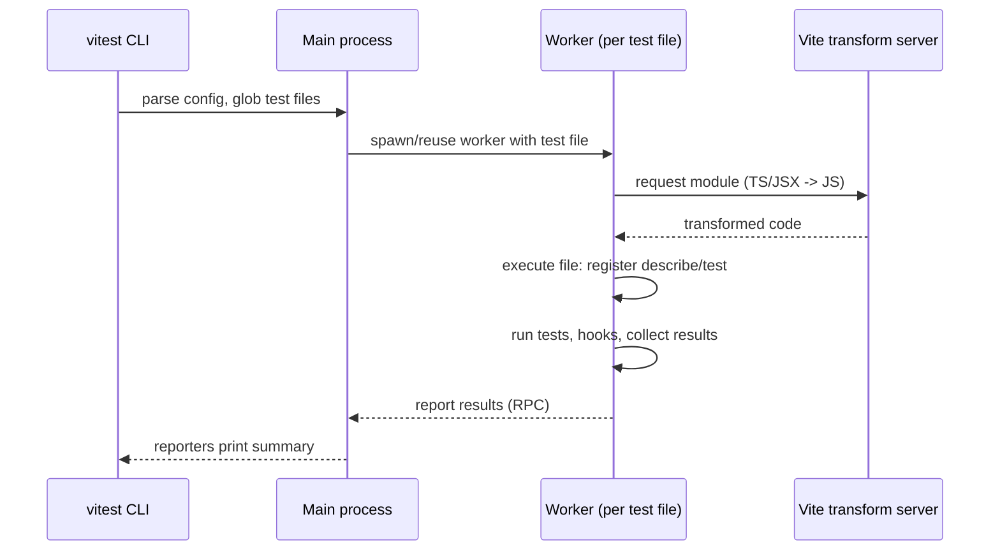
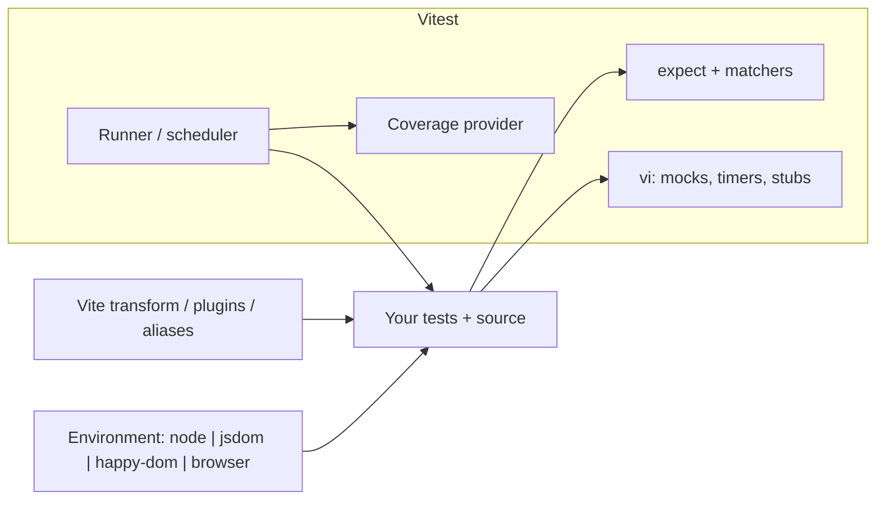
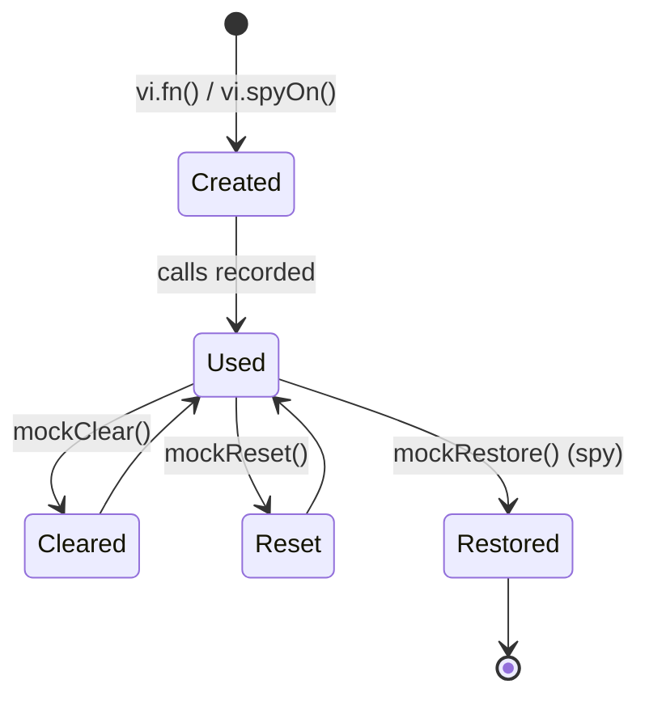

# 08 / 02 — Unit Testing with Vitest: Runner, Assertions, Mocks, and Fake Timers

## 1. Lesson metadata

| | |
|---|---|
| **Level** | Intermediate |
| **Study time** | 4–5 hours (reading 2 h, hands-on 1.5 h, exercises 1–1.5 h) |
| **Prerequisites** | [08 / 01 — Test strategy and the pyramid](./01-test-strategy-and-pyramid.md), [00 / 06 — Lexical scope and closures](../00-web-and-javascript-foundations/06-lexical-scope-and-closures.md), [00 / 10 — ES modules and dependency graphs](../00-web-and-javascript-foundations/10-modules-and-dependency-graphs.md), [00 / 11 — Event loop, tasks, microtasks](../00-web-and-javascript-foundations/11-event-loop-tasks-microtasks.md), [00 / 12 — Promises and async/await](../00-web-and-javascript-foundations/12-promises-and-async-await.md), [01 / 19 — Project setup with Vite and TypeScript](../01-react-fundamentals/19-project-setup-vite-typescript.md) |
| **Next** | [03 — React Testing Library](./03-react-testing-library.md) |
| **Related later** | [04 — Testing async updates](./04-testing-async-updates.md), [06 — Mocking strategies and MSW](./06-mocking-strategies-and-msw.md), [15 — CI checks](./15-ci-checks.md) |

**Version note.** Examples were executed against **Vitest 3.2** (Vite 5–7, TypeScript 5.x, jsdom). Vitest 4 and **Vitest 5** are released (2026); the differences that touch this lesson are called out inline and summarised here: (v3.2) `workspace` is deprecated in favour of `test.projects`; (v4) `workspace`, `poolOptions` and `coverage.all` are removed, `vi.restoreAllMocks()` only restores `vi.spyOn` spies, mocks can be called with `new`, and the default `exclude` shrank to `node_modules`/`.git`; (v5, needs Node >= 22.12 and Vite >= 6.4) `clearMocks` defaults to `true`, un-awaited `expect(...).resolves/.rejects` **fail** the test, `vi.mock`/`vi.hoisted` calls that are not top-level throw, `expect.poll` rejects on timeout, and `test.each` titles no longer quote `$` string values. Always read the migration guide (<https://vitest.dev/guide/migration>) when upgrading a major version. *Verified against vitest.dev (v3, v4, v5 docs) and by running the examples on 3.2.7, 2026-10-22.*

**Learning objectives.** After this lesson you can:
1. Configure Vitest for a Vite + TypeScript + React project (environment, setup file, globals, coverage).
2. Write structured tests using `describe`, `test`, `test.each`, hooks, and the right matcher for each situation (`toBe` vs. `toEqual` vs. `toStrictEqual`, asymmetric matchers, `rejects`/`resolves`).
3. Use `vi.fn`, `vi.spyOn`, and `vi.mock` correctly, including module hoisting and `vi.hoisted`, and explain the difference between `mockClear`, `mockReset`, and `mockRestore`.
4. Control time with fake timers and `vi.setSystemTime`, including async-aware variants.
5. Choose between inline snapshots, file snapshots, and explicit assertions.
6. Interpret a coverage report and configure it sensibly.
7. Keep tests isolated and deterministic.

**Concepts covered:** test runner vs. assertion library vs. environment, Vite-powered transforms, test file discovery, `describe`/`test`/`it`, parameterized tests, lifecycle hooks, matchers, asymmetric matchers, spies/stubs/mocks, module mocking and hoisting, `vi.hoisted`, `importOriginal`, fake timers, snapshots, coverage providers, test isolation, type tests (`expectTypeOf`), fixtures (`test.extend`).

---

## 2. Deep conceptual explanation

### 2.1 What problem does a test runner solve?

You could test code with a script that throws on failure. A runner adds what you would otherwise rebuild badly:

| Need | Runner feature |
|---|---|
| Find tests | Glob-based discovery (`**/*.test.ts`) |
| Isolate failures | Each test is a unit with its own pass/fail and error |
| Compile TypeScript/JSX | Transform pipeline |
| Provide a DOM | Environments (`jsdom`, `happy-dom`) |
| Share setup/teardown | Hooks, fixtures, setup files |
| Replace dependencies | Mocking of functions, modules, timers, globals |
| Run fast | Parallelism, watch mode with affected-test selection |
| Explain failure | Diffs, stack traces with source maps |
| Report health | Coverage, reporters (CI-friendly) |

### 2.2 Why Vitest in a Vite/React project

**Vitest** is a test runner built on **Vite**'s transform pipeline. For a project already using Vite (see [01 / 19](../01-react-fundamentals/19-project-setup-vite-typescript.md)), this means:

- **One configuration model**: path aliases (`resolve.alias`), `define` constants, and plugins (`@vitejs/plugin-react`) apply in tests as they do in the app, avoiding the "works in app, can't resolve in Jest" class of problems.
- **Native ESM and TypeScript** without a separate Babel/ts-jest chain.
- **Fast watch mode**: it uses the module graph to re-run only tests affected by a change.
- **Jest-compatible API surface** (`describe`, `test`, `expect`, `vi.fn` ≈ `jest.fn`), easing migration, with deliberate differences (explicit imports by default, `vi` instead of `jest`, ESM mocking semantics).

*Teaching model:* Vitest runs test files in worker threads/processes (configurable), transforms files on demand via Vite's server-side transform (vite-node-style execution in v3; Vitest 4 replaced vite-node with Vite's module runner; the mechanism is an implementation detail), and exposes a `vi` helper for mocking.

### 2.3 Three separable ideas: runner, assertions, environment

| Concept | Responsibility | Vitest's answer |
|---|---|---|
| **Runner** | Discover, schedule, report | `vitest` CLI |
| **Assertion library** | `expect(x).toBe(y)` | Built-in Chai-/Jest-compatible `expect` |
| **Environment** | Globals available to test code | `node` (default), `jsdom`, `happy-dom`, `edge-runtime`; browser mode (real browser) |

For React component tests you choose `jsdom` (or `happy-dom`) and add DOM matchers from `@testing-library/jest-dom` ([lesson 03](./03-react-testing-library.md)). For pure logic, `node` is faster and enough. Vitest can set the environment **per file** with a docblock comment (`// @vitest-environment jsdom`) or per glob via configuration.

### 2.4 Unit of test: *test*, *suite*, *file*

- A **test** (`test`/`it`) is one scenario with its own assertions.
- A **suite** (`describe`) groups tests; it provides shared hooks and naming (`describe("applyDiscount") → test("caps at 100%")`).
- A **file** is the isolation boundary: by default each test file gets a fresh module registry and its own environment (configurable via `isolate` and `pool`; the default pool is `forks`).

### 2.5 What a good unit test looks like (AAA / Given-When-Then)

```ts
test("rejects negative quantities", () => {
  // Arrange
  const cart = createCart();
  // Act
  const act = () => cart.add("sku-1", -1);
  // Assert
  expect(act).toThrow(RangeError);
});
```

Properties: **one reason to fail**, a name that states the behavior, no hidden dependency on other tests, minimal setup visible *in* the test (prefer small helper functions over giant shared `beforeEach` fixtures that make tests unreadable).

### 2.6 Mocking in layers

Replace dependencies at the narrowest scope that works:

1. **Pass a fake** as an argument (dependency injection; no framework magic). Best when the code is designed for it (see [05 / 16 — Dependency injection](../05-design-patterns/16-dependency-injection.md)).
2. **`vi.fn()`** for callbacks.
3. **`vi.spyOn(obj, "method")`** to observe or temporarily replace a method on an existing object.
4. **`vi.mock("module")`** to replace an entire module for a test file.
5. **`vi.stubGlobal` / `vi.stubEnv`** for globals and environment variables.
6. **Fake timers** for `setTimeout`/`Date`.

The lower in this list, the more your test is coupled to *how* the code imports things. Prefer 1–3; use 4 when you cannot inject (third-party SDKs, module-level singletons).

### 2.7 Common misconceptions

| Misconception | Reality |
|---|---|
| "`toBe` and `toEqual` are the same for objects." | `toBe` uses `Object.is` (identity for objects). `toEqual` compares structurally (recursively, ignoring `undefined` properties). `toStrictEqual` additionally checks `undefined` properties, sparseness, and object types/classes. |
| "`vi.mock` runs where I wrote it." | It is **hoisted** to the top of the file, before imports are evaluated. |
| "`mockReset` and `mockRestore` are the same." | `mockClear` clears call history; `mockReset` also resets the implementation (since Vitest 3, back to the *original* implementation passed to `vi.fn(impl)` rather than to `undefined`; verified: `vi.fn(() => 42)` returns `42` again after `mockReset()`); `mockRestore` restores a spied original method. |
| "Fake timers make `await` work faster." | They replace timer APIs; promises/microtasks still follow normal ordering and need *async-aware* advancing (`advanceTimersByTimeAsync`). |
| "Snapshots are tests." | A snapshot is a recorded output compared on each run: a change detector, not a specification. |
| "Mocks are free." | Each mock encodes assumptions about the real dependency; wrong assumptions produce passing tests for broken software. |

---

## 3. Internal mechanics

### 3.1 From command to result (teaching model)



*Public guarantee:* test files are discovered by the `include` patterns (default includes `**/*.{test,spec}.?(c|m)[jt]s?(x)`, per the v3 config docs), executed, and results reported with exit code non-zero on failure.
*Implementation detail:* worker pool type (`threads`, `forks`, `vmThreads`), the exact module execution mechanism, and caching differ across versions.

### 3.2 Why `vi.mock` is hoisted

ES modules are *linked before evaluated*: `import { sendEmail } from "./mailer"` is resolved at link time, so by the time ordinary statements run, the real `./mailer` would already be loaded. For `vi.mock` to take effect, Vitest's transform **rewrites the file** so `vi.mock(...)` calls run **before** the static imports are evaluated (static imports are converted to dynamic ones after the mock registration; this is a conceptual description, the precise transform is an implementation detail).

Consequences:

1. The mock factory runs **before** your top-level `const`/`let` declarations exist. Referencing them inside the factory yields a `ReferenceError`/TDZ error.
2. If you need a shared mock reference, create it with **`vi.hoisted`**, which is hoisted as well:

```ts
const { sendEmail } = vi.hoisted(() => ({ sendEmail: vi.fn() }));
vi.mock("./mailer", () => ({ sendEmail }));
```

3. `vi.doMock` is **not** hoisted and applies to subsequent *dynamic* imports; useful when the mock depends on runtime values.

### 3.3 Mock function state

A `vi.fn()` mock holds: an *implementation*, *call history* (`mock.calls`, `mock.results`, `mock.contexts`, `mock.invocationCallOrder`), and *once-implementations* queued via `mockImplementationOnce`/`mockReturnValueOnce`.

| Method | Clears call history | Resets implementation | Restores original (spies) |
|---|---|---|---|
| `mockClear()` | ✔ | ✘ | ✘ |
| `mockReset()` | ✔ | ✔ (to the *original* impl in v3+) | ✘ |
| `mockRestore()` | ✔ | ✔ | ✔ (for `spyOn`) |

Config flags `clearMocks`, `resetMocks`, `restoreMocks` apply these automatically **before each test** (`clearMocks` defaults to `true` from Vitest 5; `false` before). `vi.clearAllMocks()`, `vi.resetAllMocks()`, `vi.restoreAllMocks()` do it on demand. Since Vitest 4, `restoreAllMocks()` (and `restoreMocks`) only restores spies made with `vi.spyOn` and no longer resets automocks or `vi.fn()` state. A frequent source of cross-test leakage is neglecting to restore spies on globals like `console` or `Math.random`.

### 3.4 Fake timers

`vi.useFakeTimers()` installs a fake clock (via `@sinonjs/fake-timers` under the hood, conceptually) that replaces `setTimeout`, `setInterval`, `setImmediate`, `Date`, etc. *Default (v3 docs): everything available globally is faked **except `nextTick` and `queueMicrotask`**, so `performance.now()`, `requestAnimationFrame` and `setImmediate` are faked too; narrow it with `toFake`. Vitest 5 also fakes `Temporal` when present.* **Warning for React tests:** with plain `vi.useFakeTimers()` Testing Library's `userEvent`, `findBy*` and `waitFor` hang, even with `advanceTimers`; see [lesson 04](./04-testing-async-updates.md) §3.4 for the verified fixes. Time only moves when you tell it to:

| Call | Effect |
|---|---|
| `vi.advanceTimersByTime(ms)` | Run timers due within `ms`, in order, advancing the fake clock |
| `vi.advanceTimersByTimeAsync(ms)` | Same, but awaits microtasks/promises between timers |
| `vi.runOnlyPendingTimers()` | Run timers currently scheduled (not ones they schedule) |
| `vi.runAllTimers()` | Run until no timers remain (beware infinite `setInterval`) |
| `vi.setSystemTime(date)` | Set the fake `Date.now()` without running timers |
| `vi.useRealTimers()` | Restore |

Async code interleaves microtasks with timers: if a timer callback resolves a promise and subsequent code does `await`, you need the `*Async` variants to let continuations run before the next timer fires.

### 3.5 Snapshots

`expect(value).toMatchSnapshot()` serializes `value` (pretty-format) and compares to a stored `.snap` file next to the test; first run writes it. `toMatchInlineSnapshot()` writes the serialized value into the test source itself. `toMatchFileSnapshot(path)` writes to a custom file. Update with `vitest -u` (or the `u` key in watch mode). *Public guarantee:* mismatches fail the test; **obsolete snapshots** are reported. *Risk:* approving updates without reading them.

### 3.6 Coverage

Providers: **v8** (uses the engine's native coverage; fast, accuracy of branch data differs from instrumenting) and **istanbul** (instruments source; more precise branches, slower). Vitest 4 changed v8 coverage to AST-based remapping (results can differ from v3 numbers). Install `@vitest/coverage-v8` (or `-istanbul`) and run `vitest run --coverage`.

---

## 4. Step-by-step execution walkthrough: what happens on `vitest run`

Given this layout:

```text
src/
  mailer.ts
  signup.ts
  signup.test.ts
vitest.config.ts
```

1. The CLI loads `vitest.config.ts` (merged with `vite.config.ts` if present, depending on setup), resolving `test.include`, `test.environment`, `test.setupFiles`.
2. It globs files matching `include` minus `exclude` (`node_modules`, `dist`, etc.).
3. For each test file a worker starts (parallel across files up to the pool size).
4. The worker first executes **setup files** (e.g., `src/test/setup.ts`) in the same context, registering matchers (`expect.extend`) and global hooks (`afterEach(cleanup)`).
5. It executes the test file. Hoisted `vi.mock()` calls register first. Imports are evaluated; `./signup` imports `./mailer`, which resolves to the *mock factory result*.
6. `describe`/`test` calls register tests (collection phase); no test body runs yet.
7. The runner executes tests in order within the file (sequentially by default): `beforeAll` → for each test: `beforeEach` → test body (awaited, with timeout, default 5 s, `testTimeout`) → `afterEach` → `afterAll`.
8. Assertion failures throw `AssertionError`; the runner records the diff and continues to the next test.
9. Workers report results; the reporter prints; the process exits with code 0/1.

**Timeline for a single test with a mock (conceptual):**

| Step | Event | State |
|---|---|---|
| a | `vi.mock("./mailer")` registered (hoisted) | Module registry: `./mailer` → factory |
| b | `import { signup } from "./signup"` evaluates `signup.ts` | `signup.ts`'s `sendEmail` binding refers to mock |
| c | `beforeEach` clears mocks | `sendEmail.mock.calls = []` |
| d | test calls `signup("a@b.co")` | Real `signup` runs; calls mock `sendEmail` |
| e | `expect(sendEmail).toHaveBeenCalledWith(...)` | Reads `mock.calls` |
| f | `afterEach` restores timers/spies | Clean for next test |

---

## 5. Code examples

### 5.1 Minimal example — config and first test

```bash
npm i -D vitest jsdom @testing-library/react @testing-library/jest-dom @testing-library/user-event @testing-library/dom
npm i -D @vitest/coverage-v8
```

```ts
// vitest.config.ts
import react from "@vitejs/plugin-react";
import { defineConfig } from "vitest/config";

export default defineConfig({
  plugins: [react()],
  test: {
    environment: "jsdom",
    setupFiles: ["./src/test/setup.ts"],
    globals: false,              // prefer explicit imports; see note below
    css: false,                  // CSS files become empty strings (CSS Modules return a proxy); by default only files matched by css.include (default []) are processed
    restoreMocks: true,
    coverage: {
      provider: "v8",
      include: ["src/**/*.{ts,tsx}"],
      exclude: ["src/**/*.test.{ts,tsx}", "src/test/**", "src/main.tsx"],
      reporter: ["text-summary", "lcov"],
    },
  },
});
```

```ts
// src/test/setup.ts
import "@testing-library/jest-dom/vitest";
import { cleanup } from "@testing-library/react";
import { afterEach } from "vitest";

// With globals: false, RTL cannot auto-register cleanup; do it explicitly.
afterEach(() => {
  cleanup();
});
```

```ts
// package.json (scripts)
// "test": "vitest",              // watch mode locally
// "test:ci": "vitest run",       // single run for CI
// "coverage": "vitest run --coverage"
```

```ts
// src/math/sum.test.ts
import { expect, test } from "vitest";

function sum(...n: number[]) { return n.reduce((a, b) => a + b, 0); }

test("sums numbers", () => {
  expect(sum(1, 2, 3)).toBe(6);
});
```

Line notes:
- `globals: false` means `describe/test/expect/vi` must be imported. Benefits: no ambient globals, clearer types, no conflicts. If you set `globals: true`, add `"types": ["vitest/globals"]` to `tsconfig.json` and note that **RTL auto-cleanup relies on a global `afterEach`** (and RTL's `IS_REACT_ACT_ENVIRONMENT` setup relies on global `beforeAll`/`afterAll`); with `globals: false` you must register cleanup yourself (as above). *Verified in the installed RTL 16.3.3 `index.js` and by running: with `globals: false` and no setup, DOM from earlier tests accumulates and "not wrapped in act" warnings do not fire.* If you want act warnings in that mode, also set `globalThis.IS_REACT_ACT_ENVIRONMENT = true` in the setup file.
- `@testing-library/jest-dom/vitest` registers the DOM matchers (`toBeInTheDocument`) on Vitest's `expect`.
- `restoreMocks: true` restores spies before each test (v3: calls `.mockRestore()` on all spies; v4+: only `vi.spyOn` spies).
- `@testing-library/dom` is a peer dependency of RTL v16+; it must be installed explicitly (RTL 16.3.3 declares it as a peer dependency).

**Predict:** you run `vitest` (not `vitest run`) in CI. What happens? **Result:** in a non-interactive environment Vitest detects CI (or non-TTY) and runs once instead of watching; locally it enters watch mode. Do not rely on detection; use `vitest run` in CI scripts for clarity.

### 5.2 Practical example — table-driven tests and error cases

```ts
// src/format/money.ts
export function formatMoney(cents: number, currency = "USD", locale = "en-US"): string {
  if (!Number.isFinite(cents)) throw new TypeError("cents must be finite");
  return new Intl.NumberFormat(locale, { style: "currency", currency }).format(cents / 100);
}
```

```ts
// src/format/money.test.ts
import { describe, expect, test } from "vitest";
import { formatMoney } from "./money";

describe("formatMoney", () => {
  test.each([
    { cents: 0, expected: "$0.00" },
    { cents: 5, expected: "$0.05" },
    { cents: 123456, expected: "$1,234.56" },
    { cents: -250, expected: "-$2.50" },
  ])("formats $cents as $expected", ({ cents, expected }) => {
    expect(formatMoney(cents)).toBe(expected);
  });

  test("uses the provided locale and currency", () => {
    // Intl output can include non-breaking spaces; normalize rather than hard-code
    const out = formatMoney(123456, "EUR", "de-DE").replace(/ /g, " ");
    expect(out).toBe("1.234,56 €");
  });

  test.each([Number.NaN, Number.POSITIVE_INFINITY])("throws for %s", (bad) => {
    expect(() => formatMoney(bad)).toThrow(TypeError);
  });
});
```

Notes:
- `test.each` with an array of objects uses `$property` interpolation in the title (`%s`/`%d` printf-style specifiers work for arrays; verified on 3.2.7. Vitest 5 prints `$`-interpolated strings without quotes).
- Locale-dependent output depends on the ICU data in the runtime; CI and local Node versions can differ. That is an *environment determinism* issue: pin Node and, if necessary, avoid asserting exact locale formatting for exotic locales.
- Dealing with the NBSP in `de-DE` output shows why **string snapshots of formatted output** are fragile.

### 5.3 Matchers that people confuse

```ts
import { expect, test } from "vitest";

test("equality flavors", () => {
  const a = { id: 1, tags: ["x"], note: undefined };
  const b = { id: 1, tags: ["x"] };

  expect(a).toEqual(b);          // passes: `undefined` properties ignored
  expect(a).not.toStrictEqual(b); // strict: key `note` exists in one only
  expect(a).not.toBe({ ...a });   // different identity

  expect(0.1 + 0.2).toBeCloseTo(0.3);        // floating point
  expect([1, 2, 3]).toContain(2);             // array membership (Object.is)
  expect([{ a: 1 }]).toContainEqual({ a: 1 }); // structural membership
  expect({ a: 1, b: 2 }).toMatchObject({ a: 1 }); // subset
  expect({ a: 1, id: crypto.randomUUID() }).toEqual({ a: 1, id: expect.any(String) });
});
```

**Predict:** which of these would fail if you changed `toEqual(b)` to `toStrictEqual(b)` on the first line? **Result:** it would fail, because `a` has an own `note: undefined` property that `b` lacks. Use strict equality when `undefined` vs. missing matters (e.g., JSON serialization differences, `exactOptionalPropertyTypes`).

**Asymmetric matchers** (`expect.any`, `expect.objectContaining`, `expect.arrayContaining`, `expect.stringMatching`) let you ignore volatile fields (ids, timestamps) *while still asserting everything else*; prefer controlling volatility (inject ids/clock) when feasible.

### 5.4 Async assertions

```ts
import { expect, test, vi } from "vitest";

async function fetchUser(id: string): Promise<{ id: string; name: string }> {
  if (!id) throw new Error("id required");
  return { id, name: "Ada" };
}

test("resolves with a user", async () => {
  await expect(fetchUser("1")).resolves.toEqual({ id: "1", name: "Ada" });
});

test("rejects without an id", async () => {
  await expect(fetchUser("")).rejects.toThrow("id required");
});

test("assertion count guard", async () => {
  expect.assertions(1); // protects against assertions in unawaited callbacks
  await fetchUser("1").then((u) => expect(u.name).toBe("Ada"));
});
```

**Incorrect:**
```ts
test("forgot await", () => {
  expect(fetchUser("")).rejects.toThrow("id required"); // ❌ not awaited / not returned
});
```
**Why wrong:** the test function returns before the promise settles. *Verified on Vitest 3.2.7:* Vitest auto-awaits the dangling assertion at the end of the test and prints a warning ("Promise returned by `expect(actual).rejects.toThrow(expected)` was not awaited"), so a *failing* un-awaited matcher still fails, but the intent is hidden and the warning is easy to miss; in **Vitest 5 the test fails outright** when an async assertion is not awaited. Other runners/versions may silently pass. **Fix:** `await` it (or `return` it). ESLint rule `vitest/valid-expect` (from `eslint-plugin-vitest`) can catch this.

### 5.5 Spies, stubs, and module mocks

```ts
// src/signup/signup.ts
import { sendEmail } from "./mailer";
import { track } from "../analytics";

export async function signup(email: string): Promise<{ ok: true } | { ok: false; reason: string }> {
  if (!/^[^@\s]+@[^@\s]+\.[^@\s]+$/.test(email)) {
    return { ok: false, reason: "invalid-email" };
  }
  await sendEmail({ to: email, template: "welcome" });
  track("signup", { email_domain: email.split("@")[1] });
  return { ok: true };
}
```

```ts
// src/signup/signup.test.ts
import { beforeEach, describe, expect, test, vi } from "vitest";

const { sendEmail, track } = vi.hoisted(() => ({
  sendEmail: vi.fn<(args: { to: string; template: string }) => Promise<void>>(),
  track: vi.fn(),
}));

vi.mock("./mailer", () => ({ sendEmail }));
vi.mock("../analytics", () => ({ track }));

import { signup } from "./signup"; // import order no longer matters: vi.mock is hoisted

describe("signup", () => {
  beforeEach(() => {
    sendEmail.mockReset();
    track.mockReset();
    sendEmail.mockResolvedValue(undefined);
  });

  test("sends a welcome email and tracks the domain only (no PII)", async () => {
    await expect(signup("ada@example.com")).resolves.toEqual({ ok: true });

    expect(sendEmail).toHaveBeenCalledWith({ to: "ada@example.com", template: "welcome" });
    expect(track).toHaveBeenCalledWith("signup", { email_domain: "example.com" });
  });

  test("does not send mail for an invalid address", async () => {
    await expect(signup("nope")).resolves.toEqual({ ok: false, reason: "invalid-email" });
    expect(sendEmail).not.toHaveBeenCalled();
  });

  test("propagates mailer failures", async () => {
    sendEmail.mockRejectedValueOnce(new Error("smtp down"));
    await expect(signup("ada@example.com")).rejects.toThrow("smtp down");
    expect(track).not.toHaveBeenCalled(); // tracking occurs only after a successful send
  });
});
```

Line notes:
- `vi.hoisted` makes `sendEmail`/`track` available inside the hoisted factory. Without it, the factory would reference `const` declarations in TDZ.
- Interaction assertions are justified here because `sendEmail` and `track` are **outbound boundary effects** (the observable behavior *is* the call).
- The third test checks an ordering invariant ("track only after send succeeds") that is actual product behavior.

**Predict:** if you remove `vi.hoisted` and write `const sendEmail = vi.fn(); vi.mock("./mailer", () => ({ sendEmail }))`, what happens? **Result:** typically a `ReferenceError`/“cannot access before initialization” (or Vitest's explanatory error about top-level variables in `vi.mock` factories), because the factory is hoisted above the `const`. *Verified on 3.2.7:* the suite fails with "There was an error when mocking a module. If you are using `vi.mock` factory, make sure there are no top level variables inside…", caused by `ReferenceError: Cannot access 'sendEmail' before initialization`. The exact wording varies by version.

Partial mocks keep real exports:
```ts
vi.mock("./utils", async (importOriginal) => {
  const actual = await importOriginal<typeof import("./utils")>();
  return { ...actual, now: () => new Date("2024-01-01T00:00:00Z") };
});
```

Typed access to mocked modules:
```ts
import * as mailer from "./mailer";
vi.mock("./mailer");                      // automock: all exports become vi.fn()
vi.mocked(mailer.sendEmail).mockResolvedValue(undefined);
```
(Automocking replaces exports with spies returning `undefined`; it's convenient but couples the test to the module's whole export surface. In Vitest 4+, class mocks are constructible with `new` and, in Vitest 5, keep the implementation class's prototype methods.)

### 5.6 Spying on existing methods and globals

```ts
import { afterEach, expect, test, vi } from "vitest";

afterEach(() => vi.restoreAllMocks());

test("reports an error through console.error exactly once", () => {
  const spy = vi.spyOn(console, "error").mockImplementation(() => {});
  reportProblem(new Error("boom")); // function under test
  expect(spy).toHaveBeenCalledTimes(1);
  expect(spy.mock.calls[0]?.[0]).toMatch(/boom/);
});

test("uses a deterministic id source", () => {
  vi.spyOn(crypto, "randomUUID").mockReturnValue("00000000-0000-4000-8000-000000000000");
  expect(createItem("x").id).toBe("00000000-0000-4000-8000-000000000000");
});

test("environment-specific behavior", () => {
  vi.stubEnv("VITE_API_URL", "https://api.test");
  vi.stubGlobal("matchMedia", (q: string) => ({ matches: q.includes("dark"), media: q, addEventListener() {}, removeEventListener() {} }));
  // ...
  vi.unstubAllEnvs();
  vi.unstubAllGlobals();
});
```

Important: a spy on `console.error` that is *never restored* hides failures in subsequent tests. Prefer a global setup that **fails tests on unexpected `console.error`** (React warnings often appear there) rather than silencing it.

### 5.7 Fake timers: debounce and Date

```ts
// src/debounce.ts
export function debounce<A extends unknown[]>(fn: (...a: A) => void, ms: number) {
  let id: ReturnType<typeof setTimeout> | undefined;
  const debounced = (...a: A) => {
    clearTimeout(id);
    id = setTimeout(() => fn(...a), ms);
  };
  debounced.cancel = () => clearTimeout(id);
  return debounced;
}
```

```ts
// src/debounce.test.ts
import { afterEach, beforeEach, expect, test, vi } from "vitest";
import { debounce } from "./debounce";

beforeEach(() => { vi.useFakeTimers(); });
afterEach(() => { vi.useRealTimers(); });

test("fires once with the last arguments after the quiet period", () => {
  const fn = vi.fn();
  const d = debounce(fn, 300);

  d("a");
  vi.advanceTimersByTime(200);
  d("b");
  vi.advanceTimersByTime(299);
  expect(fn).not.toHaveBeenCalled();

  vi.advanceTimersByTime(1);
  expect(fn).toHaveBeenCalledTimes(1);
  expect(fn).toHaveBeenCalledWith("b");
});

test("cancel prevents the call", () => {
  const fn = vi.fn();
  const d = debounce(fn, 100);
  d();
  d.cancel();
  vi.runAllTimers();
  expect(fn).not.toHaveBeenCalled();
});

test("Date is controllable", () => {
  vi.setSystemTime(new Date("2025-03-01T12:00:00Z"));
  expect(new Date().toISOString()).toBe("2025-03-01T12:00:00.000Z");
});
```

**Predict:** at the `expect(fn).not.toHaveBeenCalled()` line, how much fake time has elapsed since the *second* call `d("b")`? **Result:** 299 ms of the 300 ms quiet period: not fired. After the next 1 ms it fires once with `"b"`, and `"a"`'s timer was cleared. Total fake time: 500 ms.

Async variant (timer + promise):
```ts
test("retries after a delay", async () => {
  const op = vi.fn().mockRejectedValueOnce(new Error("x")).mockResolvedValueOnce("ok");
  const p = retry(op, { delayMs: 1000 });      // awaits setTimeout between attempts
  await vi.advanceTimersByTimeAsync(1000);      // lets the promise continuation run too
  await expect(p).resolves.toBe("ok");
});
```
Using sync `advanceTimersByTime` here can leave the continuation unrun because the `await` after the timer needs a microtask turn.

### 5.8 Snapshots, used sparingly

```ts
test("serializes the error catalog", () => {
  expect(Object.keys(ERROR_CODES).sort()).toMatchInlineSnapshot(`
    [
      "E_AUTH_EXPIRED",
      "E_NOT_FOUND",
      "E_RATE_LIMITED",
    ]
  `);
});
```
Appropriate: small, human-reviewable output where *any change deserves a review*. Inappropriate: a 400-line rendered DOM tree.

### 5.9 Advanced — fixtures with `test.extend`, concurrent tests, type tests

```ts
// src/test/fixtures.ts
import { test as base } from "vitest";
import { createCartStore, type CartStore } from "../cart/store";

interface Fixtures { cart: CartStore }

export const test = base.extend<Fixtures>({
  cart: async ({}, use) => {
    const cart = createCartStore();      // setup
    await use(cart);                      // test runs here
    cart.dispose();                       // teardown
  },
});
```

```ts
// src/cart/store.test.ts
import { expect } from "vitest";
import { test } from "../test/fixtures";

test("adds an item", ({ cart }) => {
  cart.add({ sku: "A", qty: 1 });
  expect(cart.count()).toBe(1);
});
```
Fixtures build only what a test destructures and tear it down automatically. *Verified on 3.2.7:* the example runs and the teardown after `await use(...)` executes; the `{}` first argument is the fixtures-destructuring slot (use `{ other }` to depend on another fixture).

Type-level assertions:
```ts
import { expectTypeOf, test } from "vitest";
test("select returns the picked keys", () => {
  expectTypeOf(pick({ a: 1, b: "x" }, ["a"])).toEqualTypeOf<{ a: number }>();
});
```
(Type assertions are only *checked* in files matched by `typecheck.include`, by default `**/*.{test,spec}-d.?(c|m)[jt]s?(x)`, i.e. `*.test-d.ts`, when you run `vitest --typecheck`; in an ordinary `*.test.ts` file `expectTypeOf` is a runtime no-op. Verified against the v3 config docs.)

Property-based testing (concept): libraries such as `fast-check` generate many inputs and shrink failing cases; useful for parsers, reducers, and money math. Example idea: for all `cents ≥ 0` and `percent ∈ [0,100]`, `applyPercentOff` result is between `0` and `cents`.

---

## 6. Visual explanations

### 6.1 Where the pieces sit



### 6.2 Hoisting

```text
What you wrote:                         What effectively runs:
-----------------------------           ---------------------------------
import { signup } from "./signup";      vi.mock("./mailer", factory)   <- moved up
vi.mock("./mailer", factory);           const { signup } = await import("./signup")
describe(...)                           describe(...)
```
*(Conceptual; the real transform differs.)*

### 6.3 Mock lifecycle



### 6.4 Fake time axis (debounce test)

```text
t=0     d("a")   timer A set for t=300
t=200   d("b")   timer A cleared, timer B set for t=500
t=499   not called
t=500   timer B fires -> fn("b")
```

---

## 7. Alternative approaches and trade-offs

### 7.1 Test runner choice

| Criterion | Vitest | Jest | Node `node:test` | Playwright Test (non-E2E) |
|---|---|---|---|---|
| Fits Vite projects (aliases, plugins) | Excellent | Requires parallel config | Poor (no transform) | N/A |
| Speed in watch mode | Very good | Good | Good | N/A |
| Ecosystem and plugins | Large, growing | Largest, mature | Small | Different focus |
| ESM + TS support | Native-ish | Needs transforms/flags | TS needs loader/strip-types | Yes |
| React Testing Library compatible | Yes | Yes | Possible, more setup | Component testing is separate |
| Snapshot/mocking API | Jest-like | Reference | Basic | Limited |
| Risk | Faster API churn, major versions | Slower evolution | Few conveniences | — |

### 7.2 Environment choice

| Criterion | `jsdom` | `happy-dom` | Real browser (Vitest browser mode / Playwright) |
|---|---|---|---|
| Speed | Good | Faster | Slowest |
| Spec fidelity | Higher, long track record | Lower in some edge cases; evolves quickly | Highest (real engine) |
| Layout/CSS | None | None | Real |
| Missing APIs | `ResizeObserver`, `IntersectionObserver`, `matchMedia` need stubs | Different gaps | None |
| Best for | Default for RTL tests | Large suites where speed matters and your components pass | Layout, focus, pointer realism, visual regression |

### 7.3 Ways to isolate a dependency

| Approach | Coupling to implementation | Realism | Effort |
|---|---|---|---|
| Dependency injection (argument/context) | Low | Depends on the fake | Design effort once |
| `vi.spyOn` on an object method | Medium | Real elsewhere | Low |
| `vi.mock` module | High (import graph) | Low for that module | Low |
| MSW at the network boundary | Low | High | Medium (shared handlers) |
| Real implementation (in-memory) | None | Highest | Depends |

### 7.4 When the recommended approach is not best

You are told to "prefer real collaborators". But when the collaborator is **non-deterministic or has side effects** (payment SDK, clock, `crypto.randomUUID`, feature-flag service with network calls), mock it, because the real one makes the test non-hermetic. Similarly, if a real collaborator costs seconds to construct (a WASM codec), stub its boundary in unit tests and keep a single integration test with the real one.

---

## 8. Best practices and anti-patterns

**Do**
- Run `vitest run` in CI and `vitest` locally; keep a `--coverage` job separate if it slows the PR gate.
- Name tests as behaviors; use `describe` per unit or feature, not per file mechanically.
- Reset state in `afterEach` (timers, spies, env stubs, global stubs). Prefer config flags (`restoreMocks`, `unstubGlobals`, `unstubEnvs`; names verified in the v3 config docs) so forgetting is impossible.
- Keep test data minimal and explicit; use builder helpers (`makeUser({ role: "admin" })`) to show only what matters.
- Fail tests on unexpected `console.error`/`console.warn` to catch React warnings (e.g., "not wrapped in act", key warnings).
- Pin Node version and timezone (`TZ=UTC`) for determinism; set `TZ` in the test script or global setup.
- Use `expect.hasAssertions()`/`expect.assertions(n)` when assertions live in callbacks.

**Beginner mistakes**
- Not awaiting async assertions; forgetting `await` on `userEvent` (lesson 03).
- Using `toBe` for objects/arrays.
- Mocking the module under test.
- Leaving `.only` committed (use `forbidOnly` in CI configuration; verify option).

**Experienced-developer mistakes**
- Mocking every import "to keep it a unit test", resulting in tests that only restate the implementation.
- Global `beforeEach` that builds a huge world so each test's inputs are invisible.
- Sharing mutable fixtures between tests (object created at module scope and mutated).
- Relying on test order; or on parallel-unsafe resources (fixed ports, same temp file).
- Snapshotting data containing timestamps, ids, or locale-dependent text.

**Smells:** `vi.mock` of more than 2–3 modules per test file; `as any` casts to satisfy mocks; assertions on `mock.calls[0][0]` deep structure instead of `toHaveBeenCalledWith(expect.objectContaining(...))`; `setTimeout(done, 100)`-style waits; huge `.snap` files.

**Justified exceptions:** global `vi.mock` for modules that cannot run in tests at all (e.g., a native SDK) via setup file; `happy-dom` for a large suite after verifying parity; `test.concurrent` for I/O-bound independent tests (never for tests sharing mocks or timers).

---

## 9. Real-world application

**Finance — money utilities.** Constraints: correctness to the cent, rounding policy (banker's vs. half-up), currencies with 0 or 3 decimal places, auditability. Approach: store minor units as integers (or use a decimal library), `test.each` tables derived from the finance team's examples, property-based tests for invariants (sum of split shares equals the total), and a coverage threshold for the `money/` directory with mutation testing as a periodic check. All tests run with `TZ=UTC` and a pinned `Intl` data version to avoid ICU drift.

**Dashboards — debounced filters and polling.** Constraints: search inputs debounce 300 ms, tables poll every 30 s, a "last updated 5 minutes ago" label. Approach: fake timers control all of it; use `vi.setSystemTime` for "relative time" formatting; test the polling hook (see [05 — Testing custom hooks](./05-testing-custom-hooks.md)) with `advanceTimersByTimeAsync`, and assert that polling stops on unmount (resource leak guard).

**Forms and validation.** Constraints: validation rules shared between client and server, localized messages. Approach: validation functions are pure and unit tested with `test.each`; messages are keyed (`"errors.required"`) and tested at the integration level in the component with a stubbed i18n provider.

**Multi-team monorepo.** Constraints: packages with different environments (a Node utility package and a React package). Approach: per-package configuration through Vitest's multi-project setup (`test.projects`; `workspace` was deprecated in 3.2 and removed in Vitest 4), `node` environment for non-DOM packages (faster), and a shared preset exported from a `vitest-config` package.

**Realtime — event reducers.** A reducer that merges WebSocket updates into a normalized store is the ideal unit-test target: feed a recorded sequence of messages (including out-of-order and duplicate ones) and assert the final state. A *replay fixture* file captured from production (scrubbed of PII) is a high-value, low-maintenance test asset.

---

## 10. Debugging and troubleshooting

### 10.1 "My `vi.mock` has no effect"

1. Check the **path**: the string must resolve to the same module the code under test imports (aliases count: mocking `@/api/client` vs `../api/client` both resolve to the same file, but a *different file* with the same export name does not).
2. Confirm that the module under test imports *from that module* rather than from a re-exporting barrel; mock whichever specifier the importing file resolves to (the final module id).
3. Is the mock call inside a function/conditional? Hoisting only applies to top-level `vi.mock`; use `vi.doMock` + dynamic import for runtime mocks.
4. Is another setup file mocking it differently? Print `vi.isMockFunction(mod.fn)`.
5. Validate by `console.log(mod)` inside the test or by asserting `vi.mocked(mod.fn).mock.calls` length.

### 10.2 "Test passes alone but fails in the full run"

1. Run with `--sequence.shuffle` (`--sequence.shuffle`, optionally `--sequence.seed=<n>`; verified in the v3 docs) to expose order dependence.
2. Look for module-scope state (singletons, caches, stores) mutated by earlier tests; reset it in `afterEach` or re-import via `vi.resetModules()`.
3. Look for unrestored spies/stubs (`console`, `Math.random`, `fetch`), timers left fake, and DOM left behind (RTL cleanup not registered).
4. Validate by running the failing file with and without the suspected predecessor using `-t` name filters.

### 10.3 "Fake timers: test hangs or times out"

1. Symptom: promise never resolves. Cause: awaited a promise that depends on a fake timer you never advanced; or used `userEvent`/`findBy*`/`waitFor` under `vi.useFakeTimers()` (in Vitest `advanceTimers` alone is not enough; see lesson 04 §3.4 for the verified fixes).
2. Use `*Async` advancing when promises are chained to timers.
3. Check you restored real timers (`useRealTimers`) so later tests don't inherit fake ones.
4. `vi.runAllTimers()` with `setInterval` loops forever (Vitest aborts after a cap with an error); prefer `advanceTimersByTime` for intervals.

### 10.4 "Snapshot noise"

Review the diff of `.snap` files in code review like source; if reviewers can't understand them, replace with targeted assertions. Run `vitest --reporter=verbose` to see obsolete snapshots; delete them deliberately.

### 10.5 "Coverage looks wrong"

- v8 vs istanbul differences in branch counting; compare providers once.
- Files never imported by any test don't appear unless they are matched by `coverage.include` (in Vitest 3 this needs `coverage.all: true`, the default; Vitest 4 removed `coverage.all` and reports files matching `coverage.include` automatically); unimported code is *invisible* otherwise, inflating percentages.
- Source maps off → misreported lines.

---

## 11. Exercises

### Level A — Knowledge
A1. Differentiate `toBe`, `toEqual`, and `toStrictEqual` and give an example where each is the right choice.
A2. What does hoisting do to `vi.mock`, and what problem does `vi.hoisted` solve?
A3. Explain `mockClear`, `mockReset`, `mockRestore`. Which one do you use for a `vi.spyOn(console, "error")`?
A4. Why use `vitest run` in CI instead of `vitest`?
A5. When would you choose `node` over `jsdom` as the test environment?

### Level B — Code comprehension
B1. Predict pass/fail and explain:
```ts
test("t", () => {
  const fn = vi.fn(() => 1);
  fn();
  fn.mockReset();
  expect(fn()).toBe(1);
});
```
(Version-sensitive: answer for Vitest ≥ 3 and mention the older behavior.)

B2. What does this log and why?
```ts
vi.useFakeTimers();
const log: string[] = [];
setTimeout(() => log.push("a"), 100);
Promise.resolve().then(() => log.push("p"));
vi.advanceTimersByTime(100);
console.log(log.join());
```
B3. What is wrong with this test?
```ts
test("loads", () => {
  expect(loadData()).resolves.toEqual({ ok: true });
});
```

### Level C — Implementation
C1. Write tests for `chunk<T>(items: T[], size: number): T[][]` including empty input, exact multiples, remainder, `size <= 0`.
C2. Write a test for `useless-sleep`-free polling utility `poll(fn, {intervalMs, maxAttempts})` using fake timers: it resolves when `fn` returns truthy, rejects after `maxAttempts`.
C3. Mock `./api` in a test for `loadDashboard()` which calls `api.getUser()` and `api.getStats()` in parallel; assert it returns a combined object, and that if `getStats` rejects, the error is surfaced.

### Level D — Debugging
D1. This test passes in isolation, fails when the file runs fully. Find the cause and fix it.
```ts
const store = createStore();                // module scope
test("adds", () => { store.add("a"); expect(store.size()).toBe(1); });
test("starts empty", () => { expect(store.size()).toBe(0); });
```
D2. `vi.mock("./config")` has no effect: code under test still reads real config. File layout: `src/config/index.ts`; code imports `from "@/config"`; test mocks `"../config/index.ts"` ... Diagnose possible causes and a robust fix.
D3. After adding fake timers, an unrelated test in another `describe` becomes slow/hangs. Why?

### Level E — Architecture and engineering decisions
E1. Your team debates `jsdom` vs `happy-dom` vs browser mode for 3,000 component tests. Propose an evaluation protocol and decision criteria.
E2. A codebase imports a vendor SDK (`analytics-sdk`) directly in 80 files. How do you make code testable, and what do you mock in tests?

### Level F — Expert challenge
F1. Design the Vitest configuration and conventions for a monorepo with: a Node utility package, a React design system (DOM tests), and an app (DOM + MSW). Include environment selection, shared setup, coverage aggregation, CI sharding, and a plan for keeping test run time under 5 minutes as the suite grows 5×.

---

## 12. Detailed answers and explanations

> Attempt the exercises first.

**A1.** `toBe`: primitives and identity (`expect(fn).toBe(sameFn)`, `expect(x).toBe(true)`), using `Object.is` (distinguishes `+0`/`-0`, treats `NaN` as equal to itself). `toEqual`: structural equality when you do not care about `undefined` properties (e.g., comparing a parsed result to a literal). `toStrictEqual`: when `undefined` vs. missing keys, class instances vs. plain objects, or sparse arrays matter (e.g., serialization contracts). Wrong: using `toBe` on `{ a: 1 }` literals always fails (different identity).

**A2.** `vi.mock` calls are moved before static imports so the mocked module is registered before dependents import it. The factory therefore runs before top-level variable initialization; referencing a top-level `const` fails. `vi.hoisted(() => ...)` is hoisted too and returns values you can use in both the factory and tests.

**A3.** `mockClear`: forget calls/results only. `mockReset`: clears calls *and* resets implementation (in Vitest ≥ 3 to the original implementation given to `vi.fn(impl)`; earlier versions reset to returning `undefined`; verified on 3.2.7). `mockRestore`: for spies, restores the original method on the object. For `spyOn(console, "error")` use `mockRestore` (or `vi.restoreAllMocks()` / config `restoreMocks`), otherwise the silenced console leaks into later tests.

**A4.** In CI environments Vitest typically disables watch mode automatically, but being explicit avoids hangs on misdetected environments and documents intent; `run` also guarantees a single pass and exit code.

**A5.** For pure logic, Node services, utilities, reducers, and anything not touching DOM APIs. `node` avoids DOM setup cost, and prevents accidental reliance on browser globals.

**B1.** Vitest ≥ 3: **passes** (`mockReset` restores the original implementation `() => 1`, so `fn()` returns `1`). Older versions: `mockReset` would reset to an implementation returning `undefined`, so `expect(undefined).toBe(1)` fails. This is why version notes matter; verify with your installed version and the migration guide.

**B2.** `advanceTimersByTime(100)` is synchronous. The promise callback `.then(() => log.push("p"))` is a microtask that runs only after the current synchronous code finishes; at the time of `console.log`, microtasks have not yet run. The timer callback did run during `advanceTimersByTime`, so `log` is `["a"]`. Output: `a` (the `p` is pushed later, after the log). Lesson: sync advancing doesn't flush microtasks; use `await vi.advanceTimersByTimeAsync(100)` if you want to observe both.

**B3.** The promise assertion is neither awaited nor returned; the test ends immediately and passes even if the promise would reject or mismatch. Fix: `await expect(loadData()).resolves.toEqual({ ok: true });`. A secondary issue: if `loadData()` throws synchronously, that error is thrown correctly, but an async failure goes unobserved.

**C1.**
```ts
import { describe, expect, test } from "vitest";
import { chunk } from "./chunk";

describe("chunk", () => {
  test("returns [] for empty input", () => expect(chunk([], 3)).toEqual([]));
  test("splits into exact multiples", () => expect(chunk([1, 2, 3, 4], 2)).toEqual([[1, 2], [3, 4]]));
  test("keeps the remainder in the last chunk", () => expect(chunk([1, 2, 3], 2)).toEqual([[1, 2], [3]]));
  test("returns a single chunk when size >= length", () => expect(chunk([1, 2], 5)).toEqual([[1, 2]]));
  test.each([0, -1, 1.5, Number.NaN])("throws RangeError for size %s", (size) => {
    expect(() => chunk([1], size)).toThrow(RangeError);
  });
  test("does not mutate input", () => {
    const input = Object.freeze([1, 2, 3]);
    expect(() => chunk(input as number[], 2)).not.toThrow();
  });
});
```
Reasoning: boundaries (0, equal, greater), invalid input decision (throw), purity. Evaluation: the answer must *decide* invalid behavior and test immutability.

**C2.**
```ts
import { afterEach, beforeEach, expect, test, vi } from "vitest";
import { poll } from "./poll";

beforeEach(() => vi.useFakeTimers());
afterEach(() => vi.useRealTimers());

test("resolves once fn becomes truthy", async () => {
  const fn = vi.fn().mockReturnValueOnce(false).mockReturnValueOnce(false).mockReturnValue("ready");
  const p = poll(fn, { intervalMs: 500, maxAttempts: 5 });
  await vi.advanceTimersByTimeAsync(1000);
  await expect(p).resolves.toBe("ready");
  expect(fn).toHaveBeenCalledTimes(3);
});

test("rejects after maxAttempts", async () => {
  const fn = vi.fn().mockReturnValue(false);
  const p = poll(fn, { intervalMs: 100, maxAttempts: 3 });
  const assertion = expect(p).rejects.toThrow(/max attempts/i); // attach handler BEFORE advancing
  await vi.advanceTimersByTimeAsync(1000);
  await assertion;
  expect(fn).toHaveBeenCalledTimes(3);
});
```
Assumption: this `poll` calls `fn` immediately and then every `intervalMs` (calls at t=0, 500, 1000); if your implementation waits first, adjust the expected call count and advance time. Edge: attaching the `rejects` handler *before* advancing avoids an unhandled-rejection warning when the promise rejects during advancing. This is a commonly missed detail.

**C3.**
```ts
const { api } = vi.hoisted(() => ({ api: { getUser: vi.fn(), getStats: vi.fn() } }));
vi.mock("./api", () => api);
import { loadDashboard } from "./dashboard";

test("combines user and stats", async () => {
  api.getUser.mockResolvedValue({ id: "u1" });
  api.getStats.mockResolvedValue({ visits: 3 });
  await expect(loadDashboard()).resolves.toEqual({ user: { id: "u1" }, stats: { visits: 3 } });
});

test("surfaces stats failure", async () => {
  api.getUser.mockResolvedValue({ id: "u1" });
  api.getStats.mockRejectedValue(new Error("stats down"));
  await expect(loadDashboard()).rejects.toThrow("stats down");
});
```
Evaluation: also acceptable to assert both were called before either resolves (parallelism) using deferred promises; the exercise should state whether partial results are allowed (a requirements decision, e.g., `Promise.allSettled`).

**D1.** The store is created at module scope and shared by both tests; tests run in order, so `"starts empty"` sees `"a"` from the first. Fix: create per test (`beforeEach(() => { store = createStore(); })`) or via a fixture. A secondary lesson: if module-level state is unavoidable, expose a `reset()` or use `vi.resetModules()` + dynamic import.

**D2.** Possible causes: (1) the code under test imports `@/config` which resolves to `/src/config/index.ts`; mocking `"../config/index.ts"` should resolve to the same file only if the relative path is correct *from the test file*, which it may not be; (2) the module under test reads config via a re-export from another barrel which is the thing it actually imports; (3) `vi.mock` placed inside `beforeEach`; (4) config is read at import time of another module that was already imported in a setup file before the mock registered. Robust fix: mock via the same alias string the source uses (`vi.mock("@/config", ...)`), confirm `resolve.alias` is active in Vitest config; if config is read at import time, use `vi.resetModules()` and dynamic import after `vi.doMock`, or—better—refactor to inject config as a parameter/provider so no module mocking is needed.

**D3.** `vi.useFakeTimers()` was never undone, so later tests inherit fake timers; any `setTimeout`-based wait (including `waitFor` or `findBy*` polling that uses timers, or a library's internal delay) never advances and hangs until timeout. Fix: `afterEach(() => vi.useRealTimers())`, or use config-level resets; validate by running the second test alone and then after the first. (Note: RTL detects only Jest fake timers (a global `jest`); with Vitest, stub that global, use `shouldAdvanceTime`, or avoid faking `setTimeout`, as verified in lesson 04 §3.4.)

**E1.** Criteria: *fidelity* (does it run all your components' tests unchanged?), *speed* (CPU time and wall time on CI hardware, cold and warm), *stability* (flake rate over 50 runs), *debuggability* (stack traces, ability to debug in a browser), *maintenance risk* (release cadence, known gaps), *capability needs* (layout, pointer events, focus, CSS). Protocol: pick 100 representative test files (stratified by complexity); run them under each environment with identical setup; record failures requiring code changes, total time (p50/p95), memory; categorize failures (test bug vs. environment gap). Decision rule: choose the fastest environment whose failure categories are all *test-bug* rather than *environment-gap*, and add browser mode/Playwright only for the minority needing real layout. Document the criteria that would reverse the decision.

**E2.** Wrap the SDK behind a small interface in your own code (`Analytics.track(event)` adapter; see [05 / 15 — Adapter, strategy, factory](../05-design-patterns/15-adapter-strategy-factory.md)) and inject it via context/module boundary. Migrate usages gradually (codemod). In tests, mock **your adapter module** (or provide a fake via context) in one global place, not the vendor SDK in 80 files. Test the adapter itself once against a mocked SDK. Also add an ESLint `no-restricted-imports` rule forbidding direct SDK imports (see [14 — Linting and static analysis](./14-linting-and-static-analysis.md)).

**F1.** Example structure: root `vitest.config.ts` with `projects` (or `workspace` for older versions) listing `packages/utils` (`environment: "node"`), `packages/ui` (`jsdom`, setup with jest-dom + cleanup + a11y matchers, `css` handled), `apps/web` (`jsdom` + MSW server in setup + `onUnhandledRequest: "error"`). Shared preset exported from `packages/vitest-config`. Coverage: v8 provider, per-project `include`, merge reports in CI (`--coverage.reportsDirectory` per shard + merge step; verify `--merge-reports`/blob reporter docs). CI: shard via `--shard=i/n`, cache `node_modules` and Vite's cache dir, run changed-package tests on PRs (via workspace tooling such as Turborepo/Nx task graph) and everything on main. Time budget: track duration per project in CI, alert at 80 % of budget; mitigation list: move pure logic out of DOM tests to `node` project, prune barrel imports (slow transforms), reduce `userEvent` delay, avoid giant fixtures, keep E2E out of the unit pipeline. Strong answers define *metrics, budgets, and triggers*, not just flags.

---

## 13. Senior engineer interview questions

**Q1. "`vi.mock` is hoisted. Why, and what are the consequences?"**
*Strong answer:* ES module imports are linked/evaluated before the module body, so a mock registered in the body would be too late. The transform moves `vi.mock` above imports. Consequently, factories can't capture top-level variables (TDZ), which `vi.hoisted` solves; runtime-conditional mocks need `vi.doMock` with dynamic imports; and a mock is file-wide, so it affects every test in the file, which is a reason to keep mocked modules few.

**Q2. "How would you test a debounced search that calls an API?"**
*Strong answer:* Fake timers for the debounce and a fake at the network boundary for the API. Assert that rapid inputs result in exactly one request with the last value after the quiet period, no request earlier, and that stale responses are ignored when a later request supersedes them (race condition). For React, test through the DOM with `userEvent` configured for fake timers; for the pure debounce, test with `advanceTimersByTime`.

**Q3. "Snapshot tests: yes or no?"**
*Strong answer:* Rarely for rendered DOM; yes for small stable serialized outputs where review of any diff is cheap. The failure mode is rubber-stamping `-u`. Prefer targeted assertions; if used, keep snapshots small, inline, and reviewed like code, and delete obsolete ones.

**Q4. "A colleague wants 100 % coverage on utilities. What do you say?"**
*Strong answer:* For pure utilities, high coverage is cheap and reasonable, but the target should be *meaningful assertions*. I'd pair a threshold on the `utils/` directory with a mutation test run (periodic) to validate assertion quality, and avoid applying the same number repo-wide.

**Q5. "Why might a test pass with `toEqual` and fail with `toStrictEqual`?"**
*Strong answer:* `toEqual` ignores properties with `undefined` values and doesn't check types; `toStrictEqual` treats `{a: undefined, b: 2}` and `{b: 2}` as different, and distinguishes class instances from plain objects. Choose strict when your contract distinguishes missing from `undefined`, e.g., serialization, partial updates (PATCH semantics).

---

## 14. Further learning resources

| Resource | URL | Covers / why | Level | Study |
|---|---|---|---|---|
| Vitest — Guide | <https://vitest.dev/guide/> | Install, CLI, configuration, environments, coverage | Beginner | Getting Started, Test Environment, Coverage |
| Vitest — API reference | <https://vitest.dev/api/> | `test`, `describe`, `expect`, `vi`, matchers | All | `vi` page, `expect` page |
| Vitest — Mocking guide | <https://vitest.dev/guide/mocking> | Functions, modules, timers, globals, requests | Intermediate | Modules, Timers sections |
| Vitest — Migration guide | <https://vitest.dev/guide/migration> | Version-sensitive changes (e.g., mock reset semantics) | Intermediate | The section for your major version |
| Vitest — Configuration | <https://vitest.dev/config/> | `environment`, `setupFiles`, `restoreMocks`, `coverage` | Intermediate | Reference as needed |
| fast-check | <https://fast-check.dev/> | Property-based testing | Advanced | Getting started |
| Stryker Mutator | <https://stryker-mutator.io/> | Mutation testing for JS/TS | Advanced | Intro; verify Vitest runner plugin |
| Node.js — test runner docs | <https://nodejs.org/api/test.html> | Built-in alternative; compare features | Intermediate | Overview |

All URLs are well-known documentation hubs; deep links under them may move across versions, so use site search with the page title if one 404s.

---

## 15. Knowledge checkpoint

**You should now understand**
- Runner, assertion library, and environment as separate concerns, and why Vitest suits Vite projects.
- `vi.mock` hoisting, `vi.hoisted`, and the lifecycle differences among `mockClear`, `mockReset`, `mockRestore`.
- Fake timers and the need for async-aware advancing when promises chain off timers.
- Equality matchers, asymmetric matchers, and why un-awaited promise assertions silently pass.
- Coverage as a diagnostic.

**You should be able to explain without notes**
- Why mocks should sit at process boundaries rather than everywhere.
- Why snapshots can reduce, not increase, confidence.

**You should be able to implement**
- A Vitest configuration with jsdom, a setup file, and coverage; table-driven tests; module mocks with `vi.hoisted`; debounce/poll tests with fake timers.

**You should be able to debug**
- Ineffective mocks, order-dependent tests, fake-timer hangs, and misleading coverage.

**Before moving on:** read [03 — React Testing Library](./03-react-testing-library.md), where `render`, queries, and `userEvent` build on this foundation.
