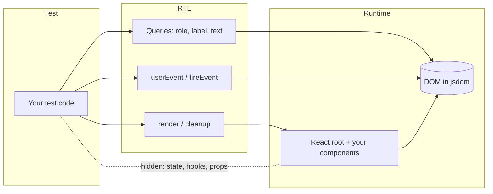
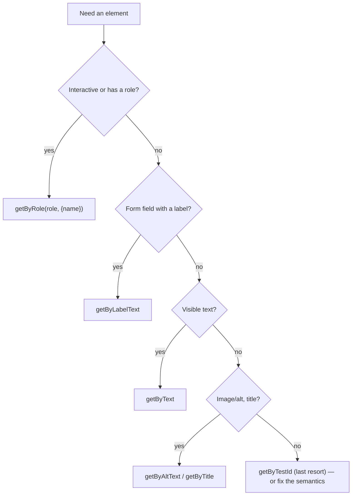

# 08 / 03 — React Testing Library: Rendering, Queries, and User Interaction

## 1. Lesson metadata

| | |
|---|---|
| **Level** | Intermediate |
| **Study time** | 5–6 hours (reading 2.5 h, hands-on 1.5 h, exercises 1.5–2 h) |
| **Prerequisites** | [08 / 02 — Unit testing with Vitest](./02-unit-testing-with-vitest.md), [01 / 05 — JSX explained](../01-react-fundamentals/05-jsx-explained.md), [01 / 10 — Event handling](../01-react-fundamentals/10-event-handling.md), [01 / 11 — Controlled and uncontrolled inputs](../01-react-fundamentals/11-controlled-and-uncontrolled-inputs.md), [00 / 02 — HTML parsing, DOM, CSSOM, render tree](../00-web-and-javascript-foundations/02-html-parsing-dom-cssom-render-tree.md) |
| **Next** | [04 — Testing async updates](./04-testing-async-updates.md) |
| **Related later** | [05 — Testing custom hooks](./05-testing-custom-hooks.md), [08 — Integration testing](./08-integration-testing.md), [10 — Accessibility testing](./10-accessibility-testing.md), [16 — Avoiding brittle tests](./16-avoiding-brittle-tests.md) |

**Version note.** Targets `@testing-library/react` 16.x (React 18/19; 16.3.3 executed here), `@testing-library/dom` 10.x (a **peer dependency** you install yourself in RTL 16), `@testing-library/user-event` 14.x (14.6.8), and `@testing-library/jest-dom` 6.x/7.x (import `@testing-library/jest-dom/vitest` for Vitest; **jest-dom 7** requires Node >= 22 and `@testing-library/dom` as a peer and adds `toContainAnyBy*`/`toContainOneBy*` matchers, otherwise the same setup entry points). Docs: <https://testing-library.com/docs/react-testing-library/intro/>. React 19 notes: `act` is exported from `react` (RTL re-exports its own wrapper); `ReactDOMTestUtils` is deprecated/removed in favor of `react`'s `act`.

**Learning objectives.** After this lesson you can:
1. State RTL's guiding principle and derive from it why tests query by role, label, and text instead of component internals.
2. Use `render`, `screen`, `within`, `rerender`, and `unmount` correctly, and explain what each leaves in the DOM.
3. Choose the right query variant (`getBy`, `queryBy`, `findBy`, and the `All` forms) and the right query type using the documented priority order.
4. Simulate realistic interaction with `userEvent.setup()` (click, type, keyboard, tab, select, clear, upload) and explain why it's preferred over `fireEvent`.
5. Assert on DOM state with `@testing-library/jest-dom` matchers, including accessibility properties.
6. Build a custom `render` that supplies providers (router, query client, theme) and returns a pre-configured `user`.
7. Debug a failing query using `screen.debug`, `logRoles`, and Testing Playground.

**Concepts covered:** guiding principles, `render` return value, `screen`, query variants and types, accessible name computation (conceptually), `getByRole` options, `within`, `userEvent` v14 API and event sequences, `fireEvent` as a low-level tool, jest-dom matchers, auto-cleanup, custom render wrappers, React Strict Mode in tests, `container` escape hatch, `data-testid` as last resort.

---

## 2. Deep conceptual explanation

### 2.1 What problem does React Testing Library solve?

Before RTL, the dominant React testing tool (Enzyme, legacy) gave you access to **component instances**: you could read state, call setState, find children by component type, and render "shallowly" (one level, with children stubbed). Tests were written in terms of React's internals. Two things followed:

1. Tests broke on harmless refactors (rename a state variable, replace a child component, swap `useState` for `useReducer`).
2. Tests passed on real breakage (a button that renders but is never wired to anything still has the right props).

RTL's guiding principle (from its documentation):

> The more your tests resemble the way your software is used, the more confidence they can give you.

How is software *used*? A person (or assistive technology) sees text, finds controls by their labels and roles, types, clicks, and sees results. They don't see components, props, or state. RTL therefore gives you:

- A **real DOM render** (React really renders into a jsdom/browser DOM).
- **Queries that mimic how users find things** (by role + accessible name, label text, visible text).
- **User-event simulation** that mimics the *sequence* of events a real interaction fires.
- *No* API for reading React state or instance methods (by design).

### 2.2 Why query by role and accessible name

A role-based query such as `screen.getByRole("button", { name: /save/i })` simultaneously asserts:

- An element with an implicit or explicit **ARIA role** `button` exists (so `<div onClick>` fails: it isn't a button for assistive technology).
- Its **accessible name** matches (so an icon-only button without `aria-label` fails).
- It is **accessible** by default: elements hidden from the accessibility tree (`display: none`, `aria-hidden`, `hidden`) are excluded unless `hidden: true`.

So the query *is* an accessibility assertion. This is why "write tests the RTL way" tends to improve accessibility as a side effect. It is **not** a full accessibility audit (see [10 — Accessibility testing](./10-accessibility-testing.md)).

### 2.3 The query matrix

Every query has a **variant** (what happens when 0, 1, or many elements match) and a **type** (how elements are located).

**Variants**

| Variant | 0 matches | 1 match | >1 matches | Async? | Use when |
|---|---|---|---|---|---|
| `getBy…` | throws | returns element | throws | no | Element must exist now |
| `queryBy…` | returns `null` | returns element | throws | no | Asserting **absence** (`expect(queryBy…).not.toBeInTheDocument()`) |
| `findBy…` | rejects (after timeout) | resolves with element | rejects | **yes** (`await`) | Element appears later (async update) |
| `getAllBy…` | throws | array | array | no | Multiple expected |
| `queryAllBy…` | `[]` | array | array | no | Count/absence of many |
| `findAllBy…` | rejects after timeout | array | array | yes | Multiple appear later |

`findBy…` is `getBy…` wrapped in `waitFor` (polling plus a `MutationObserver`; default timeout 1000 ms, verified by running (`findByText` for a missing node rejected after ~1002 ms); configurable via `configure({ asyncUtilTimeout })`). Details in [lesson 04](./04-testing-async-updates.md).

**Types and recommended priority** (from the Testing Library docs, "About queries"):

| Priority | Query | Finds | Notes |
|---|---|---|---|
| 1 (accessible to everyone) | `ByRole` | role + `name` (+ state options) | First choice for almost everything interactive |
| 1 | `ByLabelText` | form fields by `<label>`/`aria-label`/`aria-labelledby` | Best for form fields |
| 1 | `ByPlaceholderText` | `placeholder` | Placeholder is not a label; use only if no label (and fix the UI) |
| 1 | `ByText` | text content of non-interactive elements | Headings, messages, paragraphs |
| 1 | `ByDisplayValue` | current value of input/select/textarea | Checking pre-filled forms |
| 2 (semantic) | `ByAltText` | `alt` on images/areas | Images |
| 2 | `ByTitle` | `title` attribute/SVG title | Weak accessibility semantics |
| 3 (last resort) | `ByTestId` | `data-testid` | Use when no user-facing handle exists, or text is dynamic/localized and the semantic query would be ambiguous |

*Documented guidance:* prefer queries that reflect what users and assistive technology perceive; use `ByTestId` only when others do not work. *Opinion* (mine and many teams'): a `data-testid` is acceptable for non-semantic containers whose identity matters (`data-testid="cart-total"`) but *never* as the first choice for buttons and inputs.

### 2.4 `getByRole` in detail

`getByRole(role, options)` options of note:

| Option | Meaning |
|---|---|
| `name` | Accessible name; string (exact, case-sensitive, full match by default) or RegExp or function |
| `hidden` | Include elements inaccessible to the a11y tree (default `false`) |
| `level` | Heading level |
| `checked`, `pressed`, `selected`, `expanded`, `busy` | ARIA state filters |
| `description` | Accessible description (e.g. from `aria-describedby`; verified working on DTL 10.4: `getByRole("button", { description: "help text" })`) |
| `queryFallbacks` | Match elements with fallback roles |

Common implicit roles (HTML-AAM): `<button>` → `button`; `<a href>` → `link`; `<input type="text">` → `textbox`; `<input type="checkbox">` → `checkbox`; `<input type="radio">` → `radio`; `<input type="password">` → **no role** (use `ByLabelText`); `<select>` → `combobox` (or `listbox` with `multiple`/`size>1`); `<h1>`–`<h6>` → `heading`; `<ul>` → `list`; `<li>` → `listitem`; `<nav>` → `navigation`; `<main>` → `main`; `<form>` → `form` (**only if it has an accessible name**); `` → `img`; `<table>` → `table`; `<dialog open>` → `dialog`; elements with `role="alert"`/`status`.

The **accessible name** is computed (per the W3C accname algorithm) from `aria-labelledby`, `aria-label`, native label association, content text (for buttons/links), `alt`, `title`, in that kind of precedence. Libraries (`dom-accessibility-api`) implement this; edge cases can differ from browsers (for example, `getByRole("listitem", { name: "Ada" })` finds nothing because `listitem` does not take its name from content; verified).

### 2.5 `render`, `screen`, `container`

```tsx
const { container, rerender, unmount, asFragment, debug } = render(<Counter />);
```

- `render` creates a `div` appended to `document.body` and renders into it with a React root (`createRoot`) inside `act`. `container` is that div.
- `screen` is `within(document.body)`: all queries bound to the body. **Prefer `screen`** over destructured queries: you don't have to update the destructuring list when you need another query, and it works for portals (modals, tooltips) that render outside `container`.
- `rerender(ui)` re-renders with new props **into the same root** (so state is preserved if the element type/position is the same; see [01 / 16](../01-react-fundamentals/16-state-preservation-and-reset.md)).
- `unmount()` unmounts the root (use to test cleanup effects).
- `asFragment()` returns a DocumentFragment for snapshots.
- Auto-cleanup: RTL registers `afterEach(cleanup)` automatically **if** a global `afterEach` exists (Jest, or Vitest with `globals: true`). Otherwise you register it ([lesson 02 setup](./02-unit-testing-with-vitest.md)). Verified in RTL 16.3.3's `index.js`: cleanup is registered only when `typeof afterEach === 'function'` (and `RTL_SKIP_AUTO_CLEANUP` is not set), and the `IS_REACT_ACT_ENVIRONMENT = true` setup only when global `beforeAll`/`afterAll` exist. With Vitest `globals: false` and no setup file, DOM from earlier tests piles up ("Found multiple elements") and act warnings do not appear.

`container.querySelector` is the **escape hatch**: it bypasses accessibility semantics. Use only for things with no semantic handle; if you reach for it often, the UI probably needs better semantics.

### 2.6 `userEvent` vs `fireEvent`

`fireEvent.click(button)` dispatches **one** DOM event. A real click is more: pointer moves, `pointerdown`, `mousedown`, **focus change**, `pointerup`, `mouseup`, `click`. `@testing-library/user-event` simulates the sequence, honors `disabled`, `pointer-events: none`, visibility, and default actions (typing updates values and fires `input`, checkbox toggles, tab moves focus).

| | `fireEvent` | `userEvent` (v14) |
|---|---|---|
| Fidelity | Low (single event) | High (sequence + defaults) |
| Setup | None | `const user = userEvent.setup()` |
| Async | Sync | **Async: `await user.click(...)`** |
| Disabled/hidden elements | Event still dispatched | Respected |
| Use for | Events with no user-event equivalent (e.g., `scroll`, `load`, custom events, `resize`) | Everything a user can do |

v14 API essentials: `user.click`, `dblClick`, `tripleClick`, `hover`, `unhover`, `type(element, text, options)` (clicks the element first unless `skipClick`), `keyboard("text or {Enter}")`, `tab()`, `clear`, `selectOptions`, `deselectOptions`, `upload`, `paste`, `pointer`. Special keys use `{Key}` with `KeyboardEvent.key` values, e.g., `{Enter}`, `{Escape}`, `{ArrowDown}`; `[KeyA]` uses `code` values; `{{` / `[[` escape the literal. Write keys with their canonical `KeyboardEvent.key` casing; v14 happens to match case-insensitively as a fallback (verified: `{enter}` dispatched `key: "Enter"`), but v13-style lowercase names are not documented v14 syntax, and an unknown name such as `{foo}` silently dispatches no key event (verified), so a typo in a key descriptor fails quietly.

*Always call `userEvent.setup()` before rendering (or at least before interactions) and `await` every call.* The direct APIs (`userEvent.click(...)`) still exist as shortcuts but create an instance per call; `setup()` is the documented recommendation.

### 2.7 jest-dom matchers

`@testing-library/jest-dom` adds DOM-aware matchers: `toBeInTheDocument`, `toBeVisible`, `toBeDisabled`/`toBeEnabled`, `toBeChecked`, `toBeRequired`, `toBeInvalid`/`toBeValid`, `toHaveValue`, `toHaveDisplayValue`, `toHaveTextContent`, `toHaveAttribute`, `toHaveClass`, `toHaveFocus`, `toHaveAccessibleName`, `toHaveAccessibleDescription`, `toContainElement`, `toHaveStyle`, `toHaveFormValues`. Prefer these over `expect(el.disabled).toBe(true)`: failure messages print the DOM and intent.

### 2.8 React's role: `act` (briefly)

React batches and schedules work. In a test, state updates triggered outside React's event system must be wrapped so React flushes effects/updates before assertions. RTL's `render`, `fireEvent`, and `userEvent` (via RTL's configuration) already wrap in `act`; async utilities (`waitFor`, `findBy`) handle it too. You mostly never call `act` yourself. The warning *"An update to X inside a test was not wrapped in act(...)"* means something updated state **after your test stopped waiting**; see [lesson 04](./04-testing-async-updates.md). RTL sets `IS_REACT_ACT_ENVIRONMENT` to true so React knows it's in a test environment.

### 2.9 Common misconceptions

| Misconception | Reality |
|---|---|
| "RTL is for testing *components*." | It is for testing *behavior through the DOM*, whatever the component structure. |
| "`getByTestId` is the safe, stable choice." | It is stable but weak: it doesn't verify accessibility and encourages ignoring semantics. Use it last. |
| "`getByText` finds buttons." | It finds elements whose own text matches; a button is better found by role + name. `getByText` on a `<button>` works but loses the role assertion. |
| "`fireEvent` and `userEvent` are interchangeable." | `fireEvent.change` sets a value and fires an event; `user.type` types characters, firing keydown/keypress/input/keyup per char, respecting `maxLength`, selection, etc. |
| "`queryBy…` is the safe version of `getBy…`." | Use `queryBy` **only** for asserting absence; for presence use `getBy` to get a descriptive error with the DOM printed. |
| "Snapshot the container for coverage." | See [lesson 01](./01-test-strategy-and-pyramid.md): snapshots detect change, not breakage. |
| "Testing implementation details is impossible with RTL." | It's *discouraged*, not impossible (`container.querySelector`, test ids, checking props via mocks). Self-discipline matters. |

---

## 3. Internal mechanics

### 3.1 What `render` does (teaching model)

1. Creates `container = document.createElement("div")` and appends it to `document.body` (or uses the provided `container`/`baseElement`).
2. Creates a React root (`createRoot(container)`) — in RTL ≥ 13 for React 18+ — and calls `root.render(ui)` inside `act(...)`, so the initial render *and* its effects have been flushed when `render` returns. If you pass a `wrapper`, the UI is rendered as `<Wrapper>{ui}</Wrapper>`.
3. Registers the root and container for **cleanup**.
4. Returns queries bound to `baseElement` (default `document.body`) plus helpers.

*Public guarantee:* after `render` returns, the synchronous render and effects (those flushed by `act`) are done; **async** work (fetches, timers, transitions) is not complete.
*Implementation detail:* the exact `act` plumbing and `IS_REACT_ACT_ENVIRONMENT` management; Strict Mode double-render only if enabled via RTL's `reactStrictMode` option (present in RTL 16.3.3: `render(ui, { reactStrictMode: true })`, `renderHook(..., { reactStrictMode: true })` or `configure({ reactStrictMode: true })`; verified by running: one mount gave 2 renders, 2 effect runs, 1 cleanup) or by wrapping in `<StrictMode>`.

### 3.2 How a query finds elements

- `ByText` etc. walk the DOM under `baseElement`, apply the matcher to each element's text (its *own* text nodes joined, ignoring by default `script`, `style`), and **normalize** whitespace (trim, collapse) before comparing. String matchers are **exact (full-string, case-sensitive)** unless you pass `{ exact: false }` or a RegExp.
- `ByRole` computes each element's role (explicit `role` attribute or implicit HTML-AAM mapping), filters by accessibility (not `display:none`, `visibility:hidden`, `aria-hidden`, `hidden`) — which requires **`getComputedStyle`** — and then compares accessible names. This is why `ByRole` is slower than others on very large DOMs; for huge trees, prefer narrowing with `within(...)` (or pass `hidden: true` to skip the accessibility filtering where appropriate).
- `ByLabelText` finds labels matching text, then follows `for`/`id`, wrapping labels, `aria-labelledby`, and matches `aria-label`.

### 3.3 What `userEvent.click` dispatches (conceptual order)

For a mouse click on an enabled button (v14 teaching model): `pointerover/enter` → `mouseover/enter` → `pointermove` → `mousemove` → `pointerdown` → `mousedown` → focus (if focusable) → `pointerup` → `mouseup` → `click`. If the element has `pointer-events: none`, user-event throws by default (`pointerEventsCheck`), mirroring that a real user cannot click it. *Implementation detail:* exact ordering and event set may vary by version.

`user.type(input, "ab")` (conceptually): click the element (focus), then for each char: `keydown` → `keypress` → (beforeinput/`input` updating value, caret) → `keyup`. React's `onChange` for inputs listens to the native `input` event, so a controlled component updates per character. This is why `fireEvent.change(input, { target: { value: "ab" } })` works but doesn't exercise key handlers like `onKeyDown`.

### 3.4 Auto-cleanup and DOM leakage

If cleanup doesn't run, DOM from earlier tests persists in `document.body` and queries start finding multiple elements ("Found multiple elements with the role…"). Cleanup also unmounts roots (running effect cleanups), so an unmounted subscription won't leak into the next test.

---

## 4. Step-by-step execution walkthrough: one test, end to end

Component under test (a controlled counter with a reset):

```tsx
// Counter.tsx
import { useState } from "react";

export function Counter({ initial = 0 }: { initial?: number }) {
  const [count, setCount] = useState(initial);
  return (
    <section aria-labelledby="counter-title">
      <h2 id="counter-title">Counter</h2>
      <p role="status">Count: {count}</p>
      <button type="button" onClick={() => setCount((c) => c + 1)}>Increment</button>
      <button type="button" onClick={() => setCount(initial)}>Reset</button>
    </section>
  );
}
```

Test:

```tsx
import { render, screen } from "@testing-library/react";
import userEvent from "@testing-library/user-event";
import { expect, test } from "vitest";
import { Counter } from "./Counter";

test("increments and resets", async () => {
  const user = userEvent.setup();
  render(<Counter initial={5} />);

  await user.click(screen.getByRole("button", { name: "Increment" }));
  await user.click(screen.getByRole("button", { name: "Increment" }));
  expect(screen.getByRole("status")).toHaveTextContent("Count: 7");

  await user.click(screen.getByRole("button", { name: "Reset" }));
  expect(screen.getByRole("status")).toHaveTextContent("Count: 5");
});
```

**Chronological trace**

| # | Event | Detail |
|---|---|---|
| 1 | `userEvent.setup()` | Creates a user-event instance with default options (delay 0, pointer state tracked) |
| 2 | `render(<Counter initial={5} />)` | Container appended; React root renders inside `act`; DOM: `section > h2, p[role=status]"Count: 5", button×2` |
| 3 | `getByRole("button", {name: "Increment"})` | RTL lists elements with role `button`; computes names `Increment`, `Reset`; picks the match |
| 4 | `await user.click(...)` | user-event dispatches pointer/mouse/click events; React's root listener handles `click`; `onClick` calls `setCount(c => c+1)` |
| 5 | React processes update | Discrete event → synchronous-priority render, committed before the event handler's `act` scope ends (RTL's async wrapper) |
| 6 | DOM updated | `p` text node becomes `Count: 6` |
| 7 | Second click | `Count: 7` |
| 8 | `expect(...).toHaveTextContent("Count: 7")` | jest-dom matches normalized text content (substring by default for strings) |
| 9 | Reset click | `setCount(initial)` → `Count: 5` |
| 10 | Test ends; auto-cleanup | Root unmounted; container removed |

**Predict:** what does `screen.getByText("Count")` do here? **Result:** it throws, because the matcher is an *exact full-string* match on the normalized element text, which is `"Count: 7"`, not `"Count"`. Use a regex (`/count/i`) or the role query. Meanwhile, `getByText(/count/i)` would **also** find `h2`'s text `"Counter"` ("Counter" contains "count" case-insensitively) → *multiple elements* error. This is why `getByRole("status")` is more robust.

---

## 5. Code examples

### 5.1 Minimal example — query variants

```tsx
import { render, screen } from "@testing-library/react";

function Greeting({ name }: { name?: string }) {
  return (
    <div>
      <h1>Hello{name ? `, ${name}` : ""}</h1>
      {name ? null : <p>Please sign in</p>}
    </div>
  );
}

test("variants", () => {
  render(<Greeting />);
  expect(screen.getByRole("heading", { level: 1 })).toHaveTextContent("Hello");
  expect(screen.getByText(/please sign in/i)).toBeInTheDocument(); // exists
  expect(screen.queryByText(/welcome back/i)).not.toBeInTheDocument(); // absence
});
```

*(`test`/`expect` imported from `vitest` in real files.)* **Why `queryBy` for absence:** `getBy` would throw before `.not` is evaluated.

### 5.2 Practical example — a login form (labels, errors, submit)

```tsx
// LoginForm.tsx
import { useId, useState, type FormEvent } from "react";

export interface LoginFormProps {
  onSubmit: (creds: { email: string; password: string }) => Promise<void>;
}

export function LoginForm({ onSubmit }: LoginFormProps) {
  const emailId = useId();
  const passwordId = useId();
  const errorId = useId();
  const [error, setError] = useState<string | null>(null);
  const [pending, setPending] = useState(false);

  async function handleSubmit(e: FormEvent<HTMLFormElement>) {
    e.preventDefault();
    const form = new FormData(e.currentTarget);
    const email = String(form.get("email") ?? "").trim();
    const password = String(form.get("password") ?? "");
    if (!email || !password) {
      setError("Email and password are required");
      return;
    }
    setError(null);
    setPending(true);
    try {
      await onSubmit({ email, password });
    } catch {
      setError("Invalid credentials");
    } finally {
      setPending(false);
    }
  }

  return (
    <form onSubmit={handleSubmit} aria-label="Sign in" noValidate>
      <label htmlFor={emailId}>Email</label>
      <input id={emailId} name="email" type="email" autoComplete="username"
             aria-invalid={error ? true : undefined} aria-describedby={error ? errorId : undefined} />
      <label htmlFor={passwordId}>Password</label>
      <input id={passwordId} name="password" type="password" autoComplete="current-password" />
      {error && <p id={errorId} role="alert">{error}</p>}
      <button type="submit" disabled={pending}>{pending ? "Signing in…" : "Sign in"}</button>
    </form>
  );
}
```

```tsx
// LoginForm.test.tsx
import { render, screen } from "@testing-library/react";
import userEvent from "@testing-library/user-event";
import { describe, expect, test, vi } from "vitest";
import { LoginForm } from "./LoginForm";

function setup(onSubmit = vi.fn().mockResolvedValue(undefined)) {
  const user = userEvent.setup();
  render(<LoginForm onSubmit={onSubmit} />);
  return {
    user,
    onSubmit,
    email: screen.getByLabelText("Email"),
    password: screen.getByLabelText("Password"),
    submit: screen.getByRole("button", { name: "Sign in" }),
  };
}

describe("LoginForm", () => {
  test("submits trimmed credentials", async () => {
    const { user, onSubmit, email, password, submit } = setup();

    await user.type(email, "  ada@example.com ");
    await user.type(password, "s3cret!");
    await user.click(submit);

    expect(onSubmit).toHaveBeenCalledExactlyOnceWith({ email: "ada@example.com", password: "s3cret!" });
  });

  test("shows an accessible validation error and does not submit", async () => {
    const { user, onSubmit, email, submit } = setup();

    await user.click(submit);

    const alert = screen.getByRole("alert");
    expect(alert).toHaveTextContent("Email and password are required");
    expect(email).toBeInvalid();                          // aria-invalid
    expect(email).toHaveAccessibleDescription("Email and password are required");
    expect(onSubmit).not.toHaveBeenCalled();
  });

  test("shows a server error", async () => {
    const onSubmit = vi.fn().mockRejectedValue(new Error("401"));
    const { user, email, password, submit } = setup(onSubmit);

    await user.type(email, "ada@example.com");
    await user.type(password, "wrong");
    await user.click(submit);

    expect(await screen.findByRole("alert")).toHaveTextContent("Invalid credentials");
  });

  test("keyboard: Enter in the password field submits", async () => {
    const { user, onSubmit, email, password } = setup();
    await user.type(email, "ada@example.com");
    await user.type(password, "pw{Enter}");
    expect(onSubmit).toHaveBeenCalledTimes(1);
  });
});
```

Line notes:
- `setup()` helper returns `user` and the *handles*; each test reads as a story and the helper hides the repeated render. This is DAMP-friendly: the helper is small and explicit.
- `getByLabelText("Password")` is used because `type="password"` has **no implicit role**, so `getByRole("textbox")` would not find it.
- `toBeInvalid()` checks `aria-invalid="true"` (and native validity); `toHaveAccessibleDescription` verifies the `aria-describedby` wiring. These assertions check *accessibility behavior* without testing implementation.
- `user.type(password, "pw{Enter}")` types then presses Enter, triggering implicit form submission (a text input inside a form with a submit button); this verifies keyboard usability. `toHaveBeenCalledExactlyOnceWith` is a Vitest matcher (present in Vitest 3.2.7, verified by running; on older versions use `toHaveBeenCalledTimes(1)` + `toHaveBeenCalledWith`).
- The server-error test uses `findByRole` because `setError` runs after an awaited rejection (async).
- The role `form` is only queryable because we gave the form an accessible name via `aria-label`.

**Predict:** in the first test, the user types `"  ada@example.com "` into a `type="email"` input. What does user-event do with the leading/trailing spaces, and is the submitted email trimmed? **Result:** user-event types the characters; jsdom's `type="email"` value sanitization strips leading/trailing whitespace from the value (HTML spec value sanitization for email), and our code also `trim()`s, so the result is `ada@example.com` either way. *Verified on jsdom 30 + user-event 14.6.8: the input's `.value` is `ada@example.com`.* The explicit `.trim()` in the component makes the test independent of jsdom's sanitization.

### 5.3 Incorrect example — implementation-coupled and low-fidelity

```tsx
// ❌ Several problems in one test
import { fireEvent, render } from "@testing-library/react";

test("login", () => {
  const { container } = render(<LoginForm onSubmit={vi.fn()} />);
  const inputs = container.querySelectorAll("input");                // order-coupled
  fireEvent.change(inputs[0], { target: { value: "ada@example.com" } });
  fireEvent.change(inputs[1], { target: { value: "pw" } });
  fireEvent.click(container.querySelector("button")!);               // no role/name check
  expect(container.querySelector(".error")).toBeNull();             // class that doesn't exist => always passes
});
```

**Why wrong:** (1) selection by index breaks when fields are reordered or a hidden input is added; (2) `fireEvent.change` skips focus/typing; (3) `.error` is a CSS class the component never uses, so the final assertion is **vacuous**: it would pass even if the form displayed an error; (4) nothing awaits any async effect; (5) it never asserts that `onSubmit` was called. A test that cannot fail is worse than no test.

### 5.4 Corrected implementation

See 5.2. In general, to guarantee a negative assertion is meaningful, **first prove the positive case** in the same file (the alert appears for the failing input), so the "absent" case is not accidentally always true.

### 5.5 Advanced example — custom render with providers

```tsx
// src/test/render.tsx
import { QueryClient, QueryClientProvider } from "@tanstack/react-query";
import { render, type RenderOptions } from "@testing-library/react";
import userEvent from "@testing-library/user-event";
import type { ReactElement, ReactNode } from "react";
import { createMemoryRouter, RouterProvider, type RouteObject } from "react-router";

interface Options extends Omit<RenderOptions, "wrapper"> {
  route?: string;
  routes?: RouteObject[];
}

export function renderApp(ui: ReactElement, { route = "/", routes, ...options }: Options = {}) {
  const user = userEvent.setup();
  const queryClient = new QueryClient({
    defaultOptions: { queries: { retry: false, gcTime: Infinity }, mutations: { retry: false } },
  });

  const router = createMemoryRouter(routes ?? [{ path: "*", element: ui }], { initialEntries: [route] });

  function Providers({ children }: { children: ReactNode }) {
    return <QueryClientProvider client={queryClient}>{children}</QueryClientProvider>;
  }

  return {
    user,
    queryClient,
    router,
    ...render(<RouterProvider router={router} />, { wrapper: Providers, ...options }),
  };
}
```

Line notes:
- A **new `QueryClient` per test** prevents cached data bleeding between tests; `retry: false` makes failures immediate (default retries with backoff would make error-path tests slow or flaky). `gcTime: Infinity` prevents garbage-collection timers lingering after tests (option name is `gcTime` in TanStack Query v5, `cacheTime` in v4).
- Returning `user` ties the user-event instance to the same render, so tests don't need a separate `setup()`.
- React Router's package/exports differ by major: in v6 you import from `react-router-dom`; in v7 `createMemoryRouter` and `RouterProvider` are exported from `react-router` (and `RouterProvider` from `react-router/dom`; verified in 7.18.4), with `react-router-dom` kept as a re-export package. React Router 8 (ESM-only, Node >= 22.22) is released and still exports `createMemoryRouter`/`RouterProvider` (verified in 8.5.0).
- This helper lives in `src/test/` and is imported by feature tests; it should stay **small**: heavy default behavior makes tests opaque.

### 5.6 Interactions beyond click and type

```tsx
test("tab order and keyboard activation", async () => {
  const user = userEvent.setup();
  render(<Toolbar />);                          // [Bold] [Italic] [Link]

  await user.tab();                             // focus first control
  expect(screen.getByRole("button", { name: "Bold" })).toHaveFocus();

  await user.keyboard("{ArrowRight}");          // roving tabindex toolbars use arrows
  expect(screen.getByRole("button", { name: "Italic" })).toHaveFocus();

  await user.keyboard("{Enter}");
  expect(screen.getByRole("button", { name: "Italic" })).toHaveAttribute("aria-pressed", "true");
});

test("select, checkbox, radio", async () => {
  const user = userEvent.setup();
  render(<Preferences />);

  await user.selectOptions(screen.getByRole("combobox", { name: "Language" }), "de");
  await user.click(screen.getByRole("checkbox", { name: /email me/i }));
  await user.click(screen.getByRole("radio", { name: "Weekly" }));

  expect(screen.getByRole("combobox", { name: "Language" })).toHaveDisplayValue("Deutsch");
  expect(screen.getByRole("checkbox", { name: /email me/i })).toBeChecked();
  expect(screen.getByRole("radio", { name: "Weekly" })).toBeChecked();
});

test("upload", async () => {
  const user = userEvent.setup();
  render(<AvatarUpload />);
  const file = new File(["(⌐□_□)"], "me.png", { type: "image/png" });
  await user.upload(screen.getByLabelText(/avatar/i), file);
  expect(screen.getByLabelText(/avatar/i)).toHaveProperty("files.0", file);
});
```

### 5.7 Scoping with `within` and lists

```tsx
test("removes a row from a table", async () => {
  const user = userEvent.setup();
  render(<UsersTable users={[{ id: 1, name: "Ada" }, { id: 2, name: "Linus" }]} />);

  const row = screen.getByRole("row", { name: /linus/i });
  await user.click(within(row).getByRole("button", { name: /remove/i }));

  expect(screen.queryByRole("row", { name: /linus/i })).not.toBeInTheDocument();
  expect(screen.getAllByRole("row")).toHaveLength(2); // header + Ada
});
```

(Import `within` from `@testing-library/react`.) Without `within`, `getByRole("button", { name: /remove/i })` would match one per row and throw. Scoping by the row (found by its accessible name from its content) is how a user would find "the Remove button in Linus's row".

### 5.8 Modal/portal and focus

```tsx
test("opens a dialog, traps focus, closes with Escape and restores focus", async () => {
  const user = userEvent.setup();
  render(<DeleteAccount />);

  const trigger = screen.getByRole("button", { name: "Delete account" });
  await user.click(trigger);

  const dialog = screen.getByRole("dialog", { name: "Confirm deletion" }); // portal: use screen, not container
  expect(within(dialog).getByRole("button", { name: "Cancel" })).toHaveFocus();

  await user.keyboard("{Escape}");
  expect(screen.queryByRole("dialog")).not.toBeInTheDocument();
  expect(trigger).toHaveFocus();
});
```
This asserts accessible behavior (focus management) that a snapshot cannot. jsdom's focus implementation is good for these basics but is not a browser; verify critical focus behavior in E2E ([lesson 09](./09-e2e-with-playwright.md)).

### 5.9 Testing React 19 form Actions (sketch)

```tsx
// With <form action={fn}> and useActionState, tests still go through the DOM:
test("submits via form action and shows the returned message", async () => {
  const user = userEvent.setup();
  render(<NewsletterForm />);        // uses useActionState + <form action={action}>

  await user.type(screen.getByLabelText("Email"), "ada@example.com");
  await user.click(screen.getByRole("button", { name: "Subscribe" }));

  expect(await screen.findByRole("status")).toHaveTextContent(/thanks/i);
});
```
Actions run inside transitions and update asynchronously, so use `findBy*`/`waitFor` for results rather than immediate `getBy*` (see [lesson 04](./04-testing-async-updates.md)). *Verified on React 19.3.1 + jsdom 30 + user-event 14.6.8:* clicking the submit button runs the action with the form's `FormData`, `findByText` sees the returned state, and React resets uncontrolled inputs after a successful action (the email input was `""` afterwards). Form-action behavior in jsdom still depends on jsdom's `FormData`/submit support, so re-check after major jsdom upgrades.

---

## 6. Visual explanations

### 6.1 What RTL gives you vs. what it hides



### 6.2 Choosing a query



### 6.3 Variant selection

```text
Should it be there right now?        -> getBy*   (throws with DOM dump if missing)
Should it NOT be there?              -> queryBy* + .not.toBeInTheDocument()
Will it appear after async work?     -> await findBy*  (retries until timeout)
Many of them?                        -> *AllBy* variants
```

### 6.4 Event sequence difference

```text
fireEvent.click(btn):          click
userEvent.click(btn):          pointerover, pointerenter, mouseover, mouseenter,
                               pointermove, mousemove, pointerdown, mousedown,
                               (focus), pointerup, mouseup, click
userEvent.type(input, "a"):    (click sequence), keydown, keypress, beforeinput, input, keyup
```
*(Teaching model; exact set varies by version.)*

---

## 7. Alternative approaches and trade-offs

### 7.1 Component testing approaches

| Criterion | RTL (jsdom) | Enzyme `mount/shallow` (legacy) | Storybook interaction tests | Playwright component testing | Vitest browser mode |
|---|---|---|---|---|---|
| Resemblance to real use | High | Low (shallow) / Medium | High | Very high (real browser) | Very high |
| Refactor tolerance | High | Low | High | High | High |
| Real layout/CSS | No | No | Yes (browser) | Yes | Yes |
| Speed | Fast | Fast | Slower | Slower | Slower than jsdom |
| React 19 support | Yes | Not supported officially; legacy | Yes | Experimental `-ct-react` packages removed in Playwright 1.63; 1.62+ uses a stories/gallery `mount` fixture | Supported (browser mode is no longer labelled experimental in the current docs) |
| Debug experience | `screen.debug`, Testing Playground | Wrapper tree dumps | Visual in browser | Trace viewer | Real DevTools |
| Best for | Default behavior tests | Legacy suites only | Documenting + testing variants | Real-browser components | Layout/focus-sensitive tests |

### 7.2 Query strategy trade-offs

| Strategy | Pros | Cons | When |
|---|---|---|---|
| Role + name | Tests a11y, resilient to markup changes | Name changes (copy edits) break tests; slower on big DOMs | Default |
| Label text | Great for forms | Needs real labels | Form fields |
| Text | Readable | Matches too much if copy repeats | Static content/messages |
| Test id | Stable across copy and i18n changes | Zero a11y signal; clutters markup | Dynamic content with no semantics; i18n-heavy apps as a *supplement* |
| CSS selector | Anything reachable | Couples to styling/structure | Library internals you don't own, rarely |

### 7.3 When the recommended approach (role + name) is NOT best

- **Localized UIs** that run the same test across 20 locales: role + name with literal English strings will fail; provide a test-only i18n provider (stable English messages) or query via translation keys, or use a role query with a regexp built from the message catalog. A `data-testid` on stable structural elements may be a pragmatic complement.
- **Huge virtualized grids or canvases** where roles are absent or the DOM is enormous: `ByRole` is slow; scope with `within` or use test ids for the container.
- **Third-party widgets** with poor semantics (a charting library) where you can't fix accessibility: assert via the library's own testing hooks or test ids and note the accessibility gap as a defect.

---

## 8. Best practices and anti-patterns

**Do**
- `const user = userEvent.setup()` per test (or in the custom render) and `await` every interaction.
- Use `screen` for queries; use `within` to scope.
- Prefer `getByRole` with `name`; fall back through labels/text.
- Assert on *outcomes the user perceives*: text, enabled/disabled, focus, accessible description, URL (via router state).
- Assert on **outbound callbacks/requests** where they are the contract (`onSubmit` called with payload).
- Keep a small `setup()` per test file returning handles; keep fixtures local and explicit.
- Name tests by behavior ("shows an error when the email is invalid").

**Beginner mistakes**
- Missing `await` on `user.*` or `findBy*`: assertions run before the UI updates; the test may pass vacuously or fail intermittently.
- Using `getBy` to assert absence; using `queryBy` to assert presence.
- Wrapping in `act` manually "to silence the warning" without understanding the cause.
- Using `waitFor` with side effects or multiple assertions inside (lesson 04).
- Reaching for `container.querySelector`.

**Experienced-developer mistakes**
- Over-abstracting test utilities until nobody can tell what's rendered (a `renderWithEverything` that sets up 8 providers for a presentational component).
- Using `toMatchSnapshot` on whole trees.
- Mocking child components "to isolate" (a *shallow* mindset): the parent–child contract is part of the behavior.
- Testing third-party component internals (e.g., the exact DOM of a date picker library) instead of *your* integration with it.
- `data-testid` everywhere "for stability", which silently drops accessibility verification.

**Smells:** index-based selection (`getAllBy…[1]`) when a name exists; CSS class selectors; assertions on `mock.calls` of **child component** props; a `sleep`; tests longer than ~30 lines of interaction (split or extract helper); duplicated copy strings that must be updated in 50 tests (centralize messages or query by role/regex).

**Justified exceptions:** `fireEvent` for events with no user-event model (`scroll`, `load`, `transitionend`, `animationend`, custom events, `resize`); `ByTestId` for non-semantic structural hooks; `container.querySelector` to inspect something that has no accessible representation (e.g., an SVG path attribute) when you must; mocking a heavy third-party component (`<Map />`) and asserting the props *your* code passes at that boundary.

---

## 9. Real-world application

**E-commerce product configurator.** Constraints: dependent selects (size → color availability), price updates, `aria-live` announcements for price changes, many variants. Approach: render the configurator with a fixture catalog; select size via `selectOptions`; assert that unavailable colors are `disabled` (`toBeDisabled`) and that the price region (`role="status"`) announces the new price. Table-driven (`test.each`) over a few variants; the *exhaustive* combination matrix is tested at the unit level on the pure availability function ([lesson 02](./02-unit-testing-with-vitest.md)).

**Dashboard with filters.** Constraints: multi-select filters, URL-synced state, debounce, large table. Approach: wrap with a memory router; type into the search box with fake timers configured for user-event ([lesson 04](./04-testing-async-updates.md)); assert the visible rows via `getAllByRole("row")` and the URL's search params from the router instance, not from internal state.

**Auth flows.** Constraints: error messaging must not leak whether an email exists; focus must move to the error summary; password managers need correct `autocomplete`. Approach: assert the generic error text, `toHaveFocus()` on the summary, and `toHaveAttribute("autocomplete", "current-password")`. These assertions are inexpensive and encode security/a11y requirements.

**Multi-team design system.** Constraints: components consumed widely; behavior must be stable across a11y and keyboard. Approach: a shared "behavior contract" test per component (keyboard, roles, aria state) using RTL + user-event, run in the library's CI; consumers rely on it rather than re-testing the library (see [11 — Component contract testing](./11-component-contract-testing.md)).

**Internationalized app.** Constraints: copy changes weekly, translators edit strings. Approach: test with a fixed `en` test catalog loaded through the real i18n provider; select by role+name using message values pulled from the same catalog constants (`t("save")`) to avoid duplicating literal strings across tests.

---

## 10. Debugging and troubleshooting

### 10.1 "Unable to find an accessible element with the role…"

1. Read the error: RTL prints the available roles and the DOM snapshot ("Here are the accessible roles: …").
2. Common causes: (a) element is `hidden`/inside `aria-hidden` (`{ hidden: true }` to test, but fix semantics if unintended); (b) wrong role (`type="password"` has none; `<div role>` missing); (c) wrong **accessible name** (check exact string, case, whitespace; names come from `aria-label` before content); (d) the element renders **later** (use `findBy`); (e) a dialog/portal outside `container` while using destructured queries instead of `screen`.
3. Tools: `screen.debug()` prints DOM; `screen.debug(element)` prints a subtree; `logRoles(container)` lists roles; `screen.logTestingPlaygroundURL()` prints a Testing Playground link that suggests queries; the *Testing Playground* browser extension helps on a real page.
4. Validate: once passing, deliberately break the markup (remove the label) and ensure the test fails.

### 10.2 "Found multiple elements"

1. The query matched more than one: narrow by `name`, `level`, or `within(...)`; or switch to `getAllBy…` if multiple are expected.
2. If it only happens when running the whole file, check **missing cleanup** (DOM from earlier tests remains) and global DOM mutation outside `container` (e.g., a library appending to `document.body` that isn't removed).

### 10.3 "Test passes but nothing was verified"

1. Check for vacuous negatives (`queryBy… .not…` on selectors that never match). Make the positive version pass first or mutate the code to confirm failure.
2. Check for un-awaited `user.*`/`findBy*`.
3. Run with a deliberate regression (comment out `onClick`) to confirm red.

### 10.4 "`not wrapped in act(...)`" warnings

Covered thoroughly in [lesson 04](./04-testing-async-updates.md); first suspect an un-awaited async operation that finished after the test ended, or a timer/promise updating state after assertions.

### 10.5 "user.type drops characters or is slow"

- Heavy `onChange` handlers (expensive renders) slow per-character typing; use `user.paste` for large text or simplify the component under test.
- With fake timers, `userEvent`'s internal `delay` uses timers: set `userEvent.setup({ advanceTimers: vi.advanceTimersByTime })` or `delay: null` (option names verified). **Caveat verified by running:** with Vitest's `vi.useFakeTimers()` this is *not enough*, because RTL's own `asyncWrapper` (used by `user.*`, `findBy*`, `waitFor`) waits on a real `setTimeout(0)` that is faked and only advances it if a global `jest` exists. Use `vi.useFakeTimers({ shouldAdvanceTime: true })`, or fake only `Date`/specific timers with `toFake`, or stub a `jest` global; see [lesson 04](./04-testing-async-updates.md) §3.4.
- Controlled inputs that transform values (masks) interact with caret positions; test with `user.type` and assert displayed value.

---

## 11. Exercises

### Level A — Knowledge
A1. State RTL's guiding principle and give two consequences for how you write queries.
A2. What is the difference between `getBy`, `queryBy`, and `findBy`? When is each correct?
A3. Why does `getByRole("textbox")` not find a password input? What do you use instead?
A4. Name two reasons `userEvent` is preferred over `fireEvent` for clicks and typing, and one case where `fireEvent` is still appropriate.
A5. Why use `screen` rather than the queries returned by `render`?

### Level B — Code comprehension
B1. Given:
```tsx
render(
  <>
    <h1>Orders</h1>
    <button>Orders</button>
    <p>You have 3 orders</p>
  </>
);
```
Which of these succeed? (a) `getByText("Orders")` (b) `getByRole("button", { name: "Orders" })` (c) `getByText(/orders/i)` (d) `getByRole("heading", { name: /orders/i })`.

B2. This test is flaky. Why?
```tsx
test("saves", async () => {
  const user = userEvent.setup();
  render(<Editor />);
  user.type(screen.getByRole("textbox"), "hello");
  user.click(screen.getByRole("button", { name: "Save" }));
  expect(await screen.findByText("Saved")).toBeInTheDocument();
});
```
B3. What does each assertion verify, and which tests would still pass if the "Close" button were a `<div onClick>`?
```tsx
await user.click(screen.getByText("Close"));                       // (1)
await user.click(screen.getByRole("button", { name: "Close" }));   // (2)
fireEvent.click(screen.getByText("Close"));                        // (3)
```

### Level C — Implementation
C1. Write tests for a `Tabs` component (`role="tablist"`, `tab`, `tabpanel`) covering click selection, arrow-key navigation, and `aria-selected`/panel visibility.
C2. Write a `renderWithTheme(ui)` helper that wraps a component in a `ThemeProvider` (assume `ThemeProvider` takes `theme: "light" | "dark"`) and returns `user`; then show a test that the component renders a dark-mode label.
C3. Write a test for an `Accordion` item: trigger has `aria-expanded`, Enter/Space toggle it, and the panel is hidden when collapsed.

### Level D — Debugging
D1. `screen.getByRole("button", { name: "Submit" })` fails; DOM is `<button><svg aria-hidden="true"/>Submit order</button>`. Fix two ways (test and component) and say which you'd choose.
D2. A modal's test passes locally but in CI throws "multiple elements with role dialog". Provide hypotheses and an investigation plan.
D3. The test below passes even if you delete the error message from the component. Explain and fix.
```tsx
await user.click(screen.getByRole("button", { name: "Save" }));
expect(screen.queryByText("Name is required")).toBeNull();   // intended: shows error for empty name
```

### Level E — Architecture and engineering decisions
E1. Your team uses `data-testid` on every element and the product has failed an accessibility audit. Propose a migration strategy for the test suite and the markup, including how to stage it and how to prevent regression.
E2. Decide whether to ship a shared `test-utils` package across five apps. What goes in, what stays out, and how do you version it?

### Level F — Expert challenge
F1. You maintain a design-system `Combobox` (ARIA 1.2 combobox with listbox popup, `aria-activedescendant`). Design the RTL behavior suite: which interactions and assertions are needed, what jsdom cannot verify, and what you'd add in a real browser.

---

## 12. Detailed answers and explanations

> Attempt the exercises first.

**A1.** "The more your tests resemble the way your software is used, the more confidence they can give you." Consequences: (1) query by what users perceive (role/name, label, text) rather than by component names/CSS classes/state; (2) interact via user-like events (`userEvent`) and assert on rendered output; implementation details (state, hooks, child props) are deliberately unreachable.

**A2.** `getBy`: expect exactly one element **now**; throws otherwise with helpful DOM output. `queryBy`: returns `null` if absent; use for **absence** assertions. `findBy`: returns a promise that resolves when the element appears (retrying until timeout); use for **async** appearance. Wrong: using `queryBy` for presence loses the descriptive error; using `getBy` for async content races.

**A3.** `<input type="password">` has no corresponding ARIA role in HTML-AAM (it is intentionally not exposed as `textbox`), so role queries cannot find it. Use `getByLabelText("Password")` (requires an associated label), or `getByPlaceholderText` only if there is no label (and fix that).

**A4.** `userEvent` fires the realistic *sequence* (focus changes, keydown/keypress/input/keyup), respects `disabled` and `pointer-events`, and handles default actions (checkbox toggle, form submit via Enter, tab). `fireEvent` dispatches a single synthetic DOM event. `fireEvent` remains right for events users don't "perform" (`scroll`, `resize`, `load`, `transitionend`, custom events) and for cases where user-event lacks a model.

**A5.** `screen` queries `document.body`, so it also finds portals (modals, popovers, toasts) rendered outside `container`; no destructuring churn; consistent with the docs and makes failing output show the whole document.

**B1.** (a) **Fails**: `getByText("Orders")` exact match matches `<h1>Orders</h1>` *and* `<button>Orders</button>` (two elements) → "multiple elements" error. (b) **Succeeds**: one button named "Orders". (c) **Fails**: regex matches h1, button, **and** the paragraph "You have 3 orders" → multiple. (d) **Succeeds**: only the heading has role heading. Lesson: role queries disambiguate duplicates; text queries match everything containing the text.

**B2.** `user.type` and `user.click` are async but not awaited; the assertion starts waiting immediately while the typing/clicking sequence runs concurrently (interleaving at promise boundaries). Sometimes the click can happen before typing finishes, saving an empty value. Fix: `await user.type(...)`, `await user.click(...)`. (ESLint plugin `testing-library/await-async-events` catches this; verify rule name.)

**B3.** (1) Finds *any* element with text "Close" (could be a heading, a div) and clicks it with realistic events; passes with a `div onClick` (also passes if the text is on a non-button). (2) Requires an accessible element with role `button`; **fails** for `<div onClick>` (no role) — which is the point: it's an accessibility assertion. (3) Fires a bare click event; passes with the div, and also passes even if the element is visually disabled or covered. Takeaway: only (2) verifies the control is a real button.

**C1.** Example (assume `<Tabs>` renders three tabs "Overview", "Specs", "Reviews" with panels):
```tsx
test("selects a tab on click", async () => {
  const user = userEvent.setup();
  render(<Tabs />);
  await user.click(screen.getByRole("tab", { name: "Specs" }));
  expect(screen.getByRole("tab", { name: "Specs" })).toHaveAttribute("aria-selected", "true");
  expect(screen.getByRole("tabpanel", { name: "Specs" })).toBeVisible();
  expect(screen.queryByRole("tabpanel", { name: "Overview" })).not.toBeInTheDocument();
});

test("arrow keys move selection and focus (automatic activation)", async () => {
  const user = userEvent.setup();
  render(<Tabs />);
  await user.tab();                                   // focus selected tab
  expect(screen.getByRole("tab", { name: "Overview" })).toHaveFocus();
  await user.keyboard("{ArrowRight}");
  expect(screen.getByRole("tab", { name: "Specs" })).toHaveFocus();
  expect(screen.getByRole("tab", { name: "Specs" })).toHaveAttribute("aria-selected", "true");
  await user.keyboard("{End}");
  expect(screen.getByRole("tab", { name: "Reviews" })).toHaveFocus();
});
```
Notes: assertions depend on whether your Tabs uses automatic vs manual activation (WAI-ARIA APG describes both); state the chosen behavior. The `queryByRole("tabpanel", …)` absence assumes inactive panels are removed (or use `toBeVisible`/`hidden` if they're rendered but hidden: hidden panels are excluded from role queries anyway). Roving tabindex: only the selected tab is in the tab order, so one `user.tab()` lands on it.

**C2.**
```tsx
function renderWithTheme(ui: ReactElement, theme: "light" | "dark" = "light") {
  const user = userEvent.setup();
  return { user, ...render(ui, { wrapper: ({ children }) => <ThemeProvider theme={theme}>{children}</ThemeProvider> }) };
}

test("shows the dark label", () => {
  renderWithTheme(<ThemeBadge />, "dark");
  expect(screen.getByRole("status")).toHaveTextContent("Dark mode");
});
```
Edge: defining the wrapper inline creates a new component type each call, which is fine in a test; but for `rerender` consistency define the wrapper once per call (as above). Evaluation: helper stays tiny; returns `user`; theme as parameter.

**C3.** Assertions must match *how your panel hides content*; the test below shows both options.
```tsx
test("accordion toggles with keyboard", async () => {
  const user = userEvent.setup();
  render(<AccordionItem title="Shipping">Ships in 2 days</AccordionItem>);
  const trigger = screen.getByRole("button", { name: "Shipping" });

  expect(trigger).toHaveAttribute("aria-expanded", "false");
  expect(screen.queryByText("Ships in 2 days")).not.toBeInTheDocument(); // if collapsed content is unmounted
  // If the panel stays mounted but `hidden`: expect(screen.getByText("Ships in 2 days")).not.toBeVisible();

  trigger.focus();
  await user.keyboard("{Enter}");
  expect(trigger).toHaveAttribute("aria-expanded", "true");
  expect(screen.getByText("Ships in 2 days")).toBeVisible();

  await user.keyboard(" ");
  expect(trigger).toHaveAttribute("aria-expanded", "false");
});
```
Note: a native `<button>` toggles on Enter (on keydown) and Space (on keyup) and user-event models both. Calling `trigger.focus()` directly outside user-event is acceptable here but prefer `await user.tab()` to reflect real navigation (state changes from raw `.focus()` may need `act` wrapping; `user.tab()` handles it).

**D1.** Accessible name is computed from content: SVG `aria-hidden` is excluded, text is "Submit order", and string `name: "Submit"` requires a **full exact match**. Fixes: (test) `name: /submit/i` or `"Submit order"`; (component) if the product intends the name "Submit", add `aria-label="Submit"` (but that overrides visible text, violating WCAG 2.5.3 *Label in Name* if visible text differs). Prefer fixing the test to the real, user-visible name; the test string should match what a user sees ("Submit order").

**D2.** Hypotheses: (1) cleanup not running in CI (e.g., `globals` differences or a different setup file), leaving previous dialogs; (2) a portal root outside the cleaned container (library appends to body and doesn't unmount because `unmount` was skipped); (3) test order/parallelism differences (CI shuffles); (4) two dialogs legitimately render (e.g., a toast wrapper uses `role=dialog`) only under some data. Investigation: run the file in isolation vs. whole-suite; `--sequence.shuffle`; add `screen.debug()` in failing test; check setup file import; assert `document.body.innerHTML` is empty before each test as a guard. Fix root cause (register `cleanup`, ensure portal containers are removed on unmount).

**D3.** The assertion is a *vacuous negative*: it passes when the message is absent, which is also true if the feature is broken (the intended behavior is that it is **present**). The assertion is inverted. Fix: `expect(screen.getByRole("alert")).toHaveTextContent("Name is required")` for the empty case, and separately assert that with a name entered the error is absent (`queryByRole("alert")` is null). General rule: pair each negative assertion with a positive case.

**E1.** Evaluation criteria: incremental, measurable, preventing regression, and aligned with accessibility fixes. Example: (1) Add `eslint-plugin-testing-library` and `eslint-plugin-jsx-a11y`; (2) fix markup semantics in a vertical slice (one feature at a time) — use the audit's issues as the backlog because each fix creates a role/label that enables a better query; (3) when touching a test, migrate its queries (Boy Scout rule) and keep `data-testid` only for non-semantic structure; (4) configure `testIdAttribute` unchanged but add a lint rule (or `no-restricted-syntax`) to flag *new* `getByTestId` usage in tests for interactive elements; (5) add `jest-axe`/`vitest-axe`/`axe-core` checks to key component tests (partial coverage only; see [10](./10-accessibility-testing.md)); (6) metrics: count of `ByTestId` usages in tests (trend ↓), audit violations (↓). Don't do a big-bang rewrite.

**E2.** In: `renderApp` with canonical providers, MSW server setup helpers, `setup()` for user-event, custom matchers, common fixtures builders, Vitest setup that fails on unexpected `console.error`. Out: app-specific providers, domain fixtures, business logic mocks. Versioning: semantic versioning with a changelog, peer dependencies on RTL/Vitest/React to avoid duplicate React copies (a classic hazard: two copies of React cause hooks errors), a codemod for breaking changes, and an owner team with SLA. Risks: lock-step upgrades, hidden magic. Alternative: copy a ~50-line template per app and avoid a shared package if apps diverge. Strong answers weigh coupling vs. duplication.

**F1.** Interactions: typing filters options (`user.type`), `ArrowDown` opens and moves `aria-activedescendant` (assert the attribute value equals the option's `id`, and that focus **stays** on the input), `Enter` selects and closes (value updated, `aria-expanded="false"`), `Escape` closes and keeps text, `Home/End`, typeahead, click on option, blur behavior, disabled options skipped, `aria-selected`, listbox label association, live-region announcement count, controlled/uncontrolled modes. jsdom cannot verify: actual scrolling of the active option into view, popover positioning/collision, real screen reader output, pointer hit-testing for overlapped layers, touch behavior. Add browser tests (Playwright) for positioning and scroll-into-view, plus manual screen reader checks (NVDA/VoiceOver) per release. A strong answer separates *what automated checks can assert* (ARIA state wiring) from *what only AT testing reveals*.

---

## 13. Senior engineer interview questions

**Q1. "Why does RTL discourage testing state and props?"**
*Strong answer:* State and props are implementation details that users never observe. Tests coupled to them fail on refactors that preserve behavior and pass on bugs where state is right but the DOM is wrong. Querying through the DOM treats the component as a black box whose contract is its rendered output and its callbacks, so I can swap `useState` for `useReducer` or split a component without touching tests.

**Q2. "What's the difference between `fireEvent` and `userEvent`, and why does it matter?"**
*Strong answer:* `fireEvent` dispatches one event; `userEvent` simulates the sequence a browser would produce, including focus, key events, default actions, and `disabled`/`pointer-events` checks. It matters because bugs live in sequences: focus lost on mousedown, handlers on `keydown` vs `change`, blur validation. A test using `fireEvent.change` can pass while real typing fails.

**Q3. "A test uses `getByTestId` everywhere. What's your concern?"**
*Strong answer:* It decouples the test from semantics, so it doesn't verify that controls have roles and accessible names; it also invites markup clutter. I'd use role/label/text first, test ids for structural containers. And I'd see what's causing the reach for test ids: unlabeled controls (fix the UI) or dynamic i18n text (stable messages in test).

**Q4. "How do you test a component that uses `useEffect` to fetch on mount?"**
*Strong answer:* Through behavior: render, assert loading state, `await findBy…` for the result, with the network faked at the boundary (MSW). I don't assert that `useEffect` ran. I also cover the error path and unmount-during-fetch behavior (no state update after unmount), and I make sure assertions wait on observable conditions, not time.

**Q5. "What does `getByRole` actually verify, and what are its limits?"**
*Strong answer:* That an element exposes a role and accessible name to the accessibility tree as computed by jsdom + `dom-accessibility-api`: roles from markup, names via accname rules, visibility. It doesn't validate contrast, focus visibility, keyboard traps, or screen reader output; computed styles in jsdom are partial; accname edge cases may differ from browsers. It's a floor, not a full accessibility test.

---

## 14. Further learning resources

| Resource | URL | Covers / why | Level | Study |
|---|---|---|---|---|
| Testing Library — React Testing Library intro | <https://testing-library.com/docs/react-testing-library/intro/> | Setup, philosophy | Beginner | Intro, Setup |
| Testing Library — Guiding principles | <https://testing-library.com/docs/guiding-principles> | Philosophy behind queries | Beginner | Whole page |
| Testing Library — About queries | <https://testing-library.com/docs/queries/about> | Variants, types, priority | Beginner–Int. | Priority section |
| Testing Library — `ByRole` | <https://testing-library.com/docs/queries/byrole> | Role options, name, hidden | Intermediate | Options |
| Testing Library — user-event intro | <https://testing-library.com/docs/user-event/intro> | v14 setup, API, differences vs fireEvent | Intermediate | Setup, Keyboard |
| Testing Library — jest-dom | <https://github.com/testing-library/jest-dom> | Full matcher list, Vitest import | Beginner | README |
| Testing Library — Common mistakes (Kent C. Dodds) | <https://kentcdodds.com/blog/common-mistakes-with-react-testing-library> | Frequent misuse patterns | Intermediate | Whole post |
| WAI-ARIA Authoring Practices Guide | <https://www.w3.org/WAI/ARIA/apg/> | Expected keyboard/ARIA behaviors for widgets | Intermediate | Patterns you test |
| Testing Playground | <https://testing-playground.com/> | Interactive query suggestions | Beginner | Paste HTML |
| React — `act` reference | <https://react.dev/reference/react/act> | What `act` guarantees | Intermediate | Whole page |

Links not individually fetched in this session should be treated as *(unverified)* deep links within well-known sites; if one moves, use the site's search with the page title.

---

## 15. Knowledge checkpoint

**You should now understand**
- RTL's guiding principle and why role/label/text queries both resemble user behavior and assert accessibility.
- The query matrix (variant × type) and the correct use of `getBy`, `queryBy`, `findBy`.
- Why `userEvent` (async, sequence-faithful) is the default and where `fireEvent` still fits.
- How `render`, `screen`, cleanup, and custom render wrappers work.

**You should be able to explain without notes**
- Why `type="password"` isn't found by `getByRole("textbox")`.
- Why a vacuous negative assertion is dangerous.
- What `getByRole` can and cannot prove about accessibility.

**You should be able to implement**
- Behavior tests for forms, tabs, accordions, dialogs, and tables using role-based queries and user-event.
- A small custom `render` helper that returns `user` and sets up providers without hiding what renders.

**You should be able to debug**
- Failed role queries with `screen.debug`, `logRoles`, and error output; multiple-element errors; missing-await bugs.

**Before moving on:** read [04 — Testing async updates](./04-testing-async-updates.md) to master `findBy`, `waitFor`, `act`, fake timers with user-event, and the "not wrapped in act" warning.
