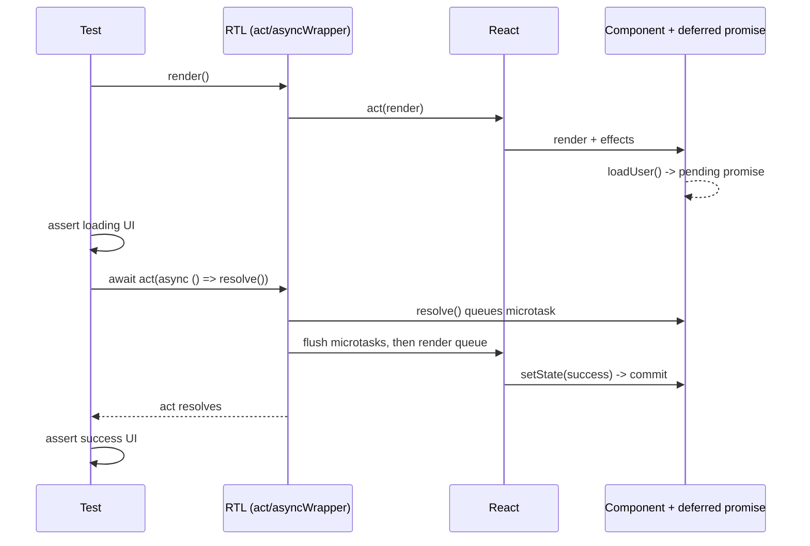
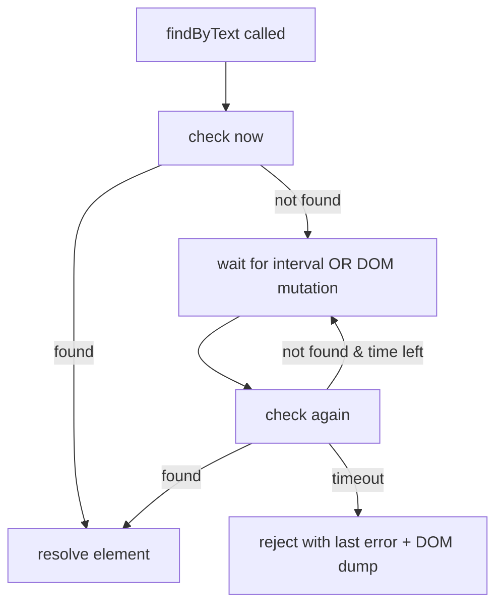

# 08 / 04 — Testing Async Updates: `act`, `findBy`, `waitFor`, Timers, and Races

## 1. Lesson metadata

| | |
|---|---|
| **Level** | Intermediate–Advanced |
| **Study time** | 5 hours (reading 2 h, hands-on 1.5 h, exercises 1.5 h) |
| **Prerequisites** | [08 / 03 — React Testing Library](./03-react-testing-library.md), [08 / 02 — Unit testing with Vitest](./02-unit-testing-with-vitest.md), [00 / 11 — Event loop, tasks, microtasks](../00-web-and-javascript-foundations/11-event-loop-tasks-microtasks.md), [00 / 12 — Promises and async/await](../00-web-and-javascript-foundations/12-promises-and-async-await.md), [03 / 04 — `useEffect` synchronization](../03-react-state-and-hooks/04-useeffect-synchronization.md), [03 / 06 — Effect cleanup](../03-react-state-and-hooks/06-effect-cleanup.md), [06 / 02 — Cancellation and race conditions](../06-data-fetching-and-state-ecosystems/02-cancellation-and-race-conditions.md) |
| **Next** | [05 — Testing custom hooks](./05-testing-custom-hooks.md) |
| **Related later** | [06 — Mocking strategies and MSW](./06-mocking-strategies-and-msw.md), [07 — Testing API interactions](./07-testing-api-interactions.md), [16 — Avoiding brittle tests](./16-avoiding-brittle-tests.md) |

**Version note.** Executed against React 19.3.1, `@testing-library/react` 16.3.3, `@testing-library/dom` 10.4.2, `@testing-library/user-event` 14.6.8, Vitest 3.2.7 and jsdom 30 (2026-10-22); Vitest 4/5 are released and did not change anything this lesson relies on. **Important, verified by running:** Testing Library detects only Jest's fake timers (a global `jest`), so with Vitest's `vi.useFakeTimers()` every `user.*` call, `findBy*` and `waitFor` **hangs** unless you apply one of the fixes in §3.4. The examples below include that fix.

**Learning objectives.** After this lesson you can:
1. Explain what `act` guarantees, why React warns "not wrapped in act(...)", and what the warning is actually telling you.
2. Choose among `findBy*`, `waitFor`, `waitForElementToBeRemoved`, `expect.poll`/`vi.waitFor`, and manual awaiting, and avoid the documented misuses of `waitFor`.
3. Test loading → success → error transitions, debounced inputs, polling, optimistic updates, transitions, and Suspense with deterministic control.
4. Use fake timers together with `userEvent` and Testing Library utilities without hangs.
5. Write deterministic race-condition tests (out-of-order responses, unmount before completion, double submit) using deferred promises.
6. Diagnose flaky async tests by classifying the root cause.

**Concepts covered:** React's `act` environment and `IS_REACT_ACT_ENVIRONMENT`, batching and effect flushing, `asyncWrapper`, `waitFor` polling plus MutationObserver, `findBy*` as `getBy*` + `waitFor`, timeouts and intervals, `waitForElementToBeRemoved`, fake timers and `advanceTimers`, deferred promises, Suspense/`use` tests, transitions, unmount-after-test updates, StrictMode double effects.

---

## 2. Deep conceptual explanation

### 2.1 What problem is this lesson solving?

A synchronous test has a simple shape: arrange → act → assert, with nothing happening in between. UI code is full of things that complete *later*: network responses, `setTimeout` debounces, `requestAnimationFrame`, Suspense boundaries resolving, transitions, effects that run after commit, promises awaited in event handlers.

A test that asserts too early fails (or worse, passes vacuously on the *absence* of something). A test that waits too long is slow. A test that waits **using time** (`sleep(500)`) is both slow *and* flaky. The goal of this lesson is to wait on **conditions**, to control **time** when time is the thing being tested, and to understand the React-specific machinery (`act`) that makes state updates visible to the test.

### 2.2 Why React needs `act` in tests

React does not apply every update synchronously. Updates are *scheduled* (see [Phase 2](../02-react-rendering-and-internals/) on rendering and batching): state updates inside event handlers are batched; effects (`useEffect`) run after paint, asynchronously; transitions render at lower priority; Suspense retries after promises resolve.

In production that's fine; the browser keeps running and eventually everything settles. In a test, you want to say "do X, then check the UI". `act(callback)` is React's test API that says:

> Run this callback, then **flush all the work React scheduled as a result** (renders, effects, and, for the async form, microtasks queued within) before returning.

So after `act`, the DOM reflects the updates caused by the callback. Testing Library wraps `render`, `fireEvent`, `userEvent` calls (through its configuration), and its async utilities in `act`, which is why you rarely write `act` yourself.

### 2.3 The warning: "An update to X inside a test was not wrapped in act(...)"

React logs this when **all** of these hold: the global `IS_REACT_ACT_ENVIRONMENT` is `true` (Testing Library sets it, but only when global `beforeAll`/`afterAll` exist, i.e. Vitest `globals: true`; see §3.2), a state update happens, and the update was **not** inside an `act` scope. Meaning in plain words:

> "Something changed React state at a moment your test wasn't tracking. Your assertions may have run before (or never saw) the update."

Typical causes:

| Cause | Example |
|---|---|
| Test ended before async work finished | `render(<Profile />)`; assert loading; test ends; fetch resolves → `setState` → warning (possibly in the *next* test's output) |
| Updating state from a timer/promise outside RTL's wrappers | Directly calling a store's `setState` in the test |
| Missing `await` | `user.click(...)` not awaited, so the async sequence continues after the test body |
| State updates from a subscription/timer callback that fires while the component is still mounted but outside any `act` | Socket `onmessage` handler calls `setState` after the test stopped waiting. (An update after *unmount* does **not** produce this warning in React 18+/19; verified: no `console.error`. It can still be a real leak bug.) |

*The warning is a feature.* Fixing it by wrapping random code in `act` hides the cause. The proper fixes: **await the condition** (`findBy`/`waitFor`), `await` user events, flush explicit async work with `await act(async () => {...})` when *you* trigger it from outside React, and clean up (unmount) so late updates can't happen.

### 2.4 `findBy*` and `waitFor` semantics

`waitFor(callback, options)` repeatedly runs `callback` until it **does not throw** (or, if it returns a promise, until it resolves) or until `timeout` elapses (default **1000 ms**, `interval` default **50 ms**; the timeout is configurable per call or globally with `configure({ asyncUtilTimeout })`; verified in the DTL 10.4.2 source and by running: a missing `findBy` rejected after ~1002 ms). It re-runs the callback when:

1. The interval fires, or
2. A **DOM mutation** is observed under `container` (via `MutationObserver`) — so you don't always wait a full interval.

On timeout, it rejects with the **last error thrown** by the callback (that's why the message shows the failing assertion/DOM).

`findBy*(…)` ≡ `waitFor(() => getBy*(…))` (and resolves with the element). It's the idiomatic way to wait for an element to appear.

`waitForElementToBeRemoved(elementOrCallback)` waits until an element disappears. It **requires the element to be present initially** (otherwise it throws immediately), so it expresses "loading spinner goes away".

**When is each right?**

| Need | Tool | Why |
|---|---|---|
| An element appears | `await screen.findBy…` | Reads like the requirement; error output is clear |
| An element disappears | `await waitForElementToBeRemoved(() => screen.queryBy…)` or `await waitFor(() => expect(screen.queryBy…).not.toBeInTheDocument())` | The former also asserts it *was* there |
| A property/attribute changes on an existing element | `await waitFor(() => expect(el).toHaveAttribute(…))` | Retry the assertion |
| Several things must hold | One `waitFor` with an assertion each, or sequential `findBy`s | Keep callbacks side-effect free |
| A mock was called | `await waitFor(() => expect(fn).toHaveBeenCalledTimes(1))` (or Vitest's `vi.waitFor` / `expect.poll`, both verified on Vitest 3.2.7; in Vitest 5 `expect.poll` rejects when the timeout elapses) | Retry until called |
| Something *never* happens | You can't wait for never; **advance fake time** and assert absence, or assert a *subsequent* event happened without it | See 2.6 |

### 2.5 `waitFor` anti-patterns (documented and common)

| Anti-pattern | Why wrong | Fix |
|---|---|---|
| Side effects inside `waitFor` (`await waitFor(() => { user.click(btn); expect(...) })`) | The callback runs many times; clicks repeat | Do the action once, outside; wait only for assertions |
| Empty callback / `waitFor(() => {})` to "let things settle" | Resolves immediately; asserts nothing | Wait for a real observable condition |
| `waitFor` around `getBy` for an element ( `waitFor(() => screen.getByText(x))`) | Works but is `findBy` with more words | `findBy` |
| Wrapping `waitFor` in `act` | Testing Library already handles it; double wrapping can mask issues | Remove |
| Large `timeout` to cure flakiness | Hides slowness and races | Find what the test is truly waiting for |
| `await waitFor(() => expect(queryBy…).toBeNull())` for something that may *never* have rendered | Passes vacuously | Prove presence first |
| Non-awaited `waitFor`/`findBy` | Assertion executes after the test ends | `await` |

### 2.6 Testing *absence* of async effects

"After typing three characters quickly, no request is made until the user pauses." You can't `await` a non-event. Use **controlled time**:

1. Install fake timers.
2. Perform the interaction.
3. Advance time by *less than* the debounce → assert not called.
4. Advance the remainder → assert called once.

This is deterministic; the real-time equivalent would be slow and flaky.

### 2.7 Controlling promises: the deferred pattern

For race conditions and loading states you want to decide *when* a promise resolves.

```ts
export function deferred<T>() {
  let resolve!: (value: T | PromiseLike<T>) => void;
  let reject!: (reason?: unknown) => void;
  const promise = new Promise<T>((res, rej) => { resolve = res; reject = rej; });
  return { promise, resolve, reject };
}
```

A test can then render, assert the loading UI (the promise is guaranteed unresolved), resolve inside `act`, and assert success. No timeouts, no flakiness. For network-level tests, MSW's `delay("infinite")` or `delay()` with a gate provides similar control ([lesson 06](./06-mocking-strategies-and-msw.md)).

### 2.8 React 19 specifics

- **Suspense and `use`**: a component that calls `use(promise)` suspends; the nearest `<Suspense fallback>` renders; when the promise resolves, React retries. In tests: render inside a `Suspense` boundary **using `await act(async () => { render(...) })`** (a plain `render(...)` is a *synchronous* `act`; React then warns "A component suspended inside an `act` scope, but the `act` call was not awaited" and, verified here, the boundary **never reveals** the content, not even for an already-resolved promise), assert the fallback, resolve the promise inside `await act(async () => ...)`, then assert the content. The promise passed to `use` must be **stable across renders** (created outside render or cached), otherwise it loops; tests that create it inline will hang or loop. See [06 / 13 — Suspense data loading](../06-data-fetching-and-state-ecosystems/13-suspense-data-loading.md).
- **Actions and transitions**: `<form action={fn}>`, `useActionState`, `useOptimistic`, and `startTransition` run work inside transitions; results appear asynchronously. Use `findBy*`/`waitFor`; for optimistic UI, assert the optimistic state *while the action is pending* using a deferred promise, then the settled state after resolve.
- **`act` import**: `act` is exported from `react` in 19 (replacing `react-dom/test-utils`); RTL also exports a wrapped `act`. Prefer RTL's.
- **StrictMode**: In dev, effects run mount → cleanup → mount. If your test wrapper uses `<StrictMode>` (or RTL's `reactStrictMode` option, verified in RTL 16.3.3), effects that fetch will fetch **twice**; tests asserting `fetch` was called once fail unless cleanup/abort logic and deduping are correct. That is a legitimate finding (see [03 / 06](../03-react-state-and-hooks/06-effect-cleanup.md)).

### 2.9 Common misconceptions

| Misconception | Reality |
|---|---|
| "I should wrap anything async in `act`." | RTL utilities already do; manual `act` is for state changes triggered **outside** RTL/user-event (e.g., calling a store setter, a mock socket's `emit`). |
| "`await waitFor(...)` waits for the component to finish rendering." | It waits for *your callback* to stop throwing. If your callback asserts nothing meaningful, nothing is awaited. |
| "A longer timeout makes a test more reliable." | It only delays failure. Reliability comes from waiting on the right condition. |
| "`findBy` is slow." | It returns as soon as the element exists (mutation-triggered re-check); the timeout only bounds the failure case. |
| "Fake timers speed up everything." | They speed up *timer-based* waits; they can **hang** promise/DOM waiting that depends on real timers. |
| "The act warning is noise." | It nearly always indicates either a missing await or a real post-unmount bug. |

---

## 3. Internal mechanics

### 3.1 What `act` does (teaching model)

*Teaching model; names and exact scheduling are implementation details.*

Conceptually, React keeps an "act queue". Inside `act`:

1. A flag marks "we are in an act scope". Updates scheduled during the scope are pushed into the act queue instead of being handed to the real scheduler (`scheduler` package), so they execute **synchronously on exit** (or at awaiting points for `async act`).
2. When the callback returns, React drains the queue: render → commit → run effects → process any new updates those effects scheduled, repeating until idle.
3. For `await act(async () => {...})`, React awaits the callback's promise, then also flushes microtask-queued work, then drains the queue again.
4. Nested `act` scopes are counted; flushing occurs when the outermost scope exits.

*Public guarantee:* after `act(...)` returns (or its promise resolves), React has processed the updates caused within and the DOM is consistent. *It does not* guarantee that **external** async work (network, real timers) has completed.

### 3.2 How RTL wires it

- RTL calls `configure({ eventWrapper, asyncWrapper, unstable_advanceTimersWrapper })` on DTL so that DOM event dispatching, async utilities, and fake-timer advancing happen under `act`.
- It sets `globalThis.IS_REACT_ACT_ENVIRONMENT = true` for tests; during `waitFor`/`findBy` (the "asyncWrapper"), it temporarily sets it to `false` because React updates arriving *while polling* are expected and should not warn; afterwards it restores the flag and drains pending microtasks with a **real `setTimeout(0)`** so that effects triggered by the final update are applied before the test continues (verified in RTL 16.3.3 `pure.js`; this drain is what hangs under Vitest fake timers, see §3.4). *Implementation detail;* the behavior of the flag within async wrappers is internal. Note also: the `IS_REACT_ACT_ENVIRONMENT = true` setup is registered by RTL only if global `beforeAll`/`afterAll` exist (Vitest `globals: true`); with `globals: false` you must set it yourself (`globalThis.IS_REACT_ACT_ENVIRONMENT = true` in the setup file) or the "not wrapped in act" warning never appears.

### 3.3 `waitFor` loop (teaching model)

```text
start timer for `timeout`
observe DOM mutations on container (subtree, childList, attributes, characterData)
checkCallback()                      // immediately, once
every `interval` ms or on mutation:
    checkCallback()
checkCallback():
    try { result = callback() }
    catch (e) { lastError = e; return }          // keep waiting
    if result is a Promise: await it (still polling safeguards)
    else resolve(result)
on timeout: reject(lastError)                    // "Unable to find..." or assertion diff
```

*Public guarantees:* the callback may be called multiple times (so must be idempotent); the promise resolves with the callback's return value; rejects with the last error on timeout.
*Implementation detail:* the interplay with fake timers. If Jest fake timers are detected (DTL's `jestFakeTimersAreEnabled()` requires a global `jest` **and** a faked `setTimeout`), DTL advances them itself while polling (`jest.advanceTimersByTime(interval)`). **Vitest's `vi` is not detected** (verified in the DTL 10.4.2 source and by running), so with `vi.useFakeTimers()` the polling interval and timeout use faked timers that never advance: `findBy`/`waitFor` hang until the *test* times out (verified: `waitFor` and `findByText` under `vi.useFakeTimers()` were still pending after 1.5 s of real time while the debounce they waited for needed 300 fake ms). This is the single most common surprise when moving from Jest to Vitest.

### 3.4 `userEvent` and time

`userEvent.setup()` defaults `delay: 0`, meaning between actions it awaits a `setTimeout(0)` ("let the event loop breathe"). With fake timers, that timeout never fires. user-event's own options address that part:

```ts
const user = userEvent.setup({ advanceTimers: vi.advanceTimersByTime.bind(vi) }); // user-event advances fake time itself
// or
const user = userEvent.setup({ delay: null });  // skip the inter-action timeout
```

**But this is not sufficient with Vitest** (verified on Vitest 3.2.7 + RTL 16.3.3 + user-event 14.6.8, all four variants below were run). Every `user.*` call, `findBy*`, `waitFor` and `waitForElementToBeRemoved` also goes through RTL's `asyncWrapper`, which finishes with `await new Promise(r => setTimeout(r, 0))` and only calls `jest.advanceTimersByTime(0)` if a global `jest` exists. Under plain `vi.useFakeTimers()` that `setTimeout` is faked and never fires:

| Setup | Result |
|---|---|
| `vi.useFakeTimers()` + `userEvent.setup()` | `await user.type(...)` hangs |
| `vi.useFakeTimers()` + `userEvent.setup({ advanceTimers: vi.advanceTimersByTime })` | still hangs (RTL's drain) |
| `vi.useFakeTimers()` + `userEvent.setup({ delay: null })` | still hangs (RTL's drain) |
| `vi.useFakeTimers()` + `fireEvent` + `findBy*`/`waitFor` | hangs (no auto-advance) |

Working fixes, from most to least deterministic:

```ts
// 1) Make Testing Library think it is under Jest: it then advances fake time itself
//    while polling and while draining. Put this next to vi.useFakeTimers().
beforeEach(() => {
  vi.stubGlobal("jest", { advanceTimersByTime: vi.advanceTimersByTime.bind(vi) });
  vi.useFakeTimers();
});
afterEach(() => { vi.useRealTimers(); vi.unstubAllGlobals(); });
const user = userEvent.setup({ advanceTimers: vi.advanceTimersByTime.bind(vi) });

// 2) Let fake time also move with real time (20 ms ticks). Unblocks everything,
//    but fake time is no longer fully under your control (a "299 ms" assertion can race).
vi.useFakeTimers({ shouldAdvanceTime: true });

// 3) Do not fake the timer that RTL/user-event wait on: fake only what the code under test uses
//    (for example just Date and setInterval), and keep setTimeout real.
vi.useFakeTimers({ toFake: ["Date", "setInterval", "clearInterval"] });
```

Option 1 passed the debounce and stale-response tests in §5.2 (`findByText` also resolved while fake timers were installed); option 2 passed a typing + `advanceTimersByTime` test; option 3 let `user.type` complete. With any of them, still advance the fake clock for your own timers with `await act(async () => { await vi.advanceTimersByTimeAsync(ms) })`. The `jest` stub works only because DTL checks `typeof jest !== "undefined"` and that `setTimeout` has a fake-timers `clock`; other libraries that sniff for `jest` may change behavior, so keep the stub local to the tests that need it. Option names `advanceTimers` and `delay` are confirmed in user-event 14.6.8 (`utils/misc/wait.js`).

### 3.5 Fake timers + promises

Fake timers replace timers, not promises. A promise continuation is a microtask; it runs when the current synchronous code finishes and the microtask queue drains. So after `vi.advanceTimersByTime(300)` (sync), continuations from promises awaiting that timer haven't run yet; use `await vi.advanceTimersByTimeAsync(300)` which yields to microtasks between timers. Also, React's own scheduler uses `MessageChannel`/`setTimeout`/`setImmediate` depending on environment; inside `act` it's bypassed; outside `act` with fake timers installed, scheduled work can stall. Prefer faking only what you need: `vi.useFakeTimers({ toFake: ["setTimeout", "clearTimeout", "Date"] })` (item names verified; Vitest's default fakes everything except `nextTick` and `queueMicrotask`, including `setImmediate`, `performance` and `requestAnimationFrame`), which keeps `MessageChannel`/`queueMicrotask` real. Remember RTL's async utilities need a *real* or auto-advanced `setTimeout`, so faking `setTimeout` requires the fix in §3.4.

### 3.6 Late updates after the test

Cleanup (`afterEach`) unmounts the tree, but promises started by your component can still resolve afterward. Components that set state in those `.then` callbacks without guarding (React 18+ no longer warns about "state update on an unmounted component", because the pattern is usually harmless) won't warn about *unmounted* updates, but **will** produce act warnings if the update happens while a *different* test's `IS_REACT_ACT_ENVIRONMENT` is true and the component is still mounted. Isolating tests (cleanup + awaiting conditions) prevents cross-test leakage.

---

## 4. Step-by-step execution walkthrough: loading → success with a deferred promise

Component:

```tsx
// UserCard.tsx
import { useEffect, useState } from "react";

export interface User { id: string; name: string }
type State =
  | { status: "loading" }
  | { status: "error"; message: string }
  | { status: "success"; user: User };

export function UserCard({ id, loadUser }: { id: string; loadUser: (id: string, signal: AbortSignal) => Promise<User> }) {
  const [state, setState] = useState<State>({ status: "loading" });

  useEffect(() => {
    const controller = new AbortController();
    setState({ status: "loading" });
    loadUser(id, controller.signal)
      .then((user) => { if (!controller.signal.aborted) setState({ status: "success", user }); })
      .catch((e: unknown) => {
        if (!controller.signal.aborted) setState({ status: "error", message: e instanceof Error ? e.message : "Unknown error" });
      });
    return () => controller.abort();
  }, [id, loadUser]);

  if (state.status === "loading") return <p role="status">Loading…</p>;
  if (state.status === "error") return <p role="alert">{state.message}</p>;
  return <h2>{state.user.name}</h2>;
}
```

Test:

```tsx
import { act, render, screen } from "@testing-library/react";
import { expect, test, vi } from "vitest";
import { UserCard, type User } from "./UserCard";
import { deferred } from "../test/deferred";

test("shows loading then the user", async () => {
  const d = deferred<User>();
  const loadUser = vi.fn(() => d.promise);

  render(<UserCard id="1" loadUser={loadUser} />);
  expect(screen.getByRole("status")).toHaveTextContent("Loading…");

  await act(async () => { d.resolve({ id: "1", name: "Ada" }); });

  expect(screen.getByRole("heading", { name: "Ada" })).toBeInTheDocument();
  expect(screen.queryByRole("status")).not.toBeInTheDocument();
});
```

**Timeline**

| # | Event | React / DOM state |
|---|---|---|
| 1 | `render(...)` inside `act` | Render #1 (`loading`). DOM: `<p role=status>Loading…</p>`. Commit. Effects flushed by `act`: effect runs → `setState({loading})` (same shape but a *new object*, so React re-renders; harmless) → calls `loadUser` → returns `d.promise` (pending). Handlers attached via `.then`. |
| 2 | Assertion `getByRole("status")` | Passes: loading is guaranteed because the promise is unresolved. |
| 3 | `await act(async () => { d.resolve(...) })` | `resolve` schedules `.then` continuation as a microtask. `act` awaits the callback, then flushes microtasks → `.then` runs → `setState({success})` queued **inside** act scope. |
| 4 | `act` exit | React renders `success`, commits; DOM: `<h2>Ada</h2>`. Effect deps unchanged → effect not re-run. |
| 5 | Assertions | `heading "Ada"` present; `status` gone. |
| 6 | Cleanup | Unmount → effect cleanup → `controller.abort()`; no pending work. |

**Strict-Mode variant (if the wrapper enables it):** effect runs, cleans up (abort #1), runs again (fetch #2). `loadUser` is called **twice**; the first result (if it resolved) is ignored thanks to the `aborted` check. A test asserting `toHaveBeenCalledTimes(1)` fails: decide whether you assert "latest call's result is displayed" instead (behavior) rather than call count (implementation).

**Predict:** if we replaced step 3 with `d.resolve(...)` *without* `act`, what happens when we immediately `expect(screen.getByRole("heading"))`? **Result:** `getByRole` throws (the state update is scheduled, but not flushed); additionally React may log the act warning when the update finally fires. Use `act` (for externally resolved promises) or `findBy*` (which waits).

**Alternative without `act`:** `d.resolve(...); expect(await screen.findByRole("heading", { name: "Ada" })).toBeInTheDocument();` Both are valid; `findBy` is the more common, but `act` makes it explicit that *you* are triggering the update.

---

## 5. Code examples

### 5.1 Minimal example — `findBy` for a delayed element

```tsx
function Delayed() {
  const [show, setShow] = useState(false);
  useEffect(() => {
    const id = setTimeout(() => setShow(true), 200);
    return () => clearTimeout(id);
  }, []);
  return show ? <p>Ready</p> : null;
}

test("appears after 200ms (real timers)", async () => {
  render(<Delayed />);
  expect(screen.queryByText("Ready")).not.toBeInTheDocument();
  expect(await screen.findByText("Ready")).toBeInTheDocument(); // default timeout 1000ms
});
```

Works, costs ~200 ms of real time. With fake timers it costs ~0:

```tsx
test("appears after 200ms (fake timers)", async () => {
  vi.useFakeTimers();
  render(<Delayed />);
  expect(screen.queryByText("Ready")).not.toBeInTheDocument();

  await act(async () => { await vi.advanceTimersByTimeAsync(200); });

  expect(screen.getByText("Ready")).toBeInTheDocument();
  vi.useRealTimers();
});
```
Here we **advance time inside `act`** so React flushes the state update, then assert synchronously with `getBy`. (Don't use `findBy` with fake timers unless you've verified your Vitest/RTL combination handles it.) Restore real timers in `afterEach` rather than at the end of the test body so a failing assertion doesn't leak fake timers.

### 5.2 Practical example — debounced search with out-of-order responses

```tsx
// SearchBox.tsx
import { useEffect, useState } from "react";

export interface Hit { id: string; title: string }

export function SearchBox({ search, debounceMs = 300 }: {
  search: (q: string, signal: AbortSignal) => Promise<Hit[]>;
  debounceMs?: number;
}) {
  const [query, setQuery] = useState("");
  const [hits, setHits] = useState<Hit[]>([]);

  useEffect(() => {
    if (!query.trim()) { setHits([]); return; }
    const controller = new AbortController();
    const id = setTimeout(() => {
      search(query, controller.signal)
        .then((h) => { if (!controller.signal.aborted) setHits(h); })
        .catch(() => { /* aborted or failed: keep previous hits */ });
    }, debounceMs);
    return () => { clearTimeout(id); controller.abort(); };
  }, [query, search, debounceMs]);

  return (
    <div>
      <label htmlFor="q">Search</label>
      <input id="q" value={query} onChange={(e) => setQuery(e.target.value)} />
      <ul aria-label="Results">
        {hits.map((h) => <li key={h.id}>{h.title}</li>)}
      </ul>
    </div>
  );
}
```
```tsx
// SearchBox.test.tsx
import { act, render, screen, within } from "@testing-library/react";
import userEvent from "@testing-library/user-event";
import { afterEach, beforeEach, expect, test, vi } from "vitest";
import { SearchBox, type Hit } from "./SearchBox";
import { deferred } from "../test/deferred";

beforeEach(() => {
  // Testing Library only auto-advances *Jest* fake timers; this stub makes it advance Vitest's (lesson §3.4)
  vi.stubGlobal("jest", { advanceTimersByTime: vi.advanceTimersByTime.bind(vi) });
  vi.useFakeTimers();
});
afterEach(() => { vi.useRealTimers(); vi.unstubAllGlobals(); });

function setup(search = vi.fn<(q: string, s: AbortSignal) => Promise<Hit[]>>()) {
  const user = userEvent.setup({ advanceTimers: vi.advanceTimersByTime.bind(vi) });
  render(<SearchBox search={search} debounceMs={300} />);
  return { user, search, input: screen.getByLabelText("Search") };
}

test("debounces: one request with the final text after a pause", async () => {
  const { user, search, input } = setup(vi.fn().mockResolvedValue([{ id: "1", title: "React" }]));

  await user.type(input, "rea");
  await act(async () => { await vi.advanceTimersByTimeAsync(299); });
  expect(search).not.toHaveBeenCalled();

  await act(async () => { await vi.advanceTimersByTimeAsync(1); });
  expect(search).toHaveBeenCalledTimes(1);
  expect(search).toHaveBeenCalledWith("rea", expect.any(AbortSignal));
  expect(within(screen.getByRole("list", { name: "Results" })).getByText("React")).toBeInTheDocument();
});

test("ignores a stale response that arrives after a newer one", async () => {
  const first = deferred<Hit[]>();
  const second = deferred<Hit[]>();
  const search = vi.fn()
    .mockReturnValueOnce(first.promise)
    .mockReturnValueOnce(second.promise);
  const { user, input } = setup(search);

  await user.type(input, "re");
  await act(async () => { await vi.advanceTimersByTimeAsync(300); });  // request #1 for "re"

  await user.type(input, "a");
  await act(async () => { await vi.advanceTimersByTimeAsync(300); });  // request #2 for "rea"

  await act(async () => { second.resolve([{ id: "2", title: "React (new)" }]); });
  await act(async () => { first.resolve([{ id: "1", title: "Redux (stale)" }]); });

  expect(screen.getByText("React (new)")).toBeInTheDocument();
  expect(screen.queryByText("Redux (stale)")).not.toBeInTheDocument();
});
```

Line notes:
- `userEvent.setup({ advanceTimers })` lets user-event's own inter-action wait advance fake time; the `jest` stub in `beforeEach` is what stops RTL's `asyncWrapper` from hanging (§3.4; without it **both tests hang until the 5 s test timeout**, verified). `vi.advanceTimersByTime.bind(vi)` is harmless; passing the bare function also worked in the runs.
- Typing `"rea"` takes fake time? With `advanceTimers` set and `delay: 0`, user-event advances fake time by 0 between keystrokes, so total fake time before our first assertion is ~0 ms; the debounce timer resets at each keystroke (each effect run clears the previous timer).
- In the second test, request #1 is made for `"re"` after the first 300 ms, then the user types `"a"`: the effect cleanup **aborts** controller #1 (its `.then` is guarded by `aborted`). Even though `first` resolves last, its result is ignored. The test proves the guard works; if you delete the `aborted` check, the stale result **overwrites** the new one and the test fails (a valuable mutation check).

**Predict:** in the second test, how many times is `search` called and with what queries? **Result:** twice: `"re"` then `"rea"`. (Typing `"re"` quickly is one debounced request because the timer resets with each character; the 300 ms advance fires it.)

### 5.3 Incorrect examples

**(a) Sleeping**
```tsx
await user.click(screen.getByRole("button", { name: "Load" }));
await new Promise((r) => setTimeout(r, 500));      // ❌ arbitrary
expect(screen.getByText("Loaded")).toBeInTheDocument();
```
Flaky on slow machines; wasteful on fast ones. Fix: `expect(await screen.findByText("Loaded")).toBeInTheDocument();`

**(b) Side effect in `waitFor`**
```tsx
await waitFor(async () => {
  await user.click(screen.getByRole("button", { name: "Refresh" })); // ❌ repeated every poll
  expect(screen.getByText("Updated")).toBeInTheDocument();
});
```
Each retry clicks again, causing multiple requests, nondeterministic state. Fix: click once, then `await screen.findByText("Updated")`.

**(c) Vacuous absence**
```tsx
render(<Profile />);                       // data loads async
expect(screen.queryByText("Error")).not.toBeInTheDocument(); // ❌ true now, before load finishes
```
This passes trivially (nothing is rendered yet). Fix: first wait for the loaded state (`await screen.findByRole("heading", { name: "Ada" })`), *then* assert no error.

**(d) Unawaited user event**
```tsx
user.click(button);                         // ❌ no await
expect(onSave).toHaveBeenCalled();          // races
```

### 5.4 Corrected: waiting on the right thing

```tsx
test("saves and confirms", async () => {
  const user = userEvent.setup();
  render(<Editor save={fakeSave} />);

  await user.type(screen.getByRole("textbox"), "hello");
  await user.click(screen.getByRole("button", { name: "Save" }));

  expect(screen.getByRole("button", { name: "Saving…" })).toBeDisabled(); // pending state (deferred promise)
  expect(await screen.findByRole("status")).toHaveTextContent("Saved");
  expect(screen.getByRole("button", { name: "Save" })).toBeEnabled();
});
```
(Needs `fakeSave` to be controlled, e.g., with a deferred, for the pending assertion to be deterministic; if `fakeSave` resolves immediately, the "Saving…" state might already be gone when asserted. Controlling the promise is how you test intermediate states.)

### 5.5 Advanced — polling with fake timers and cleanup

```tsx
// useJobStatus (simplified, component form)
function JobStatus({ getStatus }: { getStatus: () => Promise<"pending" | "done"> }) {
  const [status, setStatus] = useState<"pending" | "done">("pending");
  useEffect(() => {
    if (status === "done") return;
    let cancelled = false;
    const id = setInterval(async () => {
      const s = await getStatus();
      if (!cancelled) setStatus(s);
    }, 2000);
    return () => { cancelled = true; clearInterval(id); };
  }, [status, getStatus]);
  return <p role="status">{status === "done" ? "Complete" : "Working…"}</p>;
}

test("polls every 2s until done, then stops polling", async () => {
  vi.useFakeTimers();
  const getStatus = vi.fn<() => Promise<"pending" | "done">>()
    .mockResolvedValueOnce("pending")
    .mockResolvedValueOnce("done");

  render(<JobStatus getStatus={getStatus} />);
  expect(screen.getByRole("status")).toHaveTextContent("Working…");

  await act(async () => { await vi.advanceTimersByTimeAsync(2000); });
  expect(getStatus).toHaveBeenCalledTimes(1);
  expect(screen.getByRole("status")).toHaveTextContent("Working…");

  await act(async () => { await vi.advanceTimersByTimeAsync(2000); });
  expect(getStatus).toHaveBeenCalledTimes(2);
  expect(screen.getByRole("status")).toHaveTextContent("Complete");

  await act(async () => { await vi.advanceTimersByTimeAsync(10_000); });
  expect(getStatus).toHaveBeenCalledTimes(2);           // polling stopped
});

test("stops polling when unmounted", async () => {
  vi.useFakeTimers();
  const getStatus = vi.fn().mockResolvedValue("pending");
  const { unmount } = render(<JobStatus getStatus={getStatus} />);
  unmount();
  await vi.advanceTimersByTimeAsync(10_000);
  expect(getStatus).not.toHaveBeenCalled();
});
```
Why this matters: "polling never stops" and "leaks after unmount" are classic production bugs (battery, server load). The assertions encode both lifecycle requirements.

Note: `status` is a dependency of the effect, so when it flips to `done` React cleans up the interval. In Strict Mode, the effect would mount-unmount-mount without issue because cleanup clears the interval (verified: the same polling test also passes inside `<StrictMode>`).

### 5.6 Testing Suspense with `use`

```tsx
// Profile.tsx
import { Suspense, use } from "react";

export function Profile({ userPromise }: { userPromise: Promise<{ name: string }> }) {
  const user = use(userPromise);          // suspends until resolved
  return <h2>{user.name}</h2>;
}

export function ProfilePage({ userPromise }: { userPromise: Promise<{ name: string }> }) {
  return (
    <Suspense fallback={<p role="status">Loading profile…</p>}>
      <Profile userPromise={userPromise} />
    </Suspense>
  );
}
```

```tsx
test("shows a fallback, then the profile", async () => {
  const d = deferred<{ name: string }>();
  // Render inside an ASYNC act: a component that suspends inside a synchronous act
  // (plain `render(...)`) triggers React's "suspended inside an act scope, but the act call
  // was not awaited" warning, and the boundary never reveals the content (verified).
  await act(async () => { render(<ProfilePage userPromise={d.promise} />); });   // promise created OUTSIDE render => stable identity

  expect(screen.getByRole("status")).toHaveTextContent("Loading profile…");

  await act(async () => { d.resolve({ name: "Ada" }); });

  expect(screen.getByRole("heading", { name: "Ada" })).toBeInTheDocument();
});
```
*Verified on React 19.3.1 + RTL 16.3.3:* this version passes; the same test with a plain `render(...)` and `await findByRole(..., { timeout: 4000 })` never finds the heading, even for `Promise.resolve(...)`. (Outside tests, React reveals content that was suspended after fallback with a ~300 ms throttle; inside `act` the throttle is bypassed.)

If the promise rejects, an **error boundary** is required; render `<ErrorBoundary>` around the `Suspense`, `await act(async () => { d.reject(new Error("nope")) })`, and silence the *expected* `console.error` noise intentionally (and restore it). Verified: React 19 logged one `console.error` call for the caught error in this setup; the count differs between React versions.

### 5.7 Testing optimistic updates (`useOptimistic`) — pending vs. settled

```tsx
test("shows the optimistic item immediately and reconciles after the server responds", async () => {
  const user = userEvent.setup();
  const d = deferred<{ id: string; text: string }>();
  const addTodo = vi.fn(() => d.promise);

  render(<TodoList initial={[]} addTodo={addTodo} />);
  await user.type(screen.getByLabelText("New todo"), "buy milk");
  await user.click(screen.getByRole("button", { name: "Add" }));

  // pending: the optimistic row is visible and marked
  const row = screen.getByRole("listitem");
  expect(row).toHaveTextContent("buy milk");
  expect(row).toHaveAttribute("aria-busy", "true");

  await act(async () => { d.resolve({ id: "t1", text: "buy milk" }); });

  expect(screen.getByRole("listitem")).not.toHaveAttribute("aria-busy", "true");
  expect(screen.getAllByRole("listitem")).toHaveLength(1);   // not duplicated
});
```
The deferred promise freezes time at the interesting moment; `aria-busy` is the (accessible) signal chosen by this hypothetical component. Failure path: reject the deferred and assert the optimistic row disappears and an error is announced.

### 5.8 Testing `waitForElementToBeRemoved`

```tsx
test("spinner disappears when data arrives", async () => {
  render(<Dashboard />);
  await waitForElementToBeRemoved(() => screen.queryByRole("progressbar", { name: "Loading" }));
  expect(screen.getByRole("heading", { name: "Sales" })).toBeInTheDocument();
});
```
If the data arrived before the first check, `waitForElementToBeRemoved` throws ("The element(s) given to waitForElementToBeRemoved are already removed") — a *correct* signal that your premise (spinner visible initially) is false, e.g., because cached data rendered immediately. For cached/instant cases, assert absence with `queryBy` after waiting for the final content instead.

### 5.9 Helper: `deferred` and a `flushPromises` caution

```ts
// src/test/deferred.ts
export function deferred<T>() {
  let resolve!: (value: T | PromiseLike<T>) => void;
  let reject!: (reason?: unknown) => void;
  const promise = new Promise<T>((res, rej) => { resolve = res; reject = rej; });
  return { promise, resolve, reject };
}
```

Avoid generic `await new Promise(process.nextTick)`/`flushPromises` helpers as primary tools: they flush an arbitrary number of microtask turns and hide *what* you were waiting for. Prefer a condition.

(Modern JS also offers `Promise.withResolvers()`: it exists in Node 24 (verified), but TypeScript needs `lib: ["ES2024"]` or later and older browsers/Node lack it; a small helper is more portable.)

---

## 6. Visual explanations

### 6.1 Timeline: what waits for what



### 6.2 `findBy` internals



### 6.3 Real vs. fake time

```text
Real timers:   test --await findBy--> [polling 50ms ... real 200ms elapses] --> pass     (slow, timing-dependent)
Fake timers:   test --advanceTimersByTimeAsync(200)--> (instant) --> assert              (fast, deterministic)
Danger:        fake timers + findBy/waitFor/userEvent default delay -> polling timer never fires -> hang
```

### 6.4 Race: out-of-order responses

```text
Time ->
type "re"   ──300ms──► request A("re")
type "a"    ──300ms──► request B("rea")   ← cleanup aborts A
response B arrives  ──► UI shows B        ✔
response A arrives  ──► ignored (aborted) ✔   (without the guard: UI regresses to A ✘)
```

---

## 7. Alternative approaches and trade-offs

### 7.1 Ways to wait

| Approach | Determinism | Speed | Readability | Pitfalls |
|---|---|---|---|---|
| `await findBy*` | High (condition-based) | Fast | Highest | Timeout default 1000 ms; fake-timer hangs |
| `await waitFor(assertion)` | High | Fast | Good | Side effects inside; overly broad callbacks |
| Fake timers + `advanceTimersByTimeAsync` in `act` | Highest | Fastest | Medium | Setup complexity; `userEvent` config; hides real-time bugs |
| Deferred promises | Highest | Fastest | Good | Requires injectable async boundary |
| MSW with `delay()` | High | Real (ms) | Good | Network-level realism, wall-clock cost |
| `sleep(ms)` | Low | Slow | Low | Flaky by construction |
| Retries on CI (`retry: 2`) | Masks | Slow | — | Hides real defects |

### 7.2 Where to fake: component, hook, or network boundary

| Boundary | Pros | Cons |
|---|---|---|
| Injected async function prop (as above) | Simplest control, no network semantics | Only works for DI-friendly components; doesn't test real fetch code |
| `vi.mock` the data module | Works for any module | Coupled to module structure |
| MSW (network) | Tests real fetch/serialization/headers | Needs server lifecycle; async control via `delay`/gates |
| Real backend (E2E) | Maximum realism | Slow, flaky; see [09](./09-e2e-with-playwright.md) |

### 7.3 When fake timers are NOT the best choice

- **User flows that exercise many libraries with internal timers/animation frames** (a date picker with transitions, a tooltip library using `requestAnimationFrame`, a router): faking *all* timers can freeze them in unexpected states. Prefer real timers with `findBy` and a small real delay (disable animations in test config via a global CSS `*, *::before, *::after { transition: none !important; animation: none !important }` injected in setup, or the library's `reducedMotion`/`disableAnimations` option).
- **Tests whose point is real time** (e.g., session expiry after 15 minutes): fake time is right for unit/integration; but verify the *actual timer wiring* in one E2E where possible (Playwright has a clock API, `page.clock.install()` / `fastForward()` / `runFor()`, since 1.45; see [lesson 09](./09-e2e-with-playwright.md)).

---

## 8. Best practices and anti-patterns

**Do**
- Make every wait a **condition**: an element, a role, an attribute, a call count.
- Use `findBy*` for appearance; `await` every `user.*` call; use `queryBy` + positive proof for absence.
- Put time under test control (fake timers or injected clock) when *time is the requirement* (debounce, polling, timeouts, expiry).
- Inject async boundaries (functions, adapters, context) where it simplifies determinism.
- Use deferred promises to freeze interesting intermediate states (loading, pending, optimistic).
- Restore timers and mocks in `afterEach`.
- Treat act warnings as defects; find the leaked async operation.
- Add a **mutation check** when writing a race-condition test: temporarily remove the guard and confirm the test fails.

**Beginner mistakes**
- `setTimeout`/sleep waits; giant timeouts; missing `await`; `act` everywhere.
- Asserting absence before the async state could have appeared.
- Using `waitFor` as a "settling" tool.

**Experienced-developer mistakes**
- Using `vi.useFakeTimers()` globally in a setup file; every test then inherits fake time and RTL polling hangs.
- Asserting call counts that depend on Strict Mode behavior or effect dependency identity (e.g., unstable `loadUser` prop causing refetch loops that the test doesn't notice because the mock always resolves).
- Mocking so much that async boundaries never exist in the test (everything resolves synchronously → race conditions untestable).
- Testing "eventually" semantics only: not verifying that *intermediate* state (disabled button, spinner, optimistic row) is correct.

**Smells:** `await waitFor(() => {})`; `advanceTimersByTime(99999)` "to be safe"; `jest.setTimeout`-style large per-test timeouts; `await Promise.resolve()` repeated N times; `.skip` on tests with the comment "flaky".

**Justified exceptions:** a small real-time wait in an E2E test for a third-party iframe that offers no observable signal (prefer a web-first assertion); `waitFor` with extended `timeout` for CI-only slow integration (e.g., 3 s) *after* verifying the condition is correct; global fake `Date` for snapshotting date-based UI (without faking timers).

---

## 9. Real-world application

**Dashboard with polling and a "last updated" label (finance/ops).** Constraints: poll every 30 s, show "Updated 12 s ago", pause when the tab is hidden, stop on unmount. Tests: fake timers with a fixed system time; assert label progression ("0 s ago" → "30 s ago") via `advanceTimersByTimeAsync`; simulate `visibilitychange` with `fireEvent` on `document` (user-event can't) and assert polling pauses; unmount and assert no further calls.

**Checkout with optimistic cart and server reconciliation (e-commerce).** Constraints: adding to cart updates immediately; server may reject (stock). Tests: deferred promise for the mutation; assert optimistic quantity, then settle success (stable) and failure (rollback + error `role="alert"`); ensure double-click doesn't create two requests (disabled state while pending) by clicking twice and asserting the mock was called once.

**Search/autocomplete (any product).** Constraints: debounce, cancellation, out-of-order responses, keyboard navigation while results update. Tests as in 5.2, plus an assertion that `aria-busy`/live-region announcements don't spam.

**Realtime feeds (WebSockets).** Constraints: messages arrive at arbitrary times; reconnection with backoff. Approach: inject a fake socket (an event emitter); trigger messages with `act(() => socket.emit("message", data))` — here manual `act` is *correct* because the update originates outside RTL; use fake timers for backoff (`advanceTimersByTimeAsync(1000 * 2 ** attempt)`).

**Multi-step forms with async validation (auth/onboarding).** Constraints: username availability check on blur, server-side errors mapped to fields. Tests: deferred availability promise; assert "Checking…" announced (`role="status"`), then the error; verify the submit button remains disabled until the async check settles (prevents race between validation and submit).

---

## 10. Debugging and troubleshooting

### 10.1 "Warning: An update to X inside a test was not wrapped in act(...)"

1. Note the component named in the warning and *which test* printed it (it may belong to the **previous** test).
2. Ask: what async operation updates this state? (fetch, timer, subscription, promise in handler.)
3. Check the test: did it `await` every user event? Did it wait for the *final* state (`findBy`) before ending?
4. If the update originates outside RTL (emitter, store, timer you advanced), wrap *that call* in `act`.
5. If the update occurs after the assertion **by design** (background refetch), either await the final state to finish or unmount at the end and ensure the effect cleanup cancels the work.
6. Validate: run the test file alone, with `--sequence.shuffle`, and confirm no warnings.

### 10.2 "Test times out (5000 ms)" under fake timers

1. Does the test use `findBy`/`waitFor`/`userEvent` with `vi.useFakeTimers()`? Likely the hang from §3.3/3.4.
2. Options: configure `userEvent.setup({ advanceTimers })`; `await act(async () => { await vi.advanceTimersByTimeAsync(n) })` then assert with `getBy`; or fake only specific timers (`toFake`); or `vi.useFakeTimers({ shouldAdvanceTime: true })` to let fake time advance with real time (option verified to unblock `user.type`/`findBy`) — a compromise that sacrifices determinism. The most deterministic fix is the `jest` stub from §3.4.
3. Validate by making the test fail intentionally (wrong text) and confirming it fails fast with a good message rather than hanging.

### 10.3 "`findBy` times out but the element is visible in `screen.debug()`"

1. Check the **query**: role/name mismatch, `hidden`, exact text matching with whitespace/nested elements.
2. `findBy` is only about presence *at the time of polling*; if the element appeared and disappeared (a toast that auto-dismisses in 100 ms), polling might miss it. Control the dismissal timer (fake timers) or assert on a more durable signal.
3. Use `screen.debug()` inside a `waitFor` callback temporarily, or increase logging via `DEBUG_PRINT_LIMIT`.

### 10.4 "Flaky on CI, fine locally"

Classify: (a) race on UI condition (assert earlier than the update), (b) shared state between tests (cached query data, global stores), (c) real timers racing assertions, (d) animation/transition delays, (e) CPU contention causing the 1000 ms default to be insufficient *legitimately* (investigate before raising).
Tools: repeat the test 200× (Vitest has no `--repeat` CLI flag; use the per-test `repeats` option, e.g. `test("…", { repeats: 200 }, fn)`, or a shell loop), throttle CPU (run under `taskset`/Docker CPU limits), randomize order. Fix the root cause; raising `asyncUtilTimeout` to 3–5 s globally is acceptable as a *CI environment* concession only once the conditions are right.

### 10.5 "Expected one call but got two"

Strict Mode effect double-invocation or unstable dependencies (an inline `loadUser` function recreated each render, causing the effect to re-run → fetch loop). Check dependency identity; stabilize with `useCallback`/module-level function; verify with a render-count log. Real production bug if the app (not just the test) refetches repeatedly.

---

## 11. Exercises

### Level A — Knowledge
A1. In one paragraph, explain what `act` guarantees and what it does *not*.
A2. What is the precise relationship between `findByText` and `waitFor`?
A3. Why does `waitForElementToBeRemoved` throw if the element is already gone?
A4. List four causes of the "not wrapped in act" warning and the right fix for each.
A5. Why can `vi.useFakeTimers()` cause `await user.click(...)` to hang, and what are two remedies?

### Level B — Code comprehension
B1. What does this test assert, and is it reliable? Explain.
```tsx
test("shows saved", async () => {
  render(<Form />);
  await userEvent.click(screen.getByRole("button", { name: "Save" }));
  await waitFor(() => {});
  expect(screen.getByText("Saved")).toBeInTheDocument();
});
```
B2. Predict the number of times `fetchUser` is called in each case: (i) real component with stable `fetchUser`, no StrictMode; (ii) same but wrapped in `<StrictMode>`; (iii) `fetchUser` defined inline in the parent so its identity changes each parent render, and the parent re-renders once.
B3. In 5.2 test 2, what happens if the component omitted the `controller.signal.aborted` check? Walk through the final DOM.

### Level C — Implementation
C1. Write a test for a "Resend code" button that is disabled for 30 seconds after click and shows a countdown ("Resend in 29s"...). Use fake timers.
C2. Write a deferred-promise test for double-submit protection: clicking "Pay" twice quickly results in exactly one `pay` call and the button is disabled while pending.
C3. Write a test for a component that subscribes to a `WebSocket`-like emitter and renders messages, including cleanup on unmount (no more listeners).

### Level D — Debugging
D1. The following test passes locally but occasionally fails in CI with "Unable to find role button name Retry". Explain and fix.
```tsx
render(<DataPanel />);                      // fetches on mount, shows error after 100ms (mock delay), then "Retry" button
await new Promise((r) => setTimeout(r, 150));
await user.click(screen.getByRole("button", { name: "Retry" }));
```
D2. A test using `vi.useFakeTimers()` at the top of the file passes, but 3 of 20 tests in the file time out after you add `await screen.findByText(...)` to them. Why, and what's the least invasive fix?
D3. An act warning is logged in test B but originates from the component rendered in test A. Find the cause and fix.

### Level E — Architecture and engineering decisions
E1. Your codebase calls `fetch` directly inside components and effects. Propose how to make async behavior deterministic in tests without a rewrite. Compare MSW, module mocks, and dependency injection.
E2. Decide on a team convention for timeouts: global `asyncUtilTimeout`, per-test overrides, retries. Justify with CI evidence you'd gather.

### Level F — Expert challenge
F1. Design a test suite for a notifications center: a WebSocket pushes events; a "mark all read" action is optimistic with rollback on failure; the list is virtualized; the center polls as a fallback when the socket is down; exponential backoff on reconnect. Enumerate the async scenarios, the control mechanisms (fakes, deferred, timers), and the assertions that prove no leaks or double-processing.

---

## 12. Detailed answers and explanations

> Attempt the exercises first.

**A1.** `act` runs a callback and then flushes all React work scheduled within it (renders, effects, nested updates) before returning, so the DOM reflects the callback's consequences; the async form also flushes microtasks queued by the awaited callback. It does **not** wait for external asynchronous work (network, real timers) that wasn't started or resolved inside the scope, and it doesn't make assertions retry.

**A2.** `findBy*` is `waitFor(() => getBy*(...))` with the result returned. Consequently it inherits `waitFor`'s default `timeout` (1000 ms), `interval` (50 ms), MutationObserver-triggered re-checks, and rejection with the last error. Wrong answer: "findBy is a separate mechanism with different timing".

**A3.** It is designed to express "this *was* present and then went away" (e.g., a spinner). If the element is not initially present, the premise is false and the helper can't distinguish "removed" from "never existed", so it throws to avoid a vacuous pass. For uncertain initial presence use `waitFor(() => expect(queryBy…).not.toBeInTheDocument())` after proving final content.

**A4.** (1) Test ends before async work completes → `await findBy…` / `waitFor` for the final state. (2) A state change triggered outside RTL (store setter, emitter) → wrap that call in `act`. (3) A missing `await` on `user.*` → add it. (4) A subscription/timer updates state after unmount → fix the component's cleanup (real bug) and unmount in test cleanup. (Also acceptable: effects in Strict Mode firing twice → verify cleanup correctness.)

**A5.** Two waits use `setTimeout(0)`: user-event's inter-action delay (default `delay: 0`) and RTL's `asyncWrapper` drain after every `user.*`/`findBy`/`waitFor`. A faked `setTimeout` never fires unless time advances, so the promise never resolves. Remedies (all verified on Vitest 3.2.7): stub a global `jest` with `advanceTimersByTime` so Testing Library advances Vitest's fake time (and pass `userEvent.setup({ advanceTimers: vi.advanceTimersByTime.bind(vi) })`); or `vi.useFakeTimers({ shouldAdvanceTime: true })`; or fake only the timers you need (`toFake`) leaving `setTimeout` real. `advanceTimers` or `delay: null` *alone* do not fix it, because of RTL's drain.

**B1.** `waitFor(() => {})` resolves on its first check because the callback never throws; it waits for nothing (maybe one microtask turn). The following `getByText("Saved")` passes only if "Saved" is already rendered synchronously after the click, or fails otherwise depending on timing: unreliable if saving is async. Also, using the `userEvent.click` direct API without `setup()` is allowed but not recommended. Fix: `expect(await screen.findByText("Saved")).toBeInTheDocument();`.

**B2.** (i) once. (ii) twice in development StrictMode (mount → cleanup → mount); the first request is aborted/ignored by a correct component; count is two *calls*. (iii) the effect depends on `fetchUser`; if the parent re-renders and passes a new function identity, the effect cleans up and re-runs: at least twice (initial + after re-render); if the parent re-renders because the child's result updated parent state, you can get a **loop**. Lesson: assert behavior, and when call counts matter, check dependency stability.

**B3.** Order: request #1 ("re") in flight, request #2 ("rea") resolves first → UI shows "React (new)"; then #1 resolves → without the guard, `setHits(stale)` overwrites → final DOM shows "Redux (stale)" and "React (new)" is gone; the test fails, which is the intended outcome of the mutation check.

**C1.**
```tsx
test("resend is disabled for 30s with a countdown", async () => {
  vi.useFakeTimers();
  const onResend = vi.fn();
  const user = userEvent.setup({ advanceTimers: vi.advanceTimersByTime.bind(vi) });
  render(<ResendCode onResend={onResend} cooldownSeconds={30} />);

  await user.click(screen.getByRole("button", { name: "Resend code" }));
  expect(onResend).toHaveBeenCalledTimes(1);
  expect(screen.getByRole("button", { name: /resend in 30s/i })).toBeDisabled();

  await act(async () => { await vi.advanceTimersByTimeAsync(1000); });
  expect(screen.getByRole("button", { name: /resend in 29s/i })).toBeDisabled();

  await act(async () => { await vi.advanceTimersByTimeAsync(29_000); });
  expect(screen.getByRole("button", { name: "Resend code" })).toBeEnabled();
});
afterEach(() => vi.useRealTimers());
```
Edge cases: clicking while disabled doesn't call `onResend` (user-event doesn't click disabled elements; assert call count stays 1); countdown accuracy depends on whether the component counts by intervals or timestamps (timestamp-based with `Date.now()` is more accurate under tab throttling; fake `Date` is faked by default with timers). Evaluate answers on determinism, advancing within `act`, and restoring timers.

**C2.**
```tsx
test("prevents double submit", async () => {
  const user = userEvent.setup();
  const d = deferred<void>();
  const pay = vi.fn(() => d.promise);
  render(<PayButton pay={pay} />);

  const btn = screen.getByRole("button", { name: "Pay" });
  await user.dblClick(btn);                      // two rapid clicks (dblClick: two click events)
  expect(pay).toHaveBeenCalledTimes(1);
  expect(screen.getByRole("button", { name: /paying/i })).toBeDisabled();

  await act(async () => { d.resolve(); });
  expect(await screen.findByRole("status")).toHaveTextContent(/paid/i);
});
```
Why it can still fail: if the component sets `disabled` via state, two clicks within the same event batch could both pass the guard; the robust implementation uses a ref or `useTransition`/`useActionState` pending state. The test is a real regression guard. (`dblClick` fires click, click in quick succession; the second may hit an already-disabled element after React re-renders between events; with `pointerEventsCheck` the second is ignored. Either outcome yields one call for a correct component.)

**C3.**
```tsx
test("renders messages and unsubscribes on unmount", async () => {
  const emitter = new EventTarget();
  const add = vi.spyOn(emitter, "addEventListener");
  const remove = vi.spyOn(emitter, "removeEventListener");
  const { unmount } = render(<Feed source={emitter} />);

  act(() => { emitter.dispatchEvent(new CustomEvent("message", { detail: { id: 1, text: "hi" } })); });
  expect(screen.getByText("hi")).toBeInTheDocument();

  unmount();
  expect(remove).toHaveBeenCalledWith("message", add.mock.calls[0]![1]);
  act(() => { emitter.dispatchEvent(new CustomEvent("message", { detail: { id: 2, text: "late" } })); });
  expect(screen.queryByText("late")).not.toBeInTheDocument();
});
```
Manual `act` is correct for `dispatchEvent` since the update originates outside RTL. Asserting the *same handler* is removed is an implementation-level assertion justified at a **subscription boundary** (leaks are invisible otherwise). In Strict Mode, `add` is called twice (mount/cleanup/mount); adjust to compare the last pair.

**D1.** Real sleep of 150 ms races a mocked 100 ms delay; on a loaded CI machine the render/effect/mocks may take longer, so "Retry" doesn't exist yet. Fix: `const retry = await screen.findByRole("button", { name: "Retry" }); await user.click(retry);` and control the mock error via a deferred or immediate rejection rather than a real delay.

**D2.** Fake timers are installed at the top of the file (for all tests), so `findBy`'s polling timers/timeouts don't progress (and Vitest isn't detected by DTL). Least invasive fix: for the affected tests, use `await act(async () => { await vi.advanceTimersByTimeAsync(...) })` + `getBy` or keep fake timers local (install in the tests that need them, restore in `afterEach`); if you must use `findBy` with fake timers, stub the `jest` global as in §3.4 (or use `vi.useFakeTimers({ shouldAdvanceTime: true })`; both verified to unblock `findBy`).

**D3.** Test A started async work (fetch/timer) and ended without waiting for it; the work finished during B (when `IS_REACT_ACT_ENVIRONMENT` was true) and updated state on a component still mounted (if cleanup was skipped) or on the stale root. Fix test A to await the final state or unmount; ensure auto-cleanup is registered; make the component cancel work on unmount.

**E1.** Evaluation criteria: incremental adoption, realism, cost. Strong answer: introduce **MSW** at the network boundary (tests get realistic `fetch` behavior without touching components; control timing with `delay` and gates), use `onUnhandledRequest: "error"`; wrap data access functions as modules over time (see [04 / 14 — API boundaries and data access](../04-react-architecture/14-api-boundaries-and-data-access.md)) and use DI/`vi.mock` selectively where network-level control is awkward (e.g., one-off deferred states: MSW can also hold a response via a promise gate inside the handler). Reject "rewrite every component to take props" as a precondition; reject "mock `fetch` globally with `vi.fn`" except for trivial cases since it ignores request semantics and breaks silently on URL changes.

**E2.** Convention: keep defaults (1000 ms) locally; allow a global CI override (e.g., 3000 ms) *only* if metrics show legitimate slowness (measure p95 of `findBy` resolution time in CI); per-test overrides must include a comment with the reason; **no** blanket retries, only `retry: 1` on E2E (Playwright) with traces enabled and a flake dashboard. Evidence: histogram of time-to-first-success for `findBy`, rate of act warnings, failures that pass on rerun. A strong answer defines how to detect that a timeout increase is hiding a race (success time ≈ timeout).

**F1.** Scenario list: (1) initial load (loading, success, error, empty); (2) socket message arrives while user scrolls (virtualized: row appears only if in window; unread badge updates); (3) duplicate message ids (idempotence); (4) out-of-order messages (sort by server timestamp); (5) "mark all read": optimistic → success; → failure rollback + announcement; → second click while pending ignored; (6) socket down → polling starts at interval; socket up → polling stops (no double-processing); (7) reconnect backoff 1,2,4,… capped; reset after success; (8) unmount cleans socket, timers, listeners. Controls: fake `WebSocket` class injected via context or `vi.stubGlobal("WebSocket", FakeWS)` with `emit`/`close` helpers; deferred for mutation; fake timers (`toFake` limited) + `advanceTimersByTimeAsync` for backoff and polling; `act` around emitter calls; virtualization tested with a fixed container size stub (jsdom has no layout; stub `getBoundingClientRect`/`ResizeObserver` or use the library's test utilities; check its docs). Assertions: DOM + live region announcements, request counts by endpoint (via MSW or fake), socket listener counts after unmount, no timers pending (`vi.getTimerCount()` is 0 after unmount). Evaluation: coverage of lifecycle states and explicit leak checks; separates E2E (real socket server) from unit/integration.

---

## 13. Senior engineer interview questions

**Q1. "What does the act warning mean and how do you fix it properly?"**
*Strong answer:* React is telling you a state update occurred outside a tracked scope, so the test may assert before React flushed (or the update arrived after the test ended). The proper fix is to find the unobserved async operation and make the test wait for the *end condition* (`findBy`/`waitFor`), await user events, or wrap externally triggered updates in `act`; also fix leaked work in components via cleanup. Wrapping random code in `act` or silencing `console.error` hides defects.

**Q2. "Why shouldn't you use `waitFor` for everything?"**
*Strong answer:* `waitFor` retries a callback until it stops throwing; side effects in it repeat, empty callbacks wait for nothing, and broad timeouts hide races. `findBy` expresses presence waits more clearly; fake timers or deferred promises are better when time or ordering is the thing under test; conditions must reflect the requirement.

**Q3. "How do you test a race condition between two requests?"**
*Strong answer:* Make request resolution controllable (deferred promises or MSW handlers gated on promises), trigger both, resolve in the adversarial order, and assert the UI reflects the latest request. Verify the test is meaningful by removing the guard (abort/ignore stale) and confirming failure.

**Q4. "Fake timers vs. real timers in component tests?"**
*Strong answer:* Fake when time is part of the spec (debounce, polling, expiry, backoff): deterministic and fast. Real (with condition-based waits) when many libraries with internal timers/animations are involved and faking would freeze them. Always restore, configure user-event's `advanceTimers`, and know that Vitest fake timers aren't auto-detected by Testing Library the way Jest's are (verified: `user.*`, `findBy*` and `waitFor` hang until you stub `jest`, use `shouldAdvanceTime`, or avoid faking `setTimeout`).

**Q5. "A test passes locally and fails in CI only sometimes — your process?"**
*Strong answer:* Reproduce with repetition, throttling, and shuffling; classify the cause (race, shared state, real timers, animation, environment); inspect the failure artifact; fix by waiting on conditions and isolating state; avoid retries/timeouts as cures; add the test to a flake tracker; verify with hundreds of runs.

---

## 14. Further learning resources

| Resource | URL | Covers / why | Level | Study |
|---|---|---|---|---|
| Testing Library — Async methods | <https://testing-library.com/docs/dom-testing-library/api-async/> | `waitFor`, `findBy`, `waitForElementToBeRemoved` options | Intermediate | Whole page |
| Testing Library — React Testing Library API | <https://testing-library.com/docs/react-testing-library/api> | `act`, `configure`, `render` options | Intermediate | `act`, `configure` |
| Testing Library — user-event options | <https://testing-library.com/docs/user-event/options> | `delay`, `advanceTimers` | Intermediate | Options section |
| React — `act` | <https://react.dev/reference/react/act> | What `act` guarantees and test environment flag | Intermediate | Whole page |
| React — `use` | <https://react.dev/reference/react/use> | Promise suspension semantics (stable promises) | Intermediate | Caveats |
| Vitest — Fake timers (Mocking guide) | <https://vitest.dev/guide/mocking> | `useFakeTimers`, `advanceTimersByTimeAsync` | Intermediate | Timers |
| Vitest — `vi` API | <https://vitest.dev/api/vi.html> | `vi.waitFor`, `vi.useFakeTimers` options | Intermediate | Timers, `waitFor` |
| Kent C. Dodds — Fix the "not wrapped in act(...)" warning | <https://kentcdodds.com/blog/fix-the-not-wrapped-in-act-warning> | Causes and fixes | Intermediate | Whole post |
| Testing Library — Common mistakes | <https://kentcdodds.com/blog/common-mistakes-with-react-testing-library> | `waitFor` misuse list | Intermediate | Relevant sections |

Links not individually fetched should be treated as *(unverified)* deep links; use site search on the page title if they have moved.

---

## 15. Knowledge checkpoint

**You should now understand**
- `act` as "flush React work for this scope", RTL's wrappers, and what the act warning signals.
- `findBy`/`waitFor` semantics, their retry loops, timeouts, and misuse patterns.
- Fake timers vs. real timers vs. deferred promises as three ways to control time and ordering.
- Why Vitest fake timers need explicit coordination with `userEvent` and Testing Library utilities.

**You should be able to explain without notes**
- Why `waitFor(() => {})` is meaningless.
- How a stale-response race is reproduced deterministically and proven by a mutation check.
- Why Strict Mode double-invokes effects and how it affects call-count assertions.

**You should be able to implement**
- Deterministic tests for debounce, polling, optimistic updates, Suspense with `use`, double-submit protection, and subscription cleanup.

**You should be able to debug**
- Act warnings, fake-timer hangs, `findBy` timeouts, CI-only flakiness, and call-count surprises.

**Before moving on:** read [05 — Testing custom hooks](./05-testing-custom-hooks.md) to apply these techniques to logic that lives outside components, using `renderHook`.
