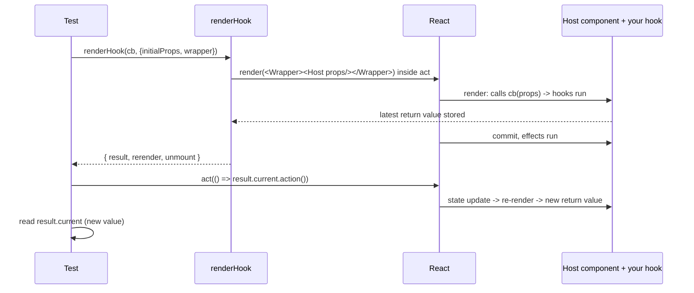
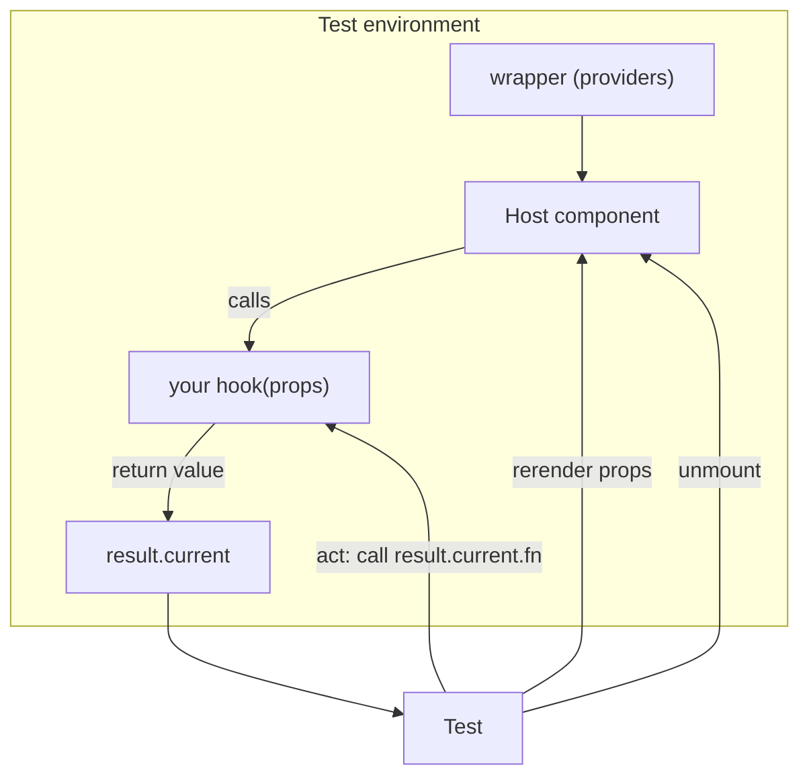
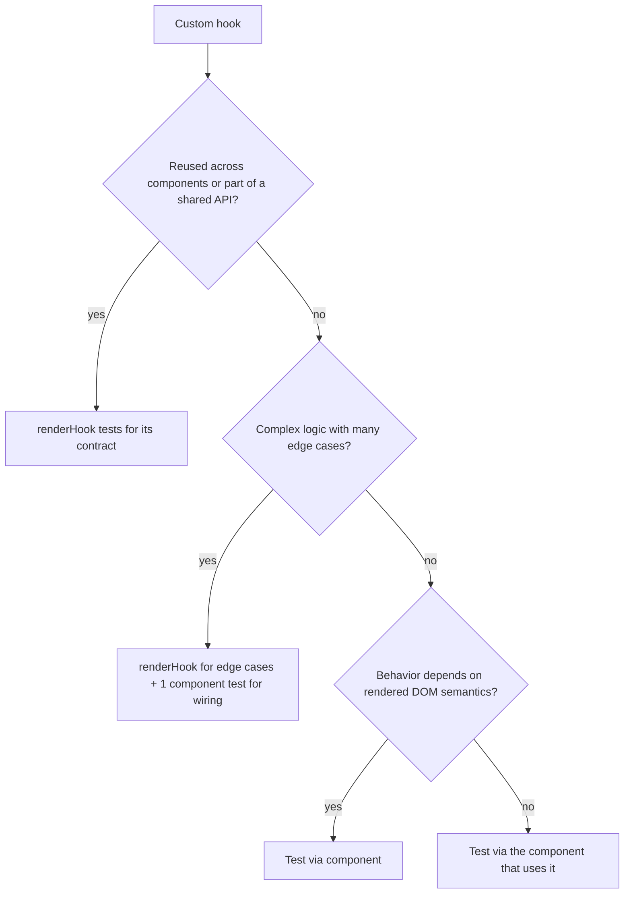

# 08 / 05 — Testing Custom Hooks: `renderHook`, Providers, Timers, and When Not to

## 1. Lesson metadata

| | |
|---|---|
| **Level** | Intermediate–Advanced |
| **Study time** | 4–5 hours (reading 1.5–2 h, hands-on 1.5 h, exercises 1–1.5 h) |
| **Prerequisites** | [08 / 03 — React Testing Library](./03-react-testing-library.md), [08 / 04 — Testing async updates](./04-testing-async-updates.md), [03 / 15 — Custom hooks](../03-react-state-and-hooks/15-custom-hooks.md), [03 / 16 — Rules of Hooks and composition](../03-react-state-and-hooks/16-rules-of-hooks-and-composition.md), [05 / 06 — Custom hook patterns](../05-design-patterns/06-custom-hook-patterns.md) |
| **Next** | [06 — Mocking strategies and MSW](./06-mocking-strategies-and-msw.md) |
| **Related later** | [07 — Testing API interactions](./07-testing-api-interactions.md), [08 — Integration testing](./08-integration-testing.md), [16 — Avoiding brittle tests](./16-avoiding-brittle-tests.md) |

**Version note.** Executed against `@testing-library/react` 16.3.3 (`renderHook` is part of RTL since v13.1; the separate `@testing-library/react-hooks` package is legacy and does not support React 18+/19), React 19.3.1 and Vitest 3.2.7 (Vitest 4/5 are released; nothing here depends on the differences). `renderHook` options `initialProps`, `wrapper` and `reactStrictMode` (as well as `configure({ reactStrictMode })`) exist in 16.3.3, verified by running.

**Learning objectives.** After this lesson you can:
1. Explain why hooks cannot be called outside a component and how `renderHook` provides a host component.
2. Test state-returning hooks with `renderHook`, `act`, `rerender`, and `unmount`, and avoid the stale-`result.current` mistake.
3. Provide context/providers to hooks via `wrapper`.
4. Test timer-based, subscription-based (`useSyncExternalStore`), storage-based, and async hooks deterministically.
5. Decide whether to test a hook directly or through a component that uses it, and apply the heuristic consistently.
6. Test hook contracts that matter (referential stability, cleanup, idempotence under Strict Mode) without over-testing internals.

**Concepts covered:** `renderHook`, `result.current`, `rerender` with `initialProps`, `unmount`, `wrapper`, `act` for hook-triggered updates, hook host component, referential stability as a contract, testing effects' cleanup, subscriptions, Strict Mode double effects, hook vs. component testing, testing hooks that wrap libraries (TanStack Query), error-throwing hooks.

---

## 2. Deep conceptual explanation

### 2.1 What problem is this lesson solving?

Custom hooks ([03 / 15](../03-react-state-and-hooks/15-custom-hooks.md)) are how React teams share *stateful logic*: `useDebouncedValue`, `useLocalStorage`, `usePagination`, `useOnlineStatus`. Logic like this often has many edge cases and is reused across features, so it deserves direct tests. But **hooks can only be called during the render of a component** (Rules of Hooks: [03 / 16](../03-react-state-and-hooks/16-rules-of-hooks-and-composition.md)). You can't just call `useCounter()` in a test: React will throw "Invalid hook call" because there is no component rendering, no fiber to attach state to.

Two historical workarounds:

1. Write a throwaway test component that calls the hook and renders its output (works, verbose, repeated everywhere).
2. Use a library that does (1) for you: `@testing-library/react-hooks` (legacy), and now **`renderHook`** built into `@testing-library/react`.

### 2.2 What `renderHook` actually does

```tsx
const { result, rerender, unmount } = renderHook(() => useCounter(5));
```

Conceptually, `renderHook` creates a tiny component:

```tsx
function TestComponent({ renderCallbackProps }) {
  const pendingResult = renderCallback(renderCallbackProps); // your hook call
  useEffect(() => { result.current = pendingResult; });      // conceptually: update after commit
  return null;
}
```

and renders it with RTL's `render` (so `act`, cleanup, `wrapper` all work). Then:

- `result.current` always holds the **latest value returned** by your callback (the value from the most recent render/commit).
- `rerender(newProps)` re-renders the host with new props (the callback receives them): this simulates the *parent* passing new arguments.
- `unmount()` unmounts the host, running effect cleanups.
- `wrapper` lets you provide context providers.
- `initialProps` sets the props for the first render.

*Implementation detail:* how `result.current` is updated internally (during render vs. in an effect) is not part of the public contract. Treat it as "the latest committed return value".

### 2.3 `result.current` is a moving reference

The value object returned by a hook changes across renders. A classic mistake:

```ts
const { result } = renderHook(() => useCounter());
const { count, increment } = result.current;   // ❌ snapshot of the first render

act(() => increment());
expect(count).toBe(1);                         // ❌ still 0: `count` is a stale local
```

`count` is a number captured at the first render; it will never update. You must read `result.current.count` **after** the act. The test equivalent of React's snapshot model ([01 / 14 — State as a snapshot](../01-react-fundamentals/14-state-as-a-snapshot.md)): each render has its own values; `result.current` points to the newest render's values.

Note that the *functions* captured from an earlier render may themselves be stale if the hook doesn't use functional updates or stable callbacks. Calling `increment` from the first render after state changed is a legitimate test of "does the callback depend on stale state?".

### 2.4 Hook tests vs. component tests: the decision

The decision rule used in this course:

| Situation | Test the hook directly (`renderHook`) | Test via a component |
|---|---|---|
| Hook encapsulates **complex logic with many edge cases** (debounce, pagination math, reducers, state machines) | ✔ | Add one integration test for wiring |
| Hook is **reusable** across features (design-system/shared hook) | ✔ (its API is the contract) | — |
| Hook is **used by exactly one component** and its API is an implementation detail | Prefer ✘ | ✔ Test the component's behavior; the hook is covered |
| Hook **renders no UI semantics** but touches browser APIs (storage, media query, online status) | ✔ (isolate the API mocking) | One component-level smoke |
| Hook is a **thin wrapper** over a library (`useQuery` + select) | ✘ (you'd test the library) | ✔ via component/MSW |
| Behavior depends on **what is rendered** (focus handling, ARIA wiring in a `useCombobox`) | ✘ alone | ✔ Component, because the DOM is the behavior |

Principle: *a hook's return value is an API only if consumers depend on it*. For single-use hooks, extracting them for tidiness doesn't create a public contract, so testing their return shape couples tests to your internal organization, the same implementation-detail trap as testing component state.

### 2.5 What is worth asserting about a hook

1. **Return values** across states (initial, after actions, after prop changes).
2. **Side effects at the boundary**: storage written, event listeners added/removed, timers cleared, subscriptions cancelled.
3. **Referential stability** *when it is part of the contract* (e.g., "`increment` is stable across renders" so that consumers can put it in dependency arrays or `memo` children). This is a documented, intentional API property for hooks designed as building blocks, otherwise skip.
4. **Behavior on prop (argument) change**: re-subscribes, resets, re-fetches.
5. **Cleanup on unmount** and **idempotence under Strict Mode** (effects mount → cleanup → mount must leave the system consistent).
6. **Error behavior**: throws a clear error if used outside its provider.

### 2.6 Common misconceptions

| Misconception | Reality |
|---|---|
| "I can call hooks in tests if I mock React." | Mocking React hooks (`vi.mock("react")`) tests your mock; use `renderHook`. |
| "`renderHook` works outside RTL." | It's an RTL export; it uses RTL's `render`, `act`, and cleanup. |
| "I should mock `useState` to assert state." | You never need to; assert returned values. |
| "Testing the hook's return shape is the same as testing behavior." | Only if the shape is a real public API. For private hooks, test through the component. |
| "`@testing-library/react-hooks` is the standard." | It's legacy and unmaintained for React 18+/19. Use `renderHook` from RTL. |
| "`rerender()` with the same args does nothing." | It re-renders (hook runs again). Memoized values should stay stable; effects with unchanged deps don't re-run. |

---

## 3. Internal mechanics

### 3.1 Host component and render lifecycle (teaching model)



*Public guarantee:* after `renderHook` and after `act` calls return, `result.current` reflects the latest committed render. *Implementation detail:* the internals of `result` assignment.

### 3.2 Why `act` is needed for hook-triggered updates

When your test calls `result.current.increment()` directly (not through a DOM event), the call isn't wrapped by `fireEvent`/`userEvent`'s wrappers. React would schedule the state update normally and might warn about missing `act`. You wrap such calls: `act(() => { result.current.increment(); })`. For async actions: `await act(async () => { await result.current.load(); })`.

Do not return values from the act callback unnecessarily: `act(() => result.current.increment())` returns whatever `increment` returns; if it returns a promise by accident, act becomes async-aware and warns. Prefer braces: `act(() => { ... })`.

### 3.3 `wrapper` and providers

`wrapper` is a component receiving `children`. It wraps the host so hooks relying on context get providers. Rules:

- The wrapper component must be **defined once** per test (module scope or inside the test but not re-created per render): a new component *type* each render would remount the tree and reset state. Defining it inline in the test body before calling `renderHook` is fine because it's created once.
- For per-test data, use a factory: `const wrapper = ({ children }: { children: ReactNode }) => <Provider value={x}>{children}</Provider>`.

### 3.4 Strict Mode and `renderHook`

In dev/Strict Mode, React runs effects mount → cleanup → mount, and renders components twice (`useMemo`/`useState` initializers and render bodies can run twice). RTL 16.3.3 supports enabling Strict Mode in tests: `renderHook(fn, { reactStrictMode: true })`, `configure({ reactStrictMode: true })`, or wrapping in `<StrictMode>`. *Verified by running:* a hook with an effect rendered 2 times, ran the effect 2 times and its cleanup 1 time on mount under Strict Mode. Running hook tests under Strict Mode is a **cheap way to find cleanup bugs and impure renders** (see [01 / 12 — Component purity](../01-react-fundamentals/12-component-purity.md)). A hook that works only when its effect runs once is buggy for React (and for future Offscreen/Activity reuse behaviors).

### 3.5 Testing subscription-based hooks

Hooks using `useSyncExternalStore` ([03 / 20](../03-react-state-and-hooks/20-usesyncexternalstore-and-external-stores.md)) call `subscribe(callback)` and `getSnapshot()`. Test by:

1. Controlling the external source (a fake store, `window` events, `navigator.onLine` stub).
2. Asserting the hook value changes after the source changes (inside `act` when you trigger the change yourself).
3. Asserting unsubscribe on unmount (remove listener count).
4. Asserting `getSnapshot` consistency (returns a cached/stable value when nothing changed: otherwise React warns "The result of getSnapshot should be cached" and may loop).

---

## 4. Step-by-step execution walkthrough: `renderHook` for a counter

```ts
// useCounter.ts
import { useCallback, useState } from "react";

export interface UseCounterOptions { min?: number; max?: number }

export function useCounter(initial = 0, { min = -Infinity, max = Infinity }: UseCounterOptions = {}) {
  const clamp = useCallback((n: number) => Math.min(max, Math.max(min, n)), [min, max]);
  const [count, setCount] = useState(() => clamp(initial));

  const increment = useCallback(() => setCount((c) => clamp(c + 1)), [clamp]);
  const decrement = useCallback(() => setCount((c) => clamp(c - 1)), [clamp]);
  const reset = useCallback(() => setCount(clamp(initial)), [clamp, initial]);

  return { count, increment, decrement, reset };
}
```

```ts
// useCounter.test.ts
import { act, renderHook } from "@testing-library/react";
import { expect, test } from "vitest";
import { useCounter } from "./useCounter";

test("increments with functional updates, even twice in one batch", () => {
  const { result } = renderHook(() => useCounter(5, { max: 7 }));
  expect(result.current.count).toBe(5);

  act(() => {
    result.current.increment();
    result.current.increment();
    result.current.increment();
  });

  expect(result.current.count).toBe(7); // 5 -> 6 -> 7 -> clamped at 7
});
```

**Chronology**

| # | Step | State |
|---|---|---|
| 1 | `renderHook` renders host in `act` | Render 1: `useState` initializer runs `clamp(5)` = 5; callbacks created (stable via `useCallback`); `result.current = { count: 5, ... }` |
| 2 | `act(() => { three increments })` | Three `setCount(updater)` calls enqueued on the same fiber; within `act` they are batched (single re-render later) |
| 3 | `act` exits → flush | React processes the update queue sequentially: `5 → clamp(6)=6 → clamp(7)=7 → clamp(8)=7`; one render with `count: 7` |
| 4 | `result.current` | Now `{ count: 7, ... }` (a *new object* from render 2) |
| 5 | Assertion | `7` |

**Predict:** if `increment` used `setCount(count + 1)` (non-functional) with the same test, what would the result be? **Result:** the three calls would read the same `count` (5) from the closure of render 1 → `setCount(6)` ×3 → final `6`, and the test would catch the bug. This is a precise instance of [03 / 02 — Functional state updates](../03-react-state-and-hooks/02-functional-state-updates.md) bugs being observable via hook tests.

**Stale callback hazard:** after the act above, `result.current.increment` is the callback from render 2. Since `clamp` is stable (deps `[min, max]` unchanged), the identity is stable: `expect(result.current.increment).toBe(firstIncrement)` holds. Whether to assert this depends on whether stability is documented API.

---

## 5. Code examples

### 5.1 Minimal example — return value and `rerender` with new props

```ts
// useFullName.ts
import { useMemo } from "react";
export function useFullName(first: string, last: string) {
  return useMemo(() => `${first.trim()} ${last.trim()}`.trim(), [first, last]);
}
```

```ts
test("recomputes when arguments change", () => {
  const { result, rerender } = renderHook(
    ({ first, last }) => useFullName(first, last),
    { initialProps: { first: "Ada", last: "Lovelace" } },
  );
  expect(result.current).toBe("Ada Lovelace");

  rerender({ first: "Grace", last: "Hopper" });
  expect(result.current).toBe("Grace Hopper");
});
```

`rerender` takes the new props object (type inferred from `initialProps`). If you call `rerender()` **without args, the hook is re-rendered with `undefined` props, not the previous ones** (verified on RTL 16.3.3: a hook that destructures `({ n })` threw "Cannot destructure property 'n' of 'undefined'"). Pass the props you want every time. Don't test that `useMemo` memoizes (implementation, and React may discard memoized values); test that results are correct.

### 5.2 Practical example — `useDebouncedValue` with fake timers

```ts
// useDebouncedValue.ts
import { useEffect, useState } from "react";

export function useDebouncedValue<T>(value: T, delayMs: number): T {
  const [debounced, setDebounced] = useState(value);
  useEffect(() => {
    const id = setTimeout(() => setDebounced(value), delayMs);
    return () => clearTimeout(id);
  }, [value, delayMs]);
  return debounced;
}
```

```ts
// useDebouncedValue.test.ts
import { act, renderHook } from "@testing-library/react";
import { afterEach, beforeEach, expect, test, vi } from "vitest";
import { useDebouncedValue } from "./useDebouncedValue";

beforeEach(() => { vi.useFakeTimers(); });
afterEach(() => { vi.useRealTimers(); });

test("emits the latest value only after the delay with no further changes", () => {
  const { result, rerender } = renderHook(
    ({ value }) => useDebouncedValue(value, 300),
    { initialProps: { value: "a" } },
  );
  expect(result.current).toBe("a");

  rerender({ value: "ab" });
  act(() => { vi.advanceTimersByTime(200); });
  rerender({ value: "abc" });                      // resets the timer
  act(() => { vi.advanceTimersByTime(299); });
  expect(result.current).toBe("a");                // still old

  act(() => { vi.advanceTimersByTime(1); });
  expect(result.current).toBe("abc");
});

test("clears the pending timer on unmount (no late update)", () => {
  const { rerender, unmount } = renderHook(({ v }) => useDebouncedValue(v, 300), { initialProps: { v: 1 } });
  rerender({ v: 2 });
  expect(vi.getTimerCount()).toBe(1);
  unmount();
  expect(vi.getTimerCount()).toBe(0);
});
```

Line notes:
- Advancing fake time that triggers React state updates **must be inside `act`** (`act(() => { vi.advanceTimersByTime(...) })`), because the timer callback calls `setDebounced` outside RTL's wrappers.
- `vi.getTimerCount()` returns the number of pending fake timers: a precise leak check, justified because "no timer left behind" *is* the behavior being protected (verified on Vitest 3.2.7: it returned 2 after two `setTimeout`s).
- With fake timers and `renderHook`, no `findBy`/`waitFor` is involved, so there is no auto-advance conflict.

**Predict:** at the first `expect(result.current).toBe("a")` after the second `rerender`, what is the total fake time since the last value change? **Result:** 299 ms since `"abc"` (timer reset by the change); the earlier 200 ms is irrelevant because the first timer was cleared when deps changed.

### 5.3 Practical example — `useLocalStorage` (browser API + sync across tabs)

```ts
// useLocalStorage.ts
import { useCallback, useEffect, useState } from "react";

export function useLocalStorage<T>(key: string, initial: T) {
  const read = useCallback((): T => {
    try {
      const raw = window.localStorage.getItem(key);
      return raw === null ? initial : (JSON.parse(raw) as T);
    } catch {
      return initial; // corrupted JSON or storage disabled
    }
  }, [key, initial]);

  const [value, setValue] = useState<T>(read);

  useEffect(() => { setValue(read()); }, [read]);

  useEffect(() => {
    const onStorage = (e: StorageEvent) => {
      if (e.storageArea === window.localStorage && e.key === key) setValue(read());
    };
    window.addEventListener("storage", onStorage);
    return () => window.removeEventListener("storage", onStorage);
  }, [key, read]);

  const set = useCallback((next: T | ((prev: T) => T)) => {
    setValue((prev) => {
      const resolved = typeof next === "function" ? (next as (p: T) => T)(prev) : next;
      try { window.localStorage.setItem(key, JSON.stringify(resolved)); } catch { /* quota/privacy mode */ }
      return resolved;
    });
  }, [key]);

  return [value, set] as const;
}
```

*(Review note: calling `setItem` inside a state updater function is a side effect in an updater, which React may invoke twice in Strict Mode; the write is idempotent here, but see [01 / 12 — Component purity](../01-react-fundamentals/12-component-purity.md) for the cleaner design that writes in an effect or event handler.)*

```ts
// useLocalStorage.test.ts
import { act, renderHook } from "@testing-library/react";
import { afterEach, beforeEach, describe, expect, test, vi } from "vitest";
import { useLocalStorage } from "./useLocalStorage";

describe("useLocalStorage", () => {
  beforeEach(() => window.localStorage.clear());
  afterEach(() => vi.restoreAllMocks());

  test("reads an existing value", () => {
    window.localStorage.setItem("theme", JSON.stringify("dark"));
    const { result } = renderHook(() => useLocalStorage("theme", "light"));
    expect(result.current[0]).toBe("dark");
  });

  test("falls back to the initial value for corrupted JSON", () => {
    window.localStorage.setItem("theme", "{not json");
    const { result } = renderHook(() => useLocalStorage("theme", "light"));
    expect(result.current[0]).toBe("light");
  });

  test("persists updates and supports updater functions", () => {
    const { result } = renderHook(() => useLocalStorage("count", 0));
    act(() => { result.current[1]((c) => c + 1); });
    act(() => { result.current[1]((c) => c + 1); });
    expect(result.current[0]).toBe(2);
    expect(window.localStorage.getItem("count")).toBe("2");
  });

  test("survives storage that throws (privacy mode)", () => {
    vi.spyOn(Storage.prototype, "setItem").mockImplementation(() => { throw new DOMException("QuotaExceededError"); });
    const { result } = renderHook(() => useLocalStorage("x", "a"));
    act(() => { result.current[1]("b"); });
    expect(result.current[0]).toBe("b");        // in-memory state still updates
  });

  test("syncs when another tab changes the key", () => {
    const { result } = renderHook(() => useLocalStorage("lang", "en"));
    act(() => {
      window.localStorage.setItem("lang", JSON.stringify("de"));
      window.dispatchEvent(new StorageEvent("storage", { key: "lang", storageArea: window.localStorage }));
    });
    expect(result.current[0]).toBe("de");
  });

  test("removes its listener on unmount", () => {
    const remove = vi.spyOn(window, "removeEventListener");
    const { unmount } = renderHook(() => useLocalStorage("k", 1));
    unmount();
    expect(remove).toHaveBeenCalledWith("storage", expect.any(Function));
  });
});
```

Line notes and traps:
- `initial` is in the dependency list of `read`; passing an **object literal** `{}` as `initial` creates a new identity each render, so `read` changes, the effect re-runs, and `setValue(read())` may produce an infinite loop (a new `{}` each time!). A test can reveal this: `renderHook(() => useLocalStorage("k", { a: 1 }))` would loop/warn. That is a *design defect* in this sample and a good test candidate: either document "initial must be stable", or store `initial` in a ref. (This kind of finding is why hooks should be tested directly *and* with realistic arguments.)
- Spying on `Storage.prototype.setItem` is the reliable way to intercept jsdom storage; spying on `window.localStorage.setItem` does not work in jsdom because `localStorage` is a special exotic object (verified on jsdom 30: the direct spy recorded 0 calls, the prototype spy recorded 1).
- The `StorageEvent` constructor accepts `storageArea` in jsdom (verified on jsdom 30); real browsers fire `storage` only in *other* tabs, not the originating tab, which this test simulates by dispatching manually.

### 5.4 Incorrect example — destructuring and ignoring `act`

```ts
test("❌ increments", () => {
  const { result } = renderHook(() => useCounter());
  const { count, increment } = result.current;
  increment();                         // not in act: warning, update not flushed
  expect(count).toBe(1);               // stale local
});
```

**Why wrong:** (1) `increment()` outside `act` → warning, DOM/hook not flushed. (2) `count` is a number captured before the update. The test fails with `expected 0 to be 1`, which people "fix" by replacing the assertion with `toBe(0)` or removing it: do not.

### 5.5 Corrected implementation

```ts
test("increments", () => {
  const { result } = renderHook(() => useCounter());
  act(() => { result.current.increment(); });
  expect(result.current.count).toBe(1);
});
```

### 5.6 Hook with a provider via `wrapper`

```tsx
// useAuth.tsx (excerpt)
const AuthContext = createContext<AuthValue | null>(null);
export function useAuth() {
  const ctx = useContext(AuthContext);
  if (!ctx) throw new Error("useAuth must be used within <AuthProvider>");
  return ctx;
}
```

```tsx
import { renderHook } from "@testing-library/react";
import type { ReactNode } from "react";

test("returns the current user from the provider", () => {
  const wrapper = ({ children }: { children: ReactNode }) => (
    <AuthContext.Provider value={{ user: { id: "u1", role: "admin" }, signOut: vi.fn() }}>
      {children}
    </AuthContext.Provider>
  );
  const { result } = renderHook(() => useAuth(), { wrapper });
  expect(result.current.user?.role).toBe("admin");
});

test("throws a helpful error outside the provider", () => {
  // React 19 rethrows render errors through act without logging them (verified: 0 console.error calls);
  // React 18 logged them. Keeping the spy is harmless and makes the test portable across versions.
  const spy = vi.spyOn(console, "error").mockImplementation(() => {});
  expect(() => renderHook(() => useAuth())).toThrow("useAuth must be used within <AuthProvider>");
  spy.mockRestore();
});
```
In React 19, errors thrown during render inside `act` are rethrown by `act`/`render`, so `expect(() => renderHook(...)).toThrow(...)` works (verified on React 19.3.1 + RTL 16.3.3). Outside `act`, React 19 reports uncaught render errors through `window.reportError` (RTL 16.2+ also exposes `onCaughtError`/`onUncaughtError`/`onRecoverableError` render options). If `toThrow` doesn't catch in your setup, render the hook under a small error boundary and assert on the captured error instead.

### 5.7 External-store hook: `useOnlineStatus`

```ts
// useOnlineStatus.ts
import { useSyncExternalStore } from "react";

function subscribe(cb: () => void) {
  window.addEventListener("online", cb);
  window.addEventListener("offline", cb);
  return () => {
    window.removeEventListener("online", cb);
    window.removeEventListener("offline", cb);
  };
}
const getSnapshot = () => navigator.onLine;
const getServerSnapshot = () => true;

export function useOnlineStatus() {
  return useSyncExternalStore(subscribe, getSnapshot, getServerSnapshot);
}
```

```ts
function setOnLine(value: boolean) {
  Object.defineProperty(window.navigator, "onLine", { configurable: true, value });
}

afterEach(() => setOnLine(true));

test("reflects online/offline events and unsubscribes on unmount", () => {
  setOnLine(true);
  const add = vi.spyOn(window, "addEventListener");
  const remove = vi.spyOn(window, "removeEventListener");

  const { result, unmount } = renderHook(() => useOnlineStatus());
  expect(result.current).toBe(true);

  act(() => { setOnLine(false); window.dispatchEvent(new Event("offline")); });
  expect(result.current).toBe(false);

  act(() => { setOnLine(true); window.dispatchEvent(new Event("online")); });
  expect(result.current).toBe(true);

  unmount();
  const added = add.mock.calls.filter(([type]) => type === "online" || type === "offline").length;
  const removed = remove.mock.calls.filter(([type]) => type === "online" || type === "offline").length;
  expect(removed).toBe(added);                       // every subscription was released
  vi.restoreAllMocks();
});
```
Why the count comparison: it's agnostic to Strict Mode double-subscription (2×2 added, 2×2 removed) while still detecting leaks. Defining `onLine` as an own property of the instance shadows the prototype getter; restoring `true` in `afterEach` avoids cross-test pollution (a stricter cleanup would `delete` the own property).

### 5.8 Async hook: `useAsync` with a deferred promise

```ts
// useAsync.ts
import { useCallback, useEffect, useRef, useState } from "react";

type AsyncState<T> =
  | { status: "idle" }
  | { status: "pending" }
  | { status: "success"; data: T }
  | { status: "error"; error: Error };

export function useAsync<T>(fn: (signal: AbortSignal) => Promise<T>, deps: readonly unknown[]) {
  const [state, setState] = useState<AsyncState<T>>({ status: "pending" });
  const latest = useRef(fn);
  latest.current = fn; // writing a ref during render: shown to illustrate a pattern you may meet; prefer an effect (React docs discourage writing refs in render)

  useEffect(() => {
    const controller = new AbortController();
    setState({ status: "pending" });
    latest.current(controller.signal).then(
      (data) => { if (!controller.signal.aborted) setState({ status: "success", data }); },
      (e: unknown) => { if (!controller.signal.aborted) setState({ status: "error", error: e instanceof Error ? e : new Error(String(e)) }); },
    );
    return () => controller.abort();
    // eslint-disable-next-line react-hooks/exhaustive-deps
  }, deps);

  return state;
}
```

```ts
test("pending → success", async () => {
  const d = deferred<string>();
  const { result } = renderHook(() => useAsync(() => d.promise, []));
  expect(result.current.status).toBe("pending");

  await act(async () => { d.resolve("ok"); });
  expect(result.current).toEqual({ status: "success", data: "ok" });
});

test("ignores the previous request after deps change", async () => {
  const first = deferred<string>();
  const second = deferred<string>();
  const { result, rerender } = renderHook(
    ({ id }) => useAsync(() => (id === 1 ? first.promise : second.promise), [id]),
    { initialProps: { id: 1 } },
  );

  rerender({ id: 2 });
  await act(async () => { second.resolve("two"); });
  await act(async () => { first.resolve("one"); });   // late, stale

  expect(result.current).toEqual({ status: "success", data: "two" });
});

test("error path", async () => {
  const d = deferred<string>();
  const { result } = renderHook(() => useAsync(() => d.promise, []));
  await act(async () => { d.reject(new Error("boom")); });
  expect(result.current).toMatchObject({ status: "error", error: { message: "boom" } });
});
```
This sample is intentionally imperfect (the `eslint-disable` and the ref write); the tests show how hook tests expose **the contract** (cancellation, stale response) while the implementation quality is a separate concern. In production code prefer TanStack Query or a vetted abstraction ([06 / 08](../06-data-fetching-and-state-ecosystems/08-tanstack-query.md)).

### 5.9 Advanced: hooks that wrap TanStack Query — test through the provider and the network

```tsx
function createWrapper() {
  const client = new QueryClient({ defaultOptions: { queries: { retry: false } } });
  return ({ children }: { children: ReactNode }) => (
    <QueryClientProvider client={client}>{children}</QueryClientProvider>
  );
}

test("useUser returns the user from the API", async () => {
  // the leading wildcard matches any origin: under jsdom a relative fetch resolves to http://localhost:3000 (verified)
  server.use(http.get("*/api/users/1", () => HttpResponse.json({ id: "1", name: "Ada" })));
  const { result } = renderHook(() => useUser("1"), { wrapper: createWrapper() });

  await waitFor(() => expect(result.current.isSuccess).toBe(true));
  expect(result.current.data).toEqual({ id: "1", name: "Ada" });
});
```
`waitFor` fits here because the hook has no DOM: you retry an assertion on `result.current`. Create one `QueryClient` per test (via `createWrapper()` inside each test) so caches don't leak. Details of MSW setup: [lesson 06](./06-mocking-strategies-and-msw.md); full patterns: [lesson 07](./07-testing-api-interactions.md). `isSuccess` and `data` are TanStack Query v5 fields (verified against @tanstack/react-query 5.104.5).

### 5.10 Strict Mode run of the same tests

```ts
// vitest setup (optional): run hook tests under Strict Mode to catch cleanup bugs
import { configure } from "@testing-library/react";
configure({ reactStrictMode: true });   // available in RTL 16.3.3 (verified)
```
Running your hook suite once with Strict Mode on is an inexpensive audit: any test that fails only under Strict Mode points at impure render logic or unpaired subscribe/unsubscribe.

---

## 6. Visual explanations

### 6.1 What `renderHook` builds



### 6.2 Stale values vs. `result.current`

```text
render #1: result.current = { count: 0, increment: f1 }     ← const { count } = result.current (captured 0)
act(increment)
render #2: result.current = { count: 1, increment: f2 }     ← result.current now points here
              ^ test must READ result.current AFTER act
```

### 6.3 Decision chart: hook test or component test?



---

## 7. Alternative approaches and trade-offs

### 7.1 Ways to test hook logic

| Approach | Pros | Cons | Use when |
|---|---|---|---|
| `renderHook` | Direct, little boilerplate, `rerender`/`wrapper` | Couples to hook API; no DOM | Reusable/complex hooks |
| Test component using the hook | Tests real contract with UI; refactor-friendly | Indirect; more setup to reach edge cases | Single-use hooks; DOM-dependent behavior |
| Extract pure logic into a function/reducer, unit-test it, thin hook | Fastest tests, trivially deterministic | Extra indirection; wiring still needs one test | Hooks with substantial computation (pagination math, reducers) |
| Mock React (`vi.mock("react")`) | None really | Tests the mock; breaks on React changes | Avoid |
| Storybook/interaction tests | Real browser | Slower; indirect | UI-bound hooks |

### 7.2 Where to place logic to make it testable

| Design | Test cost | Notes |
|---|---|---|
| Logic inline in component with effects | High (needs full render + async control) | Fine for tiny cases |
| Logic in a reducer + `useReducer` ([03 / 03](../03-react-state-and-hooks/03-usereducer-and-reducer-architecture.md)) | Very low for logic (pure unit tests) | Hook only wires; test with one `renderHook` |
| Logic in a class/service with subscribe API + `useSyncExternalStore` | Low (service tests without React) | Hook is thin; test subscription wiring once |
| Logic in a hook | Medium | OK when it genuinely depends on React lifecycle |

### 7.3 When the recommended approach (test reusable hooks directly) is NOT best

A hook such as `useCheckoutForm` is *only* used by `CheckoutPage`, and its return shape (`{ values, errors, onChange, onBlur, submit }`) changes every sprint. Direct hook tests would be rewritten with each refactor, while the user-visible behavior ("shows 'Card number invalid' after blur", "disables Pay while submitting") remains stable. Test through the page. Conversely, if `useCheckoutForm` becomes a shared package used by three teams, its return shape becomes a **public API** and direct tests become appropriate.

---

## 8. Best practices and anti-patterns

**Do**
- Read `result.current` after every `act`; never destructure early for later assertions.
- Wrap direct invocations of hook-returned functions in `act`; use braces to avoid accidentally returning values.
- Use `initialProps` + `rerender` to simulate argument changes.
- Create providers/clients/stores **fresh per test**.
- Check **cleanup** (listeners, timers, subscriptions) with counts that tolerate Strict Mode.
- Test realistic arguments (inline object literals, callbacks) to expose identity-related loops.
- Test error behavior (throws outside provider; handles storage failures).

**Beginner mistakes**
- Calling hooks directly in tests; mocking `react` hooks.
- Forgetting `act`; reading stale destructured values.
- Using the legacy `@testing-library/react-hooks`.
- Asserting `useState` was called.

**Experienced-developer mistakes**
- Over-testing referential stability of everything ("`result.current.x` is the same function") when it isn't API.
- Building giant `wrapper`s replicating the whole app providers.
- Testing hooks whose entire behavior is delegating to a library (re-testing TanStack Query).
- Mutating shared module state between tests (a singleton store) and relying on order.
- Using real timers with `waitFor` for debounce tests (slow, flaky).

**Smells:** a hook test file longer than the hook with many `rerender` permutations that mirror the implementation's branches; `as any` to reach internals; asserting call counts of internal callbacks; `act` warnings suppressed.

**Justified exceptions:** asserting referential stability when the hook's docs promise it (consumers will put the callback in `useEffect` deps); asserting `addEventListener`/`removeEventListener` pairing at subscription boundaries; testing a hook with a tiny test component when you need to verify DOM-coupled behavior (focus, refs).

---

## 9. Real-world application

**Design-system hooks (multi-team).** `useDisclosure`, `useControllableState`, `useId`-based helpers used by 30 components in a library. Their return API is a contract for downstream teams, so each has direct `renderHook` tests covering controlled/uncontrolled transitions (warning when switching modes), stable callbacks, and Strict Mode behavior. Changes are semver-significant; the tests are the spec.

**Forms and validation (finance onboarding).** A `useFieldValidation` hook runs async validators (IBAN check against an API) with debounce and cancellation. Tests: `renderHook` with fake timers for debounce; deferred promises to ensure out-of-order results don't flip the validity; unmount cancels the request. The page-level test then covers a11y wiring (error association) while hook tests cover timing.

**Realtime dashboards.** `usePriceFeed(symbol)` subscribes to a WebSocket manager. The manager (a plain class with `subscribe`) is unit tested without React; the hook wraps it with `useSyncExternalStore` and is tested with a fake manager: verify (1) snapshot stability when no tick arrived (avoiding render loops), (2) switching `symbol` unsubscribes the old topic and subscribes the new one, (3) unmount releases subscriptions, (4) under Strict Mode there is no duplicate topic subscription left active.

**Feature flags / permissions.** `useFeature("newCheckout")` reads from a context provider. Tests use `wrapper` with a fake flag provider, covering default-off behavior when the provider is missing, and *no flicker* when flags load (initial render returns the default, then updates).

**Accessibility behavior hooks.** `useRovingTabIndex`, `useFocusTrap` have DOM-coupled behavior; test via a small component (or the real component using them) with `userEvent`, not `renderHook`, since focus and keyboard are the behavior ([lesson 03](./03-react-testing-library.md) 5.6 & 5.8).

---

## 10. Debugging and troubleshooting

### 10.1 "Invalid hook call" in a test

1. Did you call the hook directly instead of through `renderHook`?
2. **Two copies of React**: a monorepo/linked package resolves a different `react` than `react-dom`/RTL. Check `npm ls react react-dom`, `resolve.dedupe: ["react", "react-dom"]` in Vite config, and peer dependency ranges.
3. A mocked `react` module (`vi.mock("react")`) replacing hooks.
4. Validate: `renderHook(() => useState(0))` as a smoke test.

### 10.2 `result.current` is `null`/stale

1. Reading before `renderHook` returns? (Not possible synchronously.) More likely, you destructured values early.
2. You updated state outside `act`, so the latest render hasn't flushed. Wrap in `act`.
3. The hook suspended (uses `use`/Suspense) → `result.current` isn't set until it resolves; wrap in `<Suspense>` via `wrapper` and `await waitFor(...)`.

### 10.3 Infinite re-render or "Maximum update depth exceeded"

1. A dependency changes each render (inline object/array/function arguments) and an effect sets state: e.g., `useLocalStorage("k", { a: 1 })` in 5.3.
2. In the test, pass the same inline literal you'd see in real usage (which creates a new object each render of the host). If it loops, you've reproduced a real bug.
3. Fix in the hook (stabilize via ref/`useMemo`, or don't depend on `initial`), or document the stable-argument requirement and enforce with lint/types. Validate by re-running the realistic-argument test.

### 10.4 "Not wrapped in act" in a hook test

The update came from a timer/promise/event you triggered outside RTL's wrappers: wrap in `act` or `await act(async …)`; for hooks reacting to async work, `await waitFor(() => expect(result.current…))`.

### 10.5 Strict-Mode-only failures

Symptom: passes normally, fails with `reactStrictMode`. Typical cause: effect without cleanup (listener added twice), non-idempotent initializer (side effect in `useState(() => ...)`), or reliance on "effect runs once". Fix the hook; don't disable Strict Mode in tests. See [03 / 06 — Effect cleanup](../03-react-state-and-hooks/06-effect-cleanup.md).

---

## 11. Exercises

### Level A — Knowledge
A1. Why can't you call a custom hook directly in a test, and what does `renderHook` provide?
A2. What is `result.current` and why is destructuring it early a bug in tests?
A3. When is `act` required around a hook test interaction, and when is it not?
A4. Name three situations in which testing through a component is preferable to `renderHook`.
A5. Why is `@testing-library/react-hooks` not recommended today?

### Level B — Code comprehension
B1. What does this test print/assert and why does it fail?
```ts
const { result } = renderHook(() => useCounter(0));
act(() => { result.current.increment(); });
const old = result.current;
act(() => { result.current.increment(); });
expect(old.count).toBe(2);
```
B2. In 5.2, change the hook to omit `clearTimeout` in the cleanup. Which test fails, and what is the observable bug in an app?
B3. In 5.7 why compare *counts* of add/remove calls rather than assert `toHaveBeenCalledTimes(2)`?

### Level C — Implementation
C1. Write `usePrevious<T>(value: T): T | undefined` and tests: initial `undefined`, previous after rerender, unchanged on same-value rerender (decide semantics: previous *render's* value vs previous *distinct* value; document).
C2. Write `useInterval(callback, delayMs | null)` (pausing when `null`) with tests for ticking, pausing, changing delay, latest-callback semantics (callback identity changes shouldn't reset the timer), and cleanup.
C3. Write a `useMediaQuery(query)` hook using `matchMedia` and `useSyncExternalStore`, and a test using a fake `matchMedia` that can emit `change`.

### Level D — Debugging
D1. `renderHook(() => useLocalStorage("k", []))` freezes the test runner. Diagnose and fix the hook (not the test).
D2. A hook test passes alone but fails after another test that used a wrapper with a shared `QueryClient` at module scope. Explain and fix.
D3. A hook returns `{ data, refetch }`; test calls `await act(async () => { await result.current.refetch(); })` and gets "Cannot read properties of undefined (reading 'refetch')". Diagnose likely causes.

### Level E — Architecture and engineering decisions
E1. Your team has 40 single-use hooks, each with direct tests, and every refactor breaks 10 tests. Propose a strategy for reducing churn while maintaining confidence.
E2. Decide: should shared hooks live in a package with their own test suite and Strict Mode matrix? Define what the contract is, what's tested, and how consumers are protected from breaking changes.

### Level F — Expert challenge
F1. Design a test plan for `useUndoableState<T>` (history stack with undo/redo, limit, batching of rapid changes, persistence) that includes property-based tests for invariants, Strict Mode, and a concurrent-rendering concern (transition-safe: no side effects in updaters).

---

## 12. Detailed answers and explanations

> Attempt the exercises first.

**A1.** Hooks need a fiber (a rendering component) to hold state and effects; calling them outside render throws "Invalid hook call". `renderHook` renders a tiny host component that calls your hook, exposes the latest return value (`result.current`), and gives `rerender`, `unmount`, `wrapper`, and `initialProps`.

**A2.** `result.current` points to the value returned by the most recent render. Destructuring copies that render's values; later renders produce new values that your local variables never see. Test must read `result.current.x` after each `act`.

**A3.** Required when *you* trigger something that updates state outside RTL's wrappers: calling a hook-returned function, advancing fake timers that fire state setters, emitting events from non-DOM sources, resolving promises you control (async act). Not required for `render`, `rerender`, `unmount`, `userEvent`, `fireEvent`, `waitFor`/`findBy` (already wrapped).

**A4.** (1) Single-use hooks whose API is an implementation detail; (2) DOM-dependent behavior (focus, ARIA); (3) thin wrappers over libraries where integration with the network/provider is the real risk; (4) behavior best specified by user-visible output.

**A5.** It was written for older React versions (peer deps up to 17, uses `react-test-renderer`), is unmaintained for 18+/19, and RTL's `renderHook` covers the same API. Using it with React 19 leads to peer-dependency conflicts and deprecated test-renderer.

**B1.** `old` is the snapshot object from render 2 (`count: 1`); `old.count` is `1` forever. The assertion `toBe(2)` fails. Fix: read `result.current.count`. The point: values returned by hooks are per-render snapshots.

**B2.** The "clears the pending timer on unmount" test fails (`vi.getTimerCount()` is 1 after unmount). In an app, a timer fires after the component unmounted and calls `setDebounced` on an unmounted component (no warning in React 18+, but wasted work, possible memory retention and, for callbacks with side effects, bugs); it also lets a stale timer fire after `value` changes: the *first* test would fail as well (because cleanup between value changes is what implements the "reset") — both tests catch it. Strong answers notice that the first test also fails.

**B3.** Under Strict Mode, effects mount → cleanup → mount; subscriptions are added twice and removed once at the intermediate cleanup and once on unmount: total adds 4 (2 events × 2 mounts), removes 4. A fixed `toHaveBeenCalledTimes(2)` couples to non-Strict mode. The equality of add and remove counts expresses the invariant "every subscription is released" independent of mode. (Also other code may add listeners to `window`, hence filtering on event type.)

**C1.**
```ts
import { useEffect, useRef } from "react";

// Semantics: value from the previous RENDER (not previous distinct value).
export function usePrevious<T>(value: T): T | undefined {
  const ref = useRef<T | undefined>(undefined);
  const previous = ref.current;
  useEffect(() => { ref.current = value; });
  return previous;
}
```
```ts
test("initially undefined, then previous render's value", () => {
  const { result, rerender } = renderHook(({ v }) => usePrevious(v), { initialProps: { v: 1 } });
  expect(result.current).toBeUndefined();
  rerender({ v: 2 });
  expect(result.current).toBe(1);
  rerender({ v: 2 });                  // same value again: previous RENDER's value is now 2
  expect(result.current).toBe(2);
});
```
Notes: reading `ref.current` during render is the commonly accepted `usePrevious` pattern, though React docs advise against reading/writing refs during render for correctness in concurrent features; the *write* here happens in an effect, the read in render. Alternative semantics ("previous distinct value") require tracking with state and are a design decision to document. Evaluation: the answer must state the semantics and test the equal-value rerender case that differentiates them.

**C2.**
```ts
import { useEffect, useRef } from "react";

export function useInterval(callback: () => void, delayMs: number | null) {
  const saved = useRef(callback);
  useEffect(() => { saved.current = callback; });
  useEffect(() => {
    if (delayMs === null) return;
    const id = setInterval(() => saved.current(), delayMs);
    return () => clearInterval(id);
  }, [delayMs]);
}
```
```ts
beforeEach(() => vi.useFakeTimers());
afterEach(() => vi.useRealTimers());

test("ticks, pauses with null, resumes", () => {
  const cb = vi.fn();
  const { rerender } = renderHook(({ d }) => useInterval(cb, d), { initialProps: { d: 1000 as number | null } });

  vi.advanceTimersByTime(3000);
  expect(cb).toHaveBeenCalledTimes(3);

  rerender({ d: null });
  vi.advanceTimersByTime(5000);
  expect(cb).toHaveBeenCalledTimes(3);

  rerender({ d: 500 });
  vi.advanceTimersByTime(1000);
  expect(cb).toHaveBeenCalledTimes(5);
});

test("a new callback identity does not reset the timer but is the one called", () => {
  const a = vi.fn();
  const b = vi.fn();
  const { rerender } = renderHook(({ cb }) => useInterval(cb, 1000), { initialProps: { cb: a } });

  vi.advanceTimersByTime(600);
  rerender({ cb: b });                // identity change mid-interval
  vi.advanceTimersByTime(400);        // total 1000ms since start: first tick
  expect(a).not.toHaveBeenCalled();
  expect(b).toHaveBeenCalledTimes(1);
});

test("clears the interval on unmount", () => {
  const { unmount } = renderHook(() => useInterval(() => {}, 1000));
  expect(vi.getTimerCount()).toBe(1);
  unmount();
  expect(vi.getTimerCount()).toBe(0);
});
```
`advanceTimersByTime` here doesn't trigger React state, so no `act` is needed (callbacks are plain mocks); if the callback set state you'd wrap in `act`. This is the "latest ref" pattern that avoids resetting timers when callbacks change (a `useEffectEvent`-like need; `useEffectEvent` is stable since React 19.2 per the react.dev 19.2 blog and is exported by react 19.3.1, but it can only be called from the component/hook that owns the Effect and must not be listed in dependency arrays; use `eslint-plugin-react-hooks` v6+ so the linter knows that).

**C3.**
```ts
import { useSyncExternalStore } from "react";

export function useMediaQuery(query: string): boolean {
  return useSyncExternalStore(
    (cb) => {
      const mql = window.matchMedia(query);
      mql.addEventListener("change", cb);
      return () => mql.removeEventListener("change", cb);
    },
    () => window.matchMedia(query).matches,
    () => false,
  );
}
```
```ts
function installMatchMedia(initial: boolean) {
  let matches = initial;
  const listeners = new Set<() => void>();
  vi.stubGlobal("matchMedia", (query: string) => ({
    get matches() { return matches; },
    media: query,
    addEventListener: (_: string, l: () => void) => listeners.add(l),
    removeEventListener: (_: string, l: () => void) => listeners.delete(l),
  }));
  return {
    set(next: boolean) { matches = next; listeners.forEach((l) => l()); },
    listenerCount: () => listeners.size,
  };
}
afterEach(() => vi.unstubAllGlobals());

test("tracks changes and unsubscribes", () => {
  const mm = installMatchMedia(false);
  const { result, unmount } = renderHook(() => useMediaQuery("(min-width: 600px)"));
  expect(result.current).toBe(false);

  act(() => mm.set(true));
  expect(result.current).toBe(true);

  unmount();
  expect(mm.listenerCount()).toBe(0);
});
```
Caveats: `window.matchMedia` is missing in jsdom (hence the stub). `getSnapshot` returns a boolean primitive, which is inherently stable; returning an object each call would cause React warnings/loops.

**D1.** Inline `[]` creates a new array identity every render; `read` depends on `initial`, so `read` changes each render, the effect `setValue(read())` runs each time and sets a *new* `[]` (when no stored value exists) → state changes → re-render → new `initial` → loop. Fix the hook: don't derive effects from `initial`; capture it once (`useRef(initial)` or lazy `useState`), and read storage only when `key` changes:
```ts
const initialRef = useRef(initial);
const read = useCallback(() => { /* uses initialRef.current */ }, [key]);
```
Validate with the realistic-argument test. Also consider `useSyncExternalStore` over localStorage with a cached snapshot, which avoids the effect entirely.

**D2.** A module-scope `QueryClient` retains cached query data (and retries/timers) across tests; the first test's data is returned by the second without a request, or an earlier test's in-flight query resolves during the later one. Fix: create the client inside a `createWrapper()` called per test; call `client.clear()` in `afterEach` if you must share; set `retry: false` and `gcTime: Infinity` (v5) for determinism.

**D3.** The error means `result.current` is `undefined`, so `result.current.refetch` cannot be read. Likely causes: (1) `renderHook`'s return value was not destructured (`const result = renderHook(...)` makes `result.current` undefined because the object has `result`, not `current`); (2) the hook suspended or threw during its first render, so the host never committed (add a `<Suspense>` wrapper or inspect the render error); (3) the `wrapper` does not render `children`; (4) the hook returns `undefined` on some path (a typo or missing return). Investigation: `console.log(result.current)` before the `act`, then check the destructuring and wrapper first.

**E1.** Strategy: classify hooks by public vs. private. For private single-use hooks, delete direct tests and cover via component-level tests that already exercise the behavior (verify coverage of branches via diff coverage rather than file coverage); keep direct tests only for hooks with complex pure logic, and move that logic into pure functions/reducers with their own unit tests (stable API: input → output). For shared hooks, keep contract tests. Process: for each hook, write down "who consumes the return value other than its component?"; if nobody, remove direct tests *after* adding or confirming the component test covers the behavior; measure churn (tests changed per refactor PR) before/after. Evaluation: reasoning about confidence preserved, not just deleting tests.

**E2.** Contract: documented argument types, returned shape, stability guarantees (callback identity), SSR snapshot behavior, Strict Mode/Offscreen safety, cleanup guarantees. Tests: `renderHook` contract suite including `reactStrictMode`, SSR render (`renderToString` smoke to ensure `getServerSnapshot`/`useId` use doesn't crash), type tests (`expectTypeOf` on the signature), and "no warnings" checks (fail on `console.error`). Consumer protection: semver with an API-extractor/`api-report` diff in CI, deprecation cycle, codemods, changelog; consumer smoke tests in two representative apps before publish. Strong answers tie each guarantee to a test and distinguish public contract from internals.

**F1.** Contract: `{ value, set, undo, redo, canUndo, canRedo, clear }`, `limit`, `batchMs`. Tests: (1) example-based: set/undo/redo sequences; limit eviction; redo cleared after new set. (2) Property-based (fast-check): random sequences of operations vs. a simple reference model (arrays) — invariants: `undo∘set` returns previous value; history length ≤ limit; `canUndo` iff past non-empty; redo stack empty after set. Run the model in a plain reducer/unit test, since the hook should delegate to a pure reducer (design for testability). (3) Batching: fake timers; multiple `set` within `batchMs` form one history entry. (4) Persistence: storage failures, corrupted data. (5) Strict Mode: run all hook tests with `reactStrictMode`; ensure updater functions are pure (no storage writes/side effects inside `setState` updaters; persist in an effect) because React may call updaters twice and, in concurrent rendering, may render and discard. (6) Transition safety: wrap `set` in `startTransition` in a test component and verify final state equals the model; ensure no history entries are lost or duplicated if an update is interrupted (use a test that triggers a higher-priority update during a transition if feasible; otherwise reason from purity). Evaluation: separation of pure logic, model-based testing, and purity under concurrency.

---

## 13. Senior engineer interview questions

**Q1. "How do you test a custom hook?"**
*Strong answer:* `renderHook` from RTL, reading `result.current` after `act`; `initialProps` and `rerender` for argument changes; `wrapper` for providers; fake timers/deferred promises for time and async; assertions about cleanup. But first I decide whether the hook is a public contract (direct tests) or an implementation detail of one component (test via the component). Complex logic is extracted into pure functions/reducers and unit-tested there.

**Q2. "Why not mock `useState` to test a hook?"**
*Strong answer:* Mocking React primitives tests your mock and the implementation structure; breaks on refactors and doesn't validate React semantics (batching, functional updates, Strict Mode). `renderHook` runs the real React.

**Q3. "What bugs do hook tests catch that component tests might not?"**
*Strong answer:* Edge cases in argument transitions (rerender with new props), cleanup leaks (timers, listeners) measured directly, stale closure bugs through calling previous callbacks, identity instability that causes loops, Strict Mode idempotence. For component-bound UX, component tests catch more.

**Q4. "A hook works in the app but test shows an infinite loop. Who's wrong?"**
*Strong answer:* Possibly neither: the app might pass a stable argument while the test passes an inline literal, but both are legitimate usage; a hook that loops on unstable arguments has a fragile API. I'd decide whether to fix the hook (stabilize with refs), document/enforce stable inputs with types or lint, and keep a regression test with the realistic argument.

**Q5. "How would you verify a `useSyncExternalStore`-based hook?"**
*Strong answer:* Control the external source with a fake store; assert initial snapshot, updates after changes (in `act`), snapshot stability when nothing changed (to avoid loops), unsubscribe on unmount, and server snapshot behavior via an SSR smoke test.

---

## 14. Further learning resources

| Resource | URL | Covers / why | Level | Study |
|---|---|---|---|---|
| Testing Library — `renderHook` (RTL API) | <https://testing-library.com/docs/react-testing-library/api#renderhook> | `renderHook` options and return values | Intermediate | Section on `renderHook` |
| React — Reusing Logic with Custom Hooks | <https://react.dev/learn/reusing-logic-with-custom-hooks> | What hooks are for, rules, design | Beginner | Whole page |
| React — `useSyncExternalStore` | <https://react.dev/reference/react/useSyncExternalStore> | Subscription, snapshot caching rules | Intermediate | Caveats |
| React — `act` | <https://react.dev/reference/react/act> | When and why | Intermediate | Whole page |
| React — `StrictMode` | <https://react.dev/reference/react/StrictMode> | Double render/effect behavior | Intermediate | Fixing bugs found by double rendering |
| fast-check | <https://fast-check.dev/> | Model-based/property tests for reducers/hooks | Advanced | Model-based testing guide *(verify page name)* |
| TanStack Query — Testing | <https://tanstack.com/query/latest/docs/framework/react/guides/testing> | Per-test `QueryClient`, `retry: false` | Intermediate | Whole page |
| Vitest — `vi` timers | <https://vitest.dev/api/vi.html> | `getTimerCount`, fake timers | Intermediate | Timers section |

Links not individually fetched should be treated as *(unverified)* deep links; use site search on the page title if they have moved.

---

## 15. Knowledge checkpoint

**You should now understand**
- Why hooks need a host component and how `renderHook` provides one.
- That `result.current` is a moving reference to the latest committed return value.
- When direct hook tests express a contract and when component tests are the better specification.
- How to test timers, storage, external stores, async work, providers, and cleanup deterministically.

**You should be able to explain without notes**
- Why destructuring `result.current` early yields stale assertions.
- Why Strict Mode is a useful *test* configuration for hooks.
- How inline-argument identity can cause render loops, and how a test finds it.

**You should be able to implement**
- `renderHook` tests with `initialProps`, `rerender`, `act`, `wrapper`, fake timers, deferred promises, and cleanup assertions; fake `matchMedia`/`onLine` stubs.

**You should be able to debug**
- Invalid hook call (duplicate React), infinite loops from unstable dependencies, stale `result.current`, Strict-Mode-only failures, shared-client test pollution.

**Before moving on:** read [06 — Mocking strategies and MSW](./06-mocking-strategies-and-msw.md) to learn how to fake the network boundary realistically, which hook and component tests will depend on.
