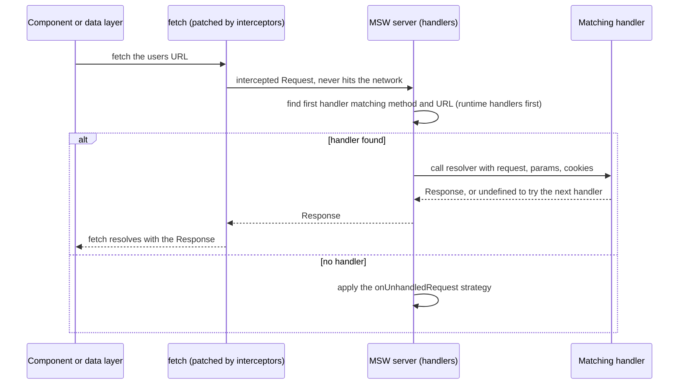
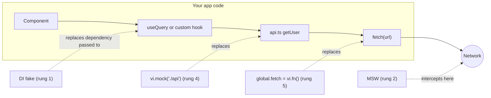
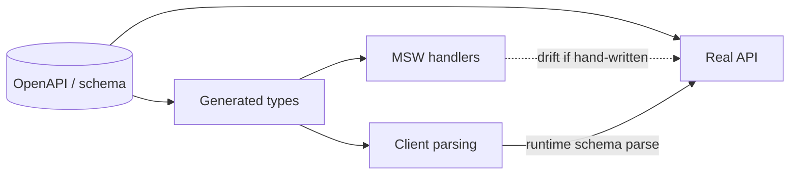

# 08 / 06 — Mocking Strategies and MSW: Faking the Boundary, Not the Application

## 1. Lesson metadata

| | |
|---|---|
| **Level** | Intermediate–Advanced |
| **Study time** | 5 hours (reading 2 h, hands-on 1.5 h, exercises 1.5 h) |
| **Prerequisites** | [08 / 01 — Test strategy and the pyramid](./01-test-strategy-and-pyramid.md), [08 / 02 — Unit testing with Vitest](./02-unit-testing-with-vitest.md), [08 / 04 — Testing async updates](./04-testing-async-updates.md), [00 / 14 — Web APIs and network requests](../00-web-and-javascript-foundations/14-web-apis-and-network-requests.md), [05 / 16 — Dependency injection](../05-design-patterns/16-dependency-injection.md), [04 / 14 — API boundaries and data access](../04-react-architecture/14-api-boundaries-and-data-access.md) |
| **Next** | [07 — Testing API interactions](./07-testing-api-interactions.md) |
| **Related later** | [08 — Integration testing](./08-integration-testing.md), [09 — E2E with Playwright](./09-e2e-with-playwright.md), [11 — Component contract testing](./11-component-contract-testing.md) |

**Version note.** This lesson targets **MSW 2.x** (executed on 2.15.0: `http`, `HttpResponse`, `graphql`, `ws`, `sse`, `delay`, `passthrough`, `bypass`, `HttpHandler` are all exported from `msw`; Node integration `msw/node`; browser integration `msw/browser`; engines `node >= 18`). MSW **1.x** used `rest.get(url, (req, res, ctx) => res(ctx.json(...)))`; that API is gone in 2.x. Vitest 3.2.7, jsdom environment.

> **MSW 3 is released (3.0.0, 2026-09-28).** It is ESM-only, needs Node >= 22 and TypeScript >= 5.9, and has breaking changes relevant here (from the 3.0.0 release notes): `onUnhandledRequest` is renamed **`onUnhandledFrame`**; `graphql` is imported from **`msw/graphql`** (with `graphql` as an optional peer dependency); individual utilities such as `delay`/`passthrough` can be imported from `msw/utils`; the WebSocket `connection` event is renamed `websocket:connection`; the library **no longer patches `setTimeout`**, so delayed mocked responses need fake timers advanced normally; cookies are no longer managed in Node and `request.headers.get('cookie')` returns `null` (use the `cookies` resolver argument); `msw/native` was removed in favour of `@msw/react-native`; `worker.stop()` returns a Promise. The examples below are MSW 2.x code; everything about handler design, `server.use`/`resetHandlers`, and asserting on UI outcomes carries over. Check the migration guide at <https://mswjs.io/docs/> before upgrading.

**Learning objectives.** After this lesson you can:
1. Choose the right mocking *layer* (argument, spy, module, network, real service) for a dependency and justify it with risk and coupling criteria.
2. Explain how MSW intercepts requests in Node and in the browser, and why that makes it a *boundary* fake rather than an implementation mock.
3. Write MSW 2.x handlers for REST and GraphQL with typed params and bodies, error responses, network errors, delays, and conditional behavior.
4. Configure MSW for Vitest (lifecycle, `onUnhandledRequest`, per-test overrides) and reuse the same handlers in Storybook/dev.
5. Model a stateful fake backend and keep it from leaking between tests.
6. Prevent mock drift between handlers and the real API using shared schemas, generated types, and contract checks.
7. Diagnose common MSW problems (unhandled requests, relative URLs, `AbortSignal`/fetch polyfill mismatches, handler ordering, leaks).

**Concepts covered:** test double taxonomy applied to network code, mocking layers, MSW architecture (interceptors, Service Worker), request handlers and resolvers, `HttpResponse`, handler precedence and `server.use`, `resetHandlers`, `onUnhandledRequest`, `passthrough`/`bypass`, typed handlers, stateful fakes, GraphQL/WebSocket handlers, mock drift, test-data builders, stubbing browser APIs absent from jsdom.

---

## 2. Deep conceptual explanation

### 2.1 What problem is this lesson solving?

Almost every real component talks to something it does not own: a REST API, a payment SDK, the clock, `localStorage`, `IntersectionObserver`. In tests you must replace *some* of those. The failure modes of replacing the wrong things are severe in both directions:

- **Mock too much (or at the wrong layer):** the test verifies your mocks. A mocked `useUser()` hook returns `{ name: "Ada" }`, the UI shows "Ada", the test passes while the real fetch URL is wrong, the JSON field was renamed, and the error state was never rendered.
- **Mock too little:** the test calls a real server, becomes slow, flaky, order-dependent, and may modify real data.

The craft is to **fake at a boundary where the real code still runs on both sides**: your code runs unmodified up to the edge of the process, and the "outside world" answers with controlled, realistic behavior. For HTTP that boundary is the *network*. MSW (Mock Service Worker) is a tool designed for exactly that.

### 2.2 The mocking ladder

From least to most coupled to implementation:

| Rung | Technique | You fake | Your code under test still runs | Coupling to implementation |
|---|---|---|---|---|
| 0 | **No double**: use the real thing | nothing | everything | none |
| 1 | **Dependency injection** (pass a fake as prop/argument/context) | a function or object you pass | everything but the dependency | low: the *interface* |
| 2 | **Network-level fake (MSW)** | the server | UI, state, data layer, `fetch` call, serialization | low: the *HTTP contract* |
| 3 | **Spy on an existing method** (`vi.spyOn`) | one method | all else | medium |
| 4 | **Module mock** (`vi.mock("./api")`) | an entire module | the importer | high: module paths and export shape |
| 5 | **Global monkey-patch** (`global.fetch = vi.fn()`) | the platform function | callers | high: *how* the code calls fetch (URL string, options shape) |
| 6 | **Mock React or the framework** (`vi.mock("react")`) | the runtime | nothing meaningful | very high: **avoid** |

Guidance: prefer rungs 0–2; use 3–4 for non-network boundaries (clock, analytics, native SDKs, framework hooks like `useRouter`); use 5 only for trivial one-off cases; never do 6.

### 2.3 What MSW is (and is not)

**MSW** intercepts outgoing requests at the *network layer* and lets you answer them with handler functions that look like server routes:

```ts
http.get("https://api.example.test/users/:id", ({ params }) => HttpResponse.json({ id: params.id, name: "Ada" }));
```

- In the **browser**, MSW registers a **Service Worker** (`mockServiceWorker.js`) that intercepts `fetch`/XHR from the page and forwards them to handlers running on the page's main thread; handlers return a standard `Response`.
- In **Node** (tests, SSR), MSW uses interceptors (the `@mswjs/interceptors` library) that patch the HTTP clients (`fetch`, `http`/`https`, `XMLHttpRequest` as available) so requests never leave the process. *No Service Worker is involved.* (Implementation detail; verified here for `fetch`. See the MSW docs for the other supported clients.)
- Handlers are written against **web-standard `Request`/`Response`** (hence MSW 2.x's `HttpResponse extends Response`), so the same handler works in Node and the browser.

What MSW is **not**: it is not a contract guarantee (your handlers can lie), not a replacement for a staging environment, and not a general-purpose stubbing tool for non-network things.

### 2.4 Why a network-level fake is better than mocking `fetch` or your API module

| Property | `vi.mock("./api")` | `global.fetch = vi.fn()` | **MSW** |
|---|---|---|---|
| Wrong URL/method is caught | No | Only if you assert on call args | **Yes** (unhandled request fails the test) |
| Request body/headers are validated | Only if you assert | Only if you assert | **Yes** (handler reads the real `Request`) |
| Response parsing code runs | Partially | Yes | **Yes** (real `Response` objects) |
| Error-status handling runs | Often skipped | Must build `Response` manually | **Yes** (`HttpResponse` with status) |
| Works if you swap `fetch` for axios/`ky`/TanStack Query | No (module path changes) | No | **Yes** (HTTP contract unchanged) |
| Reusable in dev/Storybook/E2E | No | No | **Yes** |
| Cost | Low | Low | Medium (setup, handler maintenance) |

The central argument: tests should keep passing when you refactor **how** you call the network, and fail when you break **what** the server contract requires.

### 2.5 Handler anatomy (MSW 2.x)

```ts
import { http, HttpResponse, delay } from "msw";

http.post("https://api.example.test/cart/promo", async ({ request, params, cookies }) => {
  const body = (await request.json()) as { code: string };
  await delay(150);                                   // optional latency
  if (body.code !== "SAVE20") {
    return HttpResponse.json({ message: "Invalid code" }, { status: 422 });
  }
  return HttpResponse.json({ totalCents: 8000, discountCents: 2000 });
});
```

| Piece | Meaning |
|---|---|
| `http.get/post/put/patch/delete/all/head/options` | Match on method and URL (string with `:params` and wildcards, `RegExp`, or a path relative to `location` in the browser) |
| Resolver argument | An object `{ request, params, cookies, requestId }` (type-checked against msw 2.15.0; GraphQL resolvers also get `query`, `variables`, `operationName`) |
| `request` | Standard `Request`; read with `await request.json()`, `.text()`, `.formData()`; clone with `request.clone()` if you must read twice |
| Return value | A `Response` (typically `HttpResponse.json/text/xml/formData/arrayBuffer`, or `new HttpResponse(null, { status: 204 })`), `HttpResponse.error()` for a network error, or `undefined`/nothing to **fall through** to the next matching handler |
| Options | `{ once: true }` as a third argument: handler is used once, then removed |

**Precedence:** handlers are matched in order; the **first** that returns a response wins. `server.use(...runtimeHandlers)` **prepends** runtime handlers so a per-test override beats the defaults; `server.resetHandlers()` removes runtime handlers, restoring the initial set.

### 2.6 Strategy for a robust handler set

1. **Default handlers = the happy path** that works for most tests (so component tests don't need to configure every call).
2. **Per-test overrides** for error, empty, slow, malformed cases via `server.use(...)`.
3. **Fail loudly on anything unexpected**: `onUnhandledRequest: "error"`.
4. **Keep handlers realistic**: validate required headers/body like the real server would (auth header required, 400 on bad payload). A handler that accepts anything hides client bugs.
5. **Single source of truth for shapes**: share TypeScript types or runtime schemas (Zod/Valibot) between the client's response parsing and the handlers; consider generating from an OpenAPI schema (tooling such as `openapi-typescript` for the types, plus an OpenAPI-aware handler helper such as `openapi-msw`; check each project's README for current options).
6. **Don't over-engineer**: a fake backend implementing business rules is a second implementation to maintain; implement only the behavior tests require.

### 2.7 Test data: builders over fixtures

Hand-written JSON fixtures (`user1.json`) rot and obscure what matters. Prefer small **builder functions** with defaults and overrides:

```ts
export const makeUser = (over: Partial<User> = {}): User => ({
  id: "u_1", name: "Ada Lovelace", email: "ada@example.com", role: "member", ...over,
});
```
Tests then read `makeUser({ role: "admin" })`: the only fields that matter appear in the test. Libraries (`@faker-js/faker`, `fishery`, `@mswjs/data`) help with randomness and relations; random data must be **seeded** (faker's `faker.seed(n)`) to remain deterministic. Check each library's docs for its current API.

### 2.8 Mock drift

Drift is when handlers say one thing and the real API says another. The consequences are the classic "all green, broken in production". Prevention options, from cheap to strong:

| Technique | Detects drift when | Cost |
|---|---|---|
| Runtime response parsing with a schema at the data layer (Zod, etc.) | Real responses change (fails loudly in prod/staging/E2E) and handler data violates the schema (fails in tests) | Low |
| Types generated from OpenAPI/GraphQL schema used in handlers | Handler shape differs from the spec at compile time | Medium |
| Consumer-driven contract tests (e.g., Pact) | Provider changes break consumer expectations (CI on provider) | High |
| Smoke E2E against staging | Anything integrated | Medium–High |
| Provider-verified OpenAPI mock server | Handlers *are* the spec | Medium |

### 2.9 Common misconceptions

| Misconception | Reality |
|---|---|
| "MSW is just for the browser." | It's used most in Node tests; no Service Worker needed there. |
| "MSW makes tests slow." | Request interception is in-process; typical overhead is small. Slowness comes from `delay()` or real timers. |
| "If tests use MSW, I don't need E2E." | MSW proves *client behavior given a contract*; E2E proves the *deployed system*. |
| "Mocking at the network means no module mocks." | You will still mock the clock, analytics, native modules, router hooks of frameworks. |
| "Handlers should return the same big JSON for everything." | Return the minimum realistic payload per scenario; make differences visible in the test. |
| "`onUnhandledRequest: 'warn'` is fine." | Warnings scroll by; tests then pass while hitting the real network or ignoring a call. Use `error` in CI. |
| "MSW 1.x snippets still work." | `rest`, `res(ctx.json())` were replaced by `http`, `HttpResponse`. Search results often show v1; check the version. |

---

## 3. Internal mechanics

### 3.1 Request lifecycle in Node tests (teaching model)



*Public guarantee:* requests matched by a handler get that handler's response; with `onUnhandledRequest: "error"`, an unmatched request raises an error (and prints guidance), causing the request promise to reject and typically the test to fail.
*Implementation detail:* the exact interception mechanism and the patched clients.

### 3.2 Lifecycle hooks and why each exists

```ts
beforeAll(() => server.listen({ onUnhandledRequest: "error" })); // start intercepting once per file
afterEach(() => server.resetHandlers());                          // drop per-test overrides
afterAll(() => server.close());                                   // restore patched globals
```

- `listen()` patches the HTTP clients in this worker/process; do it **once per test file** (Vitest isolates files by default; in shared-worker configurations, verify that the patches don't collide).
- `resetHandlers()` returns to the *initial* handlers. If you forget it, an override from test A (e.g., "return 500") leaks into test B.
- `close()` restores originals so other code in the same worker (e.g., other test files if isolation is off) isn't affected.

Put these in `src/test/setup.ts` (listed under `setupFiles`) so every test file gets them automatically, or in a helper imported only by tests that need the network.

### 3.3 Matching URLs

- Absolute URLs (`https://api.example.test/users/:id`) match exactly (protocol/host/port/path).
- **Relative paths** (`/api/users/:id`) are resolved against `location.href` **when a `location` exists** (browser, or jsdom). *Verified on MSW 2.15.0 + Vitest 3.2.7 + jsdom 30 + Node 24:* with `environment: "jsdom"` and the server listening, `fetch("/api/rel")` is intercepted and matched by `http.get("/api/rel", …)` (it resolves against `http://localhost:3000/`); an unmatched relative request is reported by `onUnhandledRequest: "error"`. Without MSW, or in `environment: "node"` (no `location`), `fetch("/api/1")` throws `TypeError: Failed to parse URL from /api/1`, because Node's `fetch` needs an absolute URL. So relative URLs work in jsdom component tests only while MSW is active; for portability (node-environment tests, SSR, unit tests of the API client) use an absolute API base URL read from `import.meta.env.VITE_API_URL` (set in `.env.test` or `vitest.config.ts` `test.env`), and build handlers from the same constant.
- Path params: `:id`; wildcards: `*`. Query strings are **ignored when matching**; read them from `new URL(request.url).searchParams`.
- Hash fragments are not sent over HTTP.

### 3.4 Request/response bodies are single-read streams

`request.json()` consumes the body. If you need to read it twice (once in a handler, once for logging), use `request.clone()`. Likewise, `HttpResponse.json(obj)` constructs a new `Response` each call; don't reuse one `Response` object across invocations (its body can only be read once). Handlers are functions precisely so each call builds a fresh response.

### 3.5 Delays, errors, and abort

- `await delay(ms)` (also `delay()` for a realistic random latency, `delay("infinite")` to never respond) simulates latency. In tests prefer **no delay** by default and use `delay("infinite")` or a promise **gate** to hold a request open deterministically.
- `HttpResponse.error()` simulates a network failure (`fetch` rejects with `TypeError`). `new HttpResponse(null, { status: 500 })` simulates a server error. Your client code must treat these differently: `fetch` doesn't reject on HTTP 500.
- If the client aborts via `AbortController`, `fetch` rejects with `AbortError`; the handler may still run (the response is discarded). *Verified in `environment: "node"` on MSW 2.15.0:* `fetch` rejected with `AbortError: This operation was aborted` and the handler still ran to completion (`completed === true`). Do not assert that a handler *did not complete*; assert on the client's behavior instead. (Under `jsdom` on Vitest 3 this test fails earlier with an `AbortSignal` mismatch, see §10.3.)

### 3.6 Browser integration (for dev/Storybook)

```bash
npx msw init public/ --save     # copies mockServiceWorker.js
```
```ts
// src/mocks/browser.ts
import { setupWorker } from "msw/browser";
import { handlers } from "./handlers";
export const worker = setupWorker(...handlers);
```
```ts
// main.tsx: start the worker only in development when enabled
async function enableMocking() {
  if (import.meta.env.MODE !== "development" || import.meta.env.VITE_MSW !== "true") return;
  const { worker } = await import("./mocks/browser");
  await worker.start({ onUnhandledRequest: "bypass" });
}
enableMocking().then(() => createRoot(document.getElementById("root")!).render(<App />));
```
`mockServiceWorker.js` must **never** ship enabled in production: guard with env and ensure it isn't served under a prefix that registers it for real users. Also ensure the Service Worker scope covers your app. Verify details in the MSW "Browser integration" docs.

---

## 4. Step-by-step execution walkthrough: a request through MSW in a Vitest + RTL test

Setup:

```ts
// src/test/api.ts
export const API = import.meta.env.VITE_API_URL ?? "http://localhost:3000";
```
```ts
// src/test/handlers.ts
import { http, HttpResponse } from "msw";
import { API } from "./api";

export const handlers = [
  http.get(`${API}/api/users/:id`, ({ params }) =>
    HttpResponse.json({ id: String(params.id), name: "Ada Lovelace" })),
];
```
```ts
// src/test/server.ts
import { setupServer } from "msw/node";
import { handlers } from "./handlers";
export const server = setupServer(...handlers);
```
```ts
// src/test/setup.ts  (listed in vitest.config.ts setupFiles)
import "@testing-library/jest-dom/vitest";
import { cleanup } from "@testing-library/react";
import { afterAll, afterEach, beforeAll } from "vitest";
import { server } from "./server";

beforeAll(() => server.listen({ onUnhandledRequest: "error" }));
afterEach(() => { cleanup(); server.resetHandlers(); });
afterAll(() => server.close());
```
Test:

```tsx
test("shows the user's name; shows an error when the API fails", async () => {
  render(<UserProfile id="42" />);
  expect(await screen.findByRole("heading", { name: "Ada Lovelace" })).toBeInTheDocument();
});

test("renders the error state on 500", async () => {
  server.use(http.get(`${API}/api/users/:id`, () => new HttpResponse(null, { status: 500 })));
  render(<UserProfile id="42" />);
  expect(await screen.findByRole("alert")).toHaveTextContent(/something went wrong/i);
});
```

**Chronology (first test)**

| # | Time | Event |
|---|---|---|
| 1 | file load | `setup.ts` runs: `server.listen()` patches fetch in this worker; handlers registered |
| 2 | test start | `render` mounts `UserProfile`; effect/query calls `fetch("http://localhost:3000/api/users/42")` |
| 3 | `fetch` | Interceptor creates a `Request`; MSW checks handlers in order: method GET and URL pattern match; `params.id = "42"` |
| 4 | resolver | returns `HttpResponse.json({...})` → standard `Response` 200 with `Content-Type: application/json` |
| 5 | client | `await res.json()` parses; state updates (outside `act`, but inside `findBy`'s async wrapper) |
| 6 | `findByRole` | polling/mutation observer sees `<h1>Ada Lovelace</h1>`; resolves |
| 7 | test end | `afterEach`: `cleanup()` unmounts; `resetHandlers()` clears runtime handlers |

**Second test:** `server.use(...)` **prepends** the 500 handler; step 3 now matches it first, so the first handler is never consulted. After the test, `resetHandlers()` removes it, so test 3 would again see the default 200. Predict: if you forget `resetHandlers()`, which later tests break? **Result:** every later test in the file that requests `/api/users/:id` receives a 500 (order-dependent failures, often reported as "the error UI appears in an unrelated test").

---

## 5. Code examples

### 5.1 Minimal example — one handler, one test

```ts
// minimal.test.ts
import { http, HttpResponse } from "msw";
import { setupServer } from "msw/node";
import { afterAll, afterEach, beforeAll, expect, test } from "vitest";

const server = setupServer(
  http.get("https://api.test/greeting", () => HttpResponse.json({ message: "hello" })),
);
beforeAll(() => server.listen({ onUnhandledRequest: "error" }));
afterEach(() => server.resetHandlers());
afterAll(() => server.close());

test("fetches a greeting", async () => {
  const res = await fetch("https://api.test/greeting");
  expect(res.status).toBe(200);
  await expect(res.json()).resolves.toEqual({ message: "hello" });
});

test("unhandled requests fail loudly", async () => {
  await expect(fetch("https://api.test/other")).rejects.toThrow();
});
```
The second test shows the safety net: an unmatched request produces an error rather than a silent network call. *Verified on MSW 2.15.0:* `fetch` rejects (the message begins `[MSW] Cannot bypass a request when using the "error" strategy…`) and MSW logs `[MSW] Error: intercepted a request without a matching request handler` to `console.error`. The exact error type/message differs by version (and the option is renamed `onUnhandledFrame` in MSW 3); assert only on rejection.

### 5.2 Practical example — handlers for a todo API with validation, auth, and a stateful fake

```ts
// src/test/todos-handlers.ts
import { http, HttpResponse } from "msw";
import { API } from "./api";

export interface Todo { id: string; text: string; done: boolean }

let db: Todo[] = [];
let nextId = 1;

export const resetTodosDb = (seed: Todo[] = []) => { db = structuredClone(seed); nextId = seed.length + 1; };

const unauthorized = () => HttpResponse.json({ message: "Unauthorized" }, { status: 401 });

export const todosHandlers = [
  http.get(`${API}/api/todos`, ({ request }) => {
    if (!request.headers.get("authorization")?.startsWith("Bearer ")) return unauthorized();
    const q = new URL(request.url).searchParams.get("done");
    const list = q === null ? db : db.filter((t) => String(t.done) === q);
    return HttpResponse.json(list);
  }),

  http.post<never, { text: string }, Todo | { message: string }>(`${API}/api/todos`, async ({ request }) => {
    if (!request.headers.get("authorization")) return unauthorized();
    const body = await request.json();
    if (!body.text?.trim()) return HttpResponse.json({ message: "text is required" }, { status: 422 });
    const todo: Todo = { id: `t${nextId++}`, text: body.text.trim(), done: false };
    db.push(todo);
    return HttpResponse.json(todo, { status: 201 });
  }),

  http.patch<{ id: string }, Partial<Pick<Todo, "text" | "done">>>(`${API}/api/todos/:id`, async ({ params, request }) => {
    const todo = db.find((t) => t.id === params.id);
    if (!todo) return HttpResponse.json({ message: "Not found" }, { status: 404 });
    Object.assign(todo, await request.json());
    return HttpResponse.json(todo);
  }),

  http.delete(`${API}/api/todos/:id`, ({ params }) => {
    const before = db.length;
    db = db.filter((t) => t.id !== params.id);
    return db.length === before ? new HttpResponse(null, { status: 404 }) : new HttpResponse(null, { status: 204 });
  }),
];
```

```ts
// in setup.ts
import { resetTodosDb } from "./todos-handlers";
beforeEach(() => resetTodosDb());   // isolate tests: no shared state
```

Notes:
- Typing: `http.post<Params, RequestBody, ResponseBody>` generics (order verified: this exact handler type-checks under `tsc --strict` against msw 2.15.0; `never` means "no params"). The generics are compile-time documentation only; at runtime, validate with a schema if you want parity with the server.
- The handler **enforces auth and validation**, so a client that forgets the `Authorization` header or sends an empty text fails tests: the fake behaves like a server.
- The stateful `db` allows tests like "create then list" without per-test orchestration. The cost: **hidden shared state**. Reset it in `beforeEach` and keep the fake *tiny*. If the fake grows business logic, you are building a second backend; reconsider (contract-tested staging, or per-test explicit handlers).

**Predict:** a test posts `{ text: "  " }`. What does the UI see? **Result:** the handler responds 422 with `{ message: "text is required" }`; whether the UI shows this message depends on the client parsing the error body: this test verifies it.

### 5.3 Per-test overrides: error, empty, slow, malformed, network failure

```tsx
import { delay, http, HttpResponse } from "msw";

test("empty state", async () => {
  server.use(http.get(`${API}/api/todos`, () => HttpResponse.json([])));
  render(<TodoPage />);
  expect(await screen.findByText(/nothing to do/i)).toBeInTheDocument();
});

test("server error shows a retry button and retry succeeds", async () => {
  const user = userEvent.setup();
  server.use(
    http.get(`${API}/api/todos`, () => new HttpResponse(null, { status: 503 }), { once: true }),
  );
  render(<TodoPage />);
  expect(await screen.findByRole("alert")).toHaveTextContent(/try again/i);

  await user.click(screen.getByRole("button", { name: /retry/i }));
  // Default handler (happy path) answers the second request because the override was `once`
  expect(await screen.findByRole("list", { name: /todos/i })).toBeInTheDocument();
});

test("network failure (offline) is distinguished from HTTP errors", async () => {
  server.use(http.get(`${API}/api/todos`, () => HttpResponse.error()));
  render(<TodoPage />);
  expect(await screen.findByRole("alert")).toHaveTextContent(/offline|network/i);
});

test("malformed JSON from the server", async () => {
  server.use(http.get(`${API}/api/todos`, () => new HttpResponse("<html>oops</html>", { headers: { "Content-Type": "application/json" } })));
  render(<TodoPage />);
  expect(await screen.findByRole("alert")).toBeInTheDocument();     // client must not crash
});

test("loading state is visible while the request is pending", async () => {
  server.use(http.get(`${API}/api/todos`, async () => { await delay("infinite"); }));
  render(<TodoPage />);
  expect(screen.getByRole("status", { name: /loading/i })).toBeInTheDocument();
});
```
Notes: `{ once: true }` implements "fail first, succeed after retry"; the `delay("infinite")` handler keeps the request pending without timers; the "malformed JSON" case tests an often-missed client path. Each test names *one* scenario and shows the handler right there.

### 5.4 Asserting on the request your code made

Because MSW handlers receive the real request, you can assert on outbound requests in two ways:

```ts
// (a) Capture inside the handler
test("sends the promo code as JSON with auth", async () => {
  const seen: { body: unknown; auth: string | null }[] = [];
  server.use(
    http.post(`${API}/api/cart/promo`, async ({ request }) => {
      seen.push({ body: await request.json(), auth: request.headers.get("authorization") });
      return HttpResponse.json({ totalCents: 8000, discountCents: 2000 });
    }),
  );
  const user = userEvent.setup();
  render(<Cart />);
  await user.type(screen.getByLabelText(/promo/i), "SAVE20");
  await user.click(screen.getByRole("button", { name: /apply/i }));
  await screen.findByText("$80.00");
  expect(seen).toEqual([{ body: { code: "SAVE20" }, auth: "Bearer test-token" }]);
});

// (b) Observe via lifecycle events
const requests: Request[] = [];
server.events.on("request:start", ({ request }) => { requests.push(request.clone()); });
afterEach(() => { requests.length = 0; });
```
Prefer asserting on the **UI outcome**; assert on the request only when the outbound request is itself the contract (payload shape, headers, call count for deduplication). `server.events.on` listeners persist until removed (`server.events.removeAllListeners()` in `afterEach`; verified to exist and work on 2.15.0) — leaking listeners across tests is a common bug.

### 5.5 Incorrect: mocking `fetch` globally and asserting call arguments

```ts
// ❌ Couples the test to how the code calls fetch
global.fetch = vi.fn().mockResolvedValue({ ok: true, json: async () => ({ id: 1 }) });
render(<UserProfile id="1" />);
await screen.findByText("Ada");
expect(fetch).toHaveBeenCalledWith("/api/users/1");           // breaks if code adds headers or changes to URL object
```
Problems: (1) The fake response omits `status`, `headers`, `clone`, so code using `res.status` or `res.clone()` crashes only in tests; (2) swapping `fetch` for `ky` or TanStack Query's `queryFn` calling `axios` breaks the test; (3) no server semantics: wrong method/URL is only noticed if you assert; (4) leaks into other tests unless restored.

### 5.6 Corrected implementation

The MSW-based tests in 5.2–5.4. The unit under test uses real `fetch`; the test describes the **server's behavior** and asserts on **what the user sees**.

### 5.7 Advanced: GraphQL and WebSocket handlers

```ts
import { graphql, HttpResponse } from "msw";

export const gqlHandlers = [
  graphql.query("GetUser", ({ variables }) =>
    HttpResponse.json({ data: { user: { id: variables.id, name: "Ada" } } })),

  graphql.mutation("RenameUser", ({ variables }) => {
    if (!variables.name) {
      return HttpResponse.json({ errors: [{ message: "name is required", extensions: { code: "BAD_USER_INPUT" } }] });
    }
    return HttpResponse.json({ data: { renameUser: { id: variables.id, name: variables.name } } });
  }),
];
```
GraphQL errors are typically **HTTP 200 with an `errors` array**, which is exactly the sort of semantics a hand-rolled `fetch` mock misses. Operations are matched by **operation name** (so your queries must be named). Verified on 2.15.0: `graphql.query("GetUser", …)` matched a POST to `/graphql` and returned the variables; `graphql.link(url)` exists for multiple endpoints. (In MSW 3 import `graphql` from `msw/graphql`.)

WebSocket (MSW 2.x since 2.6; `ws.link()` verified to exist on 2.15.0 and to expose `addEventListener`, `clients`, `broadcast`, `broadcastExcept`; in MSW 3 the `connection` event is named `websocket:connection`):

```ts
import { ws } from "msw";
const feed = ws.link("wss://api.example.test/prices");

export const wsHandlers = [
  feed.addEventListener("connection", ({ client }) => {
    client.send(JSON.stringify({ symbol: "ACME", price: 101.5 }));
    client.addEventListener("message", (event) => {
      if (event.data === "ping") client.send("pong");
    });
  }),
];
```
Use WebSocket handlers for integration tests of realtime UI where injecting a fake socket (see [04 — Testing async updates §9](./04-testing-async-updates.md)) is not possible.

### 5.8 Stubbing non-network browser APIs missing from jsdom

```ts
// src/test/setup.ts
import { vi } from "vitest";

class ResizeObserverStub { observe() {} unobserve() {} disconnect() {} }
vi.stubGlobal("ResizeObserver", ResizeObserverStub);

class IntersectionObserverStub {
  constructor(private cb: IntersectionObserverCallback) {}
  observe() {} unobserve() {} disconnect() {} takeRecords() { return []; }
  trigger(entries: Partial<IntersectionObserverEntry>[]) { this.cb(entries as IntersectionObserverEntry[], this as unknown as IntersectionObserver); }
}
vi.stubGlobal("IntersectionObserver", IntersectionObserverStub);

Element.prototype.scrollIntoView = vi.fn();
window.scrollTo = vi.fn() as typeof window.scrollTo;
```
Prefer **per-test** stubs where behavior matters (an infinite-scroll test needs to trigger the observer: create a stub that records instances and exposes `trigger`). Global no-op stubs are fine for APIs your tests don't care about. Restore with `vi.unstubAllGlobals()` if per-test.

### 5.9 Mocking a framework/native module boundary (rung 4, where justified)

```ts
// Next.js-style router hook (illustrative; verify against your framework)
vi.mock("next/navigation", () => ({
  useRouter: () => ({ push: vi.fn(), replace: vi.fn(), back: vi.fn() }),
  usePathname: () => "/cart",
  useSearchParams: () => new URLSearchParams("tab=promo"),
}));
```
When a framework hook can't run outside the framework (no provider available), mocking its module is the pragmatic boundary. Prefer a router *provider* you can instantiate (React Router's `createMemoryRouter`) when one exists.

### 5.10 Builders with deterministic randomness

```ts
// src/test/builders.ts
import { faker } from "@faker-js/faker";

faker.seed(1234);                       // deterministic across runs

export const makeUser = (over: Partial<User> = {}): User => ({
  id: faker.string.uuid(),
  name: faker.person.fullName(),
  email: faker.internet.email(),
  role: "member",
  ...over,
});
```
Seeding **per file** (in a `beforeEach`) keeps tests independent of execution order; a global seed only is deterministic if test order is fixed, which parallel and shuffled runs violate.

---

## 6. Visual explanations

### 6.1 Where each technique intercepts



### 6.2 Handler resolution order

```text
server.use(overrideA, overrideB)   // runtime handlers, newest first
initial handlers: [h1, h2, h3]

request ──► overrideA? ──► overrideB? ──► h1? ──► h2? ──► h3? ──► onUnhandledRequest
                (first one that returns a Response wins; returning undefined falls through)
resetHandlers() ⇒ removes overrideA/B
```

### 6.3 Mock drift



### 6.4 Which layer for which dependency

| Dependency | Preferred layer |
|---|---|
| REST/GraphQL API | MSW |
| WebSocket server | MSW `ws` or injected fake socket |
| Clock/timers | Fake timers / injected clock |
| `Math.random`, `crypto.randomUUID` | `vi.spyOn` or inject |
| `localStorage` | Real jsdom storage, cleared between tests |
| `matchMedia`, `ResizeObserver`, `IntersectionObserver` | Stubs in setup (per-test where behavior matters) |
| Analytics/logging SDK | Adapter + fake via DI/module mock |
| Framework router/hooks without provider | Module mock (`vi.mock`) |
| Payment SDK iframe | Stub component or test mode in E2E |
| File system / native | Module mock |

---

## 7. Alternative approaches and trade-offs

### 7.1 Network faking options

| Criterion | MSW | `vi.mock` API module | `global.fetch` stub | Nock (Node HTTP) | Local mock server (json-server/Prism) | Real staging backend |
|---|---|---|---|---|---|---|
| Realism of request/response | High | Low | Medium | High (Node only) | High | Highest |
| Refactor tolerance | High | Low | Low | High | High | High |
| Browser + Node reuse | Yes | No | Partial | No (Node) | Yes (process) | Yes |
| Setup cost | Medium | Low | Low | Medium | High (process mgmt) | High |
| Determinism | High | High | High | High | Medium | Low |
| Catches wrong URL/method | Yes | No | Only with asserts | Yes | Yes | Yes |
| Risk | Handler drift | Mock drift | Mock drift | `fetch` support varies by environment | Port clashes, startup time | Flake, data pollution |
| Good for | Unit/integration/dev/Storybook | Pure unit tests of consumers | Tiny one-offs | Legacy Node HTTP clients | Prototyping | Smoke E2E |

### 7.2 Handler management strategies

| Strategy | Pros | Cons | When |
|---|---|---|---|
| Happy-path defaults + per-test overrides | Small tests; explicit scenarios | Defaults may mask missing configuration | Default recommendation |
| Everything per-test (no defaults) | Fully explicit | Verbose; repeated | Strict teams, small apps |
| Stateful fake backend | Rich flows | Second implementation; shared state | Complex multi-step integration tests |
| Scenario packs (named handler sets: `scenarios.checkoutDeclined`) | Reusable in tests, Storybook, dev | Indirection | Large apps sharing mocks with dev/E2E |
| Generated from OpenAPI | Always matches spec | Tooling dependence; generic data | API-first orgs |

### 7.3 When the recommended approach (MSW) is NOT best

- **Pure unit tests of a transformation function** that happens to call `fetch` once: inject `fetch` as a parameter (`fetchImpl = fetch`) and pass a `vi.fn()`: simpler and faster; MSW adds ceremony.
- **Libraries that wrap a native SDK** (payment, maps) with no HTTP layer you control: a module-level mock or DI is the only boundary.
- **Heavy streaming/SSE protocols** where handler semantics are awkward: an injected fake stream source gives better control (MSW supports streaming responses via standard `ReadableStream` bodies and, since 2.12 exports an `sse()` handler for Server-Sent Events; check the docs for its current API).
- **Teams that cannot trust handlers to stay in sync** and have no schema discipline: MSW amplifies drift because it makes tests feel realistic. In that situation, invest first in schema validation and contract tests.

---

## 8. Best practices and anti-patterns

**Do**
- Fake at the network boundary with MSW; default to `onUnhandledRequest: "error"`.
- Keep happy-path defaults small and realistic; override per test with `server.use`.
- Reset handlers after each test; reset any stateful fake in `beforeEach`.
- Use a single shared `API` base constant; make requests use absolute URLs in test environments.
- Validate requests in handlers (auth header, required fields) to mimic the server.
- Cover error classes distinctly: HTTP 4xx/5xx, network error, malformed body, slow/never-resolving, empty.
- Derive handler types from shared types/schemas; parse responses at runtime in the client.
- Use test-data builders with explicit overrides; seed randomness.
- Document in a short `README` in `src/test/` which handlers are defaults and how to add scenarios.

**Beginner mistakes**
- Forgetting `server.resetHandlers()` (leaking overrides), or `server.close()`.
- Using `rest` / `ctx` from MSW 1.x snippets.
- Using relative URLs in Node `fetch` calls and handlers.
- Returning the same `Response` instance repeatedly.
- Using `onUnhandledRequest: "bypass"` in tests and hitting the real network.

**Experienced-developer mistakes**
- Building a rich fake backend with business rules that diverges from the real one (a second source of truth).
- Putting assertions about call counts on handlers instead of on user-visible outcomes.
- Making handlers too permissive (accept any payload) so client bugs pass.
- Sharing one global `server.use` override across tests via `beforeAll`.
- Mocking both MSW **and** the API module in the same test (double fakes obscure which is active).
- Using MSW in E2E tests *and* claiming the E2E proves integration.

**Smells:** `vi.mock("axios")` in many files; handlers with `if (url.includes(...))` chains; JSON fixture files with 500 lines; tests that depend on handler call order; `setTimeout` in handlers to "simulate real life" (slow suite).

**Justified exceptions:** `onUnhandledRequest: "warn"` temporarily during a migration; module mocks for third-party SDKs; `bypass` for specific URLs (e.g., a local dev asset server) via `passthrough()`; stateful fakes for flows impossible to script statelessly (create → list → delete).

---

## 9. Real-world application

**E-commerce (checkout, inventory).** Constraints: cart, promo, inventory checks, payment redirect. MSW handlers model the cart API with validation (422 on bad promo), inventory conflicts (409 "Out of stock" for a line item), payment declined (402). Scenario packs `checkoutHappy`, `paymentDeclined`, `inventoryChanged` are reused by integration tests, Storybook stories for the confirmation screens, and manual dev. The payment provider's hosted fields are stubbed with a lightweight component; the real provider is exercised in a single staging E2E in test mode.

**Dashboards (finance/ops).** Constraints: many endpoints, large payloads, partial failures (one widget fails while others render). Tests override a single endpoint to 500 and assert the widget-level error boundary (see [04 / 19 — Error boundaries](../04-react-architecture/19-error-boundaries.md)) contains the failure; a `delay("infinite")` handler checks skeleton states; builders produce 10,000-row payloads where performance matters, while normal tests use 3 rows.

**Auth and session.** Constraints: refresh tokens, 401 → refresh → retry, concurrent requests during refresh. MSW makes it possible to script: first protected call returns 401, `/auth/refresh` returns a new token, retry succeeds, and **parallel requests only trigger one refresh** (assert via a counter in the refresh handler). This is difficult to test with module mocks and mandatory to test for correctness.

**Multi-team platform.** Constraints: front-end teams consume APIs owned elsewhere, specs published as OpenAPI. Handlers are generated from the spec (types) and validated against it in CI; each API team publishes "mock packs" of scenario handlers; contract tests (provider-side) ensure real services match the spec, closing the drift loop.

**Realtime.** Constraints: WebSocket feed plus REST snapshot. `ws.link` handlers script message sequences (snapshot → deltas → disconnect → reconnect) in integration tests, while reducers are unit tested with recorded sequences.

---

## 10. Debugging and troubleshooting

### 10.1 "[MSW] Error: intercepted a request without a matching request handler"

1. Read the message: it prints method and URL. Compare character by character with your handler's pattern: protocol, host, **port**, path, trailing slash, `/api` prefix, `:param` names.
2. Check the **base URL**: env var differences between `.env.test` and your handler constant (`undefined` + path → `"undefined/api/..."`).
3. Check method (`http.post` vs `http.put`).
4. Check that `server.listen()` ran *before* the request (module-level `fetch` at import time).
5. If the request is intended to be real (assets, local server), add `passthrough()` for that URL.
6. Validate: add a catch-all `http.all("*", () => {...})` **temporarily** to log what's coming in.

### 10.2 "TypeError: Failed to parse URL from /api/..." (relative URL in Node)

Node's `fetch` needs absolute URLs; jsdom doesn't provide a `fetch`, so in a jsdom Vitest run `fetch` is Node's. Verified: relative URLs fail with `TypeError: Failed to parse URL from /api/x` whenever MSW is not intercepting (no `server.listen()`, a `node` environment, or code that runs before `listen()`); with MSW listening under jsdom they are resolved against `location`. Fix by using an absolute `API_URL` in tests (environment variable) or by installing a fetch wrapper that resolves relative to `location`. Don't paper over by prefixing in only some call sites.

### 10.3 "Expected signal to be an instance of AbortSignal" (or similar `AbortController` mismatch)

Known class of problem when the test environment (jsdom) provides its own `AbortController`/`AbortSignal` implementations that differ from the ones the Node `fetch` implementation expects. *Reproduced on **Vitest 3.2.7** + jsdom 30 + Node 24 + MSW 2.15.0:* `fetch(url, { signal: new AbortController().signal })` throws `TypeError: RequestInit: Expected signal ("AbortSignal {}") to be an instance of AbortSignal`, because Vitest 3's jsdom environment swaps in jsdom's `AbortController`/`AbortSignal`. This also breaks TanStack Query, whose `queryFn` context passes such a signal to your `fetch`. **Not reproduced on Vitest 4.1.12 or 5.0.5** (same jsdom 30, same MSW): there the signal is accepted and aborting rejects with `AbortError`. Remedies, in order: upgrade to Vitest >= 4; on Vitest 3 run tests that exercise cancellable `fetch` in the Node environment with a per-file docblock `// @vitest-environment node` (verified: aborts cleanly with `AbortError`); for jsdom component tests on Vitest 3, avoid passing the signal to `fetch` in the tested code path. `happy-dom` showed the **same** error on Vitest 3 in the same setup, so it is not a remedy. Keep any workaround in one clearly commented place.

### 10.4 "My override isn't used"

1. Was the override registered *before* the request fired? `server.use` inside the test body after `render` can be too late if the request fired on mount.
2. Is another runtime handler registered later and prepended in front of it?
3. Does your override's URL pattern differ (query strings are ignored for matching, but path must match)?
4. Did the earlier handler return `undefined` and fall through unintentionally?

### 10.5 "State leaks between tests"

1. Look for module-level `let` in handlers (stateful fakes) without a reset.
2. Check for `server.events.on` listeners never removed.
3. TanStack Query caches (new `QueryClient` per test).
4. Cookies/localStorage not cleared (`document.cookie`, `localStorage.clear()` in `beforeEach`).
5. Validate with random test ordering.

### 10.6 "Tests are slow with MSW"

Search for `delay()` without args (in browsers a random realistic latency; in Node a fixed 5 ms, verified: ~6 ms measured) and real `setTimeout`s; remove latency from default handlers; use `delay("infinite")` or gates for loading-state tests.

---

## 11. Exercises

### Level A — Knowledge
A1. Order these by coupling to implementation (lowest first): `vi.mock("./api")`, MSW, DI fake, `global.fetch = vi.fn()`.
A2. What happens if two handlers match a request? What does `server.use` do to precedence? What does `resetHandlers` do?
A3. Why does `onUnhandledRequest: "error"` matter in a CI test suite?
A4. In MSW 2.x, how do you simulate (a) HTTP 500, (b) a network failure, (c) a request that never completes?
A5. What is mock drift, and name two techniques to reduce it.

### Level B — Code comprehension
B1. Predict the outcome of each test and explain:
```ts
const server = setupServer(http.get("https://api.test/a", () => HttpResponse.json({ v: 1 })));
beforeAll(() => server.listen());
afterAll(() => server.close());

test("one", async () => {
  server.use(http.get("https://api.test/a", () => HttpResponse.json({ v: 2 })));
  expect(await (await fetch("https://api.test/a")).json()).toEqual({ v: 2 });
});
test("two", async () => {
  expect(await (await fetch("https://api.test/a")).json()).toEqual({ v: 1 });
});
```
B2. This handler works once and then the client reports "body used already". Why?
```ts
const res = HttpResponse.json({ ok: true });
export const h = http.get("https://api.test/ok", () => res);
```
B3. A test passes locally but in CI fails with a 'Failed to parse URL' error. The only difference is `VITE_API_URL` unset in CI. Explain.

### Level C — Implementation
C1. Write MSW handlers and tests for a `useProducts(query)` hook/component covering: success (3 items), empty, 500, network error, and a request assertion that `?q=...` was sent.
C2. Implement the "401 → refresh → retry once → parallel calls share a single refresh" behavior as handlers, and write a test that fires 3 parallel requests and asserts the refresh handler ran exactly once. (Assume a client with that logic exists.)
C3. Write a typed handler factory `ok<T>(path, data: T)` and `fail(path, status, message)` that reduce boilerplate and reuse in tests.

### Level D — Debugging
D1. After adding MSW, one test file hangs: `findByText` times out and no unhandled request error appears. The handler returns `await delay("infinite")`; the test intended an error state. Diagnose.
D2. `server.use` overrides appear to bleed into the next test only when running the full suite, not alone. Provide hypotheses and a fix plan.
D3. Your app passes AbortController signals to `fetch`; in tests you see `TypeError: Failed to execute 'fetch' ... Expected signal to be an instance of AbortSignal`. Diagnose and propose two fixes with trade-offs.

### Level E — Architecture and engineering decisions
E1. A monorepo has 6 apps that all consume the same 3 APIs. Design the mock strategy: where handlers live, how apps extend them, how to prevent drift, and how it ties to Storybook and E2E.
E2. Your team debates replacing MSW with `vi.mock` of the API layer "because it's simpler". Make the decision with criteria and a recommendation, including conditions under which you'd choose the module mock.

### Level F — Expert challenge
F1. Design a drift-detection pipeline: OpenAPI spec as source of truth, handler type generation, runtime schema validation, provider verification in the backend CI, and a nightly staging smoke. Define failure ownership and how to keep false positives low.

---

## 12. Detailed answers and explanations

> Attempt the exercises first.

**A1.** Lowest coupling first: (1) DI fake (interface only), (2) MSW (HTTP contract), (3) `vi.mock("./api")` (module path and export shape), (4) `global.fetch = vi.fn()` (exact call shape and response object shape). Debatable between 3 and 4: both are high, but `fetch` mocking couples to the HTTP *call details* and must hand-build `Response`-like objects. A justification matters more than the exact order.

**A2.** The first handler (in match order) that *returns a response* wins; one that returns `undefined` falls through to later handlers. `server.use` prepends runtime handlers, so they take precedence over initial ones. `resetHandlers()` removes the runtime handlers, restoring the initial set (or sets new initial ones if arguments are passed).

**A3.** Without it, a missed handler silently passes the request to the real network (or only warns), producing flaky, slow, environment-dependent tests that may even hit production-like services; with `error`, the test fails immediately and tells you which request has no handler. It also surfaces unintentional requests (e.g., a component making an extra call).

**A4.** (a) `new HttpResponse(null, { status: 500 })` or `HttpResponse.json({...}, { status: 500 })`. (b) `HttpResponse.error()`. (c) `await delay("infinite")` in the resolver (or await a never-resolved/gated promise).

**A5.** Mock drift: handlers/mocks no longer match the real API, so tests pass while production breaks. Techniques: runtime schema parsing at the client boundary; types/handlers generated from OpenAPI/GraphQL schema; consumer-driven contract tests; provider verification against the spec; staging smoke tests.

**B1.** Test "one": passes (override has precedence) and returns `{ v: 2 }`. Test "two": **fails** because there is no `afterEach(() => server.resetHandlers())`; the override persists, returning `{ v: 2 }` instead of `{ v: 1 }`. Also note `listen()` without `onUnhandledRequest` defaults to a warning. Fix: add `afterEach(() => server.resetHandlers())` and prefer `listen({ onUnhandledRequest: "error" })`.

**B2.** A `Response` body is a one-time stream. The first request consumes `res`'s body; the second request returns the same *already used* `Response`. Always construct the response inside the resolver (`() => HttpResponse.json({ ok: true })`).

**B3.** `API_URL` becomes `undefined`/`""` in CI; the code builds `"/api/..."` (or `"undefined/api/..."`) and passes it to Node's `fetch`, which cannot resolve a relative URL without a base (the jsdom `location` isn't used by Node's `fetch`). Fix: define the variable in `.env.test`/`vitest.config.ts` `test.env`, default to an absolute fallback in a single module, and add a startup assertion in the test setup ("API_URL must be absolute").

**C1.** Example:
```tsx
const productsUrl = `${API}/api/products`;

test("renders products", async () => {
  server.use(http.get(productsUrl, () => HttpResponse.json([makeProduct({ name: "A" }), makeProduct({ name: "B" }), makeProduct({ name: "C" })])));
  renderApp(<Products />);
  expect(await screen.findAllByRole("listitem")).toHaveLength(3);
});

test("empty", async () => {
  server.use(http.get(productsUrl, () => HttpResponse.json([])));
  renderApp(<Products />);
  expect(await screen.findByText(/no products/i)).toBeInTheDocument();
});

test.each([[500, /server/i], [404, /not found/i]])("status %i shows an error", async (status, text) => {
  server.use(http.get(productsUrl, () => new HttpResponse(null, { status })));
  renderApp(<Products />);
  expect(await screen.findByRole("alert")).toHaveTextContent(text);
});

test("network error", async () => {
  server.use(http.get(productsUrl, () => HttpResponse.error()));
  renderApp(<Products />);
  expect(await screen.findByRole("alert")).toHaveTextContent(/offline|network/i);
});

test("sends the search term", async () => {
  const user = userEvent.setup();
  const queries: (string | null)[] = [];
  server.use(http.get(productsUrl, ({ request }) => {
    queries.push(new URL(request.url).searchParams.get("q"));
    return HttpResponse.json([]);
  }));
  renderApp(<Products />);
  await user.type(screen.getByRole("searchbox"), "lamp");
  await waitFor(() => expect(queries).toContain("lamp"));
});
```
Evaluation criteria: each failure class is a separate scenario; query assertion done in the handler; wait on conditions. Edge cases: debounce (use fake timers or assert `.toContain("lamp")` rather than exact sequence of partial queries); retries in the client (set `retry: false`).

**C2.**
```ts
let refreshCalls = 0;
let token = "old";

const authHandlers = [
  http.get(`${API}/api/secure/:n`, ({ request, params }) => {
    if (request.headers.get("authorization") !== `Bearer ${token}`) return new HttpResponse(null, { status: 401 });
    return HttpResponse.json({ n: params.n });
  }),
  http.post(`${API}/auth/refresh`, async () => {
    refreshCalls++;
    await delay(20);                 // widen the window so parallel calls overlap
    token = "new";
    return HttpResponse.json({ accessToken: "new" });
  }),
];

test("parallel 401s trigger exactly one refresh", async () => {
  refreshCalls = 0; token = "old";
  server.use(...authHandlers);
  const client = createApiClient({ getToken: () => "old-at-start", /* ... */ });
  const results = await Promise.all([client.get("/api/secure/1"), client.get("/api/secure/2"), client.get("/api/secure/3")]);
  expect(results.map((r) => r.n)).toEqual(["1", "2", "3"]);
  expect(refreshCalls).toBe(1);
});
```
Why `delay(20)`: without latency the first refresh could complete before the second 401 arrives, making the test pass for a client that *doesn't* dedupe. A concurrency test must make overlap likely or certain (gate with a deferred in production-grade tests: the refresh handler awaits a promise that the test resolves after all three requests have received 401). The `createApiClient` shape is hypothetical.

**C3.**
```ts
import { http, HttpResponse, type HttpHandler } from "msw";
import { API } from "./api";

export const ok = <T extends object | unknown[]>(path: string, data: T, init?: ResponseInit): HttpHandler =>
  http.get(`${API}${path}`, () => HttpResponse.json(data, init));

export const fail = (path: string, status = 500, message = "Server error", method: "get" | "post" | "put" | "patch" | "delete" = "get"): HttpHandler =>
  http[method](`${API}${path}`, () => HttpResponse.json({ message }, { status }));
```
Usage: `server.use(fail("/api/todos", 503))`. Trade-off: helpers hide details; keep them tiny and let tests that care about specifics write handlers inline. (`HttpHandler` is exported from `msw` in 2.15.0, verified.)

**D1.** The handler never responds, so the client is stuck in loading; no unhandled-request error because the request *was* matched. The test intended an error state but used the wrong handler (`delay("infinite")` is for loading-state tests). `findByText` times out waiting for error text. Fix: use `new HttpResponse(null, { status: 500 })` or `HttpResponse.error()`. A secondary insight: with `delay("infinite")`, ensure cleanup aborts pending requests to avoid dangling work.

**D2.** Hypotheses: (1) no `resetHandlers` in a setup file used by only some files; (2) test A registers the override in `beforeAll` or at module scope; (3) a shared worker with `isolate: false`, so `server` instances from different files interfere; (4) stateful fake not reset; (5) listeners via `server.events.on` retained. Plan: run files in a single worker without isolation to reproduce (Vitest 3: `--pool=forks --poolOptions.forks.singleFork --no-isolate`; Vitest 4+: `--maxWorkers=1 --no-isolate`, since `poolOptions` was removed) and shuffle (`--sequence.shuffle`); grep for `server.use` outside tests; centralize the lifecycle in `setupFiles`; add a guard in `afterEach` asserting `server.listHandlers().length` equals the initial count (`server.listHandlers()` verified on 2.15.0).

**D3.** Cause: jsdom's `AbortSignal` isn't the same class as the one Node's built-in `fetch` (undici) checks via `instanceof`. Fix 1: upgrade to Vitest >= 4, where the same suite passes (verified on 4.1.12 and 5.0.5). `happy-dom` is **not** a fix on Vitest 3 (verified: same error). Fix 2: run the affected files in the Node environment (`// @vitest-environment node`), which aborts cleanly (verified). Fix 2b: re-assigning `globalThis.AbortController`/`AbortSignal` to Node's is possible only if you can capture Node's classes before the jsdom environment installs them; no verified recipe is given here, and other jsdom code expecting its own classes may behave differently, so keep any such hack isolated and documented. Fix 3 (design): wrap fetch calls in a thin adapter that accepts a signal; in tests, inject a fetch that ignores signals. Strong answers explain *why* (two implementations) and prefer a localized fix.

**E1.** Proposed design: a `@org/api-mocks` package with: per-API folders containing (1) types/schemas generated from each OpenAPI spec (single source), (2) default happy-path handlers built from builders, (3) scenario packs (named arrays of handlers) and (4) exported `createServer()` helper. Apps import defaults and extend with app-specific overrides in their own test setup; Storybook imports the browser worker with scenario packs per story (decorator/parameter). E2E (Playwright) does **not** use these mocks for integration confidence, only (optionally) for third-party isolation via `page.route`. Drift prevention: spec-driven type generation in the package build (CI fails on spec change that breaks handlers), runtime response validation in the clients, provider verification in the API's CI, nightly staging smoke. Governance: API teams co-own mock packs for their APIs; versioning aligned to API versions; changelog. Trade-offs: shared package coupling and release overhead vs. duplicated handlers diverging in 6 apps.

**E2.** Criteria: refactor-tolerance, ability to catch wiring bugs (URL/method/body), realism of error handling, reusability (dev/Storybook), setup/maintenance cost, team skills, drift risk. Recommendation: keep MSW for integration/component tests of data-fetching UI; allow `vi.mock` for *pure unit* tests of consumers or when a third-party SDK has no HTTP layer. Provide a counter-condition: if the codebase has a clean API layer (ports/adapters) and presentational components get data as props, then the vast majority of tests don't touch the network, so MSW is used only in a small number of data-layer tests; the cost difference shrinks and "simpler" is justified. The answer should avoid dogma and propose a measurable review (e.g., count of escaped wiring defects, test churn per refactor).

**F1.** Pipeline: (1) OpenAPI in the API repo is canonical, versioned; (2) client repo generates types (and optionally Zod schemas) from it on a schedule/PR; (3) handlers import those types so shape changes break compilation; (4) the client validates responses at runtime in non-production builds (and sampled logging in production) to catch real drift; (5) API CI runs provider verification (e.g., schema validation of real responses via tools like Schemathesis/Dredd/Pact; verify tool fit) and fails on breaking changes; (6) nightly Playwright smoke against staging checks critical flows; failures route by classification: schema mismatch → API team; handler type error → client team. Keep false positives low by versioning the spec, tolerating additive changes, pinning generators, and running expensive checks nightly rather than per PR. The answer is strong when each check maps to a drift class and an owner.

---

## 13. Senior engineer interview questions

**Q1. "Why use MSW instead of mocking `fetch` or your API module?"**
*Strong answer:* Because it fakes the server rather than the client's implementation: all client code (URL building, serialization, headers, parsing, error handling) still runs, tests survive swapping `fetch` for another client, and wrong URLs or methods are caught as unhandled requests. Module mocks and `fetch` stubs verify my assumptions about my own code. I'd still use module mocks for non-HTTP boundaries.

**Q2. "How do you keep MSW handlers from drifting from the real API?"**
*Strong answer:* Make them derive from the same source of truth (OpenAPI/GraphQL schema types, shared Zod schemas); validate responses at runtime in the client so real drift fails loudly; add provider-side contract verification; and keep a small E2E/staging smoke. Also keep handlers small and realistic (validate request headers/body like the server).

**Q3. "How do you test a refresh-token flow with parallel requests?"**
*Strong answer:* MSW handlers for the protected endpoint (401 until the token changes) and the refresh endpoint, with a counter and latency/gate so concurrent requests overlap; assert all requests succeed and the refresh handler ran once. This is hard to test with module mocks, which can't reproduce concurrency against server semantics.

**Q4. "What are the downsides of MSW?"**
*Strong answer:* Handler maintenance and drift, ceremony for trivial cases, environment plumbing (fetch/AbortSignal/URL issues), potential false confidence ("realistic" doesn't mean "correct"), and a temptation to build a second backend with stateful fakes. Mitigate with schema-derived types, small handlers, explicit scenarios, and a layered strategy that still includes E2E.

**Q5. "Where do you draw the line on mocking?"**
*Strong answer:* Fake things that cross the process boundary or are non-deterministic (network, time, randomness, native SDKs, missing browser APIs); don't fake your own components, hooks, or state libraries. If a mock needs elaborate behavior to make the test pass, I reconsider the design (inject a smaller interface) or the test level.

---

## 14. Further learning resources

| Resource | URL | Covers / why | Level | Study |
|---|---|---|---|---|
| MSW — Documentation hub | <https://mswjs.io/docs/> | Concepts, API, integrations (Node, browser, frameworks) | Beginner–Adv. | Getting started, Concepts, API |
| MSW — Migration from 1.x to 2.x | <https://mswjs.io/docs/migrations/1.x-to-2.x> | `rest`→`http`, `ctx`→`HttpResponse` | Intermediate | Whole page |
| MSW — Best practices | <https://mswjs.io/docs/> | Structure of handlers, test setup | Intermediate | Relevant pages |
| MSW — Node integration | <https://mswjs.io/docs/integrations/node> | `setupServer`, lifecycle | Beginner | Whole page |
| MSW — Browser integration | <https://mswjs.io/docs/integrations/browser> | Service Worker setup, `msw init` | Beginner | Whole page |
| Vitest — Mocking guide | <https://vitest.dev/guide/mocking> | Module, global, timer mocks | Intermediate | Requests / modules sections |
| Martin Fowler — Mocks Aren't Stubs | <https://martinfowler.com/articles/mocksArentStubs.html> | State vs. behavior verification | Intermediate | Whole article |
| OpenAPI Specification | <https://spec.openapis.org/oas/latest.html> | Contract source of truth | Intermediate | Overview |
| Pact docs | <https://docs.pact.io/> | Consumer-driven contract testing | Advanced | Intro |
| Faker | <https://fakerjs.dev/> | Seeded fake data | Beginner | Guide: usage, seed |

URLs in this table were checked for HTTP 200 on 2026-10-22; any still marked *(unverified)* could not be checked automatically (blocked or unreachable). A 200 response does not guarantee the page content still matches the description; if a link has moved, search the site for the quoted title.

---

## 15. Knowledge checkpoint

**You should now understand**
- The mocking ladder and why network-level fakes sit near the bottom in coupling.
- How MSW intercepts in Node and the browser, handler matching/precedence, lifecycle, and `onUnhandledRequest`.
- How to represent error classes (HTTP vs. network vs. malformed vs. pending) as distinct scenarios.
- What mock drift is and how schema/contract techniques contain it.

**You should be able to explain without notes**
- Why `fetch` mocks verify your assumptions rather than your integration.
- Why Node `fetch` needs absolute URLs and what that means for test configuration.
- Why handlers must construct new `Response` objects per call.

**You should be able to implement**
- An MSW setup for Vitest with defaults and per-test overrides, typed/validating handlers, stateful fakes with reset, GraphQL handlers, and browser-API stubs; builders with deterministic data.

**You should be able to debug**
- Unhandled requests, URL parsing errors, leaked overrides, `AbortSignal` mismatches, and slow suites.

**Before moving on:** read [07 — Testing API interactions](./07-testing-api-interactions.md) to apply this foundation to loading/error/retry/optimistic flows, request assertions, and TanStack Query.
