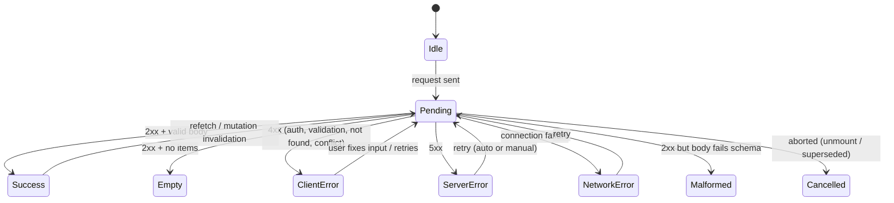
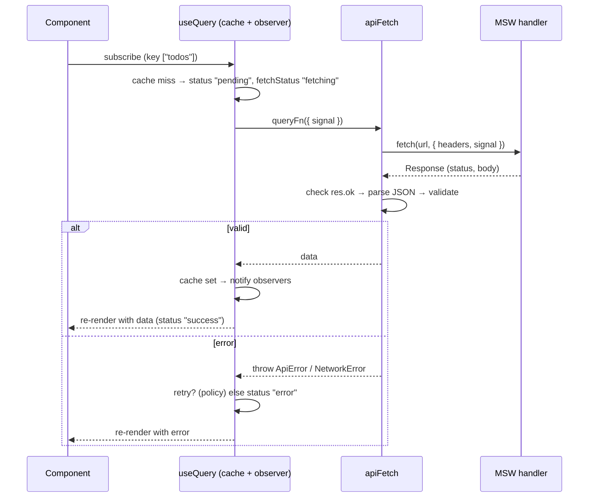
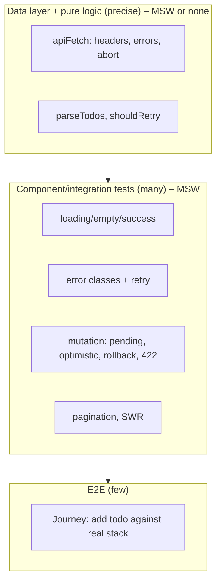
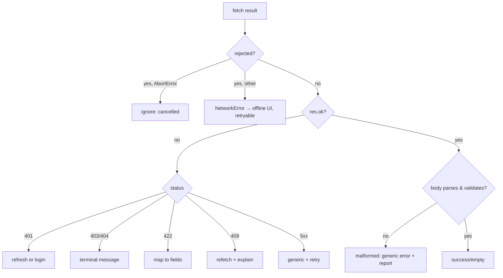

# 08 / 07 — Testing API Interactions: Loading, Errors, Mutations, Retries, and Races

## 1. Lesson metadata

| | |
|---|---|
| **Level** | Advanced |
| **Study time** | 5 hours (reading 2 h, hands-on 1.5 h, exercises 1.5 h) |
| **Prerequisites** | [08 / 04 — Testing async updates](./04-testing-async-updates.md), [08 / 05 — Testing custom hooks](./05-testing-custom-hooks.md), [08 / 06 — Mocking strategies and MSW](./06-mocking-strategies-and-msw.md), [06 / 01 — Fetch lifecycle](../06-data-fetching-and-state-ecosystems/01-fetch-lifecycle.md), [06 / 03 — Loading and error states](../06-data-fetching-and-state-ecosystems/03-loading-and-error-states.md), [06 / 05 — Optimistic updates](../06-data-fetching-and-state-ecosystems/05-optimistic-updates.md), [06 / 08 — TanStack Query](../06-data-fetching-and-state-ecosystems/08-tanstack-query.md) |
| **Next** | [08 — Integration testing](./08-integration-testing.md) |
| **Related later** | [09 — E2E with Playwright](./09-e2e-with-playwright.md), [16 — Avoiding brittle tests](./16-avoiding-brittle-tests.md) |

**Version note.** Code uses MSW 2.x (2.15), `@testing-library/react` 16.3, `@testing-library/user-event` 14.6, React 19.3, and **TanStack Query v5** (5.104: `isPending`, `gcTime`, object-argument signatures). The §5 examples (`client.ts`, `TodoPage`, and their tests) were executed: **21/21 pass on Vitest 4.1.12 and Vitest 5**, but on **Vitest 3.2.7 with jsdom 30, 9 of the 21 fail** (every test whose request succeeds, plus the abort test) because Vitest 3's jsdom environment replaces Node's `AbortController`/`AbortSignal` and Node's `fetch` rejects the jsdom signal that TanStack Query passes to `queryFn` (see [lesson 06 §10.3](./06-mocking-strategies-and-msw.md)). Use Vitest >= 4 for these tests. MSW 3 and Vitest 5 are released; see the notes in lessons 06 and 02. The data layer in examples is hand-written for clarity and is not a recommendation to avoid a query library.

**Learning objectives.** After this lesson you can:
1. Enumerate the states of a remote-data interaction (idle, pending, success, empty, partial, error classes, stale, offline) and write one deterministic test per state that matters.
2. Test a data layer (`apiFetch`) directly with MSW and test the UI above it separately, choosing the right level for each concern.
3. Assert request contracts (method, URL, headers, payload, call counts) without coupling to implementation details.
4. Test mutations, including double-submit protection, field-level server errors (422), optimistic updates and rollback, and cache invalidation.
5. Test retries/backoff, cancellation on unmount, stale-response races, and pagination/infinite loading.
6. Configure TanStack Query for deterministic tests and avoid cross-test cache leakage.
7. Decide what *not* to test about API interactions at the component level.

**Concepts covered:** request/response contract assertions, error taxonomy (network, HTTP 4xx/5xx, malformed body, validation, auth), gates for pending states, optimistic UI tests, rollback, invalidation/refetch, retry policy tests, cancellation, pagination cursors, per-test `QueryClient`, request capturing, idempotency and double-submit guards, schema validation failure paths.

---

## 2. Deep conceptual explanation

### 2.1 What problem is this lesson solving?

Remote data is the most common source of UI defects that survive code review: missing loading states, swallowed errors, wrong URLs, stale data after a mutation, rollbacks that don't roll back, and "works unless two requests overlap". These bugs share a root: **time and failure are part of the specification**, but happy-path tests (render → data appears) specify neither.

An API interaction has a *state space*, not a single path. A good test suite makes the state space explicit and tests the transitions that matter.



Each arrow is a behavior someone depends on.

### 2.2 Where to test what: three levels for API code

| Level | Subject | Fakes | What you assert | Typical count |
|---|---|---|---|---|
| **Data-layer test** (no React) | `apiFetch`, `getTodos`, error mapping, auth header, schema parsing | MSW | Request built correctly; responses mapped to values or typed errors; abort handling | Few, precise |
| **Hook/component test** | A hook or component using the data layer/query library | MSW | UI states per scenario: loading, success, empty, each error class, retry, mutation UI | Many (this lesson's focus) |
| **Contract/E2E** | Whole system | None/staging | The real API satisfies the client's expectations | Few |

The *data-layer test* is the right place for details like "adds `Authorization`", "maps a 422 body to `ValidationError`", "throws `NetworkError` when `fetch` rejects", "aborts when the signal fires". Component tests then rely on that behavior and assert only on **UI consequences**. This avoids re-testing the same fetch detail through five components.

### 2.3 Error taxonomy: different errors, different UI, different tests

| Class | Source | Typical UI | Retry? | Test with MSW |
|---|---|---|---|---|
| **Network failure** | Offline, DNS, CORS, connection reset; `fetch` **rejects** | "You appear to be offline", retry | Yes (automatic/backoff or manual) | `HttpResponse.error()` |
| **401 Unauthorized** | Missing/expired token | Redirect to login or refresh flow | After refresh only | `status: 401` |
| **403 Forbidden** | Authenticated but not allowed | "You don't have access" | No | `status: 403` |
| **404 Not found** | Resource missing | Not-found view | No | `status: 404` |
| **409 Conflict** | Version mismatch, duplicate | "Changed by someone else", refresh | Maybe after refetch | `status: 409` |
| **422/400 Validation** | Invalid input | Field-level errors | After user edits | `status: 422` + `errors` |
| **429 Too many requests** | Rate limit | "Slow down", honor `Retry-After` | After delay | `status: 429` + header |
| **5xx Server** | Server bug/outage | Generic error + retry | Yes (limited) | `status: 500/503` |
| **Malformed success** | 200 with HTML or wrong JSON shape | Generic error; report to monitoring | No | Return invalid body |
| **Timeout/cancel** | Slow or aborted | Timeout message / nothing | Yes / no | `delay("infinite")` + abort |

Key point: `fetch` **resolves** on HTTP errors (4xx/5xx) and **rejects** only on network-level failure, so a client that doesn't check `res.ok` treats a 500 as success. Tests for each class catch this.

### 2.4 What to assert about the *request*

The request is an **outbound contract**. Assert on it when the details are required by the server:

- **Method and path** (implicitly, since an unmatched handler fails the test).
- **Headers**: `Authorization`, `Content-Type`, idempotency keys, correlation IDs.
- **Body shape**: exact payload for mutations (including *not* sending extra/PII fields).
- **Query parameters**: pagination cursors, filters, sort order.
- **Call count**: deduplication (one request for N subscribers), no refetch loops, one request per submit.

Prefer capturing in the handler (as in lesson 06 §5.4). Do not assert on internal calls (`queryFn` invoked) or on library internals.

### 2.5 Server state in the UI: caching adds a dimension

With a cache (TanStack Query, SWR), the same query key may return **stale** data instantly and **refetch in the background**. UI states become: first load (no data), refetching (data + background indicator), error with stale data, error without data. Tests must make cache state explicit:

- New `QueryClient` per test (no leakage).
- `retry: false` by default; enable retries only in tests *about* retries.
- `gcTime: Infinity` (v5; `cacheTime` in v4) to avoid timers lingering after unmount; or call `queryClient.clear()` in cleanup.
- For "stale while revalidate" behavior, **seed the cache** (`queryClient.setQueryData`) and assert the stale value displays immediately, then the refreshed value after the (gated) refetch.

### 2.6 Mutations: what makes them hard to test

1. **Idempotency**: double-click must not send two creates.
2. **Pending UI**: disabled controls and busy indicators while in flight.
3. **Optimistic updates**: UI changes before the server responds, then reconciles (success) or **rolls back** (failure).
4. **Invalidation**: after success, the list refetches or is updated; the UI shows server truth (ids, timestamps).
5. **Field-level server errors**: map `422` to inputs with accessible associations.
6. **Interrupted flows**: navigate away mid-request.

Each needs controlled timing (gates), because immediate responses collapse the interesting intermediate states.

### 2.7 The gate pattern

To test the "while pending" state deterministically, make the handler wait on a promise you control:

```ts
const gate = deferred<void>();
server.use(http.post(url, async () => { await gate.promise; return HttpResponse.json(item, { status: 201 }); }));
// ... interact; assert pending UI ...
gate.resolve();                      // release the response
// ... assert settled UI via findBy ...
```
This replaces timers (`delay(500)`) with *logical* ordering, which is both faster and non-flaky. For "fail then succeed" use `{ once: true }` handlers or a counter.

### 2.8 Common misconceptions

| Misconception | Reality |
|---|---|
| "If the success path works, the error path is probably fine." | Error paths are separate code with separate bugs (swallowed rejections, missing `res.ok`, unparsed bodies). |
| "I can test optimistic updates by checking the final state." | The *interesting* states are intermediate (optimistic) and the rollback. Final-state-only tests pass for broken optimistic logic. |
| "Mocking the query library's hook is simpler." | It removes caching, retries, deduplication, and invalidation from the test, which are the sources of bugs. |
| "Retries are the library's job; no tests needed." | Your retry policy (which errors, how many, backoff, user-visible state) is *your* product decision. Test the policy, not the library. |
| "One test per endpoint is enough." | You need one per *behavioral state* (empty, error classes, pending), not per endpoint. |
| "`await waitFor(() => expect(spy).toHaveBeenCalled())` is the same as asserting UI." | Call assertions prove an attempt, not user-visible correctness. |

---

## 3. Internal mechanics

### 3.1 What happens between `fetch` and the DOM (for a typical query)



*Public guarantee (TanStack Query docs):* a query exposes `status` (`pending | error | success`) and `fetchStatus` (`fetching | paused | idle`) separately, plus `isPending`, `isError`, `isSuccess`, `isFetching`, and `data`/`error` (v5 names; v4 used `isLoading` for the first load and `cacheTime`).
*Implementation detail:* internal notification batching, scheduling (queries use a notify manager that batches updates via `setTimeout`/microtask).

### 3.2 Why tests need `findBy*` even with MSW

MSW responds asynchronously (microtask/macrotask boundaries inside the interceptor), the response stream is read asynchronously (`await res.json()`), the library batches notifications, and React renders. None of that completes by the time `render` returns, so assertions must wait on UI conditions. This is the same async model as [lesson 04](./04-testing-async-updates.md); MSW does not make it synchronous.

### 3.3 Retries and time

TanStack Query's default retry policy (3 retries with exponential backoff in the browser per the v5 docs; on the server the default is 0) would make error-state tests take seconds. Set `retry: false` in the test `QueryClient`. For tests *about* retry behavior, set a small explicit policy (`retry: 2, retryDelay: 0`) or use fake timers with the guidance of [lesson 04](./04-testing-async-updates.md). Test **your** `retry` function (which statuses are retryable) as a pure unit test when it's non-trivial:

```ts
export const shouldRetry = (failureCount: number, error: unknown) =>
  failureCount < 2 && !(error instanceof ApiError && error.status >= 400 && error.status < 500);
```

### 3.4 Abort semantics

`useQuery` passes an `AbortSignal` to `queryFn`; when the component unmounts or the key changes while fetching (and the library cancels), the signal aborts. Your `apiFetch` must pass the signal to `fetch` for cancellation to work. Whether the **request is actually cancelled at the server** is out of scope; in tests you verify the *client behavior*: the aborted request's result is ignored and no error UI flashes. Whether the library cancels in-flight requests on unmount depends on options/versions (it cancels only if the `signal` is consumed).

---

## 4. Step-by-step execution walkthrough: add-todo with optimistic update, failing then succeeding

Code under test (condensed from the examples below): `TodoPage` lists todos (`useQuery`) and has an "Add" form (`useMutation` with `onMutate` optimistic insert, `onError` rollback, `onSettled` invalidate).

Test: **"rolls back the optimistic todo and shows an error when the server rejects"**

| # | Test step | Network / cache state | UI |
|---|---|---|---|
| 1 | `server.use(GET todos → [a])`, POST handler gated and set to respond `500` after gate | cache empty | — |
| 2 | `renderApp(<TodoPage/>)` | Query pending → GET → `[a]` | Loading status |
| 3 | `await screen.findByText("a")` | cache `["todos"] = [a]`, GET done | List shows `a` |
| 4 | `await user.type(input, "b")`, `await user.click(Add)` | `onMutate`: cancel queries, snapshot `[a]`, set `[a, tmp-b]`; POST sent (held at gate) | List shows `a`, `b` (optimistic) with `aria-busy` |
| 5 | assertions on intermediate UI | POST pending | `b` visible; input cleared; Add disabled or ignoring duplicates |
| 6 | `gate.resolve()` | Handler returns 500 | — |
| 7 | `onError`: restore snapshot `[a]`; `onSettled`: invalidate → refetch GET | GET returns `[a]` | `b` disappears; `role="alert"` "Couldn't add todo" |
| 8 | assertions | cache `[a]` | `queryByText("b")` absent; alert present |

**Predict:** if `onError` didn't restore the snapshot but `onSettled` still invalidated, would the final UI still be right? **Result:** eventually yes (the refetch returns `[a]`), but there'd be a flicker where the failed todo remains until the refetch completes, and if the refetch *also* fails the UI would keep showing the phantom todo. A test that asserts *immediately after the failure* (before the refetch resolves, by gating the GET) catches this. This shows why intermediate-state gates matter.

---

## 5. Code examples

### 5.1 Data layer with typed errors (the unit under test)

```ts
// src/api/client.ts
export const API_URL: string = import.meta.env.VITE_API_URL ?? "http://localhost:3000";

export class ApiError extends Error {
  constructor(readonly status: number, message: string, readonly body?: unknown) {
    super(message);
    this.name = "ApiError";
  }
}
export class NetworkError extends Error {
  constructor(cause?: unknown) { super("Network request failed", { cause }); this.name = "NetworkError"; }
}
export class ValidationError extends ApiError {
  constructor(readonly fieldErrors: Record<string, string>, body?: unknown) { super(422, "Validation failed", body); this.name = "ValidationError"; }
}

export async function apiFetch<T>(path: string, init: RequestInit & { parse?: (data: unknown) => T } = {}): Promise<T> {
  const { parse, headers, ...rest } = init;
  const token = typeof localStorage !== "undefined" ? localStorage.getItem("token") : null;

  let res: Response;
  try {
    res = await fetch(`${API_URL}${path}`, {
      ...rest,
      headers: {
        Accept: "application/json",
        ...(rest.body ? { "Content-Type": "application/json" } : {}),
        ...(token ? { Authorization: `Bearer ${token}` } : {}),
        ...headers,
      },
    });
  } catch (e) {
    if ((e as { name?: string } | null)?.name === "AbortError") throw e;   // let callers distinguish cancellation (don't use `instanceof DOMException`: under jsdom the global DOMException is a different class than the one fetch throws)
    throw new NetworkError(e);
  }

  if (res.status === 204) return undefined as T;

  let body: unknown;
  try { body = await res.json(); } catch { body = undefined; }

  if (!res.ok) {
    if (res.status === 422 && body && typeof body === "object" && "errors" in body) {
      throw new ValidationError((body as { errors: Record<string, string> }).errors, body);
    }
    const message = body && typeof body === "object" && "message" in body ? String((body as { message: unknown }).message) : res.statusText;
    throw new ApiError(res.status, message, body);
  }
  if (body === undefined) throw new ApiError(res.status, "Malformed response body");
  return parse ? parse(body) : (body as T);
}
```

Data-layer tests (no React):

```ts
// src/api/client.test.ts
import { http, HttpResponse } from "msw";
import { beforeEach, describe, expect, test } from "vitest";
import { server } from "../test/server";
import { API_URL, ApiError, NetworkError, ValidationError, apiFetch } from "./client";

beforeEach(() => localStorage.clear());

describe("apiFetch", () => {
  test("sends Accept and Authorization headers when a token exists", async () => {
    localStorage.setItem("token", "t0k");
    let seen: Headers | undefined;
    server.use(http.get(`${API_URL}/api/me`, ({ request }) => { seen = request.headers; return HttpResponse.json({ id: 1 }); }));

    await apiFetch("/api/me");

    expect(seen?.get("authorization")).toBe("Bearer t0k");
    expect(seen?.get("accept")).toBe("application/json");
  });

  test("sets Content-Type only when there is a body", async () => {
    let ct: string | null = "unset";
    server.use(http.get(`${API_URL}/api/x`, ({ request }) => { ct = request.headers.get("content-type"); return HttpResponse.json({}); }));
    await apiFetch("/api/x");
    expect(ct).toBeNull();
  });

  test("maps 4xx/5xx to ApiError with status and server message", async () => {
    server.use(http.get(`${API_URL}/api/x`, () => HttpResponse.json({ message: "Nope" }, { status: 403 })));
    await expect(apiFetch("/api/x")).rejects.toMatchObject({ name: "ApiError", status: 403, message: "Nope" });
  });

  test("maps 422 with errors to ValidationError", async () => {
    server.use(http.post(`${API_URL}/api/x`, () => HttpResponse.json({ errors: { text: "Required" } }, { status: 422 })));
    const err = await apiFetch("/api/x", { method: "POST", body: "{}" }).catch((e: unknown) => e);
    expect(err).toBeInstanceOf(ValidationError);
    expect((err as ValidationError).fieldErrors).toEqual({ text: "Required" });
  });

  test("maps connection failures to NetworkError (not ApiError)", async () => {
    server.use(http.get(`${API_URL}/api/x`, () => HttpResponse.error()));
    await expect(apiFetch("/api/x")).rejects.toBeInstanceOf(NetworkError);
  });

  test("treats a 200 with a non-JSON body as malformed", async () => {
    server.use(http.get(`${API_URL}/api/x`, () => new HttpResponse("<html/>", { headers: { "Content-Type": "text/html" } })));
    await expect(apiFetch("/api/x")).rejects.toBeInstanceOf(ApiError);
  });

  test("runs the parse function and surfaces its error", async () => {
    server.use(http.get(`${API_URL}/api/x`, () => HttpResponse.json({ wrong: true })));
    const parse = (d: unknown) => { if (!d || typeof d !== "object" || !("id" in d)) throw new Error("bad shape"); return d as { id: number }; };
    await expect(apiFetch("/api/x", { parse })).rejects.toThrow("bad shape");
  });

  test("propagates AbortError unchanged", async () => {
    server.use(http.get(`${API_URL}/api/slow`, async () => { await new Promise(() => {}); }));
    const ctrl = new AbortController();
    const p = apiFetch("/api/slow", { signal: ctrl.signal });
    ctrl.abort();
    await expect(p).rejects.toMatchObject({ name: "AbortError" });
  });
});
```

Line notes:
- The test names read as the client's *specification*.
- `.catch((e) => e)` captures a rejection value to assert on its class.
- The abort test depends on the environment's `AbortController`/`fetch` compatibility (see lesson 06 §10.3). *Verified:* on Vitest 3.2.7 + jsdom the test fails (`NetworkError` instead of `AbortError`, because `fetch` throws a `TypeError` for the jsdom signal); on Vitest 4.1.12/5.0.5 + jsdom it passes. It also showed why the client checks `e.name` instead of `e instanceof DOMException`: the original `instanceof` version failed on Vitest 4 under jsdom because the `AbortError` is Node's `DOMException`, not jsdom's.
- The `status === 204` branch deserves its own test (omitted for brevity; see exercise C3).

### 5.2 The UI under test: queries and mutations

```tsx
// src/todos/api.ts
import { apiFetch } from "../api/client";

export interface Todo { id: string; text: string; done: boolean }

export function parseTodos(data: unknown): Todo[] {
  if (!Array.isArray(data)) throw new Error("Expected an array of todos");
  return data.map((t) => {
    if (!t || typeof t !== "object" || typeof (t as Todo).id !== "string" || typeof (t as Todo).text !== "string") {
      throw new Error("Invalid todo");
    }
    return { id: (t as Todo).id, text: (t as Todo).text, done: Boolean((t as Todo).done) };
  });
}

export const getTodos = (signal?: AbortSignal) => apiFetch<Todo[]>("/api/todos", { signal, parse: parseTodos });
export const addTodo = (text: string) => apiFetch<Todo>("/api/todos", { method: "POST", body: JSON.stringify({ text }) });
```

```tsx
// src/todos/TodoPage.tsx
import { useMutation, useQuery, useQueryClient } from "@tanstack/react-query";
import { useId, useState, type FormEvent } from "react";
import { ValidationError } from "../api/client";
import { addTodo, getTodos, type Todo } from "./api";

const KEY = ["todos"] as const;

export function TodoPage() {
  const qc = useQueryClient();
  const [text, setText] = useState("");
  const inputId = useId();
  const errId = useId();

  const todos = useQuery({ queryKey: KEY, queryFn: ({ signal }) => getTodos(signal) });

  const add = useMutation({
    mutationFn: addTodo,
    onMutate: async (newText: string) => {
      await qc.cancelQueries({ queryKey: KEY });
      const previous = qc.getQueryData<Todo[]>(KEY);
      qc.setQueryData<Todo[]>(KEY, (old = []) => [...old, { id: `tmp-${newText}`, text: newText, done: false }]);
      return { previous };
    },
    onError: (_err, _text, ctx) => { qc.setQueryData(KEY, ctx?.previous); },
    onSettled: () => qc.invalidateQueries({ queryKey: KEY }),
  });

  function submit(e: FormEvent) {
    e.preventDefault();
    const value = text.trim();
    if (!value || add.isPending) return;
    add.mutate(value);
    setText("");
  }

  const fieldError = add.error instanceof ValidationError ? add.error.fieldErrors.text : undefined;
  const genericError = add.isError && !fieldError ? "Couldn't add todo. Please try again." : undefined;

  return (
    <main>
      <h1>Todos</h1>

      {todos.isPending && <p role="status">Loading todos…</p>}
      {todos.isError && (
        <div role="alert">
          Couldn't load todos. <button type="button" onClick={() => todos.refetch()}>Retry</button>
        </div>
      )}
      {todos.isSuccess && todos.data.length === 0 && <p>Nothing to do yet.</p>}
      {todos.isSuccess && todos.data.length > 0 && (
        <ul aria-label="Todos">
          {todos.data.map((t) => (
            <li key={t.id} aria-busy={t.id.startsWith("tmp-") || undefined}>{t.text}</li>
          ))}
        </ul>
      )}

      <form onSubmit={submit} aria-label="Add todo">
        <label htmlFor={inputId}>New todo</label>
        <input id={inputId} value={text} onChange={(e) => setText(e.target.value)}
               aria-invalid={fieldError ? true : undefined} aria-describedby={fieldError ? errId : undefined} />
        {fieldError && <p id={errId}>{fieldError}</p>}
        <button type="submit" disabled={add.isPending}>Add</button>
        {genericError && <p role="alert">{genericError}</p>}
      </form>
    </main>
  );
}
```

*(Design notes: the temporary id derives from text for brevity; real code uses a client-generated unique id. Keying by `tmp-…` means two identical pending todos collide; the exercises ask you to fix this.)*

### 5.3 Test harness: per-test `QueryClient`, MSW, helper

```tsx
// src/test/renderApp.tsx
import { QueryClient, QueryClientProvider } from "@tanstack/react-query";
import { render } from "@testing-library/react";
import userEvent from "@testing-library/user-event";
import type { ReactElement } from "react";

export function renderApp(ui: ReactElement) {
  const queryClient = new QueryClient({
    defaultOptions: { queries: { retry: false, gcTime: Infinity }, mutations: { retry: false } },
  });
  const user = userEvent.setup();
  return { user, queryClient, ...render(<QueryClientProvider client={queryClient}>{ui}</QueryClientProvider>) };
}
```

Default handlers (stateful todos fake from lesson 06 §5.2) are registered in `setup.ts`; tests override as needed.

### 5.4 Query state tests: loading, success, empty, each error class

```tsx
import { delay, http, HttpResponse } from "msw";
import { screen } from "@testing-library/react";
import { expect, test } from "vitest";
import { API_URL } from "../api/client";
import { renderApp } from "../test/renderApp";
import { server } from "../test/server";
import { TodoPage } from "./TodoPage";

const url = `${API_URL}/api/todos`;

test("shows a loading status, then the list", async () => {
  server.use(http.get(url, () => HttpResponse.json([{ id: "1", text: "write tests", done: false }])));
  renderApp(<TodoPage />);

  expect(screen.getByRole("status")).toHaveTextContent(/loading/i);
  expect(await screen.findByRole("list", { name: "Todos" })).toHaveTextContent("write tests");
  expect(screen.queryByRole("status")).not.toBeInTheDocument();
});

test("shows an empty state", async () => {
  server.use(http.get(url, () => HttpResponse.json([])));
  renderApp(<TodoPage />);
  expect(await screen.findByText(/nothing to do yet/i)).toBeInTheDocument();
});

test.each([
  ["500 server error", () => new HttpResponse(null, { status: 500 })],
  ["network failure", () => HttpResponse.error()],
  ["malformed JSON", () => new HttpResponse("<html/>", { headers: { "Content-Type": "text/html" } })],
  ["invalid shape", () => HttpResponse.json([{ nope: true }])],
])("shows a retryable error for %s", async (_name, resolver) => {
  server.use(http.get(url, resolver));
  renderApp(<TodoPage />);
  const alert = await screen.findByRole("alert");
  expect(alert).toHaveTextContent(/couldn't load todos/i);
  expect(screen.getByRole("button", { name: /retry/i })).toBeEnabled();
});

test("retry after failure loads the data", async () => {
  server.use(
    http.get(url, () => new HttpResponse(null, { status: 503 }), { once: true }),
    http.get(url, () => HttpResponse.json([{ id: "1", text: "recovered", done: false }])),
  );
  const { user } = renderApp(<TodoPage />);

  await user.click(await screen.findByRole("button", { name: /retry/i }));
  expect(await screen.findByText("recovered")).toBeInTheDocument();
  expect(screen.queryByRole("alert")).not.toBeInTheDocument();
});
```

Notes:
- `test.each` with resolvers gives one table of failure classes using the same assertion; the *client's* error classification is tested in `client.test.ts`, so here we assert the UI treats any failure as retryable.
- In "retry after failure", **two** handlers are registered with one `server.use` call. Order matters: the `once` 503 handler is first, so the first request gets 503, then it's consumed, and the second handler serves later requests.
- The "invalid shape" case ensures a bad-but-200 response doesn't crash the render (validation at the boundary).

**Predict:** in the "retry" test, how many GET requests are sent in total? **Result:** two (initial 503, then retry). Because the test `QueryClient` has `retry: false`, the library doesn't send a hidden third. If you left default retries enabled the first failure would be retried automatically and the error UI might never appear within `findBy`'s 1 s timeout.

### 5.5 Request assertions for mutations

```tsx
test("posts the trimmed text as JSON with the auth token", async () => {
  localStorage.setItem("token", "abc");
  const requests: { body: unknown; auth: string | null; ct: string | null }[] = [];
  const db: { id: string; text: string; done: boolean }[] = [];   // the refetch after the mutation must see the new item
  server.use(
    http.get(url, () => HttpResponse.json(db)),
    http.post(url, async ({ request }) => {
      requests.push({ body: await request.json(), auth: request.headers.get("authorization"), ct: request.headers.get("content-type") });
      const created = { id: "s1", text: "buy milk", done: false };
      db.push(created);
      return HttpResponse.json(created, { status: 201 });
    }),
  );
  const { user } = renderApp(<TodoPage />);

  await user.type(await screen.findByLabelText("New todo"), "  buy milk  ");
  await user.click(screen.getByRole("button", { name: "Add" }));

  expect(await screen.findByText("buy milk")).toBeInTheDocument();
  expect(requests).toEqual([{ body: { text: "buy milk" }, auth: "Bearer abc", ct: "application/json" }]);
});
```
We assert the contract-critical bits (payload shape, header) and exactly one request (the array has one element). We do not assert on `onMutate`/`setQueryData`. The GET handler is stateful on purpose: the component invalidates the query in `onSettled`, so a GET that always returned `[]` would make the new row vanish after the refetch (the first version of this example failed for exactly that reason when run).

### 5.6 Optimistic update, rollback, and gates

```tsx
import { deferred } from "../test/deferred";

test("optimistically shows the new todo while pending, then reconciles", async () => {
  const gate = deferred<void>();
  let db = [{ id: "1", text: "a", done: false }];
  server.use(
    http.get(url, () => HttpResponse.json(db)),
    http.post(url, async () => {
      await gate.promise;
      const created = { id: "srv-2", text: "b", done: false };
      db = [...db, created];
      return HttpResponse.json(created, { status: 201 });
    }),
  );
  const { user } = renderApp(<TodoPage />);
  await screen.findByText("a");

  await user.type(screen.getByLabelText("New todo"), "b");
  await user.click(screen.getByRole("button", { name: "Add" }));

  // Pending: optimistic row is visible immediately, marked busy; the form guards against duplicates
  const optimistic = await screen.findByText("b");
  expect(optimistic).toHaveAttribute("aria-busy", "true");
  expect(screen.getByRole("button", { name: "Add" })).toBeDisabled();

  gate.resolve();

  // Settled: the server item replaces the temporary one; exactly one "b"
  await waitFor(() => expect(screen.getByText("b")).not.toHaveAttribute("aria-busy"));
  expect(screen.getAllByText("b")).toHaveLength(1);
  expect(screen.getByRole("button", { name: "Add" })).toBeEnabled();
});

test("rolls back and announces the error when the server rejects", async () => {
  const gate = deferred<void>();
  server.use(
    http.get(url, () => HttpResponse.json([{ id: "1", text: "a", done: false }])),
    http.post(url, async () => { await gate.promise; return HttpResponse.json({ message: "boom" }, { status: 500 }); }),
  );
  const { user } = renderApp(<TodoPage />);
  await screen.findByText("a");

  await user.type(screen.getByLabelText("New todo"), "b");
  await user.click(screen.getByRole("button", { name: "Add" }));
  expect(await screen.findByText("b")).toBeInTheDocument();   // optimistic

  gate.resolve();

  expect(await screen.findByRole("alert")).toHaveTextContent(/couldn't add todo/i);
  await waitFor(() => expect(screen.queryByText("b")).not.toBeInTheDocument());
  expect(screen.getByText("a")).toBeInTheDocument();          // untouched
});
```
Import `waitFor` from RTL. In both tests, the *intermediate* state is asserted **before** the gate opens. `findByText("b")` right after the click is robust because the optimistic cache write happens synchronously in `onMutate` but React render timing makes `findBy` the right tool (not `getBy`).

### 5.7 Field-level validation (422) mapped to the form

```tsx
test("shows a field error from the server and keeps focus usable", async () => {
  server.use(
    http.get(url, () => HttpResponse.json([])),
    http.post(url, () => HttpResponse.json({ errors: { text: "Already exists" } }, { status: 422 })),
  );
  const { user } = renderApp(<TodoPage />);

  const input = await screen.findByLabelText("New todo");
  await user.type(input, "dup");
  await user.click(screen.getByRole("button", { name: "Add" }));

  expect(await screen.findByText("Already exists")).toBeInTheDocument();
  expect(input).toBeInvalid();
  expect(input).toHaveAccessibleDescription("Already exists");
  expect(screen.queryByRole("alert")).not.toBeInTheDocument();   // field error is not also a generic banner
});
```
The last assertion encodes a UX decision (no duplicate messaging); document such decisions in test names.

### 5.8 Double-submit protection

```tsx
test("sends exactly one POST for rapid double submits", async () => {
  const gate = deferred<void>();
  let posts = 0;
  server.use(
    http.get(url, () => HttpResponse.json([])),
    http.post(url, async () => { posts++; await gate.promise; return HttpResponse.json({ id: "s", text: "x", done: false }, { status: 201 }); }),
  );
  const { user } = renderApp(<TodoPage />);
  const input = await screen.findByLabelText("New todo");

  await user.type(input, "x{Enter}");           // submit #1 via keyboard
  await user.type(input, "x{Enter}");           // submit #2 while #1 is in flight
  gate.resolve();

  await screen.findByText("x");
  expect(posts).toBe(1);
});
```
In this component the guard is `if (!value || add.isPending) return;`. Delete it and the test fails (2 posts): a useful mutation check. Whether `add.isPending` is already `true` at the instant of the second submit depends on React rendering between the two interactions; `user.type` awaits between actions so the render has flushed (verified: this test passed). If you want the guard to be robust to *same-tick* double events, use a ref or `useTransition`/action state and test with `fireEvent.submit` twice synchronously.

### 5.9 Stale-while-revalidate with a seeded cache

```tsx
test("shows cached todos immediately and refreshes in the background", async () => {
  const gate = deferred<void>();
  server.use(http.get(url, async () => { await gate.promise; return HttpResponse.json([{ id: "1", text: "fresh", done: false }]); }));

  const queryClient = new QueryClient({ defaultOptions: { queries: { retry: false, gcTime: Infinity, staleTime: 0 } } });
  queryClient.setQueryData(["todos"], [{ id: "1", text: "stale", done: false }]);

  render(<QueryClientProvider client={queryClient}><TodoPage /></QueryClientProvider>);

  expect(screen.getByText("stale")).toBeInTheDocument();             // no loading state: data from cache
  expect(screen.queryByRole("status")).not.toBeInTheDocument();

  gate.resolve();
  expect(await screen.findByText("fresh")).toBeInTheDocument();
  expect(screen.queryByText("stale")).not.toBeInTheDocument();
});
```
Seeding the cache is a legitimate use of the library's public API in tests; it turns a time-dependent behavior (previous visit's data) into an arranged precondition.

### 5.10 Pagination with a cursor (infinite list)

```tsx
test("loads more using the cursor from the previous page", async () => {
  const cursors: (string | null)[] = [];
  server.use(http.get(`${API_URL}/api/events`, ({ request }) => {
    const cursor = new URL(request.url).searchParams.get("cursor");
    cursors.push(cursor);
    return cursor === null
      ? HttpResponse.json({ items: [{ id: "e1", title: "First" }], nextCursor: "c2" })
      : HttpResponse.json({ items: [{ id: "e2", title: "Second" }], nextCursor: null });
  }));

  const { user } = renderApp(<EventsFeed />);               // uses useInfiniteQuery

  expect(await screen.findByText("First")).toBeInTheDocument();
  await user.click(screen.getByRole("button", { name: /load more/i }));
  expect(await screen.findByText("Second")).toBeInTheDocument();

  expect(cursors).toEqual([null, "c2"]);
  expect(screen.queryByRole("button", { name: /load more/i })).not.toBeInTheDocument();   // no next page
});
```
The assertion on `cursors` verifies the client-server pagination contract; the final assertion verifies the end-of-list behavior. Test "load more fails → existing items remain and an inline error with retry appears" separately.

### 5.11 Incorrect examples

**(a) Mocking the hook, losing the state space**
```tsx
vi.mock("./useTodos", () => ({ useTodos: () => ({ data: [{ id: "1", text: "a" }], isPending: false }) }));
```
The test cannot reveal missing error UI, wrong keys, broken refetch, or invalidation; it verifies that `data` renders.

**(b) Asserting the happy path only after a long real delay**
```tsx
server.use(http.get(url, async () => { await delay(2000); return HttpResponse.json([]); }));
await screen.findByText("Nothing to do", {}, { timeout: 3000 });  // slow and meaningless
```
Use a gate or no delay.

**(c) Sleeping to check "no extra requests"**
```tsx
await new Promise((r) => setTimeout(r, 500));
expect(posts).toBe(1);
```
You can't prove a negative by sleeping; assert on the *positive* completion (the UI settled) and count requests at that point, or advance fake timers over the retry/refetch window.

**(d) Shared QueryClient at module scope**
```tsx
const queryClient = new QueryClient();    // ❌ module level; cache persists across tests
```
Create per test (§5.3).

### 5.12 Corrected patterns summary

- Fake the server, not the hook; one scenario per test; gates for pending states; per-test client; assert UI and, where it is the contract, the request.

---

## 6. Visual explanations

### 6.1 Test layers for one feature



### 6.2 Optimistic update timeline

```text
t0  click Add            cache: [a]
t1  onMutate             cache: [a, tmp-b]       UI: a, b(busy)      POST in flight (gated)
t2  gate.resolve()       server responds
    ├─ success: onSettled → invalidate → GET → cache [a, b(srv)]     UI: a, b
    └─ failure: onError → cache [a]               UI: a + alert; then onSettled → GET → [a]
```

### 6.3 Gate vs. delay

```text
delay(500):   request ──500ms real time──► response     (slow, race-prone, can't pin an exact moment)
gate:         request ──(held)── test asserts pending UI ── gate.resolve() ──► response   (instant, exact)
```

### 6.4 Error handling decision



---

## 7. Alternative approaches and trade-offs

### 7.1 Where to put API-interaction assertions

| Approach | Pros | Cons | Use when |
|---|---|---|---|
| Component tests with MSW (this lesson) | Real UI + client + cache; refactor-tolerant | Moderate setup; cache config needed | Default for data-driven UI |
| Hook tests with MSW (`renderHook` + wrapper) | Focus on state transitions; no DOM noise | UI wiring (a11y, focus) untested | Shared data hooks |
| Data-layer tests only + mock hooks in components | Fast, isolated | Hides cache/invalidation/UX bugs | Presentational components receiving data via props |
| Contract tests (Pact) | Detects provider drift | Infrastructure, process cost | Multiple teams, unstable APIs |
| E2E with real backend | Real integration | Slow/flaky | Critical journeys only |
| Service-virtualization / record-replay (e.g., Polly-style) | Realistic captured traffic | Recordings rot; sensitive data | Legacy APIs with complex responses |

### 7.2 Handling retries: automatic vs. user-driven

| Policy | Test strategy | Trade-off |
|---|---|---|
| No auto retry; manual "Retry" button | Simple tests (this lesson) | Worse UX on flaky networks |
| Library auto retry (limited, with backoff) | Test your `retry` predicate as a unit; one integration test with `retry: 1, retryDelay: 0` | Test setup complexity; potential hidden delay |
| Exponential backoff + jitter | Fake timers; assert intervals within bounds, not exact values (jitter) | Time-based tests are fragile; prefer testing pure `computeDelay` |

### 7.3 When the recommended approach (MSW-backed component tests for every state) is NOT best

- **Large, mostly-presentational apps** where components receive data props from a container: testing each presentational component with MSW multiplies cost. Test the container once with MSW, and the presentational components with plain props (including loading/error variants) via component tests/stories.
- **Teams with a mature contract-testing practice** and strict API client generation: more error-class testing belongs in the generated client's test suite, not in every screen.
- **When the API is volatile** and handlers are hand-maintained: a bigger share of confidence should come from schema-derived mocks and a staging smoke test; otherwise the suite's green status is misleading.

---

## 8. Best practices and anti-patterns

**Do**
- Create a fresh `QueryClient` per test; set `retry: false` and `gcTime: Infinity` defaults in the helper.
- Test each *error class* your product handles, once, at the UI level; test classification/mapping in the data-layer tests.
- Use gates to assert pending/optimistic states; use `{ once: true }` for fail-then-succeed.
- Assert **request payload and headers** when they are contractually important; assert **call counts** for dedupe/double-submit.
- Validate responses at the boundary; test the malformed case.
- Name tests by user-visible behavior and scenario ("shows a field error from the server").
- Keep default handlers realistic and minimal; make overrides visible in the test body.
- Run a mutation check: remove the guard/rollback/abort logic and confirm the relevant test fails.

**Beginner mistakes**
- Testing only success; leaving retries enabled so error tests time out.
- Asserting right after `user.click` with `getBy` for results that need to be awaited.
- Sharing one `QueryClient` or handler override between tests.
- Treating `fetch` rejection and HTTP error status as the same thing.

**Experienced-developer mistakes**
- Over-asserting implementation (calls to `invalidateQueries`, cache keys) instead of UI outcomes.
- Writing a "fake backend" with business logic and testing against it instead of explicit scenarios.
- Ignoring concurrency: no tests for overlapping requests (stale response overwriting newer data).
- Faking timers globally so `findBy` hangs ([lesson 04](./04-testing-async-updates.md)).
- Testing the same error mapping in 30 component tests.

**Smells:** `await delay(...)` in default handlers; `waitFor` with side effects; no tests for 4xx at all; handlers returning 200 for everything; `any` in handler payloads; asserting on `queryClient.getQueryData` as the primary check.

**Justified exceptions:** asserting cache contents for a **cache normalization** utility (it is the product behavior); asserting `invalidateQueries` calls in a unit test of a *mutation factory* shared across features when invalidation targets are the contract; sleeping with fake time to assert backoff schedule.

---

## 9. Real-world application

**E-commerce checkout (money, idempotency).** Constraints: POST `/orders` must not duplicate on retries or double clicks; payment errors need distinct UX (declined vs. network); stock conflicts (409) must prompt a cart refresh. Tests: one POST for double submit; header `Idempotency-Key` present and **stable across retries of the same attempt** (capture in handler: first attempt 503, second attempt succeeds, keys equal); 402 → "Payment declined" with a different card prompt; 409 → cart refetched and an `aria-live` message; network failure → *no* duplicate order created (assert the second attempt carries the same idempotency key so the server can dedupe).

**Dashboards (multiple independent widgets).** Constraints: one failing endpoint shouldn't blank the page; stale data should remain visible with an "Updated 3 min ago" warning. Tests: override one endpoint to 500 and verify the widget shows an error with retry while others render; seed the cache and fail the refetch → stale data stays with a "may be out of date" notice; polling pauses when the tab is hidden (simulate `visibilitychange`).

**Forms (onboarding/KYC).** Constraints: server-side validation is authoritative; error messages come per field; uploads with progress. Tests: 422 `errors` map to inputs with `aria-describedby`; first error receives focus (assert `toHaveFocus()` on the first invalid field); upload failure shows retry without losing the form's other values; resubmitting after fix clears errors.

**Auth.** Constraints: token expiry mid-session. Tests: 401 triggers one refresh (shared across parallel calls) and retries the original request; refresh failure signs out and redirects with a return URL; 403 shows a no-access screen without redirect loops (assert request counts to detect loops).

**Realtime/offline.** Constraints: reconnect, queued mutations. Tests: offline (`HttpResponse.error()`) shows banner, queues the mutation; when handlers return success again and an `online` event fires, the queue flushes in order exactly once; conflicts (409) on replay surface a resolution UI.

---

## 10. Debugging and troubleshooting

### 10.1 "My error-state test times out"

1. Is the library retrying (`retry` default) so the error appears after seconds? Set `retry: false` in the test client.
2. Does the handler actually return an error? Print the status in the handler.
3. Does the client treat the status as an error (`res.ok` check)? Test the client separately.
4. Is the UI rendering the error under a different role/text? `screen.debug()`.

### 10.2 "Optimistic test passes without the optimistic code"

Likely the response resolved immediately so the intermediate state was never observable *and* the test only checks the end state. Add a gate and assert the intermediate state **before** releasing; then break the optimistic logic to confirm failure.

### 10.3 "Requests appear twice"

1. Strict Mode double effects (if your test wrapper enables it) with a `useEffect` fetch: ensure abort/dedupe, or use a query library that dedupes.
2. Unstable query keys (object created each render) causing refetch; inspect keys.
3. A `refetchOnWindowFocus`/`refetchOnMount` default firing due to test events. Disable in the test client if irrelevant.
4. Two components with the same query key mount in the test; dedupe is expected (one request), not two; if you see two, keys differ.

### 10.4 "Stale response overwrote the new one"

Reproduce deterministically with two gates (lesson 04 §5.2 pattern) and resolve out of order. Typical fixes: include params in the query key (the library handles it), abort superseded requests, ignore results whose key no longer matches. Validate with the mutation check.

### 10.5 "State from a previous test appears"

Shared `QueryClient`, stateful fake db not reset, `localStorage` token left behind, or `server.use` override leaking (see lesson 06 §10.5). Add guards in setup: `afterEach` → `cleanup()`, `server.resetHandlers()`, `localStorage.clear()`, and (if you share a client) `queryClient.clear()`.

### 10.6 "Unhandled request error for a request I didn't expect"

A component makes an extra request (prefetch, analytics, `/me`). Decide: is it legitimate? If yes add a default handler (or `http.all` safety net returning a clear failure for unknown requests in a given scenario); if no, you found a bug (e.g., a fetch on every keystroke).

---

## 11. Exercises

### Level A — Knowledge
A1. List the error classes a data-driven screen should distinguish and the UI each implies.
A2. Why does a happy-path-only suite miss `res.ok` bugs?
A3. What is a "gate" and why is it better than `delay(ms)` for testing pending states?
A4. Why should the test `QueryClient` set `retry: false`? What would you do to test retry behavior itself?
A5. What request details are worth asserting for a mutation, and what are not?

### Level B — Code comprehension
B1. In 5.4's "retry after failure" test, what happens if the two handlers are registered in the opposite order? Why?
B2. In 5.6, which line makes sure the optimistic row's removal is not accepted *before* the rollback? What would a weaker assertion look like and why is it weaker?
B3. In 5.8, the second `user.type(input, "x{Enter}")` types into an input that was cleared after the first submit. Explain why the test is still valid and what could invalidate it.

### Level C — Implementation
C1. Write tests for deleting a todo with optimistic removal and rollback on failure (restores original position).
C2. Add the missing 204-handling test to the data layer (`DELETE` returns 204 with no body), and a test that `apiFetch` rejects with `ApiError` when a 200 JSON body is empty.
C3. Write a test that verifies a 429 response with `Retry-After: 2` disables the Add button for 2 seconds (assume the component implements it) using fake timers; explain the hazards.

### Level D — Debugging
D1. A teammate's test intermittently fails with "Found multiple elements with the text: b" after the optimistic add. Diagnose and fix both the test and the component (hint: temporary id).
D2. A test for 403 passes, but in the app a 403 sends the user into an infinite redirect loop to `/login`. Why did the test miss it, and how would you test for it?
D3. After switching to React 19 Strict Mode wrapper in tests, `expect(getCount).toHaveBeenCalledTimes(1)` fails with 2. Is the app wrong? What do you assert instead?

### Level E — Architecture and engineering decisions
E1. Propose a layered test plan for a "Customers" module (list, detail, edit, delete, search) specifying data-layer, hook, component, and E2E tests with counts and rationales.
E2. Your API occasionally returns `200` with `{ error: "..." }` bodies. How do you model this in the client and tests, and how do you decide whether to fix the API instead?

### Level F — Expert challenge
F1. Design the test strategy for an offline-capable mutation queue (IndexedDB-backed): ordering, retries with backoff, conflict resolution, idempotency keys, app restarts mid-flight. Identify which parts are unit, integration (MSW + fake IndexedDB), and E2E, and how you make it deterministic.

---

## 12. Detailed answers and explanations

> Attempt the exercises first.

**A1.** Network failure → offline message + retry; 401 → refresh/login; 403 → no-access; 404 → not-found; 409 → conflict explanation + refetch; 422 → field errors; 429 → backoff notice; 5xx → generic error + retry; malformed success → generic error (report); cancelled → silent. A strong answer ties each to *different UX and different retry semantics*.

**A2.** `fetch` resolves for HTTP errors; if the code never checks `res.ok`, a 500 with a JSON body would be treated as data (or throw during parsing, producing a misleading error). Only a test that returns a non-2xx exposes it.

**A3.** A gate is a promise your test controls; the handler awaits it, so the request is held until the test releases it. It gives exact control over ordering (assert pending UI, then release) with no real-time dependence. `delay(ms)` introduces wall-clock waiting and races between the assertion and the response.

**A4.** Default retries (with backoff) would delay the error state by seconds, causing `findBy` timeouts or slow tests, and hide the first failure. In tests for retry behavior itself, configure explicit small retries (`retry: 2, retryDelay: 0`) or unit-test the retry predicate/delay function and use fake timers for the integration.

**A5.** Worth asserting: payload shape/content, content type, auth/idempotency headers, call count (no duplicates), query parameters affecting server behavior. Not worth asserting: that internal library functions were called, cache keys, order of internal state updates, the precise number of re-renders.

**B1.** If the permanent success handler is first, it always matches and the `once` 503 handler is never reached (first match wins), so the test never sees an error and `findByRole("button", {name: /retry/})` times out. Registration order defines precedence among runtime handlers passed to one `server.use` call (earlier arguments first).

**B2.** `await waitFor(() => expect(screen.queryByText("b")).not.toBeInTheDocument())` after `await screen.findByRole("alert")`: it requires both the alert and the row removal. A weaker version asserts only the alert (passes even if the optimistic row remains) or asserts `queryByText("b")` null *immediately* before the optimistic row had a chance to render (vacuous). Pairing the positive presence check (`findByText("b")` earlier) with the later absence prevents vacuity.

**B3.** The first `{Enter}` submits; the component clears the input via `setText("")`, so the second `type` starts from empty and types `x` again, producing a second submit while `add.isPending` is still true (the POST is gated). The test remains valid as long as the first submission is still pending at the second submit. That's ensured by the gate; if the handler resolved immediately, the second submit would be a *legitimate second* todo and the assertion `posts === 1` would be wrong. Also, if the component doesn't clear the input, the second `type` appends giving "xx".

**C1.**
```tsx
test("optimistically removes a todo and restores it in place on failure", async () => {
  const gate = deferred<void>();
  server.use(
    http.get(url, () => HttpResponse.json([
      { id: "1", text: "a", done: false }, { id: "2", text: "b", done: false }, { id: "3", text: "c", done: false },
    ])),
    http.delete(`${url}/:id`, async () => { await gate.promise; return HttpResponse.json({ message: "no" }, { status: 500 }); }),
  );
  const { user } = renderApp(<TodoPage />);
  await screen.findByText("b");

  await user.click(within(screen.getByText("b").closest("li")!).getByRole("button", { name: /delete/i }));
  expect(screen.queryByText("b")).not.toBeInTheDocument();            // optimistic removal

  gate.resolve();

  expect(await screen.findByRole("alert")).toHaveTextContent(/couldn't delete/i);
  const items = screen.getAllByRole("listitem").map((li) => li.textContent);
  expect(items).toEqual(["a", "b", "c"]);                             // restored in original position
});
```
Edge cases: restoring by snapshot (`setQueryData(previous)`) preserves position; implementations that re-append the deleted item put it last, which this test catches. (The `closest("li")` use is a structural query; prefer giving each row an accessible name or using `getByRole("listitem", { name })` when the markup allows.)

**C2.**
```ts
test("returns undefined for 204", async () => {
  server.use(http.delete(`${API_URL}/api/x/1`, () => new HttpResponse(null, { status: 204 })));
  await expect(apiFetch("/api/x/1", { method: "DELETE" })).resolves.toBeUndefined();
});

test("rejects with ApiError for 200 with an empty body", async () => {
  server.use(http.get(`${API_URL}/api/x`, () => new HttpResponse(null, { status: 200 })));
  await expect(apiFetch("/api/x")).rejects.toBeInstanceOf(ApiError);
});
```
Why: the 204 branch otherwise has no coverage and a refactor could break `DELETE`; the empty-200 case verifies the "malformed" rule. Evaluation: both branches tested at the data layer, not through UI.

**C3.**
```tsx
test("disables Add for the Retry-After period after a 429", async () => {
  vi.useFakeTimers({ shouldAdvanceTime: true });                 // keeps MSW/RTL timers progressing (option verified; see lesson 04 §3.4)
  server.use(
    http.get(url, () => HttpResponse.json([])),
    http.post(url, () => new HttpResponse(null, { status: 429, headers: { "Retry-After": "2" } })),
  );
  const user = userEvent.setup({ advanceTimers: vi.advanceTimersByTime.bind(vi) });
  render(<QueryClientProvider client={makeClient()}><TodoPage /></QueryClientProvider>);

  await user.type(await screen.findByLabelText("New todo"), "x");
  await user.click(screen.getByRole("button", { name: "Add" }));
  expect(await screen.findByText(/try again in 2s/i)).toBeInTheDocument();
  expect(screen.getByRole("button", { name: "Add" })).toBeDisabled();

  await act(async () => { await vi.advanceTimersByTimeAsync(2000); });
  expect(screen.getByRole("button", { name: "Add" })).toBeEnabled();
  vi.useRealTimers();
});
```
Hazards: fake timers interplay with `findBy` and MSW's internal timers ([lesson 04 §3.3](./04-testing-async-updates.md)); hence `shouldAdvanceTime` (compromise) or isolating the countdown as a pure/timer-only hook tested with `renderHook` and fake timers, while the integration test only asserts the button becomes disabled with the message and trusts the hook test for timing. The latter is more robust and is the recommended split.

**D1.** The temporary id `tmp-b` and, after the server response, the real item `b` coexist briefly; or two optimistic items with identical text produce the same key and duplicate DOM. Diagnosis: print `screen.debug()` at failure. If the list momentarily contains both the optimistic row and the refetched server row (because `onSettled` invalidation returned `[a, b(srv)]` while the cache still had `[a, tmp-b]`), the intermediate render may show two "b". Component fix: replace the temp row with the server row in `onSuccess` (`setQueryData(old => old.map(t => t.id === tempId ? created : t))`) and generate unique temp ids (`crypto.randomUUID()`), keyed per mutation. Test fix: assert single occurrence after the settled state using `waitFor`, not at an arbitrary intermediate instant; also add a test for two rapid identical additions (with a guard or unique ids).

**D2.** The 403 test only asserted the "no access" UI for a single render; the loop arises from navigation logic (a guard that redirects on any error, including the login page's own `/me` check returning 401/403). Test with a **memory router** and request counters: render the app at `/dashboard` with `/me` returning 403; assert the final location is `/forbidden` (not `/login`), and that `/me` was requested at most N times (e.g., once) within the settled state. A loop detector: capture navigation count (`router.state.history` / location changes) and assert it is below a small bound. Lesson: assert **terminal state and bounded effort**, not just the message.

**D3.** Not necessarily wrong: Strict Mode (development behavior) intentionally runs effects twice (mount → cleanup → mount), so a naive `useEffect(fetch)` calls `getCount` twice; production runs once. Assert behavior: the correct count is displayed once, aborted/superseded requests don't update state, and no leaks occur. If duplication of requests matters (rate limits, cost), dedupe with a query library or an abortable effect and assert the *outcome* ("one visible count, no errors"), or assert call count only in a test that runs without Strict Mode. Don't disable Strict Mode globally to make a call-count assertion pass.

**E1.** Example: *Data layer* (≈12 tests): headers, error mapping (4xx/5xx/network/malformed/422), abort, parse functions, `shouldRetry`. *Hook tests* (≈6): `useCustomers(search)` debounced key changes, `useDeleteCustomer` invalidation (only if shared). *Component tests with MSW* (≈25): list (loading/empty/success/error+retry/partial fail), detail (404, 403), edit (422 field errors, optimistic update + rollback, unsaved-changes guard), delete (confirmation, optimistic removal, rollback), search (debounce, race: older response ignored), pagination (cursor). *E2E* (3): create+edit+delete a customer happy path against staging; permission-denied path; large list rendering smoke. Rationale: push edge/error combinatorics down to the data layer and component tests; E2E validates the integration with real auth and API. Include a table with counts only if justified by risk.

**E2.** Model it as a boundary rule: the client treats `{ error }` in a 2xx as an `ApiError` (status 200 but `body.error` set) in a single place (`apiFetch`), with a unit test, so UI code sees a uniform error. Test at the data layer and one UI test. Decision about fixing the API: assess blast radius (number of clients, mobile apps), cost of change vs. workaround complexity, and monitoring (are consumers silently ignoring errors?). Recommend raising it as a contract defect with a deprecation path; meanwhile contain the workaround at the boundary and add a lint/contract test that fails when the API starts using proper status codes without the client being updated (so the workaround doesn't become permanent surprise).

**F1.** Decompose: (1) **Pure queue logic** (ordering, dedupe by idempotency key, backoff schedule via pure `nextDelay(attempt, rng)` with injected RNG, conflict policy functions) as unit tests, including property-based tests on invariants (no reordering of dependent ops, at-most-once application per idempotency key). (2) **Persistence layer** (IndexedDB wrapper) tested against `fake-indexeddb` (verify package and fidelity) for serialization, schema migrations, crash-recovery (simulate partial writes by constructing DB state). (3) **Integration** with MSW: handlers that fail N times, return 409, or respond slowly with gates; use fake timers for backoff with `advanceTimersByTimeAsync`; simulate going offline/online via `navigator.onLine` stubs and events; "app restart" = unmount, create a new queue instance from the same fake DB, and assert resumption without duplicates (idempotency header equality). (4) **E2E** (Playwright): toggle offline mode with the browser context (`context.setOffline(true)`; verify API), perform actions, reload, go online, verify server state eventually consistent; one test only due to flake risk. Determinism: inject clock and RNG, never rely on real backoff, control the order of resolution with gates. Strong answers define what is *assumed* from the browser (IndexedDB atomicity) and test only the app's reaction.

---

## 13. Senior engineer interview questions

**Q1. "How do you test a component that fetches data?"**
*Strong answer:* Fake the server with MSW, render the real component with a fresh query client (`retry: false`), and write one test per behavioral state: loading, success, empty, each error class with retry, plus mutation states. I wait on UI conditions (`findBy`), use gates for pending states, assert requests only where they're contract-critical, and test the data layer (error mapping, headers, abort) separately so component tests stay focused on UI.

**Q2. "How do you test optimistic updates?"**
*Strong answer:* Hold the mutation response with a gate, assert the optimistic UI and the pending/duplicate guard, release the gate with success to verify reconciliation (single item, ids replaced) and with failure to verify rollback (position restored, error announced). Then mutation-test the rollback code to ensure the tests would fail without it.

**Q3. "What do you do about flaky data-fetching tests?"**
*Strong answer:* Replace real delays with gates, wait on conditions not time, isolate state (new client per test, reset handlers/stateful fakes), disable library retries/refetch-on-focus in tests, and use the unhandled-request error to catch accidental calls. If flakiness remains, classify it (race vs. leak vs. environment) and reproduce under CPU throttling and shuffled order.

**Q4. "Why test the data layer separately?"**
*Strong answer:* Error classification, headers, parsing, and abort semantics are properties of the client, independent of any screen. Testing them once, precisely, avoids duplicating that logic in dozens of UI tests and makes UI tests concise: they assume a correct client and verify UI consequences.

**Q5. "How do you test race conditions in data fetching?"**
*Strong answer:* Make two requests overlap with two gates, release them in adversarial order, and assert the UI reflects the latest request/key. Verify the test's value by removing the guard (abort/ignore-stale). For libraries, the key-based cache already handles much of this, so I test my *usage* (keys include all params) rather than the library.

---

## 14. Further learning resources

| Resource | URL | Covers / why | Level | Study |
|---|---|---|---|---|
| TanStack Query — Docs | <https://tanstack.com/query/latest> | Queries, mutations, optimistic updates, invalidation | Intermediate | Guides: Optimistic Updates, Query Invalidation |
| TanStack Query — Testing guide | <https://tanstack.com/query/latest/docs/framework/react/guides/testing> | Per-test client, `retry: false`, `waitFor` | Intermediate | Whole page |
| TanStack Query — Optimistic Updates | <https://tanstack.com/query/latest/docs/framework/react/guides/optimistic-updates> | `onMutate`/`onError`/`onSettled` pattern | Intermediate | Whole page |
| MSW — Documentation | <https://mswjs.io/docs/> | Handlers, `delay`, `HttpResponse` | Intermediate | API reference |
| MDN — Using the Fetch API | <https://developer.mozilla.org/en-US/docs/Web/API/Fetch_API/Using_Fetch> | `res.ok`, rejection semantics, abort | Beginner | Checking that the fetch was successful |
| MDN — AbortController | <https://developer.mozilla.org/en-US/docs/Web/API/AbortController> | Cancellation | Beginner | Whole page |
| MDN — HTTP response status codes | <https://developer.mozilla.org/en-US/docs/Web/HTTP/Status> | Semantics for 4xx/5xx classes | Beginner | Client/server error responses |
| IETF — Idempotency-Key header (draft) | <https://datatracker.ietf.org/doc/draft-ietf-httpapi-idempotency-key-header/> | Idempotent POST design | Advanced | Overview |
| Testing Library — Async utilities | <https://testing-library.com/docs/dom-testing-library/api-async/> | `findBy`, `waitFor` | Intermediate | Whole page |

Links not individually fetched should be treated as *(unverified)* deep links; use site search on the page title if they have moved.

---

## 15. Knowledge checkpoint

**You should now understand**
- API interaction as a state space with distinct error classes and transitions, each deserving a deliberate test.
- The three levels of testing for API code (data layer, hook/component with MSW, contract/E2E) and what belongs where.
- Gates, `once` handlers, and per-test `QueryClient`s as the tools for deterministic async tests.
- Why optimistic updates and races demand intermediate-state assertions.

**You should be able to explain without notes**
- The difference between fetch rejection and HTTP error responses, and the tests that expose a missing `res.ok` check.
- Why asserting only final state misses optimistic/rollback bugs.
- Why request assertions should be limited to contract-critical details.

**You should be able to implement**
- A tested `apiFetch` with typed errors; component tests for loading/empty/error/retry; mutation tests for 422, double submit, optimistic update/rollback; a pagination test; a stale-while-revalidate test.

**You should be able to debug**
- Error-state timeouts due to retries, leaked cache/handlers, duplicate requests from Strict Mode or unstable keys, race conditions, and redirect loops caused by auth error handling.

**Before moving on:** read [08 — Integration testing](./08-integration-testing.md), which combines routing, providers, state, and the network boundary into feature-level tests.
