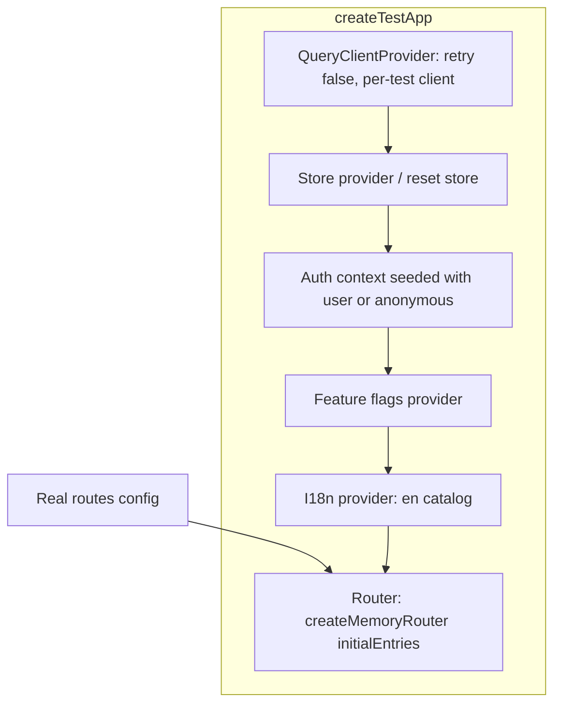
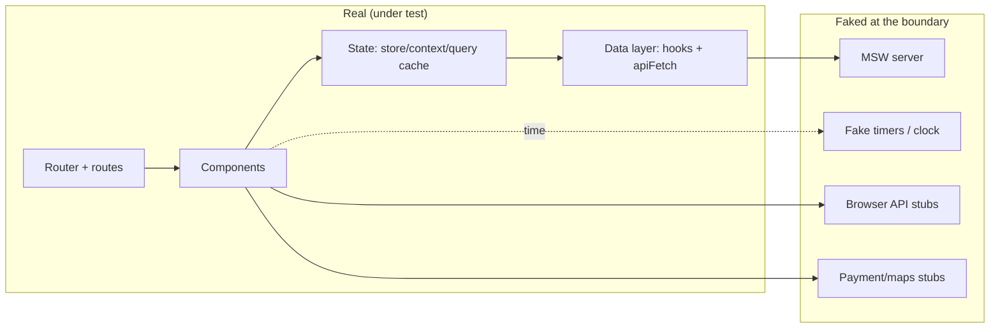
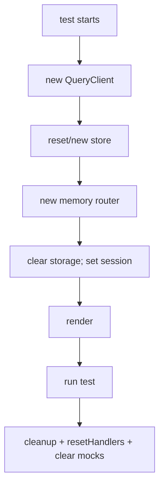

# 08 / 08 — Integration Testing: Feature Slices with Routing, State, and the Network Boundary

## 1. Lesson metadata

| | |
|---|---|
| **Level** | Advanced |
| **Study time** | 5–6 hours (reading 2 h, hands-on 2 h, exercises 1.5–2 h) |
| **Prerequisites** | [08 / 01 — Test strategy and the pyramid](./01-test-strategy-and-pyramid.md), [08 / 03 — React Testing Library](./03-react-testing-library.md), [08 / 06 — Mocking strategies and MSW](./06-mocking-strategies-and-msw.md), [08 / 07 — Testing API interactions](./07-testing-api-interactions.md), [04 / 15 — State ownership](../04-react-architecture/15-state-ownership.md), [04 / 18 — Routing architecture](../04-react-architecture/18-routing-architecture.md), [04 / 17 — Data flow architecture](../04-react-architecture/17-data-flow-architecture.md) |
| **Next** | [09 — E2E with Playwright](./09-e2e-with-playwright.md) |
| **Related later** | [10 — Accessibility testing](./10-accessibility-testing.md), [16 — Avoiding brittle tests](./16-avoiding-brittle-tests.md), [15 — CI checks](./15-ci-checks.md) |

**Version note.** Examples use React 19.x, React Router 7.x data-router APIs (`createMemoryRouter`, `RouterProvider`; in v6 both came from `react-router-dom`), Zustand 5.x, TanStack Query v5, MSW 2.x, Vitest 4.x, RTL 16.x. The router/store/harness code was executed on 2026-10-22 with react-router 7.18.4 and 8.5.0, zustand 5.0.16, Vitest 3.2.7 / 4.1.12 / 5.0.5 and jsdom 30. **Two environment findings:** (1) **on Vitest 3.2.7 + jsdom, any React Router data router (`createMemoryRouter`) fails** (navigation stalls with `TypeError: RequestInit: Expected signal ("AbortSignal {}") to be an instance of AbortSignal`, the jsdom-vs-Node `AbortSignal` mismatch from [lesson 06 §10.3](./06-mocking-strategies-and-msw.md)); use Vitest >= 4. (2) With **react-router 7.18** under Vitest 4, mixing `RouterProvider` from `react-router/dom` with `Navigate`/hooks from `react-router` produced `<Navigate> may be used only in the context of a <Router>` (two module instances in the test runner, even with `server.deps.inline`); importing `RouterProvider` from `react-router` fixed it, and **react-router 8** (ESM-only, Node >= 22.22; `createMemoryRouter`, `RouterProvider` and `react-router/dom` still exist) worked with the `react-router/dom` import. The *testing approach* is library-independent.

**Learning objectives.** After this lesson you can:
1. Define integration tests precisely (real modules cooperating; only the process boundary faked) and distinguish them from component and E2E tests.
2. Design a `createTestApp`/`renderApp` harness that provides routing, data, state, and feature-flag context with per-test isolation.
3. Write feature-slice tests that exercise multi-step user journeys across routes and assert on URL, UI, and outbound requests.
4. Handle global state (Redux, Zustand, context) so tests are isolated, and decide when to preload state versus drive it via the UI.
5. Test route guards, redirects, error boundaries, lazy routes, and Suspense without flakiness.
6. Control the size and cost of integration tests and decide what to leave to unit and E2E tests.
7. Diagnose slow, brittle, or leaking integration tests.

**Concepts covered:** integration scope, feature slice, test app factory, memory router, data-router loaders/actions in tests, provider composition, per-test store, preloaded state vs. UI-driven state, auth/session fixtures, feature flags, lazy routes and Suspense, error boundaries, document title/focus management on navigation, boundary mocking, journey tests, test data builders, test size heuristics.

---

## 2. Deep conceptual explanation

### 2.1 What problem is this lesson solving?

Unit and component tests verify parts. Real defects often live **between** parts:

- A form submits correct data, but the route that should show the result reads it from a different store key.
- The cart count in the header is derived from a store that the "Add to cart" button updates, but a refactor changed the selector.
- A route guard redirects to login, but the login page redirects back before the session is read.
- Two components both fetch `/me`; one gets 401 handling, the other silently fails.
- Navigating from a list to a detail and back loses scroll position or search filters.

Integration tests exercise **multiple real modules together** so wiring defects fail the build. Because the network boundary is faked (MSW), they remain fast and deterministic, unlike full E2E tests. In the testing-trophy view ([lesson 01](./01-test-strategy-and-pyramid.md)), this is the widest layer for UI applications: *most of the behavioral confidence per unit cost.*

### 2.2 A precise definition

> An **integration test** (in this course) renders a meaningful slice of the real application (several components, the real router, real state management, the real data-fetching layer) and fakes only what crosses the process boundary: network, clock (if needed), browser APIs the simulated DOM lacks, third-party SDKs that cannot run in tests.

Contrast:

| | Component test | Integration test | E2E test |
|---|---|---|---|
| Real modules | One component + children | A feature: routes, state, data layer | Entire app + browser (+ often backend) |
| Faked | Network, maybe context providers | Network, time, missing browser APIs | Nothing/third parties |
| Environment | jsdom | jsdom | Real browser |
| Typical scenario | "Button disables while pending" | "User adds an item, goes to checkout, sees updated total in header and summary" | "User can really buy from the deployed site" |
| Failure localization | Excellent | Good | Poor |
| Speed | ms | 100 ms–2 s | seconds–minutes |

### 2.3 What counts as a "feature slice"

A slice follows a **user story**, not a folder. Examples: *Checkout* (cart → shipping → payment → confirmation), *Account settings* (profile edit + password change), *Search with filters and URL sync*, *Admin user management (list/detail/edit/delete)*.

Heuristic for scope: include everything that participates in *the same user-observable outcome*. If the outcome is "cart count updates in the header", then both the product page and header must be in the render tree.

### 2.4 What to fake in integration tests (and what never)

| Fake | Why | How |
|---|---|---|
| HTTP APIs | Process boundary, determinism | MSW |
| Time (`Date`, timers) | Debounce, expiry, relative times | Fake timers (targeted), fixed system time |
| Browser APIs missing in jsdom | `matchMedia`, observers, `scrollTo`, `canvas` | Setup stubs |
| Third-party widgets/SDKs | Payment fields, maps, rich-text editors | Stub component/module at the boundary |
| Analytics/telemetry | Side effects | Adapter fake or no-op provider |
| Randomness/IDs | Determinism | Inject or seed |
| **Never fake:** | | |
| Your own routes/components | They *are* the integration | — |
| State management (store, context) | It is the glue | Real store, **fresh per test** |
| Router | Navigation is behavior | `createMemoryRouter` |
| Your data-fetching layer/hooks | Where wiring bugs live | Real; fake the network below it |

### 2.5 The test app factory

A harness assembles the same provider stack as production, but with test-appropriate configuration:



Principles:

1. **Reuse production composition** (`<AppProviders>`) with injectable overrides rather than duplicating the stack; duplication drifts. A common design: `AppProviders` accepts optional `queryClient`, `store`, `session`, `flags` props; production passes defaults; tests pass their own.
2. **Everything per test**: new `QueryClient`, new store instance, new router. No module-level singletons (or reset them).
3. **Return handles**: `{ user, router, queryClient, store }` so tests can navigate programmatically *only when the UI offers no path*, assert on `router.state.location`, or inspect store state in rare justified cases.
4. **Keep it small and readable.** A harness that hides 200 lines of behavior makes failures opaque.

### 2.6 Preloaded state vs. driving state via the UI

| Approach | Use when | Pros | Cons |
|---|---|---|---|
| **Drive via the UI** (type, click through steps) | The steps are what you're testing | Highest fidelity | Slower; repeated setup |
| **Preload state** (initial store state, seeded cache, session) | The state is a precondition, not the subject | Fast; focused | Can drift from reachable states (invalid combos) |
| **Server-side fixtures** (MSW handlers returning data that represents the precondition) | State originates at the server | Real data path; no internal coupling | Handler maintenance |

Rule of thumb: **arrange via the boundary** (server data, seeded session) rather than via internal store internals, so tests don't depend on the store's shape. Preloading internal store state is acceptable for UI-only state that has no server origin (e.g., a draft in a client store) when the store *is* the public API of a module.

### 2.7 Journey tests vs. scenario tests

- **Scenario test**: one behavior per test (e.g., "guest is redirected to login from /account and returned afterwards").
- **Journey test**: a linear multi-step story (cart → checkout → confirmation).

Prefer many small scenarios plus a few journeys. Journeys are valuable for catching cross-step state loss (e.g., address lost between steps) but cost more to diagnose. Each journey should assert at *each step boundary* (URL + key content) so a failure points to the step.

### 2.8 Common misconceptions

| Misconception | Reality |
|---|---|
| "Integration tests are slow." | In jsdom with MSW, typical slice tests run in tens to hundreds of ms. Slowness usually comes from real timers, huge renders, or repeated heavy setup. |
| "They duplicate component tests." | They overlap in *rendering*, not in *purpose*: component tests nail component-level edge cases; integration tests prove wiring across components/routes/state. |
| "Test the whole app in one test." | Large tests are hard to diagnose and brittle. Scope to a slice and a user story. |
| "I should mock the store to isolate the component." | The store is the integration; use the real one per test. |
| "More providers = more realistic." | Only include providers the slice needs; extra providers add setup cost and failure modes. |
| "Integration tests replace E2E." | They cannot catch bundler, CSS, real browser, SSR/hydration, cookie/storage, CORS, or CDN issues. |

---

## 3. Internal mechanics

### 3.1 Memory router vs. browser router in tests

`createMemoryRouter(routes, { initialEntries, initialIndex })` keeps history in memory (not `window.history`), so tests don't affect each other or jsdom's location. Navigation via `<Link>`/`navigate()`/form actions updates `router.state.location`. The router handles route matching, **loaders** (data before render), **actions** (form submissions), **error elements**, and **lazy** route modules. In tests:

- **Loaders** run via `fetch` through MSW, so loader errors and redirects are testable end-to-end: render at `/dashboard`, the loader redirects to `/login?redirectTo=/dashboard` when `/api/me` returns 401.
- **Pending UI**: during navigation, `useNavigation().state === "loading"`; use gates (lesson 07) to assert pending indicators.
- **Lazy routes** (`lazy: () => import("./Settings")` or `React.lazy`) resolve asynchronously: always use `findBy*` for content on lazy routes.

APIs differ if you use a different router (TanStack Router, Next.js App Router, Remix/React Router framework mode). For framework-owned routing (Next.js), integration tests often mock `next/navigation` and test components in isolation, with E2E covering routing; see [09 / 09 — Framework architecture](../09-advanced-rendering-and-ecosystem/09-framework-architecture.md).

### 3.2 Per-test store isolation

Global singleton stores persist across tests in the same module registry (Vitest isolates modules **per test file**, not per test). Options:

| Store | Isolation technique |
|---|---|
| Redux Toolkit | Create the store with a factory `makeStore(preloadedState)` per test; pass to `<Provider>` |
| Zustand (module singleton) | Reset: `useCartStore.setState(useCartStore.getInitialState(), true)` in `afterEach` (`getInitialState` exists in Zustand 5.0.16, verified; it was added in Zustand 4.5); or create stores via a factory + context |
| Jotai | New `Provider`/`createStore()` per test |
| Context + reducer | New provider instance per render (naturally isolated) |
| TanStack Query | New `QueryClient` per test |
| `localStorage`/`sessionStorage`/cookies | Clear in `beforeEach`/`afterEach` |
| URL state | New memory router per test |

If a store is a module singleton and you cannot reset it reliably, that is a *design smell* affecting production flexibility (SSR request isolation, multiple roots) as well as tests. See [03 / 20 — useSyncExternalStore and external stores](../03-react-state-and-hooks/20-usesyncexternalstore-and-external-stores.md).

### 3.3 Why integration tests need act-aware waiting

Navigation and data loading are asynchronous: route transitions run loaders, then render. After `user.click(link)`, you must `await` a condition that proves the transition completed (a heading on the new page, `router.state.location.pathname`). Asserting synchronously after the click usually sees the old page or the pending state. This is the same principle as [lesson 04](./04-testing-async-updates.md).

### 3.4 Focus and title management on navigation

Accessible SPAs manage focus and document title on route changes (announce the new page to screen readers). These behaviors are part of integration behavior and **cannot be tested in a component in isolation**. In jsdom:

- `document.title` can be asserted (React 19 supports rendering `<title>` in components and hoists it to `<head>`; verified: a route rendering `<title>Login</title>` made `document.title === "Login"` under jsdom; libraries like `react-helmet-async` historically did this).
- `document.activeElement` after navigation can be asserted, e.g., focus moved to the page's `h1` (a common pattern: `tabIndex={-1}` on the heading and `focus()` on route change).
- Live-region announcements can be asserted by role (`status`).

Real focus/scroll behavior should still be validated in a browser ([lesson 09](./09-e2e-with-playwright.md)).

### 3.5 Suspense, lazy routes, and error boundaries

- A `lazy` route module is fetched asynchronously; in Vitest the dynamic import resolves quickly but still asynchronously. The `fallback` renders first; assert it only if it matters, then `await findBy*`.
- Error boundaries: a thrown render error or loader error should render the route's `errorElement`. React logs errors to `console.error` even when caught by boundaries; **expect and silence** that specific noise in the test (restore afterward) or assert on it explicitly. A global "fail on console.error" setup needs an allowlist mechanism for these cases.

---

## 4. Step-by-step execution walkthrough: a checkout journey test

Slice: `/cart` → `/checkout/shipping` → `/checkout/payment` → `/confirmation`. Real: routes, Zustand cart store, TanStack Query, forms, validation. Fake: MSW for `GET /api/cart`, `POST /api/checkout/shipping`, `POST /api/orders`; payment widget stubbed as a text input.

| # | Test action | App behavior | Assertion |
|---|---|---|---|
| 1 | `createTestApp({ route: "/cart", session: signedIn })` | Router matches `/cart`; loader/query fires `GET /api/cart`; store hydrates cart | `findByRole("heading", { name: "Your cart" })`; two line items; total `$120.00` |
| 2 | click "+" on item A | Store updates quantity (optimistic); `PATCH /api/cart/items/a` (gated) | quantity 2 immediately (optimistic); total `$170.00` |
| 3 | release gate | Server returns updated cart | no change (reconciled), single request recorded |
| 4 | click "Proceed to checkout" | Router navigates to `/checkout/shipping` | `router.state.location.pathname === "/checkout/shipping"`; heading "Shipping address"; focus on `h1` |
| 5 | submit empty shipping form | Client validation | `alert`/field errors; **no** request sent |
| 6 | fill address; submit | `POST /api/checkout/shipping` → 200 | navigates to payment; summary shows shipping cost `$5.00`; total `$175.00` |
| 7 | at payment, enter card (stub) and click "Pay" | `POST /api/orders` (gated) | "Pay" disabled, `aria-busy`; one POST |
| 8 | release gate with 201 | Store clears cart; navigate `/confirmation?order=o_1` | heading "Thanks for your order"; order id text; header cart badge hidden; `document.title` includes "Order confirmed" |
| 9 | press back (`router.navigate(-1)` — or click "Back to shop") | Guard prevents returning to paid checkout | location is not `/checkout/payment` (redirected) |

Notes:
- Each step has a **boundary assertion** (URL + heading) so failures localize.
- Steps 2–3 and 7–8 use gates for deterministic intermediate states.
- Step 9 asserts a guard; if that guard is the *subject*, make it its own scenario test and keep the journey short.

**Predict:** if the cart store were a module singleton not reset between tests and an earlier test left `qty: 2` in it, which step fails first? **Result:** Step 1's total assertion (`$120.00`) fails or, worse, passes depending on order if the earlier state coincidentally matches. This is why per-test store isolation matters.

---

## 5. Code examples

### 5.1 The app under test (routes and providers)

```tsx
// src/app/routes.tsx
import type { RouteObject } from "react-router";
import { CartPage } from "../cart/CartPage";
import { ConfirmationPage } from "../checkout/ConfirmationPage";
import { PaymentPage } from "../checkout/PaymentPage";
import { ShippingPage } from "../checkout/ShippingPage";
import { RequireAuth } from "../auth/RequireAuth";
import { RootLayout } from "./RootLayout";
import { RouteError } from "./RouteError";

export const routes: RouteObject[] = [
  {
    path: "/",
    element: <RootLayout />,           // header with cart badge, <Outlet />
    errorElement: <RouteError />,
    children: [
      { index: true, element: <p>Welcome</p> },
      { path: "login", lazy: async () => ({ Component: (await import("../auth/LoginPage")).LoginPage }) },
      {
        element: <RequireAuth />,
        children: [
          { path: "cart", element: <CartPage /> },
          { path: "checkout/shipping", element: <ShippingPage /> },
          { path: "checkout/payment", element: <PaymentPage /> },
          { path: "confirmation", element: <ConfirmationPage /> },
        ],
      },
    ],
  },
];
```

```tsx
// src/app/AppProviders.tsx
import { QueryClient, QueryClientProvider } from "@tanstack/react-query";
import type { ReactNode } from "react";
import { SessionProvider, type Session } from "../auth/SessionProvider";
import { FlagsProvider, type Flags } from "../flags/FlagsProvider";

export interface AppProvidersProps {
  children: ReactNode;
  queryClient?: QueryClient;
  session?: Session | null;
  flags?: Partial<Flags>;
}

export function AppProviders({ children, queryClient = defaultClient(), session, flags }: AppProvidersProps) {
  return (
    <QueryClientProvider client={queryClient}>
      <SessionProvider initialSession={session}>
        <FlagsProvider overrides={flags}>{children}</FlagsProvider>
      </SessionProvider>
    </QueryClientProvider>
  );
}

const defaultClient = () => new QueryClient();   // production default; tests pass their own
```

Design point: `AppProviders` is the *same* component production uses, with optional injection props. The production `main.tsx` passes nothing; tests pass a client, session, and flags. This keeps the test composition from drifting.

### 5.2 The harness

```tsx
// src/test/createTestApp.tsx
import { QueryClient } from "@tanstack/react-query";
import { render } from "@testing-library/react";
import userEvent from "@testing-library/user-event";
import { createMemoryRouter } from "react-router";
import { RouterProvider } from "react-router/dom";      // v8, or v7 in the browser; with v7.18 under Vitest import it from "react-router" (see version note); in v6: "react-router-dom"
import { AppProviders } from "../app/AppProviders";
import { routes } from "../app/routes";
import type { Session } from "../auth/SessionProvider";
import type { Flags } from "../flags/FlagsProvider";
import { useCartStore } from "../cart/store";

export interface TestAppOptions {
  route?: string;
  session?: Session | null;
  flags?: Partial<Flags>;
}

export const signedIn: Session = { user: { id: "u1", name: "Ada" }, token: "test-token" };

export function createTestApp({ route = "/", session = null, flags }: TestAppOptions = {}) {
  localStorage.clear();
  useCartStore.setState(useCartStore.getInitialState(), true);   // getInitialState: Zustand >= 4.5 (verified on 5.0.16)

  if (session) localStorage.setItem("token", session.token);

  const user = userEvent.setup();
  const queryClient = new QueryClient({
    defaultOptions: { queries: { retry: false, gcTime: Infinity, staleTime: 0 }, mutations: { retry: false } },
  });
  const router = createMemoryRouter(routes, { initialEntries: [route] });

  const utils = render(
    <AppProviders queryClient={queryClient} session={session} flags={flags}>
      <RouterProvider router={router} />
    </AppProviders>,
  );

  return { user, router, queryClient, ...utils, pathname: () => router.state.location.pathname };
}
```

Line notes:
- Resetting the module-level Zustand store in the factory couples tests to that singleton; if you control store creation, prefer a factory and context so no reset is needed. The reset line is the pragmatic compromise for existing singleton stores.
- `pathname()` returns a *function* so tests read the current location lazily (a value captured once would be stale; the same snapshot lesson as [lesson 05](./05-testing-custom-hooks.md)).
- The harness sets `localStorage` token because the data layer reads it (lesson 07). A cleaner design injects a token provider; keep the harness aligned with how production gets credentials.

### 5.3 Scenario tests: guards and redirects

```tsx
test("anonymous users are sent to login with a return path, then back after signing in", async () => {
  server.use(
    http.post(`${API_URL}/api/login`, async ({ request }) => {
      const body = (await request.json()) as { email: string; password: string };
      return body.password === "pw" ? HttpResponse.json({ token: "t", user: { id: "u1", name: "Ada" } }) : HttpResponse.json({ message: "Invalid" }, { status: 401 });
    }),
    http.get(`${API_URL}/api/cart`, () => HttpResponse.json({ items: [], totalCents: 0 })),
  );
  const { user, pathname, router } = createTestApp({ route: "/cart", session: null });

  expect(await screen.findByRole("heading", { name: "Sign in" })).toBeInTheDocument();     // lazy route
  expect(router.state.location.search).toBe("?redirectTo=%2Fcart");

  await user.type(screen.getByLabelText("Email"), "ada@example.com");
  await user.type(screen.getByLabelText("Password"), "pw");
  await user.click(screen.getByRole("button", { name: "Sign in" }));

  expect(await screen.findByRole("heading", { name: "Your cart" })).toBeInTheDocument();
  expect(pathname()).toBe("/cart");
});

test("a wrong password stays on login with an error and does not navigate", async () => {
  server.use(http.post(`${API_URL}/api/login`, () => HttpResponse.json({ message: "Invalid" }, { status: 401 })));
  const { user, pathname } = createTestApp({ route: "/login" });
  await user.type(await screen.findByLabelText("Email"), "ada@example.com");
  await user.type(screen.getByLabelText("Password"), "nope");
  await user.click(screen.getByRole("button", { name: "Sign in" }));

  expect(await screen.findByRole("alert")).toHaveTextContent(/invalid/i);
  expect(pathname()).toBe("/login");
});
```

These are small, scenario-focused slices; the redirect/return behavior spans guard + router + login page + session + network (a perfect integration target). Notice `findByRole` for the lazily loaded login page.

### 5.4 Journey test with checkpoints, gates, and request assertions

```tsx
test("a signed-in shopper can check out", async () => {
  const gatePay = deferred<void>();
  const orders: unknown[] = [];

  server.use(
    http.get(`${API_URL}/api/cart`, () =>
      HttpResponse.json({
        items: [{ id: "a", name: "Espresso machine", unitCents: 10000, qty: 1 }, { id: "b", name: "Grinder", unitCents: 2000, qty: 1 }],
        totalCents: 12000,
      })),
    http.post(`${API_URL}/api/checkout/shipping`, async ({ request }) => {
      const body = (await request.json()) as { postcode: string };
      return body.postcode ? HttpResponse.json({ shippingCents: 500 }) : HttpResponse.json({ errors: { postcode: "Required" } }, { status: 422 });
    }),
    http.post(`${API_URL}/api/orders`, async ({ request }) => {
      orders.push(await request.json());
      await gatePay.promise;
      return HttpResponse.json({ id: "o_1" }, { status: 201 });
    }),
  );

  const { user, pathname } = createTestApp({ route: "/cart", session: signedIn });

  // Step 1: cart
  expect(await screen.findByRole("heading", { name: "Your cart" })).toBeInTheDocument();
  expect(within(screen.getByRole("list", { name: "Cart items" })).getAllByRole("listitem")).toHaveLength(2);
  expect(screen.getByTestId("cart-total")).toHaveTextContent("$120.00");

  // Step 2: shipping
  await user.click(screen.getByRole("link", { name: /checkout/i }));
  expect(await screen.findByRole("heading", { name: "Shipping address" })).toBeInTheDocument();
  expect(pathname()).toBe("/checkout/shipping");
  expect(screen.getByRole("heading", { name: "Shipping address" })).toHaveFocus();     // route-change focus management

  await user.click(screen.getByRole("button", { name: "Continue" }));
  expect(await screen.findByText("Required")).toBeInTheDocument();                       // server 422 mapped to field
  expect(pathname()).toBe("/checkout/shipping");

  await user.type(screen.getByLabelText("Postcode"), "12345");
  await user.click(screen.getByRole("button", { name: "Continue" }));

  // Step 3: payment
  expect(await screen.findByRole("heading", { name: "Payment" })).toBeInTheDocument();
  expect(screen.getByTestId("order-total")).toHaveTextContent("$125.00");               // 120 + 5 shipping
  await user.type(screen.getByLabelText("Card number"), "4242 4242 4242 4242");
  await user.click(screen.getByRole("button", { name: "Pay $125.00" }));

  expect(await screen.findByRole("button", { name: /paying/i })).toBeDisabled();
  expect(orders).toHaveLength(1);

  gatePay.resolve();

  // Step 4: confirmation
  expect(await screen.findByRole("heading", { name: "Thanks for your order" })).toBeInTheDocument();
  expect(pathname()).toBe("/confirmation");
  expect(screen.getByText(/o_1/)).toBeInTheDocument();
  expect(screen.queryByTestId("cart-badge")).not.toBeInTheDocument();                   // header badge cleared by shared store
  await waitFor(() => expect(document.title).toMatch(/order confirmed/i));
  expect(orders[0]).toMatchObject({ items: [{ id: "a", qty: 1 }, { id: "b", qty: 1 }], shipping: { postcode: "12345" } });
});
```

Line notes:
- **Checkpoints**: each step asserts heading + pathname. A failure message "Unable to find heading 'Payment'" tells you which transition broke.
- **Cross-module assertions** are the point: the cart *badge in the header* disappears after payment (store shared between the layout and the checkout feature); the order payload contains data from three steps (cart, shipping, payment): state carried across routes.
- The payment widget is a plain labelled input in test (a stub) because the real provider iframe cannot run in jsdom.
- `getByTestId("cart-total")` is used because the total is dynamic text without a semantic handle; acceptable per lesson 03's priority notes, though a `<output>` with accessible name or a `role="status"` summary would be better semantic markup.
- The journey is long (~35 lines). Keep it as *one* of several: validation edge cases, tax rules, shipping options, and failure paths are scenario tests or lower-level tests.

### 5.5 Incorrect example: over-mocking the integration away

```tsx
// ❌ "Integration" test that isn't
vi.mock("../cart/store", () => ({ useCartStore: () => ({ items: [{ id: "a", qty: 1 }], total: 12000 }) }));
vi.mock("react-router", async (orig) => ({ ...(await orig<typeof import("react-router")>()), useNavigate: () => mockNavigate }));
render(<CheckoutButton />);
await user.click(screen.getByRole("button", { name: /checkout/i }));
expect(mockNavigate).toHaveBeenCalledWith("/checkout/shipping");
```
**Why wrong for an integration test:** it fakes both the store and the router, so nothing is integrated. It verifies that a click calls `navigate` with a string. If the route is renamed to `/checkout/address`, the test (and the app) disagree until someone notices. It's still a valid *unit* test of `CheckoutButton`, but must not be counted as integration confidence.

### 5.6 Corrected implementation

Use `createTestApp` with the real routes: click the real link, assert the real heading and `pathname()`. Rename the route in `routes.tsx` and the test either follows (assertion on heading text) or fails if the link breaks, as it should.

### 5.7 Error boundary and loader failure

```tsx
test("a failing cart load shows the route error UI with a way back", async () => {
  server.use(http.get(`${API_URL}/api/cart`, () => new HttpResponse(null, { status: 500 })));
  const consoleError = vi.spyOn(console, "error").mockImplementation(() => {});
  const { user, pathname } = createTestApp({ route: "/cart", session: signedIn });

  expect(await screen.findByRole("heading", { name: /something went wrong/i })).toBeInTheDocument();
  expect(consoleError).toHaveBeenCalled();                      // React / router logged the error: expected here

  await user.click(screen.getByRole("link", { name: /back to shop/i }));
  expect(pathname()).toBe("/");
  consoleError.mockRestore();
});
```
If your global setup fails tests on `console.error`, wrap this pattern in a helper `expectConsoleError(/pattern/, () => ...)` that allows a *specific* message; avoid blanket silencing.

### 5.8 Feature flags and variants

```tsx
test.each([
  [{ newCheckout: false }, "Shipping address"],
  [{ newCheckout: true }, "Where should we send it?"],
])("flag %o renders the matching shipping step", async (flags, heading) => {
  server.use(http.get(`${API_URL}/api/cart`, () => HttpResponse.json(oneItemCart())));
  const { user } = createTestApp({ route: "/cart", session: signedIn, flags });
  await user.click(await screen.findByRole("link", { name: /checkout/i }));
  expect(await screen.findByRole("heading", { name: heading })).toBeInTheDocument();
});
```
Flags are an **input** to the app: inject them via the provider rather than mocking the flag SDK in every file. Test both variants (and the default when the provider is absent) for any flag that will live more than a day; delete both the flag and the test when the flag is retired.

### 5.9 Shared state across distant components

```tsx
test("adding from the product page updates the header badge and the cart page", async () => {
  server.use(
    http.get(`${API_URL}/api/products/espresso`, () => HttpResponse.json({ id: "a", name: "Espresso machine", priceCents: 10000 })),
    http.post(`${API_URL}/api/cart/items`, () => HttpResponse.json({ items: [{ id: "a", name: "Espresso machine", unitCents: 10000, qty: 1 }], totalCents: 10000 }, { status: 201 })),
    http.get(`${API_URL}/api/cart`, () => HttpResponse.json({ items: [{ id: "a", name: "Espresso machine", unitCents: 10000, qty: 1 }], totalCents: 10000 })),
  );
  const { user } = createTestApp({ route: "/products/espresso", session: signedIn });

  await user.click(await screen.findByRole("button", { name: "Add to cart" }));
  expect(await screen.findByRole("status")).toHaveTextContent(/added to cart/i);
  expect(screen.getByRole("link", { name: /cart \(1\)/i })).toBeInTheDocument();         // header badge from shared store/query

  await user.click(screen.getByRole("link", { name: /cart/i }));
  expect(await screen.findByRole("listitem", { name: /espresso machine/i })).toBeInTheDocument();
});
```
The header and the product page never import each other; only the shared state layer connects them: exactly the kind of wiring unit tests cannot prove.

### 5.10 Advanced: asserting no request storms and bounded navigation

```tsx
test("loading the dashboard sends one request per resource (no duplicate or looping fetches)", async () => {
  const counts = new Map<string, number>();
  server.events.on("request:start", ({ request }) => {
    const key = `${request.method} ${new URL(request.url).pathname}`;
    counts.set(key, (counts.get(key) ?? 0) + 1);
  });
  server.use(
    http.get(`${API_URL}/api/me`, () => HttpResponse.json({ id: "u1", name: "Ada" })),
    http.get(`${API_URL}/api/stats`, () => HttpResponse.json({ visits: 3 })),
  );

  createTestApp({ route: "/dashboard", session: signedIn });
  await screen.findByText(/3 visits/i);
  await new Promise((r) => setTimeout(r, 0));          // allow any erroneous follow-up requests to start (macrotask boundary)

  expect(Object.fromEntries(counts)).toEqual({ "GET /api/me": 1, "GET /api/stats": 1 });
  server.events.removeAllListeners();
});
```
Asserting request counts catches duplicate fetching (two components with different query keys for the same resource) and loops. The `setTimeout(0)` yield is a deliberate, narrow concession: "give erroneous follow-ups one macrotask to appear". It cannot prove absence forever; pair with a bounded-effort assertion style. (`server.events.removeAllListeners()` verified on MSW 2.15.0.)

### 5.11 Making integration tests fast

```ts
// vitest.config.ts excerpt
test: {
  environment: "jsdom",
  setupFiles: ["./src/test/setup.ts"],
  css: false,                 // skip CSS processing (if your tests don't rely on computed styles)
  pool: "forks",              // already the default since Vitest 2 (verified in the v3 config docs); shown only for explicitness
  testTimeout: 10_000,        // integration tests may be slower; keep the default for unit
},
```
Other levers: import specific modules rather than barrels (barrels pull the whole app into every file); keep default handlers tiny; avoid `userEvent` per-character typing for long text (use `user.paste`); don't render the entire app when a slice needs two routes; run heavy suites in parallel shards in CI.

---

## 6. Visual explanations

### 6.1 What is real in an integration test



### 6.2 Per-test isolation



### 6.3 Journey with checkpoints

```text
/cart ──► /checkout/shipping ──► /checkout/payment ──► /confirmation
 ✔ heading     ✔ heading+focus       ✔ total incl. shipping   ✔ heading, order id
 ✔ items       ✔ 422 field error     ✔ pending guard          ✔ header badge cleared
               ✔ no request when invalid                       ✔ payload carries all steps
```

### 6.4 Where each concern is tested

| Concern | Unit | Component | Integration | E2E |
|---|---|---|---|---|
| Tax/price calculation edge cases | ✔✔ | | ✔ (one representative) | |
| Form field validation messages | ✔ (pure rules) | ✔✔ | ✔ (step transition) | |
| Route guard redirect + return | | | ✔✔ | ✔ (one, real cookies) |
| Shared state across components | | | ✔✔ | |
| Keyboard/focus on route change | | | ✔ (basic) | ✔ (real browser) |
| CSS/layout/responsive | | | | ✔ / visual regression |
| Real auth cookie/CORS/CDN | | | | ✔ |

---

## 7. Alternative approaches and trade-offs

### 7.1 Integration styles

| Criterion | Full app render with memory router (this lesson) | Container-level render (one route's element) | Storybook interaction tests | Playwright component tests | Real browser E2E |
|---|---|---|---|---|---|
| Fidelity of navigation | High | None (mock `useNavigate`) | None | Partial | Highest |
| Setup cost | Medium | Low | Medium | Medium–High | High |
| Speed | Fast | Fastest | Medium | Medium | Slow |
| Catches route/guard bugs | Yes | No | No | Partial | Yes |
| Real CSS/layout | No | No | Yes | Yes | Yes |
| Flake risk | Low | Very low | Medium | Medium | Medium–High |
| Best for | Journeys and guards | Page-level behavior without navigation | Visual states, a11y per story | Real-browser components | Critical journeys |

### 7.2 State setup strategies

| Strategy | Fidelity | Speed | Coupling to internals | Recommendation |
|---|---|---|---|---|
| UI-driven | Highest | Slow | None | Subject of the test |
| Server-data driven (MSW) | High | Fast | None | Default for preconditions |
| Preloaded store/cache | Medium | Fastest | Medium–High | Only for client-only state |
| Direct store mutation in test | Low | Fast | High | Avoid |

### 7.3 When the recommended approach (integration-heavy) is NOT best

- **Frameworks that own routing/data (Next.js App Router, Remix framework mode)**: the router, loaders, server components, and caching live in the framework; replicating them in jsdom is incomplete or impossible (RSC doesn't render in RTL the same way). Test client components and pure logic at the component level, use the framework's own integration/E2E mechanisms, and invest in Playwright for routes/server rendering.
- **Highly visual, interaction-heavy widgets** (drag and drop canvases, maps): jsdom can't judge layout; use real-browser component tests or visual regression.
- **Tiny apps**: with 5 screens and little shared state, a handful of component tests plus two E2E may deliver the same confidence at lower maintenance than a harness.
- **Hot paths whose cost is dominated by the server**: put the effort into API contract/integration tests on the backend and a single front-end smoke.

---

## 8. Best practices and anti-patterns

**Do**
- Write each integration test around one **user story**; name it like one ("anonymous users are sent to login and returned after signing in").
- Build a single `createTestApp` that reuses production providers and injects per-test state.
- Fake only the boundary; use real router, store, components.
- Assert at checkpoints (URL + landmark/heading + key content) in journeys.
- Combine gates for pending states, `findBy*` for transitions, and request capture for contracts.
- Keep default handlers minimal; override per scenario.
- Assert cross-cutting behavior here: focus management, document title, shared state reflecting across distant components, bounded requests.
- Run integration suites with randomized order in CI occasionally to expose leaks.

**Beginner mistakes**
- Mocking the router/store and calling it integration.
- Asserting synchronously after navigation.
- Sharing a store or `QueryClient` across tests.
- One enormous test for the whole app.

**Experienced-developer mistakes**
- Harness complexity creep: 300-line `renderApp` with magic defaults, so no one can tell what a test depends on.
- Preloading internal state shapes so tests break on every store refactor.
- Re-testing unit-level edge cases (tax rules, validators) through the full UI.
- Neglecting error and guard paths because the happy-path journey is "enough".
- Treating integration tests as a replacement for E2E and skipping browser-level validation of auth cookies, CORS, and real navigation.

**Smells:** tests that import internal store modules to set up state; `if (process.env.TEST)` branches in production code; `vi.mock` of 5+ app modules; sleeps; a "journey" test that fails in step 1 for unrelated reasons ten times a month; handler overrides copied across 30 tests (move to scenario helpers).

**Justified exceptions:** preloading a **client-only draft** (e.g., a half-completed wizard persisted in a store) to test resume behavior; mocking a framework module (`next/navigation`) where no provider exists; stubbing a third-party payment/maps component; using `router.navigate()` directly to reach a state the UI doesn't expose (e.g., a deep link) as a precondition (but assert the user-visible result).

---

## 9. Real-world application

**E-commerce checkout (money and state).** Constraints: multi-step flow, totals computed on server and client, coupons, inventory conflicts. Integration tests: journey (above), scenario tests for: coupon applied persists across steps; inventory conflict at payment (409) routes back to the cart with a notice and updated quantities; session expiry mid-checkout triggers re-auth and returns to the same step with data intact; reload mid-flow restores state (if persisted). Unit tests cover totals; E2E covers the real payment provider in test mode.

**Admin dashboards with role-based access.** Constraints: pages and actions vary by permissions; unauthorized deep links must not flash privileged content. Tests: `createTestApp({ session: { role: "viewer" } })` for each role: nav shows only permitted links; direct navigation to `/admin/users` renders "no access" and fires **no** privileged API request (assert request log); role upgrade via re-login updates nav without reload. Table-driven over roles (`test.each`) for a permissions matrix, leaving the matrix itself as a data file shared with the app (single source of truth).

**Search with URL-synced filters.** Constraints: shareable URLs, back/forward behavior, debounced input. Tests: type in search → URL updates `?q=`; navigating back restores the previous query and results; opening `/search?q=lamp&sort=price` renders matching state on first render (no flash of default); invalid params fall back gracefully. Time is controlled narrowly (fake debounce only).

**Forms spanning pages (onboarding/KYC).** Constraints: draft persistence, resumability, per-step server validation. Tests: fill step 1, reload (new `createTestApp` with same storage) → resumes at step 2 with step-1 data; server rejects a field on step 3 → the user is taken back to step 1 with an error summary focused; submit button never double-sends.

**Multi-team microfrontend shell.** Constraints: shell provides auth/layout, teams provide remotes. Integration tests live at *seams*: shell renders a fake remote exposing the agreed contract (props, events, shared context) and asserts both sides. Teams' remotes have their own slice tests; the shell has contract tests; a small E2E covers real federation loading.

---

## 10. Debugging and troubleshooting

### 10.1 "Works alone, fails with the rest of the file"

1. Suspect leaked state: stores, storage, `QueryClient`, MSW overrides, module-level caches, router (browser router vs. memory).
2. Run with shuffled order and bisect with `-t`.
3. Add an `afterEach` leak detector in setup: assert `localStorage.length === 0`, `document.body.children.length === 0` after cleanup, and `server.listHandlers().length` equals the initial count (`listHandlers` verified on MSW 2.15.0), failing loudly.

### 10.2 "findBy times out after navigation"

1. Print `router.state.location` and `screen.debug()`: did navigation happen? If not, the click may have hit a disabled link, or a guard redirected elsewhere.
2. Is the route lazy and its chunk failing (path alias in dynamic import)? Check for an unhandled rejection.
3. Is a loader awaiting an endpoint without a handler (unhandled-request error swallowed by the router)? Look at console output and set `onUnhandledRequest: "error"`.
4. Does the new page expose a different heading than expected (copy change)? Prefer asserting stable landmarks/headings from the same constants the app uses.

### 10.3 "Suspense/lazy flicker or act warnings"

1. Lazy components resolve after the test's last await: always await a **final** UI condition.
2. If a warning cites a component inside a lazy route, an update arrives after the test ended; await its settled state or unmount.
3. Prefetching code (hover/idle prefetch) triggers late imports: disable prefetch in tests or await.

### 10.4 "Console is full of React/router errors"

Distinguish expected from unexpected: an error-boundary test *should* log; others shouldn't. Use a setup that records `console.error` calls and fails tests unless explicitly allowed via a helper; investigate each unexpected message (e.g., "Each child in a list should have a unique key", "Cannot update a component while rendering a different component", "Maximum update depth exceeded").

### 10.5 "The test is slow (several seconds)"

1. Profile: `vitest --reporter=verbose` for per-test time; add `performance.now()` markers for steps.
2. Common causes: `userEvent.type` on long strings (use `paste`), `waitFor` with default 1 s timeout hit repeatedly because conditions are wrong then right, huge default handler payloads, importing the whole app, real `setTimeout` delays in handlers.
3. Validate improvements by measuring total time before/after on CI hardware.

### 10.6 "Hidden dependency on test order"

Symptoms: only passes if a previous test ran (e.g., session already stored). Fix the harness so each test's preconditions are explicit; consider a guard in `createTestApp` that throws if storage isn't empty at the start (indicates a previous test leaked).

---

## 11. Exercises

### Level A — Knowledge
A1. Define an integration test in this course and list four things it fakes and four things it never fakes.
A2. Why is `createMemoryRouter` preferred over a browser router in tests?
A3. What does "arrange via the boundary" mean for test state setup?
A4. Name three categories of behavior only visible in integration tests.
A5. Why must `pathname()` in the harness be a function?

### Level B — Code comprehension
B1. In 5.4, which assertions would still pass if the cart badge were rendered from a *separate* store never updated by checkout? Which would fail?
B2. In 5.10, explain the purpose of the final `setTimeout(0)` and why it's imperfect. What alternative provides stronger evidence?
B3. What goes wrong if `createTestApp` is called twice in one test?

### Level C — Implementation
C1. Write a scenario test for a role-based nav: `viewer` sees "Reports" only; `admin` also sees "Users"; both cases assert that `/users` for viewer renders "no access" and sends no `/api/users` request.
C2. Write a test that verifies back/forward behavior of URL-synced search: search "lamp", then "desk", press browser back (`router.navigate(-1)`), the input shows "lamp" and results match.
C3. Write a test that a session expiring mid-checkout (401 on `POST /api/checkout/shipping`) redirects to `/login?redirectTo=/checkout/shipping`, and after login returns to shipping with the previously entered postcode still in the form.

### Level D — Debugging
D1. A journey test passes locally but fails in CI at "heading 'Payment'" with no obvious error. List five hypotheses and an investigation order.
D2. After introducing a Zustand persist middleware (localStorage), tests start failing in seemingly random ways. Why, and how do you fix the harness?
D3. A guard test asserts "no `/api/users` request for viewers", but the assertion passes even when the guard is removed. Why, and how do you make it meaningful?

### Level E — Architecture and engineering decisions
E1. Your app uses Next.js App Router with RSC. Propose a testing strategy (unit, component, integration, E2E) given jsdom's limits. What do you mock and what do you refuse to?
E2. The team wants to run the full journey tests on every PR but they take 4 minutes. Propose measures to cut the time without losing coverage, and a policy for which tests gate merges.

### Level F — Expert challenge
F1. Design the integration test architecture for a multi-tenant admin app with 40 routes, role-based permissions, feature flags, i18n (6 locales), and server-driven navigation. Define the harness, the permission-matrix tests, locale strategy, and how you keep the suite under 3 minutes.

---

## 12. Detailed answers and explanations

> Attempt the exercises first.

**A1.** An integration test renders a meaningful slice of the real app (routes, components, state, data layer) and fakes only the process boundary. Fakes: HTTP (MSW), time (fake timers), missing browser APIs, third-party SDK widgets (also analytics, randomness). Never fake: your own components, the router, your state management, your data-fetching hooks/layer.

**A2.** Memory router stores history in memory, so tests are isolated from jsdom's `window.history`/`location` and from each other; you can start at any route; and you can read `router.state.location` directly. A browser router mutates global location, causing leaks between tests.

**A3.** Create preconditions through the same boundary the real app crosses (server responses via MSW, session cookies/tokens in storage) rather than poking internal state (store shape), so tests don't break when internals change and they exercise real data paths.

**A4.** (1) State shared across distant components (header badge vs. page), (2) route guards/redirects with return paths, (3) multi-step state carried across navigation, (4) focus/title/announcement on route change, (5) request orchestration (dedupe, no loops).

**A5.** Because `router.state.location` changes over time; a value captured once (`const p = router.state.location.pathname`) is a stale snapshot. A function reads the current location on each call.

**B1.** The headings, pathnames, totals, and order payload assertions do not involve the badge, so they would all still pass. The badge assertion is `queryByTestId("cart-badge")` **not** in the document; if the badge were driven by a separate store that checkout never touches (and that never held the items), the badge would be absent from the start and the assertion would pass *vacuously*. The journey therefore does not prove the shared-state wiring. Fix: assert the badge is **present** with the right count earlier in the journey (e.g., after the cart loads), then assert it disappears after payment. Pair every negative assertion with an earlier positive one.

**B2.** Purpose: let any erroneous follow-up request (a duplicate or loop) start before counting. Imperfect: it only waits one macrotask; a delayed duplicate (after 100 ms debounce or a retry timer) would be missed, so the assertion proves less than it appears. Stronger evidence: await a *deterministic* signal that all intended work is complete (e.g., the UI finished and the query client reports `isFetching() === 0`, via `queryClient.isFetching()`) and use fake timers to advance past any known timers (retry/refetch intervals) before counting; or assert on explicit request keys with `once` handlers that fail on a second call.

**B3.** Two renders create two routers/clients/providers in the same document body (RTL appends both), so queries find duplicates ("multiple elements") and shared singletons (store) are reset twice, destroying state from the first. Create one app per test; if you need a second tab/window simulation, use a separate test or an explicit container with isolation.

**C1.**
```tsx
test.each([
  ["viewer", ["Reports"], ["Users"]],
  ["admin", ["Reports", "Users"], []],
] as const)("%s navigation", async (role, visible, hidden) => {
  createTestApp({ route: "/", session: { ...signedIn, user: { ...signedIn.user, role } } });
  const nav = await screen.findByRole("navigation", { name: /main/i });
  for (const name of visible) expect(within(nav).getByRole("link", { name })).toBeInTheDocument();
  for (const name of hidden) expect(within(nav).queryByRole("link", { name })).not.toBeInTheDocument();
});

test("viewer deep link to /users shows no access and sends no privileged request", async () => {
  let usersCalls = 0;
  server.use(http.get(`${API_URL}/api/users`, () => { usersCalls++; return HttpResponse.json([]); }));
  createTestApp({ route: "/users", session: { ...signedIn, user: { ...signedIn.user, role: "viewer" } } });

  expect(await screen.findByRole("heading", { name: /no access/i })).toBeInTheDocument();
  expect(usersCalls).toBe(0);
});
```
Also include a positive control (admin does call `/api/users` once) in a sibling test so the "0 calls" isn't vacuous.

**C2.**
```tsx
test("search is URL-synced and back restores the previous query", async () => {
  server.use(http.get(`${API_URL}/api/search`, ({ request }) => {
    const q = new URL(request.url).searchParams.get("q");
    return HttpResponse.json({ results: [{ id: q, title: `Result for ${q}` }] });
  }));
  const { user, router } = createTestApp({ route: "/search", session: signedIn });
  const box = await screen.findByRole("searchbox");

  await user.type(box, "lamp{Enter}");
  expect(await screen.findByText("Result for lamp")).toBeInTheDocument();
  await user.clear(box);
  await user.type(box, "desk{Enter}");
  expect(await screen.findByText("Result for desk")).toBeInTheDocument();
  expect(router.state.location.search).toBe("?q=desk");

  await act(async () => { await router.navigate(-1); });
  expect(await screen.findByText("Result for lamp")).toBeInTheDocument();
  expect(screen.getByRole("searchbox")).toHaveValue("lamp");
});
```
Notes: `router.navigate(-1)` is the in-memory equivalent of the back button, justified because memory history has no real back button; the assertion is on user-visible state. If the input is uncontrolled and derived only from URL on mount, the `toHaveValue("lamp")` check catches the common bug where the field keeps "desk".

**C3.**
```tsx
test("an expired session mid-checkout redirects to login and resumes with data intact", async () => {
  let call = 0;
  server.use(
    http.get(`${API_URL}/api/cart`, () => HttpResponse.json(oneItemCart())),
    http.post(`${API_URL}/api/checkout/shipping`, () => (++call === 1 ? new HttpResponse(null, { status: 401 }) : HttpResponse.json({ shippingCents: 500 }))),
    http.post(`${API_URL}/api/login`, () => HttpResponse.json({ token: "t2", user: signedIn.user })),
  );
  const { user, router } = createTestApp({ route: "/checkout/shipping", session: signedIn });

  await user.type(await screen.findByLabelText("Postcode"), "12345");
  await user.click(screen.getByRole("button", { name: "Continue" }));

  expect(await screen.findByRole("heading", { name: "Sign in" })).toBeInTheDocument();
  expect(decodeURIComponent(router.state.location.search)).toBe("?redirectTo=/checkout/shipping");

  await user.type(screen.getByLabelText("Email"), "ada@example.com");
  await user.type(screen.getByLabelText("Password"), "pw");
  await user.click(screen.getByRole("button", { name: "Sign in" }));

  expect(await screen.findByRole("heading", { name: "Shipping address" })).toBeInTheDocument();
  expect(screen.getByLabelText("Postcode")).toHaveValue("12345");    // draft preserved across the login detour
});
```
Evaluation: the "draft preserved" assertion is the high-value one; it requires state that survives navigation (store/persistence), which is why this belongs in integration tests.

**D1.** Hypotheses: (1) race: the previous step's POST hasn't finished when the assertion times out under CI load (default 1 s `findBy`): check timings; (2) leak: state from a previous test (cart quantity differs → different total/validation) → run in isolation/shuffled; (3) lazy route chunk slow or failing; (4) environment: locale/timezone formatting differences (currency formatting differences in the heading or button name "Pay $125.00"); (5) unhandled request error from a handler path difference due to `VITE_API_URL` differences; (6) headings differ due to feature flag default differences in CI env vars. Investigation order: read the failure DOM dump → check console for unhandled-request/act warnings → rerun repeatedly with CPU throttling → run with `--sequence.shuffle` → compare env vars/locale (`TZ`, `LANG`) → verify handler URLs.

**D2.** `persist` writes store state to `localStorage` on every change and rehydrates on creation, so state from test A is rehydrated into test B's store (module singleton) unless storage is cleared *and* the store is reset in the right order; hydration can also happen asynchronously after the harness reset. Fix: clear storage **before** resetting/creating the store; await rehydration (`useStore.persist.rehydrate()` / `persist.hasHydrated()`; both verified to exist in Zustand 5.0.16) or configure the persist storage with an in-memory fake in tests (via `createJSONStorage(() => memoryStorage)` injection), and ensure the harness resets in `beforeEach`. Better: construct stores per test via factory.

**D3.** Vacuous negative: if the *route never rendered the users page* (e.g., the app crashed to the error page first, or the test finished before the guard evaluated), the request count is also 0. Make it meaningful by (1) asserting the positive outcome first (`findByRole("heading", { name: /no access/i })`), (2) adding a positive control with an admin session where the request count becomes 1, (3) removing the guard and confirming the test fails (mutation check).

**E1.** Principles: acknowledge that server components, route handlers, caching, and streaming aren't faithfully reproducible in jsdom. Strategy: *Unit*: pure functions, validation, server actions' domain logic extracted into plain modules. *Component*: client components with RTL (mock `next/navigation`, `next/image` as needed; test props/behavior). *Integration (limited)*: client-side slices that don't depend on RSC (forms, interactive widgets), with MSW for API calls from client components. *Server-side integration*: test route handlers/server actions as functions with Request/Response objects; test data-access with a test DB/MSW for upstream APIs. *E2E (Playwright)*: the main safeguard for routing, RSC streaming, auth cookies, caching, and the whole page: run against `next build && next start` (or dev for speed) with a hermetic backend. What to refuse: mocking the framework's data layer to imitate RSC in RTL (you'd test your imitation), snapshotting RSC payloads. See the Next.js testing guide (<https://nextjs.org/docs/app/guides/testing>); its guidance on async Server Components has been evolving, and it currently points to E2E for those.

**E2.** Measures: shard across CI workers (`--shard`); split journeys (steps 1–2 share setup; later steps preloaded via server data) while keeping *one* full journey; reduce per-test cost (no CSS processing, `paste` rather than type for long strings, narrow imports, minimize default handler payloads); share expensive module imports by avoiding isolation overhead where safe (`isolate` tuning; verify safety); remove duplicate coverage (journey asserting what scenarios already cover); run the full journey suite on merge-to-main and a **changed-files-selected** subset on PRs (use dependency graph via `vitest --changed`, a documented Vitest CLI flag that runs tests related to changed files) plus the one smoke journey. Policy: gates = fast unit/component/integration scenarios + one smoke journey; non-gates (but alerting) = long journeys nightly; flake budget and ownership. Measure before/after on CI.

**F1.** Harness: `createTestApp({ role, flags, locale, tenant, route })` using production `AppProviders` with injection points; a single **permissions matrix data file** (route × role → allow/deny/redirect) used by the app's guard *and* by `test.each` tests (one data-driven test per matrix row that asserts navigation result and absence of privileged requests plus a positive control per role). Flags: default flag set from the same module as production; tests override only what they need; a lint rule prevents flags living without tests for both states. i18n: run the suite in `en` only for behavior; add a separate **locale smoke test** per locale that loads each translation catalog, renders a small set of key screens, and fails on missing keys/ICU parse errors (pseudo-locale test to detect hard-coded strings), plus unit tests on formatting utilities per locale; avoid multiplying every test by 6. Server-driven navigation: MSW returns nav definitions per role; test mapping logic (unknown item types, empty menus). Performance: shard, narrow imports, `css: false`, per-route test files, default handlers small, avoid `delay`; budget tracked in CI with an alert at 80 % of 3 minutes. Evaluation: the matrix-as-data idea, positive controls, locale strategy (don't multiply), and explicit performance budget.

---

## 13. Senior engineer interview questions

**Q1. "What's the difference between integration and E2E tests in a React app, and why have both?"**
*Strong answer:* Integration tests run real app modules in jsdom with the network faked: fast, deterministic, great for wiring (routes, state, data layer). E2E tests run the built app in a real browser against a real or hermetic backend: slower and flakier but the only place that proves browser-level and deployment-level behavior (cookies, CORS, real navigation, CSS, bundling). I put most behavior in integration tests and a few critical journeys in E2E.

**Q2. "How do you handle global state across tests?"**
*Strong answer:* Per-test instances: factory-created stores, new `QueryClient`, memory router, cleared storage. If a store is a module singleton, reset it in the harness and, over time, refactor to factory/context because singletons also hurt SSR and multi-root scenarios. I arrange state through the server boundary and session rather than poking store internals, except for client-only state.

**Q3. "Your integration test suite is slow. What do you do?"**
*Strong answer:* Measure first. Typical wins: avoid barrel imports; skip CSS processing; trim default handler payloads; use `paste` for long text; avoid real timers/`delay`; shard in CI; remove duplicate journeys; keep one smoke journey as a PR gate and run long journeys on merge/nightly. I'd also check test isolation settings and parallelism, and track suite time as a metric with a budget.

**Q4. "How do you test route guards?"**
*Strong answer:* Render the real routes with a memory router and different sessions; assert the final location and UI, that return paths work after login, that no privileged requests fire for unauthorized users (with a positive control to avoid vacuous passes), and that guard redirects don't loop (bounded navigation count). One real-cookie E2E complements this.

**Q5. "When would you not write an integration test?"**
*Strong answer:* When the behavior is local (component or pure logic) and can be covered cheaper; when the framework owns the integration (RSC/App Router) and jsdom can't reproduce it faithfully; when the slice is trivial. I also avoid re-testing edge cases through the UI that are already covered in unit tests.

---

## 14. Further learning resources

| Resource | URL | Covers / why | Level | Study |
|---|---|---|---|---|
| React Router — Documentation | <https://reactrouter.com/> | Data routers, memory router, loaders/actions, testing notes | Intermediate | "Testing" and data-router docs *(section names unverified)* |
| Testing Library — React Testing Library | <https://testing-library.com/docs/react-testing-library/intro/> | Philosophy for resembling real use | Beginner | Intro |
| Testing Library — `render` wrapper option | <https://testing-library.com/docs/react-testing-library/setup/> | Custom render with providers | Intermediate | "Custom Render" |
| MSW — Documentation | <https://mswjs.io/docs/> | Faking the boundary | Intermediate | Node integration |
| TanStack Query — Testing | <https://tanstack.com/query/latest/docs/framework/react/guides/testing> | Per-test client setup | Intermediate | Whole page |
| Redux — Writing Tests | <https://redux.js.org/usage/writing-tests> | Integration-first testing philosophy for Redux apps | Intermediate | Whole page |
| Zustand — Testing | <https://zustand.docs.pmnd.rs/learn/guides/testing> | Resetting stores between tests | Intermediate | Whole page |
| Kent C. Dodds — Write tests. Not too many. Mostly integration. | <https://kentcdodds.com/blog/write-tests> | The integration-weighted rationale | Intermediate | Whole post |
| WAI-ARIA APG / WCAG on focus and navigation | <https://www.w3.org/WAI/WCAG22/Understanding/> | Page title, focus order requirements | Intermediate | "Page Titled", "Focus Order" |

URLs in this table were checked for HTTP 200 on 2026-10-22; any still marked *(unverified)* could not be checked automatically (blocked or unreachable). A 200 response does not guarantee the page content still matches the description; if a link has moved, search the site for the quoted title.

---

## 15. Knowledge checkpoint

**You should now understand**
- Integration tests as real-module slices with only the process boundary faked, and their place as the widest layer for UI apps.
- The harness pattern (production providers + per-test injection) and per-test isolation of router, store, query cache, and storage.
- How to assert checkpoints, cross-component state, guards/redirects, focus/title, and bounded requests.
- Where integration tests stop and E2E must begin.

**You should be able to explain without notes**
- Why mocking the router or store removes the integration from the test.
- Why preconditions should be arranged via server data and sessions.
- Why negative assertions need positive controls.

**You should be able to implement**
- `createTestApp`, scenario tests for guards and role-based nav, a multi-step journey with gates and request capture, an error-boundary test, and flag-variant tests.

**You should be able to debug**
- State leaks, navigation timeouts, lazy-route act warnings, slow suites, and order dependence.

**Before moving on:** read [09 — E2E with Playwright](./09-e2e-with-playwright.md) to cover what jsdom-based tests cannot: real browsers, real navigation, cookies, CSS, and the full deployed stack.
